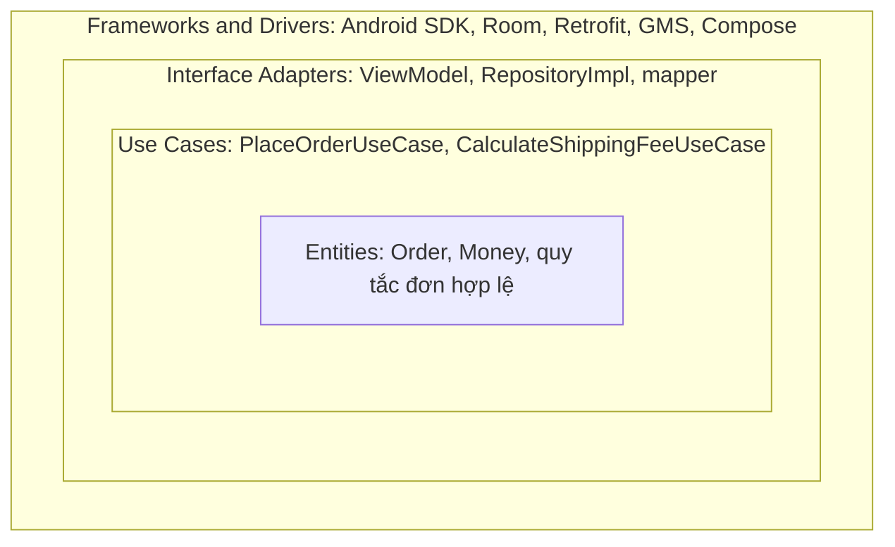
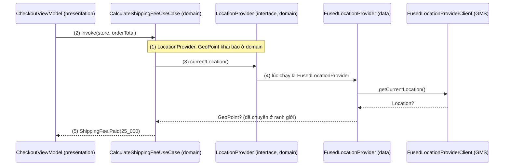
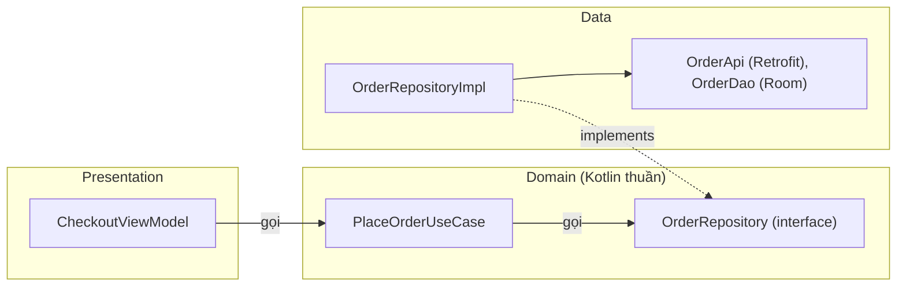
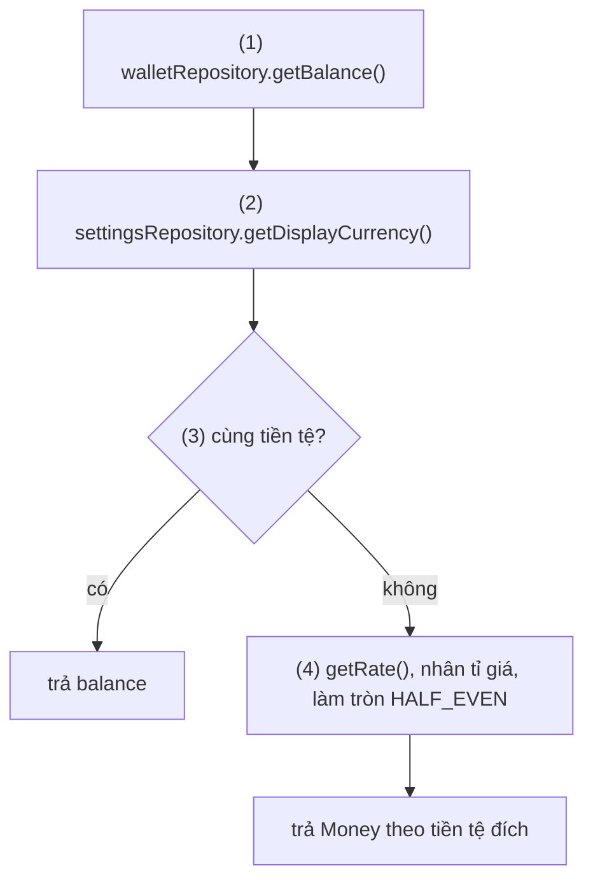
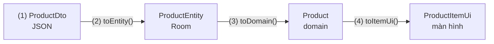
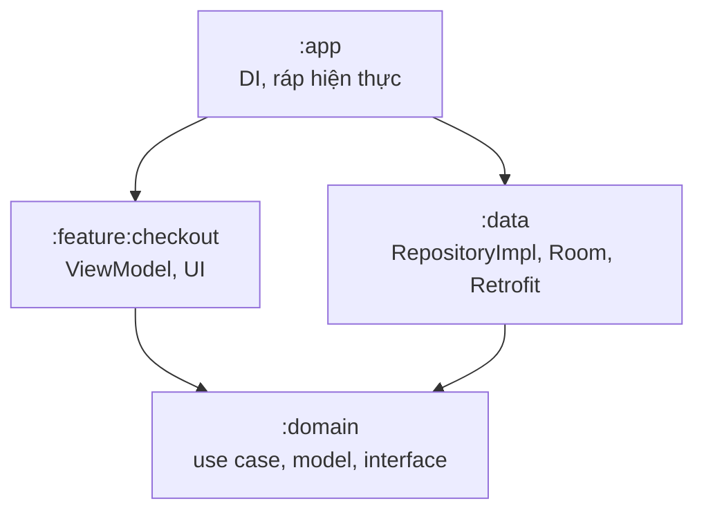
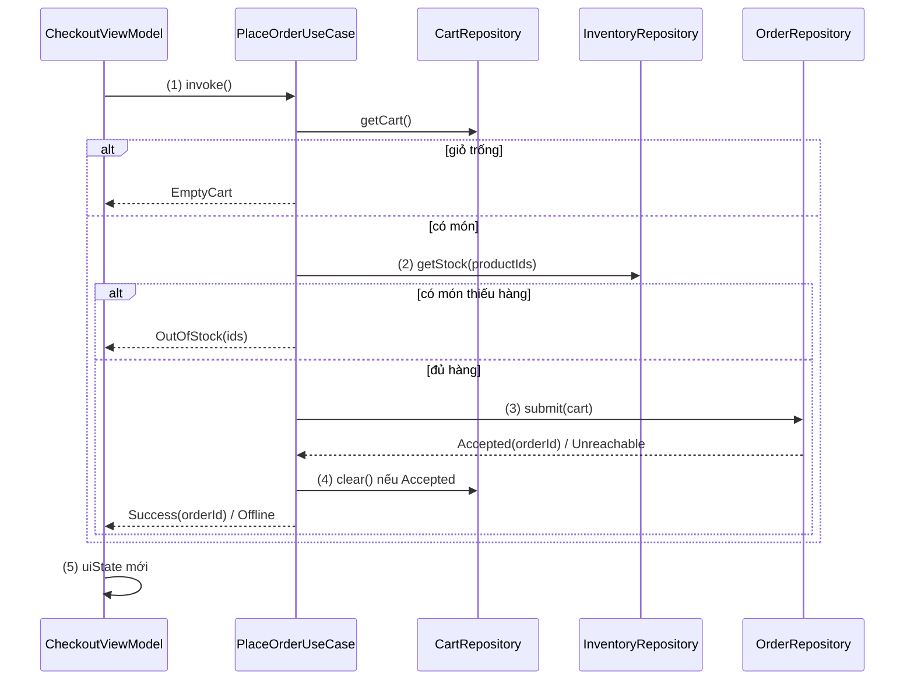

# Clean Architecture

## Vấn đề cần giải quyết

Sau khi tách màn hình theo [MVVM](mvvm.md), logic nghiệp vụ thường rơi vào ViewModel hoặc Repository, và dính chặt vào thư viện đang dùng:

```kotlin
// CheckoutViewModel.kt (cách làm có vấn đề)
fun onConfirm(cart: List<CartItemDto>) = viewModelScope.launch {          // DTO của server
    val location: Location? = fusedClient.lastLocation.await()             // GMS, android.location
    val subtotal = cart.sumOf { it.priceVnd * it.qty }
    val fee = if (subtotal >= 500_000) 0 else 15_000 + extraFee(location)
    try { api.createOrder(OrderRequestDto(cart, fee)) } catch (e: HttpException) { /* Retrofit */ }
}
```

Quy tắc "đơn từ 500.000 ₫ thì miễn phí giao hàng" là thứ của sản phẩm, nhưng nó đang dính vào chi tiết kỹ thuật:

- **Đổi kỹ thuật kéo theo sửa nghiệp vụ:** máy không có Google Play Services (phải dùng Huawei HMS), server đổi tên field JSON, hay chuyển Retrofit sang Ktor đều phải sửa đúng file chứa quy tắc tính phí.
- **Không test được trên JVM:** muốn kiểm tra phí phải giả lập Retrofit, `FusedLocationProviderClient` và `android.location.Location`.
- **Quy tắc bị chép:** màn giỏ hàng cũng cần biết "còn bao nhiêu để được miễn phí", công thức bị chép sang ViewModel thứ hai và dần lệch nhau.

Vấn đề cần giải quyết là: **giữ quy tắc nghiệp vụ độc lập với UI, database, mạng và framework**, để chi tiết kỹ thuật thay được mà nghiệp vụ không đổi, và nghiệp vụ test được mà không cần chi tiết kỹ thuật.

## Sau khi học xong

- Giải thích được dependency rule và bốn vòng Entities, Use Cases, Interface Adapters, Frameworks and Drivers.
- Áp dụng được đảo chiều phụ thuộc tại ranh giới: domain định nghĩa interface, data layer hiện thực nó.
- Thiết kế được app Android theo presentation, domain, data layer, với use case một việc và mapping model ở ranh giới.
- Phân biệt được Clean Architecture với "Guide to app architecture" của Google, nơi domain layer là tuỳ chọn và phụ thuộc vào data layer.
- Biết khi nào Clean Architecture đáng chi phí và khi nào là quá tay.

## Clean Architecture là gì?

**Clean Architecture** là cách tổ chức code thành các vòng đồng tâm: quy tắc nghiệp vụ ở vòng trong cùng, chi tiết kỹ thuật (UI, database, mạng, framework) ở vòng ngoài, và tuân theo một luật duy nhất là **dependency rule (luật phụ thuộc)**: phụ thuộc trong mã nguồn chỉ được hướng vào trong.

Mental model: phần nghiệp vụ là **bức tường có ổ cắm**. Nó tự quy định hình dạng ổ cắm (interface: "tôi cần vị trí hiện tại", "tôi cần nơi lưu đơn hàng"). Database, mạng, GPS, UI là **các thiết bị cắm vào**, phải làm phích khớp với ổ. Đổi thiết bị (Room sang SQLDelight, GMS sang HMS, XML sang Compose) không phải đục lại tường; muốn test bức tường thì cắm một thiết bị giả.

## Cách hoạt động

### Bốn vòng của Robert C. Martin

Bài viết gốc năm 2012 của Robert C. Martin ("Uncle Bob") vẽ bốn vòng, từ trong ra ngoài:

| Vòng | Chứa gì | Đổi khi nào |
|---|---|---|
| **Entities** | Quy tắc nghiệp vụ chung nhất (enterprise business rules): object nghiệp vụ như `Money`, `Order` và quy tắc gắn với nó | Hiếm khi; không đổi vì đổi màn hình hay database |
| **Use Cases** | Quy tắc riêng của ứng dụng (application business rules): từng việc app làm như "đặt hàng"; điều phối dữ liệu tới và từ entities | Khi cách app vận hành đổi |
| **Interface Adapters** | Chuyển đổi giữa dạng tiện cho use case và dạng tiện cho bên ngoài: Presenter/ViewModel, Repository hiện thực, mapper | Khi UI hay nguồn dữ liệu đổi |
| **Frameworks and Drivers** | Chi tiết: UI framework, database, web, thiết bị; thường chỉ có code "keo dán" | Khi đổi thư viện, nền tảng |



Bài gốc nói rõ số vòng không cố định; thứ không đổi là **dependency rule**: càng vào trong càng trừu tượng (chính sách), càng ra ngoài càng cụ thể (cơ chế).

### Dependency rule và đảo chiều phụ thuộc tại ranh giới

Dependency rule có hai vế:

- **Vòng trong không được nhắc tên bất cứ thứ gì của vòng ngoài:** class, hàm, biến. Code ở domain không `import` `androidx.room`, `retrofit2`, `android.location`.
- **Dạng dữ liệu của vòng ngoài không được đi vào trong:** không đưa row của database, DTO JSON hay object của framework qua ranh giới. Dữ liệu qua ranh giới luôn ở dạng tiện cho vòng trong.

Nghe có vẻ mâu thuẫn: use case "đặt hàng" phải gọi tới database, tức **luồng điều khiển** đi từ trong ra ngoài. Clean Architecture giải quyết bằng **Dependency Inversion Principle (nguyên lý đảo chiều phụ thuộc)**, xem [DIP](../../../../design-principles/02-solid/solid-dip.md):

1. Vòng trong khai báo một **interface** mô tả đúng thứ nó cần (cái ổ cắm), đặt ngay trong vòng trong.
2. Vòng ngoài **hiện thực** interface đó (cái phích cắm), nên mũi tên phụ thuộc mã nguồn đi từ ngoài vào.
3. Lúc chạy, một nơi ở vòng ngoài cùng (`Application`, DI container) ráp hiện thực vào chỗ cần interface.

Luồng điều khiển vẫn đi ra ngoài, còn phụ thuộc mã nguồn đi ngược lại tại ranh giới. Bước 3 là Dependency Injection, học ở [Dependency Injection Overview](../design_pattern/di/overview.md).

#### Ví dụ: tính phí giao hàng theo khoảng cách

**Bài toán:** phí giao hàng là 15.000 ₫ cho 3 km đầu, thêm 5.000 ₫ mỗi km sau đó (làm tròn lên), đơn từ 500.000 ₫ thì miễn phí. Vị trí khách lấy từ Fused Location Provider của Google Play Services. Quy tắc phải test được trên JVM và không đổi khi app chạy trên máy không có GMS.

**Luồng chạy:**

1. Domain khai báo `LocationProvider` (ổ cắm) và model `GeoPoint` của riêng nó; không biết GMS tồn tại.
2. `CheckoutViewModel` gọi `CalculateShippingFeeUseCase`; đơn đủ ngưỡng thì trả `Free` ngay, không cần vị trí.
3. Use case gọi `locationProvider.currentLocation()`, chỉ biết interface.
4. Lúc chạy, hiện thực là `FusedLocationProvider` ở data layer: gọi GMS, chuyển `android.location.Location` thành `GeoPoint` ở ranh giới, bắt `SecurityException` khi chưa có quyền.
5. Use case tính khoảng cách và phí từ `GeoPoint`, trả `ShippingFee`.



```kotlin
// :domain — shipping/LocationProvider.kt
data class GeoPoint(val latitude: Double, val longitude: Double)

interface LocationProvider {                                   // (1) ổ cắm do domain định nghĩa
    suspend fun currentLocation(): GeoPoint?
}

// :domain — shipping/CalculateShippingFeeUseCase.kt
sealed interface ShippingFee {
    data object Free : ShippingFee
    data class Paid(val amountVnd: Long) : ShippingFee
    data object LocationUnavailable : ShippingFee
}

class CalculateShippingFeeUseCase(private val locationProvider: LocationProvider) {

    suspend operator fun invoke(store: GeoPoint, orderTotalVnd: Long): ShippingFee {
        if (orderTotalVnd >= FREE_THRESHOLD_VND) return ShippingFee.Free          // (2)
        val customer = locationProvider.currentLocation()                         // (3)
            ?: return ShippingFee.LocationUnavailable
        val extraKm = (distanceKm(store, customer) - BASE_KM).coerceAtLeast(0.0)  // (5)
        return ShippingFee.Paid(BASE_FEE_VND + ceil(extraKm).toLong() * FEE_PER_KM_VND)
    }

    // distanceKm(a, b): công thức haversine viết bằng kotlin.math, lược bỏ cho gọn

    private companion object {
        const val FREE_THRESHOLD_VND = 500_000L
        const val BASE_FEE_VND = 15_000L
        const val FEE_PER_KM_VND = 5_000L
        const val BASE_KM = 3.0
    }
}
```

```kotlin
// :data — location/FusedLocationProvider.kt: (4) phích cắm, nơi duy nhất biết GMS
class FusedLocationProvider(private val client: FusedLocationProviderClient) : LocationProvider {

    override suspend fun currentLocation(): GeoPoint? = try {
        client.getCurrentLocation(Priority.PRIORITY_BALANCED_POWER_ACCURACY, null)
            .await()                                                   // kotlinx-coroutines-play-services
            ?.let { GeoPoint(it.latitude, it.longitude) }              // Location → GeoPoint ở ranh giới
    } catch (e: SecurityException) {
        null                                                           // chưa được cấp quyền vị trí
    }
}
```

Hàm `suspend` và `await()` là coroutine, học ở 8.4.3 Coroutines (chưa có bài). Cách xin quyền vị trí và vì sao API của GMS nằm ở data layer: [Google Service](../../session_04/components/services/google_service.md), mục "Vị trí trong Clean Architecture / MVVM".

**Kết quả:** use case không có `import` nào của Android hay GMS. Unit test truyền `FakeLocationProvider` trả điểm cách cửa hàng khoảng 4,5 km (vượt 1,5 km, làm tròn lên 2 km) thì nhận `Paid(25_000)`, trả `null` thì nhận `LocationUnavailable`. Máy dùng HMS chỉ cần thêm `HuaweiLocationProvider : LocationProvider` và ráp trong DI; use case không đổi dòng nào.

### Bản Android: presentation, domain, data

Trên Android, bốn vòng thường được gom thành ba tầng (layer):

| Tầng | Vòng tương ứng | Chứa | Được biết |
|---|---|---|---|
| **Presentation** | Interface Adapters + Frameworks (phía UI) | Activity, Fragment, composable, ViewModel, UI state, mapper sang UI model | Domain |
| **Domain** | Entities + Use Cases | Model nghiệp vụ, use case, **interface** Repository và provider | Không ai; Kotlin thuần |
| **Data** | Interface Adapters + Frameworks (phía dữ liệu) | Repository hiện thực, data source (Room DAO, Retrofit service, DataStore, SDK như GMS, Firebase), DTO, Entity của Room, mapper | Domain |



Hai điểm làm sơ đồ trên "clean":

- **Domain ở giữa, không phụ thuộc gì:** presentation và data đều trỏ vào domain; data trỏ vào qua `implements`, ngược chiều lời gọi `UseCase → Repository`.
- **Domain không có `android.*`:** không `Context`, `Parcelable`, annotation của Room hay Gson, nên có thể là module Kotlin/JVM thuần, test bằng JUnit. Dùng lại trong Kotlin Multiplatform thì tránh thêm API riêng của JVM (`java.time`, `BigDecimal`): dùng `kotlinx-datetime`, lưu tiền bằng `Long` theo đơn vị nhỏ nhất.

Các bài trước đã đặt từng thành phần vào ba tầng này: [Activity](../../session_04/components/activity/index.md), [Fragment](../../session_04/components/fragment/index.md) ở presentation; [Room](../../session_05/data_store/room_architecture.md), [quảng cáo](../../session_04/components/services/advertisements/ads_architecture.md) ở data; [Broadcast Receiver](../../session_04/components/broadcast/broadcast_receiver.md) là entry point đẩy sự kiện vào domain qua interface `ConnectivityObserver`.

Đổi thread cũng theo tầng: data layer và use case phải **main-safe** (gọi từ main thread an toàn, tự chuyển việc nặng sang background), xem [Working with Thread](../../session_05/working_with_thread.md), mục "Vị trí của Threading trong Clean Architecture".

### Use case

**Use case** (hay interactor) là một class ở domain đại diện cho **một việc** app làm cho người dùng, ví dụ `PlaceOrderUseCase`, `CalculateShippingFeeUseCase`. Những quy ước đã thành chuẩn trên Android:

- **Tên = động từ + danh từ + `UseCase`:** `GetDisplayBalanceUseCase`, `LogOutUserUseCase`.
- **Một hàm công khai, thường là `operator fun invoke`:** gọi như hàm; `suspend` (một lần) hoặc trả `Flow`.
- **Không giữ state thay đổi được:** state thuộc UI hoặc data layer, nên use case không có vòng đời riêng; mỗi nơi dùng nhận instance mới.
- **Main-safe:** tính toán nặng tự chuyển sang `Dispatchers.Default`; kết quả cần cache cho nhiều màn hình thì thuộc data layer.
- **Có thể gọi use case khác:** use case nhỏ ghép thành use case lớn.

Use case có giá trị khi nó **chứa logic**: ghép nhiều Repository, áp quy tắc nghiệp vụ, hoặc gom logic mà nhiều nơi cùng cần (ViewModel, `Worker`, UI của TV/Wear).

#### Ví dụ: số dư ví theo tiền tệ người dùng chọn

**Bài toán:** ví lưu số dư bằng VND, người dùng chọn hiển thị bằng USD; màn ví và màn thanh toán đều cần số dư đã quy đổi.

**Luồng chạy:**

1. Đọc số dư từ `WalletRepository`.
2. Đọc tiền tệ hiển thị người dùng chọn từ `SettingsRepository`.
3. Cùng tiền tệ thì trả số dư nguyên vẹn.
4. Khác tiền tệ: lấy tỉ giá từ `ExchangeRateRepository`, quy đổi rồi làm tròn theo số chữ số thập phân của tiền tệ đích.



```kotlin
// :domain — wallet/GetDisplayBalanceUseCase.kt (ba interface Repository khai báo ở domain như các ví dụ khác)
enum class CurrencyCode(val fractionDigits: Int) { VND(0), USD(2) }
data class Money(val amount: BigDecimal, val currency: CurrencyCode)   // BigDecimal: tiền không được sai số dấu phẩy động

class GetDisplayBalanceUseCase(
    private val walletRepository: WalletRepository,
    private val settingsRepository: SettingsRepository,
    private val exchangeRateRepository: ExchangeRateRepository,
) {
    suspend operator fun invoke(): Money {
        val balance = walletRepository.getBalance()                              // (1)
        val target = settingsRepository.getDisplayCurrency()                     // (2)
        if (balance.currency == target) return balance                           // (3)
        val rate = exchangeRateRepository.getRate(balance.currency, target)      // (4)
        return Money((balance.amount * rate).setScale(target.fractionDigits, RoundingMode.HALF_EVEN), target)
    }
}
```

**Kết quả:** `WalletViewModel` và `CheckoutViewModel` chỉ gọi `getDisplayBalance()`. Đổi quy tắc làm tròn chỉ sửa một chỗ; test bằng ba fake Repository kiểm tra `1_250_000 VND × 0.0000394 = 49.25 USD`.

### Model riêng cho từng tầng và mapping

Dependency rule cấm dạng dữ liệu của vòng ngoài đi vào trong, nên mỗi tầng thường có model riêng:

| Model | Tầng | Hình dạng theo | Ví dụ |
|---|---|---|---|
| DTO (Data Transfer Object) | Data, phía mạng | JSON của server: tên field, kiểu nullable | `ProductDto` có `@SerializedName("price_vnd")` |
| Entity của Room | Data, phía database | Bảng SQLite | `ProductEntity` có `@Entity`, `@PrimaryKey` |
| Domain model | Domain | Nghiệp vụ cần gì | `Product(id, name, priceVnd, inStock)` |
| UI model | Presentation | Màn hình hiện gì | `ProductItemUi(name, priceText = "129.000 ₫")` |

"Entity" của Room (bảng database) **khác** "Entities" của Clean Architecture (quy tắc nghiệp vụ). Trên Android, vai Entities của Clean Architecture thường là domain model.

Mapping đặt **ở ranh giới, phía vòng ngoài**: data layer chuyển DTO/Entity thành domain model trước khi trả lên; presentation chuyển domain model thành UI model. Domain không biết DTO hay UI model tồn tại.

#### Ví dụ: giá sản phẩm từ API tới màn hình

**Bài toán:** server trả `stock_qty` có thể `null`; nghiệp vụ chỉ cần biết "còn hàng hay không"; màn hình cần chuỗi giá đã định dạng và nút "Mua" bật/tắt.

**Luồng chạy:**

1. `refresh()` gọi API, nhận `List<ProductDto>`.
2. Repository chuyển DTO thành `ProductEntity` (`null` thành `0`, cắt khoảng trắng) và ghi vào Room.
3. DAO phát `List<ProductEntity>`; Repository chuyển thành `List<Product>` rồi trả lên domain.
4. ViewModel chuyển `Product` thành `ProductItemUi` với giá đã định dạng theo locale.



```kotlin
// :data — product/ProductModels.kt
data class ProductDto(                                       // hình dạng JSON (Gson)
    @SerializedName("id") val id: String,
    @SerializedName("title") val title: String,
    @SerializedName("price_vnd") val priceVnd: Long,
    @SerializedName("stock_qty") val stockQty: Int?,
)

@Entity(tableName = "products")
data class ProductEntity(@PrimaryKey val id: String, val name: String, val priceVnd: Long, val stock: Int)

fun ProductDto.toEntity() = ProductEntity(id, title.trim(), priceVnd, stockQty ?: 0)      // (2)
fun ProductEntity.toDomain() = Product(id, name, priceVnd, inStock = stock > 0)          // (3)

// :data — product/OfflineFirstProductRepository.kt
class OfflineFirstProductRepository(private val api: ProductApi, private val dao: ProductDao) : ProductRepository {
    override fun observeProducts(): Flow<List<Product>> =
        dao.observeAll().map { rows -> rows.map { it.toDomain() } }                     // (3)

    override suspend fun refresh() {
        dao.upsertAll(api.getProducts().map { it.toEntity() })                          // (1) (2)
    }
}

// :domain — product/Product.kt: không annotation, không biết JSON hay Room
data class Product(val id: String, val name: String, val priceVnd: Long, val inStock: Boolean)

interface ProductRepository {
    fun observeProducts(): Flow<List<Product>>
    suspend fun refresh()
}

// :presentation — product/ProductItemUi.kt
data class ProductItemUi(val id: String, val name: String, val priceText: String, val buyEnabled: Boolean)

fun Product.toItemUi(formatter: NumberFormat) =                                          // (4)
    ProductItemUi(id, name, formatter.format(priceVnd), buyEnabled = inStock)

// ViewModel: formatter = NumberFormat.getCurrencyInstance(Locale.forLanguageTag("vi-VN"))
```

Room DAO, `@Upsert` và mô hình offline-first: [Room Architecture](../../session_05/data_store/room_architecture.md). Gson học ở 8.1.2 Gson (chưa có bài).

**Kết quả:** server đổi `title` thành `name` chỉ sửa `ProductDto`; đổi màn hình hiện giá kiểu "129K" chỉ sửa `toItemUi`. Domain và các use case dùng `Product` không đổi. Mapper là hàm thuần nên test riêng được: DTO có `stockQty = null` cho ra `Product.inStock == false`.

### Module hoá theo tầng

Chia package (`domain/`, `data/`) chỉ là quy ước. Tách thành **Gradle module** biến dependency rule thành lỗi compile:

```kotlin
// domain/build.gradle.kts: Kotlin/JVM thuần, không có Android
plugins { kotlin("jvm") }
dependencies {
    implementation(libs.kotlinx.coroutines.core)                  // chỉ để có Flow, suspend
    testImplementation(libs.junit)
    testImplementation(libs.kotlinx.coroutines.test)              // runTest
}

// data/build.gradle.kts
dependencies { implementation(project(":domain")) }              // để implements interface

// feature/checkout/build.gradle.kts
dependencies { implementation(project(":domain")) }              // không biết :data

// app/build.gradle.kts: nơi duy nhất biết mọi module, ráp hiện thực bằng DI
dependencies {
    implementation(project(":feature:checkout"))
    implementation(project(":data"))
    implementation(project(":domain"))
}
```



`:feature:checkout` không có `:data` trên classpath, nên dùng `OrderRepositoryImpl` trong ViewModel là lỗi compile. Hướng dẫn modularization của Android gọi đây là **dependency inversion giữa module**: module abstraction (`:domain`) chứa interface, module implementation (`:data`) phụ thuộc vào nó, DI nối hai bên.

## Ví dụ thực tế

Ba bài toán hay gặp khi áp dụng Clean Architecture:

1. **Đặt hàng:** quy tắc giỏ hàng và tồn kho trong use case, lỗi mạng thành kết quả của domain, kèm unit test. Bài toán chính, code bên dưới.
2. **Danh sách sản phẩm offline-first:** `UI → ViewModel → UseCase → Repository → Room + Retrofit`; code đầy đủ ở [Networking](../../session_05/networking.md), mục "Tích hợp Clean Architecture: End-to-End E-Commerce Example".
3. **Thay SDK theo thị trường:** domain giữ interface `NotificationRepository`, data có một hiện thực FCM và một hiện thực HMS, chọn theo flavor ([Google Service](../../session_04/components/services/google_service.md)).

### Đặt hàng với use case, lỗi theo domain và unit test

**Bài toán:** bấm "Đặt hàng" thì: giỏ trống thì báo; có món vượt tồn kho thì báo đúng món đó và **không** gửi đơn; gửi đơn thành công thì xoá giỏ; mất mạng thì báo offline và giữ nguyên giỏ. Màn hình không được biết `IOException` hay `HttpException`.

**Luồng chạy:**

1. `CheckoutViewModel.onPlaceOrderClick()` gọi `PlaceOrderUseCase`; use case đọc giỏ từ `CartRepository`, giỏ trống thì trả `EmptyCart`.
2. Use case hỏi tồn kho từ `InventoryRepository`; món nào thiếu thì trả `OutOfStock(ids)` và dừng.
3. Use case gọi `OrderRepository.submit(cart)`. Hiện thực ở data gọi API; lỗi mạng được chuyển thành `SubmitResult.Unreachable` ngay ở ranh giới.
4. `Accepted` thì use case xoá giỏ và trả `Success(orderId)`; `Unreachable` thì trả `Offline`.
5. ViewModel chuyển `PlaceOrderResult` thành `uiState`.
6. Unit test chạy use case với ba fake Repository.



```kotlin
// :domain — order/OrderModels.kt
data class CartItem(val productId: String, val quantity: Int, val unitPriceVnd: Long)
data class Cart(val items: List<CartItem>)

sealed interface SubmitResult {                    // kết quả theo ngôn ngữ domain, không có exception mạng
    data class Accepted(val orderId: String) : SubmitResult
    data object Unreachable : SubmitResult
}

sealed interface PlaceOrderResult {
    data class Success(val orderId: String) : PlaceOrderResult
    data object EmptyCart : PlaceOrderResult
    data class OutOfStock(val productIds: List<String>) : PlaceOrderResult
    data object Offline : PlaceOrderResult
}

interface CartRepository { suspend fun getCart(): Cart; suspend fun clear() }
interface InventoryRepository { suspend fun getStock(productIds: List<String>): Map<String, Int> }
interface OrderRepository { suspend fun submit(cart: Cart): SubmitResult }

// :domain — order/PlaceOrderUseCase.kt
class PlaceOrderUseCase(
    private val cartRepository: CartRepository,
    private val inventoryRepository: InventoryRepository,
    private val orderRepository: OrderRepository,
) {
    suspend operator fun invoke(): PlaceOrderResult {
        val cart = cartRepository.getCart()                                            // (1)
        if (cart.items.isEmpty()) return PlaceOrderResult.EmptyCart

        val stock = inventoryRepository.getStock(cart.items.map { it.productId })      // (2)
        val missing = cart.items.filter { (stock[it.productId] ?: 0) < it.quantity }
        if (missing.isNotEmpty()) return PlaceOrderResult.OutOfStock(missing.map { it.productId })

        return when (val submitted = orderRepository.submit(cart)) {                   // (3)
            is SubmitResult.Accepted -> {
                cartRepository.clear()                                                 // (4)
                PlaceOrderResult.Success(submitted.orderId)
            }
            SubmitResult.Unreachable -> PlaceOrderResult.Offline
        }
    }
}
```

```kotlin
// :data — order/OrderRepositoryImpl.kt: (3) lỗi mạng dừng lại ở ranh giới
class OrderRepositoryImpl(private val api: OrderApi) : OrderRepository {
    override suspend fun submit(cart: Cart): SubmitResult = try {
        val response = api.createOrder(cart.toRequestDto())        // DTO chỉ tồn tại ở data
        SubmitResult.Accepted(response.orderId)
    } catch (e: IOException) {
        SubmitResult.Unreachable
    }
}

```

`CheckoutViewModel.onPlaceOrderClick()` chỉ gọi `placeOrder()` trong `viewModelScope` rồi `when (result)` để đặt `uiState` (bước 5), theo mẫu ở [MVVM](mvvm.md). `HttpException` (server trả 4xx/5xx) cần được phân loại tương tự, ví dụ thành `Rejected(reason)`; ví dụ chỉ giữ `IOException` cho gọn. Phân cấp lỗi mạng đầy đủ ở [Networking](../../session_05/networking.md), mục "Chuẩn hóa Error Handling & Result Pattern trong Clean Architecture".

```kotlin
// :domain — src/test/.../PlaceOrderUseCaseTest.kt: (6) JUnit thuần, không Robolectric, không Main dispatcher
class FakeCartRepository(private val cart: Cart) : CartRepository {
    var cleared = false
    override suspend fun getCart() = cart
    override suspend fun clear() { cleared = true }
}

class FakeOrderRepository(private val result: SubmitResult) : OrderRepository {
    var submitCount = 0
    override suspend fun submit(cart: Cart): SubmitResult { submitCount++; return result }
}

class FakeInventoryRepository(private val stock: Map<String, Int>) : InventoryRepository {
    override suspend fun getStock(productIds: List<String>) = stock
}

class PlaceOrderUseCaseTest {
    @Test
    fun outOfStock_doesNotSubmitAndKeepsCart() = runTest {
        val cartRepo = FakeCartRepository(Cart(listOf(CartItem("tea-01", quantity = 3, unitPriceVnd = 45_000))))
        val orderRepo = FakeOrderRepository(SubmitResult.Accepted("A1"))

        val result = PlaceOrderUseCase(cartRepo, FakeInventoryRepository(mapOf("tea-01" to 2)), orderRepo)()

        assertEquals(PlaceOrderResult.OutOfStock(listOf("tea-01")), result)
        assertEquals(0, orderRepo.submitCount)
        assertFalse(cartRepo.cleared)
    }
}
```

`runTest` thuộc `kotlinx-coroutines-test`; fake thay cho mock theo khuyến nghị của Android, xem [Unit Testing](../../coding_analyst_and_testing/unit_testing.md).

**Kết quả:** `./gradlew :domain:test` chạy trong vài giây, không cần emulator. Thêm quy tắc "đơn tối thiểu 50.000 ₫" chỉ sửa `PlaceOrderUseCase` và thêm một test. Tắt mạng rồi đặt hàng: màn hình báo không có mạng, giỏ hàng còn nguyên.

## So sánh với các cách tiếp cận khác

"Guide to app architecture" của Android cũng có ba tầng UI, domain, data, nhưng **không phải** Clean Architecture; docs ghi rõ "domain layer" của họ khác nghĩa với domain layer của Clean Architecture.

| | Clean Architecture | Guide to app architecture (Google) |
|---|---|---|
| Tầng ở giữa | Domain, **bắt buộc**, là trung tâm | Domain **tuỳ chọn**, khuyên dùng cho app lớn |
| Hướng phụ thuộc domain ↔ data | **Data → Domain** (data implements interface của domain) | **Domain → Data** (use case gọi class Repository ở data layer) |
| Logic nghiệp vụ chủ yếu ở | Use case và entities | Data layer; use case cho logic phức tạp hoặc dùng lại |
| Repository interface | Ở domain | Không bắt buộc; Repository là class của data layer |
| UI gọi thẳng Repository? | Bài gốc qua use case; gọi interface Repository ở domain vẫn đúng dependency rule | Được; chỉ thêm use case khi cần |
| Model riêng mỗi tầng | Gần như bắt buộc | Khuyên dùng trong app phức tạp; UI state được chứa model của data layer |

Clean Architecture đặt nghiệp vụ ở giữa và bắt mọi thứ trỏ vào nó; Google đặt data layer làm nền và thêm domain khi có lý do, như mẫu [Now in Android](https://github.com/android/nowinandroid): module `core:domain` phụ thuộc `core:data` và chỉ chứa use case dùng chung, các feature vẫn gọi thẳng Repository. Các bài ở Session 04 và 05 trong repo này ([Room Architecture](../../session_05/data_store/room_architecture.md), [Google Service](../../session_04/components/services/google_service.md), [Broadcast Receiver](../../session_04/components/broadcast/broadcast_receiver.md)) vẽ theo Clean Architecture: interface Repository ở domain.

Hexagonal Architecture (Ports and Adapters) và Onion Architecture là hai kiến trúc mà Clean Architecture tổng hợp lại: nghiệp vụ ở giữa, port là interface, adapter ở ngoài. MVVM, MVP, [MVI](mvi.md) chỉ tổ chức **tầng presentation**, nên dùng được trong bất kỳ cách chia tầng nào ở trên.

## Khi nào nên và không nên dùng

- **Nên dùng** khi nghiệp vụ phức tạp và sống lâu hơn công nghệ (thương mại điện tử, tài chính, đặt chỗ): quy tắc cần test kỹ, nguồn dữ liệu và SDK có thể thay.
- **Nên dùng** khi một nghiệp vụ được nhiều nơi gọi hoặc chia sẻ qua Kotlin Multiplatform, hay khi nhiều nhóm cùng làm một app và cần ranh giới module.
- **Không nên** dựng đủ tầng cho app nhỏ, prototype, hoặc màn hình chỉ hiển thị dữ liệu từ một nguồn: ViewModel gọi Repository là đủ, như hướng dẫn của Google.
- **Quá tay** khi: mỗi lời gọi Repository đều bọc một use case không có logic; bốn model y hệt nhau chỉ để "đúng tầng"; tách hàng chục module khi app mới có năm màn hình. Có thể bắt đầu theo cách của Google, rồi thêm use case và interface ở chỗ thật sự có logic hoặc cần thay hiện thực.

## Sai lầm thường gặp

### 1. Domain phụ thuộc framework

```kotlin
// Sai: model của domain mang annotation của Room và Gson
@Entity(tableName = "orders")
data class Order(
    @PrimaryKey val id: String,
    @SerializedName("total_vnd") val totalVnd: Long,
    val createdAt: android.icu.util.Calendar,
)
```

**Lỗi lộ ra thế nào:** domain phải phụ thuộc Room, Gson và Android SDK, không còn test được như JVM thuần. Server đổi tên field hay database thêm cột đều buộc sửa model mà mọi use case đang dùng.

**Cách sửa:** domain model không annotation, dùng kiểu thuần (`java.time.Instant`, `Long`); `OrderDto`, `OrderEntity` và mapper ở data layer. Tách `:domain` thành module `kotlin("jvm")` để `import androidx.room` trong domain là lỗi compile.

### 2. Lộ model hoặc exception của vòng ngoài lên trong

```kotlin
// Sai: interface ở domain trả DTO, và để HttpException bay lên UI
interface ProductRepository { suspend fun getProducts(): List<ProductDto> }

viewModelScope.launch {
    try { repository.getProducts() } catch (e: HttpException) { /* UI biết Retrofit */ }
}
```

**Lỗi lộ ra thế nào:** interface ở domain nhắc tên `ProductDto` của data, vi phạm dependency rule dù vẫn compile (khi cùng module). ViewModel phải `import retrofit2.HttpException`; đổi sang Ktor thì phải sửa mọi ViewModel, sót một chỗ là exception của Ktor không bị bắt và crash app.

**Cách sửa:** interface trả domain model; data layer bắt exception ở ranh giới và chuyển thành kết quả của domain (`SubmitResult`, `NetworkResult`) như ví dụ đặt hàng.

### 3. Use case chỉ chuyển tiếp lời gọi

```kotlin
// Không nên: use case không có logic, chỉ thêm một lớp
class GetProductsUseCase(private val repository: ProductRepository) {
    operator fun invoke() = repository.observeProducts()
}
```

**Lỗi lộ ra thế nào:** mỗi thao tác thêm một file mà không có quy tắc nào được bảo vệ; code thật chìm giữa các lớp rỗng. Docs của Android cảnh báo đúng chi phí này khi buộc mọi truy cập đi qua domain.

**Cách sửa:** chỉ tạo use case khi có logic (ghép nhiều nguồn, quy tắc nghiệp vụ, dùng lại nhiều nơi). Quy tắc chặt "UI chỉ gọi use case" là quyết định có chủ ý cho cả codebase, không phải mặc định.

### 4. Chia package nhưng không chặn phụ thuộc

```kotlin
// Sai: ViewModel ở presentation/ dùng thẳng hiện thực ở data/
class CheckoutViewModel(private val orders: OrderRepositoryImpl) : ViewModel()
```

**Lỗi lộ ra thế nào:** vẫn compile vì cùng module; dần dần presentation dùng cả DAO và DTO, ba tầng chỉ còn trên tài liệu. Test ViewModel không thay được bằng fake.

**Cách sửa:** phụ thuộc interface (`OrderRepository`) hoặc use case; để hiện thực `internal` trong `:data`, hoặc tách module như mục "Module hoá theo tầng" để compiler chặn hộ.

## Lịch sử phát triển

- **1996:** Robert C. Martin công bố Dependency Inversion Principle, nền của việc đảo chiều phụ thuộc tại ranh giới.
- **2005:** Alistair Cockburn mô tả Hexagonal Architecture (Ports and Adapters).
- **2008:** Jeffrey Palermo đặt tên Onion Architecture.
- **13/08/2012:** Robert C. Martin đăng bài "The Clean Architecture", gộp các kiến trúc trên thành bốn vòng và dependency rule.
- **03/09/2014:** Fernando Cejas viết "Architecting Android… The clean way?", bài mẫu đưa presentation/domain/data và use case vào Android, được cộng đồng dùng nhiều năm.
- **09/2017:** sách *Clean Architecture: A Craftsman's Guide to Software Structure and Design* (Prentice Hall) phát hành.
- **Google I/O 2017:** Architecture Components và "Guide to app architecture" đầu tiên, xoay quanh ViewModel, LiveData, Repository; chưa có domain layer.
- **12/2021:** Google viết lại hướng dẫn kiến trúc, thêm **domain layer tuỳ chọn** với use case, và ghi chú rằng nó khác domain layer của Clean Architecture.
- **2022:** Google công bố mẫu Now in Android (multi-module, có `core:domain`) và hướng dẫn modularization.
- **Hiện nay:** hai trường phái cùng tồn tại; khuyến nghị chính thức là data layer rõ ràng, domain layer khi app lớn, model riêng mỗi tầng trong app phức tạp.

## Kết nối hệ thống

- **Tiên quyết:**
  - [MVVM](mvvm.md): tổ chức tầng presentation.
  - [Room Architecture](../../session_05/data_store/room_architecture.md): Repository, data source, Single Source of Truth.
  - [ViewModel](../../session_06/viewmodel.md): nơi gọi use case và giữ UI state.
  - [DIP — Dependency Inversion Principle](../../../../design-principles/02-solid/solid-dip.md): nền của việc đặt interface ở domain.
- **Liên quan (ví dụ áp dụng trong các bài khác):**
  - [Networking](../../session_05/networking.md): luồng end-to-end và Result pattern cho lỗi mạng.
  - [Google Service](../../session_04/components/services/google_service.md): SDK GMS/Firebase ở data layer.
  - [Broadcast Receiver](../../session_04/components/broadcast/broadcast_receiver.md): receiver là entry point của data layer.
  - [Working with Thread](../../session_05/working_with_thread.md): main-safety theo tầng.
  - [Unit Testing](../../coding_analyst_and_testing/unit_testing.md): test domain bằng fake.
- **Học tiếp:**
  - [Dependency Injection Overview](../design_pattern/di/overview.md) và [Hilt](../design_pattern/di/hilt.md): ráp hiện thực của data vào interface của domain (`@Binds`).
  - [MVI](mvi.md): một cách khác tổ chức tầng presentation trên cùng domain.
  - 8.4.3 Coroutines (chưa có bài): `suspend`, dispatcher dùng trong use case và Repository.

## Tham khảo

- [The Clean Architecture (13/08/2012) - Robert C. Martin](https://blog.cleancoder.com/uncle-bob/2012/08/13/the-clean-architecture.html)
- [Clean Architecture: A Craftsman's Guide to Software Structure and Design - Pearson/InformIT](https://www.informit.com/store/clean-architecture-a-craftsmans-guide-to-software-structure-9780134494166)
- [Domain layer - Android Developers](https://developer.android.com/topic/architecture/domain-layer)
- [Recommendations for Android architecture - Android Developers](https://developer.android.com/topic/architecture/recommendations)
- [Guide to app architecture - Android Developers](https://developer.android.com/topic/architecture)
- [Common modularization patterns (dependency inversion) - Android Developers](https://developer.android.com/topic/modularization/patterns)
- [Rebuilding our guide to app architecture (12/2021) - Android Developers Blog](https://android-developers.googleblog.com/2021/12/rebuilding-our-guide-to-app-architecture.html)
- [Now in Android - GitHub](https://github.com/android/nowinandroid)
- [Architecting Android… The clean way? (09/2014) - Fernando Cejas](https://fernandocejas.com/blog/engineering/2014-09-03-architecting-android-the-clean-way/)
- [Hexagonal Architecture - Alistair Cockburn](https://alistair.cockburn.us/hexagonal-architecture/)
