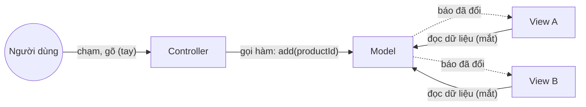
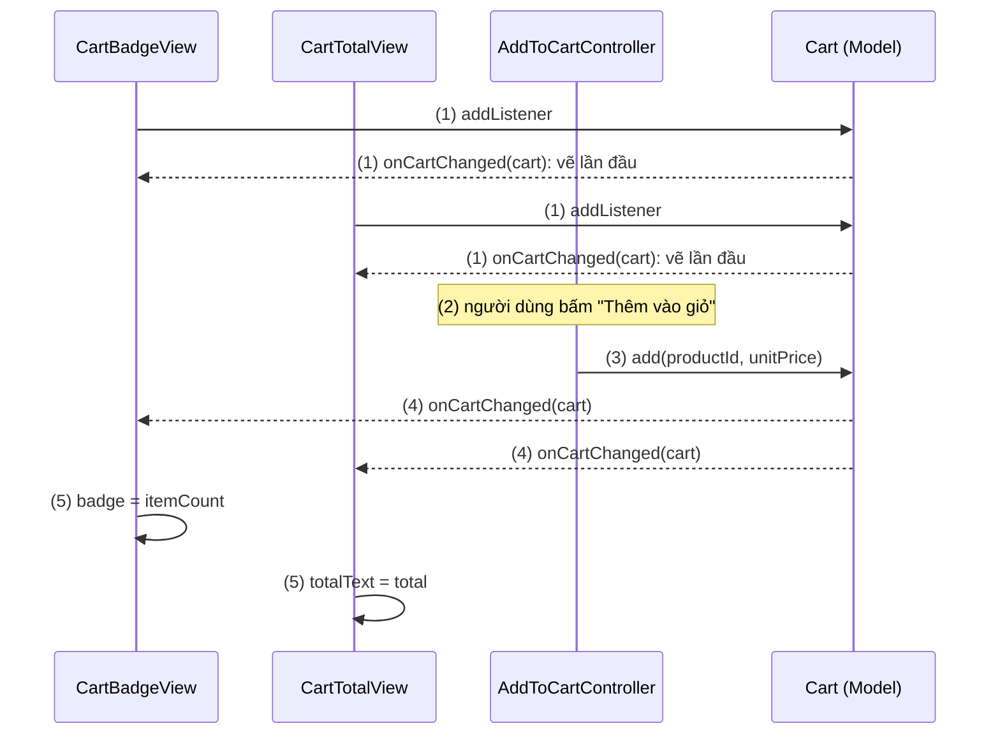
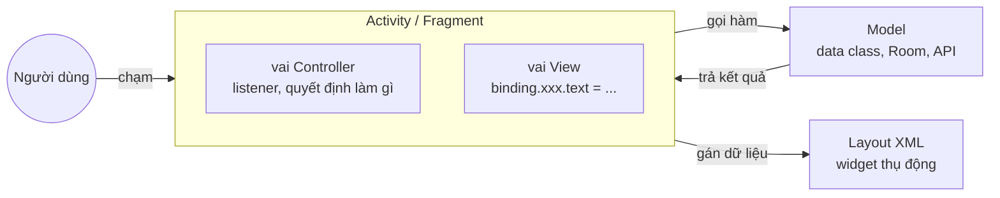
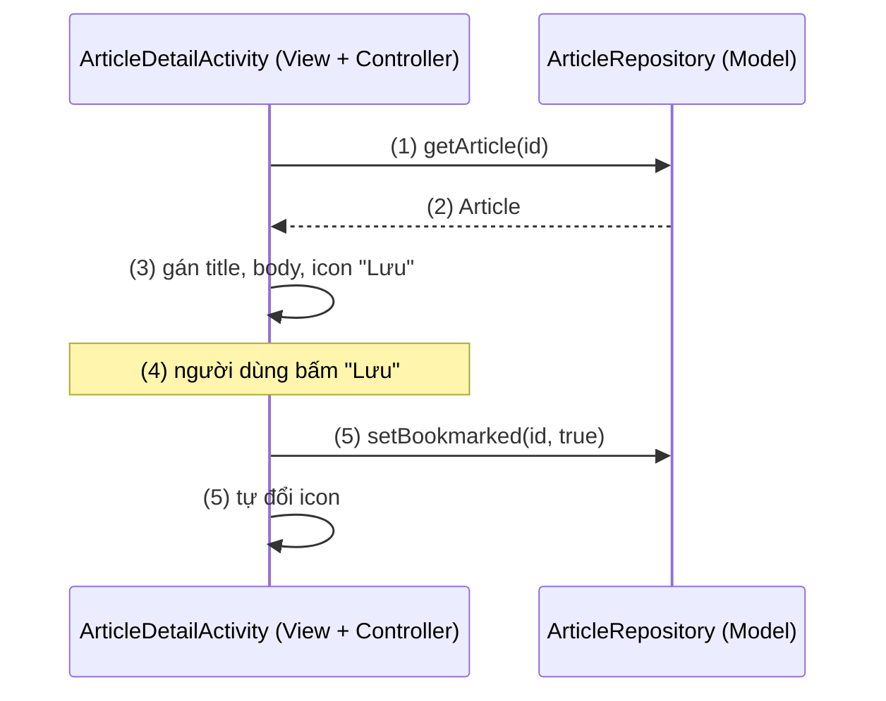
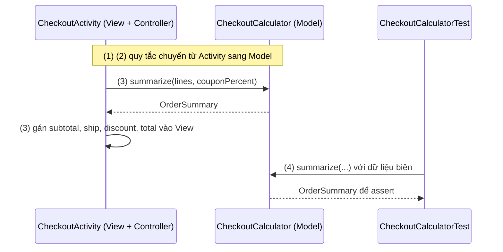

# MVC

## Vấn đề cần giải quyết

Mọi phần mềm có giao diện đều làm ba loại việc:

- **Giữ dữ liệu và quy tắc:** giỏ hàng có món gì, tổng tiền bao nhiêu, mã giảm giá nào hợp lệ.
- **Hiển thị:** vẽ dữ liệu ra màn hình, có thể ở nhiều chỗ cùng lúc.
- **Nhận input:** chạm, gõ phím, và quyết định chúng có nghĩa gì với dữ liệu.

Khi ba loại việc viết lẫn vào nhau, mỗi thay đổi nhỏ chạm vào mọi thứ. Đổi cách hiển thị tổng tiền phải sửa chỗ tính tiền; thêm chỗ thứ hai hiện số món trong giỏ thì phải nhớ cập nhật nó ở mọi nơi dữ liệu đổi; muốn kiểm tra quy tắc giảm giá thì phải dựng cả giao diện.

Vấn đề cần giải quyết là: **tách dữ liệu ra khỏi phần giao diện, và để mọi phần hiển thị luôn khớp với dữ liệu mà không ai phải cập nhật chúng bằng tay.** MVC là lời giải đầu tiên được đặt tên cho vấn đề này, và hiểu nó giúp thấy vì sao Android đi qua MVP, MVVM rồi MVI.

## Sau khi học xong

- Giải thích được ba vai Model, View, Controller trong MVC gốc và vì sao View quan sát Model thay vì được Controller cập nhật.
- Phân biệt được MVC gốc của Smalltalk với "MVC kiểu Android", nơi Activity hoặc Fragment vừa là View vừa là Controller.
- Nhận diện được Massive Activity và các hậu quả của nó với test, vòng đời và việc sửa code.
- Áp dụng được việc tách Model thuần Kotlin ra khỏi Activity để quy tắc nghiệp vụ test được trên JVM.
- Giải thích được vì sao cộng đồng Android chuyển từ MVC sang MVP rồi MVVM.

## MVC là gì?

**MVC (Model–View–Controller)** là pattern kiến trúc giao diện chia phần mềm có UI thành ba vai: **Model** giữ dữ liệu và quy tắc nghiệp vụ, không biết UI; **View** hiển thị Model và **quan sát** Model để vẽ lại khi nó đổi; **Controller** nhận input của người dùng và dịch thành lời gọi lên Model.

Mental model: Model là **nguồn sự thật duy nhất**, còn View và Controller là **hai nửa của giao diện bám vào nó**: View là nửa để **nhìn**, Controller là nửa để **chạm**. Tay chạm thì đổi Model; mắt chỉ nhìn Model. Không nửa nào nói thẳng với nửa kia về dữ liệu, nên thêm bao nhiêu "mắt" cũng không phải sửa "tay".

## Cách hoạt động

### MVC gốc: ba vai và hai luồng

MVC ra đời ở Xerox PARC cuối thập niên 1970, cho môi trường Smalltalk (mục "Lịch sử phát triển"). Ba vai có trách nhiệm và hướng phụ thuộc rõ ràng:

| Vai | Trách nhiệm | Biết ai | Không biết ai |
|---|---|---|---|
| **Model** | Dữ liệu và quy tắc; báo "tôi đã đổi" cho ai đăng ký | Danh sách observer (không biết cụ thể là gì) | View, Controller |
| **View** | Vẽ Model ra màn hình; đăng ký nhận thông báo từ Model | Model | Controller xử lý input thế nào |
| **Controller** | Nhận input (chạm, phím), quyết định đổi Model ra sao | Model, View đi cặp với nó (để xử lý input, ví dụ hỏi View vị trí chuột rơi vào phần tử nào; không để đẩy dữ liệu) | Những View khác đang hiện cùng Model |

Có hai luồng tách biệt:

1. **Luồng input (tay):** người dùng → Controller → gọi hàm của Model.
2. **Luồng hiển thị (mắt):** Model đổi → báo cho mọi View đã đăng ký → mỗi View tự đọc Model và vẽ lại.

Luồng hiển thị chính là **Observer Pattern**: Model chỉ giữ một danh sách "ai muốn biết khi tôi đổi", không biết đó là View nào. Pattern này được giải thích đầy đủ ở [Observer Pattern Overview](../design_pattern/observer/overview.md). Nhờ nó, Controller **không cần biết** có bao nhiêu View đang hiện dữ liệu: nó đổi Model, phần còn lại tự xảy ra.



#### Ví dụ: một giỏ hàng hiện ở hai chỗ

**Bài toán:** màn chi tiết sản phẩm có nút "Thêm vào giỏ", biểu tượng giỏ hàng trên thanh công cụ hiện số món, và một dòng tổng tiền ở cuối màn. Bấm nút thì cả hai chỗ phải đổi cùng lúc. Đây đúng là bài toán MVC gốc giải: **một Model, nhiều View**.

**Luồng chạy:**

1. Khi màn hình mở, hai View (`CartBadgeView`, `CartTotalView`) đăng ký làm listener của Model `Cart`; `Cart` báo ngay cho listener mới để nó vẽ dữ liệu hiện tại.
2. Người dùng bấm "Thêm vào giỏ"; `AddToCartController` nhận thao tác.
3. Controller gọi `cart.add()`. Nó không đụng vào View nào.
4. `Cart` cập nhật dữ liệu rồi báo cho **mọi** listener.
5. Mỗi View tự đọc `cart` và vẽ lại phần của mình.



```kotlin
// Cart.kt: Model, thuần Kotlin, không import android.*
class Cart {
    fun interface Listener { fun onCartChanged(cart: Cart) }

    private val listeners = mutableListOf<Listener>()
    private val quantities = mutableMapOf<String, Int>()   // productId → số lượng
    private val unitPrices = mutableMapOf<String, Long>()  // productId → giá (đồng)

    val itemCount: Int get() = quantities.values.sum()
    val total: Long get() = quantities.entries.sumOf { (id, qty) -> unitPrices.getValue(id) * qty }

    fun addListener(listener: Listener) {                                     // (1)
        listeners += listener
        listener.onCartChanged(this)                                           // (1) vẽ ngay dữ liệu hiện tại
    }
    fun removeListener(listener: Listener) { listeners -= listener }

    fun add(productId: String, unitPrice: Long) {                             // (3)
        unitPrices[productId] = unitPrice
        quantities[productId] = (quantities[productId] ?: 0) + 1
        listeners.forEach { it.onCartChanged(this) }                           // (4)
    }
}

// CartBadgeView.kt và CartTotalView.kt: View, chỉ đọc Model để vẽ
class CartBadgeView(private val badge: TextView) : Cart.Listener {
    override fun onCartChanged(cart: Cart) {                                   // (5)
        badge.text = cart.itemCount.toString()
        badge.isVisible = cart.itemCount > 0
    }
}

class CartTotalView(private val totalText: TextView) : Cart.Listener {
    override fun onCartChanged(cart: Cart) {                                   // (5)
        totalText.text = "%,d đ".format(cart.total)
    }
}

// AddToCartController.kt: Controller, dịch thao tác thành lời gọi Model
class AddToCartController(private val cart: Cart) {
    fun onAddClick(product: Product) = cart.add(product.id, product.price)     // (2) (3)
}
```

```kotlin
// ProductDetailActivity.kt: chỉ lắp ráp ba vai
private lateinit var cartViews: List<Cart.Listener>

// trong onCreate()
cartViews = listOf(CartBadgeView(binding.cartBadge), CartTotalView(binding.totalText))
cartViews.forEach(cart::addListener)                                           // (1)
val controller = AddToCartController(cart)
binding.addToCartButton.setOnClickListener { controller.onAddClick(product) }  // (2)

override fun onDestroy() {
    cartViews.forEach(cart::removeListener)                                    // Model không giữ View đã chết
    super.onDestroy()
}
```

`binding` là class sinh bởi [View Binding](../../session_06/view_binding.md). `cart` là object dùng chung cho cả app (ví dụ giữ trong `Application`); cách cung cấp object dùng chung là chủ đề của [Dependency Injection Overview](../design_pattern/di/overview.md).

**Kết quả:** bấm "Thêm vào giỏ" thì số trên biểu tượng và tổng tiền đổi cùng lúc. Thêm View thứ ba (ví dụ "Mua thêm 50.000 đ để được miễn phí ship") chỉ cần một `Cart.Listener` mới và một dòng `addListener`; `AddToCartController` và `Cart` không đổi. `Cart` không import `android.*`, nên quy tắc tính tổng tiền test được bằng unit test thường.

### MVC kiểu Android: Activity vừa là View vừa là Controller

Android không áp một kiến trúc nào cho app. Một màn hình chỉ có sẵn hai thứ: **layout XML** và **Activity (hoặc Fragment)**. Khi gán tên MVC cho chúng, người ta thường chia thế này:

| Vai MVC | Ở "MVC kiểu Android" là | Điểm khác MVC gốc |
|---|---|---|
| Model | Data class, SQLite/Room, lớp gọi API | Thường không báo thay đổi; ai cần thì tự hỏi lại |
| View | Layout XML và các widget | **Thụ động**: không quan sát Model, chỉ hiện cái được gán vào |
| Controller | Activity / Fragment | **Đồng thời là View**: giữ tham chiếu tới widget, tự gán dữ liệu vào chúng |

Vì sao Controller "tan" vào Activity? Trong Smalltalk, Controller xử lý input thô: vị trí chuột, phím nào được bấm. Trên Android, việc đó đã nằm sẵn trong từng widget (`Button` tự xử lý chạm rồi gọi `OnClickListener`). Phần còn lại của Controller chỉ là "bấm nút này thì làm gì", và chỗ tự nhiên nhất để viết nó là listener trong Activity, nơi đang giữ mọi widget. Kết quả là **một class vừa nhận input, vừa gọi Model, vừa gán dữ liệu vào View**; luồng hiển thị không còn là Observer mà Activity tự "đẩy" dữ liệu vào View sau mỗi lần gọi Model.



#### Ví dụ: màn chi tiết bài báo có nút "Lưu"

**Bài toán:** mở một bài báo, hiện tiêu đề và nội dung; nút "Lưu" đổi biểu tượng khi bài đã được lưu. Đây là kiểu màn hình mà hầu hết app Android đời đầu viết theo "MVC kiểu Android".

**Luồng chạy:**

1. `onCreate()`: Activity inflate layout và gọi Model tải bài theo id.
2. Model trả bài báo về cho Activity.
3. Activity tự gán tiêu đề, nội dung và trạng thái nút "Lưu" vào View.
4. Người dùng bấm "Lưu"; listener trong chính Activity nhận thao tác.
5. Activity gọi Model lưu bài, rồi **tự** đổi biểu tượng nút.



```kotlin
// ArticleDetailActivity.kt: MVC kiểu Android
class ArticleDetailActivity : AppCompatActivity() {
    private lateinit var binding: ActivityArticleDetailBinding
    private val repository by lazy { (application as NewsApplication).articleRepository }

    override fun onCreate(savedInstanceState: Bundle?) {
        super.onCreate(savedInstanceState)
        binding = ActivityArticleDetailBinding.inflate(layoutInflater)
        setContentView(binding.root)
        val articleId = intent.getStringExtra(EXTRA_ARTICLE_ID) ?: return finish()

        lifecycleScope.launch {
            val article = repository.getArticle(articleId)                    // (1) (2)
            binding.titleText.text = article.title                             // (3) vai View
            binding.bodyText.text = article.body
            renderBookmark(article.isBookmarked)

            binding.bookmarkButton.setOnClickListener {                        // (4) vai Controller
                lifecycleScope.launch {
                    val bookmarked = !binding.bookmarkButton.isSelected
                    repository.setBookmarked(articleId, bookmarked)            // (5)
                    renderBookmark(bookmarked)                                 // (5) tự cập nhật View
                }
            }
        }
    }

    private fun renderBookmark(bookmarked: Boolean) {
        binding.bookmarkButton.isSelected = bookmarked
        binding.bookmarkButton.contentDescription = if (bookmarked) "Bỏ lưu" else "Lưu bài"
    }
}
```

`getArticle()` và `setBookmarked()` là hàm `suspend` của Repository. Coroutine (`lifecycleScope.launch`, hàm `suspend`) là cách chạy việc bất đồng bộ mà không chặn main thread, học ở 8.4.3 Coroutines (chưa có bài).

**Kết quả:** màn hình chạy đúng và với màn nhỏ thế này code vẫn dễ đọc. Nhưng đã thấy ba điểm yếu:

- **Trạng thái "đã lưu" lấy từ widget** (`isSelected`), không từ Model. Bài được lưu ở chỗ khác (màn danh sách) thì màn này không biết, vì Model không báo ai.
- **Xoay màn hình là tải lại từ đầu:** Activity bị tạo lại, bước (1) chạy lại ([Activity State Changes](../../session_04/components/activity/state_changes.md), mục "Configuration Change").
- **Không test được quy tắc của màn hình** (ví dụ "bài trả phí thì ẩn nút Lưu") mà không chạy Activity.

### Massive Activity: vì sao MVC kiểu Android phình to

Vì Activity là chỗ duy nhất nhận cả vòng đời, input và tham chiếu tới View, mọi việc mới của màn hình đều có xu hướng rơi vào đó. Một màn thanh toán sau vài năm phát triển thường gom:

| Việc | Đáng lẽ thuộc | Hậu quả khi nằm trong Activity |
|---|---|---|
| Inflate layout, gán listener, vẽ dữ liệu, xin quyền | View | Hợp lý, đây đúng là việc của Activity |
| Gọi API giỏ hàng, retry khi lỗi | Model (Repository) | Request chạy lại mỗi lần xoay màn hình; callback giữ Activity đã huỷ |
| Quy tắc phí ship, giảm giá, tổng tiền | Model | Chỉ test được bằng instrumented test trên thiết bị |
| Trạng thái màn hình (đang tải, lỗi, mã đang nhập) | Một nơi giữ state | Mất khi xoay màn hình nếu không tự lưu vào `Bundle` |

Tên gọi chung cho hiện tượng này là **Massive Activity** (bên iOS gọi là "Massive View Controller", vì `UIViewController` cũng vừa là View vừa là Controller). Dấu hiệu nhận biết:

- Activity dài hàng nghìn dòng, có nhiều field `var` mô tả trạng thái (`isLoading`, `currentCoupon`, `retryCount`).
- Trong listener `onClick` có `if` về nghiệp vụ (giá, quyền của người dùng), không chỉ là chuyển thao tác đi.
- Màn hình không có unit test nào; hai người sửa hai tính năng của cùng màn thường xuyên conflict khi merge.

Massive Activity không phải lỗi của một người viết, mà là hệ quả tự nhiên khi **một class vừa là View vừa là Controller** và không có vai nào khác để đặt logic vào. MVC kiểu Android chỉ chia được một đường: Model tách khỏi phần còn lại.

### Vì sao cộng đồng chuyển sang MVP rồi MVVM

Mỗi pattern sau giải quyết một phần vấn đề của MVC kiểu Android:

| Vấn đề của MVC kiểu Android | MVP | MVVM |
|---|---|---|
| Logic UI nằm trong Activity, không test được trên JVM | Chuyển vào Presenter thuần Kotlin, test với View giả | Chuyển vào ViewModel, test bằng cách kiểm tra state |
| View được cập nhật thủ công ở mọi chỗ dữ liệu đổi | Vẫn thủ công, nhưng gom về Presenter gọi interface View | View **quan sát** state và tự vẽ lại (đúng tinh thần MVC gốc) |
| Xoay màn hình làm mất state và tải lại | Chưa giải quyết: Presenter thường chết cùng Activity | Class `ViewModel` của Jetpack sống qua configuration change |
| Callback giữ Activity đã huỷ gây leak | Presenter phải tự gỡ View khi View bị huỷ | ViewModel không giữ tham chiếu tới View |

Đọc bảng theo cột: MVP tách được logic ra khỏi Activity nhưng vẫn để Presenter điều khiển View từng bước, xem [MVP](mvp.md). MVVM quay lại ý tưởng quan trọng nhất của MVC gốc (**View quan sát, không bị điều khiển**) và có thêm công cụ của Jetpack để sống qua vòng đời, xem [MVVM](mvvm.md).

## Ví dụ thực tế

Ba tình huống hay gặp với MVC trong app Android:

1. **Tách quy tắc ra khỏi một Massive Activity có sẵn:** bước đầu tiên, rẻ nhất và an toàn nhất khi phải sửa màn hình cũ. Đây là bài toán chính, code đầy đủ bên dưới.
2. **Màn hình gần như tĩnh** (giới thiệu, điều khoản, cài đặt chỉ có vài công tắc ghi thẳng vào DataStore): MVC kiểu Android là đủ, dựng thêm vai chỉ tốn code.
3. **Một Model, nhiều View cùng lúc** (giỏ hàng, trạng thái đăng nhập, trình phát nhạc hiện ở nhiều chỗ): dùng ý tưởng Observer của MVC gốc, ngày nay thường là một `Flow` từ Repository như ở [MVVM](mvvm.md), mục "Ba vai và hướng phụ thuộc".

### Tách quy tắc tính tiền ra khỏi CheckoutActivity

**Bài toán:** `CheckoutActivity` đang tính phí ship, giảm giá và tổng tiền ngay trong listener. Một lỗi "giảm giá vượt 50%" vừa lọt ra production vì không ai test được quy tắc đó. Chưa có thời gian chuyển cả màn sang MVVM, nhưng phải khoá quy tắc lại bằng test **ngay bây giờ**.

**Luồng chạy:**

1. Tìm trong Activity những đoạn code là quy tắc: không đọc widget, không cần `Context`, chỉ biến dữ liệu vào thành dữ liệu ra.
2. Chuyển chúng vào một class Model thuần Kotlin, `CheckoutCalculator`, trả về một `OrderSummary`.
3. Activity (vẫn vừa View vừa Controller) gọi Model rồi gán kết quả vào View; không còn phép tính nào trong Activity.
4. Viết unit test cho `CheckoutCalculator` trên JVM, khoá lại lỗi vừa gặp.



```kotlin
// CheckoutCalculator.kt: Model, thuần Kotlin                                  (2)
data class CartLine(val productId: String, val unitPrice: Long, val quantity: Int)

data class OrderSummary(val subtotal: Long, val shippingFee: Long, val discount: Long) {
    val total: Long get() = subtotal + shippingFee - discount
}

class CheckoutCalculator(
    private val freeShippingThreshold: Long = 500_000,
    private val shippingFee: Long = 30_000,
    private val maxDiscountPercent: Int = 50
) {
    fun summarize(lines: List<CartLine>, couponPercent: Int): OrderSummary {
        val subtotal = lines.sumOf { it.unitPrice * it.quantity }
        val fee = if (subtotal >= freeShippingThreshold) 0L else shippingFee
        val discount = subtotal * couponPercent.coerceIn(0, maxDiscountPercent) / 100
        return OrderSummary(subtotal, fee, discount)
    }
}
```

```kotlin
// CheckoutActivity.kt: chỉ còn gọi Model và vẽ                               (3)
private val calculator = CheckoutCalculator()

private fun renderSummary(lines: List<CartLine>, couponPercent: Int) {
    val summary = calculator.summarize(lines, couponPercent)
    binding.subtotalText.text = formatVnd(summary.subtotal)
    binding.shippingText.text = if (summary.shippingFee == 0L) "Miễn phí" else formatVnd(summary.shippingFee)
    binding.discountRow.isVisible = summary.discount > 0
    binding.discountText.text = "-" + formatVnd(summary.discount)
    binding.totalText.text = formatVnd(summary.total)
}

private fun formatVnd(amount: Long) = "%,d đ".format(amount)
```

```kotlin
// CheckoutCalculatorTest.kt (src/test): chạy trên JVM, không cần emulator     (4)
class CheckoutCalculatorTest {
    private val calculator = CheckoutCalculator()

    @Test
    fun orderReachingThreshold_getsFreeShipping() {
        val summary = calculator.summarize(listOf(CartLine("ao-thun", 250_000, 2)), couponPercent = 0)
        assertEquals(0L, summary.shippingFee)
        assertEquals(500_000L, summary.total)
    }

    @Test
    fun couponIsCappedAtFiftyPercent() {
        val summary = calculator.summarize(listOf(CartLine("giay-chay", 1_000_000, 1)), couponPercent = 80)
        assertEquals(500_000L, summary.discount)
    }
}
```

**Kết quả:** `./gradlew testDebugUnitTest` chạy hai test trong vài giây, không cần thiết bị. Lỗi "giảm giá vượt 50%" giờ bị test chặn lại nếu ai đó sửa nhầm. Activity ngắn đi và không còn phép tính nào. Những gì **chưa** được giải quyết: trạng thái màn hình vẫn nằm trong Activity, xoay màn hình vẫn tải lại giỏ hàng, và View vẫn được gán bằng tay. Đó là việc của bước tiếp theo, chuyển sang [MVP](mvp.md) hoặc [MVVM](mvvm.md); khi chuyển, `CheckoutCalculator` được dùng lại nguyên vẹn.

## So sánh với các cách tiếp cận khác

| Pattern | Thành phần giữa UI và dữ liệu | Thành phần đó có biết View? | Cập nhật UI |
|---|---|---|---|
| **MVC gốc** | Controller (chỉ xử lý input) | Có, đi cặp với một View | View quan sát Model và tự vẽ lại |
| **MVC kiểu Android** | Activity / Fragment | Nó **chính là** View | Activity gán thẳng dữ liệu vào widget |
| MVP | Presenter | Có, qua interface `View` | Presenter gọi hàm của View |
| MVVM | ViewModel | Không | View quan sát state của ViewModel |
| MVI | ViewModel / Store, reducer | Không | Như MVVM, nhưng mọi thay đổi (Intent và kết quả side effect) đi qua một reducer duy nhất, state bất biến |

Cũng cần tách MVC của giao diện với **MVC của framework web** (Spring MVC, Ruby on Rails, ASP.NET MVC). Ở web, Controller nhận một HTTP request, gọi Model rồi chọn template (View) để sinh response; không có View nào "quan sát" Model, vì mỗi request là một lần vẽ mới. Cùng một cái tên nhưng là cách chia khác, nên không thể lấy kinh nghiệm "Controller mỏng, Model dày" của web áp nguyên vào Activity.

## Khi nào nên và không nên dùng

- **Nên dùng MVC kiểu Android** cho màn hình gần như không có state hay logic: trang giới thiệu, điều khoản, màn cài đặt đơn giản, code mẫu và prototype sẽ bỏ đi.
- **Nên giữ hai ý tưởng của MVC gốc** ở mọi kiến trúc: Model không biết UI (không import `android.*` nếu không cần), và View quan sát dữ liệu thay vì được cập nhật bằng tay. MVVM và MVI đều xây trên hai ý tưởng này.
- **Không nên dùng** cho màn hình có dữ liệu tải bất đồng bộ, có trạng thái tải và lỗi, có quy tắc cần test, hoặc sẽ còn được phát triển lâu: chọn [MVVM](mvvm.md), là kiến trúc mà hướng dẫn chính thức của Android khuyên dùng.
- **Khi gặp Massive Activity có sẵn**, đừng viết lại cả màn một lần: tách Model trước như ở "Ví dụ thực tế", có test rồi mới đổi kiến trúc của tầng UI.

## Sai lầm thường gặp

### 1. Callback bất đồng bộ giữ Activity đã bị huỷ

```kotlin
// Sai: callback giữ Activity, chạy cả khi Activity đã bị huỷ
override fun onCreate(savedInstanceState: Bundle?) {
    super.onCreate(savedInstanceState)
    articleApi.getArticle(articleId).enqueue(object : Callback<Article> {
        override fun onResponse(call: Call<Article>, response: Response<Article>) {
            binding.titleText.text = response.body()?.title
        }
        override fun onFailure(call: Call<Article>, t: Throwable) {
            AlertDialog.Builder(this@ArticleDetailActivity)
                .setMessage("Không tải được bài báo")
                .show()
        }
    })
}
```

**Lỗi lộ ra thế nào:** xoay màn hình khi request đang chạy thì Activity cũ bị huỷ nhưng callback vẫn giữ nó cho tới khi response về: leak cả cây View (LeakCanary báo). Khi response về, code gán dữ liệu vào View của Activity đã chết (người dùng không thấy gì); nếu request lỗi, `show()` dialog trên Activity đã huỷ ném `WindowManager.BadTokenException` và app crash. Activity mới thì gửi một request thứ hai.

**Cách sửa:** tối thiểu, gọi hàm `suspend` trong `lifecycleScope` để việc bị huỷ cùng Activity. Đúng hơn, đưa việc tải dữ liệu ra khỏi Activity, vào ViewModel sống qua xoay màn hình ([ViewModel](../../session_06/viewmodel.md)).

### 2. Model biết UI

```kotlin
// Sai: Model nhận TextView và Context
class Cart(private val context: Context, private val badge: TextView) {
    fun add(productId: String, unitPrice: Long) {
        // ... cập nhật dữ liệu
        badge.text = context.getString(R.string.cart_count, itemCount)
    }
}
```

**Lỗi lộ ra thế nào:** Model chỉ phục vụ được đúng một View; thêm chỗ hiện giỏ hàng thứ hai là phải sửa Model. Unit test `Cart` cần `Context` và `TextView`, nên không chạy được trên JVM. Model giữ `TextView` của một Activity thì leak Activity đó khi Model sống lâu hơn (Model dùng chung toàn app).

**Cách sửa:** Model chỉ giữ dữ liệu và báo thay đổi (listener, hoặc ngày nay là `Flow`); View tự đọc và tự định dạng.

### 3. Quy tắc nghiệp vụ trong listener

```kotlin
// Sai: quy tắc giá nằm trong onClick
binding.applyCouponButton.setOnClickListener {
    val percent = if (user.isVip) couponPercent + 5 else couponPercent
    binding.totalText.text = formatVnd(subtotal - subtotal * percent / 100)
}
```

**Lỗi lộ ra thế nào:** quy tắc "VIP được thêm 5%" chỉ kiểm tra được bằng cách bấm nút trên thiết bị. Màn thứ hai cần cùng quy tắc sẽ chép lại, rồi hai bản lệch nhau sau lần sửa đầu tiên.

**Cách sửa:** listener chỉ chuyển thao tác đi; quy tắc nằm trong Model (như `CheckoutCalculator`) hoặc trong Presenter/ViewModel khi đã đổi kiến trúc.

### 4. Lấy state từ widget thay vì từ Model

```kotlin
// Sai: widget là nơi giữ sự thật
val bookmarked = !binding.bookmarkButton.isSelected
repository.setBookmarked(articleId, bookmarked)
```

**Lỗi lộ ra thế nào:** bài được lưu ở nơi khác thì nút ở màn này vẫn hiện "chưa lưu"; bấm vào lại **bỏ lưu** một bài người dùng vừa lưu. Bấm "Lưu" hai lần nhanh trước khi lần ghi đầu xong thì cả hai lần đều đọc cùng giá trị `isSelected` cũ (nút chỉ đổi sau khi ghi xong) và ghi cùng một giá trị: người dùng bấm lưu rồi bỏ lưu, nhưng bài vẫn ở trạng thái đã lưu.

**Cách sửa:** đọc trạng thái từ Model (Repository) và để Model báo khi nó đổi. Đây là điểm MVC kiểu Android đánh mất so với MVC gốc, và là lý do MVVM cho View quan sát state.

## Lịch sử phát triển

- **1978–1979:** Trygve Reenskaug, khi làm việc ở Xerox PARC, viết bản ghi chú đầu tiên cho Smalltalk. Bản ngày 12/05/1979 dùng bộ tên "Thing-Model-View-Editor"; bản ngày 10/12/1979 chốt tên "Models-Views-Controllers" sau các buổi thảo luận với Adele Goldberg.
- **Smalltalk-80 (đầu thập niên 1980):** Jim Althoff và các cộng sự hiện thực MVC trong thư viện class của Smalltalk-80, với cơ chế "dependents" để View quan sát Model. Bản này dùng chữ Controller hơi khác ý ban đầu của Reenskaug.
- **08–09/1988:** Glenn Krasner và Stephen Pope (ParcPlace Systems) công bố "A Cookbook for Using the Model-View-Controller User Interface Paradigm in Smalltalk-80" trên Journal of Object-Oriented Programming, phổ biến MVC ra ngoài nhóm PARC.
- **Thập niên 1990:** Taligent phát triển MVP từ MVC, bỏ cặp View–Controller theo từng widget (xem [MVP](mvp.md)). Các framework GUI sau đó (Cocoa của Apple, rồi `UIViewController` của iOS) dùng tên MVC nhưng để Controller làm trung gian đẩy dữ liệu vào View.
- **Đầu thập niên 2000:** framework web (Struts, Ruby on Rails, ASP.NET MVC) dùng tên MVC cho mô hình request → Controller → template, càng làm nghĩa của chữ MVC phân tán.
- **2008 (Android 1.0):** Android chỉ cung cấp Activity và layout XML, không có hướng dẫn kiến trúc; "MVC kiểu Android" và Massive Activity trở thành mặc định.
- **2015–2016:** cộng đồng chuyển sang MVP để tách logic khỏi Activity: thư viện Mosby (04/2015), Android Architecture Blueprints của Google với nhánh `todo-mvp` (2016).
- **Google I/O 2017:** Android Architecture Components và "Guide to app architecture" ra mắt; MVVM với `ViewModel` và `LiveData` thành hướng chính thức ([MVVM](mvvm.md), mục "Lịch sử phát triển").

## Kết nối hệ thống

- **Tiên quyết:**
  - [Activity Lifecycle](../../session_04/components/activity/lifecycle.md): vì sao Activity là nơi nhận mọi callback của màn hình.
  - [Activity State Changes](../../session_04/components/activity/state_changes.md): xoay màn hình huỷ và tạo lại Activity, gốc của nhiều vấn đề MVC kiểu Android.
- **Liên quan:**
  - [View Binding](../../session_06/view_binding.md): cách Activity giữ tham chiếu tới widget trong các ví dụ.
  - [Observer Pattern Overview](../design_pattern/observer/overview.md): cơ chế để View quan sát Model trong MVC gốc.
  - [SRP — Single Responsibility Principle](../../../../design-principles/02-solid/solid-srp.md): nguyên lý mà Massive Activity vi phạm.
- **Học tiếp:**
  - [MVP](mvp.md): tách logic khỏi Activity bằng Presenter và interface View.
  - [MVVM](mvvm.md): View quan sát state, ViewModel sống qua xoay màn hình.
  - [MVI](mvi.md): mọi thay đổi state đi qua một reducer.
  - [Clean Architecture](clean_architecture.md): đặt nghiệp vụ ở giữa, data layer phụ thuộc domain qua interface.

## Tham khảo

- [MVC (các ghi chú gốc 1978–1979) - Trygve Reenskaug](https://folk.universitetetioslo.no/trygver/themes/mvc/mvc-index.html)
- [GUI Architectures (MVC, MVP, Presentation Model) - Martin Fowler](https://martinfowler.com/eaaDev/uiArchs.html)
- [A Description of the Model-View-Controller User Interface Paradigm in the Smalltalk-80 System (bản tài liệu ParcPlace của bài "A Cookbook…", 1988) - Krasner, Pope](https://web.archive.org/web/20100921030808/http://www.itu.dk/courses/VOP/E2005/VOP2005E/8_mvc_krasner_and_pope.pdf)
- [Guide to app architecture - Android Developers](https://developer.android.com/topic/architecture)
- [Android Architecture Samples - GitHub](https://github.com/android/architecture-samples)
