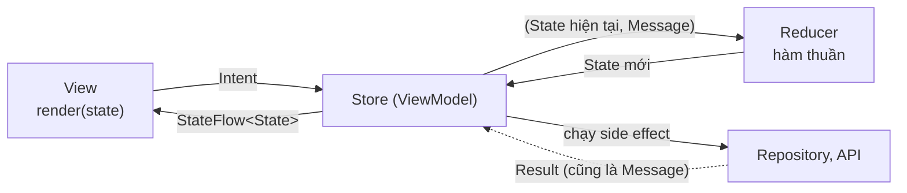
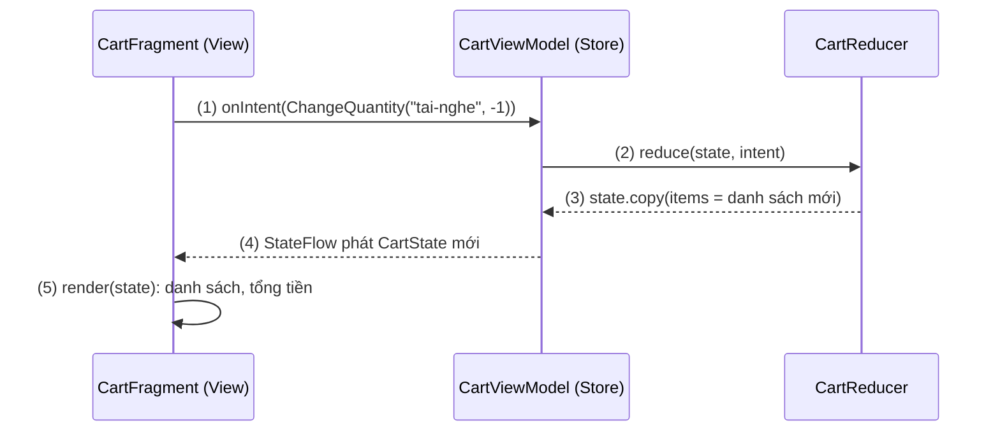
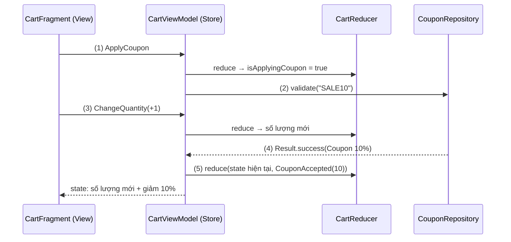
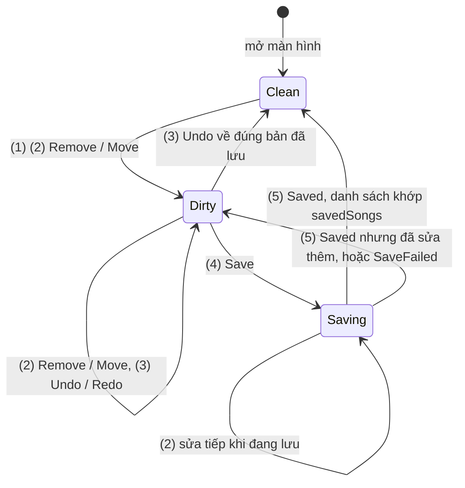

# MVI

## Vấn đề cần giải quyết

Một màn hình có nhiều thao tác cùng tác động lên một state: giỏ hàng có tăng giảm số lượng, xoá món, nhập và áp mã giảm giá; mỗi thao tác có thể kèm việc bất đồng bộ. Theo [MVVM](mvvm.md), mỗi thao tác là một hàm của ViewModel tự sửa `uiState`. Khi số hàm và số coroutine tăng lên, lỗi bắt đầu nằm ở **chỗ giao nhau** giữa chúng:

```kotlin
// CartViewModel.kt (mỗi hàm tự sửa state)
fun onApplyCoupon() {
    viewModelScope.launch {
        val current = _uiState.value                                  // chụp state lúc bắt đầu
        val coupon = couponRepository.validate(current.couponCode).getOrNull()
        _uiState.value = current.copy(discountPercent = coupon?.percent ?: 0)
        // Trong lúc chờ API, người dùng đã bấm "+" ở một món:
        // bản copy cũ ghi đè lên, số lượng vừa tăng bị mất.
    }
}
```

Lỗi này không nằm ở một dòng sai rõ ràng, mà ở việc **có nhiều chỗ được ghi state** và mỗi chỗ tự quyết định cách ghi. Muốn trả lời "vì sao màn hình đang hiện số lượng 1" thì phải dò mọi hàm, mọi coroutine. Vấn đề cần giải quyết là: **dồn mọi thay đổi state về một chỗ duy nhất, theo một thứ tự, bằng một quy tắc test được, kể cả thay đổi đến từ việc bất đồng bộ.**

## Sau khi học xong

- Giải thích được vòng lặp Intent → reducer → state bất biến → View của MVI và vì sao mọi thay đổi state chỉ đi qua reducer.
- Thiết kế được contract của một màn hình MVI gồm State, Intent và message kết quả của side effect.
- Triển khai được reducer thuần và test nó trên JVM mà không cần coroutine hay Android.
- Xử lý được side effect như gọi API và lưu dữ liệu bên ngoài reducer, đưa kết quả quay lại reducer thành message.
- Phân biệt được MVI với MVVM theo luồng dữ liệu một chiều, và biết khi nào MVI đáng chi phí.

## MVI là gì?

**MVI (Model–View–Intent)** là pattern kiến trúc tầng UI trong đó mọi thao tác của người dùng (**Intent**) và mọi kết quả của **side effect** được biểu diễn thành **message** đi qua một hàm **reducer** duy nhất; reducer nhận state hiện tại cùng message và trả về **state mới bất biến**, còn View chỉ vẽ state đó và gửi Intent.

Mental model: MVI là **một cuốn sổ cái**. State là số dư; không ai được sửa số dư trực tiếp. Mọi giao dịch (message) được ghi vào sổ theo thứ tự, và một quy tắc duy nhất (reducer) tính số dư mới từ số dư cũ và giao dịch đó. Muốn biết vì sao số dư như hiện tại, đọc lại các giao dịch; muốn kiểm tra quy tắc, đưa vào một số dư và một giao dịch rồi xem kết quả.

> [!NOTE]
> "Intent" trong MVI là **ý định của người dùng** (bấm "+", gõ mã giảm giá), không liên quan tới class `android.content.Intent`. Nhiều codebase gọi nó là `Action`, `UiAction` hay `Event` để tránh trùng tên. Chữ "Model" trong MVI cũng không phải data layer mà là **state của màn hình**; data layer (Repository) vẫn tồn tại bên dưới như trong MVVM.

## Cách hoạt động

### Vòng lặp một chiều: Intent → reducer → State → View

| Thành phần | Vai trò | Ở Android là |
|---|---|---|
| **State** | Mô tả trọn vẹn màn hình tại một thời điểm, bất biến | `data class` với toàn `val`, collection chỉ đọc |
| **Intent** | Điều người dùng muốn làm | `sealed interface` với mỗi thao tác một class |
| **Result** | Kết quả của side effect, quay lại sổ như một giao dịch | `sealed interface`, cùng cha `Message` với Intent |
| **Reducer** | `(State, Message) -> State`, hàm thuần | `object` hoặc hàm top-level, không coroutine, không I/O |
| **Store** | Giữ state, đưa message qua reducer, chạy side effect | Thường là `ViewModel` với `MutableStateFlow` |
| **View** | Vẽ state, chuyển thao tác thành Intent | Fragment với `render(state)`, hoặc composable |



Ba quy tắc giữ cho vòng lặp đúng:

1. **Chỉ reducer tạo state mới.** Không có `_state.value = …` nào khác trong Store; số dư chỉ đổi qua sổ.
2. **Reducer thuần:** cùng state và message thì luôn ra cùng kết quả, không gọi mạng, không ghi log analytics, không `launch`. Nhờ vậy test reducer chỉ là gọi hàm và so sánh.
3. **State bất biến:** reducer tạo bản mới bằng `copy()`, không sửa bản cũ. View và test luôn cầm một bản chụp nhất quán ([UI layer](https://developer.android.com/topic/architecture/ui-layer), mục "Immutability").

### Contract và reducer thuần

**Contract** của một màn MVI là bộ ba kiểu: `State`, `Intent` và `Result`. Intent và Result cùng kế thừa một `sealed interface Message`, nên reducer xử lý cả hai trong một `when` duy nhất và compiler bắt lỗi nếu quên một nhánh.

#### Ví dụ: giỏ hàng tăng giảm số lượng và xoá món

**Bài toán:** giỏ hàng có nhiều thao tác cùng sửa danh sách món và tổng tiền. Giảm số lượng về 0 thì món biến mất; tổng tiền luôn khớp danh sách. Đây là phần đồng bộ của màn hình, nên viết hoàn toàn trong reducer.

**Luồng chạy:**

1. Người dùng bấm "−" ở món "Tai nghe"; View gửi `CartIntent.ChangeQuantity("tai-nghe", -1)`.
2. Store đưa state hiện tại và Intent vào `CartReducer.reduce()`.
3. Reducer tạo danh sách mới: món có số lượng về 0 bị bỏ; state cũ không bị sửa.
4. Store phát state mới qua `StateFlow`.
5. View vẽ lại danh sách và tổng tiền (tổng tiền là property tính từ `items`, không lưu riêng).



```kotlin
// CartContract.kt
data class CartItem(val productId: String, val name: String, val unitPrice: Long, val quantity: Int)

data class CartState(
    val items: List<CartItem> = emptyList(),
    val couponCode: String = "",
    val discountPercent: Int = 0,
    val isApplyingCoupon: Boolean = false,
    val couponError: String? = null
) {
    val subtotal: Long get() = items.sumOf { it.unitPrice * it.quantity }                // (5) tính, không lưu
    val total: Long get() = subtotal - subtotal * discountPercent / 100
    val canApplyCoupon: Boolean get() = couponCode.isNotBlank() && !isApplyingCoupon
}

sealed interface CartMessage                                          // mọi giao dịch của sổ

sealed interface CartIntent : CartMessage {                           // người dùng gửi
    data class ChangeQuantity(val productId: String, val delta: Int) : CartIntent
    data class Remove(val productId: String) : CartIntent
    data class CouponCodeChange(val code: String) : CartIntent
    data object ApplyCoupon : CartIntent
}

sealed interface CartResult : CartMessage {                           // side effect gửi lại
    data class CouponAccepted(val percent: Int) : CartResult
    data class CouponRejected(val reason: String) : CartResult
}
```

```kotlin
// CartReducer.kt: hàm thuần, không coroutine, không android.*
object CartReducer {
    fun reduce(state: CartState, message: CartMessage): CartState = when (message) {
        is CartIntent.ChangeQuantity -> state.copy(                                       // (2) (3)
            items = state.items.mapNotNull { item ->
                if (item.productId != message.productId) item
                else item.copy(quantity = item.quantity + message.delta).takeIf { it.quantity > 0 }
            }
        )
        is CartIntent.Remove -> state.copy(items = state.items.filterNot { it.productId == message.productId })
        is CartIntent.CouponCodeChange -> state.copy(couponCode = message.code.trim().uppercase(), couponError = null)
        CartIntent.ApplyCoupon ->
            if (state.canApplyCoupon) state.copy(isApplyingCoupon = true, couponError = null) else state
        is CartResult.CouponAccepted -> state.copy(isApplyingCoupon = false, discountPercent = message.percent)
        is CartResult.CouponRejected ->
            state.copy(isApplyingCoupon = false, discountPercent = 0, couponError = message.reason)
    }
}
```

**Kết quả:** mọi quy tắc của giỏ hàng nằm trong một hàm `when`; thêm thao tác mới (ví dụ "Xoá hết") là thêm một class Intent và compiler chỉ ra chỗ phải xử lý. Test reducer chỉ là gọi `CartReducer.reduce(state, intent)` rồi so sánh, không cần `MainDispatcherRule` (test đầy đủ ở mục "Ví dụ thực tế"); `state` cũ vẫn nguyên sau khi reduce. Nhánh `ApplyCoupon` chỉ bật cờ `isApplyingCoupon`: gọi API là side effect, thuộc mục tiếp theo.

### Side effect: việc nằm ngoài reducer

Gọi API, ghi database, điều hướng, đọc đồng hồ đều là **side effect**: chúng không thuần, nên không được ở trong reducer. Store chạy chúng và đưa **kết quả quay lại reducer thành một message** (`CartResult`), giống mọi giao dịch khác của sổ.

Cách Store biết khi nào chạy side effect: so sánh state **trước và sau** khi reduce. Reducer đã quyết định thao tác có hợp lệ không (mã rỗng hoặc đang áp mã thì `ApplyCoupon` không đổi gì); Store chỉ phản ứng với **chuyển trạng thái** `isApplyingCoupon: false → true`. Nhờ vậy bấm "Áp dụng" hai lần liên tiếp chỉ gọi API một lần.

`MutableStateFlow.update { }` cập nhật giá trị một cách atomic, và hàm truyền vào **có thể chạy lại nhiều lần** nếu có cập nhật đồng thời; vì reducer thuần nên chạy lại không gây hại. Đây là lý do thứ hai reducer không được chứa side effect (sai lầm 1).

#### Ví dụ: áp mã giảm giá trong khi người dùng vẫn sửa giỏ

**Bài toán:** người dùng nhập "SALE10", bấm "Áp dụng"; trong lúc chờ server kiểm tra mã, họ bấm "+" ở một món. Khi mã hợp lệ, giảm giá phải áp lên **giỏ hàng mới nhất**, không làm mất lần bấm "+" như ở phần "Vấn đề cần giải quyết".

**Luồng chạy:**

1. View gửi `ApplyCoupon`; reducer đặt `isApplyingCoupon = true`.
2. Store thấy chuyển trạng thái `false → true`, chạy side effect `couponRepository.validate(code)` trong `viewModelScope`.
3. Trong lúc chờ, View gửi `ChangeQuantity(…, +1)`; reducer cập nhật số lượng như bình thường.
4. Server trả kết quả; Store biến nó thành `CouponAccepted(10)` hoặc `CouponRejected(...)`.
5. Kết quả đi qua reducer với `update { }`, tức là áp lên state **hiện tại** (đã có lần bấm "+"), không phải bản chụp lúc bắt đầu.



```kotlin
// CartViewModel.kt: Store
class CartViewModel(
    initialItems: List<CartItem>,
    private val couponRepository: CouponRepository
) : ViewModel() {

    private val _state = MutableStateFlow(CartState(items = initialItems))
    val state: StateFlow<CartState> = _state.asStateFlow()

    fun onIntent(intent: CartIntent) {                                                    // cửa vào duy nhất
        val before = _state.value
        val after = _state.updateAndGet { CartReducer.reduce(it, intent) }                // (1) (3)
        if (!before.isApplyingCoupon && after.isApplyingCoupon) {                         // (2) chuyển trạng thái
            validateCoupon(after.couponCode)
        }
    }

    private fun validateCoupon(code: String) {
        viewModelScope.launch {
            val result = couponRepository.validate(code).fold(                            // (4)
                onSuccess = { coupon -> CartResult.CouponAccepted(coupon.percent) },
                onFailure = { CartResult.CouponRejected("Mã giảm giá không hợp lệ") }
            )
            _state.update { CartReducer.reduce(it, result) }                              // (5) state hiện tại
        }
    }
}
```

`CouponRepository.validate()` là hàm `suspend` trả `Result<Coupon>`. `initialItems` được truyền khi tạo ViewModel bằng factory ([ViewModel](../../session_06/viewmodel.md), mục "Factory và CreationExtras: ViewModel có dependency"); giỏ hàng lưu trong Room thì danh sách món đến từ một `Flow` của Repository và mỗi lần nó phát cũng là một message `ItemsLoaded` đi qua reducer.

```kotlin
// CartFragment.kt: View gửi Intent, vẽ State
override fun onViewCreated(view: View, savedInstanceState: Bundle?) {
    super.onViewCreated(view, savedInstanceState)
    val binding = FragmentCartBinding.bind(view)
    val adapter = CartItemAdapter(onQuantityChange = { id, delta ->
        viewModel.onIntent(CartIntent.ChangeQuantity(id, delta))
    })
    binding.itemList.adapter = adapter
    binding.couponInput.doAfterTextChanged { viewModel.onIntent(CartIntent.CouponCodeChange(it.toString())) }
    binding.applyCouponButton.setOnClickListener { viewModel.onIntent(CartIntent.ApplyCoupon) }

    viewLifecycleOwner.lifecycleScope.launch {
        viewLifecycleOwner.repeatOnLifecycle(Lifecycle.State.STARTED) {
            viewModel.state.collect { state ->
                adapter.submitList(state.items)
                binding.totalText.text = "%,d đ".format(state.total)
                binding.applyCouponButton.isEnabled = state.canApplyCoupon
                binding.couponProgress.isVisible = state.isApplyingCoupon
                binding.couponLayout.error = state.couponError                            // lỗi là state, không phải event
            }
        }
    }
}
```

`couponLayout` là `TextInputLayout` bọc ô nhập mã. Cách collect `StateFlow` theo vòng đời là phần đã học ở [Flow](../design_pattern/observer/flow.md), mục "Collect an toàn trong Android".

**Kết quả:** nhập mã, bấm "Áp dụng" rồi bấm "+" ngay: khi server trả lời, tổng tiền là (số lượng mới) × giá × 90%, không mất lần bấm "+". Bấm "Áp dụng" hai lần nhanh chỉ có một request trong log. Mã sai thì ô nhập hiện lỗi, xoay màn hình lỗi vẫn còn (vì nó là state); gõ lại mã thì lỗi tự xoá (reducer xoá `couponError` khi nhận `CouponCodeChange`).

### Event một lần: state hay kênh side effect

Thông báo "Đã áp mã" hay điều hướng sang màn thanh toán chỉ xảy ra **một lần**. Các thư viện MVI thường có một kênh riêng cho chúng (Orbit gọi là `postSideEffect`), nhưng kênh riêng có cùng rủi ro đã phân tích ở [MVVM](mvvm.md), mục "Thao tác của người dùng và event một lần": event phát ra lúc không có ai collect (đang xoay màn hình) có thể bị mất.

Hướng dẫn của Android khuyên đưa event vào state rồi để View báo đã xử lý. Trong MVI, việc "báo đã xử lý" tự nhiên là **một Intent** (`CheckoutNavigated`, `MessageShown`) đi qua reducer để xoá phần state đó, nên nó vẫn được ghi vào sổ như mọi giao dịch khác.

### MVI và MVVM với luồng dữ liệu một chiều

MVVM như ở bài [MVVM](mvvm.md) (một `uiState`, state đi xuống, event đi lên) đã là luồng dữ liệu một chiều (UDF). MVI không đổi hướng luồng; nó thêm **kỷ luật về chỗ được đổi state**:

| | MVVM theo UDF | MVI |
|---|---|---|
| Cửa vào từ View | Nhiều hàm: `onRetry()`, `onBookmarkClick(id)` | Một hàm `onIntent(intent)`, Intent là `sealed` type |
| Ai tạo state mới | Mỗi hàm tự `update { it.copy(...) }` | Chỉ reducer `(State, Message) -> State` |
| Kết quả bất đồng bộ | Coroutine tự ghi vào state | Thành `Result`, quay lại reducer |
| Test logic chuyển trạng thái | Gọi hàm ViewModel, cần coroutine test | Gọi reducer như hàm thuần; side effect test riêng |
| Lần vết lỗi | Log rải ở từng hàm | Log mọi (message, state cũ, state mới) ở một chỗ |
| Chi phí | Ít code | Thêm `sealed` type cho mỗi thao tác, thêm một lớp gián tiếp |

Ranh giới giữa hai pattern là **độ chặt**, không phải hai thế giới khác nhau. Hướng dẫn kiến trúc của Android không gọi tên MVI, chỉ yêu cầu UDF với UI state bất biến; nhiều team dùng MVVM cho phần lớn màn hình và MVI cho màn có nhiều thao tác chéo nhau. Thư viện Orbit cũng tự mô tả mình là "MVVM+".

Thư viện MVI hay gặp khi đọc code: **Orbit** (Kotlin Multiplatform, `intent { reduce { state.copy(...) } }` và `postSideEffect`), **Mavericks** của Airbnb (tên cũ MvRx, `setState { copy(...) }`), và **Mosby** (có module MVI từ bản 3.0 năm 2017, không còn phát hành từ 2018). Không thư viện nào bắt buộc: Store tự viết bằng `ViewModel` và `MutableStateFlow` như bài này đủ cho phần lớn app.

## Ví dụ thực tế

Ba bài toán mà MVI đáng chi phí:

1. **Màn chỉnh sửa có Hoàn tác/Làm lại:** state bất biến và chỉ đổi qua reducer, nên lịch sử chỉnh sửa chỉ là danh sách các state cũ. Bài toán chính, code đầy đủ bên dưới.
2. **Giỏ hàng, bộ lọc nhiều điều kiện:** thao tác và kết quả mạng giao nhau trên một state, như ví dụ ở mục "Side effect".
3. **Lỗi khó tái hiện:** log mọi message kèm state trước và sau; phát lại đúng chuỗi message vào reducer trong test để tái hiện.

### Chỉnh sửa playlist với Hoàn tác, Làm lại và Lưu

**Bài toán:** màn chỉnh sửa playlist cho xoá bài, kéo đổi thứ tự, bấm "Hoàn tác" và "Làm lại", rồi "Lưu" lên server. Nút "Lưu" chỉ bật khi có thay đổi chưa lưu, và nếu người dùng tiếp tục sửa trong lúc đang lưu thì sau khi lưu xong vẫn phải hiện "còn thay đổi chưa lưu".

**Luồng chạy:**

1. View gửi Intent `Remove`, `Move`, `Undo`, `Redo`, `Save`.
2. Mỗi chỉnh sửa: reducer cất danh sách hiện tại vào `past`, tạo danh sách mới và xoá `future`.
3. `Undo`: lấy bản cuối của `past` làm danh sách hiện tại, đẩy bản đang có vào `future`; `Redo` làm ngược lại.
4. `Save`: reducer bật `isSaving`; Store thấy chuyển trạng thái thì gọi `saveOrder()` với **đúng danh sách lúc bấm Lưu**.
5. Kết quả `Saved(songs)` đi qua reducer, ghi `savedSongs`. `hasUnsavedChanges` so sánh danh sách hiện tại với `savedSongs`, nên đúng cả khi người dùng đã sửa thêm trong lúc lưu.



```kotlin
// PlaylistEditorContract.kt
data class Song(val id: String, val title: String)

data class PlaylistEditorState(
    val songs: List<Song>,
    val savedSongs: List<Song>,
    val past: List<List<Song>> = emptyList(),       // các bản trước: để Hoàn tác
    val future: List<List<Song>> = emptyList(),     // các bản đã hoàn tác: để Làm lại
    val isSaving: Boolean = false,
    val saveError: String? = null
) {
    val canUndo: Boolean get() = past.isNotEmpty()
    val canRedo: Boolean get() = future.isNotEmpty()
    val hasUnsavedChanges: Boolean get() = songs != savedSongs                            // (5)
}

sealed interface PlaylistMessage

sealed interface PlaylistIntent : PlaylistMessage {                                       // (1)
    data class Remove(val songId: String) : PlaylistIntent
    data class Move(val from: Int, val to: Int) : PlaylistIntent
    data object Undo : PlaylistIntent
    data object Redo : PlaylistIntent
    data object Save : PlaylistIntent
}

sealed interface PlaylistResult : PlaylistMessage {
    data class Saved(val songs: List<Song>) : PlaylistResult
    data object SaveFailed : PlaylistResult
}
```

```kotlin
// PlaylistReducer.kt
object PlaylistReducer {
    private const val MAX_HISTORY = 50

    fun reduce(state: PlaylistEditorState, message: PlaylistMessage): PlaylistEditorState = when (message) {
        is PlaylistIntent.Remove -> state.edit(state.songs.filterNot { it.id == message.songId })      // (2)
        is PlaylistIntent.Move ->
            if (message.from !in state.songs.indices || message.to !in state.songs.indices) state
            else state.edit(state.songs.toMutableList().apply { add(message.to, removeAt(message.from)) })
        PlaylistIntent.Undo ->                                                                          // (3)
            if (!state.canUndo) state
            else state.copy(songs = state.past.last(), past = state.past.dropLast(1), future = state.future + listOf(state.songs))
        PlaylistIntent.Redo ->
            if (!state.canRedo) state
            else state.copy(songs = state.future.last(), future = state.future.dropLast(1), past = state.past + listOf(state.songs))
        PlaylistIntent.Save ->                                                                          // (4)
            if (state.isSaving || !state.hasUnsavedChanges) state else state.copy(isSaving = true, saveError = null)
        is PlaylistResult.Saved -> state.copy(isSaving = false, savedSongs = message.songs)            // (5)
        PlaylistResult.SaveFailed -> state.copy(isSaving = false, saveError = "Chưa lưu được, hãy thử lại")
    }

    // (2) mỗi chỉnh sửa: cất bản hiện tại vào past, xoá future
    private fun PlaylistEditorState.edit(newSongs: List<Song>): PlaylistEditorState =
        if (newSongs == songs) this
        else copy(songs = newSongs, past = (past + listOf(songs)).takeLast(MAX_HISTORY), future = emptyList())
}
```

`toMutableList()` tạo bản sao để đổi chỗ, nên state cũ vẫn nguyên; `MAX_HISTORY` giới hạn số bước hoàn tác.

```kotlin
// PlaylistEditorViewModel.kt
class PlaylistEditorViewModel(
    private val playlistId: String,
    initialSongs: List<Song>,
    private val repository: PlaylistRepository
) : ViewModel() {

    private val _state = MutableStateFlow(PlaylistEditorState(songs = initialSongs, savedSongs = initialSongs))
    val state: StateFlow<PlaylistEditorState> = _state.asStateFlow()

    fun onIntent(intent: PlaylistIntent) {
        val before = _state.value
        val after = _state.updateAndGet { PlaylistReducer.reduce(it, intent) }
        if (!before.isSaving && after.isSaving) save(after.songs)                          // (4)
    }

    private fun save(songs: List<Song>) {
        viewModelScope.launch {
            val result = try {
                repository.saveOrder(playlistId, songs.map { it.id })
                PlaylistResult.Saved(songs)                                                // (5) đúng bản đã gửi
            } catch (e: IOException) {
                PlaylistResult.SaveFailed
            }
            _state.update { PlaylistReducer.reduce(it, result) }
        }
    }
}
```

```kotlin
// PlaylistReducerTest.kt (src/test): phát lại chuỗi message như đọc lại sổ
fun PlaylistEditorState.after(vararg messages: PlaylistMessage): PlaylistEditorState =
    messages.fold(this, PlaylistReducer::reduce)

class PlaylistReducerTest {
    private val intro = Song("s1", "Mở đầu")
    private val morningRun = Song("s2", "Chạy bộ buổi sáng")
    private val chill = Song("s3", "Thư giãn")
    private val start = PlaylistEditorState(
        songs = listOf(intro, morningRun, chill),
        savedSongs = listOf(intro, morningRun, chill)
    )

    @Test
    fun removeThenUndo_restoresList_andRedoRemovesAgain() {
        val undone = start.after(PlaylistIntent.Remove("s2"), PlaylistIntent.Undo)
        assertEquals(start.songs, undone.songs)
        assertFalse(undone.hasUnsavedChanges)

        val redone = undone.after(PlaylistIntent.Redo)
        assertEquals(listOf(intro, chill), redone.songs)
    }

    @Test
    fun editWhileSaving_stillHasUnsavedChangesAfterSaved() {
        val saving = start.after(PlaylistIntent.Remove("s1"), PlaylistIntent.Save)
        val saved = saving.after(PlaylistIntent.Move(from = 0, to = 1), PlaylistResult.Saved(saving.songs))

        assertFalse(saved.isSaving)
        assertTrue(saved.hasUnsavedChanges)
    }
}
```

**Kết quả:** xoá một bài rồi bấm "Hoàn tác": bài quay lại đúng vị trí và nút "Lưu" mờ đi, vì danh sách lại khớp bản đã lưu. Bấm "Lưu" rồi kéo đổi thứ tự trong lúc đang lưu: khi server trả lời, vòng tải tắt nhưng nút "Lưu" vẫn bật. Hai test chạy trong vài mili giây, không cần coroutine test, vì cả Hoàn tác lẫn quy tắc "còn thay đổi chưa lưu" đều nằm trong reducer. Hàm `after(...)` chính là "đọc lại sổ": cùng chuỗi message luôn cho cùng state.

## So sánh với các cách tiếp cận khác

| Pattern | Thành phần giữa UI và dữ liệu | Thành phần đó có biết View? | Cập nhật UI |
|---|---|---|---|
| MVC | Controller | Có; trên Android, Activity thường vừa là View vừa là Controller | Controller gán thẳng vào View |
| MVP | Presenter | Có, qua interface `View` | Presenter gọi hàm của View |
| MVVM | ViewModel | Không | View quan sát state của ViewModel |
| **MVI** | ViewModel / Store, reducer | Không | Như MVVM, nhưng mọi thay đổi đi qua một reducer duy nhất, state bất biến |

MVI và [MVVM](mvvm.md) cùng giải quyết những gì [MVP](mvp.md) vướng (ViewModel không giữ View, sống qua xoay màn hình). Khác biệt giữa MVI và MVVM nằm ở bảng của mục "MVI và MVVM với luồng dữ liệu một chiều".

## Khi nào nên và không nên dùng

- **Nên dùng** khi màn hình có nhiều thao tác tác động chéo lên cùng một state, kết quả bất đồng bộ giao nhau với thao tác người dùng, hoặc cần Hoàn tác, phát lại, lần vết từng thay đổi: trình soạn thảo, giỏ hàng, luồng thanh toán nhiều bước, bộ lọc phức tạp.
- **Không nên dùng** cho màn hình chỉ tải rồi hiện (chi tiết bài báo, trang hồ sơ): MVVM với `stateIn` gọn hơn nhiều, bộ `sealed` Intent chỉ thêm code.
- **Không nên** chọn MVI chỉ vì thư viện: nếu team chưa quen reducer thuần và state bất biến, thư viện MVI chỉ che đi việc state vẫn bị ghi từ nhiều chỗ.

## Sai lầm thường gặp

### 1. Side effect bên trong reducer

```kotlin
// Sai: reducer gọi API và ghi analytics
fun reduce(state: CartState, message: CartMessage): CartState = when (message) {
    CartIntent.ApplyCoupon -> {
        analytics.log("apply_coupon")
        scope.launch { couponRepository.validate(state.couponCode) }
        state.copy(isApplyingCoupon = true)
    }
    // ...
}
```

**Lỗi lộ ra thế nào:** `MutableStateFlow.update { }` có thể chạy lại hàm khi có cập nhật đồng thời, nên API và analytics bị gọi hai lần. Test reducer giờ cần scope, repository giả và analytics giả; phát lại chuỗi message trong test thì gọi mạng thật.

**Cách sửa:** reducer chỉ trả state mới; Store chạy side effect dựa trên chuyển trạng thái (như `isApplyingCoupon: false → true`) và đưa kết quả quay lại thành `Result`.

### 2. State chứa collection có thể sửa

```kotlin
// Sai: sửa list tại chỗ rồi phát lại cùng object
data class CartState(val items: MutableList<CartItem> = mutableListOf())

_state.value.items.removeAll { it.productId == id }
_state.value = _state.value.copy(items = _state.value.items)
```

**Lỗi lộ ra thế nào:** `StateFlow` bỏ qua giá trị mới nếu nó `equals` giá trị cũ. List đã bị sửa tại chỗ nên state "mới" và "cũ" là cùng một list, `equals` trả `true`, không có gì được phát: món đã bị xoá trong dữ liệu nhưng vẫn hiện trên màn hình cho tới lần thay đổi kế tiếp. View nào đang giữ bản state cũ cũng thấy nó bị đổi dưới chân.

**Cách sửa:** state chỉ dùng `val` và `List` (chỉ đọc); reducer tạo list mới bằng `filterNot`, `map`, `+`.

### 3. Ghi state ngoài reducer bằng bản chụp cũ

```kotlin
// Sai: coroutine ghi đè bằng bản copy chụp trước khi chờ
viewModelScope.launch {
    val current = _state.value
    val coupon = couponRepository.validate(current.couponCode).getOrThrow()
    _state.value = current.copy(discountPercent = coupon.percent, isApplyingCoupon = false)
}
```

**Lỗi lộ ra thế nào:** mọi Intent được xử lý trong lúc chờ (bấm "+", xoá món) bị bản chụp cũ ghi đè. Lỗi chỉ xuất hiện khi mạng chậm, nên khó tái hiện và dễ bị đóng là "không tái hiện được".

**Cách sửa:** kết quả side effect là một message, đi qua `_state.update { reducer(it, result) }` để áp lên state hiện tại.

### 4. Intent cho phép ghi đè state

```kotlin
// Sai: một Intent "đa năng" bỏ qua reducer
sealed interface CartIntent {
    data class SetState(val state: CartState) : CartIntent
}
```

**Lỗi lộ ra thế nào:** View hoặc test tự dựng state rồi gửi vào, quy tắc của reducer (giới hạn số lượng, xoá lỗi khi đổi mã) bị bỏ qua. Đọc log thấy `SetState(...)` thay vì biết người dùng đã làm gì. Sổ cái có một dòng "sửa số dư thành X".

**Cách sửa:** mỗi Intent mô tả **điều người dùng làm** (`Remove(id)`, `ApplyCoupon`), không mô tả state mong muốn; state chỉ do reducer tính.

### 5. Event một lần qua kênh có thể mất

```kotlin
// Không nên: event điều hướng qua Channel, View có thể không đang collect
private val _effects = Channel<CartEffect>()
val effects = _effects.receiveAsFlow()
```

**Lỗi lộ ra thế nào:** `Channel` giữ event tới khi có người nhận, nhưng không bảo đảm event được **xử lý**: event có thể đã được lấy ra khỏi `Channel` đúng lúc coroutine collect của View bị huỷ (xoay màn hình, app vào nền), và việc điều hướng không bao giờ chạy. Docs ghi rõ khi ViewModel sống lâu hơn UI, Channel và các luồng tương tự không bảo đảm event được gửi và xử lý. Lỗi chỉ thấy khi xoay màn hình đúng thời điểm.

**Cách sửa:** đưa event vào state (`navigateToCheckout = true`) và để View gửi Intent `CheckoutNavigated` sau khi điều hướng, như mục "Event một lần: state hay kênh side effect".

## Lịch sử phát triển

- **2014–2015:** frontend web chuyển sang kiến trúc một chiều: Flux (Facebook), Redux với khái niệm reducer `(state, action) -> state`, và Elm Architecture (Model-View-Update) mà Redux lấy cảm hứng.
- **22/08/2015:** André Staltz viết "Unidirectional User Interface Architectures", so sánh Flux, Redux, Model-View-Update và **Model-View-Intent**, pattern chính của framework JavaScript Cycle.js dựa trên luồng Observable.
- **09/01/2017:** Hannes Dorfmann mở đầu loạt bài "Reactive Apps with Model-View-Intent", đưa MVI vào Android với RxJava và lập luận rằng "Model" nên là state của màn hình.
- **03/2017:** Mosby 3.0 phát hành, có module MVI bên cạnh MVP.
- **2018:** Airbnb mở mã nguồn MvRx (về sau đổi tên thành Mavericks), framework MVVM/MVI dựa trên state bất biến.
- **07/2021:** Jetpack Compose 1.0 stable; UI khai báo vẽ thẳng từ một state, làm state bất biến và luồng một chiều thành mặc định tự nhiên.
- **12/2021:** Google viết lại hướng dẫn kiến trúc, đặt UI state bất biến và UDF làm khuyến nghị cho tầng UI, không bắt buộc MVI.
- **Hiện nay:** Orbit (bản 12.x, Kotlin Multiplatform) và Mavericks (3.x) vẫn được phát triển; phần lớn app tự viết Store bằng `ViewModel` và `StateFlow`.

## Kết nối hệ thống

- **Tiên quyết:**
  - [MVVM](mvvm.md): UI state, UDF và event thành state; MVI xây trên chúng.
  - [ViewModel](../../session_06/viewmodel.md): Store của MVI trên Android là một ViewModel.
  - [Flow](../design_pattern/observer/flow.md): `StateFlow`, `update`, collect theo vòng đời.
- **Liên quan:**
  - [MVP](mvp.md) và [MVC](mvc.md): các pattern đứng trước, để thấy MVI sửa điểm nào.
  - [Jetpack Compose Overview](../../jetpack_compose_ui/overview.md): UI khai báo vẽ từ một state, rất hợp với MVI.
  - [Observer Pattern Overview](../design_pattern/observer/overview.md): View quan sát state của Store.
- **Học tiếp:**
  - [Clean Architecture](clean_architecture.md): side effect của Store gọi use case và Repository ở các tầng bên dưới.
  - 7.1.5.3 Hilt: cung cấp Repository cho Store ([Hilt](../design_pattern/di/hilt.md)).

## Tham khảo

- [UI layer (Immutability, Unidirectional Data Flow) - Android Developers](https://developer.android.com/topic/architecture/ui-layer)
- [UI events - Android Developers](https://developer.android.com/topic/architecture/ui-layer/events)
- [MutableStateFlow.update - kotlinx.coroutines API](https://kotlinlang.org/api/kotlinx.coroutines/kotlinx-coroutines-core/kotlinx.coroutines.flow/update.html)
- [StateFlow - kotlinx.coroutines API](https://kotlinlang.org/api/kotlinx.coroutines/kotlinx-coroutines-core/kotlinx.coroutines.flow/-state-flow/)
- [Unidirectional User Interface Architectures (2015) - André Staltz](https://staltz.com/unidirectional-user-interface-architectures.html)
- [Reactive Apps with Model-View-Intent, Part 1 (2017) - Hannes Dorfmann](http://hannesdorfmann.com/android/mosby3-mvi-1/)
- [Orbit Multiplatform - orbit-mvi.org](https://orbit-mvi.org/)
- [Mavericks - Airbnb](https://airbnb.io/mavericks/)
