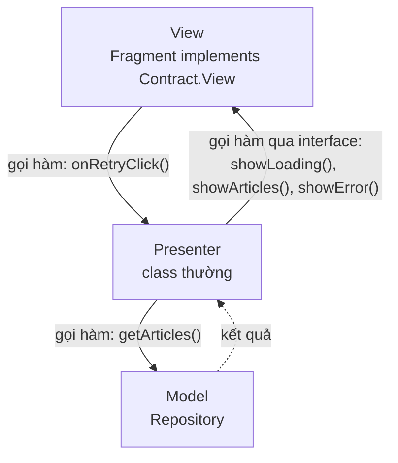
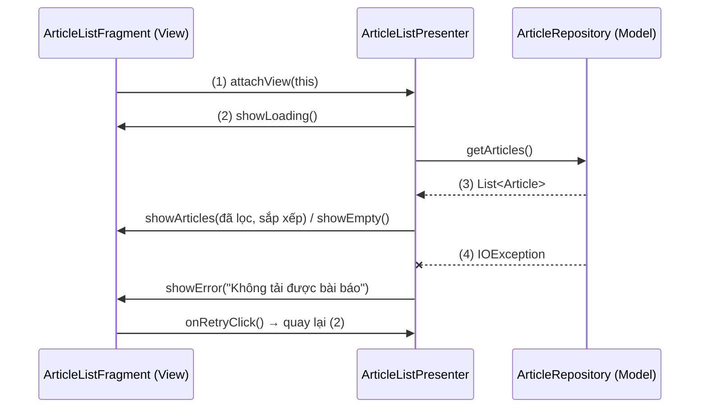
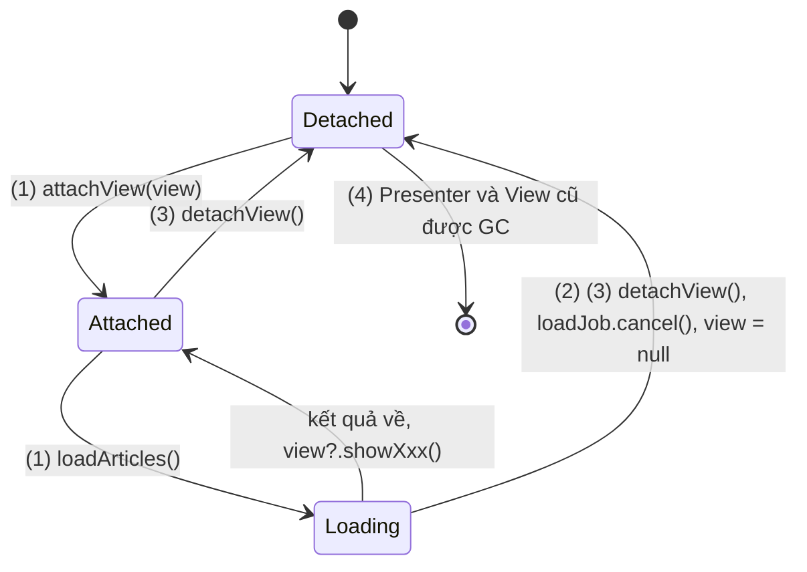
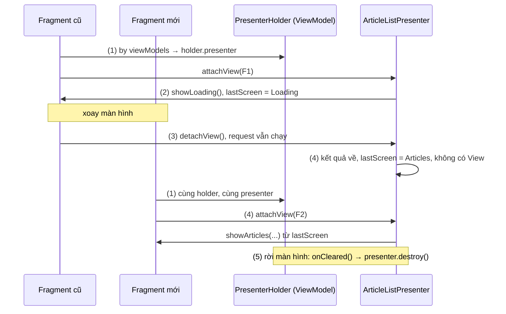
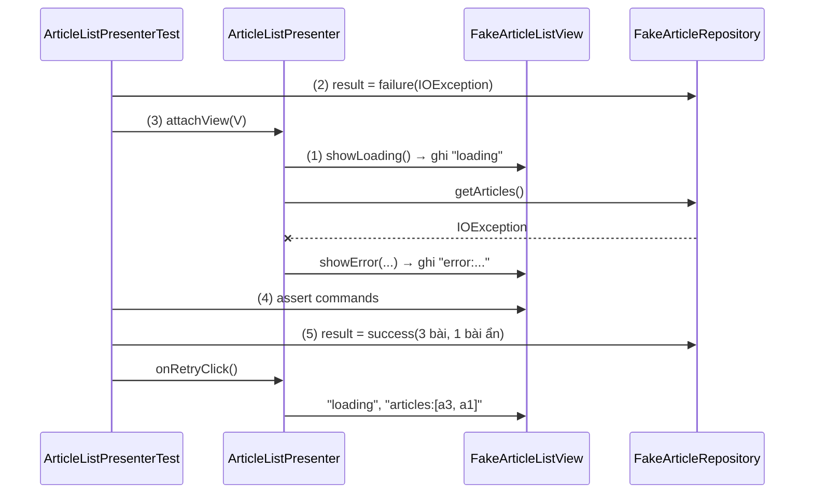

# MVP

## Vấn đề cần giải quyết

Ở [MVC](mvc.md), "MVC kiểu Android" tách được Model (dữ liệu, quy tắc nghiệp vụ) ra khỏi Activity, nhưng **logic UI** vẫn ở lại: khi nào hiện vòng tải, danh sách rỗng thì hiện gì, lỗi mạng thì báo câu nào, bấm "Thử lại" thì làm gì.

```kotlin
// ArticleListFragment.kt (MVC kiểu Android): quyết định và vẽ trộn vào nhau
lifecycleScope.launch {
    binding.progress.isVisible = true
    try {
        val visible = repository.getArticles().filter { !it.isHidden }
        if (visible.isEmpty()) binding.emptyText.isVisible = true   // quyết định "hiện gì"
        else adapter.submitList(visible)                            // và "vẽ thế nào" ở cùng một chỗ
    } catch (e: IOException) {
        binding.errorGroup.isVisible = true
    } finally {
        binding.progress.isVisible = false
    }
}
```

Muốn kiểm tra "lỗi mạng thì hiện lỗi, bấm Thử lại thì hiện danh sách" phải chạy Fragment trên thiết bị, vì quyết định "hiện gì" dính chặt vào widget. Vấn đề cần giải quyết là: **đưa toàn bộ logic UI vào một class không phụ thuộc Android, để View chỉ còn việc vẽ, và logic test được trên JVM.**

## Sau khi học xong

- Giải thích được vai Presenter và interface View (contract) trong MVP, và vì sao Presenter chỉ biết View qua interface.
- Triển khai được một màn hình MVP gồm contract, Presenter thuần Kotlin và Fragment hiện thực interface View.
- Xử lý được việc attach và detach View theo vòng đời để Presenter không gọi vào View đã bị huỷ và không làm leak.
- Áp dụng được unit test cho Presenter bằng View giả chạy trên JVM.
- Giải thích được vấn đề xoay màn hình của MVP và vì sao MVVM với ViewModel của Jetpack thay thế nó.

## MVP là gì?

**MVP (Model–View–Presenter)** là pattern kiến trúc tầng UI trong đó **View** thụ động chỉ chuyển thao tác của người dùng cho **Presenter** và làm theo lệnh hiển thị; **Presenter** là class thường, gọi **Model** rồi ra lệnh cho View qua một **interface** (gọi là contract).

Mental model: Presenter **cầm điều khiển từ xa**. Các nút trên điều khiển là các hàm của interface View: `showLoading()`, `showArticles()`, `showError()`. Presenter quyết định bấm nút nào, còn đầu bên kia là Fragment thật hay một View giả trong test thì nó không cần biết. Điều khiển chỉ hoạt động khi đang **kết nối** với một màn hình, và mỗi lần màn hình bị thay thì phải kết nối lại.

## Cách hoạt động

### Ba vai và contract

| Vai | Ở Android là | Biết ai | Không biết ai |
|---|---|---|---|
| **View** | Activity hoặc Fragment hiện thực interface `XxxContract.View` | Presenter | Model |
| **Presenter** | Class thường, không kế thừa class nào của Android | Interface View, Model | Activity/Fragment cụ thể, widget |
| **Model** | Data layer: Repository và data source | Không ai ở tầng UI | View, Presenter |

Khác với [MVVM](mvvm.md), mũi tên giữa Presenter và View đi **cả hai chiều** và cả hai đều là lời gọi hàm: View gọi Presenter khi người dùng thao tác, Presenter gọi View để ra lệnh hiển thị.



**Contract** là một interface gom hai interface con: `View` (những lệnh Presenter được ra) và `Presenter` (những thao tác View được báo). Vì Presenter chỉ thấy interface, nó không import `android.*` nên test được trên JVM với một View giả. Đây là Dependency Inversion: Presenter phụ thuộc vào trừu tượng, không vào Fragment cụ thể ([DIP](../../../../design-principles/02-solid/solid-dip.md)).

Martin Fowler chia MVP thành hai biến thể theo việc View tự làm được bao nhiêu:

- **Passive View:** View không có logic nào; Presenter quyết định mọi thứ hiện ra. Đây là kiểu phổ biến trên Android và là kiểu dùng trong bài.
- **Supervising Controller:** View tự đồng bộ phần đơn giản với Model (qua data binding), Presenter chỉ xử lý phần phức tạp.

Hàm của contract nên nói **hiện gì** (`showEmpty()`), không nói **vẽ thế nào** (`setEmptyTextVisibility(View.VISIBLE)`); nếu không Presenter lại phải biết layout.

#### Ví dụ: danh sách bài báo có tải, lỗi và thử lại

**Bài toán:** bài toán của ví dụ ở [MVVM](mvvm.md), mục "UI state và luồng dữ liệu một chiều", thêm trạng thái rỗng: danh sách bài báo đọc từ Repository, màn hình ở đúng một trong bốn trạng thái (đang tải, có danh sách, rỗng, lỗi kèm nút "Thử lại"). Viết lại theo MVP để thấy chỗ khác.

**Luồng chạy:**

1. Fragment tạo Presenter và gọi `presenter.attachView(this)` trong `onViewCreated()`; Presenter bắt đầu tải.
2. Presenter ra lệnh `view.showLoading()` rồi gọi `repository.getArticles()`.
3. Có kết quả: Presenter lọc, sắp xếp, rồi ra lệnh `showArticles(list)` hoặc `showEmpty()`.
4. Lỗi mạng: Presenter ra lệnh `showError(message)`. Người dùng bấm "Thử lại", Fragment gọi `presenter.onRetryClick()`, quay lại bước 2.



```kotlin
// ArticleListContract.kt
interface ArticleListContract {
    interface View {
        fun showLoading()
        fun showArticles(articles: List<Article>)
        fun showEmpty()
        fun showError(message: String)
    }

    interface Presenter {
        fun attachView(view: View)
        fun detachView()
        fun onRetryClick()
    }
}

// ArticleListPresenter.kt: không import android.*
class ArticleListPresenter(
    private val repository: ArticleRepository
) : ArticleListContract.Presenter {

    private var view: ArticleListContract.View? = null
    private val scope = MainScope()
    private var loadJob: Job? = null

    override fun attachView(view: ArticleListContract.View) {
        this.view = view
        loadArticles()                                                        // (1)
    }

    override fun onRetryClick() = loadArticles()                              // (4)

    override fun detachView() {
        loadJob?.cancel()                                                     // mục "Attach và detach"
        view = null
    }

    private fun loadArticles() {
        loadJob?.cancel()
        view?.showLoading()                                                   // (2)
        loadJob = scope.launch {
            try {
                val visible = repository.getArticles()
                    .filter { !it.isHidden }
                    .sortedByDescending { it.publishedAt }
                if (visible.isEmpty()) view?.showEmpty() else view?.showArticles(visible)  // (3)
            } catch (e: IOException) {
                view?.showError("Không tải được bài báo")                       // (4)
            }
        }
    }
}
```

`ArticleRepository.getArticles()` là hàm `suspend` trả `List<Article>`. `MainScope()` tạo một coroutine scope chạy trên main thread mà Presenter tự quản lý; coroutine học ở [8.4.3 Coroutines](../../session_08/async_threads/coroutines.md).

```kotlin
// ArticleListFragment.kt: View thụ động, chỉ làm theo lệnh
class ArticleListFragment : Fragment(R.layout.fragment_article_list), ArticleListContract.View {

    private var binding: FragmentArticleListBinding? = null
    private var adapter: ArticleAdapter? = null                               // sống theo View, như binding
    private val presenter by lazy {
        ArticleListPresenter((requireActivity().application as NewsApplication).articleRepository)
    }

    override fun onViewCreated(view: View, savedInstanceState: Bundle?) {
        super.onViewCreated(view, savedInstanceState)
        adapter = ArticleAdapter()
        binding = FragmentArticleListBinding.bind(view).apply {
            articleList.adapter = adapter
            retryButton.setOnClickListener { presenter.onRetryClick() }       // (4)
        }
        presenter.attachView(this)                                            // (1)
    }

    override fun onDestroyView() {
        presenter.detachView()
        binding = null
        adapter = null
        super.onDestroyView()
    }

    override fun showLoading() = showOnly { it.progress }
    override fun showEmpty() = showOnly { it.emptyText }
    override fun showArticles(articles: List<Article>) {
        showOnly { it.articleList }
        adapter?.submitList(articles)
    }
    override fun showError(message: String) {
        showOnly { it.errorGroup }
        binding?.errorText?.text = message
    }

    // Mỗi lệnh phải tự tắt ba nhóm View còn lại
    private fun showOnly(pick: (FragmentArticleListBinding) -> View) {
        val b = binding ?: return
        val target = pick(b)
        listOf(b.progress, b.emptyText, b.articleList, b.errorGroup).forEach { it.isVisible = it == target }
    }
}
```

`ArticleAdapter` là adapter của `RecyclerView`, học ở [ViewHolder Pattern](../design_pattern/viewholder_pattern.md). Binding được gán `null` trong `onDestroyView()` theo quy tắc ở [View Binding](../../session_06/view_binding.md), mục "View Binding trong Fragment: binding sống theo View". Adapter cũng vậy: `RecyclerView` đăng ký observer vào adapter, nên adapter giữ ở field của Fragment sẽ giữ luôn `RecyclerView` cũ khi Fragment vào backstack.

**Kết quả:** Fragment không còn `if` nghiệp vụ nào; quy tắc "ẩn bài bị ẩn, mới nhất lên đầu" và thứ tự Loading → Error → Loading → Articles nằm trong Presenter và test được trên JVM (mục "Ví dụ thực tế"). So với bản MVVM: logic ở cùng chỗ, nhưng Presenter **ra lệnh từng bước**, nên View phải có hàm `showOnly` để mỗi lệnh tự tắt các trạng thái khác. Chỗ này sẽ quay lại ở mục "Vì sao MVVM thay thế MVP".

### Attach và detach theo vòng đời

Presenter giữ tham chiếu tới View, nên nó phải **buông** View đúng lúc View bị huỷ. Nếu không, hai lỗi xảy ra: Presenter (và mọi coroutine của nó) giữ cả cây View cũ trong bộ nhớ, và kết quả về muộn bị gửi vào một View không còn tồn tại.

Quy ước thường dùng:

| View | Gọi `attachView()` | Gọi `detachView()` |
|---|---|---|
| Fragment | `onViewCreated()` | `onDestroyView()` |
| Activity | `onCreate()` | `onDestroy()` |

Với Fragment phải dùng vòng đời của **View** (`onViewCreated`/`onDestroyView`), không phải của Fragment, vì Fragment vào backstack thì View bị huỷ còn Fragment vẫn sống ([Fragment Lifecycle](../../session_04/components/fragment/lifecycle.md), mục "View Lifecycle: vòng đời thứ hai trong Fragment"). Khi detach, Presenter làm hai việc: **huỷ việc đang chạy** (hoặc chủ động giữ lại, xem mục sau) và **gán `view = null`**. Mọi lệnh tới View đều đi qua `view?.`, nên kết quả về sau khi detach bị bỏ qua thay vì crash. Code MVP cũ dùng RxJava thì làm việc tương tự bằng `CompositeDisposable.clear()` trong `detachView()` ([RxJava / RxAndroid](../design_pattern/observer/rxjava.md)).

#### Ví dụ: người dùng rời màn khi danh sách đang tải

**Bài toán:** mạng chậm, người dùng mở danh sách bài báo rồi bấm Back trước khi dữ liệu về. Presenter không được giữ Fragment, và không được gửi lệnh nào tới View đã huỷ.

**Luồng chạy:**

1. `onViewCreated()` → `attachView(view)`: Presenter ra lệnh `showLoading()` và bắt đầu request.
2. Người dùng bấm Back khi request chưa xong; Fragment bị pop, View bị huỷ.
3. `onDestroyView()` → `detachView()`: Presenter huỷ `loadJob` và gán `view = null`.
4. Không có lệnh nào tới View cũ; không còn gì giữ cây View, nên nó được GC thu hồi.



```kotlin
// ArticleListPresenter.kt (trích)
override fun detachView() {
    loadJob?.cancel()          // (3) request đang chạy bị huỷ, không tốn mạng vô ích
    view = null                // (3) buông View: Presenter không còn giữ Fragment
}
```

**Kết quả:** rời màn hình giữa chừng không để lại leak (LeakCanary không báo `ArticleListFragment`), và log của Repository cho thấy request bị huỷ. Test `detachWhileLoading_sendsNothingMoreToView` ở mục "Ví dụ thực tế" kiểm tra đúng hành vi này trên JVM.

### Xoay màn hình: Presenter chết cùng View

Presenter ở trên được Fragment tạo bằng `by lazy`, nên nó **sống bằng Fragment**. Xoay màn hình thì Activity và Fragment bị huỷ rồi tạo lại ([Activity State Changes](../../session_04/components/activity/state_changes.md)); Presenter mới ra đời, request đang chạy bị huỷ ở `detachView()` và chạy lại từ đầu. Người dùng thấy vòng tải mỗi lần xoay.

Giữ Presenter qua xoay màn hình từng là bài toán riêng của MVP trên Android, với nhiều cách: cất Presenter vào một map tĩnh theo id màn hình (dễ leak, phải tự dọn), dùng Fragment không UI với `setRetainInstance(true)` (deprecated từ Fragment 1.3.0), hoặc dùng Loader (deprecated từ Android 9). Cách còn hợp lệ hiện nay là **để Presenter trong một `ViewModel` của Jetpack**, vì ViewModel được thiết kế để sống qua configuration change ([ViewModel](../../session_06/viewmodel.md)).

Nhưng giữ được Presenter chưa đủ. Các lệnh `showXxx()` đã được gửi cho **View cũ**; View mới gắn vào thì trống trơn, và Presenter phải **nhớ lệnh cuối cùng** để gửi lại.

#### Ví dụ: giữ Presenter và trạng thái màn hình qua xoay màn hình

**Bài toán:** xoay màn hình khi danh sách đang hiện thì không tải lại; xoay khi đang tải thì request chạy tiếp và kết quả hiện trên View mới.

**Luồng chạy:**

1. Fragment lấy `ArticleListPresenterHolder` (một `ViewModel`) bằng `by viewModels`; holder tạo Presenter đúng một lần.
2. Mỗi lần ra lệnh, Presenter ghi lại màn hình đang ở trạng thái nào (`lastScreen`).
3. Xoay màn hình: View cũ `detachView()`, nhưng Presenter **không huỷ request**, chỉ buông View.
4. View mới `attachView()`: đã có `lastScreen` thì vẽ lại ngay, không tải lại; kết quả về lúc không có View thì chỉ được ghi nhớ.
5. Người dùng rời hẳn màn hình: ViewModel bị xoá, `onCleared()` gọi `presenter.destroy()` để huỷ scope.



```kotlin
// ArticleListPresenter.kt: bản giữ được qua xoay màn hình
class ArticleListPresenter(
    private val repository: ArticleRepository
) : ArticleListContract.Presenter {

    private sealed interface Screen {                                         // (2) lệnh cuối cùng
        data object Loading : Screen
        data class Articles(val articles: List<Article>) : Screen
        data object Empty : Screen
        data class Error(val message: String) : Screen
    }

    private var view: ArticleListContract.View? = null
    private var lastScreen: Screen? = null
    private val scope = MainScope()
    private var loadJob: Job? = null

    override fun attachView(view: ArticleListContract.View) {
        this.view = view
        val screen = lastScreen
        if (screen == null) loadArticles() else render(screen)                // (4)
    }

    override fun detachView() {
        view = null                                                           // (3) không huỷ request
    }

    override fun onRetryClick() = loadArticles()

    fun destroy() = scope.cancel()                                            // (5)

    private fun loadArticles() {
        loadJob?.cancel()                                                     // bấm "Thử lại" khi đang tải: bỏ lần cũ
        render(Screen.Loading)
        loadJob = scope.launch {
            render(
                try {
                    val visible = repository.getArticles()
                        .filter { !it.isHidden }
                        .sortedByDescending { it.publishedAt }
                    if (visible.isEmpty()) Screen.Empty else Screen.Articles(visible)
                } catch (e: IOException) {
                    Screen.Error("Không tải được bài báo")
                }
            )
        }
    }

    private fun render(screen: Screen) {
        lastScreen = screen                                                   // (2) nhớ lại
        val view = view ?: return                                             // (4) chưa có View: chỉ nhớ
        when (screen) {
            Screen.Loading -> view.showLoading()
            is Screen.Articles -> view.showArticles(screen.articles)
            Screen.Empty -> view.showEmpty()
            is Screen.Error -> view.showError(screen.message)
        }
    }
}

// ArticleListPresenterHolder.kt
class ArticleListPresenterHolder(repository: ArticleRepository) : ViewModel() {
    val presenter = ArticleListPresenter(repository)                          // (1)
    override fun onCleared() = presenter.destroy()                            // (5)
}
```

```kotlin
// ArticleListFragment.kt (thay cho presenter by lazy)
private val holder: ArticleListPresenterHolder by viewModels {
    viewModelFactory {
        initializer {
            val app = checkNotNull(this[APPLICATION_KEY]) as NewsApplication
            ArticleListPresenterHolder(app.articleRepository)                 // (1)
        }
    }
}
private val presenter get() = holder.presenter
```

`viewModelFactory { initializer { } }` tạo ViewModel có tham số, giải thích ở [ViewModel](../../session_06/viewmodel.md), mục "Factory và CreationExtras: ViewModel có dependency".

**Kết quả:** xoay màn hình khi danh sách đang hiện: danh sách hiện lại ngay, log Repository không có lời gọi mới. Xoay khi đang tải: vòng tải hiện trên View mới rồi danh sách về. Nhưng nhìn lại: `Screen` là một **mô tả đầy đủ màn hình đang hiện gì**, và Presenter giữ giá trị mới nhất của nó, trong một `ViewModel`, để View mới vẽ lại. Đó chính là `uiState` của [MVVM](mvvm.md), chỉ là được chuyển tới View bằng lệnh thay vì bằng quan sát.

### Vì sao MVVM thay thế MVP

Ví dụ trên cho thấy MVP trên Android sẽ tự tiến hoá thành MVVM khi giải quyết đủ vấn đề. Các lý do cụ thể:

1. **Vòng đời:** Presenter không tự sống qua xoay màn hình; phải có holder, phải nhớ trạng thái và gửi lại. Class `ViewModel` của Jetpack (2017) giải quyết việc sống sót, và một `StateFlow` giữ giá trị mới nhất thay cho `lastScreen`.
2. **State rải theo lệnh:** trạng thái màn hình là kết quả của **chuỗi lệnh** đã gửi. Quên một lệnh `hideLoading()` trên một nhánh lỗi là màn hình mâu thuẫn. MVVM thay chuỗi lệnh bằng **một giá trị state** được vẽ nguyên khối.
3. **Boilerplate:** mỗi màn một contract hai interface, View viết từng `showXxx()`, Presenter viết attach/detach. MVVM chỉ cần `uiState` và vài hàm sự kiện.
4. **UI khai báo:** trong [Jetpack Compose](../../jetpack_compose_ui/overview.md), composable là hàm nhận state; không có object View nào để Presenter gọi `showError()`. MVP không khớp với cách Compose vẽ UI.
5. **Hệ sinh thái:** hướng dẫn kiến trúc chính thức, thư viện Jetpack và mẫu của Google đều xây quanh ViewModel.

Khi chuyển một màn MVP sang MVVM, các phần tương ứng như sau:

| MVP | MVVM |
|---|---|
| `interface View` với `showLoading()`, `showArticles()`, `showEmpty()`, `showError()` | `sealed interface ArticleListUiState` (Loading, Success, Empty, Error) |
| `presenter.onRetryClick()` | `viewModel.onRetry()` |
| `attachView()` / `detachView()` | `repeatOnLifecycle(STARTED) { uiState.collect { … } }` |
| Presenter trong holder `ViewModel`, `onCleared()` gọi `destroy()` | Chính class `ViewModel`, coroutine chạy trong `viewModelScope` |
| `lastScreen` gửi lại khi attach | `StateFlow` luôn có giá trị mới nhất cho collector mới |

## Ví dụ thực tế

Ba tình huống hay gặp với MVP hiện nay, chủ yếu trong code đã có sẵn:

1. **Khoá hành vi của một màn MVP bằng unit test trước khi sửa:** đây là giá trị lớn nhất MVP mang lại, và là bước đầu tiên khi phải bảo trì nó. Bài toán chính, code đầy đủ bên dưới.
2. **Chuyển dần một màn MVP sang MVVM:** đổi theo bảng ở mục "Vì sao MVVM thay thế MVP"; logic và test của Presenter chuyển gần như nguyên vẹn sang ViewModel.
3. **Codebase lớn đã chuẩn hoá theo MVP:** giữ MVP cho nhất quán, nhưng đặt Presenter trong `ViewModel` để hết tải lại khi xoay.

### Test Presenter của màn danh sách bằng View giả

**Bài toán:** khoá lại hai hành vi của màn danh sách bài báo: (a) lỗi mạng rồi bấm "Thử lại" thì hiện danh sách đã lọc và sắp xếp, (b) rời màn khi đang tải thì không có lệnh nào tới View. Test phải chạy trên JVM, không cần emulator.

**Luồng chạy:**

1. `FakeArticleListView` hiện thực interface View và ghi mỗi lệnh nhận được vào một danh sách.
2. `FakeArticleRepository` trả kết quả do test đặt: lần đầu ném `IOException`.
3. Test gọi `attachView(fakeView)` rồi chạy hết coroutine bằng `advanceUntilIdle()`.
4. Kiểm tra View đã nhận đúng chuỗi lệnh `loading` → `error`.
5. Đổi Repository sang thành công, gọi `onRetryClick()`, kiểm tra hai lệnh cuối là `loading` → `articles`.



```kotlin
// ArticleListPresenterTest.kt (src/test)
class FakeArticleListView : ArticleListContract.View {
    val commands = mutableListOf<String>()                                    // (1)
    override fun showLoading() { commands += "loading" }
    override fun showArticles(articles: List<Article>) { commands += "articles:${articles.map { it.id }}" }
    override fun showEmpty() { commands += "empty" }
    override fun showError(message: String) { commands += "error:$message" }
}

class FakeArticleRepository : ArticleRepository {
    var result: Result<List<Article>> = Result.success(emptyList())
    override suspend fun getArticles(): List<Article> = result.getOrThrow()
}

@OptIn(ExperimentalCoroutinesApi::class)
class ArticleListPresenterTest {
    private val dispatcher = StandardTestDispatcher()

    @Before fun setUp() = Dispatchers.setMain(dispatcher)
    @After fun tearDown() = Dispatchers.resetMain()

    @Test
    fun networkError_thenRetry_showsVisibleArticlesNewestFirst() = runTest(dispatcher) {
        val repository = FakeArticleRepository().apply { result = Result.failure(IOException()) }  // (2)
        val view = FakeArticleListView()
        val presenter = ArticleListPresenter(repository)

        presenter.attachView(view)                                                                 // (3)
        advanceUntilIdle()
        assertEquals(listOf("loading", "error:Không tải được bài báo"), view.commands)            // (4)

        repository.result = Result.success(
            listOf(
                Article("a1", "Giá xăng giảm", publishedAt = 1, isHidden = false),
                Article("a2", "Bài đã gỡ", publishedAt = 3, isHidden = true),
                Article("a3", "Lịch nghỉ Tết", publishedAt = 2, isHidden = false)
            )
        )
        presenter.onRetryClick()                                                                   // (5)
        advanceUntilIdle()
        assertEquals(listOf("loading", "articles:[a3, a1]"), view.commands.takeLast(2))
    }

    @Test
    fun detachWhileLoading_sendsNothingMoreToView() = runTest(dispatcher) {
        val view = FakeArticleListView()
        val presenter = ArticleListPresenter(FakeArticleRepository())

        presenter.attachView(view)
        presenter.detachView()                                                                     // rời màn trước khi có kết quả
        advanceUntilIdle()

        assertEquals(listOf("loading"), view.commands)
    }
}
```

`Article` là `data class Article(val id: String, val title: String, val publishedAt: Long, val isHidden: Boolean)`. `Dispatchers.setMain` thay main dispatcher (mà `MainScope()` dùng) bằng dispatcher test, giống cách test ViewModel ở [ViewModel](../../session_06/viewmodel.md), mục "Ví dụ thực tế"; cách tổ chức unit test nói chung ở [Unit Testing](../../coding_analyst_and_testing/unit_testing.md).

**Kết quả:** `./gradlew testDebugUnitTest` chạy hai test trong vài giây, và cả hai đạt với cả hai bản Presenter trong bài. Sửa nhầm quy tắc lọc (bỏ `!it.isHidden`) thì test đầu báo `articles:[a2, a3, a1]`.

## So sánh với các cách tiếp cận khác

| Pattern | Thành phần giữa UI và dữ liệu | Thành phần đó có biết View? | Cập nhật UI |
|---|---|---|---|
| MVC gốc | Controller (chỉ xử lý input) | Có, đi cặp với một View | View quan sát Model và tự vẽ lại |
| MVC kiểu Android | Activity / Fragment | Nó **chính là** View | Activity gán thẳng dữ liệu vào widget |
| **MVP** | Presenter | **Có, qua interface `View`** | Presenter gọi hàm của View |
| MVVM | ViewModel | Không | View quan sát state của ViewModel |
| MVI | ViewModel / Store, reducer | Không | Như MVVM, nhưng mọi thay đổi (Intent và kết quả side effect) đi qua một reducer duy nhất, state bất biến |

So với [MVC](mvc.md) kiểu Android, MVP thêm đúng một vai (Presenter) để kéo logic UI ra khỏi Activity. So với [MVVM](mvvm.md), khác biệt cốt lõi là **ai giữ tham chiếu tới ai**: Presenter giữ View nên phải attach, detach và tự sống qua vòng đời; ViewModel không giữ gì nên những việc đó biến mất.

## Khi nào nên và không nên dùng

- **Không nên chọn MVP cho màn hình mới** trong app Android hiện nay: MVVM với `ViewModel` và `StateFlow` giải quyết cùng vấn đề với ít code hơn và được cả hệ sinh thái hỗ trợ.
- **Nên giữ và bảo trì đúng cách** khi codebase đã dùng MVP: thêm test cho Presenter, đặt Presenter vào `ViewModel` để hết tải lại khi xoay, rồi chuyển dần từng màn nếu có kế hoạch.
- **Có thể dùng ý tưởng của MVP** cho một component tự vẽ phức tạp (custom View, màn hình trong SDK nhúng vào app khác) khi không dùng được ViewModel: một class logic thuần, nói chuyện với phần vẽ qua interface, vẫn test được.
- **Không dùng** với Jetpack Compose: UI khai báo cần state, không cần một object để ra lệnh.

## Sai lầm thường gặp

### 1. Không detach View

```kotlin
// Sai: Presenter giữ Fragment mãi mãi
override fun onViewCreated(view: View, savedInstanceState: Bundle?) {
    super.onViewCreated(view, savedInstanceState)
    presenter.attachView(this)
}
// không có presenter.detachView() trong onDestroyView()
```

**Lỗi lộ ra thế nào:** Fragment vào backstack thì View bị huỷ nhưng Presenter vẫn giữ nó, LeakCanary báo leak `ArticleListFragment`. Kết quả về muộn gọi `showArticles()` khi `binding` đã là `null`: nếu View viết `binding!!` thì app crash với `NullPointerException`.

**Cách sửa:** `detachView()` trong `onDestroyView()` (Fragment) hoặc `onDestroy()` (Activity); mọi lệnh trong Presenter đi qua `view?.`.

### 2. Presenter phụ thuộc Android

```kotlin
// Sai: Presenter nhận Context và tự làm việc của View
class ArticleListPresenter(private val context: Context, private val repository: ArticleRepository) {
    private fun onError() {
        Toast.makeText(context, context.getString(R.string.error_network), Toast.LENGTH_SHORT).show()
    }
}
```

**Lỗi lộ ra thế nào:** unit test trên JVM ném `RuntimeException: Method makeText in android.widget.Toast not mocked` (hoặc phải kéo cả Robolectric vào). Presenter giữ Activity Context thì leak Activity khi Presenter sống lâu hơn nó, đúng trường hợp đặt Presenter trong ViewModel.

**Cách sửa:** Presenter chỉ ra lệnh theo ý nghĩa (`view.showError(...)`); View quyết định hiện bằng Toast, Snackbar hay dòng chữ, và tự đọc string resource.

### 3. Contract theo widget và cặp lệnh show/hide

```kotlin
// Sai: contract mô tả widget, trạng thái là tổ hợp của nhiều lệnh
interface View {
    fun setProgressVisible(visible: Boolean)
    fun setErrorVisible(visible: Boolean)
    fun setListVisible(visible: Boolean)
}
```

**Lỗi lộ ra thế nào:** Presenter phải nhớ gọi đủ ba lệnh ở mọi nhánh. Một nhánh lỗi quên `setProgressVisible(false)` là màn hình vừa quay vòng tải vừa hiện lỗi. Presenter cũng biết bố cục của layout, đổi giao diện là phải sửa Presenter.

**Cách sửa:** mỗi hàm của contract mô tả **một trạng thái trọn vẹn** của màn hình (`showError(message)`), và View tự bảo đảm các phần khác bị tắt, như `showOnly` trong ví dụ. Tốt hơn nữa là một hàm `render(state)`, tức là bước sang MVVM.

### 4. Tạo Presenter mới mỗi lần View được tạo lại

```kotlin
// Sai: Presenter mới sau mỗi lần xoay màn hình
override fun onCreate(savedInstanceState: Bundle?) {
    super.onCreate(savedInstanceState)
    presenter = ArticleListPresenter(repository)
    presenter.attachView(this)
}
```

**Lỗi lộ ra thế nào:** mỗi lần xoay là một request mới và một vòng tải; người dùng đang cuộn giữa danh sách thì bị đưa về trạng thái tải. Cách "sửa" bằng map tĩnh giữ Presenter theo tên màn hình thì leak nếu quên xoá, và giữ nhầm Presenter cũ khi mở lại màn hình.

**Cách sửa:** đặt Presenter trong một `ViewModel` và để Presenter nhớ trạng thái cuối, như mục "Xoay màn hình: Presenter chết cùng View".

### 5. View tự quyết định

```kotlin
// Sai: Fragment lọc và rẽ nhánh trước khi hiện
override fun showArticles(articles: List<Article>) {
    val visible = articles.filter { !it.isHidden }
    if (visible.isEmpty()) showOnly { it.emptyText } else adapter?.submitList(visible)
}
```

**Lỗi lộ ra thế nào:** test Presenter vẫn xanh vì Presenter gửi đủ danh sách, nhưng màn hình thật hiện "Không có bài" trong khi test khẳng định có bài. Logic đã trốn khỏi chỗ được test.

**Cách sửa:** giữ View thụ động (Passive View): mọi `if`, mọi phép lọc thuộc Presenter; View chỉ vẽ đúng thứ nó nhận.

## Lịch sử phát triển

- **Thập niên 1990:** MVP xuất hiện ở IBM và Taligent (liên doanh của Apple, IBM, HP). Mike Potel, CTO của Taligent, mô tả nó trong bài "MVP: Model-View-Presenter, The Taligent Programming Model for C++ and Java" (1996).
- **Khoảng 2000:** Andy Bower và Blair McGlashan dựng framework UI của Dolphin Smalltalk trên MVP ("Twisting the Triad"), phổ biến pattern ra ngoài Taligent.
- **11/07/2006:** Martin Fowler "nghỉ hưu" tên MVP trong bộ pattern của mình, tách thành hai pattern Supervising Controller và Passive View.
- **04/2015:** Hannes Dorfmann phát hành Mosby 1.0, thư viện MVP phổ biến cho Android; cùng giai đoạn có Nucleus, Moxy và nhiều cách tự viết.
- **2016:** Google công bố Android Architecture Blueprints: cùng một app ghi chú viết theo nhiều nhánh `todo-mvp`, `todo-mvp-clean`, `todo-mvp-dagger`, `todo-mvp-rxjava`, `todo-mvp-loaders`, `todo-databinding`. MVP thành kiến trúc "gần chính thức" của cộng đồng.
- **Google I/O 2017:** Android Architecture Components ra mắt; `ViewModel` giải quyết việc sống qua xoay màn hình mà MVP phải tự lo, và "Guide to app architecture" chọn MVVM.
- **2018 (Android 9, API 28):** Loader, một cách giữ Presenter qua xoay màn hình, bị deprecated; docs khuyên dùng `ViewModel` và `LiveData`.
- **02/2021 (Fragment 1.3.0):** `setRetainInstance()` bị deprecated, đóng nốt cách "retained Fragment".
- **Hiện nay:** repo `android/architecture-samples` chỉ còn các nhánh MVVM (Compose và View), không còn nhánh MVP. MVP chủ yếu gặp trong codebase cũ.

## Kết nối hệ thống

- **Tiên quyết:**
  - [MVC](mvc.md): Massive Activity, vấn đề mà MVP sinh ra để giải quyết.
  - [Fragment Lifecycle](../../session_04/components/fragment/lifecycle.md): vì sao attach/detach theo vòng đời của View.
  - [Activity State Changes](../../session_04/components/activity/state_changes.md): xoay màn hình huỷ và tạo lại View.
- **Liên quan:**
  - [ViewModel](../../session_06/viewmodel.md): nơi giữ Presenter qua xoay màn hình, và là thứ thay thế Presenter.
  - [View Binding](../../session_06/view_binding.md): binding trong Fragment hiện thực interface View.
  - [Unit Testing](../../coding_analyst_and_testing/unit_testing.md): tổ chức unit test.
  - [DIP — Dependency Inversion Principle](../../../../design-principles/02-solid/solid-dip.md): Presenter phụ thuộc interface View, không phụ thuộc Fragment.
- **Học tiếp:**
  - [MVVM](mvvm.md): View quan sát một `uiState`, không còn attach/detach.
  - [MVI](mvi.md): mọi thay đổi state đi qua một reducer.
  - [Clean Architecture](clean_architecture.md): đặt nghiệp vụ ở giữa, data layer phụ thuộc domain qua interface.

## Tham khảo

- [GUI Architectures (mục Model-View-Presenter) - Martin Fowler](https://martinfowler.com/eaaDev/uiArchs.html)
- [Passive View - Martin Fowler](https://martinfowler.com/eaaDev/PassiveScreen.html)
- [Supervising Controller - Martin Fowler](https://martinfowler.com/eaaDev/SupervisingPresenter.html)
- [Retirement note for Model View Presenter Pattern - Martin Fowler](https://martinfowler.com/eaaDev/ModelViewPresenter.html)
- [MVP: Model-View-Presenter, The Taligent Programming Model for C++ and Java - Mike Potel](https://www.wildcrest.com/Potel/Portfolio/mvp.pdf)
- [Loaders (deprecated từ Android 9) - Android Developers](https://developer.android.com/guide/components/loaders)
- [Android Architecture Samples - GitHub](https://github.com/android/architecture-samples)
- [Guide to app architecture - Android Developers](https://developer.android.com/topic/architecture)
