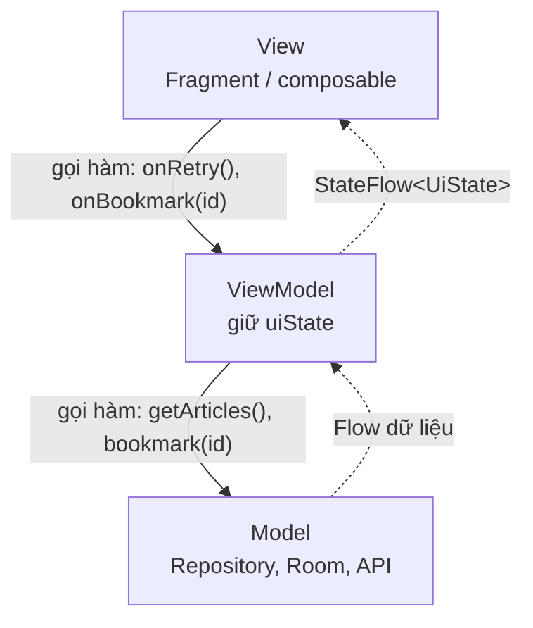
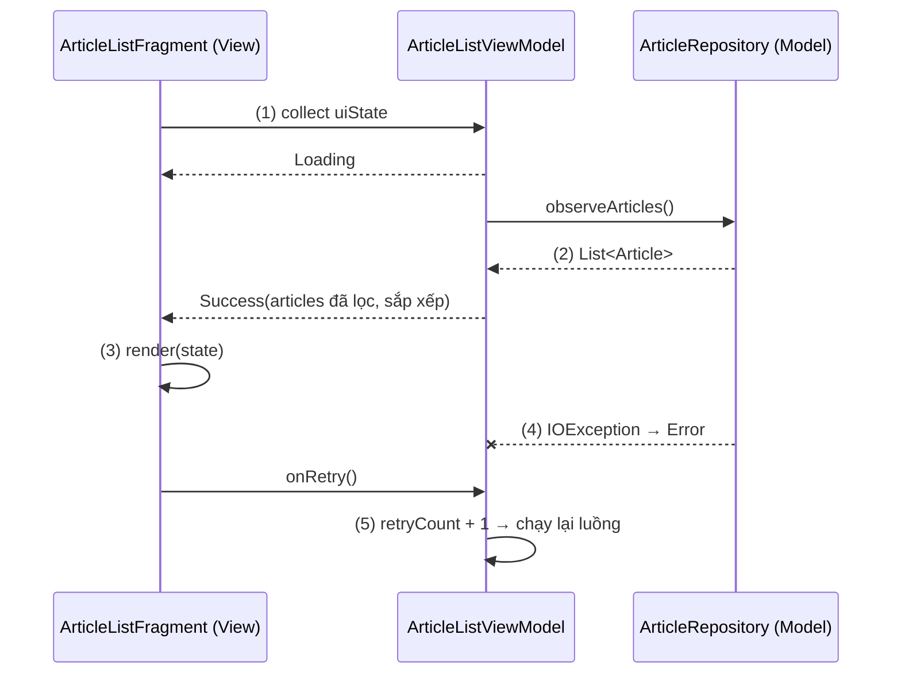
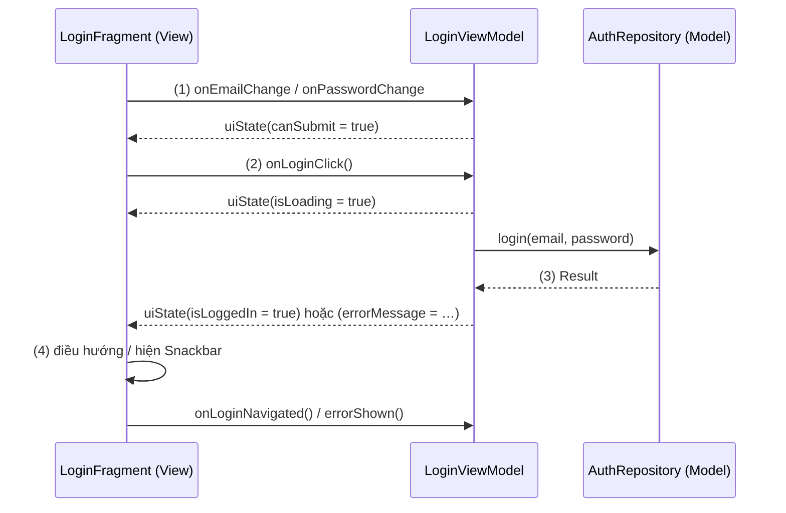

# MVVM

## Vấn đề cần giải quyết

Màn hình đầu tiên của nhiều app thường được viết dồn vào một Activity hoặc Fragment:

```kotlin
// ArticleListFragment.kt (cách làm có vấn đề)
override fun onViewCreated(view: View, savedInstanceState: Bundle?) {
    super.onViewCreated(view, savedInstanceState)
    binding.progress.isVisible = true
    lifecycleScope.launch {
        try {
            val articles = retrofit.create(ArticleApi::class.java).getArticles() // gọi API ngay trong UI
            val visible = articles.filter { !it.isHidden }.sortedByDescending { it.publishedAt }
            adapter.submitList(visible)
            binding.emptyText.isVisible = visible.isEmpty()
        } catch (e: IOException) {
            binding.errorText.isVisible = true
        } finally {
            binding.progress.isVisible = false
        }
    }
}
```

Khi màn hình lớn dần, kiểu viết này gặp bốn vấn đề:

- **Một class làm mọi việc:** gọi mạng, lọc và sắp xếp dữ liệu, quyết định hiển thị, vẽ View. Sửa một quy tắc lọc phải đọc cả code vẽ UI.
- **Không test được logic:** quy tắc "ẩn bài bị ẩn, mới nhất lên đầu" chỉ chạy được khi có Fragment, tức phải có thiết bị hoặc emulator.
- **Gắn với vòng đời của UI:** xoay màn hình thì Fragment bị tạo lại và request chạy lại từ đầu; request đang chạy dở bị huỷ cùng scope của Fragment.
- **State rải rác trong View:** "đang tải", "lỗi", "danh sách rỗng" nằm trong `isVisible` của ba View khác nhau. Không có chỗ nào nói màn hình **đang ở trạng thái gì**, nên dễ hiện cùng lúc vòng tải và thông báo lỗi.

Vấn đề cần giải quyết là: **tách phần "màn hình hiển thị gì" khỏi phần "vẽ nó ra" và phần "dữ liệu đến từ đâu"**, để mỗi phần đổi và test được riêng.

## Sau khi học xong

- Giải thích được ba vai Model, View, ViewModel và hướng phụ thuộc giữa chúng, và vì sao ViewModel không được biết View.
- Phân biệt được vai ViewModel của MVVM với class ViewModel của Jetpack, và MVVM với MVC, MVP, MVI.
- Thiết kế được một màn hình theo luồng dữ liệu một chiều, với một uiState dạng StateFlow đi xuống và thao tác của người dùng đi lên qua hàm của ViewModel.
- Xử lý được event một lần (thông báo, điều hướng) bằng cách biểu diễn nó thành state.
- Nhận diện được các sai lầm như ViewModel giữ View hoặc Context, View chứa logic nghiệp vụ và nhiều luồng state rời rạc gây màn hình mâu thuẫn.

## MVVM là gì?

**MVVM (Model–View–ViewModel)** là pattern kiến trúc cho tầng UI, chia một màn hình thành ba vai: **Model** giữ dữ liệu và logic nghiệp vụ, **View** vẽ state và chuyển thao tác của người dùng, **ViewModel** giữ UI state đã chuẩn bị sẵn cho View. View quan sát ViewModel, còn ViewModel không biết View tồn tại.

Mental model: ViewModel là **màn hình được viết bằng dữ liệu**: nó mô tả đầy đủ "màn hình đang hiện gì" (danh sách nào, có đang tải không, lỗi gì) mà không có một pixel nào. View chỉ là **bộ dịch** từ bản mô tả đó ra pixel, và từ cú chạm của người dùng ra lời gọi hàm. Thay View (XML sang Compose, điện thoại sang tablet) thì bản mô tả không đổi.

## Cách hoạt động

### Ba vai và hướng phụ thuộc

| Vai | Ở Android là | Biết ai | Không biết ai |
|---|---|---|---|
| **View** | Activity, Fragment, composable, layout XML | ViewModel | Model |
| **ViewModel** | Class giữ UI state và nhận thao tác (thường kế thừa `ViewModel` của Jetpack) | Model | View |
| **Model** | Data layer: Repository và data source (Room, API, DataStore); có thể thêm domain layer (use case) | Không ai ở tầng UI | View, ViewModel |

Mũi tên phụ thuộc chỉ đi **một hướng**: View → ViewModel → Model. Dữ liệu đi ngược lại không phải bằng lời gọi hàm, mà bằng **quan sát**: Model đưa dữ liệu ra dạng `Flow`, ViewModel đưa UI state ra dạng `StateFlow` hoặc `LiveData`, và tầng trên tự nhận giá trị mới. Đây là Observer Pattern, giải thích ở [Observer Pattern Overview](../design_pattern/observer/overview.md); `StateFlow` học ở [Flow](../design_pattern/observer/flow.md), LiveData ở [LiveData](../../session_06/livedata.md).



Vì ViewModel không giữ tham chiếu tới View:

- **ViewModel sống được lâu hơn View.** Xoay màn hình thì View bị huỷ và tạo lại, ViewModel vẫn còn và View mới chỉ việc quan sát lại.
- **ViewModel test được trên JVM.** Test gọi hàm của ViewModel và kiểm tra `uiState`, không cần View nào.
- **Một ViewModel phục vụ được nhiều kiểu View.** Cùng một `uiState` có thể được vẽ bằng XML hoặc Compose.

### Vai ViewModel của MVVM và class `ViewModel` của Jetpack

Hai thứ cùng tên nhưng là hai khái niệm khác nhau:

- **Vai ViewModel** là một khái niệm của pattern: thứ giữ UI state và không biết View.
- **Class `androidx.lifecycle.ViewModel`** là một công cụ của Android: object được cất trong `ViewModelStore` nên sống qua configuration change ([ViewModel](../../session_06/viewmodel.md), mục "ViewModel là gì?").

Trên Android, vai ViewModel gần như luôn được hiện thực bằng class `ViewModel` của Jetpack, vì nó giải quyết luôn chuyện sống qua xoay màn hình. Nhưng kế thừa class đó không tự biến code thành MVVM: một `ViewModel` giữ `Fragment`, hoặc một Fragment tự gọi API dù đã có `ViewModel`, đều không phải MVVM. Ngược lại, một class thường giữ state cho một component UI tái sử dụng (state holder) vẫn đóng vai ViewModel mà không cần kế thừa gì.

### UI state và luồng dữ liệu một chiều

Hướng dẫn kiến trúc của Android đặt MVVM trên nguyên tắc **luồng dữ liệu một chiều** (Unidirectional Data Flow, UDF): **state đi xuống, event đi lên**.

1. ViewModel đưa ra **một** property `uiState` mô tả toàn bộ màn hình, thường là `StateFlow<XxxUiState>`.
2. View quan sát `uiState` theo lifecycle và vẽ lại theo giá trị mới nhất. View không tự giữ state nghiệp vụ nào.
3. Người dùng thao tác: View gọi một hàm của ViewModel (`onRetry()`, `onBookmarkClick(id)`), không tự sửa View.
4. ViewModel xử lý (gọi Model nếu cần) và phát ra `uiState` mới; quay lại bước 2.

`XxxUiState` là một `data class` (các phần dữ liệu cùng tồn tại) hoặc `sealed interface` (các trạng thái loại trừ nhau, như Loading/Success/Error). Gom mọi thứ vào một state duy nhất giúp màn hình **không thể** ở trạng thái mâu thuẫn, vì mỗi lần vẽ là vẽ từ một giá trị nhất quán. Khi dữ liệu đến từ một luồng của Model, docs khuyên dựng `uiState` bằng `stateIn(viewModelScope, SharingStarted.WhileSubscribed(5_000), initialValue)`; cách tải lười này đã giải thích ở [ViewModel](../../session_06/viewmodel.md), mục "Tải dữ liệu: lười, không launch trong init".

#### Ví dụ: danh sách bài báo có tải, lỗi và thử lại

**Bài toán:** màn danh sách bài báo đọc từ Repository (Room làm cache, mạng làm mới). Màn hình phải ở đúng một trong ba trạng thái: đang tải, có danh sách, hoặc lỗi kèm nút "Thử lại".

**Luồng chạy:**

1. Fragment bắt đầu quan sát `uiState`; `stateIn` khởi động luồng của Repository và phát `Loading`.
2. Repository phát danh sách bài; ViewModel lọc, sắp xếp rồi phát `Success(articles)`.
3. Fragment vẽ theo state: chỉ một trong ba nhóm View được hiện.
4. Lỗi mạng: ViewModel phát `Error`. Người dùng bấm "Thử lại", Fragment gọi `viewModel.onRetry()`.
5. ViewModel tăng bộ đếm thử lại; luồng chạy lại từ bước 1.



```kotlin
// ArticleListUiState.kt
sealed interface ArticleListUiState {
    data object Loading : ArticleListUiState
    data class Success(val articles: List<Article>) : ArticleListUiState
    data class Error(val message: String) : ArticleListUiState
}

// ArticleListViewModel.kt
class ArticleListViewModel(private val repository: ArticleRepository) : ViewModel() {

    private val retryCount = MutableStateFlow(0)

    @OptIn(ExperimentalCoroutinesApi::class)
    val uiState: StateFlow<ArticleListUiState> = retryCount
        .flatMapLatest {                                                        // (5) mỗi lần thử lại
            repository.observeArticles()                                        // (1)
                .map<List<Article>, ArticleListUiState> { articles ->
                    ArticleListUiState.Success(                                 // (2) quy tắc hiển thị ở đây
                        articles.filter { !it.isHidden }.sortedByDescending { it.publishedAt }
                    )
                }
                .onStart { emit(ArticleListUiState.Loading) }
                .catch { emit(ArticleListUiState.Error("Không tải được bài báo")) } // (4)
        }
        .stateIn(viewModelScope, SharingStarted.WhileSubscribed(5_000), ArticleListUiState.Loading)

    fun onRetry() {
        retryCount.update { it + 1 }                                            // (5)
    }
}
```

```kotlin
// ArticleListFragment.kt
override fun onViewCreated(view: View, savedInstanceState: Bundle?) {
    super.onViewCreated(view, savedInstanceState)
    val binding = FragmentArticleListBinding.bind(view)
    val adapter = ArticleAdapter()
    binding.articleList.adapter = adapter
    binding.retryButton.setOnClickListener { viewModel.onRetry() }             // (4) event đi lên

    viewLifecycleOwner.lifecycleScope.launch {
        viewLifecycleOwner.repeatOnLifecycle(Lifecycle.State.STARTED) {
            viewModel.uiState.collect { state ->                                // (1) state đi xuống
                binding.progress.isVisible = state is ArticleListUiState.Loading    // (3)
                binding.errorGroup.isVisible = state is ArticleListUiState.Error
                binding.articleList.isVisible = state is ArticleListUiState.Success
                if (state is ArticleListUiState.Success) adapter.submitList(state.articles)
            }
        }
    }
}
```

`flatMapLatest`, `onStart`, `catch` là toán tử của Flow, học ở [Flow](../design_pattern/observer/flow.md). Fragment không có `if` nghiệp vụ nào: nó chỉ dịch state thành `isVisible` và danh sách. `ArticleAdapter` là adapter của `RecyclerView`, học ở [ViewHolder Pattern](../design_pattern/viewholder_pattern.md).

**Kết quả:** quy tắc "ẩn bài bị ẩn, mới nhất lên đầu" giờ nằm trong ViewModel và test được bằng một `FakeArticleRepository`. Tắt mạng thì màn hình chỉ hiện lỗi, không còn vòng tải; bấm "Thử lại" khi có mạng thì danh sách hiện. Xoay màn hình không chạy lại luồng, nhờ `WhileSubscribed(5_000)`.

### Thao tác của người dùng và event một lần

Thao tác đi lên bằng **lời gọi hàm** của ViewModel. Tên hàm nói về việc người dùng làm (`onBookmarkClick(articleId)`), không nói về View (`onStarImageViewClicked()`), để cùng ViewModel dùng được cho mọi kiểu UI.

Khó hơn là những thứ chỉ xảy ra **một lần**: hiện Snackbar "Đã lưu", điều hướng sang màn kế tiếp sau khi đăng nhập. Gửi chúng qua một kênh event riêng (`SharedFlow`, `Channel`, `SingleLiveEvent`) không bảo đảm event được xử lý: `SharedFlow` không replay làm mất event phát ra lúc không có ai đang collect (ví dụ đúng lúc xoay màn hình), còn `Channel` giữ event tới khi có người nhận nhưng event vẫn mất nếu được nhận đúng lúc coroutine collect bị huỷ. Docs khuyên **không gửi event từ ViewModel sang UI**: xử lý event ngay trong ViewModel và đưa kết quả vào state. Cách làm:

1. ViewModel đưa kết quả vào `uiState`, ví dụ `userMessage = "Đã lưu bài"` hoặc `isLoggedIn = true`.
2. View vẽ state đó: hiện Snackbar, hoặc điều hướng.
3. View báo lại đã xử lý xong: `viewModel.userMessageShown()`; ViewModel xoá phần state đó.

Vì thông điệp nằm trong state, nó không mất khi xoay màn hình (View mới vẽ lại state hiện tại), và không bị hiện hai lần (đã được xoá sau bước 3). Code đầy đủ của mẫu này với LiveData ở [LiveData](../../session_06/livedata.md), mục "Ví dụ thực tế"; với `StateFlow` ở mục "Ví dụ thực tế" bên dưới.

### Model trong Android: data layer và domain layer

Chữ "Model" trong MVVM không phải một class mà là **mọi thứ bên dưới tầng UI**. Theo hướng dẫn kiến trúc của Android:

- **Data layer** (bắt buộc): Repository đưa dữ liệu của app ra cho phần còn lại, giấu việc dữ liệu đến từ Room, mạng hay DataStore. Docs khuyên tạo Repository kể cả khi chỉ có một nguồn, và **ViewModel không gọi thẳng data source** (DAO, Retrofit service). Repository và nguồn sự thật đã gặp ở [Room Architecture](../../session_05/data_store/room_architecture.md), mục "Single Source of Truth (SSOT) và Offline-first" và [Networking](../../session_05/networking.md).
- **Domain layer** (tuỳ chọn, khuyên dùng cho app lớn): các use case gom logic nghiệp vụ dùng lại ở nhiều ViewModel, ví dụ `GetVisibleArticlesUseCase`. Domain layer của Google phụ thuộc data layer (use case gọi class Repository ở data layer); Clean Architecture đảo chiều này, đặt interface Repository ở domain để data layer hiện thực nó, xem [Clean Architecture](clean_architecture.md), mục "So sánh với các cách tiếp cận khác".

ViewModel giữ **logic UI** (dữ liệu nào hiện, định dạng ra sao, trạng thái tải) và gọi Model cho **logic nghiệp vụ** (quy tắc của sản phẩm, đọc ghi dữ liệu). Ranh giới này không cứng: app nhỏ có thể để quy tắc lọc trong ViewModel như ví dụ trên, rồi chuyển xuống use case khi nhiều màn cùng cần.

### View cập nhật thế nào: tự vẽ, Data Binding hay Compose

MVVM chỉ đòi View **quan sát** ViewModel; cách quan sát tuỳ công nghệ UI:

| Cách | View làm gì | Ghi chú |
|---|---|---|
| View/XML + View Binding | `collect` `uiState` rồi tự gán vào View, như ví dụ trên | Rõ ràng, debug dễ; Fragment có một hàm `render(state)` |
| View/XML + Data Binding | Layout đọc `uiState` qua biểu thức `@{}` | Bớt code trong Fragment; logic dễ lọt vào XML ([Data Binding](../../session_06/data_binding.md)) |
| Jetpack Compose | `collectAsStateWithLifecycle()` rồi gọi composable với state | Docs khuyên dùng cho UI mới; recomposition thay cho tự gán |

MVVM ở WPF nguyên thuỷ dựa hẳn vào data binding. Trên Android, binding là tuỳ chọn: phần cốt lõi là ViewModel đưa state ra và View quan sát nó.

## Ví dụ thực tế

Ba bài toán hay gặp khi tổ chức màn hình theo MVVM:

1. **Form đăng nhập:** ô nhập, kiểm tra hợp lệ, trạng thái đang gửi, lỗi và điều hướng sau khi thành công, kèm unit test. Đây là bài toán chính, code đầy đủ bên dưới.
2. **Danh sách có tải, lỗi, thử lại:** như ví dụ ở mục "UI state và luồng dữ liệu một chiều".
3. **Cùng ViewModel cho XML và Compose:** khi chuyển dần sang Compose, màn mới viết `LoginScreen(uiState, onEmailChange, …)` và dùng nguyên `LoginViewModel`; chỉ View đổi.

### Form đăng nhập với UI state, event thành state và unit test

**Bài toán:** màn đăng nhập có email, mật khẩu và nút "Đăng nhập". Nút chỉ bật khi email đúng định dạng và mật khẩu đủ 8 ký tự; khi đang gửi thì hiện vòng tải; sai mật khẩu thì hiện lỗi; thành công thì sang màn chính **đúng một lần**, kể cả nếu người dùng xoay màn hình đúng lúc đó.

**Luồng chạy:**

1. Người dùng gõ: View gọi `onEmailChange()`, `onPasswordChange()`; ViewModel cập nhật `uiState` và tính lại `canSubmit`.
2. Bấm "Đăng nhập": View gọi `onLoginClick()`; ViewModel đặt `isLoading = true` rồi gọi `AuthRepository.login()` trong `viewModelScope`.
3. Thành công: ViewModel đặt `isLoggedIn = true`. Sai thông tin: đặt `errorMessage`.
4. View thấy `isLoggedIn = true` thì điều hướng, rồi gọi `onLoginNavigated()` để ViewModel đặt lại cờ. Thấy `errorMessage` thì hiện Snackbar rồi gọi `errorShown()`.
5. Unit test gọi các hàm của ViewModel với `FakeAuthRepository` và kiểm tra `uiState`.



```kotlin
// LoginUiState.kt
data class LoginUiState(
    val email: String = "",
    val password: String = "",
    val isLoading: Boolean = false,
    val errorMessage: String? = null,
    val isLoggedIn: Boolean = false
) {
    val canSubmit: Boolean
        get() = !isLoading && EMAIL_REGEX.matches(email) && password.length >= 8

    private companion object {
        // Regex thuần Kotlin thay cho android.util.Patterns: test chạy được trên JVM
        val EMAIL_REGEX = Regex("^[^@\\s]+@[^@\\s]+\\.[^@\\s]+$")
    }
}

// LoginViewModel.kt
class LoginViewModel(private val authRepository: AuthRepository) : ViewModel() {

    private val _uiState = MutableStateFlow(LoginUiState())
    val uiState: StateFlow<LoginUiState> = _uiState.asStateFlow()

    fun onEmailChange(email: String) = _uiState.update { it.copy(email = email.trim()) }       // (1)
    fun onPasswordChange(password: String) = _uiState.update { it.copy(password = password) }

    fun onLoginClick() {
        val state = _uiState.value
        if (!state.canSubmit) return
        _uiState.update { it.copy(isLoading = true, errorMessage = null) }                   // (2)
        viewModelScope.launch {
            val result = authRepository.login(state.email, state.password)
            _uiState.update {                                                                   // (3)
                if (result.isSuccess) it.copy(isLoading = false, isLoggedIn = true)
                else it.copy(isLoading = false, errorMessage = "Email hoặc mật khẩu không đúng")
            }
        }
    }

    fun onLoginNavigated() = _uiState.update { it.copy(isLoggedIn = false) }                  // (4)
    fun errorShown() = _uiState.update { it.copy(errorMessage = null) }
}
```

Kiểm tra email dùng regex thuần Kotlin thay vì `android.util.Patterns`, vì class của Android framework không có giá trị khi chạy unit test trên JVM. `AuthRepository.login()` là hàm `suspend` trả `Result<Unit>`, giấu việc gọi API và lưu token ([Key-Value Storage](../../session_05/data_store/key_value.md)).

```kotlin
// LoginFragment.kt
override fun onViewCreated(view: View, savedInstanceState: Bundle?) {
    super.onViewCreated(view, savedInstanceState)
    val binding = FragmentLoginBinding.bind(view)
    binding.emailInput.doAfterTextChanged { viewModel.onEmailChange(it.toString()) }        // (1)
    binding.passwordInput.doAfterTextChanged { viewModel.onPasswordChange(it.toString()) }
    binding.loginButton.setOnClickListener { viewModel.onLoginClick() }                       // (2)

    viewLifecycleOwner.lifecycleScope.launch {
        viewLifecycleOwner.repeatOnLifecycle(Lifecycle.State.STARTED) {
            viewModel.uiState.collect { state ->
                binding.loginButton.isEnabled = state.canSubmit
                binding.progress.isVisible = state.isLoading
                state.errorMessage?.let { message ->                                          // (4)
                    Snackbar.make(binding.root, message, Snackbar.LENGTH_SHORT).show()
                    viewModel.errorShown()
                }
                if (state.isLoggedIn) {
                    findNavController().navigate(R.id.action_login_to_home)
                    viewModel.onLoginNavigated()
                }
            }
        }
    }
}
```

Ô nhập không được gán ngược từ state, vì `EditText` tự giữ text người dùng đang gõ; gán lại mỗi lần state đổi sẽ làm con trỏ nhảy. `findNavController()` thuộc Navigation, chỉ dùng tối thiểu ở đây. `Snackbar` học ở 8.5.5 Message (chưa có bài).

```kotlin
// LoginViewModelTest.kt (src/test): (5) kiểm tra state, không cần View
class FakeAuthRepository(var result: Result<Unit> = Result.success(Unit)) : AuthRepository {
    override suspend fun login(email: String, password: String) = result
}

@OptIn(ExperimentalCoroutinesApi::class)
class LoginViewModelTest {
    @get:Rule val mainDispatcherRule = MainDispatcherRule()   // thay Dispatchers.Main bằng test dispatcher

    @Test
    fun wrongPassword_showsErrorAndStaysOnScreen() = runTest {
        val viewModel = LoginViewModel(FakeAuthRepository(Result.failure(IOException())))
        viewModel.onEmailChange("an@shop.vn")
        viewModel.onPasswordChange("12345678")

        viewModel.onLoginClick()
        advanceUntilIdle()

        val state = viewModel.uiState.value
        assertFalse(state.isLoggedIn)
        assertEquals("Email hoặc mật khẩu không đúng", state.errorMessage)
    }
}
```

`MainDispatcherRule` là một JUnit rule ngắn của dự án, gọi `Dispatchers.setMain` trước mỗi test và `Dispatchers.resetMain` sau test; nó làm đúng việc mà cặp `@Before`/`@After` trong test của [ViewModel](../../session_06/viewmodel.md), mục "Ví dụ thực tế", đang làm, chỉ gom lại để dùng chung.

**Kết quả:** gõ email sai định dạng thì nút "Đăng nhập" mờ. Đăng nhập thành công rồi xoay màn hình ngay lúc chuyển: màn chính chỉ mở một lần, vì `isLoggedIn` đã được đặt lại sau khi điều hướng. Sai mật khẩu thì Snackbar hiện một lần, xoay màn hình không hiện lại. Test chạy bằng `./gradlew testDebugUnitTest`.

## So sánh với các cách tiếp cận khác

| Pattern | Thành phần giữa UI và dữ liệu | Thành phần đó có biết View? | Cập nhật UI |
|---|---|---|---|
| MVC gốc | Controller (chỉ xử lý input) | Có, đi cặp với một View | View quan sát Model và tự vẽ lại |
| MVC kiểu Android | Activity / Fragment | Nó **chính là** View | Activity gán thẳng dữ liệu vào widget |
| MVP | Presenter | Có, qua interface `View` (`showArticles()`, `showError()`) | Presenter gọi hàm của View |
| **MVVM** | ViewModel | **Không** | View quan sát state của ViewModel |
| MVI | ViewModel / Store, reducer | Không | Như MVVM, nhưng mọi thay đổi (Intent và kết quả side effect) đi qua một reducer duy nhất, state bất biến |

Khác biệt cốt lõi giữa MVP và MVVM là **ai giữ tham chiếu tới ai**. Presenter giữ View nên phải tự gỡ khi View bị huỷ; ViewModel không giữ gì nên sống qua xoay màn hình một cách tự nhiên. MVVM theo UDF với một `uiState` như bài này đã rất gần MVI; MVI chặt hơn ở chỗ mọi thay đổi đều đi qua một hàm reducer. Chi tiết từng pattern ở [MVC](mvc.md), [MVP](mvp.md) và [MVI](mvi.md).

## Khi nào nên và không nên dùng

- **Nên dùng** cho hầu hết màn hình của app Android hiện nay: đây là kiến trúc mà hướng dẫn chính thức, các thư viện Jetpack (ViewModel, Lifecycle, Navigation) và Compose được thiết kế để phục vụ.
- **Nên dùng** khi màn hình có state đáng kể (tải, lỗi, form, lọc) hoặc logic cần unit test.
- **Không cần** dựng đủ ba vai cho màn hình tĩnh không có state (trang giới thiệu, điều khoản), hoặc cho một component UI tái sử dụng: component đó dùng state holder thường, không dùng class `ViewModel`.
- **Cân nhắc MVI** khi màn hình có nhiều thao tác tác động chéo lên cùng một state (trình soạn thảo, giỏ hàng nhiều bước) và cần mọi thay đổi đi qua một chỗ để dễ lần vết.

## Sai lầm thường gặp

### 1. ViewModel giữ View, Fragment hoặc Context

```kotlin
// Sai: ViewModel biết View
class LoginViewModel(private val fragment: LoginFragment) : ViewModel() {
    fun onLoginSuccess() = fragment.findNavController().navigate(R.id.action_login_to_home)
}
```

**Lỗi lộ ra thế nào:** xoay màn hình thì ViewModel vẫn giữ Fragment cũ đã bị huỷ: leak cả cây View, và lệnh điều hướng chạy trên Fragment đã chết có thể crash. ViewModel cũng không unit test được vì cần Fragment thật.

**Cách sửa:** ViewModel chỉ đặt state (`isLoggedIn = true`), View quan sát và tự điều hướng. Docs khuyên ViewModel không giữ `Activity`, `Context` hay `Resources`, và không dùng `AndroidViewModel`.

### 2. View vẫn chứa logic nghiệp vụ

```kotlin
// Sai: quy tắc nằm trong Fragment
viewModel.articles.observe(viewLifecycleOwner) { articles ->
    adapter.submitList(articles.filter { !it.isHidden && it.publishedAt > lastWeek })
}
```

**Lỗi lộ ra thế nào:** quy tắc "bài trong tuần, không bị ẩn" không test được, và màn khác cần cùng quy tắc sẽ chép lại. Đây là "Massive Fragment" khoác áo MVVM.

**Cách sửa:** ViewModel (hoặc use case) đưa ra danh sách đã lọc; View chỉ hiển thị.

### 3. Nhiều luồng state rời rạc

```kotlin
// Sai: bốn luồng độc lập cho một màn hình
val isLoading = MutableLiveData(false)
val articles = MutableLiveData<List<Article>>()
val error = MutableLiveData<String?>()
val isEmpty = MutableLiveData(false)
```

**Lỗi lộ ra thế nào:** mỗi luồng được View quan sát riêng và đổi vào thời điểm khác nhau, nên có lúc màn hình vừa hiện vòng tải vừa hiện lỗi, hoặc hiện "Không có bài" trong khi danh sách đang về. Mỗi chỗ đổi state phải nhớ đặt lại ba luồng kia.

**Cách sửa:** một `uiState` duy nhất (`data class` hoặc `sealed interface`), đổi nguyên khối mỗi lần. Các phần dữ liệu thật sự không liên quan nhau có thể tách thành vài state riêng, nhưng không tách những phần phải nhất quán với nhau.

### 4. Gửi event một lần qua kênh riêng

```kotlin
// Không nên: event có thể mất hoặc lặp
private val _navigateHome = MutableSharedFlow<Unit>()
val navigateHome = _navigateHome.asSharedFlow()
```

**Lỗi lộ ra thế nào:** `SharedFlow` không có replay thì event phát ra đúng lúc View đang tạo lại (xoay màn hình) sẽ bị mất: đăng nhập xong mà không sang màn chính. Dùng `LiveData` cho event thì ngược lại: event bị phát lại cho View mới, Snackbar hiện hai lần.

**Cách sửa:** biểu diễn event thành state rồi để View báo đã xử lý, như mục "Thao tác của người dùng và event một lần".

### 5. ViewModel gọi thẳng data source

```kotlin
// Sai: ViewModel biết Retrofit và DAO
class ArticleListViewModel(private val api: ArticleApi, private val dao: ArticleDao) : ViewModel()
```

**Lỗi lộ ra thế nào:** quyết định "đọc cache hay gọi mạng" nằm rải ở nhiều ViewModel, mỗi nơi làm một kiểu; đổi API hay thêm cache phải sửa mọi màn. Test ViewModel phải giả lập cả Retrofit lẫn Room.

**Cách sửa:** ViewModel chỉ phụ thuộc `ArticleRepository`; Repository mới biết DAO và API.

## Lịch sử phát triển

- **1979:** Trygve Reenskaug mô tả MVC cho Smalltalk, tách dữ liệu (Model) khỏi hiển thị (View) và xử lý input (Controller).
- **Thập niên 1990:** MVP xuất hiện (Taligent), Presenter nhận input và cập nhật View qua interface.
- **2004:** Martin Fowler mô tả Presentation Model: một class giữ state và hành vi của màn hình, không phụ thuộc UI framework.
- **2005:** John Gossman (Microsoft) giới thiệu MVVM cho WPF, một biến thể của Presentation Model dựa vào data binding của WPF.
- **Android những năm đầu:** không có kiến trúc chính thức; Activity thường làm mọi việc ("Massive Activity"), cộng đồng dùng MVP để tách logic ra khỏi Activity.
- **Google I/O 2015:** Data Binding Library ra mắt, cho layout XML quan sát dữ liệu.
- **Google I/O 2017:** Android Architecture Components (Lifecycle, LiveData, ViewModel, Room) và "Guide to app architecture" chính thức đưa MVVM thành hướng khuyên dùng.
- **12/2021:** Google viết lại hướng dẫn kiến trúc: tầng UI, tầng data, tầng domain tuỳ chọn, UI state và luồng dữ liệu một chiều; MVVM giữ vai trò ở tầng UI, kết hợp Compose (stable 07/2021).
- **Hiện nay:** khuyến nghị kiến trúc của Android gồm UDF, một `uiState` dạng `StateFlow` dựng bằng `stateIn(... WhileSubscribed(5000))`, không gửi event từ ViewModel sang UI, ViewModel ở cấp màn hình và Compose cho UI mới.

## Kết nối hệ thống

- **Tiên quyết:**
  - [ViewModel](../../session_06/viewmodel.md): class hiện thực vai ViewModel, vì sao nó sống qua xoay màn hình, tải dữ liệu lười.
  - [LiveData](../../session_06/livedata.md): một cách đưa state ra cho View quan sát, và mẫu event thành state.
  - [Fragment Lifecycle](../../session_04/components/fragment/lifecycle.md): quan sát state trên `viewLifecycleOwner`.
- **Liên quan:**
  - [View Binding](../../session_06/view_binding.md) và [Data Binding](../../session_06/data_binding.md): hai cách View vẽ state trong UI XML.
  - [Room Architecture](../../session_05/data_store/room_architecture.md) và [Networking](../../session_05/networking.md): Model của các ví dụ.
  - [Jetpack Compose Overview](../../jetpack_compose_ui/overview.md): View viết bằng Compose cho cùng ViewModel.
  - [SRP — Single Responsibility Principle](../../../../design-principles/02-solid/solid-srp.md): nguyên lý đứng sau việc tách ba vai.
- **Học tiếp:**
  - [Observer Pattern Overview](../design_pattern/observer/overview.md) và [Flow](../design_pattern/observer/flow.md): cơ chế quan sát và `StateFlow`.
  - [MVC](mvc.md), [MVP](mvp.md), [MVI](mvi.md): các pattern đứng trước và sau MVVM.
  - [Clean Architecture](clean_architecture.md): đặt nghiệp vụ ở giữa, data layer phụ thuộc domain qua interface.
  - [Hilt](../design_pattern/di/hilt.md): cung cấp Repository cho ViewModel.

## Tham khảo

- [Guide to app architecture - Android Developers](https://developer.android.com/topic/architecture)
- [UI layer - Android Developers](https://developer.android.com/topic/architecture/ui-layer)
- [UI events (không gửi event từ ViewModel) - Android Developers](https://developer.android.com/topic/architecture/ui-layer/events)
- [Recommendations for Android architecture - Android Developers](https://developer.android.com/topic/architecture/recommendations)
- [Data layer - Android Developers](https://developer.android.com/topic/architecture/data-layer)
- [Rebuilding our guide to app architecture (12/2021) - Android Developers Blog](https://android-developers.googleblog.com/2021/12/rebuilding-our-guide-to-app-architecture.html)
- [Presentation Model - Martin Fowler](https://martinfowler.com/eaaDev/PresentationModel.html)
- [GUI Architectures (MVC, MVP, Presentation Model) - Martin Fowler](https://martinfowler.com/eaaDev/uiArchs.html)
