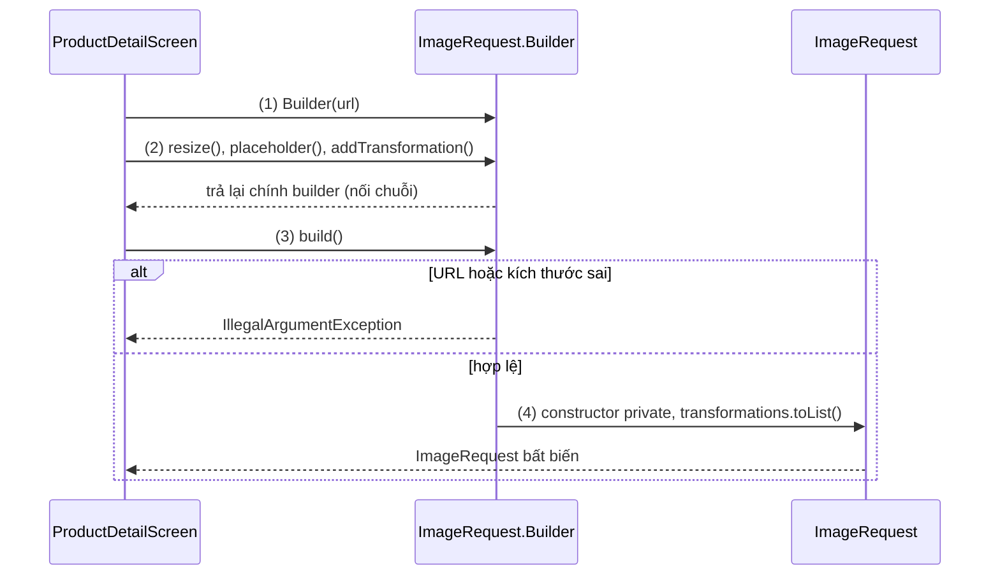
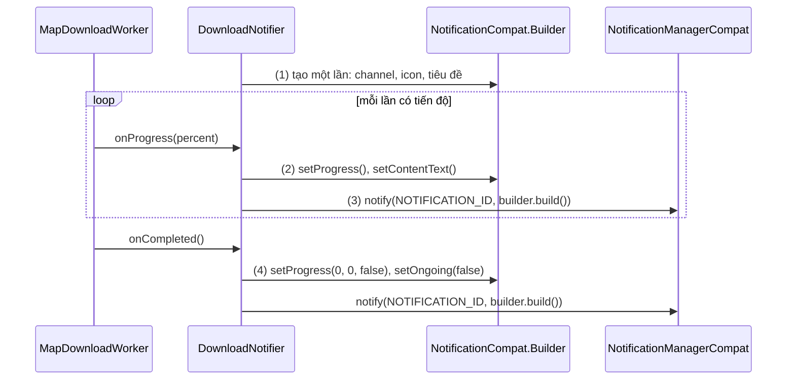
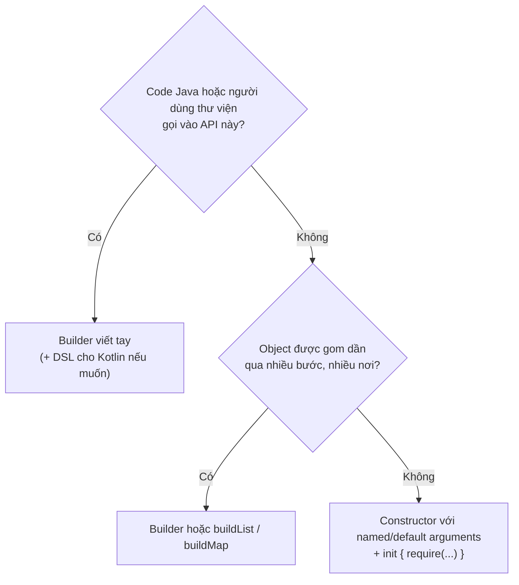
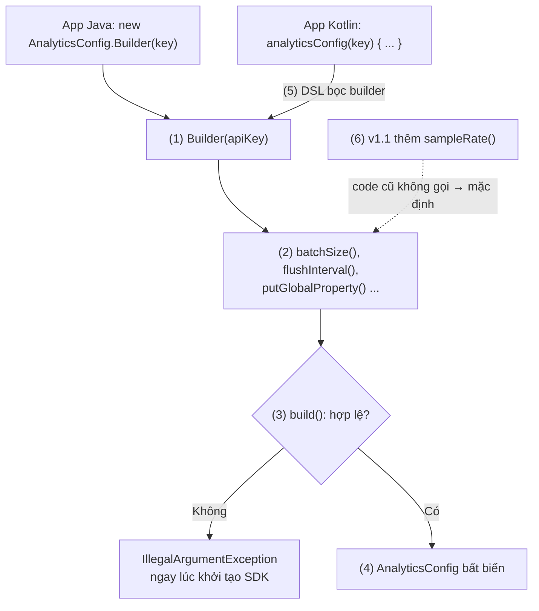

# Builder Pattern

## Vấn đề cần giải quyết

Một object có vài tham số bắt buộc và nhiều tham số tuỳ chọn. Nếu chỉ có constructor, cách tạo nó trở nên khó đọc và dễ sai:

```kotlin
// UploadRequest.kt (cách làm có vấn đề): mọi tham số đều theo vị trí
class UploadRequest(
    val url: String,
    val file: File,
    val mimeType: String?,
    val timeoutSeconds: Int,
    val retryCount: Int,
    val wifiOnly: Boolean,
    val showProgress: Boolean
)

val request = UploadRequest(url, file, null, 30, 3, true, false) // true, false nghĩa là gì?
```

Kiểu viết này có bốn vấn đề:

- **Không đọc được:** `30, 3, true, false` không nói gì. Đổi chỗ `wifiOnly` và `showProgress` vẫn compile, vì cùng kiểu `Boolean`.
- **Constructor "lồng kính thiên văn" (telescoping constructor):** trong Java không có tham số mặc định, nên mỗi tổ hợp tuỳ chọn cần một overload: `UploadRequest(url, file)`, `UploadRequest(url, file, mimeType)`... Số overload tăng theo số tuỳ chọn.
- **Object dở dang:** cách thay thế là constructor rỗng cộng setter (`request.setTimeout(30)`). Khi đó object tồn tại ở trạng thái thiếu tham số trong khoảng giữa các lời gọi setter, và vẫn đổi được sau khi đã được dùng.
- **Kiểm tra rải rác:** quy tắc "có `showProgress` thì phải có `mimeType`" không có chỗ nào để đặt cho đúng lúc.

Vấn đề cần giải quyết là: **tạo một object nhiều tham số sao cho mỗi tham số được đặt theo tên, phần tuỳ chọn có thể bỏ qua, và object chỉ ra đời khi đã đủ và hợp lệ.**

## Sau khi học xong

- Giải thích được cấu trúc của Builder Pattern (builder, các bước có tên, build()) và vấn đề constructor nhiều tham số mà nó giải quyết.
- Áp dụng được các builder có sẵn trong Android như NotificationCompat.Builder, AlertDialog.Builder, Room.databaseBuilder và OkHttpClient.Builder, kể cả việc giữ builder để build lại.
- Phân biệt được builder viết tay với named/default arguments, apply và DSL builder của Kotlin.
- Biết khi nào nên tự viết builder (API cho code Java, thư viện cần tương thích nhị phân, object gom dần qua nhiều bước) và khi nào chỉ cần constructor của Kotlin.
- Nhận diện được các sai lầm như builder thừa cho class Kotlin, build() không kiểm tra, object "bất biến" dùng chung list của builder và build lại object đắt tiền nhiều lần.

## Builder Pattern là gì?

**Builder Pattern** là một creational design pattern (pattern về cách tạo object) tách việc **cấu hình** một object nhiều tham số khỏi việc **tạo** ra nó: một object builder riêng thu thập từng tham số qua các bước có tên, rồi hàm `build()` kiểm tra và tạo ra object cuối, thường là bất biến.

Mental model: builder là **phiếu đặt món**. Bạn ghi từng mục lên phiếu theo tên ("cỡ lớn", "ít đá"), bỏ trống mục nào thì bếp dùng mặc định, và có thể sửa phiếu bao nhiêu lần tuỳ ý. Chỉ khi bấm "gửi bếp" (`build()`), bếp mới kiểm tra phiếu và làm ra món. Món đã ra thì không sửa nữa; muốn món khác thì sửa phiếu và gửi lại.

## Cách hoạt động

### Cấu trúc: tham số bắt buộc, các bước có tên, `build()`

Bản Builder dùng hằng ngày trong Java và Android là biến thể Joshua Bloch mô tả trong *Effective Java*, gọn hơn bản gốc của GoF (xem "Lịch sử phát triển"). Nó có bốn phần:

1. **Tham số bắt buộc** nằm ở constructor của builder, nên không thể quên.
2. **Mỗi tham số tuỳ chọn là một hàm có tên**, đặt giá trị vào builder rồi trả lại chính builder. Nhờ đó các lời gọi nối được thành chuỗi (fluent interface). Hàm có thể gọi nhiều lần để gom dần (`addHeader()` gọi ba lần là ba header).
3. **`build()` kiểm tra** mọi quy tắc, kể cả quy tắc giữa nhiều tham số, và ném lỗi ngay nếu sai.
4. **Object cuối có constructor `private`** và chỉ có `val`, nên cách duy nhất để có nó là đi qua `build()`, và có rồi thì không đổi được.

#### Ví dụ: yêu cầu tải ảnh có nhiều tuỳ chọn

**Bài toán:** một module tải ảnh nhận yêu cầu gồm URL (bắt buộc), kích thước cần resize, ảnh chờ, chính sách cache và danh sách phép biến đổi (bo tròn, làm mờ). Phần lớn màn hình chỉ đặt một hai tuỳ chọn, và yêu cầu sai (URL không phải HTTPS, kích thước âm) phải bị chặn trước khi chạm vào mạng. Thư viện thật như Coil có `ImageRequest.Builder` theo đúng cách này.

**Luồng chạy:**

1. Màn hình tạo `ImageRequest.Builder(url)`: URL bắt buộc nằm ở constructor.
2. Gọi các bước tuỳ chọn `resize()`, `placeholder()`, `addTransformation()`; mỗi bước ghi vào builder và trả lại builder.
3. Gọi `build()`: builder kiểm tra URL và kích thước.
4. Hợp lệ thì `build()` gọi constructor `private` của `ImageRequest`, kèm **bản sao** của danh sách biến đổi.



```kotlin
// ImageRequest.kt
data class PixelSize(val width: Int, val height: Int)

enum class CachePolicy { ENABLED, READ_ONLY, DISABLED }

fun interface Transformation {
    fun key(): String
}

class ImageRequest private constructor(                       // (4) chỉ build() tạo được
    val url: String,
    val size: PixelSize?,
    @DrawableRes val placeholderRes: Int?,
    val cachePolicy: CachePolicy,
    val transformations: List<Transformation>
) {
    class Builder(private val url: String) {                   // (1) tham số bắt buộc
        private var size: PixelSize? = null
        private var placeholderRes: Int? = null
        private var cachePolicy = CachePolicy.ENABLED
        private val transformations = mutableListOf<Transformation>()

        fun resize(width: Int, height: Int): Builder {         // (2) bước có tên, trả lại builder
            size = PixelSize(width, height)
            return this
        }

        fun placeholder(@DrawableRes res: Int): Builder {
            placeholderRes = res
            return this
        }

        fun cachePolicy(policy: CachePolicy): Builder {
            cachePolicy = policy
            return this
        }

        fun addTransformation(transformation: Transformation): Builder {
            transformations += transformation                  // gọi nhiều lần để gom dần
            return this
        }

        fun build(): ImageRequest {
            require(url.startsWith("https://")) { "Chỉ tải ảnh qua HTTPS: $url" }      // (3)
            size?.let { require(it.width > 0 && it.height > 0) { "Kích thước phải dương: $it" } }
            return ImageRequest(url, size, placeholderRes, cachePolicy, transformations.toList()) // (4)
        }
    }
}
```

```kotlin
// ProductDetailFragment.kt
val request = ImageRequest.Builder(product.imageUrl)
    .resize(720, 720)
    .placeholder(R.drawable.product_placeholder)
    .addTransformation(RoundedCorners(radiusPx = 16))
    .build()
```

`RoundedCorners` là một `Transformation` của module, không quan trọng ở đây. `@DrawableRes` (từ `androidx.annotation`) chỉ để lint kiểm tra id truyền vào đúng là drawable.

**Kết quả:** mỗi tuỳ chọn được đặt theo tên, phần không đặt dùng mặc định. Unit test `assertThrows(IllegalArgumentException::class.java) { ImageRequest.Builder("http://cdn.shop.vn/a.jpg").build() }` đạt, vì yêu cầu sai không bao giờ thành object. Gọi `addTransformation()` tiếp trên builder sau khi đã `build()` không làm đổi `request.transformations`, nhờ bản sao ở bước (4).

> [!NOTE]
> Bản gốc của GoF có thêm vai **Director**: một object biết *thứ tự* gọi các bước, dùng cùng thứ tự đó với nhiều builder khác nhau để ra nhiều "biểu diễn" (ví dụ cùng một tài liệu xuất ra HTML hoặc PDF). Builder trong Android gần như không bao giờ có Director: chính code gọi là người chỉ huy.

### Builder có sẵn trong Android

Android và các thư viện Jetpack dùng builder ở những chỗ object có nhiều tuỳ chọn hoặc tạo ra tốn kém:

| Builder | `build()` (hoặc tương đương) tạo ra | Lưu ý |
|---|---|---|
| `AlertDialog.Builder(context)` | `AlertDialog` qua `create()` hoặc `show()` | Thường gọi trong `onCreateDialog()` của `DialogFragment` để dialog sống qua xoay màn hình ([Dialog and DialogFragment](../../session_04/components/fragment/dialog_and_dialogfragment.md)) |
| `NotificationCompat.Builder(context, channelId)` | `Notification` | Constructor không có `channelId` đã deprecated; builder giữ lại được để build nhiều lần |
| `Room.databaseBuilder(context, AppDatabase::class.java, "app.db")` | `AppDatabase` | Tạo database tốn kém: build **một lần** cho cả process ([Room nâng cao](../../session_05/data_store/room_advanced.md)) |
| `OkHttpClient.Builder()`, `Retrofit.Builder()` | `OkHttpClient`, `Retrofit` | Client nên dùng chung; cần cấu hình khác thì `client.newBuilder()` để dùng chung connection pool và thread pool ([OkHttp](../../session_08/networks/okhttp.md)) |
| `OneTimeWorkRequestBuilder<T>()`, `Constraints.Builder()` | `OneTimeWorkRequest`, `Constraints` | `OneTimeWorkRequestBuilder` là hàm Kotlin trả về `OneTimeWorkRequest.Builder` ([Android Service](../../session_04/components/services/android_service.md), mục "WorkManager — Lựa chọn hiện đại cho background task") |

Hai tính chất của builder hay bị bỏ qua:

- **Builder không phải object kết quả.** `NotificationCompat.Builder` là phiếu; `Notification` mới là món được đưa cho hệ thống. Sửa builder sau khi `notify()` không đổi thông báo đang hiện, phải `build()` và `notify()` lại.
- **Builder dùng lại được.** Vì builder chỉ giữ cấu hình, có thể giữ nó làm field, sửa vài mục rồi `build()` ra object mới. `client.newBuilder()` của OkHttp đi theo chiều ngược lại: từ một object đã có, lấy ra một phiếu chứa sẵn cấu hình của nó.

#### Ví dụ: thông báo tiến độ tải bản đồ ngoại tuyến

**Bài toán:** app bản đồ cho tải vùng bản đồ để dùng ngoại tuyến; thông báo hiện thanh tiến độ và cập nhật khi tải, rồi đổi thành "Đã tải xong". Các mục như icon, tiêu đề, channel không đổi, chỉ tiến độ và nội dung đổi: đúng trường hợp giữ một builder và build lại.

**Luồng chạy:**

1. Tạo `NotificationCompat.Builder` **một lần** với channel, icon, tiêu đề, `setOnlyAlertOnce(true)` để mỗi lần cập nhật không rung và kêu lại.
2. Mỗi lần có tiến độ: sửa builder bằng `setProgress()` và `setContentText()`.
3. `build()` ra `Notification` mới và `notify()` với **cùng** id, để hệ thống thay thông báo cũ thay vì thêm thông báo mới.
4. Tải xong: `setProgress(0, 0, false)` để bỏ thanh tiến độ, đổi nội dung, cho phép vuốt bỏ, rồi build và notify lần cuối.



```kotlin
// DownloadNotifier.kt
class DownloadNotifier(private val context: Context) {

    private val notificationManager = NotificationManagerCompat.from(context)

    private val builder = NotificationCompat.Builder(context, CHANNEL_DOWNLOADS)   // (1) phiếu dùng lại
        .setSmallIcon(R.drawable.ic_download)
        .setContentTitle("Đang tải bản đồ ngoại tuyến")
        .setOnlyAlertOnce(true)
        .setOngoing(true)

    fun onProgress(percent: Int) {
        builder.setProgress(100, percent, false)                                   // (2) sửa phiếu
            .setContentText("$percent%")
        show()
    }

    fun onCompleted() {
        builder.setProgress(0, 0, false)                                           // (4) bỏ thanh tiến độ
            .setContentText("Đã tải xong, dùng được khi không có mạng")
            .setOngoing(false)
        show()
    }

    private fun show() {
        // Android 13+ cần quyền POST_NOTIFICATIONS; ContextCompat tự xử lý cho bản Android cũ hơn
        if (ContextCompat.checkSelfPermission(context, Manifest.permission.POST_NOTIFICATIONS)
            != PackageManager.PERMISSION_GRANTED
        ) return
        notificationManager.notify(NOTIFICATION_ID, builder.build())               // (3) cùng id → thay thế
    }

    companion object {
        const val CHANNEL_DOWNLOADS = "downloads"   // channel đã được tạo lúc app khởi động
        const val NOTIFICATION_ID = 2001
    }
}
```

`MapDownloadWorker` là một worker của WorkManager gọi `onProgress()` khi tải; cách tạo channel và quyền thông báo nằm ở [PendingIntent](../../session_04/intent/pending_intent.md) và 8.5.5 Message (chưa có bài).

**Kết quả:** khi tải chỉ có một thông báo, thanh tiến độ chạy từ 0 tới 100% và điện thoại chỉ kêu ở lần đầu. Tải xong thì thanh tiến độ biến mất và thông báo vuốt bỏ được. Đổi `NOTIFICATION_ID` thành một số mới cho mỗi lần gọi thì khay thông báo đầy hàng chục thông báo tiến độ.

### Kotlin: named/default arguments, `apply` và DSL builder

Phần lớn lý do builder tồn tại trong Java đã được Kotlin giải quyết ngay trong ngôn ngữ:

- **Named arguments** (tham số có tên): gọi `UploadRequest(url = url, file = file, wifiOnly = true)`. Đổi chỗ tham số không còn nguy hiểm vì mỗi giá trị đi kèm tên.
- **Default arguments** (tham số mặc định): một constructor duy nhất thay cho cả chục overload.
- **`init { require(...) }`**: kiểm tra trong constructor, nên object sai không ra đời, giống `build()`.
- **`val` và `copy()` của `data class`**: object bất biến, muốn biến thể thì `copy(timeoutSeconds = 60)`.

```kotlin
// ImageRequest.kt (bản Kotlin cho code chỉ gọi từ Kotlin)
class ImageRequest(
    val url: String,
    val size: PixelSize? = null,
    @DrawableRes val placeholderRes: Int? = null,
    val cachePolicy: CachePolicy = CachePolicy.ENABLED,
    val transformations: List<Transformation> = emptyList()
) {
    init {
        require(url.startsWith("https://")) { "Chỉ tải ảnh qua HTTPS: $url" }
        size?.let { require(it.width > 0 && it.height > 0) { "Kích thước phải dương: $it" } }
    }
}

val request = ImageRequest(
    url = product.imageUrl,
    size = PixelSize(720, 720),
    placeholderRes = R.drawable.product_placeholder
)
```

Cùng một việc với ví dụ ở mục đầu, nhưng không cần class `Builder`, không cần copy list, và compiler bắt lỗi thiếu `url`.

Hai công cụ khác của Kotlin hay bị gọi nhầm là "builder":

- **`apply`** là scope function: chạy một lambda với object làm receiver (`this`) rồi trả lại chính object. Nó tiện để cấu hình object **mutable** kiểu Java ngay khi tạo: `Paint().apply { color = Color.RED; isAntiAlias = true }`. Đây không phải Builder Pattern: không có `build()`, không có bước kiểm tra, object vẫn mutable sau đó. Trong builder viết tay, `apply` giúp các hàm bước ngắn lại: `fun placeholder(res: Int) = apply { placeholderRes = res }`.
- **DSL builder** (type-safe builder): hàm nhận một **lambda có receiver** là builder, chạy lambda đó trên builder rồi gọi `build()`. Thư viện chuẩn có sẵn `buildList { }`, `buildString { }`, `buildMap { }`; Navigation có `navController.createGraph { }`. Annotation `@DslMarker` chặn việc vô tình gọi hàm của receiver bên ngoài trong lambda lồng nhau.

```kotlin
// ImageRequestDsl.kt: bọc builder ở mục đầu thành DSL cho code Kotlin
inline fun imageRequest(url: String, block: ImageRequest.Builder.() -> Unit = {}): ImageRequest =
    ImageRequest.Builder(url).apply(block).build()

val banner = imageRequest(promo.imageUrl) {
    resize(1080, 540)
    placeholder(R.drawable.banner_placeholder)
}

val tags = buildList {                      // builder của thư viện chuẩn: gom dần rồi trả List chỉ đọc
    add("Mới")
    if (product.isOnSale) add("Giảm giá")
    if (product.stock < 5) add("Sắp hết hàng")
}
```

DSL builder không thay builder mà **đứng trên** nó: bên dưới vẫn là builder mutable và `build()`. Cái lợi là code Kotlin gọi đọc như khai báo, còn builder vẫn ở đó cho code Java.

### Khi nào vẫn tự viết builder

Trong code app viết bằng Kotlin và chỉ Kotlin gọi, constructor với named/default arguments gần như luôn đủ. Builder viết tay đáng giá trong bốn trường hợp:

1. **Code Java gọi vào.** Java không có named arguments. `@JvmOverloads` chỉ sinh overload bằng cách bỏ dần tham số **cuối**, nên không đặt được tuỳ chọn ở giữa mà bỏ qua tuỳ chọn trước nó.
2. **API công khai của thư viện cần tương thích nhị phân** (binary compatibility). Tài liệu cho tác giả thư viện của Kotlin nói rõ: thêm tham số, kể cả có mặc định, làm đổi chữ ký hàm trên JVM, nên code đã biên dịch gọi phiên bản cũ có thể lỗi `NoSuchMethodError`; `data class` trong API cũng gặp vấn đề tương tự với `copy()` và `componentN()`. Thêm một hàm mới vào builder thì không vỡ ai.
3. **Object được gom dần qua nhiều bước hoặc nhiều nơi**: đọc tuỳ chọn từ nhiều nguồn (remote config, cài đặt người dùng) trong vòng lặp hoặc rẽ nhánh, rồi mới tạo object. Với collection, `buildList` là đủ.
4. **Tạo object tốn kém hoặc có kiểm tra chéo phức tạp**, cần một thời điểm rõ ràng "từ đây object mới tồn tại", như `Room.databaseBuilder(...).build()`.



## Ví dụ thực tế

Ba bài toán hay gặp với Builder trong dự án Android:

1. **Cấu hình SDK nội bộ dùng chung cho nhiều app, có app còn viết bằng Java.** Đây là bài toán chính, code đầy đủ bên dưới.
2. **Một `OkHttpClient` cho cả app, client riêng cho upload với timeout dài:** `baseClient.newBuilder().writeTimeout(5, TimeUnit.MINUTES).build()`, vẫn dùng chung connection pool. Lý do không tạo client mới nằm ở [OkHttp](../../session_08/networks/okhttp.md), mục "Sai lầm thường gặp".
3. **Cấu hình Room theo build type:** cùng một `Room.databaseBuilder(...)`, bản debug thêm `fallbackToDestructiveMigration(dropAllTables = true)`, bản release chỉ `addMigrations(...)`; builder cho phép rẽ nhánh trước khi `build()` một lần duy nhất. Khi nào được xoá dữ liệu nằm ở [Room nâng cao](../../session_05/data_store/room_advanced.md), mục "Cảnh báo về `fallbackToDestructiveMigration()`".

### Cấu hình SDK analytics dùng chung cho app Java và Kotlin

**Bài toán:** một công ty có module `:analytics` dùng chung cho ba app; một app cũ còn viết bằng Java. SDK cần cấu hình gồm API key (bắt buộc), endpoint, kích thước lô sự kiện, chu kỳ gửi, có gửi ở bản debug không, và các thuộc tính chung gắn vào mọi sự kiện. Phiên bản sau sẽ thêm tuỳ chọn mới, mà code đang gọi SDK không phải sửa và thư viện nào đã biên dịch sẵn với bản cũ vẫn chạy.

**Luồng chạy:**

1. App tạo `AnalyticsConfig.Builder(apiKey)`; API key bắt buộc nằm ở constructor.
2. App đặt tuỳ chọn theo tên; `putGlobalProperty()` gọi nhiều lần để gom thuộc tính chung.
3. `build()` kiểm tra: API key không rỗng, lô từ 1 đến 500, chu kỳ gửi ít nhất 10 giây.
4. Hợp lệ thì tạo `AnalyticsConfig` bất biến, với bản sao chỉ đọc của map thuộc tính.
5. Code Kotlin dùng DSL `analyticsConfig(apiKey) { ... }` bọc chính builder đó; code Java gọi builder trực tiếp.
6. Phiên bản 1.1 thêm `sampleRate()` vào builder: code cũ không gọi hàm này vẫn biên dịch và chạy, nhận giá trị mặc định.



```kotlin
// :analytics / AnalyticsConfig.kt
class AnalyticsConfig private constructor(
    val apiKey: String,
    val endpoint: String,
    val batchSize: Int,
    val flushIntervalMillis: Long,
    val enabledInDebug: Boolean,
    val sampleRate: Double,
    val globalProperties: Map<String, String>
) {
    class Builder(private val apiKey: String) {                                  // (1)
        private var endpoint = DEFAULT_ENDPOINT
        private var batchSize = 20
        private var flushIntervalMillis = TimeUnit.SECONDS.toMillis(30)
        private var enabledInDebug = false
        private var sampleRate = 1.0                                              // (6) thêm ở v1.1
        private val globalProperties = linkedMapOf<String, String>()

        fun endpoint(url: String) = apply { endpoint = url }                     // (2)
        fun batchSize(size: Int) = apply { batchSize = size }
        fun flushInterval(duration: Long, unit: TimeUnit) = apply { flushIntervalMillis = unit.toMillis(duration) }
        fun enabledInDebug(enabled: Boolean) = apply { enabledInDebug = enabled }
        fun putGlobalProperty(key: String, value: String) = apply { globalProperties[key] = value }
        fun sampleRate(rate: Double) = apply { sampleRate = rate }               // (6) không vỡ code cũ

        fun build(): AnalyticsConfig {
            require(apiKey.isNotBlank()) { "apiKey không được rỗng" }                         // (3)
            require(batchSize in 1..500) { "batchSize phải trong 1..500, đang là $batchSize" }
            require(flushIntervalMillis >= MIN_FLUSH_MILLIS) { "flushInterval tối thiểu 10 giây" }
            require(sampleRate in 0.0..1.0) { "sampleRate phải trong 0..1" }
            return AnalyticsConfig(                                                            // (4)
                apiKey, endpoint, batchSize, flushIntervalMillis, enabledInDebug, sampleRate,
                globalProperties.toMap()                                                       // bản sao chỉ đọc
            )
        }
    }

    companion object {
        const val DEFAULT_ENDPOINT = "https://events.example.com/v1/batch"
        private val MIN_FLUSH_MILLIS = TimeUnit.SECONDS.toMillis(10)
    }
}

// :analytics / AnalyticsConfigDsl.kt: (5) DSL cho code Kotlin
inline fun analyticsConfig(apiKey: String, block: AnalyticsConfig.Builder.() -> Unit): AnalyticsConfig =
    AnalyticsConfig.Builder(apiKey).apply(block).build()
```

`TimeUnit` (thay cho `java.time.Duration`) giữ SDK chạy được trên mọi API level mà không cần desugaring. Các hàm bước dùng `apply` nên kiểu trả về là `Builder`, và code Java nối chuỗi được như mọi builder khác.

```java
// App Java cũ: CheckoutApplication.java
AnalyticsConfig config = new AnalyticsConfig.Builder(BuildConfig.ANALYTICS_KEY)
        .batchSize(50)
        .flushInterval(1, TimeUnit.MINUTES)
        .putGlobalProperty("app", "checkout")
        .putGlobalProperty("store", "hcm-01")
        .build();
Analytics.init(this, config);
```

```kotlin
// App Kotlin: NewsApplication.kt
val config = analyticsConfig(BuildConfig.ANALYTICS_KEY) {                         // (5)
    batchSize(50)
    enabledInDebug(BuildConfig.DEBUG)
    putGlobalProperty("app", "news")
}
Analytics.init(this, config)
```

```kotlin
// AnalyticsConfigTest.kt (src/test): chạy trên JVM, không cần thiết bị
class AnalyticsConfigTest {

    @Test
    fun batchSizeOutOfRange_failsAtBuild() {
        assertThrows(IllegalArgumentException::class.java) {
            AnalyticsConfig.Builder("key-123").batchSize(0).build()
        }
    }

    @Test
    fun builtConfig_isNotAffectedByLaterBuilderChanges() {
        val builder = AnalyticsConfig.Builder("key-123").putGlobalProperty("app", "news")
        val config = builder.build()
        builder.putGlobalProperty("store", "hn-02")

        assertEquals(mapOf("app" to "news"), config.globalProperties)
        assertEquals(1.0, config.sampleRate, 0.0)                                  // (6) mặc định
    }
}
```

**Kết quả:** cấu hình sai (`batchSize(0)`) làm app crash ngay ở `Analytics.init()` với thông báo rõ ràng, thay vì SDK lặng lẽ không gửi sự kiện. App Java không phải truyền mười tham số theo vị trí. Khi phát hành v1.1 với `sampleRate()`, không chỗ gọi nào phải sửa và không hàm cũ nào bị đổi chữ ký. Nếu cấu hình là constructor có tham số mặc định, thêm `sampleRate` sẽ đổi chữ ký constructor: code Java phải sửa mọi chỗ gọi (Java không có tham số mặc định), và một thư viện đã biên dịch sẵn với v1.0 mà gọi constructor đó sẽ gặp `NoSuchMethodError` lúc chạy.

## Khi nào nên và không nên dùng

- **Nên dùng builder có sẵn** của Android và thư viện (`NotificationCompat.Builder`, `Room.databaseBuilder`, `OkHttpClient.Builder`) theo đúng cách tài liệu của chúng hướng dẫn: đây là API chính thức, không có lựa chọn khác.
- **Nên tự viết builder** khi API được gọi từ Java, khi là API công khai của thư viện cần tương thích nhị phân, hoặc khi object được gom dần qua nhiều bước.
- **Nên bọc builder bằng DSL** khi đã có builder (vì Java) nhưng phần lớn người gọi viết Kotlin.
- **Không nên** viết builder cho class Kotlin chỉ dùng trong app: constructor với named/default arguments và `init { require(...) }` cho cùng lợi ích với ít code hơn.
- **Không nên** dùng builder cho object chỉ có hai ba tham số bắt buộc: constructor thường rõ hơn.

## Sai lầm thường gặp

### 1. Builder kiểu Java cho class Kotlin chỉ dùng trong app

```kotlin
// Không cần: 30 dòng builder cho một class chỉ Kotlin gọi
class SearchFilter private constructor(val query: String, val minPrice: Long?, val sort: Sort) {
    class Builder { /* setQuery(), setMinPrice(), setSort(), build() */ }
}
```

**Lỗi lộ ra thế nào:** không có lỗi runtime, nhưng mỗi field mới phải sửa ba chỗ (field của builder, hàm bước, constructor), và quên một chỗ thì giá trị lặng lẽ bị bỏ qua. Builder mutable còn khuyến khích truyền builder dở dang qua nhiều hàm.

**Cách sửa:** `data class SearchFilter(val query: String, val minPrice: Long? = null, val sort: Sort = Sort.RELEVANCE)`, kiểm tra trong `init`, biến thể bằng `copy()`.

### 2. `build()` không kiểm tra gì

```kotlin
// Sai: build() chỉ chuyển giá trị
fun build() = AnalyticsConfig(apiKey, endpoint, batchSize, flushIntervalMillis, /* ... */)
```

**Lỗi lộ ra thế nào:** `batchSize(0)` tạo ra config "hợp lệ"; lỗi chỉ hiện ra rất xa chỗ cấu hình sai, ví dụ vòng lặp gửi lô không bao giờ đủ sự kiện, hoặc chia cho 0 trong thread nền.

**Cách sửa:** `build()` là chốt chặn duy nhất: `require(...)` cho từng quy tắc, kể cả quy tắc giữa nhiều tham số, với thông báo lỗi nói rõ giá trị sai.

### 3. Object "bất biến" dùng chung collection của builder

```kotlin
// Sai: truyền thẳng list mutable của builder
fun build() = ImageRequest(url, size, placeholderRes, cachePolicy, transformations)
```

**Lỗi lộ ra thế nào:** builder được giữ lại để tạo nhiều request; mỗi lần `addTransformation()` trên builder, cả các request đã tạo trước đó cũng đổi theo, vì chúng trỏ tới cùng một `MutableList`. Ảnh đã hiện bỗng được tải lại với phép biến đổi khác, hoặc cache key đổi.

**Cách sửa:** sao chép trong `build()`: `transformations.toList()`, `globalProperties.toMap()`.

### 4. Build lại object đắt tiền mỗi lần cần

```kotlin
// Sai: mỗi repository tự build database và client
class OrderRepository(context: Context) {
    private val db = Room.databaseBuilder(context, AppDatabase::class.java, "app.db").build()
    private val client = OkHttpClient.Builder().build()
}
```

**Lỗi lộ ra thế nào:** mỗi `AppDatabase` mở kết nối và cache riêng tới cùng một file, nên ghi ở instance này có thể không phát Flow ở instance kia; mỗi `OkHttpClient` có connection pool và thread pool riêng, bộ nhớ và số thread tăng theo số repository.

**Cách sửa:** builder dùng để cấu hình, không phải để gọi mỗi lần cần object. Build một lần cho cả app rồi dùng chung, bằng một instance duy nhất ([Singleton Pattern](singleton_pattern.md)) hoặc scope của DI ([Dependency Injection Overview](di/overview.md)). Client cần cấu hình khác thì `newBuilder()`.

### 5. Dùng constructor `NotificationCompat.Builder(context)` không có channel

```kotlin
// Sai: constructor deprecated, không có channel
val notification = NotificationCompat.Builder(context)
    .setSmallIcon(R.drawable.ic_download)
    .setContentTitle("Đang tải")
    .build()
```

**Lỗi lộ ra thế nào:** app có `targetSdk` từ 26 (Android 8.0) trở lên chạy trên Android 8.0+ thì mọi thông báo phải thuộc một notification channel; thông báo không có channel không hiện, và hệ thống chỉ ghi một lỗi vào Logcat.

**Cách sửa:** dùng `NotificationCompat.Builder(context, channelId)` và tạo channel trước khi gửi thông báo đầu tiên.

## Lịch sử phát triển

- **10/1994:** sách *Design Patterns: Elements of Reusable Object-Oriented Software* của nhóm "Gang of Four" (Gamma, Helm, Johnson, Vlissides) mô tả Builder là một trong năm creational pattern, gồm Builder, ConcreteBuilder, Director và Product. Mục tiêu gốc là dùng cùng một quy trình dựng để tạo nhiều biểu diễn khác nhau.
- **Android 1.0 (API 1, 2008):** `AlertDialog.Builder` có từ phiên bản đầu, theo kiểu builder nối chuỗi.
- **2008:** *Effective Java* bản thứ hai của Joshua Bloch thêm mục "Consider a builder when faced with many constructor parameters", phổ biến biến thể builder lồng trong class, có `build()` kiểm tra; đây là kiểu builder mà hầu hết API Java và Android dùng.
- **Android 3.0 (API 11, 02/2011):** `Notification.Builder` ra đời, thay cho việc gán thẳng field của `Notification`; `NotificationCompat.Builder` của thư viện hỗ trợ mang API này về các bản cũ.
- **OkHttp 3.0 (01/2016):** `OkHttpClient` thành stateless, mọi cấu hình đi qua `OkHttpClient.Builder`, và cấu hình riêng dùng `newBuilder()` trên client dùng chung.
- **Kotlin 1.0 (02/2016):** named/default arguments, `data class` với `copy()` và scope function `apply` làm builder viết tay ít cần trong code Kotlin.
- **Kotlin 1.1 (03/2017):** annotation `@DslMarker` để kiểm soát receiver trong DSL builder.
- **Android 8.0 (API 26, 08/2017):** notification channel bắt buộc; `NotificationCompat.Builder` thêm constructor nhận `channelId`, constructor cũ bị deprecated.
- **Room 1.0 (11/2017):** database tạo qua `Room.databaseBuilder(...)`, cấu hình migration, callback, executor trước khi `build()`.
- **Kotlin 1.6.0 (11/2021):** `buildList`, `buildMap`, `buildSet` thành stable.

## Kết nối hệ thống

- **Tiên quyết:**
  - [Kotlin](../../session_01/languages/kotlin.md): Java gọi Kotlin, `@JvmOverloads`, tham số mặc định.
- **Liên quan:**
  - [Dialog and DialogFragment](../../session_04/components/fragment/dialog_and_dialogfragment.md): `AlertDialog.Builder` trong `onCreateDialog()`.
  - [PendingIntent](../../session_04/intent/pending_intent.md) và [Android Service](../../session_04/components/services/android_service.md): `NotificationCompat.Builder`, WorkManager request.
  - [Room nâng cao](../../session_05/data_store/room_advanced.md) và [OkHttp](../../session_08/networks/okhttp.md): builder của database và HTTP client.
- **Học tiếp:**
  - [Singleton Pattern](singleton_pattern.md): giữ một instance duy nhất của object mà builder tạo ra.
  - [Dependency Injection Overview](di/overview.md): nơi build các object dùng chung và cấp cho class cần chúng.
  - 8.5.5 Message (chưa có bài): notification channel và các kiểu thông báo.

## Tham khảo

- [Type-safe builders - Kotlin](https://kotlinlang.org/docs/type-safe-builders.html)
- [Backward compatibility guidelines for library authors - Kotlin](https://kotlinlang.org/docs/api-guidelines-backward-compatibility.html)
- [What's new in Kotlin 1.1 (@DslMarker) - Kotlin](https://kotlinlang.org/docs/whatsnew11.html)
- [What's new in Kotlin 1.6.0 (stable collection builders) - Kotlin](https://kotlinlang.org/docs/whatsnew16.html)
- [NotificationCompat.Builder - Android Developers](https://developer.android.com/reference/androidx/core/app/NotificationCompat.Builder)
- [Notification.Builder - Android Developers](https://developer.android.com/reference/android/app/Notification.Builder)
- [Save data in a local database using Room - Android Developers](https://developer.android.com/training/data-storage/room)
- [OkHttpClient (OkHttpClients should be shared, newBuilder) - OkHttp](https://square.github.io/okhttp/5.x/okhttp/okhttp3/-ok-http-client/)
- [OkHttp 3.x changelog (3.0.0: OkHttpClient is now stateless) - GitHub](https://github.com/square/okhttp/blob/master/docs/changelogs/changelog_3x.md)
