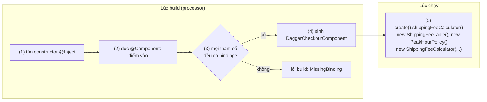
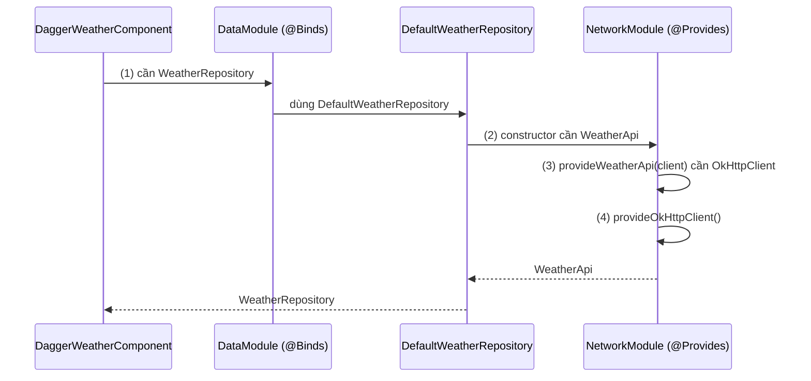
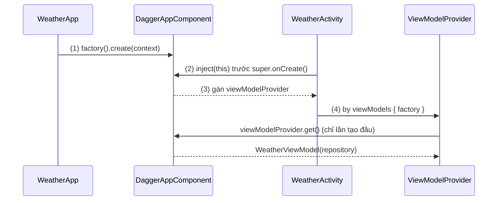
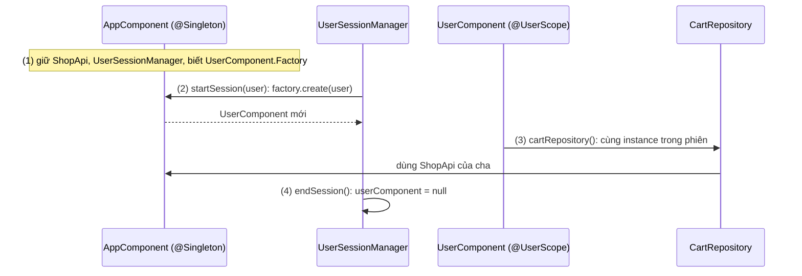
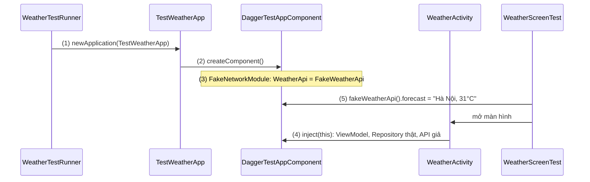

# Dagger2

## Vấn đề cần giải quyết

Ở [Dependency Injection Overview](overview.md), composition root là một `AppContainer` viết tay. Khi app có vài chục Repository, vài phiên lồng nhau và hàng chục ViewModel, container đó bộc lộ giới hạn:

```kotlin
// AppContainer.kt sau một năm phát triển (rút gọn)
class AppContainer(context: Context) {
    val okHttpClient by lazy { OkHttpClient.Builder().cache(/* ... */).build() }
    val weatherApi by lazy { createWeatherApi(okHttpClient) }
    val weatherRepository by lazy { DefaultWeatherRepository(weatherApi, database.forecastDao(), clock) }
    val locationRepository get() = DefaultLocationRepository(fusedClient, permissionChecker) // quên by lazy
    // ... thêm 40 dòng nữa, mỗi class mới một dòng, mỗi ViewModel một factory
}
```

- **Mọi dòng đều tự viết:** thêm một tham số vào constructor `DefaultWeatherRepository` là phải sửa container; thêm một màn hình là thêm một factory.
- **Scope do người viết tự nhớ:** `locationRepository` dùng `get()` thay vì `by lazy`, nên mỗi lần truy cập là một instance mới. Compiler không biết đó là lỗi.
- **Phiên lồng nhau phải tự quản:** container theo phiên đăng nhập, theo luồng thanh toán đều phải tự tạo, tự bỏ, tự nối với container cha.

Các thư viện DI dựa trên reflection (như Guice) tự động hoá được phần này, nhưng chúng dựng graph **lúc chạy**: chậm lúc khởi động trên thiết bị Android, và thiếu binding chỉ lộ ra khi app crash. Vấn đề cần giải quyết là: **tự động hoá việc viết container, mà vẫn giữ mọi lỗi nối dây ở lúc build và không tốn chi phí reflection lúc chạy**.

## Sau khi học xong

- Giải thích được Dagger dựng và kiểm tra graph lúc compile thế nào, và class component sinh ra tương ứng với container viết tay ra sao.
- Triển khai được binding bằng `@Inject` constructor, `@Provides` và `@Binds`, gom vào `@Module` và một `@Component` có `@Component.Factory`.
- Áp dụng được scope (`@Singleton`, scope tự định nghĩa) và subcomponent để giữ object theo đúng vòng đời, và `@Qualifier` để phân biệt hai binding cùng kiểu.
- Debug được các lỗi build phổ biến của Dagger như MissingBinding, DuplicateBindings, IncompatiblyScopedBindings và DependencyCycle.
- Nhận diện được các sai lầm khi dùng Dagger trong Android như inject sau `super.onCreate()`, tạo component mới ở mỗi Activity và inject qua kiểu lớp cha.

## Dagger2 là gì?

**Dagger 2** là framework Dependency Injection **dựng và kiểm tra graph dependency lúc compile**. Bạn khai báo các **binding** (cách tạo từng kiểu) bằng `@Inject`, `@Module` (`@Provides`, `@Binds`) và một interface `@Component`; annotation processor của Dagger báo lỗi build nếu graph thiếu, trùng hoặc sai scope, rồi sinh class `DaggerXxxComponent` chứa code tạo object giống hệt container bạn sẽ tự viết.

Mental model, nối tiếp "xưởng lắp ráp" ở bài tổng quan: Dagger là **người viết xưởng lắp ráp hộ bạn**. Bạn đưa bản mô tả linh kiện và cách lắp (binding); Dagger kiểm tra bản mô tả có đủ và không mâu thuẫn, rồi viết ra chính class container mà trước đây bạn tự viết tay. Lúc app chạy không có "phép thuật" nào: chỉ có code Java gọi constructor.

## Cách hoạt động

### Cài đặt: Dagger chạy lúc build

Dagger gồm hai phần: thư viện runtime nhỏ (`dagger`) và annotation processor (`dagger-compiler`) chạy khi build. Processor chạy qua **KSP** (Kotlin Symbol Processing) hoặc **kapt**; khác biệt giữa hai công cụ này giải thích ở [Kotlin](../../../session_01/languages/kotlin.md), mục "Annotation Processing: KAPT và KSP". Dự án mới dùng KSP: theo docs của Dagger, hỗ trợ KSP ổn định từ Dagger 2.60 với KSP 2.3.9 trở lên.

```kotlin
// build.gradle.kts (Module: app)
plugins {
    // ... các plugin Android/Kotlin sẵn có
    id("com.google.devtools.ksp")                       // version khai báo ở build.gradle.kts gốc, ví dụ 2.3.9
}

dependencies {
    implementation("com.google.dagger:dagger:2.60.1")
    ksp("com.google.dagger:dagger-compiler:2.60.1")     // dự án cũ: kapt(...) với plugin kotlin-kapt
    kspAndroidTest("com.google.dagger:dagger-compiler:2.60.1")   // kapt: kaptAndroidTest(...)
}
```

`ksp(...)` chỉ chạy processor trên `src/main`. Component khai báo trong `src/androidTest` (như `TestAppComponent` ở mục "Ví dụ thực tế") cần thêm `kspAndroidTest`, component trong `src/test` cần `kspTest`; thiếu thì class `Dagger...` của nó không được sinh.

Code sinh ra nằm trong `build/generated/ksp/`. Chỉ dùng trực tiếp class có tiền tố `Dagger` (như `DaggerAppComponent`); `Xxx_Factory`, `Xxx_MembersInjector` là chi tiết nội bộ.

### Binding và component: `@Inject` constructor

Một **binding** trả lời câu hỏi "cần một `X` thì lấy ở đâu". Cách đơn giản nhất là đánh `@Inject` lên constructor: Dagger sẽ gọi constructor đó, và tự lấy giá trị cho từng tham số từ graph.

Một **component** là interface đánh `@Component`, khai báo **điểm vào** của graph: các hàm không tham số trả về kiểu bạn cần (provision method). Dagger sinh class implement interface đó; từ mỗi điểm vào, processor đi theo các tham số constructor để chắc chắn mọi dependency đều có binding.

#### Ví dụ: tính phí giao hàng

**Bài toán:** `ShippingFeeCalculator` tính phí theo bảng giá theo km và hệ số giờ cao điểm. Ba class đều do ta viết, nên chỉ cần `@Inject` constructor và một component, không cần module.

**Luồng chạy:**

1. Lúc build, processor tìm các constructor `@Inject`; mỗi constructor là một binding.
2. Processor đọc `CheckoutComponent`: `shippingFeeCalculator()` là điểm vào.
3. Từ điểm vào, processor duyệt graph: `ShippingFeeCalculator` cần `ShippingFeeTable` và `PeakHourPolicy`, cả hai đều có binding, nên graph đủ.
4. Processor sinh `DaggerCheckoutComponent`.
5. Lúc chạy, `DaggerCheckoutComponent.create().shippingFeeCalculator()` gọi các constructor theo thứ tự lá trước, gốc sau.



```kotlin
// ShippingFeeTable.kt
class ShippingFeeTable @Inject constructor() {                          // (1) binding
    fun baseFee(distanceKm: Double): Long =
        if (distanceKm <= 3.0) 15_000 else 15_000 + ((distanceKm - 3.0) * 5_000).toLong()
}

// PeakHourPolicy.kt
class PeakHourPolicy @Inject constructor() {                            // (1)
    fun multiplier(hour: Int): Double = if (hour in 17..19) 1.2 else 1.0
}

// ShippingFeeCalculator.kt
class ShippingFeeCalculator @Inject constructor(                        // (1), (3) cần hai binding trên
    private val feeTable: ShippingFeeTable,
    private val peakHourPolicy: PeakHourPolicy
) {
    fun fee(distanceKm: Double, hour: Int): Long =
        (feeTable.baseFee(distanceKm) * peakHourPolicy.multiplier(hour)).toLong()
}

// CheckoutComponent.kt
@Component
interface CheckoutComponent {
    fun shippingFeeCalculator(): ShippingFeeCalculator                  // (2) điểm vào
}

// ShippingFeeCalculatorTest.kt (src/test)
class ShippingFeeCalculatorTest {
    @Test
    fun fiveKmAtPeakHour() {
        val calculator = DaggerCheckoutComponent.create().shippingFeeCalculator()  // (4), (5)
        assertEquals(30_000L, calculator.fee(distanceKm = 5.0, hour = 18))
    }
}
```

**Kết quả:** test chạy trên JVM: 5 km có phí gốc 25.000, giờ cao điểm nhân 1,2 thành 30.000. Xoá `@Inject` ở `PeakHourPolicy` rồi build lại: build trượt với lỗi `[Dagger/MissingBinding] PeakHourPolicy cannot be provided without an @Inject constructor or an @Provides-annotated method.` Lỗi lộ ra trước khi app kịp chạy.

### `@Module`: `@Provides` và `@Binds`

`@Inject` constructor không dùng được trong ba trường hợp: **interface** (không có constructor), **class của thư viện** (không sửa được để thêm annotation, như `OkHttpClient`, `Retrofit`), và **object cần cấu hình** khi tạo. Khi đó binding được khai báo trong một **module**: class hoặc interface đánh `@Module`, được khai báo trong `@Component(modules = [...])`.

- **`@Provides`**: một hàm có thân, trả về kiểu cần cung cấp. Tham số của hàm cũng được lấy từ graph. Dùng cho class thư viện và object cần cấu hình.
- **`@Binds`**: một hàm abstract một tham số, khai báo "khi cần interface `A`, dùng implementation `B`" (`B` phải có binding riêng, thường là `@Inject` constructor). Docs của Dagger khuyên dùng `@Binds` cho trường hợp này, vì Dagger chỉ cần module lúc compile, không phải nạp class module lúc chạy.

Trong Kotlin, module chỉ có `@Provides` viết thành `object`; module chỉ có `@Binds` viết thành `interface` (hoặc `abstract class`); cần cả hai thì đặt `@Binds` trong interface và `@Provides` trong `companion object` của nó.

#### Ví dụ: tầng mạng của app thời tiết

**Bài toán:** `WeatherRepository` là interface; implementation gọi `WeatherApi` (interface Retrofit), `WeatherApi` cần `Retrofit` dựng từ `OkHttpClient`. Không class nào trong chuỗi này dùng được `@Inject` constructor, trừ implementation của Repository.

**Luồng chạy:**

1. Điểm vào yêu cầu `WeatherRepository`; `@Binds` trong `DataModule` chỉ sang `DefaultWeatherRepository`.
2. `DefaultWeatherRepository` có `@Inject` constructor cần `WeatherApi`.
3. `WeatherApi` đến từ `@Provides provideWeatherApi()`, hàm này cần `OkHttpClient`.
4. `OkHttpClient` đến từ `@Provides provideOkHttpClient()`, không cần gì thêm. Code sinh ra gọi theo thứ tự ngược lại: 4 → 3 → 2 → 1.



```kotlin
// WeatherRepository.kt
interface WeatherRepository {
    suspend fun forecast(city: String): Forecast
}

class DefaultWeatherRepository @Inject constructor(                     // (2)
    private val api: WeatherApi
) : WeatherRepository {
    override suspend fun forecast(city: String): Forecast = api.forecast(city).toForecast()
}

// NetworkModule.kt
@Module
object NetworkModule {
    @Provides
    fun provideOkHttpClient(): OkHttpClient =                           // (4)
        OkHttpClient.Builder().callTimeout(15, TimeUnit.SECONDS).build()

    @Provides
    fun provideWeatherApi(client: OkHttpClient): WeatherApi =           // (3) tham số lấy từ graph
        Retrofit.Builder()
            .baseUrl("https://api.weather.example/")
            .client(client)
            .addConverterFactory(GsonConverterFactory.create())
            .build()
            .create(WeatherApi::class.java)
}

// DataModule.kt
@Module
interface DataModule {
    @Binds
    fun bindWeatherRepository(impl: DefaultWeatherRepository): WeatherRepository   // (1)
}

// WeatherComponent.kt
@Component(modules = [NetworkModule::class, DataModule::class])
interface WeatherComponent {
    fun weatherRepository(): WeatherRepository
}
```

`WeatherApi` là interface Retrofit có `@GET("forecast") suspend fun forecast(@Query("city") city: String): ForecastDto`; Retrofit học ở 8.1.1 Retrofit (chưa có bài), `OkHttpClient` ở [OkHttp](../../../session_08/networks/okhttp.md).

**Kết quả:** `DaggerWeatherComponent.create().weatherRepository()` trả một `DefaultWeatherRepository` đã nối đủ. Gọi hàm này hai lần rồi so sánh: hai Repository khác nhau, **và hai `OkHttpClient` khác nhau**. Binding mặc định không có scope, nên mỗi lần được yêu cầu là một instance mới. Mục "Scope" sửa điều này.

### Component trong Android: `@Component.Factory`, `@BindsInstance` và `inject()`

Trong app Android, component gốc được tạo một lần trong `Application` và giữ ở đó, đúng vị trí của `AppContainer` ở bài tổng quan. Ba công cụ giúp nối component với Android:

- **`@Component.Factory`** với tham số **`@BindsInstance`**: đưa một object có sẵn lúc tạo component (như `Context`) vào graph, để các binding khác dùng được.
- **Members injection (`inject()`)**: `Activity`, `Fragment` do hệ thống tạo nên không dùng được constructor injection. Component khai báo `fun inject(activity: WeatherActivity)`; Dagger sinh code gán mọi field `@Inject lateinit var` của đúng kiểu đó. Field không được `private`.
- **Thời điểm gọi `inject()`**: docs Android khuyên Activity gọi **trước** `super.onCreate()`, vì trong `super.onCreate()` Activity khôi phục các Fragment, và Fragment có thể dùng ngay field của Activity; Fragment gọi trong `onAttach()`.

ViewModel của Jetpack phải được tạo qua `ViewModelProvider` để sống qua xoay màn hình ([ViewModel](../../../session_06/viewmodel.md)), nên không inject thẳng ViewModel vào field. Thay vào đó inject một `Provider<WeatherViewModel>` (mỗi lần `get()` là một lần Dagger chạy binding) và gọi nó trong factory.

#### Ví dụ: màn dự báo thời tiết nhận ViewModel từ graph

**Bài toán:** `WeatherActivity` cần `WeatherViewModel`, ViewModel cần `WeatherRepository`. Repository cần cache HTTP trong thư mục cache của app, nên graph phải có `Context`.

**Luồng chạy:**

1. `WeatherApp.onCreate()` tạo component bằng `DaggerAppComponent.factory().create(this)`; `@BindsInstance` đưa `Context` vào graph.
2. `WeatherActivity.onCreate()` gọi `appComponent.inject(this)` **trước** `super.onCreate()`.
3. Code sinh ra gán field `viewModelProvider`.
4. Lần đầu truy cập `viewModel`, factory gọi `viewModelProvider.get()`; Dagger tạo `WeatherViewModel(repository)`. Sau khi xoay màn hình, `ViewModelStore` trả instance cũ và provider không được gọi lại.



```kotlin
// AppComponent.kt
@Component(modules = [NetworkModule::class, DataModule::class])
interface AppComponent {
    fun inject(activity: WeatherActivity)                                   // (2) members injection

    @Component.Factory
    interface Factory {
        fun create(@BindsInstance context: Context): AppComponent           // (1) Context vào graph
    }
}

// NetworkModule.kt: provideOkHttpClient giờ dùng Context từ graph
@Provides
fun provideOkHttpClient(context: Context): OkHttpClient =
    OkHttpClient.Builder()
        .cache(Cache(File(context.cacheDir, "http"), 10L * 1024 * 1024))
        .build()

// WeatherApp.kt (khai báo android:name=".WeatherApp" trong manifest)
class WeatherApp : Application() {
    lateinit var appComponent: AppComponent
        private set

    override fun onCreate() {
        super.onCreate()
        appComponent = DaggerAppComponent.factory().create(this)            // (1)
    }
}

// WeatherViewModel.kt
class WeatherViewModel @Inject constructor(
    private val repository: WeatherRepository
) : ViewModel()

// WeatherActivity.kt
class WeatherActivity : AppCompatActivity() {
    @Inject lateinit var viewModelProvider: Provider<WeatherViewModel>      // (3) javax.inject.Provider

    private val viewModel: WeatherViewModel by viewModels {
        viewModelFactory { initializer { viewModelProvider.get() } }        // (4)
    }

    override fun onCreate(savedInstanceState: Bundle?) {
        (application as WeatherApp).appComponent.inject(this)               // (2) trước super
        super.onCreate(savedInstanceState)
    }
}
```

**Kết quả:** màn hình hiện dự báo; xoay màn hình thì `viewModel` là instance cũ (log `hashCode()` không đổi). Mỗi Activity, mỗi ViewModel cần một dòng `inject()` và một factory như trên: đó chính là phần mà [Hilt](hilt.md) sinh hộ bằng `@AndroidEntryPoint` và `@HiltViewModel`.

### Scope: một instance theo vòng đời component

Binding mặc định **không scope**: mỗi lần được yêu cầu là chạy lại constructor hoặc hàm `@Provides`. Đánh một **scope annotation** lên binding (class `@Inject` hoặc hàm `@Provides`) và lên component thì component giữ **một instance** của binding đó suốt vòng đời của chính component.

```kotlin
@Singleton
@Component(modules = [NetworkModule::class, DataModule::class])
interface AppComponent { /* như trên */ }

@Module
object NetworkModule {
    @Provides
    @Singleton                                       // một OkHttpClient cho mỗi instance AppComponent
    fun provideOkHttpClient(context: Context): OkHttpClient =
        OkHttpClient.Builder().cache(Cache(File(context.cacheDir, "http"), 10L * 1024 * 1024)).build()
}
```

Bốn điều cần nắm:

- **Scope gắn với instance component, không gắn với process.** `@Singleton` chỉ là "một instance trong component này". Tạo hai `AppComponent` thì có hai `OkHttpClient`. Component gốc sống suốt process vì nó được giữ trong `Application`.
- **Quy tắc khớp scope:** binding có scope chỉ dùng được trong component cùng scope; component có scope chỉ chứa binding cùng scope hoặc không scope; subcomponent không được dùng lại scope của component tổ tiên.
- **Đặt tên scope theo vòng đời**, không theo tính năng: `@ActivityScope`, `@UserScope` thay vì `@LoginScope`, để component anh em dùng lại được. `@Singleton` (từ `javax.inject`) là scope có sẵn duy nhất giữ đúng một instance; `@Reusable` của Dagger cũng là scope annotation nhưng không đảm bảo điều đó (xem dưới).
- **Scope có giá:** object có scope sống bằng component, và được bọc trong `DoubleCheck`: lần lấy đầu phải qua khoá, các lần sau đọc một field `volatile`. Docs khuyên chỉ scope khi cần: object đắt để tạo hoặc có trạng thái phải dùng chung. `@Reusable` là lựa chọn ở giữa: Dagger được phép cache để đỡ tạo lại, nhưng không đảm bảo đúng một instance, chỉ dùng cho object không trạng thái.

Hai kiểu yêu cầu liên quan: **`Lazy<T>`** (`dagger.Lazy`) hoãn việc tạo tới lần `get()` đầu và trả cùng instance cho các lần sau; **`Provider<T>`** chạy lại binding ở mỗi lần `get()`, như ví dụ ViewModel ở trên.

### Subcomponent: scope ngắn hơn bên trong graph cha

**Subcomponent** là component con, kế thừa toàn bộ graph của component cha và thêm binding của riêng nó. Binding trong subcomponent dùng được mọi thứ của cha; ngược lại thì không. Vì subcomponent được tạo từ cha, vòng đời của nó luôn ngắn hơn: đây là cách Dagger biểu diễn container theo phiên ở bài tổng quan.

Khai báo subcomponent bằng `@Subcomponent` kèm `@Subcomponent.Factory`, rồi gắn vào cha qua `@Module(subcomponents = [...])`. Docs của Dagger khuyên cách gắn qua module này (thay vì một hàm trả subcomponent trên component cha), vì Dagger biết được subcomponent có thật sự được dùng không.

#### Ví dụ: giỏ hàng theo phiên đăng nhập

**Bài toán:** như ví dụ ở [Dependency Injection Overview](overview.md), mục "Scope và vòng đời object": giỏ hàng chỉ sống trong một phiên đăng nhập. Lần này Dagger sinh container theo phiên, và kiểm tra lúc build rằng không ai ở graph cha giữ được giỏ hàng.

**Luồng chạy:**

1. `AppComponent` (`@Singleton`) giữ `ShopApi` và `UserSessionManager`; nhờ `SubcomponentsModule`, graph cha biết cách tạo `UserComponent.Factory`.
2. Đăng nhập thành công: `UserSessionManager.startSession(user)` gọi `factory.create(user)`, tạo một `UserComponent` mới; `@BindsInstance` đưa `LoggedInUser` vào graph con.
3. Các màn của người dùng lấy `CartRepository` từ `userComponent`: cùng một instance trong suốt phiên (`@UserScope`), và nó dùng được `ShopApi` của cha.
4. Đăng xuất: `endSession()` bỏ `userComponent`; `CartRepository` cũ không còn ai giữ. Lần đăng nhập sau có component mới, giỏ mới.



```kotlin
// UserScope.kt
@Scope
@MustBeDocumented
@Retention(AnnotationRetention.RUNTIME)
annotation class UserScope

// CartRepository.kt
@UserScope
class CartRepository @Inject constructor(                                  // (3) một instance mỗi phiên
    private val user: LoggedInUser,
    private val shopApi: ShopApi                                           // binding của component cha
) {
    private val items = mutableListOf<CartItem>()
    fun add(item: CartItem) { items += item }
    fun items(): List<CartItem> = items.toList()
}

// UserComponent.kt
@UserScope
@Subcomponent
interface UserComponent {
    fun cartRepository(): CartRepository

    @Subcomponent.Factory
    interface Factory {
        fun create(@BindsInstance user: LoggedInUser): UserComponent       // (2)
    }
}

// SubcomponentsModule.kt
@Module(subcomponents = [UserComponent::class])                            // (1) gắn con vào cha
interface SubcomponentsModule

// UserSessionManager.kt
@Singleton
class UserSessionManager @Inject constructor(
    private val userComponentFactory: UserComponent.Factory
) {
    var userComponent: UserComponent? = null
        private set

    fun startSession(user: LoggedInUser) {                                 // (2)
        userComponent = userComponentFactory.create(user)
    }

    fun endSession() {                                                     // (4)
        userComponent = null
    }
}

// AppComponent.kt (NetworkModule của app bán hàng cung cấp ShopApi, cách viết như app thời tiết)
@Singleton
@Component(modules = [NetworkModule::class, SubcomponentsModule::class])
interface AppComponent {
    fun userSessionManager(): UserSessionManager
    // @Component.Factory như ví dụ trước
}
```

**Kết quả:** đăng nhập A, thêm hai sản phẩm, đăng xuất, đăng nhập B: `userComponent!!.cartRepository().items()` rỗng. Thử thêm `fun cartRepository(): CartRepository` vào `AppComponent` rồi build: build trượt, Dagger báo `[Dagger/IncompatiblyScopedBindings] AppComponent scoped with @Singleton may not reference bindings with different scopes` cho `@UserScope CartRepository` (có thể kèm `MissingBinding` cho `LoggedInUser`, vốn chỉ có trong graph con). Graph cha không thể vô tình giữ giỏ hàng của một phiên.

### `@Qualifier`: hai binding cùng kiểu

Dagger nhận diện binding bằng **kiểu** trả về. Khi cần hai giá trị khác nhau của cùng một kiểu (hai `CoroutineDispatcher`, hai `OkHttpClient` với timeout khác nhau), thêm một **qualifier**: annotation đánh `@Qualifier`, đặt ở cả nơi cung cấp và nơi nhận.

```kotlin
@Qualifier @Retention(AnnotationRetention.BINARY) annotation class IoDispatcher
@Qualifier @Retention(AnnotationRetention.BINARY) annotation class DefaultDispatcher

@Module
object DispatcherModule {
    @Provides @IoDispatcher fun provideIoDispatcher(): CoroutineDispatcher = Dispatchers.IO
    @Provides @DefaultDispatcher fun provideDefaultDispatcher(): CoroutineDispatcher = Dispatchers.Default
}

// Nén ảnh là việc nặng CPU, nên dùng Dispatchers.Default
class ImageCompressor @Inject constructor(
    @DefaultDispatcher private val dispatcher: CoroutineDispatcher
)
```

`javax.inject` có sẵn qualifier `@Named("...")`, nhưng nó dựa vào chuỗi: gõ sai thì Dagger báo `MissingBinding` ở nơi xa chỗ gõ, hoặc khớp nhầm một tên khác đã có. Qualifier tự định nghĩa là một kiểu: sai tên là lỗi compile ngay tại chỗ, và refactor được. Dispatcher là khái niệm của coroutine, học ở 8.4.3 Coroutines (chưa có bài).

### Đọc lỗi build của Dagger

Mọi lỗi nối dây đều lộ ra lúc build, với tên lỗi trong ngoặc vuông ở đầu thông báo:

| Lỗi | Nghĩa | Cách sửa thường gặp |
|---|---|---|
| `[Dagger/MissingBinding] X cannot be provided without an @Inject constructor or an @Provides-annotated method` | Có nơi cần `X` nhưng graph không có binding cho `X` | Thêm `@Inject` constructor, hoặc `@Provides`/`@Binds` trong một module **đã khai báo** ở component |
| `[Dagger/DuplicateBindings] X is bound multiple times` | Hai binding cùng kiểu và cùng qualifier | Bỏ một binding, hoặc thêm qualifier để phân biệt |
| `[Dagger/IncompatiblyScopedBindings] ... may not reference bindings with different scopes` | Component dùng binding có scope khác scope của nó | Chuyển binding sang component đúng scope (thường là subcomponent), hoặc sửa scope |
| `[Dagger/DependencyCycle] Found a dependency cycle` | `A` cần `B`, `B` lại cần `A` | Tách trách nhiệm; nếu vòng là hợp lý, cắt bằng `Provider<A>` hoặc `Lazy<A>` |

Sau dòng lỗi, Dagger in **đường yêu cầu**: binding thiếu được inject ở đâu, nơi đó được yêu cầu từ đâu, cho tới điểm vào của component. Đọc từ dưới lên để biết màn hình hay class nào kéo theo dependency bị thiếu.

## Deep Dive: code Dagger sinh ra

Mở `DaggerAppComponent.java` trong `build/generated/ksp/` sẽ thấy code gần như container viết tay. Bản rút gọn, đã bỏ phần khai báo field và khởi tạo phụ (tên và chi tiết thay đổi giữa các version):

```java
// DaggerAppComponent.java (rút gọn)
final class AppComponentImpl implements AppComponent {
    private final Context context;
    private Provider<OkHttpClient> provideOkHttpClientProvider;

    private void initialize(Context context) {
        // binding @Singleton: bọc trong DoubleCheck, tạo một lần rồi cache
        this.provideOkHttpClientProvider = DoubleCheck.provider(
            NetworkModule_ProvideOkHttpClientFactory.create(contextInstanceFactory));
    }

    private DefaultWeatherRepository defaultWeatherRepository() {
        // binding không scope: gọi thẳng constructor mỗi lần
        return new DefaultWeatherRepository(
            NetworkModule_ProvideWeatherApiFactory.provideWeatherApi(provideOkHttpClientProvider.get()));
    }

    @Override public void inject(WeatherActivity activity) {
        WeatherActivity_MembersInjector.injectViewModelProvider(activity, weatherViewModelProvider);
    }
}
```

Binding có scope là một `Provider` bọc `DoubleCheck` (khoá hai lần, an toàn đa luồng); binding không scope là lời gọi `new` trực tiếp; `inject()` chỉ là phép gán field. Không có reflection, nên lỗi graph không xuất hiện lúc chạy, và chi phí lúc chạy gần bằng code viết tay.

## Ví dụ thực tế

1. **Test end-to-end với backend giả:** thay module mạng bằng module giả cho UI test mà không đụng code của app. Đây là bài toán chính, code bên dưới.
2. **App nhiều module tính năng:** mỗi module tính năng có subcomponent riêng (đăng nhập, thanh toán), component gốc chỉ giữ binding dùng chung; module tính năng không thấy binding nội bộ của nhau.
3. **Chuyển sang Hilt:** Hilt dùng lại `@Inject`, `@Module`, `@Provides`, `@Binds` của Dagger; phần bị thay là component tự viết, `inject()` và factory ViewModel ([Hilt](hilt.md)).

### UI test với backend giả bằng component test riêng

**Bài toán:** UI test của màn thời tiết phải chạy ổn định, không phụ thuộc server và mạng. Docs của Dagger khuyên tạo **component riêng cho môi trường test**, kế thừa component production nhưng cài module khác; không nên ghi đè hàm `@Provides` bằng cách kế thừa module.

**Luồng chạy:**

1. Test runner riêng (`WeatherTestRunner`) bảo hệ thống tạo `TestWeatherApp` thay cho `WeatherApp`.
2. `TestWeatherApp` ghi đè `createComponent()`, trả `DaggerTestAppComponent`.
3. `TestAppComponent` kế thừa `AppComponent` nên có cùng `inject()`, nhưng cài `FakeNetworkModule` thay cho `NetworkModule`: `WeatherApi` giờ là `FakeWeatherApi`.
4. `WeatherActivity` gọi `inject()` như thường; mọi tầng phía trên `WeatherApi` chạy code thật.
5. Test lấy `fakeWeatherApi()` từ component để đặt dữ liệu, rồi kiểm tra UI.



```kotlin
// src/main: WeatherApp.kt
open class WeatherApp : Application() {
    lateinit var appComponent: AppComponent
        private set

    override fun onCreate() {
        super.onCreate()
        appComponent = createComponent()
    }

    protected open fun createComponent(): AppComponent =
        DaggerAppComponent.factory().create(this)
}

// src/androidTest: FakeNetworkModule.kt
@Module
interface FakeNetworkModule {
    @Binds fun bindWeatherApi(fake: FakeWeatherApi): WeatherApi            // (3)
}

@Singleton
class FakeWeatherApi @Inject constructor() : WeatherApi {
    var forecast = ForecastDto(city = "Hà Nội", temperatureC = 25)
    override suspend fun forecast(city: String): ForecastDto = forecast
}

// src/androidTest: TestAppComponent.kt
@Singleton
@Component(modules = [FakeNetworkModule::class, DataModule::class])
interface TestAppComponent : AppComponent {                                // (3) cùng inject() với production
    fun fakeWeatherApi(): FakeWeatherApi

    @Component.Factory
    interface Factory {
        fun create(@BindsInstance context: Context): TestAppComponent
    }
}

// src/androidTest: TestWeatherApp.kt và WeatherTestRunner.kt
class TestWeatherApp : WeatherApp() {
    override fun createComponent(): AppComponent =                         // (2)
        DaggerTestAppComponent.factory().create(this)
}

class WeatherTestRunner : AndroidJUnitRunner() {
    override fun newApplication(cl: ClassLoader?, className: String?, context: Context?): Application =
        super.newApplication(cl, TestWeatherApp::class.java.name, context) // (1)
}
```

```kotlin
// src/androidTest: WeatherScreenTest.kt
@RunWith(AndroidJUnit4::class)
class WeatherScreenTest {
    @Test
    fun showsForecastFromFakeApi() {
        val app = ApplicationProvider.getApplicationContext<TestWeatherApp>()
        (app.appComponent as TestAppComponent).fakeWeatherApi().forecast =
            ForecastDto(city = "Hà Nội", temperatureC = 31)               // (5)

        ActivityScenario.launch(WeatherActivity::class.java).use {        // (4)
            onView(withId(R.id.temperature)).check(matches(withText("31°C")))
        }
    }
}
```

Khai báo runner trong `build.gradle.kts`: `defaultConfig { testInstrumentationRunner = "vn.weather.WeatherTestRunner" }`. `onView` là Espresso, thuộc phần test giao diện.

**Kết quả:** `./gradlew connectedDebugAndroidTest` chạy test khi tắt mạng vẫn đạt. `DaggerTestAppComponent` được sinh nhờ `kspAndroidTest` ở mục "Cài đặt"; thiếu dòng đó thì build của `androidTest` trượt vì không tìm thấy class này. Nếu một binding mà `WeatherActivity` cần chỉ có trong `NetworkModule` và quên đưa vào bản giả, build của `androidTest` trượt với `MissingBinding`, không phải test chạy rồi crash.

## Khi nào nên và không nên dùng

- **Nên dùng Dagger thuần** cho dự án JVM/Android cần graph tuỳ biến mà khuôn component của Hilt không vừa, dự án đang dùng Dagger (hoặc `dagger.android`) chưa chuyển sang Hilt, hoặc thư viện/SDK cần DI nội bộ mà không ép app dùng Hilt.
- **Nên dùng Hilt thay vì Dagger thuần** cho app Android mới: docs Android khuyên Hilt, vì nó sinh sẵn component theo vòng đời Android, `inject()` và factory ViewModel, trong khi vẫn là Dagger bên dưới.
- **Không nên dùng** cho dự án Kotlin Multiplatform (Dagger chỉ chạy trên JVM), hoặc app rất nhỏ, nơi container viết tay ngắn hơn cấu hình Dagger.
- **Cân nhắc chi phí build:** annotation processing làm build chậm hơn, nhất là với kapt; dùng KSP để giảm chi phí này.

## Sai lầm thường gặp

### 1. Gọi `inject()` sau `super.onCreate()`

```kotlin
// Sai
override fun onCreate(savedInstanceState: Bundle?) {
    super.onCreate(savedInstanceState)
    (application as WeatherApp).appComponent.inject(this)
}
```

**Lỗi lộ ra thế nào:** chạy bình thường lúc mở màn lần đầu, nhưng sau khi xoay màn hình hoặc process bị kill rồi khôi phục, app có thể crash `UninitializedPropertyAccessException: lateinit property ... has not been initialized`. Lý do: `super.onCreate()` khôi phục Fragment, và Fragment nào đọc field của Activity ngay khi được gắn sẽ gặp field chưa được gán.

**Cách sửa:** gọi `inject()` trước `super.onCreate()` trong Activity; trong Fragment gọi ở `onAttach()`.

### 2. Tạo component ở mỗi Activity

```kotlin
// Sai: mỗi Activity một component mới
override fun onCreate(savedInstanceState: Bundle?) {
    DaggerAppComponent.factory().create(applicationContext).inject(this)
    super.onCreate(savedInstanceState)
}
```

**Lỗi lộ ra thế nào:** `@Singleton` không còn là một instance: mỗi màn có `OkHttpClient`, database và `UserSessionManager` riêng. Đăng nhập ở màn này, màn kia vẫn thấy chưa đăng nhập; `Flow` đọc từ database ở màn này không cập nhật khi màn kia ghi qua một instance Room khác.

**Cách sửa:** tạo component gốc đúng một lần trong `Application` và mọi nơi dùng chung instance đó.

### 3. Một hàm `inject()` cho lớp cha

```kotlin
// Sai: khai báo theo kiểu lớp cha
@Component
interface AppComponent {
    fun inject(activity: BaseActivity)
}
// WeatherActivity : BaseActivity có @Inject lateinit var viewModelProvider
```

**Lỗi lộ ra thế nào:** build đạt, nhưng mở `WeatherActivity` thì crash `UninitializedPropertyAccessException`. Dagger chỉ sinh code gán field của **đúng kiểu khai báo** (`BaseActivity`), không biết tới field của lớp con.

**Cách sửa:** mỗi class cần inject có một hàm `inject()` với kiểu chính xác của nó: `fun inject(activity: WeatherActivity)`. Docs Android nêu rõ một hàm `inject()` chung không cho Dagger biết phải cung cấp gì.

### 4. Field `@Inject` là `private`

```kotlin
// Sai
@Inject private lateinit var viewModelProvider: Provider<WeatherViewModel>
```

**Lỗi lộ ra thế nào:** build trượt với `Dagger does not support injection into private fields`. Code sinh ra nằm ở class khác (`WeatherActivity_MembersInjector`) nên không gán được field private.

**Cách sửa:** bỏ `private` (`@Inject lateinit var ...`). Đây cũng là lý do field injection chỉ dùng cho class hệ thống tạo; class tự tạo được thì dùng constructor injection.

### 5. Đánh `@Singleton` lên mọi thứ

```kotlin
// Sai: state của một luồng thanh toán sống suốt process
@Singleton
class CheckoutDraft @Inject constructor() {
    var shippingAddress: Address? = null
    var voucherCode: String? = null
}
```

**Lỗi lộ ra thế nào:** người dùng thanh toán xong, mở luồng thanh toán mới thì địa chỉ và mã giảm giá cũ vẫn còn; đăng xuất rồi đăng nhập tài khoản khác cũng thấy. Object scope dài cũng chiếm bộ nhớ suốt process.

**Cách sửa:** chỉ scope theo đúng vòng đời dữ liệu: dữ liệu theo phiên vào subcomponent `@UserScope`; dữ liệu của một màn hình vào ViewModel; object không trạng thái thì để không scope (hoặc `@Reusable`).

## Lịch sử phát triển

- **2007:** Google phát hành Guice, DI cho Java dựa trên reflection lúc chạy. Trên Android, các thư viện kiểu này (như RoboGuice) làm app khởi động chậm.
- **05/2013:** Square phát hành Dagger 1.0. Dagger 1 sinh code cho phần tạo object, nhưng graph vẫn được lắp lúc chạy và chỉ kiểm tra theo từng module.
- **04/2015:** Dagger 2.0, do Google phát triển dựa trên Dagger 1: toàn bộ graph sinh thành code và kiểm tra ở cấp component lúc compile, không còn reflection.
- **2017:** `dagger.android` (`AndroidInjector`, `@ContributesAndroidInjector`) giảm code `inject()` lặp lại cho Activity, Fragment; về sau được thay bằng Hilt.
- **06/2020:** Hilt bản alpha (Dagger 2.28-alpha), lớp chuẩn hoá Dagger cho Android.
- **01/2021:** Dagger 2.31 thêm assisted injection (`@AssistedInject`) vào Dagger core, và `@HiltViewModel` cho Hilt.
- **04/2021:** Dagger 2.35, Hilt stable.
- **08/2023:** Dagger 2.48 có bản alpha của processor KSP cho Dagger và Hilt.
- **06/2026:** Dagger 2.60: hỗ trợ KSP ổn định (cùng KSP 2.3.9+), thêm `@Binds` không tham số để khai báo tường minh binding của `@Inject` constructor; Hilt yêu cầu minSdk 23. Bản sửa lỗi 2.60.1 phát hành 07/2026.

## Kết nối hệ thống

- **Tiên quyết:**
  - [Dependency Injection Overview](overview.md): composition root, container, scope và subcontainer theo phiên mà Dagger tự động hoá.
  - [Kotlin](../../../session_01/languages/kotlin.md): annotation processing với KAPT và KSP.
- **Liên quan:**
  - [ViewModel](../../../session_06/viewmodel.md): vì sao ViewModel phải tạo qua `ViewModelProvider` và factory.
  - [Activity Lifecycle](../../../session_04/components/activity/lifecycle.md): vì sao `inject()` đứng trước `super.onCreate()`.
  - [MVVM](../../architecture/mvvm.md): ViewModel nhận Repository qua constructor `@Inject`.
  - [OkHttp](../../../session_08/networks/okhttp.md): dependency đắt, phải scope `@Singleton`.
- **Học tiếp:**
  - [Hilt](hilt.md): component, scope và entry point chuẩn cho Android, xây trên mọi khái niệm của bài này.
  - [Koin](koin.md): cách tiếp cận ngược lại, resolve lúc runtime bằng DSL.

## Tham khảo

- [Dagger User's Guide - dagger.dev](https://dagger.dev/dev-guide/)
- [Dagger: Subcomponents](https://dagger.dev/dev-guide/subcomponents)
- [Dagger: Testing](https://dagger.dev/dev-guide/testing)
- [Dagger: KSP Support](https://dagger.dev/dev-guide/ksp)
- [Dagger basics - Android Developers](https://developer.android.com/training/dependency-injection/dagger-basics)
- [Using Dagger in Android apps - Android Developers](https://developer.android.com/training/dependency-injection/dagger-android)
- [Dagger releases - GitHub](https://github.com/google/dagger/releases)
