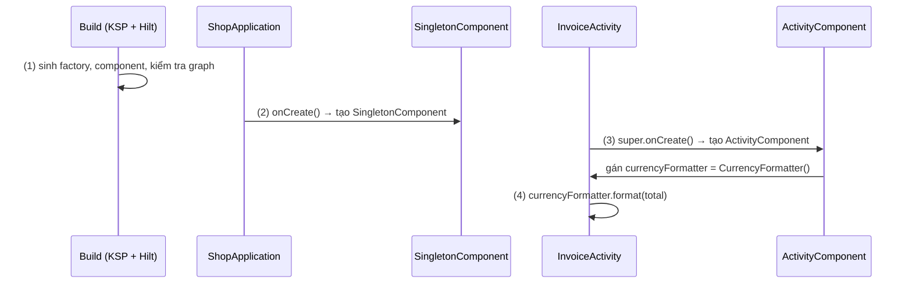
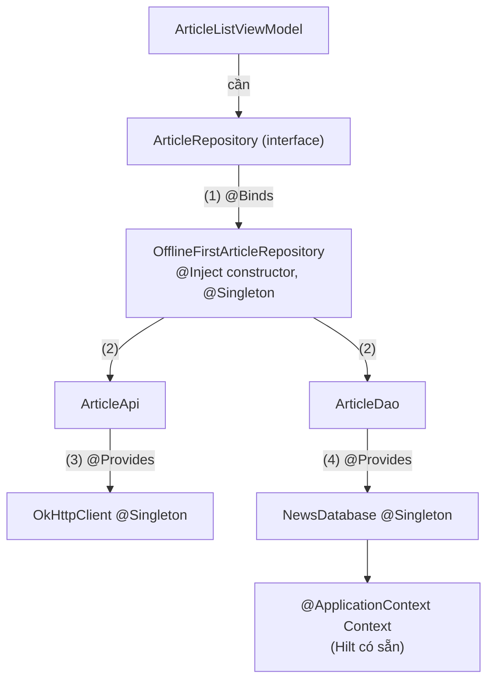
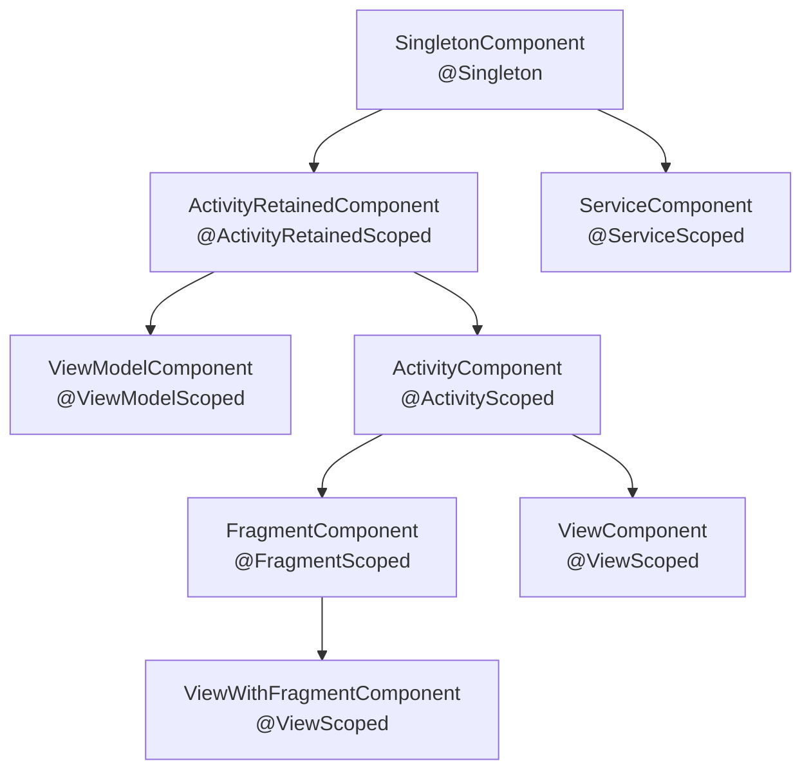
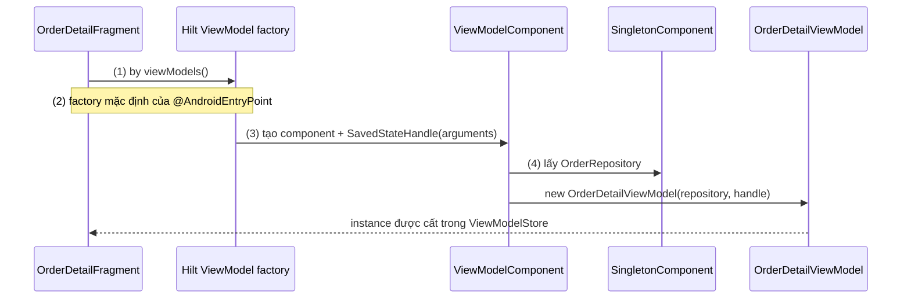
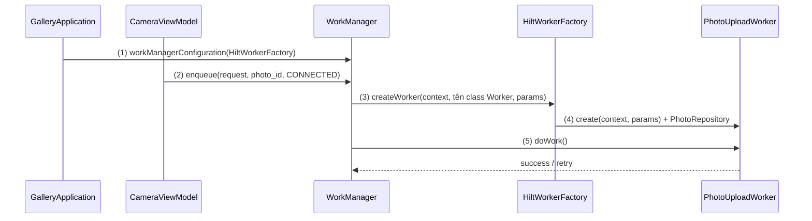
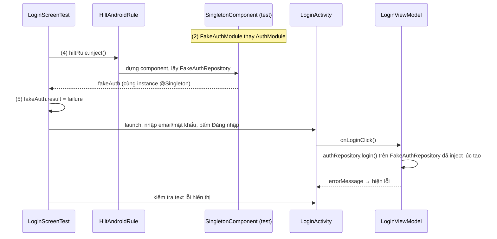

# Hilt

## Vấn đề cần giải quyết

Một app có vài Repository, một Room database, một Retrofit client. Làm DI thủ công (khái niệm ở [Dependency Injection Overview](overview.md)) thì phải tự viết container và factory cho từng ViewModel, như ví dụ `AppContainer` ở [ViewModel](../../../session_06/viewmodel.md), mục "Factory và CreationExtras":

```kotlin
// Cách làm thủ công: mỗi ViewModel một factory, mỗi dependency một dòng nối dây
class AppContainer(context: Context) {
    private val database = Room.databaseBuilder(context, ShopDatabase::class.java, "shop.db").build()
    private val api = Retrofit.Builder().baseUrl("https://api.shop.example/").build().create(ShopApi::class.java)
    val orderRepository: OrderRepository = DefaultOrderRepository(database.orderDao(), api)
    // ... mỗi Repository thêm một dòng; đổi constructor là sửa mọi chỗ gọi
}
```

Khi app lớn dần, cách này gặp ba vấn đề:

- **Activity, Fragment, Service, Worker do hệ thống tạo**, không gọi constructor được. Muốn đưa dependency vào thì mỗi class phải tự với tới container (`application as ShopApplication`), tức là quay lại Service Locator.
- **Vòng đời phải tự quản:** object nào sống cả app, object nào chỉ sống cùng một màn hình, object nào phải sống qua xoay màn hình. Container thủ công không biết Activity hay ViewModel nào đang sống.
- **Sai sót chỉ lộ ra lúc chạy:** quên nối một dependency thì app crash khi mở đúng màn hình đó.

[Dagger](dagger2.md) giải quyết vấn đề thứ ba bằng graph sinh lúc compile, nhưng bạn vẫn tự định nghĩa component cho Application, cho từng Activity, tự gọi `inject(this)`, mỗi team một kiểu. Vấn đề cần giải quyết là: **một cách DI chuẩn cho Android**, biết sẵn vòng đời của các class Android và vẫn kiểm tra graph lúc build.

## Sau khi học xong

- Giải thích được Hilt thêm gì lên trên Dagger, cụ thể là cây component chuẩn gắn với vòng đời class Android, và vì sao lỗi thiếu dependency hiện ra lúc build thay vì lúc chạy.
- Triển khai được Hilt cho một app gồm @HiltAndroidApp, @AndroidEntryPoint, constructor @Inject, module @Provides và @Binds với @InstallIn, và @HiltViewModel lấy bằng by viewModels() hoặc hiltViewModel().
- Biết khi nào gắn scope (@Singleton, @ActivityRetainedScoped, @ViewModelScoped...) và chọn đúng component để cài module.
- Áp dụng được assisted injection cho ViewModel và Worker khi một phần tham số chỉ có lúc chạy.
- Thiết kế được test thay binding thật bằng bản giả với @HiltAndroidTest và @TestInstallIn, và debug được các lỗi Hilt báo lúc build như thiếu binding hoặc scope không khớp component.

## Hilt là gì?

**Hilt** là thư viện Dependency Injection chuẩn cho Android, xây trên Dagger: Hilt định nghĩa sẵn một cây **component** (container chứa các binding) gắn với vòng đời của từng loại class Android, và sinh code Dagger lúc build để tạo và đưa dependency vào cả những class mà hệ thống Android khởi tạo thay bạn.

Mental model: Hilt dựng **một cây container song song với cây vòng đời của app**. Application có một container sống cả process; mỗi Activity, mỗi ViewModel, mỗi Fragment có một container sinh ra và chết đi cùng nó. Container con thấy mọi thứ của container cha, còn cha không thấy con. Bạn chỉ khai báo hai điều: **cách tạo** một kiểu (`@Inject`, `@Provides`, `@Binds`) và **nó thuộc container nào** (`@InstallIn`, scope); phần nối dây Hilt làm lúc build.

Các khái niệm của Dagger mà Hilt dùng lại (component, module, binding, scope, qualifier, graph sinh lúc compile) được giải thích ở [Dagger2](dagger2.md). Bài này tập trung vào phần Hilt thêm cho Android.

## Cách hoạt động

> [!NOTE]
> **Kiến thức dùng trước.** Các ví dụ dùng tối thiểu:
> - Coroutine (`suspend`, `CoroutineWorker`): học ở 8.4.3 Coroutines (chưa có bài).
> - `Flow`/`StateFlow`: học ở [Flow](../observer/flow.md).
> - Retrofit: client HTTP sinh từ interface, học ở 8.1.1 Retrofit (chưa có bài); Room ở [Room Architecture](../../../session_05/data_store/room_architecture.md).
> - WorkManager: chạy tác vụ nền cần đảm bảo hoàn thành, giới thiệu ở [Android Service](../../../session_04/components/services/android_service.md), mục "WorkManager — Lựa chọn hiện đại cho background task".

### Điểm vào và constructor injection

Cài Hilt gồm Gradle plugin của Hilt, thư viện `hilt-android` và annotation processor chạy bằng KSP:

```kotlin
// build.gradle.kts (root)
plugins {
    id("com.google.devtools.ksp") version "2.3.9" apply false
    id("com.google.dagger.hilt.android") version "2.60.1" apply false
}

// app/build.gradle.kts
plugins {
    id("com.android.application")
    id("com.google.devtools.ksp")
    id("com.google.dagger.hilt.android")
}

dependencies {
    implementation("com.google.dagger:hilt-android:2.60.1")
    ksp("com.google.dagger:hilt-compiler:2.60.1")
}
```

Từ Dagger 2.59, Hilt Gradle plugin yêu cầu AGP 9; từ Dagger 2.60, `minSdk` tối thiểu của Hilt là 23. Cách khai báo plugin ở root với `apply false` đã giải thích ở [Plugin](../../../session_04/android_manifest/package_build_gradle/plugin.md).

Ba annotation tạo nên bộ khung:

| Annotation | Đặt ở đâu | Tác dụng |
|---|---|---|
| `@HiltAndroidApp` | class `Application` (bắt buộc, đúng một) | Kích hoạt sinh code; tạo `SingletonComponent`, gốc của cây container |
| `@AndroidEntryPoint` | `Activity`, `Fragment`, `View`, `Service`, `BroadcastReceiver` | Class này được Hilt đưa dependency vào qua **field injection** |
| `@Inject constructor(...)` | constructor của class bạn viết | Dạy Hilt **cách tạo** class đó; tham số là các dependency của nó |

Hệ thống Android tự gọi constructor của Activity và Fragment, nên Hilt không đưa dependency qua constructor được. Thay vào đó, Gradle plugin đổi lớp cha của class có `@AndroidEntryPoint` thành một class sinh ra (`Hilt_InvoiceActivity`); lớp cha này tạo component và gán các field `@Inject lateinit var` ở thời điểm cố định: trong `super.onCreate()` với Activity, trong `onAttach()` với Fragment. Field được inject **không được `private`**.

Activity phải kế thừa `ComponentActivity` (như `AppCompatActivity`); Fragment phải là `androidx.fragment.app.Fragment` và Activity chứa nó cũng phải có `@AndroidEntryPoint`. Với Compose, chỉ cần đánh dấu Activity gốc.

#### Ví dụ: màn hoá đơn cần định dạng tiền

**Bài toán:** `InvoiceActivity` hiện tổng tiền theo định dạng tiền Việt Nam. Logic định dạng nằm trong `CurrencyFormatter` để dùng lại ở nhiều màn; Activity không tự `new` nó.

**Luồng chạy:**

1. **Lúc build:** KSP đọc `@Inject constructor` của `CurrencyFormatter` và sinh factory cho nó; Hilt sinh component cho từng loại class Android và kiểm tra mọi dependency đều có cách tạo. Gradle plugin đổi lớp cha của `InvoiceActivity` thành `Hilt_InvoiceActivity`.
2. **Lúc mở app:** `Application.onCreate()` chạy, Hilt tạo `SingletonComponent`.
3. **Lúc mở màn hình:** `InvoiceActivity.onCreate()` gọi `super.onCreate()`; `Hilt_InvoiceActivity` tạo `ActivityComponent` (con của các component cha) và gán `currencyFormatter`.
4. Sau `super.onCreate()`, Activity dùng field như object bình thường.



```kotlin
// ShopApplication.kt (khai báo trong AndroidManifest bằng android:name)
@HiltAndroidApp
class ShopApplication : Application()                                   // (2)

// CurrencyFormatter.kt
class CurrencyFormatter @Inject constructor() {                         // (1) Hilt biết cách tạo
    private val format = NumberFormat.getCurrencyInstance(Locale.forLanguageTag("vi-VN"))
    fun format(amount: Long): String = format.format(amount)
}

// InvoiceActivity.kt
@AndroidEntryPoint
class InvoiceActivity : AppCompatActivity() {

    @Inject lateinit var currencyFormatter: CurrencyFormatter           // field injection, không private

    override fun onCreate(savedInstanceState: Bundle?) {
        super.onCreate(savedInstanceState)                              // (3) field được gán ở đây
        val binding = ActivityInvoiceBinding.inflate(layoutInflater)
        setContentView(binding.root)
        binding.totalText.text = currencyFormatter.format(intent.getLongExtra(EXTRA_TOTAL, 0L)) // (4)
    }

    companion object { const val EXTRA_TOTAL = "total" }
}
```

**Kết quả:** mở màn hoá đơn với `total = 125000` thì thấy "125.000 ₫". Xoá `@Inject` khỏi constructor của `CurrencyFormatter` rồi build: build thất bại với lỗi `[Dagger/MissingBinding] CurrencyFormatter cannot be provided without an @Inject constructor or an @Provides-annotated method`, kèm đường đi từ `InvoiceActivity` tới chỗ thiếu. Đây là lợi ích cốt lõi Hilt thừa hưởng từ Dagger: thiếu dây là không build được.

### Module: `@Provides`, `@Binds` và `@InstallIn`

Constructor injection không dùng được trong hai trường hợp:

- **Interface:** `ArticleRepository` là interface, không có constructor. Dùng hàm **`@Binds`** (abstract, không có thân) để nói "khi cần `ArticleRepository` thì dùng `OfflineFirstArticleRepository`".
- **Class không phải của bạn hoặc phải tạo bằng builder:** `OkHttpClient`, Retrofit service, Room database, `DataStore`. Dùng hàm **`@Provides`**: kiểu trả về là thứ được cung cấp, tham số là dependency, thân hàm là cách tạo. Hilt chạy thân hàm mỗi lần cần một instance (trừ khi có scope).

Hai loại hàm này nằm trong một **Hilt module**: class có `@Module` và **bắt buộc** có `@InstallIn(XxxComponent::class)` để nói binding thuộc container nào. Module chứa `@Provides` thường là `object`; module chứa `@Binds` là `abstract class` (hoặc interface). Hilt module không liên quan tới Gradle module.

Hilt cung cấp sẵn vài binding và qualifier: `@ApplicationContext Context` có ở mọi component, `@ActivityContext Context` có ở `ActivityComponent` và các con của nó. Khi cần hai binding cùng kiểu (hai `OkHttpClient` khác interceptor), tự định nghĩa `@Qualifier`; cơ chế qualifier thuộc Dagger, xem [Dagger2](dagger2.md).

#### Ví dụ: tầng data của app đọc tin, offline trước

**Bài toán:** `ArticleListViewModel` cần `ArticleRepository`. Bản hiện thực đọc Room trước rồi làm mới từ API (mẫu ở [Room Architecture](../../../session_05/data_store/room_architecture.md), mục "Single Source of Truth (SSOT) và Offline-first"). Database và HTTP client phải là **một instance cho cả app**.

**Luồng chạy** khi Hilt cần tạo `ArticleRepository`:

1. `ArticleRepository` là interface: `@Binds` trong `RepositoryModule` trỏ sang `OfflineFirstArticleRepository`.
2. `OfflineFirstArticleRepository` có `@Inject constructor` cần `ArticleDao` và `ArticleApi`.
3. `ArticleApi` do `@Provides` trong `NetworkModule` tạo, hàm này cần `OkHttpClient` (một `@Provides` khác).
4. `ArticleDao` lấy từ `NewsDatabase`, database do `@Provides` tạo từ `@ApplicationContext`.
5. Các binding có `@Singleton` được tạo một lần trong `SingletonComponent` rồi dùng lại cho mọi nơi yêu cầu.



```kotlin
// di/NetworkModule.kt
@Module
@InstallIn(SingletonComponent::class)
object NetworkModule {

    @Provides
    @Singleton
    fun provideOkHttpClient(): OkHttpClient = OkHttpClient.Builder()
        .callTimeout(30, TimeUnit.SECONDS)
        .build()

    @Provides
    @Singleton
    fun provideArticleApi(client: OkHttpClient): ArticleApi = Retrofit.Builder()    // (3)
        .baseUrl("https://api.news.example/")
        .client(client)
        .addConverterFactory(Json.asConverterFactory("application/json".toMediaType()))
        .build()
        .create(ArticleApi::class.java)
}

// di/DatabaseModule.kt
@Module
@InstallIn(SingletonComponent::class)
object DatabaseModule {

    @Provides
    @Singleton
    fun provideNewsDatabase(@ApplicationContext context: Context): NewsDatabase =    // (4)
        Room.databaseBuilder(context, NewsDatabase::class.java, "news.db").build()

    @Provides
    fun provideArticleDao(database: NewsDatabase): ArticleDao = database.articleDao()
}

// di/RepositoryModule.kt
@Module
@InstallIn(SingletonComponent::class)
abstract class RepositoryModule {

    @Binds
    abstract fun bindArticleRepository(impl: OfflineFirstArticleRepository): ArticleRepository // (1)
}

// data/OfflineFirstArticleRepository.kt
@Singleton                                                                            // (5)
class OfflineFirstArticleRepository @Inject constructor(                             // (2)
    private val articleDao: ArticleDao,
    private val articleApi: ArticleApi
) : ArticleRepository {
    override fun observeArticles(): Flow<List<Article>> = articleDao.observeAll()
    override suspend fun refresh() = articleDao.upsertAll(articleApi.getArticles())
}
```

**Kết quả:** không class nào gọi `Room.databaseBuilder` hay `Retrofit.Builder` ngoài hai module. Cần đổi nguồn dữ liệu (ví dụ bản chỉ đọc mạng cho màn demo, hoặc DataSource GMS sang HMS như ở [Google Service](../../../session_04/components/services/google_service.md)) chỉ phải sửa **một dòng `@Binds`**; ViewModel không đổi vì nó chỉ biết interface, đúng tinh thần [DIP](../../../../../design-principles/02-solid/solid-dip.md).

### Component, scope và vòng đời

Mỗi component là một container có vòng đời riêng. Hilt định nghĩa sẵn cây sau; bạn không tự tạo hay huỷ component nào.



| Component | Inject vào | Tạo lúc | Huỷ lúc | Binding có sẵn |
|---|---|---|---|---|
| `SingletonComponent` | `Application` | `Application#onCreate()` | Process chết | `Application`, `@ApplicationContext` |
| `ActivityRetainedComponent` | (không inject trực tiếp) | `onCreate()` đầu tiên của Activity | `onDestroy()` cuối cùng (sống qua xoay màn hình) | `ActivityRetainedLifecycle` |
| `ViewModelComponent` | `ViewModel` | ViewModel được tạo | ViewModel bị huỷ | `SavedStateHandle`, `ViewModelLifecycle` |
| `ActivityComponent` | `Activity` | `Activity#onCreate()` | `Activity#onDestroy()` | `Activity`, `@ActivityContext` |
| `FragmentComponent` | `Fragment` | `Fragment#onAttach()` | `Fragment#onDestroy()` | `Fragment` |
| `ViewComponent` | `View` | Constructor của View | View bị huỷ | `View` |
| `ServiceComponent` | `Service` | `Service#onCreate()` | `Service#onDestroy()` | `Service` |

`BroadcastReceiver` không có component riêng: Hilt inject nó từ `SingletonComponent`. `ContentProvider` không được hỗ trợ trực tiếp vì `onCreate()` của nó chạy trước `Application#onCreate()`; khi cần, lấy dependency qua `@EntryPoint` và `EntryPointAccessors.fromApplication(...)`.

Ba quy tắc về scope:

1. **Mặc định mọi binding là unscoped:** mỗi lần được yêu cầu, Hilt tạo instance mới. `CurrencyFormatter` ở ví dụ đầu là unscoped.
2. **Scope nghĩa là "một instance cho mỗi instance của component đó".** `@Singleton` là một cho cả app; `@ActivityScoped` là một cho **mỗi** Activity (hai Activity khác nhau có hai instance); `@ViewModelScoped` là một cho mỗi ViewModel. Muốn chia sẻ giữa nhiều ViewModel thì dùng `@ActivityRetainedScoped` hoặc `@Singleton`.
3. **Scope phải khớp component nơi binding được cài:** binding `@ActivityScoped` chỉ được nằm trong module `@InstallIn(ActivityComponent::class)`. Chỉ hàm có annotation scope mới được scope; cài module vào `SingletonComponent` không tự biến mọi binding trong đó thành singleton.

Scope có giá: object sống tới khi component chết. Docs khuyên **chỉ gắn scope khi cần cho tính đúng đắn** (state phải dùng chung, cần đồng bộ) hoặc khi đã đo được object tạo đắt; chỉ vì hiệu năng thì cân nhắc `@Reusable` của Dagger trước.

```kotlin
// SessionStore.kt: giữ user đang đăng nhập trong bộ nhớ, mọi màn phải thấy cùng một state
@Singleton
class SessionStore @Inject constructor() {
    private val _currentUser = MutableStateFlow<User?>(null)
    val currentUser: StateFlow<User?> = _currentUser.asStateFlow()
    fun signIn(user: User) { _currentUser.value = user }
}
```

Bỏ `@Singleton` thì `LoginViewModel` và `ProfileViewModel` mỗi bên nhận một `SessionStore` riêng: đăng nhập xong, màn hồ sơ vẫn thấy "Khách". `@Singleton` của Hilt là cách thay cho Singleton tự viết bằng `object` (so sánh ở [Singleton Pattern](../singleton_pattern.md)): vẫn một instance, nhưng test thay được và không ai giữ tham chiếu toàn cục.

### ViewModel với `@HiltViewModel`

ViewModel không được tạo bằng constructor (lý do ở [ViewModel](../../../session_06/viewmodel.md)), nên Hilt có API riêng: đánh dấu class bằng `@HiltViewModel` và constructor bằng `@Inject`. Activity hoặc Fragment có `@AndroidEntryPoint` lấy ViewModel **như bình thường** bằng `by viewModels()`, `by activityViewModels()`; trong Compose dùng `hiltViewModel()`.

Mỗi ViewModel được tạo trong một `ViewModelComponent` riêng, có sẵn `SavedStateHandle`. ViewModel chỉ nhận được binding của `ViewModelComponent` và các component cha (`ActivityRetainedComponent`, `SingletonComponent`), nên **không** inject được `Activity` hay `@ActivityContext`: Hilt chặn lỗi leak này ngay lúc build.

#### Ví dụ: màn chi tiết đơn hàng, bỏ factory viết tay

**Bài toán:** `OrderDetailViewModel` ở [ViewModel](../../../session_06/viewmodel.md), mục "Factory và CreationExtras" cần `OrderRepository` và `orderId` từ `arguments` của Fragment, và phải viết một `Factory` tay lấy repository từ `AppContainer`. Chuyển sang Hilt thì factory đó biến mất.

**Luồng chạy:**

1. Fragment gọi `by viewModels()` mà không truyền factory.
2. Fragment có `@AndroidEntryPoint` nên factory mặc định của nó là factory của Hilt.
3. Factory tạo `ViewModelComponent` mới, dựng `SavedStateHandle` từ `CreationExtras` của Fragment (đã chứa `arguments`, gồm `order_id`).
4. Hilt gọi constructor với `OrderRepository` lấy từ `SingletonComponent` và `SavedStateHandle` vừa dựng; ViewModel được cất vào `ViewModelStore`. Xoay màn hình thì Fragment mới nhận lại instance cũ, không qua factory.



```kotlin
// OrderDetailViewModel.kt
@HiltViewModel
class OrderDetailViewModel @Inject constructor(
    private val repository: OrderRepository,                  // (4) từ SingletonComponent
    savedStateHandle: SavedStateHandle                        // (3) binding có sẵn của ViewModelComponent
) : ViewModel() {
    private val orderId: String = checkNotNull(savedStateHandle["order_id"])

    val order: StateFlow<Order?> = repository.observeOrder(orderId)
        .stateIn(viewModelScope, SharingStarted.WhileSubscribed(5_000), null)
}

// OrderDetailFragment.kt
@AndroidEntryPoint
class OrderDetailFragment : Fragment(R.layout.fragment_order_detail) {
    private val viewModel: OrderDetailViewModel by viewModels()   // (1) không cần factory
}
```

Với Compose, thêm `androidx.hilt:hilt-lifecycle-viewmodel-compose` (từ androidx.hilt 1.3.0, `hiltViewModel()` chuyển sang artifact này và package `androidx.hilt.lifecycle.viewmodel.compose`; artifact cũ `hilt-navigation-compose` kéo theo cả Navigation):

```kotlin
// OrderDetailRoute.kt
@Composable
fun OrderDetailRoute(viewModel: OrderDetailViewModel = hiltViewModel()) {
    val order by viewModel.order.collectAsStateWithLifecycle()
    OrderDetailScreen(order)
}
```

Bên trong một destination của Navigation Compose, `hiltViewModel()` gắn ViewModel với back stack entry của destination đó.

**Kết quả:** companion `Factory` và `AppContainer` bị xoá, hành vi giữ nguyên, kể cả sau process death (`arguments` vẫn đưa `order_id` vào `SavedStateHandle`). Thử `@Inject lateinit var viewModel: OrderDetailViewModel` trong Fragment: Hilt báo lỗi lúc build, vì instance đó sẽ không nằm trong `ViewModelStore`.

### Assisted injection: tham số chỉ có lúc chạy

Có những class cần cả dependency từ graph **lẫn** giá trị chỉ biết lúc chạy: `Worker` cần `Context` và `WorkerParameters` do WorkManager đưa vào; một ViewModel cần object không `Parcelable` do màn trước truyền. **Assisted injection** (cơ chế của Dagger) giải quyết bằng ba annotation:

- `@AssistedInject` trên constructor thay cho `@Inject`.
- `@Assisted` trên các tham số do người gọi truyền vào lúc chạy.
- `@AssistedFactory` trên một interface có hàm `create(...)` nhận đúng các tham số `@Assisted`; Dagger sinh hiện thực của interface này.

Với ViewModel, khai báo `@HiltViewModel(assistedFactory = ...)` rồi truyền giá trị qua callback lúc lấy ViewModel:

```kotlin
// ProductCompareViewModel.kt: nhận danh sách sản phẩm đã chọn ở màn trước
@HiltViewModel(assistedFactory = ProductCompareViewModel.Factory::class)
class ProductCompareViewModel @AssistedInject constructor(
    @Assisted private val selection: ProductSelection,
    private val productRepository: ProductRepository
) : ViewModel() {
    @AssistedFactory
    interface Factory { fun create(selection: ProductSelection): ProductCompareViewModel }
}

// Compose; Fragment dùng by viewModels(extrasProducer = { defaultViewModelCreationExtras.withCreationCallback<...> { ... } })
val viewModel = hiltViewModel<ProductCompareViewModel, ProductCompareViewModel.Factory>(
    creationCallback = { factory -> factory.create(selection) }
)
```

Callback chỉ chạy khi ViewModel được tạo lần đầu; xoay màn hình không gọi lại. Giá trị assisted **không** được lưu khi process chết, nên `id` từ điều hướng vẫn nên đi qua `SavedStateHandle`. Không truyền Activity, Fragment hay View vào assisted factory: ViewModel sống lâu hơn chúng và sẽ giữ chúng lại.

#### Ví dụ: đồng bộ ảnh lên server bằng WorkManager

**Bài toán:** người dùng chụp ảnh khi mất mạng; ảnh phải được tải lên khi có mạng lại, kể cả khi app đã bị đóng. `PhotoUploadWorker` cần `PhotoRepository` từ Hilt, nhưng chính WorkManager mới là bên tạo Worker. Thêm dependency `androidx.hilt:hilt-work:1.4.0` và `ksp("androidx.hilt:hilt-compiler:1.4.0")` (processor của AndroidX Hilt, chạy cùng processor của Dagger).

**Luồng chạy:**

1. `GalleryApplication` hiện thực `Configuration.Provider`, đưa `HiltWorkerFactory` (được inject) vào cấu hình WorkManager. Initializer mặc định của WorkManager bị gỡ khỏi manifest để cấu hình này được dùng.
2. Màn chụp ảnh enqueue một `OneTimeWorkRequest` kèm `photo_id`, ràng buộc có mạng.
3. Khi đủ điều kiện, WorkManager nhờ `HiltWorkerFactory` tạo `PhotoUploadWorker`; factory tìm assisted factory mà Hilt sinh cho đúng class đó.
4. Assisted factory gọi constructor với `Context`, `WorkerParameters` từ WorkManager và `PhotoRepository` từ `SingletonComponent`.
5. `doWork()` tải ảnh; lỗi mạng thì trả `Result.retry()` để WorkManager thử lại với backoff.



```kotlin
// PhotoUploadWorker.kt
@HiltWorker
class PhotoUploadWorker @AssistedInject constructor(
    @Assisted appContext: Context,                                    // (4) WorkManager truyền
    @Assisted params: WorkerParameters,
    private val photoRepository: PhotoRepository                      // (4) Hilt truyền
) : CoroutineWorker(appContext, params) {

    override suspend fun doWork(): Result {                           // (5)
        val photoId = inputData.getString(KEY_PHOTO_ID) ?: return Result.failure()
        return if (photoRepository.upload(photoId).isSuccess) Result.success() else Result.retry()
    }

    companion object { const val KEY_PHOTO_ID = "photo_id" }
}

// GalleryApplication.kt
@HiltAndroidApp
class GalleryApplication : Application(), Configuration.Provider {

    @Inject lateinit var workerFactory: HiltWorkerFactory              // (1)

    override val workManagerConfiguration: Configuration
        get() = Configuration.Builder().setWorkerFactory(workerFactory).build()
}

// CameraViewModel.kt (trích)
fun onPhotoSaved(photoId: String) {
    val request = OneTimeWorkRequestBuilder<PhotoUploadWorker>()       // (2)
        .setInputData(workDataOf(PhotoUploadWorker.KEY_PHOTO_ID to photoId))
        .setConstraints(Constraints(requiredNetworkType = NetworkType.CONNECTED))
        .build()
    workManager.enqueue(request)
}
```

```xml
<!-- AndroidManifest.xml: (1) gỡ initializer mặc định để WorkManager đọc Configuration.Provider -->
<provider
    android:name="androidx.startup.InitializationProvider"
    android:authorities="${applicationId}.androidx-startup"
    android:exported="false"
    tools:node="merge">
    <meta-data
        android:name="androidx.work.WorkManagerInitializer"
        android:value="androidx.startup"
        tools:node="remove" />
</provider>
```

`workManager` được cung cấp bằng một hàm `@Provides` gọi `WorkManager.getInstance(context)`. Worker chỉ nhận được binding `@Singleton` hoặc unscoped.

**Kết quả:** bật chế độ máy bay, chụp ảnh: work nằm ở trạng thái `ENQUEUED` (xem trong App Inspection > Background Task Inspector). Tắt chế độ máy bay: Worker chạy và ảnh được tải lên. Một Worker khác dùng Hilt theo cùng cách là `RescheduleRemindersWorker` ở [Broadcast Receiver](../../../session_04/components/broadcast/broadcast_receiver.md).

## Ví dụ thực tế

Bài toán chính là **test UI với Repository giả**, code đầy đủ bên dưới. Hai bài toán khác đã có trong repo: inject `FragmentManager` bằng `@Provides` trong `ActivityComponent` ([FragmentManager](../../../session_04/components/fragment/fragment_manager.md), mục "FragmentManager và Dependency Injection"), và cấp `DataStore<Preferences>` bằng `@Provides @Singleton` ([Key-Value Storage](../../../session_05/data_store/key_value.md)).

### Test UI đăng nhập với `AuthRepository` giả

**Bài toán:** `LoginActivity` chứa `LoginFragment` và `LoginViewModel` của [MVVM](../../architecture/mvvm.md), mục "Ví dụ thực tế"; màn hình phải hiện lỗi khi sai mật khẩu. Test UI không được gọi server thật: kết quả phụ thuộc mạng, chậm, và không ép được tình huống "sai mật khẩu".

Unit test ViewModel **không cần Hilt**: constructor `@Inject` vẫn là constructor thường, nên test gọi `LoginViewModel(FakeAuthRepository(...))` trực tiếp như `LoginViewModelTest` ở bài MVVM. Test UI (instrumented) thì cần Hilt, vì Activity và ViewModel do Hilt tạo; Hilt sinh bộ component riêng cho mỗi test và cho phép thay module.

**Luồng chạy:**

1. Production cài `AuthModule` vào `SingletonComponent`: `AuthRepository` → `RemoteAuthRepository`.
2. Trong `androidTest`, `FakeAuthModule` có `@TestInstallIn(replaces = [AuthModule::class])`: mọi test trong source set `androidTest` của module này dùng `FakeAuthRepository`.
3. `HiltTestRunner` cho test chạy trong `HiltTestApplication` (Application mà Hilt sinh cho test) thay cho `ShopApplication`.
4. Test có `@HiltAndroidTest`; `HiltAndroidRule` dựng component; `hiltRule.inject()` gán field `fakeAuth` trong test, cũng chính là instance mà `LoginViewModel` nhận, vì nó là `@Singleton`.
5. Test đặt `fakeAuth.result = failure`, mở `LoginActivity`, nhập và bấm "Đăng nhập", rồi kiểm tra thông báo lỗi.



```kotlin
// main/di/AuthModule.kt                                                       (1)
@Module
@InstallIn(SingletonComponent::class)
abstract class AuthModule {
    @Binds @Singleton
    abstract fun bindAuthRepository(impl: RemoteAuthRepository): AuthRepository
}

// main: LoginActivity và LoginFragment có @AndroidEntryPoint; LoginViewModel chỉ thêm hai annotation
@HiltViewModel
class LoginViewModel @Inject constructor(
    private val authRepository: AuthRepository
) : ViewModel() { /* như bài MVVM */ }
```

```kotlin
// androidTest/FakeAuthRepository.kt
@Singleton
class FakeAuthRepository @Inject constructor() : AuthRepository {
    var result: Result<Unit> = Result.success(Unit)
    override suspend fun login(email: String, password: String) = result
}

// androidTest/di/FakeAuthModule.kt                                             (2)
@Module
@TestInstallIn(components = [SingletonComponent::class], replaces = [AuthModule::class])
abstract class FakeAuthModule {
    @Binds
    abstract fun bindAuthRepository(fake: FakeAuthRepository): AuthRepository
}

// androidTest/HiltTestRunner.kt                                                (3)
class HiltTestRunner : AndroidJUnitRunner() {
    override fun newApplication(cl: ClassLoader?, name: String?, context: Context?): Application =
        super.newApplication(cl, HiltTestApplication::class.java.name, context)
}
```

```kotlin
// androidTest/LoginScreenTest.kt
@HiltAndroidTest
class LoginScreenTest {

    @get:Rule(order = 0) val hiltRule = HiltAndroidRule(this)

    @Inject lateinit var fakeAuth: FakeAuthRepository

    @Before
    fun setUp() = hiltRule.inject()                                                 // (4)

    @Test
    fun wrongPassword_showsError() {
        fakeAuth.result = Result.failure(IOException())                             // (5)
        ActivityScenario.launch(LoginActivity::class.java).use {
            onView(withId(R.id.email_input)).perform(typeText("an@shop.vn"))
            onView(withId(R.id.password_input)).perform(typeText("12345678"), closeSoftKeyboard())
            onView(withId(R.id.login_button)).perform(click())
            onView(withText("Email hoặc mật khẩu không đúng")).check(matches(isDisplayed()))
        }
    }
}
```

```kotlin
// app/build.gradle.kts
android {
    defaultConfig {
        testInstrumentationRunner = "com.shop.app.HiltTestRunner"                   // (3) tên đầy đủ
    }
}
dependencies {
    androidTestImplementation("com.google.dagger:hilt-android-testing:2.60.1")
    kspAndroidTest("com.google.dagger:hilt-compiler:2.60.1")
}
```

Khi chỉ một class test cần binding khác, dùng `@UninstallModules(AuthModule::class)` kèm module lồng trong test, hoặc `@BindValue` trên một field của test. Hai cách này làm Hilt sinh component riêng cho class test đó nên build test chậm hơn; docs khuyên dùng `@TestInstallIn` khi có thể. Cách tổ chức unit test nói chung ở [Unit Testing](../../../coding_analyst_and_testing/unit_testing.md).

**Kết quả:** `./gradlew connectedDebugAndroidTest` chạy được khi tắt mạng; test "sai mật khẩu" luôn ra cùng kết quả. Code production không có `if (isTest)` nào: chỉ graph của test khác graph thật.

## Khi nào nên và không nên dùng

- **Nên dùng** cho app Android viết bằng Kotlin hoặc Java có nhiều tầng (UI, ViewModel, Repository, data source): Hilt là thư viện DI mà hướng dẫn kiến trúc của Android khuyên dùng, và có tích hợp sẵn ViewModel, Navigation, Compose, WorkManager.
- **Nên dùng** khi muốn lỗi nối dây hiện ra lúc build và muốn test UI thay binding mà không sửa code production.
- **Không hợp** cho code dùng chung Kotlin Multiplatform: Hilt chỉ chạy trên Android; dùng [Koin](koin.md) hoặc DI thủ công ở `commonMain`. So sánh đầy đủ Dagger, Hilt, Koin, Kodein ở [Dependency Injection Overview](overview.md).
- **Cần cây component riêng** (ví dụ component theo phiên đăng nhập) thì Hilt vẫn cho định nghĩa custom component, nhưng kém linh hoạt hơn [Dagger](dagger2.md) thuần.
- **Có thể chưa cần** cho app rất nhỏ (vài màn, một Repository): container thủ công đủ rõ, không tốn thêm thời gian build cho annotation processing.
- **Cân nhắc kỹ** khi build time đã là vấn đề lớn: Hilt thêm bước KSP cho mọi Gradle module dùng nó.

## Sai lầm thường gặp

### 1. Fragment có `@AndroidEntryPoint` nhưng Activity chứa nó thì không

```kotlin
class MainActivity : AppCompatActivity()                       // thiếu @AndroidEntryPoint

@AndroidEntryPoint
class CartFragment : Fragment(R.layout.fragment_cart)
```

**Lỗi lộ ra thế nào:** build vẫn qua, nhưng mở Fragment thì crash: `IllegalStateException: Hilt Fragments must be attached to an @AndroidEntryPoint Activity`. `FragmentComponent` là con của `ActivityComponent`, nên không có component cha thì không dựng được.

**Cách sửa:** đánh dấu cả Activity. Quy tắc chung: class Hilt phải gắn vào class Hilt khác (Fragment vào Activity, View vào Activity hoặc Fragment).

### 2. Dùng field được inject trước khi Hilt kịp gán

```kotlin
@AndroidEntryPoint
class InvoiceActivity : AppCompatActivity() {
    @Inject lateinit var currencyFormatter: CurrencyFormatter
    private val totalLabel = currencyFormatter.format(0L)       // chạy lúc khởi tạo object
}
```

**Lỗi lộ ra thế nào:** `UninitializedPropertyAccessException: lateinit property currencyFormatter has not been initialized`, vì property initializer chạy trong constructor, trước lúc Hilt gán field.

**Cách sửa:** chỉ dùng field sau `super.onCreate()` (Activity) hoặc sau `onAttach()` (Fragment).

### 3. Scope không khớp component

```kotlin
@Module
@InstallIn(SingletonComponent::class)
object ScannerModule {
    @Provides @ActivityScoped                                  // scope của ActivityComponent
    fun provideBarcodeScanner(): BarcodeScanner = BarcodeScanner()
}
```

**Lỗi lộ ra thế nào:** build thất bại với `[Dagger/IncompatiblyScopedBindings] ..._HiltComponents.SingletonC scoped with @Singleton may not reference bindings with different scopes` (`SingletonC` là class Hilt sinh cho `SingletonComponent`).

**Cách sửa:** chọn component trước, rồi dùng đúng scope của nó: object sống theo Activity thì `@InstallIn(ActivityComponent::class)` + `@ActivityScoped`; sống cả app thì `@Singleton`.

### 4. Gắn `@Singleton` cho mọi thứ

```kotlin
@Singleton
class CheckoutFormState @Inject constructor() {               // giữ địa chỉ, phương thức thanh toán đang nhập
    var address: Address? = null
}
```

**Lỗi lộ ra thế nào:** đặt xong đơn, bắt đầu đơn mới: form hiện lại địa chỉ của đơn trước, vì state lẽ ra chết cùng màn thanh toán lại sống cả process.

**Cách sửa:** gắn với đúng vòng đời: state của một màn để trong ViewModel (hoặc `@ViewModelScoped`), state của một luồng nhiều màn trong cùng Activity dùng `@ActivityRetainedScoped`. Chỉ dùng `@Singleton` khi object thật sự phải dùng chung cả app.

### 5. Worker dùng Hilt nhưng WorkManager không biết `HiltWorkerFactory`

```kotlin
@HiltAndroidApp
class GalleryApplication : Application()                     // không hiện thực Configuration.Provider
```

**Lỗi lộ ra thế nào:** work enqueue được, nhưng tới lúc chạy WorkManager không tạo được Worker và đánh dấu work `FAILED`; Logcat có `Could not instantiate ...PhotoUploadWorker` kèm `NoSuchMethodException: <init> [class android.content.Context, class androidx.work.WorkerParameters]`. Factory mặc định chỉ biết gọi constructor hai tham số.

**Cách sửa:** hiện thực `Configuration.Provider` với `HiltWorkerFactory` **và** gỡ `WorkManagerInitializer` khỏi manifest như ví dụ WorkManager ở trên; thiếu bước gỡ thì WorkManager đã tự khởi tạo bằng cấu hình mặc định trước khi đọc cấu hình của bạn.

## Lịch sử phát triển

- **Trước 2020:** mỗi app tự định nghĩa component Dagger 2 cho Application, Activity, Fragment.
- **06/2020 (Dagger 2.28):** Hilt ra bản alpha, cùng androidx.hilt 1.0.0-alpha01 cho ViewModel (`@ViewModelInject`) và WorkManager. Từ 2.28.2 (07/2020), `ApplicationComponent` đổi tên thành `SingletonComponent`.
- **01/2021 (Dagger 2.31):** Dagger hỗ trợ assisted injection; Hilt thêm `@HiltViewModel` với `ViewModelComponent`, thay cho `@ViewModelInject`, và thêm `@TestInstallIn`. androidx.hilt đổi `@WorkerInject` thành `@HiltWorker`.
- **04/2021 (Dagger 2.35):** Hilt stable; androidx.hilt 1.0.0 stable vào 05/2021. `hiltViewModel()` cho Compose stable ở `hilt-navigation-compose` 1.0.0 (01/2022).
- **08/2023 (Dagger 2.48):** Dagger và Hilt có processor KSP (alpha); androidx.hilt 1.1.0 (11/2023) hỗ trợ KSP.
- **12/2023 (Dagger 2.49):** `@HiltViewModel` hỗ trợ `@AssistedInject`; androidx.hilt 1.2.0 (02/2024) thêm `creationCallback` cho `hiltViewModel()`.
- **09/2025 (androidx.hilt 1.3.0):** `hiltViewModel()` chuyển sang artifact `hilt-lifecycle-viewmodel-compose`, không còn kéo theo Navigation.
- **01/2026 (Dagger 2.59):** Hilt Gradle plugin hỗ trợ và yêu cầu AGP 9.
- **06/2026 (Dagger 2.60):** hỗ trợ KSP được công bố stable (với KSP 2.3.9+); `minSdk` của Hilt nâng lên 23. androidx.hilt 1.4.0 ra vào 07/2026.

## Kết nối hệ thống

- **Tiên quyết:**
  - [Dependency Injection Overview](overview.md): DI là gì, DI thủ công, scope và vòng đời object.
  - [Dagger2](dagger2.md): component, module, binding, scope, qualifier, graph sinh lúc compile.
  - [ViewModel](../../../session_06/viewmodel.md): `ViewModelStore`, factory, `SavedStateHandle`, thứ `@HiltViewModel` sinh thay bạn.
  - [Activity Lifecycle](../../../session_04/components/activity/lifecycle.md) và [Fragment Lifecycle](../../../session_04/components/fragment/lifecycle.md): thời điểm component được tạo và field được gán.
- **Liên quan:**
  - [MVVM](../../architecture/mvvm.md): Hilt cung cấp Repository cho ViewModel.
  - [Singleton Pattern](../singleton_pattern.md): `@Singleton` thay cho Singleton tự viết.
  - [Koin](koin.md) và [Kodein](kodein.md): DI resolve lúc runtime, chạy được trên Kotlin Multiplatform.
  - [Room Architecture](../../../session_05/data_store/room_architecture.md), [Networking](../../../session_05/networking.md), [Key-Value Storage](../../../session_05/data_store/key_value.md): các dependency thường được cung cấp bằng `@Provides`.
  - [FragmentManager](../../../session_04/components/fragment/fragment_manager.md), [Broadcast Receiver](../../../session_04/components/broadcast/broadcast_receiver.md), [Android Service](../../../session_04/components/services/android_service.md): Hilt trong các component Android khác.
  - [DIP - Dependency Inversion Principle](../../../../../design-principles/02-solid/solid-dip.md): nguyên lý đứng sau `@Binds` interface.
- **Học tiếp:**
  - [Clean Architecture](../../architecture/clean_architecture.md): chia tầng mà Hilt nối lại với nhau.
  - [Unit Testing](../../../coding_analyst_and_testing/unit_testing.md): test ViewModel và Repository với bản giả.

## Tham khảo

- [Dependency injection with Hilt - Android Developers](https://developer.android.com/training/dependency-injection/hilt-android)
- [Use Hilt with other Jetpack libraries - Android Developers](https://developer.android.com/training/dependency-injection/hilt-jetpack)
- [Hilt testing guide - Android Developers](https://developer.android.com/training/dependency-injection/hilt-testing)
- [Hilt Components - dagger.dev](https://dagger.dev/hilt/components)
- [Android Entry Points - dagger.dev](https://dagger.dev/hilt/android-entry-point)
- [Hilt View Models (assisted injection) - dagger.dev](https://dagger.dev/hilt/view-model)
- [Dagger KSP - dagger.dev](https://dagger.dev/dev-guide/ksp)
- [AndroidX Hilt release notes - Android Developers](https://developer.android.com/jetpack/androidx/releases/hilt)
- [Dagger releases (2.28 Hilt alpha, 2.31, 2.35 stable, 2.48 KSP, 2.59, 2.60) - GitHub](https://github.com/google/dagger/releases)
