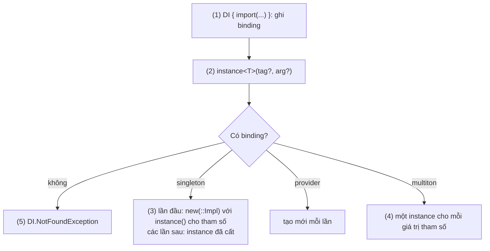
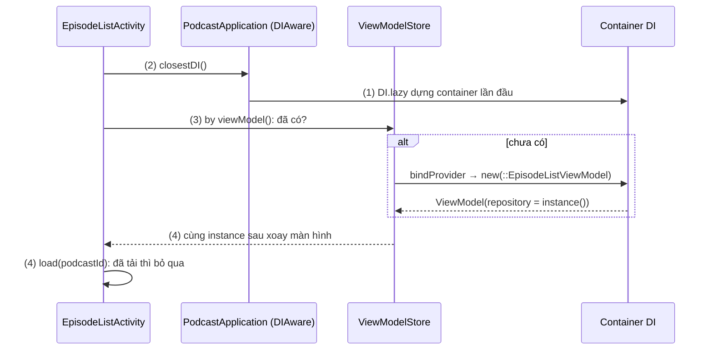
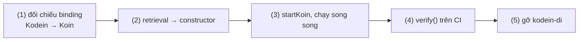

# Kodein

## Vấn đề cần giải quyết

Trong một dự án Kotlin, nhất là dự án dùng chung code cho nhiều nền tảng, bạn cần một container DI (khái niệm ở [Dependency Injection Overview](overview.md)) mà:

- viết bằng Kotlin thuần, chạy được trên JVM, Android, iOS, JS;
- khai báo bằng DSL ngắn, không cần annotation processor;
- phân biệt được các cách cung cấp object: tạo mới mỗi lần, dùng chung một instance, tạo theo tham số.

Kodein-DI là một trong những thư viện đầu tiên làm việc này cho Kotlin (từ 2015), trước cả [Koin](koin.md). Ngày nay bạn chủ yếu **gặp lại** nó trong các dự án đã có, nên câu hỏi thực tế là: đọc hiểu được code Kodein-DI, sửa được lỗi của nó, và biết khi nào chuyển đi.

## Sau khi học xong

- Giải thích được cách Kodein-DI giữ binding trong container DI và trả instance khi được hỏi bằng instance(), và khác biệt giữa binding provider, singleton, factory, multiton.
- Triển khai được Kodein-DI trên Android với Application là DIAware, Activity hoặc Fragment lấy container bằng closestDI(), và ViewModel khai báo bằng bindProvider rồi lấy bằng by viewModel().
- Phân biệt được Kodein-DI với Koin về DSL, cách lấy dependency, công cụ kiểm tra cấu hình và tình trạng phát triển.
- Biết khi nào còn giữ Kodein-DI trong dự án và khi nào nên chuyển sang Koin hoặc Hilt, khi Kodein-DI đã vào chế độ bảo trì.

## Kodein là gì?

**Kodein-DI** (KOtlin DEpendency INjection) là thư viện Dependency Injection viết bằng Kotlin Multiplatform: các **binding** được khai báo trong khối `DI { }` bằng DSL `bind`, và dependency được lấy ra **lúc chạy** bằng delegate `instance()` từ container `DI`.

Mental model: container `DI` là **một tủ có nhiều ngăn dán nhãn theo kiểu** (thêm tag khi cùng kiểu có nhiều ngăn). Mỗi ngăn ghi cách lấy đồ: `provider` làm món mới mỗi lần mở, `singleton` giữ đúng một món dùng chung, `factory` làm món theo yêu cầu kèm tham số. `instance()` là mở ngăn theo nhãn; ngăn không tồn tại thì chỉ biết khi mở.

> [!IMPORTANT]
> **Tình trạng hiện nay (11/2026):** README của Kodein-DI thông báo thư viện vào **chế độ bảo trì**: không thêm tính năng mới, chỉ sửa lỗi khi cần. Nhóm tác giả chuyển sang Inara (DI sinh code lúc compile bằng KSP cho Kotlin Multiplatform) và khuyên người dùng Kodein-DI chuyển sang Koin. Bản mới nhất là 7.33.0 (07/2026). Không chọn Kodein-DI cho dự án mới.

## Cách hoạt động

### Container DI và các loại binding

Dependency `org.kodein.di:kodein-di` (một artifact cho mọi nền tảng). Một binding gồm **kiểu** được bind (thường là interface), **tag** tuỳ chọn, và **cách cung cấp**:

| Binding | Cách viết gọn | Hành vi |
|---|---|---|
| Provider | `bindProvider<T> { ... }` | Mỗi lần hỏi gọi lambda, tạo instance mới |
| Singleton | `bindSingleton<T> { ... }` | Tạo lười một lần ở lần hỏi đầu (có đồng bộ), sau đó dùng lại |
| Eager singleton | `bindEagerSingleton<T> { ... }` | Như singleton nhưng tạo ngay khi container dựng xong |
| Factory | `bindFactory<A, T> { a: A -> ... }` | Tạo instance mới từ một tham số |
| Multiton | `bindMultiton<A, T> { a: A -> ... }` | Một instance cho **mỗi giá trị** tham số |
| Instance | `bindInstance(obj)` | Bind một object có sẵn |

Cách viết đầy đủ tương đương là `bind<T> { singleton { ... } }`. Trong lambda, `instance()` lấy dependency từ cùng container; `new(::Class)` gọi constructor và tự lấy từng tham số bằng `instance()`. Binding gom thành `DI.Module` rồi `import` vào container.

#### Ví dụ: app nghe podcast, một HTTP client và một bộ đệm cho mỗi tập

**Bài toán:** app podcast cần một `HttpClient` dùng chung, `PodcastRepository` (interface) hiện thực bằng mạng, và một `EpisodeDownloader` cho **mỗi** tập (theo `episodeId`) để tải tập đó, nhưng cùng một tập thì không tạo hai downloader.

**Luồng chạy:**

1. Khối `DI { }` import `networkModule` và `podcastModule`: Kodein-DI ghi các binding, chưa tạo object nào (trừ eager singleton).
2. Màn hình hỏi `instance<PodcastRepository>()`: Kodein tìm binding theo kiểu và tag.
3. Binding là singleton chưa có instance: chạy `new(::RemotePodcastRepository)`, lấy `HttpClient` bằng `instance()`, rồi cất instance.
4. Hỏi `EpisodeDownloader` kèm `episodeId`: binding multiton tạo một downloader cho mỗi id và trả lại đúng cái đó cho các lần sau cùng id.
5. Hỏi một kiểu chưa bind: `DI.NotFoundException` lúc chạy.



```kotlin
// di/NetworkModule.kt
val networkModule = DI.Module("network") {
    bindSingleton { HttpClient { install(ContentNegotiation) { json() } } }
}

// di/PodcastModule.kt
val podcastModule = DI.Module("podcast") {
    bindSingleton<PodcastRepository> { new(::RemotePodcastRepository) }          // (3)
    bindMultiton { episodeId: String -> EpisodeDownloader(episodeId, instance()) } // (4)
}

// di/AppDI.kt
val appDI = DI {                                                                  // (1)
    import(networkModule)
    import(podcastModule)
}

// data/RemotePodcastRepository.kt: chỉ nhận qua constructor
class RemotePodcastRepository(private val client: HttpClient) : PodcastRepository {
    override suspend fun episodes(podcastId: String): List<Episode> =
        client.get("https://api.podcast.example/podcasts/$podcastId/episodes").body()
}
```

**Kết quả:** `appDI.direct.instance<PodcastRepository>()` gọi hai lần trả cùng object; `appDI.direct.instance<String, EpisodeDownloader>(arg = "ep-42")` gọi hai lần trả cùng downloader, đổi sang `"ep-43"` thì được downloader khác. Bỏ `import(networkModule)`: code vẫn compile, lần đầu hỏi `PodcastRepository` ném `DI.NotFoundException` vì thiếu `HttpClient`. `direct` lấy instance ngay thay vì qua delegate lười.

### Kodein-DI trên Android

Activity, Fragment do hệ thống tạo nên Kodein-DI không inject qua constructor được; docs của Kodein-DI gọi cách dùng trên chúng là **retrieval** (class tự lấy dependency). Các artifact `kodein-di-framework-android-*` thêm tiện ích:

- `Application` hiện thực `DIAware` và khai báo `override val di by DI.lazy { ... }` (lười để dùng được `Context` lúc khai báo binding).
- Activity, Fragment hiện thực `DIAware` với `override val di by closestDI()`: hàm này đi ngược cây `Context` tới `Application` để tìm container. Dependency lấy bằng `by instance()`, lười tới lần truy cập đầu.
- ViewModel (artifact `kodein-di-framework-android-x-viewmodel`): khai báo bằng **`bindProvider`** và lấy bằng `by viewModel()`; delegate này đi qua `ViewModelStore` của Activity/Fragment, chỉ gọi provider khi chưa có instance. ViewModel cần `SavedStateHandle` thì dùng `bindFactory { handle: SavedStateHandle -> ... }` và `by viewModelWithSavedStateHandle()` (artifact `-viewmodel-savedstate`).
- Compose (`kodein-di-framework-compose`): `withDI(di) { ... }` đưa container vào cây composable, `rememberInstance()` và `rememberViewModel()` lấy dependency.

#### Ví dụ: màn danh sách tập podcast

**Bài toán:** `EpisodeListActivity` hiện danh sách tập của một podcast. `EpisodeListViewModel` cần `PodcastRepository` và phải sống qua xoay màn hình.

**Luồng chạy:**

1. Lần đầu có nơi cần container, `PodcastApplication.di` (`DI.lazy`) được dựng với `androidXModule` và các module của app.
2. `EpisodeListActivity.onCreate()` truy cập `viewModel` để gọi `load(podcastId)`: `closestDI()` tìm tới container của `Application`.
3. `by viewModel()` hỏi `ViewModelStore` của Activity: đã có thì trả luôn; chưa có thì gọi binding provider, `new(::EpisodeListViewModel)` lấy `PodcastRepository` từ container. `load()` gọi API và ghi nhớ `podcastId` đã tải.
4. Xoay màn hình: Activity mới gọi lại `load()`, nhưng bước 3 trả lại ViewModel cũ trong store, đã tải đúng `podcastId` này nên không gọi lại API.



```kotlin
// PodcastApplication.kt (khai báo trong AndroidManifest bằng android:name)
class PodcastApplication : Application(), DIAware {
    override val di by DI.lazy {                                                  // (1)
        import(androidXModule(this@PodcastApplication))                          // binding cho dịch vụ Android
        import(networkModule)
        import(podcastModule)
        bindProvider { new(::EpisodeListViewModel) }                              // (3) ViewModel: provider
    }
}

// EpisodeListViewModel.kt
class EpisodeListViewModel(private val repository: PodcastRepository) : ViewModel() {
    private val _episodes = MutableStateFlow<List<Episode>>(emptyList())
    val episodes: StateFlow<List<Episode>> = _episodes.asStateFlow()
    private var loadedFor: String? = null

    fun load(podcastId: String) {
        if (podcastId == loadedFor) return                                        // (4) đã tải: không gọi lại API
        loadedFor = podcastId
        viewModelScope.launch { _episodes.value = repository.episodes(podcastId) } // (3)
    }
}

// EpisodeListActivity.kt
class EpisodeListActivity : AppCompatActivity(), DIAware {
    override val di by closestDI()                                                // (2)
    private val viewModel: EpisodeListViewModel by viewModel()                    // (3)(4)

    override fun onCreate(savedInstanceState: Bundle?) {
        super.onCreate(savedInstanceState)
        viewModel.load(checkNotNull(intent.getStringExtra("podcast_id")))         // (2) mỗi onCreate đều gọi
    }
}
```

`StateFlow` học ở [Flow](../observer/flow.md); `viewModelScope` ở [ViewModel](../../../session_06/viewmodel.md).

**Kết quả:** mở màn danh sách, xoay màn hình: danh sách giữ nguyên, không gọi lại API, vì ViewModel được lấy lại từ store và `load()` bỏ qua `podcastId` đã tải. Unit test tạo `EpisodeListViewModel(FakePodcastRepository())` trực tiếp, không cần Kodein-DI, vì ViewModel nhận dependency qua constructor.

Trên Kotlin Multiplatform, binding đặt trong `commonMain` như mọi code Kotlin khác; phần riêng từng nền tảng (driver database, vị trí) đặt trong module ở `androidMain`, `iosMain` rồi `import` vào container.

## Ví dụ thực tế

Bài toán thực tế nhất với Kodein-DI hiện nay là **chuyển một dự án đang dùng nó sang Koin**, theo đúng khuyến nghị của nhóm tác giả; code đầy đủ bên dưới. Bài toán khác: sửa `DI.NotFoundException` trong dự án cũ, bằng cách tìm module chưa được `import` vào container gốc, hoặc tag lệch giữa nơi bind và nơi lấy.

### Chuyển app podcast từ Kodein-DI sang Koin

**Bài toán:** app podcast ở trên cần tiếp tục được bảo trì nhiều năm. Kodein-DI không còn tính năng mới, nên đội chuyển sang [Koin](koin.md), từng module một, không viết lại cả app.

**Luồng chạy:**

1. **Đối chiếu binding:** `bindSingleton` → `single`/`singleOf`, `bindProvider` → `factory`, ViewModel → `viewModelOf`, tag → `named(...)`, `new(::X)` → constructor reference `::X`. `bindMultiton` không có bản tương đương trực tiếp: chuyển thành một class quản lý map theo id.
2. **Bỏ retrieval trong class nghiệp vụ:** class nào gọi `instance()` bên trong thì đổi sang nhận qua constructor. Activity, Fragment đổi `by instance()` thành `by inject()`, `by viewModel()` của Kodein thành `by viewModel()` của Koin.
3. **Khởi động Koin** trong `Application`; trong lúc chuyển, hai container cùng tồn tại, mỗi màn hình lấy từ đúng một bên.
4. **Kiểm tra** bằng test `verify()` của Koin, thứ Kodein-DI không có.
5. **Gỡ Kodein-DI** khi không còn class nào là `DIAware`.



```kotlin
// Trước: Kodein-DI
val podcastModule = DI.Module("podcast") {
    bindSingleton { HttpClient { install(ContentNegotiation) { json() } } }
    bindSingleton<PodcastRepository> { new(::RemotePodcastRepository) }
    bindMultiton { episodeId: String -> EpisodeDownloader(episodeId, instance()) }
    bindProvider { new(::EpisodeListViewModel) }
}

// Sau: Koin                                                                    (1)
val podcastModule = module {
    single { HttpClient { install(ContentNegotiation) { json() } } }
    singleOf(::RemotePodcastRepository) bind PodcastRepository::class
    singleOf(::EpisodeDownloads)                     // thay bindMultiton: giữ map episodeId → downloader
    viewModelOf(::EpisodeListViewModel)
}

class EpisodeDownloads(private val client: HttpClient) {
    private val downloaders = ConcurrentHashMap<String, EpisodeDownloader>()
    fun forEpisode(episodeId: String): EpisodeDownloader =
        downloaders.getOrPut(episodeId) { EpisodeDownloader(episodeId, client) }
}
```

```kotlin
// PodcastApplication.kt                                                        (3)
class PodcastApplication : Application() {
    override fun onCreate() {
        super.onCreate()
        startKoin {
            androidContext(this@PodcastApplication)
            modules(podcastModule)
        }
    }
}

// EpisodeListActivity.kt: không còn DIAware                                    (2)
class EpisodeListActivity : AppCompatActivity() {
    private val viewModel: EpisodeListViewModel by viewModel()   // org.koin.androidx.viewmodel.ext.android
    // onCreate() gọi viewModel.load(...) như cũ
}

// src/test/.../KoinConfigurationTest.kt                                        (4)
class KoinConfigurationTest {
    @Test
    fun podcastModule_isComplete() {
        podcastModule.verify(extraTypes = listOf(HttpClientEngine::class))
    }
}
```

`verify()` chỉ đọc constructor public của kiểu mà mỗi definition khai báo, không đọc thân lambda (xem [Koin](koin.md), mục "Kiểm tra cấu hình trước khi chạy"): `HttpClient` dựng bằng builder, nhưng constructor của nó cần `HttpClientEngine`, nên thiếu `extraTypes` thì test báo thiếu sai.

`EpisodeListViewModel` và `RemotePodcastRepository` không đổi một dòng nào, vì chúng đã nhận dependency qua constructor; đây là lợi ích của việc dùng injection thay cho retrieval ngay từ đầu. Ở JVM, `ConcurrentHashMap` đủ cho `EpisodeDownloads`; code `commonMain` của Kotlin Multiplatform cần một map có khoá đồng bộ thay thế.

**Kết quả:** sau bước 5, `./gradlew :app:dependencies` không còn `org.kodein.di`; test `verify()` chạy trên CI chặn được definition thiếu, điều mà dự án cũ chỉ phát hiện khi chạy app.

## So sánh với Koin

| | Kodein-DI | [Koin](koin.md) |
|---|---|---|
| Khai báo | `DI { bindSingleton { } }`, `DI.Module` + `import` | `module { single { } }`, `modules(...)` hoặc `includes` |
| Tạo theo constructor | `new(::Class)` | `singleOf(::Class)`, hoặc chỉ ghi kiểu với Compiler Plugin |
| Lấy dependency trong class Android | `DIAware` + `closestDI()` + `by instance()` | `by inject()`, không cần hiện thực interface |
| Tham số lúc chạy | `bindFactory`, `bindMultiton` | `parametersOf`, `@InjectedParam` |
| Kiểm tra cấu hình | Không có công cụ riêng; lỗi lộ ra khi lấy | `verify()` trong test, Compiler Plugin lúc build |
| Nền tảng | Kotlin Multiplatform | Kotlin Multiplatform |
| Tình trạng (11/2026) | Chế độ bảo trì, bản cuối 7.33.0 | Phát triển tích cực, stable 4.2.2 |

Hai thư viện cùng dựa trên ý tưởng container tra cứu lúc chạy với DSL Kotlin; khác biệt lớn nhất hiện nay là Koin có công cụ kiểm tra cấu hình và vẫn được phát triển. Bảng so sánh cả Dagger, Hilt ở [Dependency Injection Overview](overview.md).

## Khi nào nên và không nên dùng

- **Không nên** chọn Kodein-DI cho dự án mới: thư viện đã ngừng phát triển tính năng; app chỉ chạy Android dùng [Hilt](hilt.md), dự án Kotlin Multiplatform dùng [Koin](koin.md).
- **Có thể giữ** trong dự án đang chạy ổn định, ít thay đổi; bản bảo trì vẫn sửa lỗi. Lên kế hoạch chuyển khi cần nâng Kotlin, Compose hay AndroidX mà Kodein-DI chưa theo kịp.
- **Nên chuyển** sớm khi đội đang viết nhiều code mới trên nền DI, vì mọi class mới phụ thuộc Kodein-DI đều thêm việc lúc chuyển.

## Sai lầm thường gặp

### 1. Khai báo ViewModel bằng `bindSingleton`

```kotlin
bindSingleton { new(::EpisodeListViewModel) }    // Sai
```

**Lỗi lộ ra thế nào:** mở danh sách tập của podcast A, quay lại, mở podcast B: màn mới vẫn hiện danh sách của A và không tải gì thêm. Mọi `ViewModelStore` nhận cùng một instance; khi màn A đóng, store của nó gọi `onCleared()` và huỷ `viewModelScope` của chính instance đó, nên `load("B")` ở màn B khởi chạy coroutine trong một scope đã bị huỷ: coroutine không chạy, `episodes` vẫn giữ danh sách của A.

**Cách sửa:** ViewModel luôn khai báo bằng `bindProvider` (hoặc `bindFactory` khi cần `SavedStateHandle`); `by viewModel()` mới là bên quyết định giữ instance trong store.

### 2. Retrieval trong class nghiệp vụ

```kotlin
class RemotePodcastRepository(override val di: DI) : PodcastRepository, DIAware {
    private val client: HttpClient by instance()
}
```

**Lỗi lộ ra thế nào:** test phải dựng cả container mới tạo được Repository; constructor không nói class cần gì. Khi chuyển sang Koin, mọi class kiểu này phải sửa.

**Cách sửa:** nhận qua constructor và khai báo bằng `new(::RemotePodcastRepository)`; chỉ dùng retrieval trong Activity, Fragment, Service.

### 3. Tin rằng compile được là cấu hình đúng

```kotlin
class PodcastApplication : Application(), DIAware {
    override val di by DI.lazy { import(podcastModule) }   // quên import(networkModule)
}
```

**Lỗi lộ ra thế nào:** app build và mở được; tới lúc người dùng vào màn danh sách thì crash với `DI.NotFoundException` cho `HttpClient`. Delegate `by instance()` lười nên lỗi lộ ra muộn hơn nữa.

**Cách sửa:** viết test JVM dựng container và gọi `di.direct.instance<...>()` cho các kiểu gốc (Repository, ViewModel); trong Activity có thể dùng `DITrigger` để lấy mọi dependency ngay trong `onCreate()`.

### 4. `Application` không phải `DIAware` hoặc không khai báo trong manifest

```xml
<!-- AndroidManifest.xml: thiếu android:name=".PodcastApplication" -->
<application android:label="@string/app_name">
```

**Lỗi lộ ra thế nào:** `closestDI()` đi ngược cây `Context` mà không gặp container nào, Activity crash ở lần đầu truy cập dependency.

**Cách sửa:** `Application` hiện thực `DIAware` và được khai báo bằng `android:name` trong thẻ `<application>`.

## Lịch sử phát triển

- **2015:** Salomon Brys tạo Kodein, một trong những thư viện DI đầu tiên viết riêng cho Kotlin, với lý do Dagger quá dài dòng cho code Kotlin.
- **2017:** Koin ra đời như đối thủ trực tiếp, cũng dùng DSL Kotlin; theo chính tác giả Kodein, tới 2020 Koin đã chiếm ưu thế về số người dùng.
- **05/2020 (Kodein-DI 7.0):** hệ thống kiểu mới dùng `typeOf()` nên phân biệt được kiểu generic trên mọi nền tảng; các class đổi tên từ `Kodein` sang `DI` (`KodeinAware` → `DIAware`, `closestKodein()` → `closestDI()`); các artifact `-erased`, `-generic-jvm` gộp thành một `kodein-di`.
- **12/2022 (7.17):** chỉ còn hỗ trợ backend JS-IR, theo Kotlin 1.8.
- **05/2024 (7.22.0):** chuyển sang Kotlin 2.0.
- **07/2026 (7.33.0):** bản phát hành mới nhất.
- **11/2026:** Kodein-DI vào chế độ bảo trì; nhóm Kodein Koders chuyển sang Inara (DI sinh code lúc compile cho Kotlin Multiplatform) và khuyên chuyển sang Koin.

## Kết nối hệ thống

- **Tiên quyết:**
  - [Dependency Injection Overview](overview.md): DI, Service Locator, container, scope.
  - [Kotlin](../../../session_01/languages/kotlin.md): lambda và `by lazy`. Lambda with receiver (nền của DSL) và property delegate (nền của `by instance()`): chưa có bài.
  - [ViewModel](../../../session_06/viewmodel.md): `ViewModelStore`, lý do ViewModel phải khai báo bằng provider.
- **Liên quan:**
  - [Koin](koin.md): thư viện thay thế được khuyên dùng, cùng mô hình container lúc chạy.
  - [Hilt](hilt.md): DI sinh code lúc build cho app chỉ chạy Android.
  - [MVVM](../../architecture/mvvm.md): ViewModel nhận Repository qua constructor.
- **Học tiếp:**
  - [Clean Architecture](../../architecture/clean_architecture.md): chia tầng mà container DI nối lại.

## Tham khảo

- [Kodein-DI README (thông báo chế độ bảo trì) - GitHub](https://github.com/kosi-libs/Kodein)
- [Getting started with Kodein-DI - Kodein docs](https://kosi-libs.org/kodein/7.31/getting-started.html) (docs bản 7.31, bản docs mới nhất đang được đăng; thư viện đã tới 7.33.0)
- [Bindings: Declaring dependencies - Kodein docs](https://kosi-libs.org/kodein/7.31/core/bindings.html)
- [Dependency injection & retrieval - Kodein docs](https://kosi-libs.org/kodein/7.31/core/injection-retrieval.html)
- [Kodein-DI on Android - Kodein docs](https://kosi-libs.org/kodein/7.31/framework/android.html)
- [Kodein-DI and Compose - Kodein docs](https://kosi-libs.org/kodein/7.31/framework/compose.html)
- [Migration from Kodein-DI 6 to 7 - Kodein docs](https://kosi-libs.org/kodein/7.31/migration/migration-6to7.html)
- [Inara: Inject your dependencies at compile time - Kodein Koders blog](https://kodein-koders.com/en/blog/inara-inject-your-dependencies-at-compile-time/)
- [Kodein releases - GitHub](https://github.com/kosi-libs/Kodein/releases)
