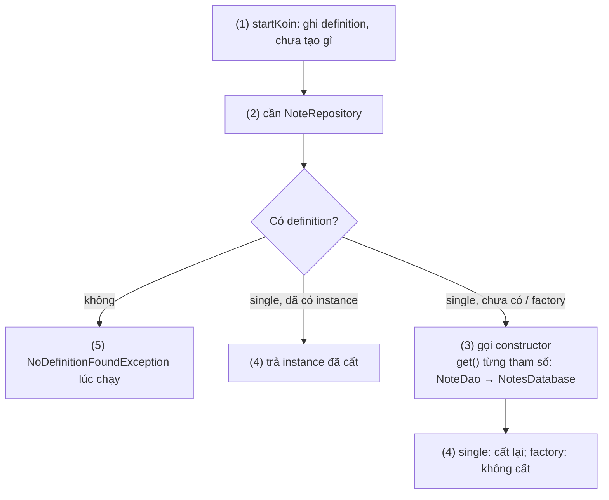
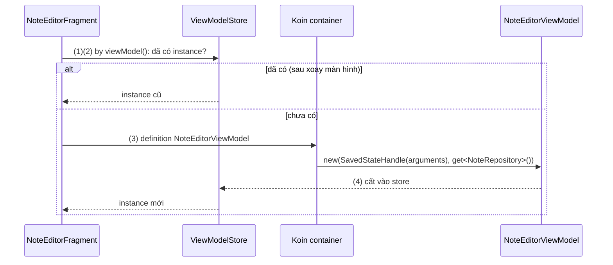
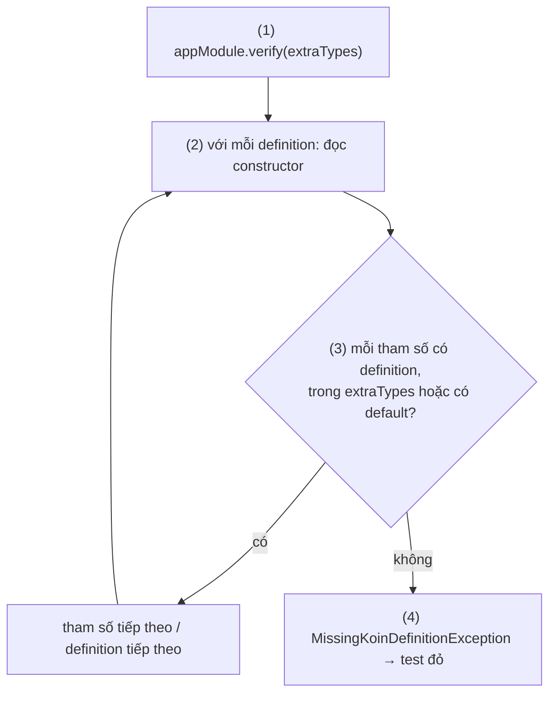
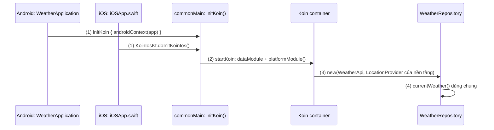

# Koin

## Vấn đề cần giải quyết

[Dependency Injection Overview](overview.md) đã chỉ ra: khi số dependency tăng, container viết tay ngày càng dài, và mỗi ViewModel cần một factory. [Hilt](hilt.md) tự động hoá việc này bằng cách sinh code Dagger lúc build, nhưng có những dự án nó không hợp:

- **Code dùng chung Kotlin Multiplatform:** tầng data viết trong `commonMain` để chạy trên cả Android và iOS. Hilt chỉ chạy trên Android, nên phần chung không dùng được nó.
- **Muốn ít công cụ build:** Hilt cần annotation processor (KSP), Gradle plugin riêng, và `@AndroidEntryPoint` ở từng Activity, Fragment.
- **Muốn khai báo bằng code Kotlin thường:** chọn hiện thực theo điều kiện lúc chạy, nạp thêm module sau khi app đã khởi động.

Vấn đề cần giải quyết là: **một cách DI viết bằng Kotlin thuần**, khai báo ngắn, chạy được trên mọi nền tảng Kotlin, và vẫn có cách phát hiện cấu hình sai trước khi tới tay người dùng.

## Sau khi học xong

- Giải thích được cách Koin tra cứu và tạo dependency lúc chạy từ các definition trong module, và hệ quả của nó so với graph sinh lúc compile của Hilt.
- Triển khai được Koin trên Android gồm startKoin với androidContext, module với single, factory, viewModelOf, bind interface, và lấy dependency bằng constructor, by inject(), by viewModel() hoặc koinViewModel().
- Áp dụng được verify() hoặc Koin Compiler Plugin để phát hiện definition còn thiếu trước khi app chạy, thay cho checkModules() đã deprecated.
- Phân biệt được ba cách khai báo của Koin (Constructor/Classic DSL, Compiler Plugin DSL, Annotations) và biết khi nào chọn Koin thay cho Hilt, nhất là với Kotlin Multiplatform.
- Nhận diện được các sai lầm như gọi get() trong class nghiệp vụ biến DI thành Service Locator, lấy ViewModel bằng by inject(), và dùng single cho state chỉ thuộc một màn hình.

## Koin là gì?

**Koin** là framework Dependency Injection viết bằng Kotlin thuần: các **definition** (cách tạo một kiểu và tuổi thọ của nó) được khai báo trong **module** bằng DSL Kotlin hoặc annotation, nạp vào một **container** lúc app khởi động, rồi được tra cứu theo kiểu để tạo instance **lúc chạy**.

Mental model: container của Koin là **một cuốn danh bạ nạp vào bộ nhớ lúc khởi động**. Mỗi dòng ghi "kiểu này → tạo bằng cách nào, giữ bao lâu". Khi có nơi cần một kiểu, Koin lật danh bạ theo kiểu đó và làm theo dòng ghi. Danh bạ thiếu dòng thì Koin chỉ phát hiện **lúc lật tới**, trừ khi bạn soát danh bạ trước bằng `verify()` hoặc Koin Compiler Plugin.

Khác biệt với [Hilt](hilt.md) nằm ở thời điểm nối dây: Hilt nối dây lúc build và sinh code gọi constructor; Koin giữ danh bạ trong bộ nhớ và nối dây khi được hỏi.

## Cách hoạt động

> [!NOTE]
> **Kiến thức dùng trước.** Ví dụ dùng Room ([Room Architecture](../../../session_05/data_store/room_architecture.md)), `StateFlow` ([Flow](../observer/flow.md)) và Ktor client ([Ktor and Apollo Android](../../../session_08/networks/ktor_apollo.md)) ở mức tối thiểu. Lambda with receiver, nền của DSL `module { }`, ở [Kotlin](../../../session_01/languages/kotlin.md).

### Container, module và definition

Cài Koin trên Android bằng BOM để mọi artifact cùng version:

```kotlin
// app/build.gradle.kts
dependencies {
    implementation(platform("io.insert-koin:koin-bom:4.2.2"))
    implementation("io.insert-koin:koin-android")              // gồm koin-core và hỗ trợ ViewModel
    testImplementation("io.insert-koin:koin-test-junit4")
}
```

Không cần annotation processor hay Gradle plugin. Từ Koin 4.2, `koin-android` yêu cầu `minSdk` 23.

Một module chứa các definition. Bốn loại hay dùng:

| Definition | Tuổi thọ instance | Dùng cho |
|---|---|---|
| `single` | Một instance cho cả container (tạo lười, lần đầu được hỏi) | Database, HTTP client, Repository |
| `factory` | Mỗi lần được hỏi một instance mới | Use case, formatter, object ngắn hạn |
| `viewModel` | Do `ViewModelStore` của owner quản lý | ViewModel |
| `scoped` | Một instance cho mỗi scope, giải phóng khi scope đóng | Object gắn với Activity, phiên làm việc |

Mỗi definition viết được theo hai dạng không cần plugin:

- **Classic DSL:** lambda tự gọi constructor, `get()` lấy từng dependency: `single { RoomNoteRepository(get()) }`. Lambda là code Kotlin thường, nên dùng được cho builder (`Room.databaseBuilder`) và điều kiện.
- **Constructor DSL:** tham chiếu constructor, Koin tự gọi `get()` cho từng tham số: `singleOf(::RoomNoteRepository)`. Thêm tham số vào constructor thì không phải sửa module.

Consumer nên phụ thuộc vào interface. `bind` gắn definition với interface; hai definition cùng kiểu thì phân biệt bằng qualifier `named("...")`.

#### Ví dụ: app ghi chú, một database và một Repository cho cả app

**Bài toán:** app ghi chú đọc và ghi qua `NoteRepository` (interface), hiện thực bằng Room. Database phải là **một instance** (mở nhiều kết nối Room tới cùng file vừa tốn vừa dễ lệch dữ liệu), còn `NoteDateFormatter` nhẹ, mỗi nơi một cái cũng được.

**Luồng chạy:**

1. `Application.onCreate()` gọi `startKoin`: Koin ghi các definition vào container. **Chưa instance nào được tạo.**
2. Một nơi yêu cầu `NoteRepository` (ViewModel ở mục sau). Koin tìm definition theo kiểu (và qualifier nếu có).
3. Definition là `single` và chưa có instance: Koin chạy cách tạo. Constructor của `RoomNoteRepository` cần `NoteDao`, nên Koin lặp lại bước 2 cho `NoteDao`, rồi cho `NotesDatabase`.
4. Instance `single` được cất lại; lần hỏi sau trả đúng instance đó. `factory` thì mỗi lần chạy lại cách tạo.
5. Không tìm thấy definition: Koin ném exception **lúc chạy**, đúng lúc được hỏi.



```kotlin
// di/DataModule.kt
val dataModule = module {
    single {                                                                   // (3) builder: dùng lambda
        Room.databaseBuilder(androidContext(), NotesDatabase::class.java, "notes.db").build()
    }
    single { get<NotesDatabase>().noteDao() }
    singleOf(::RoomNoteRepository) bind NoteRepository::class                  // (4) một instance, gắn interface
    factoryOf(::NoteDateFormatter)                                             // (4) mỗi lần một instance
}

// data/RoomNoteRepository.kt: không annotation, không import Koin
class RoomNoteRepository(private val noteDao: NoteDao) : NoteRepository {
    override fun observeNotes(): Flow<List<Note>> = noteDao.observeAll()
    override suspend fun save(note: Note) = noteDao.upsert(note)
}

// NotesApplication.kt
class NotesApplication : Application() {
    override fun onCreate() {
        super.onCreate()
        startKoin {                                                            // (1)
            androidLogger()
            androidContext(this@NotesApplication)                              // Context cho androidContext()
            modules(dataModule, uiModule)
        }
    }
}
```

`androidContext()` trả `Application` đã đưa vào lúc `startKoin`, nên `single` không giữ nhầm Activity. Các hàm `singleOf`, `factoryOf`, `viewModelOf` nằm trong package `org.koin.core.module.dsl`.

**Kết quả:** gọi `getKoin().get<NoteRepository>()` hai lần trả cùng một object (`===` là `true`), còn `NoteDateFormatter` trả hai object khác nhau. Xoá dòng `single { get<NotesDatabase>().noteDao() }`: app **vẫn build và khởi động bình thường**, chỉ crash khi lần đầu có nơi cần `NoteRepository`, với `NoDefinitionFoundException` cho `NoteDao`. Đây là đánh đổi cốt lõi của việc resolve lúc chạy; mục "Kiểm tra cấu hình" xử lý nó.

### Lấy dependency trên Android: constructor, `by inject()`, ViewModel

Có ba cách lấy dependency, theo thứ tự nên ưu tiên:

1. **Qua constructor:** class nghiệp vụ (Repository, use case, ViewModel) chỉ khai báo tham số; Koin truyền vào. Class không biết Koin tồn tại.
2. **`by viewModel()`** trong Activity, Fragment và **`koinViewModel()`** trong Compose cho ViewModel. Chúng đi qua `ViewModelStore` của owner, nên xoay màn hình nhận lại instance cũ. `SavedStateHandle` khai báo trong constructor được Koin dựng từ `CreationExtras` của owner (intent extras, arguments của Fragment).
3. **`by inject()`** (lười) hoặc `get()` (ngay) trong class do hệ thống tạo, như Activity, Fragment, Service, vì chúng không nhận tham số constructor được. Không như Hilt, Koin không cần đánh dấu class bằng annotation nào.

Gọi `get()` trong một class thường (qua interface `KoinComponent`) là **Service Locator**: class tự đi tìm dependency, như phân biệt ở [Dependency Injection Overview](overview.md). Chỉ làm vậy ở ranh giới với framework, nơi không có constructor để dùng.

Giá trị chỉ có lúc chạy truyền bằng `parametersOf`: `by viewModel { parametersOf(noteId) }`, phía definition nhận bằng `viewModel { (noteId: String) -> ... }` hoặc tham số đánh dấu `@InjectedParam`. Tham số chỉ dùng khi ViewModel được tạo lần đầu và không được lưu khi process chết; id từ điều hướng nên đi qua `SavedStateHandle`.

#### Ví dụ: màn soạn ghi chú mở từ danh sách

**Bài toán:** bấm một ghi chú trong danh sách thì mở `NoteEditorFragment` với `note_id` trong `arguments`. `NoteEditorViewModel` cần `NoteRepository` và `note_id`, và phải giữ bản nháp khi xoay màn hình.

**Luồng chạy:**

1. Fragment truy cập `viewModel` lần đầu (delegate lười của `by viewModel()`).
2. Koin hỏi `ViewModelStore` của Fragment: đã có `NoteEditorViewModel` thì trả luôn (trường hợp xoay màn hình).
3. Chưa có: Koin tìm definition `viewModelOf(::NoteEditorViewModel)`, dựng `SavedStateHandle` từ `arguments` và lấy `NoteRepository` từ container.
4. ViewModel được cất vào `ViewModelStore`; Fragment dùng nó, còn `NoteDateFormatter` lấy bằng `by inject()`.



```kotlin
// di/UiModule.kt
val uiModule = module {
    viewModelOf(::NoteEditorViewModel)                                         // (3)
}

// NoteEditorViewModel.kt
class NoteEditorViewModel(
    savedStateHandle: SavedStateHandle,                                        // (3) Koin dựng từ arguments
    private val repository: NoteRepository                                     // (3) từ container
) : ViewModel() {
    private val noteId: String = checkNotNull(savedStateHandle["note_id"])
    val note: StateFlow<Note?> = repository.observeNote(noteId)
        .stateIn(viewModelScope, SharingStarted.WhileSubscribed(5_000), null)
}

// NoteEditorFragment.kt
class NoteEditorFragment : Fragment(R.layout.fragment_note_editor) {
    private val viewModel: NoteEditorViewModel by viewModel()                  // (1)
    private val dateFormatter: NoteDateFormatter by inject()                   // (4) class do hệ thống tạo
}

// Compose: cùng definition, lấy bằng koinViewModel()
@Composable
fun NoteEditorRoute(viewModel: NoteEditorViewModel = koinViewModel()) { /* ... */ }
```

`by viewModel()` ở package `org.koin.androidx.viewmodel.ext.android`, `by inject()` ở `org.koin.android.ext.android`, `koinViewModel()` ở artifact `koin-compose-viewmodel`. ViewModel dùng chung giữa Fragment và Activity thì lấy bằng `by activityViewModel()`.

**Kết quả:** sửa nội dung rồi xoay màn hình: bản nháp còn nguyên, vì Fragment mới nhận lại ViewModel cũ ở bước 2. Unit test tạo `NoteEditorViewModel(SavedStateHandle(mapOf("note_id" to "n1")), FakeNoteRepository())` trực tiếp, không cần Koin.

### Kiểm tra cấu hình trước khi chạy: `verify()` và Compiler Plugin

Vì Koin resolve lúc chạy, cần một bước soát danh bạ trước khi phát hành. Có hai cách:

- **`verify()`** (trong `koin-test`, chạy trên JVM): đọc constructor của class trong từng definition và kiểm tra mỗi tham số đều có definition trong cây module. Nó không tạo instance nào, không cần mock. Kiểu do nền tảng cung cấp (`Context`, `SavedStateHandle`) khai báo qua `extraTypes`. Giới hạn: `verify()` **chỉ đọc constructor**, không đọc các lời gọi `get()` viết tay trong lambda, nên định nghĩa bằng Constructor DSL được kiểm tra kỹ hơn Classic DSL.
- **Koin Compiler Plugin** (Gradle plugin `io.insert-koin.compiler.plugin`, Koin 4.2+, Kotlin 2.3.20+ với K2): kiểm tra graph **lúc build** tại điểm `startKoin`, kể cả lời gọi `get()`. Thiếu dependency là build thất bại với lỗi `KOIN-D001`. Module nạp thêm lúc chạy bằng `loadKoinModules()` nằm ngoài tầm nhìn của plugin.

`checkModules()` của các bản cũ tạo thật mọi definition nên phải giả lập đủ thứ; nó đã **deprecated từ Koin 4.0**, thay bằng `verify()` hoặc Compiler Plugin.

#### Ví dụ: chặn lỗi thiếu definition trên CI

**Bài toán:** app ghi chú ở trên không dùng Compiler Plugin. Đội muốn mọi pull request làm thiếu definition đều bị CI chặn, thay vì crash ở máy người dùng.

**Luồng chạy:**

1. Test gọi `appModule.verify(extraTypes = ...)`; `appModule` gom `dataModule` và `uiModule` bằng `includes`.
2. Với mỗi definition, `verify()` đọc constructor của class (`RoomNoteRepository`, `NoteEditorViewModel`...).
3. Mỗi tham số được chấp nhận khi: có definition cùng kiểu, nằm trong `extraTypes`, có giá trị mặc định, hoặc là `Lazy<T>`/`List<T>` của kiểu đã khai báo.
4. Một tham số không thoả: `verify()` ném `MissingKoinDefinitionException` kèm gợi ý sửa; test đỏ, CI chặn merge.



```kotlin
// di/AppModule.kt
val appModule = module { includes(dataModule, uiModule) }

// src/test/.../KoinConfigurationTest.kt
class KoinConfigurationTest {
    @Test
    fun appModule_hasEveryDependency() {
        appModule.verify(                                                      // (1)
            extraTypes = listOf(Context::class, SavedStateHandle::class)       // (3) nền tảng cung cấp
        )
    }
}
```

`verify()` ở `org.koin.test.verify.verify`. Trong instrumented test, `androidVerify()` của `koin-android-test` tự thêm `Context`, `Activity`, `Fragment`, `Application`, `SavedStateHandle`, `WorkerParameters` vào danh sách.

**Kết quả:** `./gradlew testDebugUnitTest` xanh. Thêm tham số `tagRepository: TagRepository` vào `NoteEditorViewModel` mà quên khai báo `TagRepository`: test đỏ với `MissingKoinDefinitionException`, chỉ ra `TagRepository` thiếu cho `NoteEditorViewModel`. Lỗi lộ ra trên CI, trước khi app chạy.

### Ba cách khai báo

Từ Koin 4.2, cùng một container có thể được khai báo theo ba cách; chúng sinh ra cùng loại definition và có thể trộn trong một project:

```kotlin
// 1. Constructor / Classic DSL: không cần plugin (các ví dụ ở trên)
val dataModule = module {
    singleOf(::RoomNoteRepository) bind NoteRepository::class
    viewModelOf(::NoteEditorViewModel)
}

// 2. Compiler Plugin DSL: chỉ ghi kiểu, plugin tự viết lời gọi constructor (import org.koin.plugin.module.dsl.*)
val dataModule = module {
    single<RoomNoteRepository>() bind NoteRepository::class
    viewModel<NoteEditorViewModel>()
}

// 3. Annotations (Koin Annotations, cũng do Compiler Plugin xử lý)
@Singleton class RoomNoteRepository(private val noteDao: NoteDao) : NoteRepository   // tự bind interface
@KoinViewModel class NoteEditorViewModel(/* ... */) : ViewModel()
@Module @ComponentScan("com.notes.app") class AppModule
```

| Cách | Cần gì | Thiếu dependency lộ ra khi |
|---|---|---|
| Constructor / Classic DSL | Không gì thêm | Chạy, hoặc test `verify()`; build nếu có áp plugin |
| Compiler Plugin DSL | Plugin, Kotlin 2.3.20+ | Build |
| Annotations | Plugin, `koin-annotations` | Build |

Koin Annotations trước đây được xử lý bằng processor KSP (`koin-ksp-compiler`); processor này đã deprecated, thay bằng Compiler Plugin, còn các annotation giữ nguyên. Docs của Koin khuyên dự án mới trên Kotlin 2.3.20+ dùng Compiler Plugin DSL; giữ Constructor/Classic DSL khi chưa lên được Kotlin mới hoặc khi viết thư viện không muốn ép người dùng áp plugin. Hàm của Compiler Plugin DSL chỉ là stub: quên áp plugin thì code vẫn compile nhưng ném `NotImplementedError` lúc chạy.

### Dùng chung module trong Kotlin Multiplatform

`koin-core` chạy trên mọi target của Kotlin: Android, iOS, JVM desktop, JS, Wasm. Cách tổ chức: definition dùng chung đặt trong `commonMain`; phần khác nhau theo nền tảng khai báo bằng một hàm `expect fun platformModule(): Module` và hiện thực `actual` ở từng source set; một hàm `initKoin()` trong `commonMain` được mỗi nền tảng gọi lúc khởi động. Code đầy đủ ở "Ví dụ thực tế".

Ngoài ra Koin có tích hợp WorkManager (`koin-androidx-workmanager`: gọi `workManagerFactory()` trong `startKoin`, khai báo `workerOf(::PhotoSyncWorker)`, và gỡ initializer mặc định trong manifest như với Hilt), Navigation Compose, Navigation 3 và Ktor.

## Ví dụ thực tế

Bài toán chính là **dùng chung tầng data giữa Android và iOS**, nơi Koin có lợi thế rõ nhất so với Hilt; code đầy đủ bên dưới. Hai bài toán khác: thay definition bằng bản giả trong test bằng `KoinTestRule` và `declare { }` (docs "Unit Testing" của Koin), và nạp module của một tính năng chỉ khi người dùng bật nó bằng `loadKoinModules()`.

### Ứng dụng thời tiết: tầng data trong `commonMain`

**Bài toán:** app thời tiết có bản Android và iOS dùng chung `WeatherRepository` (gọi API bằng Ktor client, lấy vị trí hiện tại). Cách lấy vị trí khác nhau theo nền tảng: Android dùng `Context` và dịch vụ vị trí, iOS dùng CoreLocation. `WeatherRepository` chỉ được biết interface `LocationProvider`.

**Luồng chạy:**

1. **Android:** `WeatherApplication.onCreate()` gọi `initKoin { androidContext(...) }`. **iOS:** `init()` của app Swift gọi `KoinIosKt.doInitKoinIos()`.
2. `initKoin()` trong `commonMain` gọi `startKoin` với `dataModule` (chung) và `platformModule()`; mỗi nền tảng dùng bản `actual` của mình.
3. Màn hình yêu cầu `WeatherRepository`: Koin tạo nó với `WeatherApi` (chung) và `LocationProvider` (Android hoặc iOS, tuỳ nền tảng đang chạy).
4. Cùng một đoạn `WeatherRepository.currentWeather()` chạy trên cả hai nền tảng.



```kotlin
// shared/src/commonMain/kotlin/di/Koin.kt
val dataModule = module {
    single { HttpClient { install(ContentNegotiation) { json() } } }        // engine theo nền tảng
    singleOf(::WeatherApi)
    singleOf(::WeatherRepository)                                           // (3)
}

expect fun platformModule(): Module

fun initKoin(config: KoinAppDeclaration? = null) {                          // (2)
    startKoin {
        includes(config)                                                    // cấu hình riêng của nền tảng
        modules(dataModule, platformModule())
    }
}

// shared/src/commonMain/kotlin/data/WeatherRepository.kt
class WeatherRepository(
    private val api: WeatherApi,
    private val locationProvider: LocationProvider                          // interface chung
) {
    suspend fun currentWeather(): Weather {                                 // (4)
        val location = locationProvider.currentLocation()
        return api.forecast(location.latitude, location.longitude)
    }
}

// shared/src/androidMain/kotlin/di/PlatformModule.android.kt
actual fun platformModule(): Module = module {
    singleOf(::AndroidLocationProvider) bind LocationProvider::class        // nhận Context qua constructor
}

// shared/src/iosMain/kotlin/di/PlatformModule.ios.kt
actual fun platformModule(): Module = module {
    singleOf(::IosLocationProvider) bind LocationProvider::class            // bọc CLLocationManager
}

// shared/src/iosMain/kotlin/di/KoinIos.kt
fun initKoinIos() = initKoin()

class WeatherRepositoryProvider : KoinComponent {                           // ranh giới với Swift
    fun repository(): WeatherRepository = get()
}
```

```kotlin
// androidApp/src/main/kotlin/WeatherApplication.kt
class WeatherApplication : Application() {
    override fun onCreate() {
        super.onCreate()
        initKoin {                                                          // (1)
            androidContext(this@WeatherApplication)
            androidLogger()
        }
    }
}
```

```swift
// iosApp/iOSApp.swift
import Shared

@main
struct iOSApp: App {
    init() {
        KoinIosKt.doInitKoinIos()   // (1) Kotlin/Native thêm tiền tố "do" cho hàm bắt đầu bằng "init"
    }
    var body: some Scene { WindowGroup { ContentView() } }
}
```

`WeatherRepositoryProvider` là chỗ duy nhất gọi `get()`: Swift không nhận được tham số constructor từ Koin, nên đây là composition root phía iOS, không phải Service Locator rải trong code nghiệp vụ. Dependency của `shared` gồm `koin-core` ở `commonMain` và `koin-android` ở `androidMain`.

**Kết quả:** chạy app trên Android và iOS: cùng `WeatherRepository` trả dự báo cho vị trí hiện tại. Test trong `commonTest` thay `LocationProvider` bằng bản giả trả toạ độ Hà Nội và kiểm tra `WeatherRepository` mà không cần thiết bị nào.

## So sánh với Hilt

| | **Koin** | [Hilt](hilt.md) |
|---|---|---|
| Graph dựng lúc | Chạy (container trong bộ nhớ); kiểm tra lúc build nếu dùng Compiler Plugin | Build (code Dagger sinh ra) |
| Thiếu binding lộ ra khi | Chạy, test `verify()`, hoặc build với plugin | Build, luôn luôn |
| Công cụ build | Không bắt buộc; plugin tuỳ chọn | KSP và Hilt Gradle plugin |
| Nền tảng | Kotlin Multiplatform | Android (Dagger chạy được trên JVM) |
| Ngôn ngữ | Kotlin | Java và Kotlin |
| Vòng đời, scope | Container gốc, scope tự khai báo, scope có sẵn cho Activity/Fragment/ViewModel | Cây component chuẩn cố định |
| Điểm vào Android | `by inject()`, `by viewModel()` ở bất kỳ Activity, Fragment | `@AndroidEntryPoint` trên từng class |
| Nạp/gỡ module lúc chạy | Có (`loadKoinModules`, lazy modules) | Không |

Hilt mạnh hơn ở chỗ graph luôn được kiểm tra trọn vẹn và không tốn chi phí tra cứu lúc chạy, và là thư viện mà docs Android dùng. Koin mạnh hơn ở Kotlin Multiplatform, ít cấu hình build, và linh hoạt lúc chạy. Bảng so sánh cả bốn thư viện ở [Dependency Injection Overview](overview.md).

## Khi nào nên và không nên dùng

- **Nên dùng** khi có code dùng chung Kotlin Multiplatform (Android, iOS, desktop, server Ktor): cùng module chạy ở mọi nơi.
- **Nên dùng** khi đội muốn khai báo DI bằng code Kotlin thường, ít công cụ build, hoặc cần nạp module theo tính năng lúc chạy.
- **Cân nhắc Hilt** cho app chỉ chạy Android, nhất là codebase còn Java, hoặc khi đội muốn đi theo đúng hướng dẫn của Android và lỗi graph luôn hiện lúc build mà không cần thêm bước nào.
- **Không nên** dùng Koin mà bỏ qua cả `verify()` lẫn Compiler Plugin: khi đó lỗi cấu hình chỉ lộ ra ở máy người dùng.

## Sai lầm thường gặp

### 1. Gọi `get()` trong class nghiệp vụ

```kotlin
// Sai: Repository tự đi tìm dependency
class RoomNoteRepository : NoteRepository, KoinComponent {
    private val noteDao: NoteDao by inject()
}
```

**Lỗi lộ ra thế nào:** constructor không còn nói class cần gì; unit test phải khởi động Koin và khai báo đủ module mới tạo được một Repository. Class bị gắn chặt vào Koin, không chuyển sang DI khác hay dùng lại được.

**Cách sửa:** nhận qua constructor (`class RoomNoteRepository(private val noteDao: NoteDao)`) và khai báo `singleOf(::RoomNoteRepository)`. Chỉ dùng `KoinComponent` ở ranh giới với framework hoặc Swift.

### 2. Lấy ViewModel bằng `by inject()`

```kotlin
class NoteEditorFragment : Fragment() {
    private val viewModel: NoteEditorViewModel by inject()   // Sai
}
```

**Lỗi lộ ra thế nào:** ViewModel không nằm trong `ViewModelStore`: xoay màn hình tạo instance mới, bản nháp mất; `viewModelScope` không bao giờ bị huỷ vì `onCleared()` không được gọi. Docs của Koin ghi rõ không được lấy ViewModel bằng `inject()` hay `get()`.

**Cách sửa:** khai báo bằng `viewModel { }`/`viewModelOf()` và lấy bằng `by viewModel()`, `by activityViewModel()` hoặc `koinViewModel()`.

### 3. Dùng `single` cho state chỉ thuộc một màn hình

```kotlin
val uiModule = module {
    singleOf(::CheckoutDraft)   // giữ địa chỉ, phương thức thanh toán đang nhập
}
```

**Lỗi lộ ra thế nào:** đặt xong đơn, mở luồng thanh toán mới: form hiện lại dữ liệu của đơn trước, vì `single` sống cả container.

**Cách sửa:** state của màn hình để trong ViewModel; object cần tạo mới mỗi lần dùng `factory`; object gắn với một vòng đời ngắn hơn app dùng `scoped` trong scope tương ứng.

### 4. Đổi constructor mà không có bước kiểm tra

```kotlin
class NoteEditorViewModel(
    savedStateHandle: SavedStateHandle,
    private val repository: NoteRepository,
    private val tagRepository: TagRepository        // mới thêm, chưa khai báo trong module
) : ViewModel()
```

**Lỗi lộ ra thế nào:** build xanh, app khởi động bình thường; người dùng mở màn soạn ghi chú thì crash với `NoDefinitionFoundException` cho `TagRepository`.

**Cách sửa:** có test `appModule.verify()` chạy trên CI, hoặc áp Koin Compiler Plugin để lỗi lộ ra lúc build.

### 5. Gọi `startKoin` nhiều lần

```kotlin
class NotesTest {
    @Before fun setUp() { startKoin { modules(appModule) } }   // không stopKoin sau mỗi test
}
```

**Lỗi lộ ra thế nào:** test thứ hai ném `KoinApplicationAlreadyStartedException`, vì container toàn cục của lần trước vẫn còn. Lỗi tương tự xảy ra khi gọi `startKoin` trong Activity thay vì `Application`.

**Cách sửa:** `startKoin` đúng một lần trong `Application.onCreate()`; trong test dùng `KoinTestRule`, hoặc gọi `stopKoin()` trong `@After`.

## Lịch sử phát triển

- **2017:** Arnaud Giuliani khởi động Koin như một DSL DI nhẹ cho Kotlin, phản ứng với độ phức tạp của Dagger.
- **09/2018:** Koin 1.0 stable.
- **04/2021 (Koin 3.0):** Koin chuyển sang Kotlin Multiplatform; `koin-core` chạy được ngoài JVM.
- **06/2022:** Koin Annotations 1.0 ra mắt, khai báo bằng annotation và xử lý bằng KSP.
- **2023 (dòng 3.4):** API `verify()` để kiểm tra module trong unit test mà không tạo instance.
- **09/2024 (Koin 4.0):** API ViewModel cho Kotlin Multiplatform; `checkModules()` bị deprecated.
- **06/2025 (Koin 4.1):** scope có sẵn cho Activity, Fragment, ViewModel; cấu hình module dùng chung cho Kotlin Multiplatform.
- **03/2026 (Koin 4.2):** `@KoinApplication`, `@Configuration`, hỗ trợ Navigation 3, cầu nối với Dagger cho việc chuyển dần; `minSdk` của `koin-android` lên 23. Koin Annotations dùng chung version với Koin.
- **05/2026:** Koin Compiler Plugin 1.0, plugin compiler K2 thay cho processor KSP, kiểm tra graph lúc build. Koin 4.2.2 (06/2026) là bản stable hiện tại.

## Kết nối hệ thống

- **Tiên quyết:**
  - [Dependency Injection Overview](overview.md): DI, Service Locator, composition root, scope.
  - [ViewModel](../../../session_06/viewmodel.md): `ViewModelStore`, `SavedStateHandle`, thứ `by viewModel()` dựa vào.
  - [Kotlin](../../../session_01/languages/kotlin.md): lambda with receiver, nền của DSL `module { }`.
- **Liên quan:**
  - [Hilt](hilt.md): DI sinh code lúc build, lựa chọn mặc định cho app chỉ chạy Android.
  - [Kodein](kodein.md): DI DSL Kotlin khác, nay ở chế độ bảo trì.
  - [MVVM](../../architecture/mvvm.md): Koin cung cấp Repository cho ViewModel.
  - [Room Architecture](../../../session_05/data_store/room_architecture.md) và [Ktor and Apollo Android](../../../session_08/networks/ktor_apollo.md): dependency trong ví dụ.
- **Học tiếp:**
  - [Clean Architecture](../../architecture/clean_architecture.md): chia tầng mà module Koin nối lại.
  - [Unit Testing](../../../coding_analyst_and_testing/unit_testing.md): test với bản giả.

## Tham khảo

- [What is Koin / Core concepts - Koin docs](https://insert-koin.io/docs/intro/what-is-koin)
- [Definitions - Koin docs](https://insert-koin.io/docs/reference/koin-core/definitions)
- [Start Koin on Android - Koin docs](https://insert-koin.io/docs/reference/koin-android/start)
- [Android ViewModel - Koin docs](https://insert-koin.io/docs/reference/koin-android/viewmodel)
- [ViewModel in Compose - Koin docs](https://insert-koin.io/docs/reference/koin-compose/compose-viewmodel)
- [Verifying your Configuration (verify, checkModules) - Koin docs](https://insert-koin.io/docs/reference/koin-test/verify)
- [Choosing your style - Koin docs](https://insert-koin.io/docs/intro/choosing-your-style)
- [Koin Compiler Plugin - Koin docs](https://insert-koin.io/docs/intro/koin-compiler-plugin)
- [Kotlin Multiplatform Setup - Koin docs](https://insert-koin.io/docs/reference/koin-core/kmp-setup)
- [Koin vs Hilt - Koin docs](https://insert-koin.io/docs/intro/koin-vs-hilt)
- [Releases - Koin docs](https://insert-koin.io/docs/support/releases)
- [Koin releases - GitHub](https://github.com/InsertKoinIO/koin/releases)
