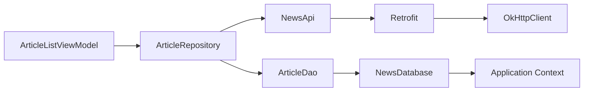
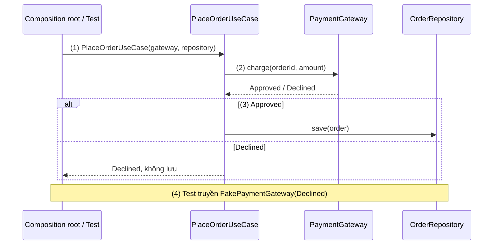
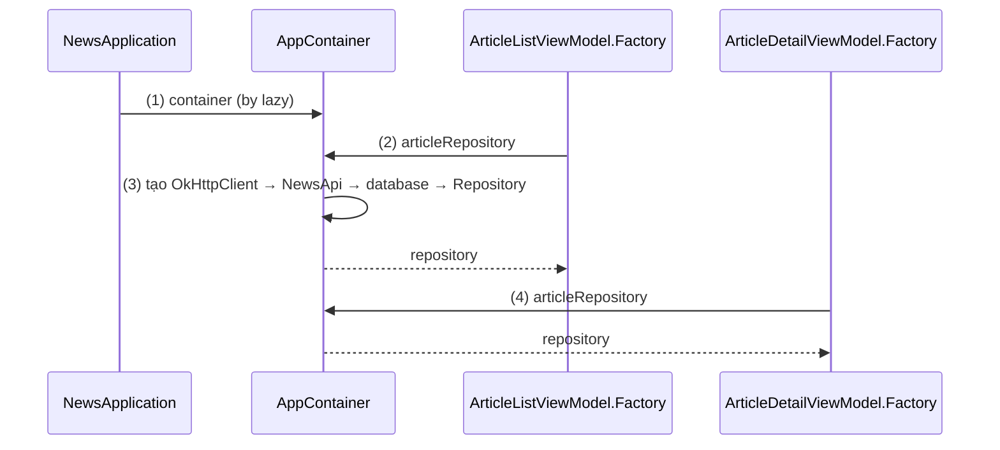
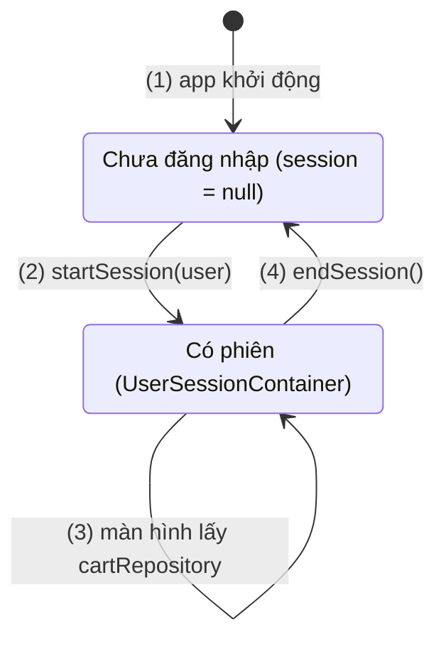
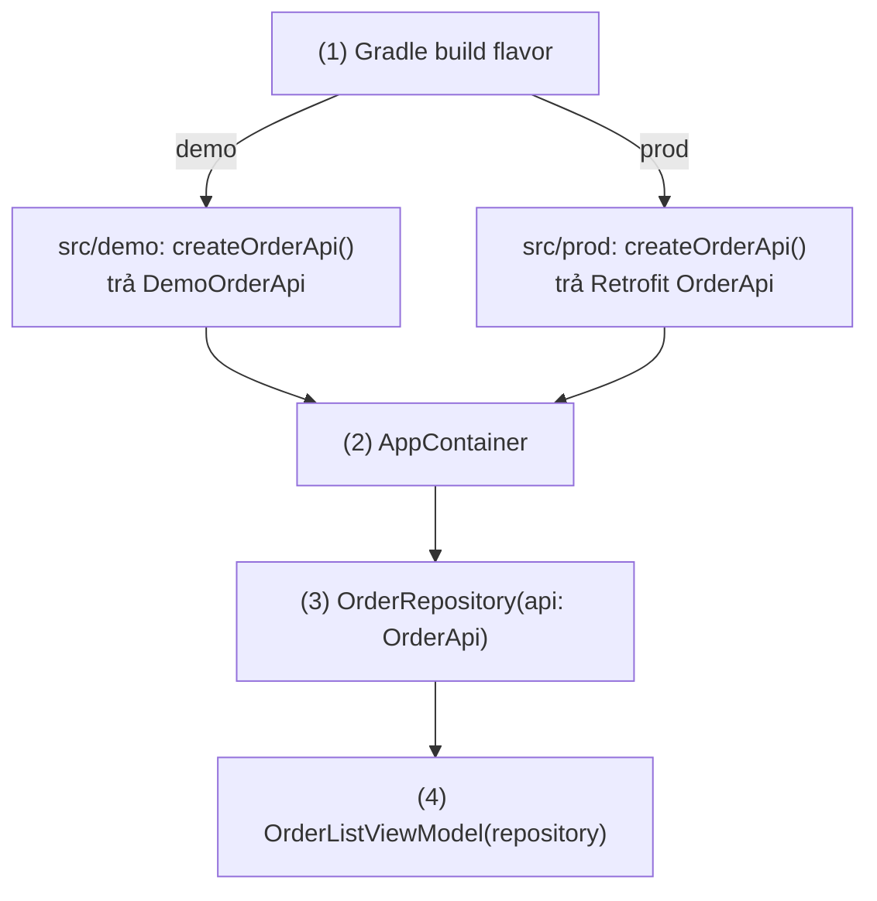

# Dependency Injection Overview

## Vấn đề cần giải quyết

Cách viết tự nhiên nhất là để mỗi class tự tạo thứ nó cần:

```kotlin
// ArticleListViewModel.kt (cách làm có vấn đề)
class ArticleListViewModel(application: Application) : AndroidViewModel(application) {
    private val repository = ArticleRepository(
        api = createNewsApi(OkHttpClient()),                        // client mới cho mỗi ViewModel
        dao = NewsDatabase.getInstance(application).articleDao()     // tự đi tìm database
    )
}
```

Khi app lớn dần, kiểu viết này gặp bốn vấn đề:

- **Không thay được khi test:** test logic của ViewModel buộc phải có mạng và database thật.
- **Không dùng chung được:** mỗi ViewModel tạo một `OkHttpClient` với connection pool riêng; màn khác chép lại khối code.
- **Dependency bị giấu:** nhìn constructor không biết class cần mạng, cần database.
- **Vòng đời lẫn lộn:** thứ nên sống suốt app bị tạo theo ViewModel, còn thứ chỉ nên sống trong một phiên đăng nhập (giỏ hàng) lại dễ bị giữ trong singleton toàn cục.

Vấn đề cần giải quyết là: **tách việc dùng một object khỏi việc tạo và nối object đó**, để class chỉ nói nó cần gì; ai cung cấp, cung cấp bản nào và giữ bao lâu được quyết định ở chỗ khác.

## Sau khi học xong

- Giải thích được Dependency Injection là gì, composition root là gì, và vì sao tách việc dùng object khỏi việc tạo object giúp code test và thay thế được.
- Phân biệt được constructor injection, field injection, method injection, và DI với Service Locator.
- Triển khai được manual DI bằng một container trong Application, kèm container theo phiên cho các object chỉ sống trong một luồng.
- Thiết kế được scope cho từng dependency theo vòng đời của nó, và nhận diện được lỗi object scope dài giữ object scope ngắn.
- Biết khi nào dùng manual DI, Dagger, Hilt, Koin hoặc Kodein dựa trên cách dựng graph, thời điểm phát hiện lỗi và nền tảng cần hỗ trợ.

## Dependency Injection là gì?

**Dependency Injection (DI, tiêm phụ thuộc)** là kỹ thuật trong đó một class **nhận** các object nó cần (dependency) từ bên ngoài, qua constructor, field hoặc method, thay vì tự tạo hay tự đi tìm chúng. Việc tạo và nối các object được dồn về một nơi duy nhất gọi là **composition root**.

Mental model: mỗi class là một **linh kiện có chân cắm ghi rõ nó cần gì** (tham số constructor); composition root là **xưởng lắp ráp** duy nhất biết linh kiện nào cắm vào đâu và mỗi linh kiện được dùng lại bao lâu. Linh kiện không tự đi mua linh kiện con. Dagger, Hilt, Koin là các cách **tự động hoá xưởng lắp ráp** đó.

## Cách hoạt động

### Dependency, graph và composition root

`ArticleRepository` là **dependency** của `ArticleListViewModel` nếu ViewModel cần nó để chạy. Repository lại cần `NewsApi` và `ArticleDao`, `NewsApi` cần `Retrofit`, và cứ thế. Các class cùng mũi tên "cần" giữa chúng tạo thành **graph dependency** (application graph):



Graph phải được tạo **từ lá lên gốc**: `OkHttpClient` trước, ViewModel sau cùng. DI không xoá việc tạo object mà **dời** nó về composition root, trên Android thường gắn với `Application` vì nó sống suốt process. Class không còn tự điều khiển cách dependency được tạo: đó là một dạng **Inversion of Control (đảo ngược điều khiển)**.

### Ba cách inject: constructor, field, method

| Cách | Viết thế nào | Dùng khi |
|---|---|---|
| **Constructor injection** | Dependency là tham số constructor: `class ArticleRepository(private val api: NewsApi)` | Mặc định cho mọi class bạn tự tạo được. Dependency là `val`, bắt buộc có, nhìn constructor là biết class cần gì |
| **Field injection** | Field được gán sau khi object đã tạo: `lateinit var analytics: Analytics` | Class do hệ thống tạo, bạn không gọi được constructor: `Activity`, `Fragment`, `Service` |
| **Method injection** | Dependency truyền qua một hàm (setter, hoặc tham số của riêng lần gọi đó) | Dependency đổi theo từng lần gọi (hiếm) |

Field injection có hai cái giá: field có thể bị dùng trước khi được gán (`UninitializedPropertyAccessException`), và phải là `var`. Chỉ dùng nó ở nơi constructor injection không làm được: dùng cho class tự tạo được thì quên gán chỉ lộ ra lúc chạy.

#### Ví dụ: đặt hàng qua cổng thanh toán, test không cần cổng thật

**Bài toán:** khi đặt hàng, app trừ tiền qua cổng thanh toán rồi mới lưu đơn. Quy tắc "bị từ chối thì không lưu đơn" phải test được mà không gọi cổng thật.

> [!NOTE]
> Kiến thức dùng trước: hàm `suspend` chạy trong coroutine mà không chặn thread, học ở [8.4.3 Coroutines](../../../session_08/async_threads/coroutines.md). Use case là class gói một nghiệp vụ, thuộc domain layer trong [Clean Architecture](../../architecture/clean_architecture.md).

**Luồng chạy:**

1. Composition root tạo cổng thật (`CardPaymentGateway`) và truyền vào constructor của `PlaceOrderUseCase`.
2. Use case gọi `paymentGateway.charge()` qua interface, không biết implementation nào đang chạy.
3. Được duyệt thì lưu đơn; bị từ chối thì trả kết quả từ chối, không lưu.
4. Test truyền `FakePaymentGateway` luôn từ chối và `FakeOrderRepository`, rồi kiểm tra không có đơn nào được lưu.



```kotlin
// PaymentGateway.kt
interface PaymentGateway {
    suspend fun charge(orderId: String, amount: Long): PaymentResult
}

sealed interface PaymentResult {
    data object Approved : PaymentResult
    data class Declined(val reason: String) : PaymentResult
}

// PlaceOrderUseCase.kt
class PlaceOrderUseCase(
    private val paymentGateway: PaymentGateway,                        // (1) nhận từ bên ngoài
    private val orderRepository: OrderRepository
) {
    suspend operator fun invoke(order: Order): PaymentResult {
        val result = paymentGateway.charge(order.id, order.total)      // (2)
        if (result is PaymentResult.Approved) orderRepository.save(order) // (3)
        return result
    }
}

// PlaceOrderUseCaseTest.kt (src/test)
class FakePaymentGateway(private val result: PaymentResult) : PaymentGateway {
    override suspend fun charge(orderId: String, amount: Long) = result
}

class FakeOrderRepository : OrderRepository {
    val saved = mutableListOf<Order>()
    override suspend fun save(order: Order) { saved += order }
}

class PlaceOrderUseCaseTest {
    @Test
    fun declinedPayment_doesNotSaveOrder() = runTest {
        val repository = FakeOrderRepository()
        val placeOrder = PlaceOrderUseCase(                            // (4) cắm bản giả
            FakePaymentGateway(PaymentResult.Declined("Vượt hạn mức")), repository
        )
        val result = placeOrder(Order(id = "DH-1024", total = 350_000))
        assertTrue(result is PaymentResult.Declined)
        assertTrue(repository.saved.isEmpty())
    }
}
```

**Kết quả:** test chạy trên JVM bằng `./gradlew testDebugUnitTest`, không cần mạng (`runTest` thuộc `kotlinx-coroutines-test`; xem [Unit Testing](../../../coding_analyst_and_testing/unit_testing.md)). Nếu use case tự tạo `CardPaymentGateway()`, test này không viết được.

### DI và Service Locator

**Service Locator (bộ định vị dịch vụ)** cũng tách class khỏi implementation cụ thể, nhưng class **tự hỏi** một object trung tâm để lấy dependency:

```kotlin
// Service Locator: class tự đi lấy
object ServiceLocator {
    val paymentGateway: PaymentGateway by lazy { CardPaymentGateway() }
}

class PlaceOrderUseCase(private val orderRepository: OrderRepository) {
    private val paymentGateway = ServiceLocator.paymentGateway       // dependency ẩn trong thân class
}
```

| Tiêu chí | Dependency Injection | Service Locator |
|---|---|---|
| Ai chủ động | Bên ngoài đưa vào | Class tự gọi locator |
| Nhìn API có biết class cần gì | Có, trong constructor | Không, phải đọc thân class |
| Test | Truyền fake vào constructor, mỗi test độc lập | Sửa locator toàn cục; các test dùng chung trạng thái |
| Scope ngắn hơn vòng đời app | Tạo container riêng cho scope đó | Khó, locator thường là object toàn cục |

`context.getSystemService()` là một Service Locator. Ranh giới nằm ở **ai chủ động lấy dependency**, không ở tên thư viện: với Koin hay Kodein, nhận qua constructor là DI, gọi `get()` trong thân class nghiệp vụ là Service Locator.

### Manual DI: container trong Application

**Manual DI** là tự viết composition root, không dùng thư viện. Hướng dẫn của Android gọi nó là **container**: một class thường giữ các dependency dùng chung, tạo một lần trong `Application`. Container **không phải Singleton Pattern** (không phải `object`, không có `getInstance()`); nó chỉ có một instance vì `Application` chỉ có một, nên test vẫn tự tạo được container riêng ([Singleton Pattern](../singleton_pattern.md)).

#### Ví dụ: app đọc tin dùng chung một `OkHttpClient`

**Bài toán:** màn danh sách và màn chi tiết bài báo đều cần `ArticleRepository`; cả app chỉ nên có **một** `OkHttpClient` (dùng chung connection pool và HTTP cache) và một database.

**Luồng chạy:**

1. Hệ thống tạo `NewsApplication`; `container` được tạo lười ở lần truy cập đầu.
2. Factory của màn danh sách hỏi container `articleRepository`.
3. Lần hỏi đầu tiên, container tạo `OkHttpClient` → `NewsApi` → database → `ArticleRepository` theo thứ tự phụ thuộc; mỗi property `by lazy` chỉ được tạo một lần.
4. Factory của màn chi tiết nhận **cùng** instance đó.



```kotlin
// AppContainer.kt: composition root của app
class AppContainer(context: Context) {
    private val appContext = context.applicationContext              // chỉ giữ Application Context

    private val okHttpClient: OkHttpClient by lazy {                 // (3) tạo một lần, khi cần
        OkHttpClient.Builder()
            .cache(Cache(File(appContext.cacheDir, "http"), 10L * 1024 * 1024))
            .build()
    }
    private val newsApi: NewsApi by lazy {
        Retrofit.Builder()
            .baseUrl("https://api.news.example/")
            .client(okHttpClient)
            .addConverterFactory(GsonConverterFactory.create())
            .build()
            .create(NewsApi::class.java)
    }
    private val database: NewsDatabase by lazy {
        Room.databaseBuilder(appContext, NewsDatabase::class.java, "news.db").build()
    }
    val articleRepository: ArticleRepository by lazy {                // chỉ lộ ra thứ màn hình cần
        OfflineFirstArticleRepository(newsApi, database.articleDao())
    }
}

// NewsApplication.kt (khai báo android:name=".NewsApplication" trong AndroidManifest.xml)
class NewsApplication : Application() {
    val container: AppContainer by lazy { AppContainer(this) }        // (1)
}

// ArticleListViewModel.kt
class ArticleListViewModel(private val repository: ArticleRepository) : ViewModel() {
    companion object {
        val Factory: ViewModelProvider.Factory = viewModelFactory {
            initializer {
                val app = checkNotNull(this[APPLICATION_KEY]) as NewsApplication
                ArticleListViewModel(app.container.articleRepository)   // (2); màn chi tiết làm y hệt (4)
            }
        }
    }
}
```

Cách factory lấy `Application` qua `CreationExtras` đã giải thích ở [ViewModel](../../../session_06/viewmodel.md), mục "Factory và CreationExtras" (bài đó dùng cùng mẫu với `ShopApplication.container`). `OkHttpClient` ở [OkHttp](../../../session_08/networks/okhttp.md); Retrofit học ở [8.1.1 Retrofit](../../../session_08/networks/retrofit.md).

**Kết quả:** đặt log trong lambda `by lazy` của `okHttpClient`: mở danh sách, vào chi tiết, quay lại nhiều lần, log chỉ in một lần. ViewModel vẫn test được bằng `ArticleListViewModel(FakeArticleRepository())`.

Cái giá của container viết tay tăng theo app: mỗi class mới phải tự nối, mỗi ViewModel cần factory, và quên nối chỉ lộ ra lúc chạy.

### Scope và vòng đời object

**Scope (phạm vi)** của một dependency là khoảng thời gian một instance của nó được dùng lại. Trong manual DI, scope chính là **vòng đời của container giữ nó**:

| Scope | Ai giữ | Ví dụ |
|---|---|---|
| Không scope | Không ai; tạo mới mỗi lần được yêu cầu | Formatter, mapper không trạng thái |
| Suốt process | Container trong `Application` | `OkHttpClient`, database Room, `DataStore` |
| Một luồng hoặc phiên | Container tạo khi vào luồng, bỏ khi kết thúc | Giỏ hàng của người đang đăng nhập |
| Một màn hình | `ViewModel` | State của màn hình |

Quy tắc cốt lõi: **object không được giữ object có scope ngắn hơn nó**. Container suốt process giữ `Activity` thì Activity không được giải phóng: leak. Chiều ngược lại an toàn: ViewModel giữ Repository suốt process là bình thường.

#### Ví dụ: giỏ hàng chỉ sống trong một phiên đăng nhập

**Bài toán:** A đăng nhập, thêm hàng vào giỏ, rồi đăng xuất; B đăng nhập trên cùng máy không được thấy giỏ của A. Nếu `CartRepository` nằm trong container suốt process, dữ liệu của A vẫn còn.

**Luồng chạy:**

1. Khi app chạy, `AppContainer` giữ thứ sống suốt process (`ShopApi`); chưa có phiên, `session = null`.
2. Đăng nhập thành công: `startSession(user)` tạo `UserSessionContainer` mới từ `ShopApi` của container cha và `user`.
3. Các màn của người dùng (giỏ hàng, đơn hàng) lấy dependency từ `session`.
4. Đăng xuất: `endSession()` bỏ `session`; giỏ cũ không còn ai giữ nên được GC dọn. Người khác đăng nhập thì quay lại bước 2 với instance mới.



```kotlin
// UserSessionContainer.kt: dependency chỉ sống trong một phiên đăng nhập
class UserSessionContainer(val user: LoggedInUser, shopApi: ShopApi) {
    val cartRepository: CartRepository = DefaultCartRepository(user.id, shopApi)
}

// AppContainer.kt (okHttpClient khai báo như ví dụ trước)
class AppContainer(context: Context) {
    private val retrofit: Retrofit by lazy {
        Retrofit.Builder()
            .baseUrl("https://api.shop.example/")
            .client(okHttpClient)
            .addConverterFactory(GsonConverterFactory.create())
            .build()
    }
    private val shopApi: ShopApi by lazy { retrofit.create(ShopApi::class.java) }

    var session: UserSessionContainer? = null                         // (1) chưa có phiên
        private set

    fun startSession(user: LoggedInUser) {                            // (2) sau khi đăng nhập thành công
        session = UserSessionContainer(user, shopApi)
    }

    fun endSession() {                                                // (4) khi đăng xuất
        session = null
    }
}

// CartViewModel.kt, trong companion object
val Factory: ViewModelProvider.Factory = viewModelFactory {
    initializer {
        val app = checkNotNull(this[APPLICATION_KEY]) as ShopApplication
        val session = checkNotNull(app.container.session) { "Giỏ hàng chỉ mở khi đã đăng nhập" }
        CartViewModel(session.cartRepository)                         // (3)
    }
}
```

**Kết quả:** đăng nhập A, thêm hai sản phẩm, đăng xuất, đăng nhập B: giỏ trống. Khi đăng xuất, app phải đóng các màn thuộc phiên, nếu không một `CartViewModel` còn sống vẫn giữ `cartRepository` cũ. Thư viện DI biểu diễn ý này bằng component con (subcomponent của Dagger, scope của Koin).

### DIP: vì sao inject interface

**Dependency Inversion Principle (DIP)** là nguyên lý thiết kế: nghiệp vụ và hạ tầng cùng phụ thuộc vào abstraction thuộc về phía nghiệp vụ ([DIP](../../../../../design-principles/02-solid/solid-dip.md)); DI là kỹ thuật cung cấp object. `PlaceOrderUseCase` phụ thuộc interface `PaymentGateway` là DIP; composition root chọn cắm cổng thật hay bản giả là DI. Inject thẳng class cụ thể vẫn là DI và vẫn có lợi về dùng chung, scope, nhưng chỉ khi dependency là interface mới thay được implementation trong test hay theo cấu hình build. Chỉ cần interface ở chỗ thật sự có hơn một implementation.

### Thư viện DI tự động hoá những gì

Thư viện DI làm phần việc của container viết tay: tạo object theo thứ tự phụ thuộc, giữ instance theo scope, đưa object vào class Android do hệ thống tạo. Khác biệt chính là **lúc nào graph được dựng và kiểm tra**:

- **Sinh code lúc compile** (Dagger, Hilt): annotation processor kiểm tra cả graph rồi sinh code gọi constructor như container viết tay. Thiếu dependency là **lỗi build**; đổi lại build chậm hơn.
- **Tra cứu lúc runtime** (Koin, Kodein): khai báo bằng DSL Kotlin, thư viện tạo object khi được yêu cầu. Không sinh code, nhưng thiếu khai báo chỉ lộ ra **lúc chạy**, trừ khi có bước kiểm tra riêng.

| | [Dagger 2](dagger2.md) | [Hilt](hilt.md) | [Koin](koin.md) | [Kodein-DI](kodein.md) |
|---|---|---|---|---|
| Cách khai báo | Annotation (`@Inject`, `@Module`, `@Component`) | Annotation của Dagger, thêm annotation cho Android | DSL Kotlin hoặc Koin Annotations | DSL Kotlin |
| Graph dựng lúc | Compile | Compile (là Dagger) | Runtime | Runtime |
| Thiếu binding lộ ra lúc | Build | Build | Runtime; test `verify()`, hoặc build nếu dùng Koin Compiler Plugin | Runtime |
| Tích hợp Android | Tự viết | Có sẵn component theo vòng đời Android | Có | Có |
| Kotlin Multiplatform | Không (JVM) | Không (Android) | Có | Có |
| Tình trạng (11/2026) | Google duy trì (2.60.1) | Jetpack khuyên dùng | Phát triển tích cực (4.2.x) | Chế độ bảo trì, tác giả khuyên chuyển sang Koin |

Hilt chạy trên Dagger, nên đọc [Dagger2](dagger2.md) trước [Hilt](hilt.md).

## Ví dụ thực tế

1. **Bản demo chạy không cần server:** composition root chọn implementation theo product flavor. Bài toán chính, code bên dưới.
2. **Unit test ViewModel và use case:** truyền fake qua constructor như ví dụ ở mục "Ba cách inject".
3. **App lớn dần:** container vượt vài chục dependency thì chuyển sang Hilt (hoặc Koin cho Kotlin Multiplatform); class dùng constructor injection gần như giữ nguyên, chỉ composition root bị thay.

### Bản demo cho đội bán hàng, chạy offline bằng flavor

**Bài toán:** đội bán hàng cần một bản app để trình diễn mà không phụ thuộc server. Bản `demo` trả đơn hàng mẫu, bản `prod` gọi API; ViewModel, use case và Repository không được có `if (isDemo)`.

**Luồng chạy:**

1. Gradle biên dịch source set của flavor đang build: `src/demo/` hoặc `src/prod/`; mỗi bên có hàm `createOrderApi()` cùng chữ ký.
2. `AppContainer` trong `src/main/` gọi `createOrderApi()` mà không biết bản nào được biên dịch vào.
3. `OrderRepository` nhận `OrderApi` (interface) qua constructor.
4. ViewModel nhận `OrderRepository`; ngoài composition root, không lớp nào biết đang chạy bản demo.



```kotlin
// src/demo/java/vn/shop/di/OrderApiFactory.kt
fun createOrderApi(okHttpClient: OkHttpClient): OrderApi = DemoOrderApi()   // (1) bỏ qua mạng

class DemoOrderApi : OrderApi {
    override suspend fun getOrders(): List<OrderDto> = listOf(
        OrderDto(id = "DH-0001", total = 1_250_000, status = "DELIVERED"),
        OrderDto(id = "DH-0002", total = 480_000, status = "SHIPPING")
    )
}

// src/prod/java/vn/shop/di/OrderApiFactory.kt
fun createOrderApi(okHttpClient: OkHttpClient): OrderApi =                  // (1)
    Retrofit.Builder()
        .baseUrl("https://api.shop.example/")
        .client(okHttpClient)
        .addConverterFactory(GsonConverterFactory.create())
        .build()
        .create(OrderApi::class.java)

// src/main/java/vn/shop/di/AppContainer.kt
class AppContainer {
    private val okHttpClient: OkHttpClient by lazy { OkHttpClient() }
    private val orderApi: OrderApi by lazy { createOrderApi(okHttpClient) }  // (2) không biết flavor
    val orderRepository: OrderRepository by lazy { DefaultOrderRepository(orderApi) } // (3)
}
```

Hai flavor `demo` và `prod` cùng một dimension khai báo trong `productFlavors` như ở [Flavor](../../../session_04/android_manifest/package_build_gradle/flavor.md); bài đó cũng giải thích source set riêng theo flavor. `OrderApi` là interface trong `src/main/`.

**Kết quả:** `./gradlew installDemoDebug` cài bản demo; tắt mạng vẫn thấy hai đơn mẫu, còn `installProdDebug` gọi API thật. Tìm `DemoOrderApi` trong `src/main/` không ra kết quả nào.

## Khi nào nên và không nên dùng

- **Nên dùng DI** ở dạng nào đó cho mọi app nhiều hơn vài màn hình: kiến trúc khuyên dùng của Android dựa trên việc ViewModel nhận Repository qua constructor.
- **Manual DI** hợp với app nhỏ, thư viện (không ép người dùng theo một framework DI), hoặc khi học; docs Android vẫn khuyên dùng Hilt khi có thể.
- **Hilt** là mặc định cho app Android thuần; **Dagger thuần** cho graph không theo khuôn của Hilt hoặc dự án JVM. **Koin** cho Kotlin Multiplatform hoặc khi muốn DSL không sinh code; **Kodein** chủ yếu gặp ở dự án cũ.
- **Không cần inject** thứ không có dependency và không cần thay: `data class`, value object, hàm thuần.

## Sai lầm thường gặp

### 1. Truyền cả container vào class

```kotlin
// Sai: container bị dùng như Service Locator
class CheckoutViewModel(private val container: AppContainer) : ViewModel()
```

**Lỗi lộ ra thế nào:** constructor không nói class thật sự cần gì; test phải dựng cả `AppContainer` (kéo theo Retrofit, Room) chỉ để thay một cổng thanh toán.

**Cách sửa:** truyền đúng dependency cần: `CheckoutViewModel(paymentGateway, orderRepository)`. Container chỉ xuất hiện ở composition root (factory, `Application`).

### 2. Object scope dài giữ object scope ngắn

```kotlin
// Sai: container suốt process giữ Activity
class AppContainer(private val activity: Activity) {
    val imageLoader by lazy { ImageLoader(activity) }
}
```

**Lỗi lộ ra thế nào:** đóng hoặc xoay màn hình, Activity cũ không được giải phóng vì container còn giữ nó cùng cả cây View; LeakCanary báo leak.

**Cách sửa:** container suốt process chỉ giữ `applicationContext`. Thứ cần `Activity` thì tạo trong scope của Activity hoặc truyền qua tham số hàm. Vì sao Activity bị huỷ và tạo lại ở [Activity Lifecycle](../../../session_04/components/activity/lifecycle.md).

### 3. Không scope cho object đắt

```kotlin
// Sai: mỗi lần truy cập là một client mới
class AppContainer {
    val okHttpClient: OkHttpClient get() = OkHttpClient()
}
```

**Lỗi lộ ra thế nào:** mỗi Repository có `OkHttpClient` riêng: số thread tăng, HTTP cache không dùng chung, kết nối không được tái sử dụng. Không crash, chỉ chậm và tốn pin.

**Cách sửa:** object đắt hoặc có trạng thái dùng chung để ở scope suốt process (`by lazy` trong container, `@Singleton` trong Dagger/Hilt).

### 4. Tạo toàn bộ graph ngay khi app khởi động

```kotlin
// Không nên: dựng mọi thứ trong Application.onCreate()
override fun onCreate() {
    super.onCreate()
    container = AppContainer(this).also { it.warmUpEverything() }   // mở database, dựng Retrofit...
}
```

**Lỗi lộ ra thế nào:** cold start chậm thấy rõ, vì màn đầu tiên chỉ hiện sau khi mọi dependency (kể cả thứ chỉ màn cài đặt cần) được tạo xong trên main thread.

**Cách sửa:** tạo lười bằng `by lazy` như mục "Manual DI". Dagger và Hilt cũng chỉ tạo object khi có ai yêu cầu.

## Lịch sử phát triển

- **01/2004:** Martin Fowler viết "Inversion of Control Containers and the Dependency Injection pattern", đặt tên **Dependency Injection** và so sánh nó với Service Locator, giữa lúc các IoC container cho Java (PicoContainer, Spring) đang phổ biến.
- **2007:** Google phát hành Guice, DI cho Java dựa trên reflection lúc chạy.
- **10/2009:** JSR-330 (`javax.inject`) chuẩn hoá `@Inject`, `@Singleton`, `@Scope`, `@Qualifier`, `Provider`, những annotation Dagger và Hilt dùng.
- **05/2013:** Square phát hành Dagger 1.0, sinh code lúc compile để tránh chi phí reflection trên Android. **04/2015:** Dagger 2.0 của Google sinh toàn bộ graph thành code, kiểm tra lúc compile.
- **2017:** Koin ra đời (repo công khai 06/2017); Kodein, cũng dùng DSL Kotlin, có từ trước đó.
- **06/2020:** Hilt alpha (Dagger 2.28-alpha); **04/2021:** Hilt stable cùng Dagger 2.35.
- **2023–2026:** Dagger 2.48 (08/2023) có processor KSP alpha, Dagger 2.60 (06/2026) đưa KSP lên stable; Koin 4.0 (09/2024), Koin Compiler Plugin 1.0 (05/2026) kiểm tra graph lúc build; Kodein-DI vào chế độ bảo trì (11/2026), nhóm tác giả khuyên chuyển sang Koin.

## Kết nối hệ thống

- **Tiên quyết:**
  - [ViewModel](../../../session_06/viewmodel.md): factory với `CreationExtras` là nơi container đưa dependency vào ViewModel.
- **Liên quan:**
  - [MVVM](../../architecture/mvvm.md): ViewModel nhận Repository qua constructor, nhờ đó test được với fake.
  - [DIP](../../../../../design-principles/02-solid/solid-dip.md): phân biệt DIP, IoC, DI và IoC container.
  - [Singleton Pattern](../singleton_pattern.md): vì sao scope của container thay được phần lớn Singleton tự viết.
  - [Clean Architecture](../../architecture/clean_architecture.md): use case và Repository được inject.
  - [Room Architecture](../../../session_05/data_store/room_architecture.md), [OkHttp](../../../session_08/networks/okhttp.md): dependency dùng chung suốt process.
  - [Unit Testing](../../../coding_analyst_and_testing/unit_testing.md): test với fake.
- **Học tiếp:**
  - [Dagger2](dagger2.md): graph sinh lúc compile, nền của Hilt.
  - [Hilt](hilt.md): DI chuẩn cho Android, dùng trong phần lớn bài của repo.
  - [Koin](koin.md) và [Kodein](kodein.md): DI bằng DSL Kotlin, resolve lúc runtime.

## Tham khảo

- [Dependency injection in Android - Android Developers](https://developer.android.com/training/dependency-injection)
- [Manual dependency injection - Android Developers](https://developer.android.com/training/dependency-injection/manual)
- [Inversion of Control Containers and the Dependency Injection pattern - Martin Fowler](https://martinfowler.com/articles/injection.html)
- [JSR 330: Dependency Injection for Java](https://jcp.org/en/jsr/detail?id=330)
- [Dagger](https://dagger.dev/) và [Dagger releases](https://github.com/google/dagger/releases)
- [Koin](https://insert-koin.io/) và [Koin Compiler Plugin](https://github.com/InsertKoinIO/koin-compiler-plugin)
- [Kodein-DI (README, thông báo chế độ bảo trì)](https://github.com/kosi-libs/Kodein)
