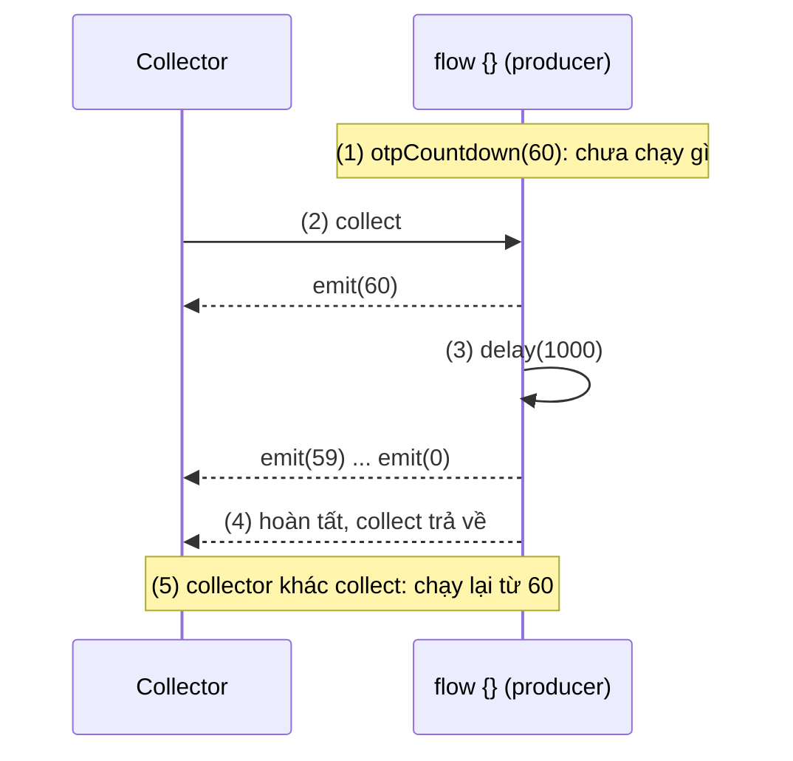
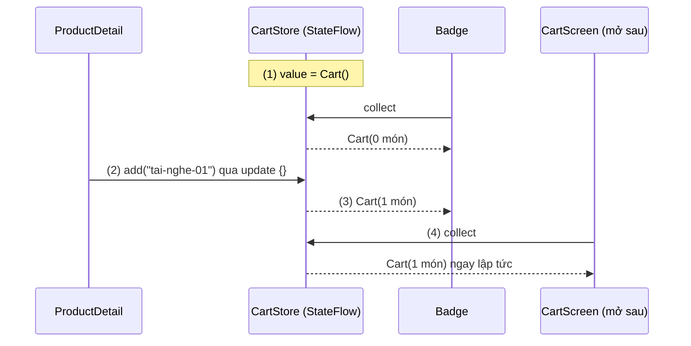
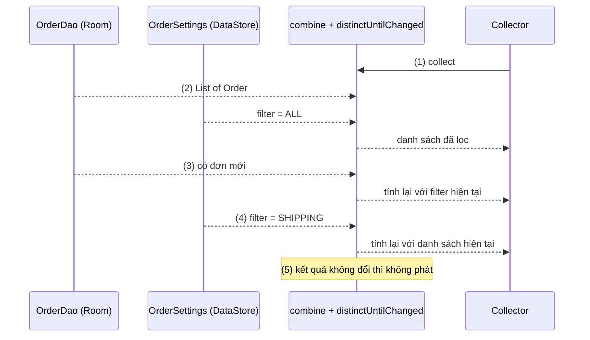
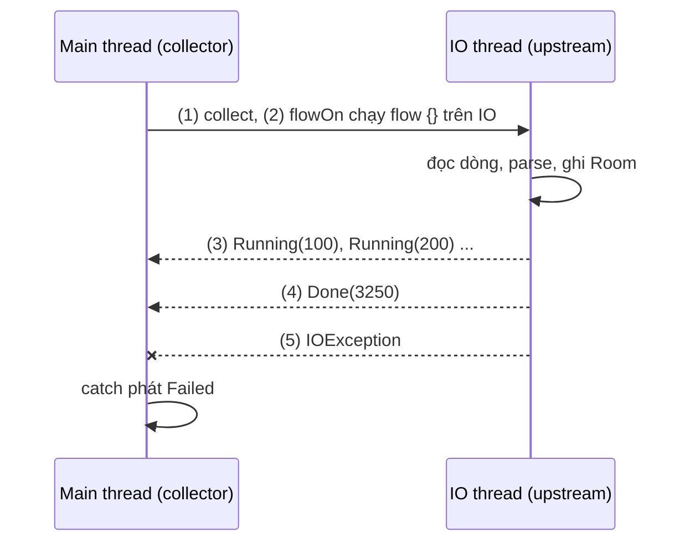
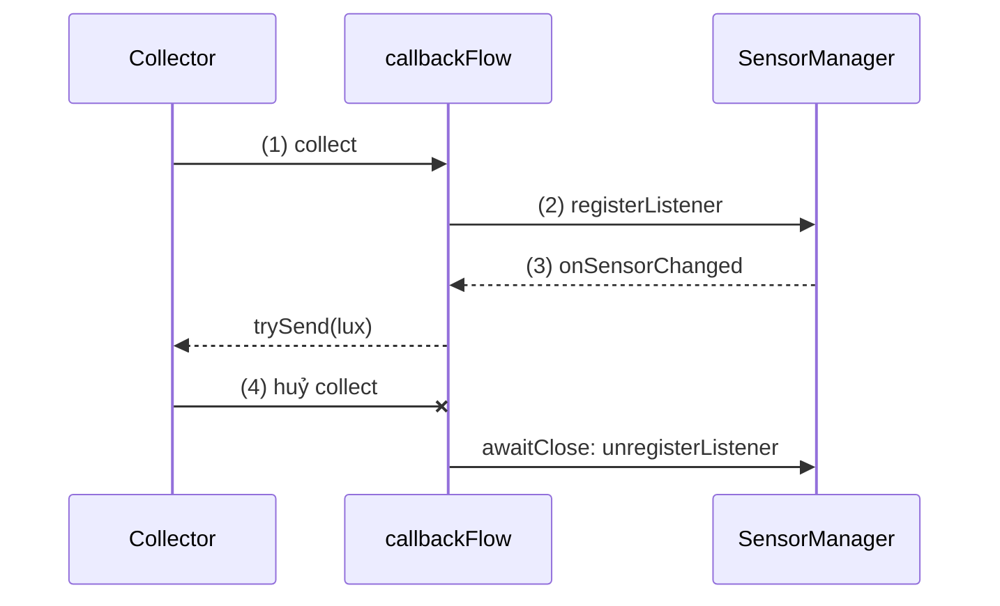
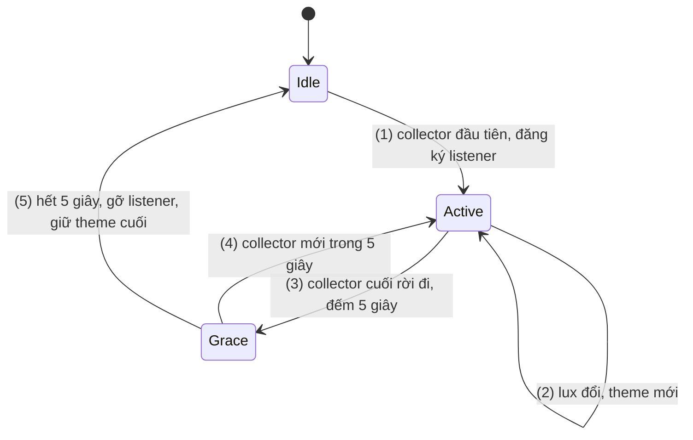
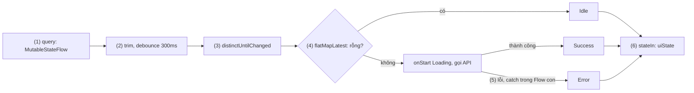

# Flow

## Vấn đề cần giải quyết

Một hàm `suspend` trả về **một** kết quả rồi kết thúc. Nhiều dữ liệu trong app lại **thay đổi theo thời gian**: bảng database được ghi thêm, người dùng gõ từng ký tự, cảm biến báo giá trị vài lần mỗi giây, mạng bật tắt. Cách cũ để nhận chúng là callback:

```kotlin
// Cách làm có vấn đề: tự lo lọc, đổi thread, đăng ký và gỡ
sensorManager.registerListener(lightListener, lightSensor, SensorManager.SENSOR_DELAY_NORMAL)
// lightListener.onSensorChanged() phải tự lọc, tự kết hợp với cài đặt người dùng...
// quên unregisterListener(lightListener) là cảm biến chạy mãi, tốn pin
```

Callback không có cách chung để **biến đổi, kết hợp** luồng giá trị, và **vòng đời** lắng nghe phải tự quản lý ở từng chỗ. LiveData lo được vòng đời nhưng ít toán tử và chỉ có trên Android ([LiveData](../../../session_06/livedata.md)).

Vấn đề cần giải quyết là: **một kiểu dữ liệu chung cho "nhiều giá trị theo thời gian"**, có toán tử biến đổi và quy tắc rõ ràng về thread, lỗi, việc huỷ.

## Sau khi học xong

- Giải thích được vì sao Flow lạnh chạy lại producer cho từng collector, còn StateFlow và SharedFlow là nóng và dùng chung cho mọi collector.
- Áp dụng được builder, toán tử (combine, flatMapLatest, debounce, catch, retry...) và flowOn để dựng một pipeline dữ liệu.
- Triển khai được UI state bằng StateFlow và stateIn với SharingStarted.WhileSubscribed(5_000), và sự kiện cho nhiều nơi bằng SharedFlow.
- Áp dụng được callbackFlow để biến listener thành Flow và gỡ listener bằng awaitClose, rồi collect theo lifecycle bằng repeatOnLifecycle hoặc collectAsStateWithLifecycle.
- Nhận diện được các sai lầm như withContext quanh emit, catch làm chết cả pipeline, tạo StateFlow mới mỗi lần gọi và dùng StateFlow cho event lặp lại.

## Flow là gì?

**Flow** (`kotlinx.coroutines.flow.Flow<T>`) là luồng bất đồng bộ phát lần lượt nhiều giá trị theo thời gian, dựng trên coroutine: producer gọi `emit(value)`, consumer nhận bằng hàm `suspend` `collect`. Flow thường là **lạnh**: mỗi lần `collect` chạy lại producer cho riêng collector đó; `StateFlow` và `SharedFlow` là **nóng**: một nguồn giá trị dùng chung cho mọi collector, kể cả khi nguồn chung bắt đầu và dừng theo số collector ([Observer Pattern Overview](overview.md), mục "Hot và cold").

Mental model dùng lại từ [Observer Pattern Overview](overview.md): **đặt báo dài hạn**. Flow lạnh là **bản in theo yêu cầu**: khai báo Flow chưa in gì; mỗi người đặt (`collect`) được in riêng một bộ từ số 1. Flow nóng là **báo in chung theo lịch**: mọi người đặt nhận cùng một bản in, người đặt muộn nhận từ số hiện tại; `StateFlow` còn đưa ngay số mới nhất cho người vừa đặt. Với `stateIn`/`shareIn`, `SharingStarted` quyết định máy in chạy khi nào.

Đây là một hiện thực của Observer Pattern: collector là observer, `collect` là đăng ký, huỷ coroutine đang collect là huỷ đăng ký.

> [!NOTE]
> **Kiến thức dùng trước: coroutine.** Bài dùng hàm `suspend`, `launch`, scope (`viewModelScope`, `lifecycleScope`), dispatcher và việc huỷ coroutine ở mức tối thiểu. Coroutine là code bất đồng bộ viết tuần tự, tạm dừng được mà không chặn thread; học ở 8.4.3 Coroutines (chưa có bài). Test dùng `runTest` của `kotlinx-coroutines-test`, chạy `delay` trên thời gian ảo.

## Cách hoạt động

### Flow lạnh: producer chạy khi có người collect

Builder hay dùng: `flow { ... }` (khối code tuỳ ý, gọi `emit()` khi có giá trị), `flowOf(a, b)` (giá trị cố định), `.asFlow()` (từ `List`, `Sequence`, `IntRange`). Nhiều thư viện trả Flow sẵn: DAO của Room, DataStore, Paging.

Khối `flow {}` **không chạy** lúc khai báo, mà khi gặp **toán tử cuối** (terminal operator): `collect`, `toList`, `first`. Khi đó producer chạy **trong coroutine của collector**, tuần tự: `emit()` gọi thẳng vào lambda của `collect` và chờ nó xong. Huỷ coroutine của collector thì producer bị huỷ theo.

#### Ví dụ: đếm ngược "Gửi lại mã OTP"

**Bài toán:** màn nhập OTP hiện "Gửi lại sau 60 giây", đếm lùi mỗi giây, về 0 thì bật nút gửi lại: một chuỗi giá trị có thời gian và có điểm kết thúc.

**Luồng chạy:**

1. Gọi `otpCountdown(60)` chỉ tạo object Flow, chưa chạy gì.
2. Collector gọi `collect`: khối `flow {}` chạy trong coroutine của collector; `emit(60)` trao giá trị cho lambda của `collect`.
3. `delay(1_000)` tạm dừng một giây mà không chặn thread.
4. Lặp đến `emit(0)`; khối kết thúc nên Flow hoàn tất, `collect` trả về.
5. Collector thứ hai collect cùng object thì đếm lại từ 60, độc lập.



```kotlin
// OtpCountdown.kt
fun otpCountdown(seconds: Int): Flow<Int> = flow {          // (1) chỉ là khai báo
    for (remaining in seconds downTo 0) {
        emit(remaining)                                      // (2) trao giá trị cho collector
        if (remaining > 0) delay(1_000)                      // (3) tạm dừng, không chặn thread
    }
}                                                            // (4) hết vòng lặp: hoàn tất

// OtpCountdownTest.kt (src/test)
@Test
fun countdown_emitsEverySecondThenCompletes() = runTest {
    assertEquals(listOf(3, 2, 1, 0), otpCountdown(3).toList())
    assertEquals(3_000L, currentTime)                        // delay chạy trên thời gian ảo
}
```

**Kết quả:** test xong ngay dù Flow "kéo dài" 3 giây. Hệ quả của bước (5): Fragment collect thẳng Flow này thì xoay màn hình làm đếm ngược bắt đầu lại từ 60 (mục "Biến Flow lạnh thành nóng" giải quyết).

### Flow nóng: `StateFlow` và `SharedFlow`

**StateFlow (Luồng trạng thái)** giữ **đúng một giá trị hiện tại**: luôn có giá trị (`MutableStateFlow(initial)`, đọc `.value`); collector mới nhận ngay giá trị hiện tại; giá trị mới `equals` giá trị cũ thì không phát; collector chậm chỉ nhận giá trị mới nhất (conflation); không bao giờ hoàn tất. `update { }` đọc-sửa-ghi nguyên tử, an toàn khi nhiều coroutine cùng sửa.

**SharedFlow (Luồng chia sẻ)** phát cho mọi collector đang collect: `replay` là số giá trị phát lại cho collector mới (mặc định 0); `extraBufferCapacity` và `onBufferOverflow` (`SUSPEND`, `DROP_OLDEST`, `DROP_LATEST`) xử lý collector chậm; `emit()` là hàm `suspend`, `tryEmit()` thì không và trả `false` nếu buffer đầy. Với `replay = 0`, giá trị phát lúc không có collector nào thì **mất**.

| | Flow lạnh | `StateFlow` | `SharedFlow` |
|---|---|---|---|
| Producer chạy | Mỗi lần collect | Ai đó gán `value` | Ai đó gọi `emit` |
| Collector mới nhận | Từ đầu | Giá trị hiện tại, rồi giá trị sau | `replay` giá trị gần nhất, rồi giá trị sau |
| Giá trị trùng liên tiếp | Phát hết | Bỏ qua | Phát hết |
| Hợp với | Dữ liệu từ một nguồn (Room, API, cảm biến) | State | Sự kiện cho nhiều nơi |

#### Ví dụ: số lượng giỏ hàng hiện trên nhiều màn

**Bài toán:** badge trên toolbar và màn giỏ hàng cùng hiện số món. Thêm món ở màn chi tiết thì mọi nơi đổi theo; màn mở sau cũng thấy đúng số hiện tại.

**Luồng chạy:**

1. `CartStore` (một instance cho cả app) giữ `MutableStateFlow(Cart())`.
2. Màn chi tiết gọi `add()`; `update { }` tính `Cart` mới từ `Cart` hiện tại.
3. Mọi collector đang collect nhận `Cart` mới.
4. Màn mở sau collect thì nhận ngay giá trị hiện tại.



```kotlin
// Cart.kt
data class Cart(val quantities: Map<String, Int> = emptyMap()) {
    val itemCount: Int get() = quantities.values.sum()
    fun withItemAdded(productId: String) =
        copy(quantities = quantities + (productId to (quantities[productId] ?: 0) + 1))
}

// CartStore.kt
class CartStore {
    private val _cart = MutableStateFlow(Cart())                  // (1) luôn có giá trị
    val cart: StateFlow<Cart> = _cart.asStateFlow()               // chỉ đưa ra bản read-only

    fun add(productId: String) {
        _cart.update { current -> current.withItemAdded(productId) }       // (2) đọc-sửa-ghi nguyên tử
    }
}
```

**Kết quả:** gọi `add()` hai lần rồi `store.cart.first().itemCount` trả `2` (bước 4). Cung cấp một `CartStore` cho cả app là việc của DI ([Dependency Injection Overview](../di/overview.md)).

`SharedFlow` hợp với **sự kiện** nhiều nơi cùng nghe và chỉ có ý nghĩa với nơi đang nghe, ví dụ "đồng bộ xong, màn nào đang mở thì tải lại" (màn chưa mở sẽ tự tải khi mở):

```kotlin
// SyncEvents.kt
class SyncEvents {
    private val _completed = MutableSharedFlow<SyncResult>(
        extraBufferCapacity = 1, onBufferOverflow = BufferOverflow.DROP_OLDEST   // tryEmit luôn thành công
    )
    val completed: SharedFlow<SyncResult> = _completed.asSharedFlow()
    fun notifyCompleted(result: SyncResult) { _completed.tryEmit(result) }      // gọi được từ code không suspend
}
```

`SharedFlow` thay cho `LocalBroadcastManager` ở [Broadcast Receiver](../../../session_04/components/broadcast/broadcast_receiver.md), mục "LocalBroadcastManager — Deprecated và thay thế". Sự kiện một lần **từ ViewModel tới UI** (điều hướng, Snackbar) thì biểu diễn thành state, không gửi qua `SharedFlow` ([MVVM](../../architecture/mvvm.md), mục "Thao tác của người dùng và event một lần").

### Toán tử: biến đổi luồng mà không chạy nó

Toán tử trung gian (intermediate operator) nhận một Flow, trả Flow mới: nó chỉ **lắp thêm một khâu** vào khai báo của Flow, chưa chạy gì.

| Toán tử | Làm gì |
|---|---|
| `map`, `filter`, `transform` | Đổi, lọc từng giá trị |
| `distinctUntilChanged()` | Bỏ giá trị bằng giá trị ngay trước |
| `debounce(300)` | Chỉ phát khi nguồn im lặng đủ 300 ms |
| `combine(a, b)` | Phát lại mỗi khi **một** nguồn đổi, dùng giá trị mới nhất của nguồn kia |
| `a.zip(b)` | Ghép cặp phần tử thứ n của hai nguồn, dừng khi nguồn ngắn hơn hết |
| `flatMapLatest { }` | Mỗi giá trị mới mở một Flow con, **huỷ** Flow con trước |
| `onStart`, `onCompletion` | Chạy code khi bắt đầu, khi kết thúc |
| `catch`, `retry`, `retryWhen` | Xem mục "Thread và lỗi" |

`flatMapLatest` hợp với chỗ nguồn bên trong phụ thuộc một giá trị có thể đổi, ví dụ `currentUserId.flatMapLatest { cartDao.observeCart(it) }`: đổi tài khoản thì bỏ giỏ hàng của tài khoản cũ. `flatMapLatest` mang `@ExperimentalCoroutinesApi`, `debounce` mang `@FlowPreview`: dùng được, nhưng phải opt-in và API có thể đổi ở bản sau.

#### Ví dụ: danh sách đơn hàng theo bộ lọc người dùng chọn

**Bài toán:** màn "Đơn hàng của tôi" có bộ lọc (Tất cả, Đang giao, Đã giao) lưu trong DataStore. Danh sách phải đổi khi đổi bộ lọc **và** khi có đơn mới ghi vào Room.

**Luồng chạy:**

1. Có collector: `combine` collect cả hai nguồn cùng lúc.
2. Cả hai phát giá trị đầu; `combine` phát danh sách đã lọc.
3. Room ghi đơn mới: DAO phát danh sách mới, `combine` tính lại với **bộ lọc mới nhất**.
4. Đổi bộ lọc: DataStore phát giá trị mới, `combine` tính lại với **danh sách mới nhất**, không query lại database.
5. Kết quả tính lại bằng kết quả trước (ghi một đơn "Đã giao" khi đang lọc "Đang giao") thì `distinctUntilChanged` chặn lại.



```kotlin
// ObserveVisibleOrders.kt
class ObserveVisibleOrders(
    private val orderDao: OrderDao,                      // observeOrders(): Flow<List<Order>>
    private val settings: OrderSettingsRepository        // orderFilter: Flow<OrderFilter>
) {
    operator fun invoke(): Flow<List<Order>> =
        combine(orderDao.observeOrders(), settings.orderFilter) { orders, filter ->   // (1)(2)(3)(4)
            orders.filter { filter.matches(it.status) }.sortedByDescending { it.createdAt }
        }
            .distinctUntilChanged()                                                     // (5)
}
```

**Kết quả:** đổi bộ lọc thì danh sách đổi ngay mà Database Inspector không ghi query mới; ghi một đơn mới thì danh sách tự cập nhật theo bộ lọc đang chọn. Vì sao Room phát lại khi bảng bị ghi ở [Async Transactions & Flow](../../../session_05/data_store/room_transactions.md), mục "Flow từ Room — Cơ chế InvalidationTracker"; Flow của DataStore ở [Key-Value Storage](../../../session_05/data_store/key_value.md).

### Thread và lỗi: `flowOn`, `catch`, `retry`

**Giữ nguyên context (context preservation).** Producer chạy trong context của collector; không được bọc `emit()` trong `withContext`. Muốn producer chạy trên thread khác thì dùng `flowOn(dispatcher)`: nó chỉ đổi context cho các khâu **đứng trước** nó (upstream), các khâu sau và `collect` giữ context của collector. Bên dưới, `flowOn` chạy upstream trong một coroutine riêng và chuyển giá trị qua một buffer.

**Lỗi trong suốt (exception transparency).** `catch { }` chỉ bắt lỗi của **upstream**, không bắt lỗi trong lambda của `collect`. Trong `catch` có thể `emit` giá trị thay thế hoặc ném lại lỗi. Upstream đã ném lỗi thì Flow đó **đã kết thúc**: `catch` chỉ phát thêm giá trị thay thế rồi Flow hoàn tất, không nối lại upstream. Muốn chạy lại nguồn thì dùng `retry(retries) { cause -> ... }` hoặc `retryWhen { cause, attempt -> ... }`; công thức backoff ở [Networking](../../../session_05/networking.md), mục "Retry Policy với Exponential Backoff & Jitter".

#### Ví dụ: nhập danh bạ từ file CSV

**Bài toán:** nhập danh bạ từ file CSV vài nghìn dòng: đọc file, ghi database ngoài main thread; tiến độ cập nhật mỗi 100 dòng; file lỗi thì báo lỗi.

**Luồng chạy:**

1. ViewModel collect `import(file)` trong `viewModelScope` (main thread) và gán từng giá trị vào một `MutableStateFlow` cho UI.
2. `flowOn(ioDispatcher)` khiến khối `flow {}` (đọc, parse, ghi DB) chạy trên thread IO.
3. Cứ 100 dòng, producer phát `Running(count)`, giá trị qua buffer sang main.
4. Hết file, producer phát `Done(count)`.
5. `IOException`: `catch` đứng sau `flowOn` nên chạy trên main, phát `Failed`. Lỗi khác bị ném lại.



```kotlin
// ContactImporter.kt
sealed interface ImportProgress {
    data class Running(val imported: Int) : ImportProgress
    data class Done(val imported: Int) : ImportProgress
    data object Failed : ImportProgress
}

class ContactImporter(
    private val contactDao: ContactDao,
    private val ioDispatcher: CoroutineDispatcher = Dispatchers.IO   // test truyền test dispatcher
) {
    fun import(file: File): Flow<ImportProgress> = flow {
        var imported = 0
        file.bufferedReader().useLines { lines ->
            lines.drop(1).forEach { line ->                           // bỏ dòng tiêu đề
                val parts = line.split(',')
                if (parts.size < 2) return@forEach                    // bỏ dòng hỏng
                contactDao.insert(Contact(name = parts[0].trim(), phone = parts[1].trim()))
                imported++
                if (imported % 100 == 0) emit(ImportProgress.Running(imported))   // (3)
            }
        }
        emit(ImportProgress.Done(imported))                           // (4)
    }
        .flowOn(ioDispatcher)                                         // (2) mọi khâu phía trên chạy trên IO
        .catch { e ->                                                 // (5) chỉ bắt lỗi của upstream
            if (e is IOException) emit(ImportProgress.Failed) else throw e
        }
}

// ImportViewModel.kt
private val _progress = MutableStateFlow<ImportProgress?>(null)
val progress: StateFlow<ImportProgress?> = _progress.asStateFlow()

fun startImport(file: File) {
    viewModelScope.launch {                                           // (1) collect trên main
        importer.import(file).collect { _progress.value = it }
    }
}
```

`useLines` và `forEach` là hàm `inline` nên gọi được hàm `suspend` bên trong.

**Kết quả:** log `Thread.currentThread().name` trong `flow {}` ra `DefaultDispatcher-worker-…`, trong `collect` ra `main`. Xoá file trước khi nhập (`FileNotFoundException` là một `IOException`) thì màn hình báo lỗi thay vì crash.

### `callbackFlow`: biến listener thành Flow

Cảm biến, vị trí, `NetworkCallback`, `ContentObserver` báo giá trị qua listener. `callbackFlow { }` bọc chúng thành Flow lạnh:

- Khối chạy khi có collector, trong một `ProducerScope` có sẵn channel.
- Listener gọi `trySend(value)`: không suspend, gọi từ thread khác được.
- `awaitClose { }` **bắt buộc** ở cuối: treo cho tới khi collector huỷ hoặc channel đóng, rồi chạy lambda để gỡ listener. Khối kết thúc mà channel chưa đóng thì Flow ném `IllegalStateException`.
- Channel mặc định có buffer 64 phần tử. Với nguồn phát dày (backpressure, [Observer Pattern Overview](overview.md)): `.conflate()` chỉ giữ giá trị mới nhất, `buffer(n)` đổi cỡ vùng đệm, `collectLatest { }` huỷ xử lý giá trị cũ khi giá trị mới tới.

#### Ví dụ: đo ánh sáng môi trường cho chế độ đọc sách

**Bài toán:** app đọc sách tự chuyển nền tối khi phòng tối. Cảm biến `Sensor.TYPE_LIGHT` báo lux qua `SensorEventListener`; không còn ai cần thì phải gỡ listener để đỡ tốn pin.

**Luồng chạy:**

1. Có collector: khối `callbackFlow` chạy; máy không có cảm biến thì đóng Flow ngay.
2. Đăng ký listener với `SensorManager`.
3. Mỗi lần cảm biến báo, listener gọi `trySend(lux)`.
4. Collector bị huỷ: `awaitClose` gỡ listener.



```kotlin
// AmbientLightMonitor.kt
class AmbientLightMonitor(private val sensorManager: SensorManager) {

    val lux: Flow<Float> = callbackFlow {
        val sensor = sensorManager.getDefaultSensor(Sensor.TYPE_LIGHT)
        if (sensor == null) {                                          // (1) máy không có cảm biến
            close()
            return@callbackFlow
        }
        val listener = object : SensorEventListener {
            override fun onSensorChanged(event: SensorEvent) {
                trySend(event.values[0])                               // (3) callback đi vào Flow
            }
            override fun onAccuracyChanged(sensor: Sensor, accuracy: Int) = Unit
        }
        sensorManager.registerListener(listener, sensor, SensorManager.SENSOR_DELAY_NORMAL)  // (2)
        awaitClose { sensorManager.unregisterListener(listener) }      // (4) gỡ khi collector huỷ
    }.conflate()
}
```

**Kết quả:** che cảm biến thì lux giảm. `adb shell dumpsys sensorservice` liệt kê listener đang đăng ký: rời màn hình thì listener của app biến mất. Cùng khuôn này dùng cho `NetworkCallback` ở [Networking](../../../session_05/networking.md), mục "Ví dụ: NetworkMonitor phát trạng thái mạng bằng `callbackFlow`", và `ContentObserver` ở [Content Provider](../../../session_04/components/content_provider.md).

### Biến Flow lạnh thành nóng: `stateIn`, `shareIn` và `SharingStarted`

Flow lạnh đưa thẳng lên UI thì mỗi collector chạy một producer riêng (hai composable collect `lux` là hai listener), và xoay màn hình làm producer chạy lại từ đầu (đếm ngược về 60). Hai toán tử chạy **một** producer trong một scope và chia kết quả cho mọi collector:

- `stateIn(scope, started, initialValue)` trả `StateFlow<T>`, cho state.
- `shareIn(scope, started, replay)` trả `SharedFlow<T>`, khi không có giá trị ban đầu hợp lý hoặc cần replay nhiều giá trị.

`scope` là giới hạn sống của producer: `viewModelScope` cho UI state của một màn, scope cấp app (thường do DI cung cấp) cho dữ liệu dùng chung. `started` quyết định khi nào producer chung chạy và dừng; chọn kiểu nào thì kết quả vẫn nóng, vì không collector nào có producer riêng:

| `SharingStarted` | Bắt đầu | Dừng |
|---|---|---|
| `Eagerly` | Ngay khi gọi | Khi scope bị huỷ |
| `Lazily` | Collector đầu tiên | Khi scope bị huỷ |
| `WhileSubscribed(stopTimeoutMillis)` | Collector đầu tiên | `stopTimeoutMillis` sau khi collector cuối rời đi |

Với UI state, docs khuyên `WhileSubscribed(5_000)`: xoay màn hình mất dưới 5 giây nên producer không chạy lại; app nằm background quá 5 giây thì producer dừng. Lý do không tải trong `init` ở [ViewModel](../../../session_06/viewmodel.md), mục "Tải dữ liệu: lười, không launch trong init". Producer dừng thì `StateFlow` vẫn giữ giá trị cuối (trừ khi đặt `replayExpirationMillis`).

#### Ví dụ: nền tối theo ánh sáng, sống qua xoay màn hình

**Bài toán:** dùng `AmbientLightMonitor.lux` để đổi theme màn đọc sách. Xoay màn hình không được đăng ký lại cảm biến; ra màn hình chính lâu thì cảm biến phải tắt.

**Luồng chạy:**

1. Fragment collect `theme`: số collector lên 1, `stateIn` chạy upstream, `callbackFlow` đăng ký listener.
2. Ánh sáng đổi: `map` đổi lux thành theme, `distinctUntilChanged` chỉ cho qua khi theme đổi.
3. Xoay màn hình: Fragment cũ ngừng collect, số collector về 0, bắt đầu đếm 5 giây.
4. Fragment mới collect trong 5 giây: huỷ đếm, listener giữ nguyên, nhận ngay theme hiện tại.
5. Ở màn hình chính quá 5 giây: upstream bị huỷ, `awaitClose` gỡ listener, `StateFlow` giữ theme cuối. Quay lại thì về (1).



```kotlin
// ReaderViewModel.kt
class ReaderViewModel(lightMonitor: AmbientLightMonitor) : ViewModel() {

    val theme: StateFlow<ReaderTheme> = lightMonitor.lux
        .map { lux -> if (lux < 10f) ReaderTheme.Night else ReaderTheme.Day }    // (2)
        .distinctUntilChanged()
        .stateIn(
            scope = viewModelScope,
            started = SharingStarted.WhileSubscribed(5_000),                     // (1)(3)(4)(5)
            initialValue = ReaderTheme.Day
        )
}
```

**Kết quả:** theo dõi bằng `dumpsys sensorservice`: xoay màn hình vài lần, listener không bị gỡ rồi đăng ký lại; ấn Home, chờ hơn 5 giây, listener biến mất.

Nhiều ViewModel cùng cần một nguồn thì chia sẻ ở tầng data: `monitor.lux.shareIn(appScope, SharingStarted.WhileSubscribed(), replay = 1)` trong một object dùng chung cho cả app, để cả app chỉ có một listener.

### Collect an toàn trong Android

Collect trong `lifecycleScope.launch` thường thì coroutine sống tới `onDestroy`: app xuống background vẫn collect, và vì collector còn đó nên `WhileSubscribed` không dừng producer (cảm biến chạy suốt). Cách collect đúng:

```kotlin
// Fragment: dừng collect ở onStop, chạy lại ở onStart
viewLifecycleOwner.lifecycleScope.launch {
    viewLifecycleOwner.repeatOnLifecycle(Lifecycle.State.STARTED) {
        launch { viewModel.theme.collect { applyTheme(it) } }
        launch { viewModel.readingProgress.collect { renderProgress(it) } }   // Flow thứ hai: mỗi Flow một launch
    }
}

// Compose (lifecycle-runtime-compose)
val theme by viewModel.theme.collectAsStateWithLifecycle()
```

Chuỗi hệ quả: View qua `onStop()` (state `CREATED`) → `repeatOnLifecycle` huỷ coroutine collect → số collector về 0 → 5 giây sau `stateIn` dừng upstream → `awaitClose` gỡ listener. Cơ chế `repeatOnLifecycle`, `flowWithLifecycle` và vì sao `launchWhenStarted` bị deprecated ở [Activity Lifecycle](../../../session_04/components/activity/lifecycle.md), mục "repeatOnLifecycle"; vì sao dùng `viewLifecycleOwner` ở [Fragment Lifecycle](../../../session_04/components/fragment/lifecycle.md).

## Ví dụ thực tế

1. **Gợi ý tìm kiếm khi đang gõ:** bài toán chính, code bên dưới.
2. **Danh sách từ Room sống qua xoay màn hình:** `map` rồi `stateIn`, như [MVVM](../../architecture/mvvm.md), mục "UI state và luồng dữ liệu một chiều".
3. **Banner "Mất kết nối":** `callbackFlow` bọc `NetworkCallback` rồi `stateIn`, như [Networking](../../../session_05/networking.md).

### Gợi ý tìm kiếm khi đang gõ

**Bài toán:** ô tìm kiếm sản phẩm hiện gợi ý khi gõ. Chỉ gọi API khi người dùng ngừng gõ 300 ms; gõ tiếp thì bỏ kết quả của từ khoá cũ; thêm dấu cách thừa không gọi lại; ô rỗng thì không gọi. Một lần lỗi mạng không được làm ô tìm kiếm ngừng hoạt động.

**Luồng chạy:**

1. Mỗi lần gõ, Fragment gọi `onQueryChange(text)`; ViewModel gán vào `MutableStateFlow` `query`.
2. `map { it.trim() }` rồi `debounce(300)`: chỉ từ khoá đứng yên đủ 300 ms mới đi tiếp.
3. `distinctUntilChanged()`: `"tai "` và `"tai"` sau khi trim là một, bỏ lần sau.
4. `flatMapLatest`: từ khoá rỗng thì phát `Idle`; ngược lại mở Flow con gọi API, phát `Loading` trước (`onStart`). Từ khoá mới đến khi API đang chạy thì Flow con cũ bị huỷ.
5. Flow con lỗi: `catch` **bên trong** Flow con phát `Error`; pipeline ngoài vẫn sống.
6. `stateIn(... WhileSubscribed(5_000) ...)` cho ra `uiState`; Fragment collect bằng `repeatOnLifecycle` như mục "Collect an toàn trong Android".



```kotlin
// SearchSuggestionViewModel.kt
sealed interface SuggestionUiState {
    data object Idle : SuggestionUiState
    data object Loading : SuggestionUiState
    data class Success(val suggestions: List<String>) : SuggestionUiState
    data object Error : SuggestionUiState
}

class SearchSuggestionViewModel(private val api: SuggestionApi) : ViewModel() {

    private val query = MutableStateFlow("")

    @OptIn(FlowPreview::class, ExperimentalCoroutinesApi::class)
    val uiState: StateFlow<SuggestionUiState> = query
        .map { it.trim() }
        .debounce(300)                                                    // (2)
        .distinctUntilChanged()                                           // (3)
        .flatMapLatest { keyword ->                                       // (4) huỷ lần tìm cũ
            if (keyword.isEmpty()) {
                flowOf(SuggestionUiState.Idle)
            } else {
                flow<SuggestionUiState> { emit(SuggestionUiState.Success(api.suggest(keyword))) }
                    .onStart { emit(SuggestionUiState.Loading) }
                    .catch { emit(SuggestionUiState.Error) }              // (5) chỉ kết thúc Flow con
            }
        }
        .stateIn(viewModelScope, SharingStarted.WhileSubscribed(5_000), SuggestionUiState.Idle)  // (6)

    fun onQueryChange(text: String) {
        query.value = text                                                // (1)
    }
}
```

Fragment gọi `onQueryChange` trong `doAfterTextChanged` của ô nhập và vẽ `uiState` vào `RecyclerView` ([ViewHolder Pattern](../viewholder_pattern.md)).

```kotlin
// SearchSuggestionViewModelTest.kt (src/test)
class FakeSuggestionApi : SuggestionApi {
    val keywords = mutableListOf<String>()
    override suspend fun suggest(keyword: String): List<String> {
        keywords += keyword
        return listOf("$keyword bluetooth", "$keyword chống ồn")
    }
}

@OptIn(ExperimentalCoroutinesApi::class)
class SearchSuggestionViewModelTest {
    @Before fun setUp() = Dispatchers.setMain(StandardTestDispatcher())   // viewModelScope chạy trên Main
    @After fun tearDown() = Dispatchers.resetMain()

    @Test
    fun typingFast_callsApiOnceWithLastKeyword() = runTest {
        val api = FakeSuggestionApi()
        val viewModel = SearchSuggestionViewModel(api)
        // WhileSubscribed chỉ chạy upstream khi có collector: tạo một collector nền
        backgroundScope.launch(UnconfinedTestDispatcher(testScheduler)) { viewModel.uiState.collect {} }

        viewModel.onQueryChange("tai")
        advanceTimeBy(100)                       // chưa đủ 300 ms
        viewModel.onQueryChange("tai nghe")
        advanceTimeBy(301)                       // đứng yên đủ 300 ms

        assertEquals(listOf("tai nghe"), api.keywords)
        assertTrue(viewModel.uiState.value is SuggestionUiState.Success)
    }
}
```

`runTest` dùng chung scheduler với test dispatcher của `Dispatchers.Main`, nên `advanceTimeBy` điều khiển được `debounce` trong `viewModelScope`.

**Kết quả:** test xác nhận gõ nhanh hai từ khoá chỉ gọi API một lần. Trên máy, gõ "tai nghe" thì log OkHttp chỉ có một request; tắt mạng rồi gõ thì hiện lỗi; bật mạng, gõ tiếp thì gợi ý hiện lại.

## Khi nào nên và không nên dùng

- **Nên dùng** Flow cho dữ liệu thay đổi theo thời gian và pipeline cần toán tử.
- **Nên dùng** `StateFlow` cho UI state và state dùng chung; `SharedFlow` cho sự kiện nhiều nơi cùng nghe trong cùng process.
- **Không cần** Flow cho thao tác trả một kết quả (gọi API, ghi một bản ghi): ở tầng data, hàm `suspend` là đủ.
- **Không dùng** `SharedFlow` hay `Channel` để gửi event một lần từ ViewModel tới UI; biểu diễn thành state ([MVVM](../../architecture/mvvm.md)).
- **Cân nhắc giữ** LiveData cho màn cũ dùng Data Binding hoặc Java, RxJava cho codebase Rx lớn ([LiveData](livedata.md), [RxJava / RxAndroid](rxjava.md)).

## Sai lầm thường gặp

### 1. Đổi dispatcher bằng `withContext` bao quanh `emit`

```kotlin
// Sai
fun import(file: File) = flow {
    withContext(Dispatchers.IO) { file.readLines().forEach { emit(parse(it)) } }
}
```

**Lỗi lộ ra thế nào:** collect là crash với `IllegalStateException: Flow invariant is violated`, vì `emit` bị gọi từ context khác context của collector.

**Cách sửa:** bỏ `withContext`, thêm `.flowOn(Dispatchers.IO)` sau `flow {}`; `withContext` chỉ được bọc phần không gọi `emit`.

### 2. Đặt `catch` ở ngoài `flatMapLatest`

```kotlin
// Sai: một lỗi mạng kết thúc cả pipeline tìm kiếm
query.debounce(300)
    .flatMapLatest { keyword -> flow { emit(Success(api.suggest(keyword))) } }
    .catch { emit(Error) }
```

**Lỗi lộ ra thế nào:** lỗi mạng đầu tiên hiện lỗi đúng, nhưng sau đó gõ gì cũng không ra gợi ý: cả upstream đã kết thúc vì lỗi, `catch` phát `Error` rồi Flow hoàn tất.

**Cách sửa:** đặt `catch` (và `retry` nếu cần) **bên trong** Flow con, như mục "Ví dụ thực tế".

### 3. Tạo `StateFlow` mới mỗi lần gọi

```kotlin
// Sai: getter tạo stateIn mới mỗi lần được đọc
val orders: StateFlow<List<Order>>
    get() = observeVisibleOrders().stateIn(viewModelScope, SharingStarted.WhileSubscribed(5_000), emptyList())
```

**Lỗi lộ ra thế nào:** mỗi lần View đọc `orders` là thêm một coroutine chia sẻ trong `viewModelScope` và một query mới; UI luôn bắt đầu từ `emptyList()`.

**Cách sửa:** khai báo `val orders = ... .stateIn(...)` (không getter) để chỉ tạo một lần. Cần tham số thì đưa vào một `MutableStateFlow` rồi `flatMapLatest`.

### 4. Collect nhiều Flow nối tiếp trong một coroutine

```kotlin
// Sai
repeatOnLifecycle(Lifecycle.State.STARTED) {
    viewModel.theme.collect { applyTheme(it) }
    viewModel.readingProgress.collect { renderProgress(it) }    // không bao giờ chạy tới
}
```

**Lỗi lộ ra thế nào:** `StateFlow` không bao giờ hoàn tất nên `collect` đầu treo mãi; phần UI của Flow thứ hai đứng yên mà Logcat không có lỗi.

**Cách sửa:** mỗi Flow một `launch { }` trong `repeatOnLifecycle`, hoặc gộp thành một `uiState`.

### 5. Dùng `StateFlow` cho sự kiện có thể lặp lại

```kotlin
// Sai: thông báo "Đã thêm vào giỏ"
fun onAddToCart(id: String) { cartStore.add(id); _message.value = "Đã thêm vào giỏ" }
```

**Lỗi lộ ra thế nào:** bấm "Thêm" lần hai thì không có thông báo, vì giá trị mới `equals` giá trị cũ.

**Cách sửa:** UI báo đã hiện xong (`messageShown()` đặt lại `null`) theo mẫu event thành state ở [MVVM](../../architecture/mvvm.md), hoặc cho mỗi thông báo một `id` riêng.

## Lịch sử phát triển

- **10/2018 (Kotlin 1.3):** coroutine ổn định, nền của Flow.
- **04/2019 (kotlinx.coroutines 1.2.0):** `Flow` ra mắt dạng preview.
- **08/2019 (1.3.0):** API lõi của Flow ổn định; thêm `onStart`, `onCompletion`.
- **10/2019 (Room 2.2.0):** hàm `@Query` của DAO trả được `Flow<T>`.
- **05/2020 (1.3.6):** `StateFlow` xuất hiện (experimental), thay `ConflatedBroadcastChannel` cho state.
- **10/2020 (1.4.0):** thêm `SharedFlow`, `shareIn`, `stateIn`; `StateFlow`, `SharedFlow` ổn định.
- **05/2021 (1.5.0):** `callbackFlow`, `channelFlow` ổn định; `BroadcastChannel`, `ConflatedBroadcastChannel` bị đánh dấu obsolete.
- **10/2021 (Lifecycle 2.4.0):** `repeatOnLifecycle` ổn định (có từ 2.4.0-alpha01, 03/2021).
- **03/2023 (Lifecycle 2.6.0):** `collectAsStateWithLifecycle` ổn định; `launchWhenX` bị deprecated.
- **05/2026 (kotlinx.coroutines 1.11.0):** bản mới nhất lúc viết; `flatMapLatest`, `debounce` vẫn cần opt-in.

## Kết nối hệ thống

- **Tiên quyết:**
  - [Kotlin](../../../session_01/languages/kotlin.md).
  - [Observer Pattern Overview](overview.md): observer, hot/cold, push/pull, backpressure.
  - [ViewModel](../../../session_06/viewmodel.md) và [Activity Lifecycle](../../../session_04/components/activity/lifecycle.md): `viewModelScope`, `repeatOnLifecycle`.
- **Liên quan:**
  - [MVVM](../../architecture/mvvm.md): `uiState` dạng `StateFlow`, luồng dữ liệu một chiều.
  - [LiveData](../../../session_06/livedata.md) và [Async Transactions & Flow](../../../session_05/data_store/room_transactions.md): observable của Jetpack, Flow từ Room.
  - [Networking](../../../session_05/networking.md), [Content Provider](../../../session_04/components/content_provider.md), [Broadcast Receiver](../../../session_04/components/broadcast/broadcast_receiver.md): áp dụng `callbackFlow`, `retryWhen`, `SharedFlow`.
- **Học tiếp:**
  - [LiveData](livedata.md) và [RxJava / RxAndroid](rxjava.md): so sánh với Flow và cách chuyển sang Flow.
  - 8.4.3 Coroutines (chưa có bài): scope, dispatcher, Job, cancellation bên dưới Flow.
  - [Unit Testing](../../../coding_analyst_and_testing/unit_testing.md): test ViewModel và Flow.

## Tham khảo

- [Asynchronous Flow - Kotlin Documentation](https://kotlinlang.org/docs/flow.html)
- [Kotlin flows on Android - Android Developers](https://developer.android.com/kotlin/flow)
- [StateFlow and SharedFlow - Android Developers](https://developer.android.com/kotlin/flow/stateflow-and-sharedflow)
- [Testing Kotlin flows on Android - Android Developers](https://developer.android.com/kotlin/flow/test)
- [callbackFlow - kotlinx.coroutines API](https://kotlinlang.org/api/kotlinx.coroutines/kotlinx-coroutines-core/kotlinx.coroutines.flow/callback-flow.html)
- [SharingStarted - kotlinx.coroutines API](https://kotlinlang.org/api/kotlinx.coroutines/kotlinx-coroutines-core/kotlinx.coroutines.flow/-sharing-started/)
- [kotlinx.coroutines changelog đến 1.7](https://github.com/Kotlin/kotlinx.coroutines/blob/master/CHANGES_UP_TO_1.7.md) và [changelog hiện tại](https://github.com/Kotlin/kotlinx.coroutines/blob/master/CHANGES.md)
- [Lifecycle release notes - Android Developers](https://developer.android.com/jetpack/androidx/releases/lifecycle)
- [A safer way to collect flows from Android UIs - Android Developers (Medium)](https://medium.com/androiddevelopers/a-safer-way-to-collect-flows-from-android-uis-23080b1f8bda)
