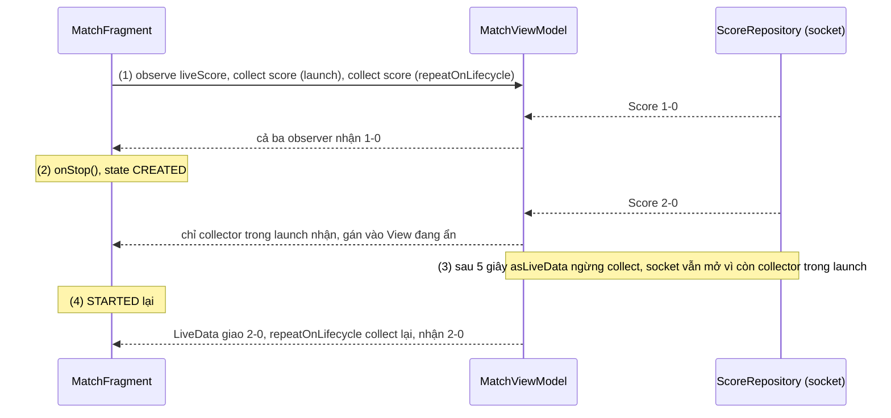
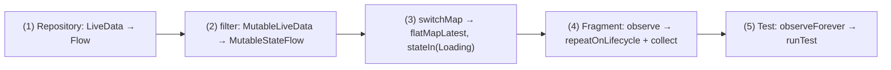

# LiveData

## Vấn đề cần giải quyết

Bài [LiveData](../../../session_06/livedata.md) ở Session 06 dạy cách dùng LiveData. Trong một codebase thật, LiveData hiếm khi đứng một mình: data layer trả `Flow`, vài module cũ trả `Flowable` của RxJava, màn mới dùng `StateFlow`. Câu hỏi thực tế không còn là "dùng LiveData thế nào" mà là:

- LiveData nên nằm ở **tầng nào**, và vì sao không nên đặt nó ở Repository?
- Nó **khác** `StateFlow` và RxJava ở đâu, đủ để chọn đúng cho từng chỗ?
- **Nối** nó với Flow và RxJava thế nào, và **chuyển** sang `StateFlow` mà không làm hỏng hành vi theo lifecycle?

Đặt sai tầng thì lỗi lộ ra rất cụ thể:

```kotlin
// OrderRepository.kt (cách làm có vấn đề)
fun observeOverdueOrders(): LiveData<List<Order>> =
    orderDao.observeAll().map { orders ->                 // lambda của map chạy trên main thread
        orders.filter { it.dueAt < clock.now() }.sortedBy { it.dueAt }
    }
```

Danh sách vài nghìn đơn làm UI giật, và ViewModel muốn `debounce` ô tìm kiếm hay `combine` với một nguồn khác thì LiveData không có toán tử đó. Vấn đề cần giải quyết là: **nhìn LiveData như một hiện thực Observer Pattern để biết nó mạnh ở đâu, yếu ở đâu, và đặt nó đúng chỗ cạnh Flow và RxJava.**

## Sau khi học xong

- Giải thích được LiveData theo các trục của Observer Pattern là push, hot, chỉ giữ giá trị mới nhất, giao theo lifecycle và trên main thread.
- Phân biệt được LiveData với StateFlow, SharedFlow và RxJava về giá trị khởi tạo, hành vi khi UI dừng, thread, toán tử và tầng được dùng trong kiến trúc.
- Áp dụng được asLiveData, asFlow, toLiveData và toPublisher để nối LiveData với Flow và RxJava.
- Triển khai được việc chuyển state của ViewModel từ LiveData sang StateFlow mà UI vẫn quan sát an toàn theo lifecycle.

## LiveData là gì?

Định nghĩa đầy đủ ở [LiveData](../../../session_06/livedata.md), mục "LiveData là gì?": class giữ dữ liệu quan sát được và lifecycle-aware của Jetpack, giữ một giá trị mới nhất và chỉ giao cho observer có `LifecycleOwner` đang active. Bài này nhìn đúng định nghĩa đó qua Observer Pattern:

**LiveData** là một **subject hot giữ đúng một giá trị mới nhất**, đẩy giá trị cho observer (**push**), và dùng **lifecycle của observer làm điều kiện giao**: chỉ observer active (`STARTED`, `RESUMED`) được gọi, observer bị gỡ khi owner `DESTROYED`; mọi lần giao chạy trên main thread.

Theo hình ảnh đặt báo ở [Observer Pattern Overview](overview.md): LiveData là toà soạn chỉ in **một tờ**, tờ mới thay tờ cũ; người đặt đi vắng (inactive) thì không giao, về nhà thì nhận đúng tờ đang in; người chuyển đi (`DESTROYED`) tự bị gạch tên.

## Cách hoạt động

### LiveData trên các trục của Observer Pattern

| Trục | LiveData | Hệ quả | Cơ chế ở bài chính |
|---|---|---|---|
| Đăng ký, huỷ | `observe(owner, observer)`; tự gỡ khi `DESTROYED` | Không phải nhớ huỷ trong UI | "Observe theo lifecycle: active, inactive và tự gỡ" |
| Push / pull | Push: `onChanged(value)` | Observer có ngay giá trị | |
| Hot / cold | Hot, giữ giá trị cuối | Màn hình tạo lại có ngay state | |
| Giá trị cuối | Một giá trị, có thể **chưa có** (`MutableLiveData()` không đối số) | Observer mới nhận giá trị hiện tại, kể cả khi bằng giá trị đã thấy | "Deep Dive: bên trong LiveData" |
| Backpressure | Chỉ giữ mới nhất; `postValue()` liên tiếp gộp lại | Không dùng được như hàng đợi | "`setValue` và `postValue`" |
| Lifecycle | Có sẵn: inactive khi owner dưới `STARTED` | UI ẩn không bị cập nhật | "Observe theo lifecycle" |
| Thread | Giao trên main thread; lambda của `map`, `switchMap` cũng chạy trên main thread | Biến đổi nặng gây giật UI | "Biến đổi: `map`, `switchMap`, `distinctUntilChanged`" |
| Toán tử | `map`, `switchMap`, `distinctUntilChanged`, `MediatorLiveData` | Không có `debounce`, `retry`, `combine` nhiều nguồn tiện lợi | "Gộp nhiều nguồn: `MediatorLiveData`" |

Hai dòng cuối giải thích khuyến nghị của docs: LiveData **không được thiết kế cho luồng dữ liệu bất đồng bộ ở các tầng khác của app**, vì khả năng kết hợp luồng rất hạn chế và mọi LiveData, kể cả LiveData sinh từ biến đổi, đều được quan sát trên main thread. Docs khuyên dùng Flow ở các tầng đó và đổi sang LiveData trong ViewModel bằng `asLiveData()` nếu cần.

### So với StateFlow, SharedFlow và RxJava

| | LiveData | `StateFlow` | `SharedFlow` | RxJava (`Observable`, `BehaviorSubject`) |
|---|---|---|---|---|
| Hot / cold | Hot | Hot | Hot | Mặc định cold; `Subject` hot |
| Giá trị khởi tạo | Không bắt buộc | **Bắt buộc** | Không có, tuỳ `replay` | `BehaviorSubject` tuỳ chọn |
| Giá trị bằng giá trị trước | Vẫn giao lại | **Bỏ qua** (so bằng `equals`) | Vẫn phát | Vẫn phát, trừ khi `distinctUntilChanged()` |
| Khi UI qua `onStop()` | Tự ngừng giao | Collector vẫn chạy, trừ khi collect trong `repeatOnLifecycle` | Như `StateFlow` | Vẫn chạy tới khi `dispose()` |
| Thread | Main thread | Dispatcher của collector | Dispatcher của collector | `observeOn` quyết định |
| Toán tử | Ít | Mọi toán tử của Flow | Mọi toán tử của Flow | Rất nhiều |
| Dùng ở | ViewModel → UI | Mọi tầng, chủ yếu UI state | Event, broadcast trong app | Codebase Java, Rx cũ |
| Nền tảng | Android | Kotlin, cả KMP | Kotlin, cả KMP | JVM |

`StateFlow` là thứ thay thế trực tiếp cho LiveData: docs Android mô tả hai class "có nhiều điểm giống nhau", cùng là observable data holder, với hai khác biệt chính là giá trị khởi tạo bắt buộc và việc `observe()` của LiveData tự ngừng khi View qua `onStop()` còn collect Flow thì không. `SharedFlow` không giữ state nên không thay LiveData cho state. RxJava và `Flow` cần thêm một lớp gắn lifecycle mà LiveData có sẵn. API của Flow học ở [Flow](flow.md), của RxJava ở [RxJava / RxAndroid](rxjava.md).

#### Ví dụ: tỉ số trận đấu khi app xuống background

**Bài toán:** màn theo dõi trận đấu nhận tỉ số từ một kết nối realtime (`Flow<Score>` từ Repository, mở socket khi có collector). App xuống background thì không được cập nhật View và nên đóng socket. Cùng một nguồn, ba cách quan sát cho ba kết quả khác nhau.

**Luồng chạy:**

1. Fragment `STARTED`: ba observer cùng nhận tỉ số từ một `StateFlow` (một socket): LiveData tạo bằng `asLiveData()`, collector thẳng trong `lifecycleScope.launch`, collector trong `repeatOnLifecycle(STARTED)`.
2. Bấm Home, Fragment qua `onStop()` (state `CREATED`): observer của LiveData thành inactive, không được gọi; collector trong `repeatOnLifecycle` bị huỷ; collector trong `launch` **vẫn chạy** và gán vào View đang ẩn.
3. Sau 5 giây: `asLiveData()` hết timeout nên ngừng collect; nhưng `StateFlow` vẫn còn một collector (cái trong `launch`) nên `WhileSubscribed` không dừng upstream, socket **không đóng**.
4. Quay lại app: LiveData giao giá trị mới nhất; `repeatOnLifecycle` chạy lại khối collect và nhận ngay giá trị hiện tại của `StateFlow`.



```kotlin
// MatchViewModel.kt
class MatchViewModel(scoreRepository: ScoreRepository, matchId: Long) : ViewModel() {
    val score: StateFlow<Score?> = scoreRepository.observeScore(matchId)                      // mở socket khi có collector
        .stateIn(viewModelScope, SharingStarted.WhileSubscribed(5_000), initialValue = null)

    val liveScore: LiveData<Score?> = score.asLiveData()                                      // (1) timeout mặc định 5 giây
}

// MatchFragment.kt, trong onViewCreated()
viewModel.liveScore.observe(viewLifecycleOwner) { log("LiveData", it) }                      // (2) tự inactive

viewLifecycleOwner.lifecycleScope.launch {
    viewModel.score.collect { log("launch", it) }                                             // (2)(3) Sai: chạy tới DESTROYED
}

viewLifecycleOwner.lifecycleScope.launch {
    viewLifecycleOwner.repeatOnLifecycle(Lifecycle.State.STARTED) {
        viewModel.score.collect { log("repeatOnLifecycle", it) }                              // (2)(4) đúng
    }
}
```

**Kết quả:** bấm Home khi trận đang diễn ra, Logcat chỉ còn dòng `launch` in tỉ số mới. Xoá khối `launch` thứ nhất thì khoảng 10 giây sau (5 giây timeout của `asLiveData()` cộng 5 giây của `WhileSubscribed`) log của Repository báo đóng socket. Muốn `StateFlow` có hành vi như LiveData, mọi collector UI phải nằm trong `repeatOnLifecycle` (View) hoặc dùng `collectAsStateWithLifecycle()` (Compose).

### Cầu nối với Flow và RxJava

| Từ → sang | API | Artifact | Hành vi |
|---|---|---|---|
| `Flow` → LiveData | `flow.asLiveData()` | `lifecycle-livedata` | Collect khi LiveData active, ngừng sau timeout (mặc định 5 giây) khi inactive |
| LiveData → `Flow` | `liveData.asFlow()` | `lifecycle-livedata` | Collector nhận giá trị mới nhất rồi các giá trị sau |
| `Publisher` (`Flowable`) → LiveData | `flowable.toLiveData()` | `lifecycle-reactivestreams` | Subscribe khi active, huỷ khi inactive |
| LiveData → `Publisher` | `liveData.toPublisher(lifecycleOwner)` | `lifecycle-reactivestreams` | Cho code Rx quan sát LiveData theo lifecycle |

`asLiveData()` và `asFlow()` đã có ví dụ ở [LiveData](../../../session_06/livedata.md), mục "Cầu nối với coroutine và Flow". Với `toLiveData()`, docs nhấn mạnh LiveData **không xử lý lỗi**: `Flowable` phát `onError` thì lỗi được ném lên main thread và **app crash**. Lỗi phải được biến thành state trước khi qua cầu:

```kotlin
// LoyaltyViewModel.kt: module điểm thưởng cũ trả Flowable<Int>
val points: LiveData<PointsUiState> = loyaltyModule.observePoints()
    .map<PointsUiState> { PointsUiState.Loaded(it) }
    .onErrorReturnItem(PointsUiState.Unavailable)          // bắt buộc: lỗi qua toLiveData() là crash
    .toLiveData()
```

Từ Lifecycle 2.6.0, `toLiveData()` và `toPublisher()` là extension Kotlin trong `lifecycle-reactivestreams`; `LiveDataReactiveStreams.fromPublisher()`/`toPublisher()` là cách gọi cũ từ Java.

Chiều ngược lại, `toPublisher(owner)` cho code Rx cũ quan sát LiveData theo lifecycle; `Flowable.fromPublisher` bọc `Publisher` đó thành `Flowable` để dùng toán tử Rx:

```kotlin
// CartFragment.kt, trong onViewCreated(): module analytics cũ nhận Flowable
viewDisposables.add(
    Flowable.fromPublisher(viewModel.itemCount.toPublisher(viewLifecycleOwner))   // chỉ nhận khi View active
        .distinctUntilChanged()
        .subscribe { count -> analytics.trackCartSize(count) }
)
// onDestroyView(): viewDisposables.clear()
```

### Chuyển state của ViewModel từ LiveData sang `StateFlow`

| LiveData | `StateFlow` | Lưu ý |
|---|---|---|
| `MutableLiveData<T>()` | `MutableStateFlow<T>(initial)` | Phải chọn giá trị khởi tạo có nghĩa (`Loading`, không phải danh sách rỗng) |
| `liveData.value` (kiểu `T?`) | `stateFlow.value` (kiểu `T`) | Hết kiểm tra `null` |
| `postValue()` từ thread khác | `value =` hoặc `update { }` từ thread bất kỳ | `update { }` an toàn khi nhiều thread cùng sửa |
| `map`, `switchMap` | `map`, `flatMapLatest` | Chạy trên dispatcher, đổi được bằng `flowOn` |
| `MediatorLiveData` | `combine` | |
| `liveData { }` | `flow { }` + `stateIn(...)` | |
| `observe(viewLifecycleOwner)` | `repeatOnLifecycle(STARTED) { collect }` | Thiếu `repeatOnLifecycle` là lỗi ở ví dụ trên |
| `observeAsState()` (Compose) | `collectAsStateWithLifecycle()` | |
| `InstantTaskExecutorRule` | `runTest` + `MainDispatcherRule` | Đọc `stateFlow.value` sau `advanceUntilIdle()`; `stateIn(WhileSubscribed)` vẫn cần một collector |

Data Binding cũng đọc được `StateFlow` trực tiếp khi binding có `lifecycleOwner` ([Data Binding](../../../session_06/data_binding.md)), nên dùng Data Binding không phải lý do bắt buộc giữ LiveData.

## Ví dụ thực tế

1. **Chuyển màn lọc đơn hàng sang `StateFlow`:** bài toán chính, code bên dưới.
2. **Giữ LiveData ở UI, Flow ở data layer:** màn View/XML cũ chưa chuyển thì ViewModel nhận `Flow` từ Repository và đưa ra `asLiveData()`; Fragment không đổi.
3. **Module Rx cũ trong màn mới:** `flowable.asFlow()` ([RxJava / RxAndroid](rxjava.md), mục "Tình trạng hiện nay và chuyển sang coroutine, Flow") thay vì `toLiveData()`, để màn mới chỉ có một loại luồng.

### Chuyển màn lọc đơn hàng từ LiveData sang `StateFlow`

**Bài toán:** màn danh sách đơn có chip lọc theo trạng thái (Tất cả, Đang giao, Đã giao). Bản cũ dùng `MutableLiveData` + `switchMap`; cần chuyển sang `StateFlow` mà màn hình vẫn đúng một trong hai trạng thái (đang tải, có danh sách) và vẫn dừng nhận khi app ở background.

> [!NOTE]
> Kiến thức dùng trước: `flatMapLatest`, `stateIn`, `SharingStarted.WhileSubscribed` học ở [Flow](flow.md); `viewModelScope` và `lifecycleScope` là coroutine scope, học ở [8.4.3 Coroutines](../../../session_08/async_threads/coroutines.md).

**Luồng chạy:**

1. Đổi Repository trả `Flow<List<Order>>` (Room hỗ trợ sẵn) thay vì `LiveData`.
2. Đổi đầu vào `filter` từ `MutableLiveData` sang `MutableStateFlow`.
3. Đổi `switchMap` thành `flatMapLatest`, `map` thành `UiState`, rồi `stateIn` với giá trị khởi tạo `Loading`.
4. Đổi Fragment từ `observe(viewLifecycleOwner)` sang `repeatOnLifecycle(STARTED) { collect }`.
5. Đổi test từ `InstantTaskExecutorRule` + `observeForever` sang `runTest` và đọc `uiState`.



Bản cũ:

```kotlin
// OrderListViewModel.kt (LiveData)
class OrderListViewModel(private val repository: OrderRepository) : ViewModel() {
    private val filter = MutableLiveData(OrderFilter.ALL)
    val orders: LiveData<List<Order>> = filter.switchMap { repository.observeOrders(it) }  // DAO trả LiveData
    fun onFilterSelected(selected: OrderFilter) { filter.value = selected }
}
```

Bản mới:

```kotlin
// OrderListUiState.kt
sealed interface OrderListUiState {
    data object Loading : OrderListUiState
    data class Content(val orders: List<Order>) : OrderListUiState
}

// OrderListViewModel.kt (StateFlow)
class OrderListViewModel(private val repository: OrderRepository) : ViewModel() {

    private val filter = MutableStateFlow(OrderFilter.ALL)                                    // (2)

    @OptIn(ExperimentalCoroutinesApi::class)
    val uiState: StateFlow<OrderListUiState> = filter
        .flatMapLatest { selected -> repository.observeOrders(selected) }                    // (1)(3) Flow<List<Order>>
        .map<List<Order>, OrderListUiState> { OrderListUiState.Content(it) }
        .stateIn(viewModelScope, SharingStarted.WhileSubscribed(5_000), OrderListUiState.Loading) // (3)

    fun onFilterSelected(selected: OrderFilter) { filter.value = selected }                  // giống bản cũ
}

// OrderListFragment.kt, trong onViewCreated()
viewLifecycleOwner.lifecycleScope.launch {
    viewLifecycleOwner.repeatOnLifecycle(Lifecycle.State.STARTED) {                          // (4)
        viewModel.uiState.collect { state ->
            binding.progress.isVisible = state is OrderListUiState.Loading
            if (state is OrderListUiState.Content) adapter.submitList(state.orders)
        }
    }
}
```

Giá trị khởi tạo là `Loading` chứ không phải `Content(emptyList())`: chọn danh sách rỗng thì màn hình nháy "Chưa có đơn nào" trước khi dữ liệu thật về. Bấm lại đúng chip đang chọn: `MutableStateFlow` bỏ qua giá trị bằng nhau nên không query lại, đúng ý ở đây; bản LiveData cũ thì chạy lại `switchMap` mỗi lần `setValue`.

```kotlin
// OrderListViewModelTest.kt (src/test): (5)
@OptIn(ExperimentalCoroutinesApi::class)
class OrderListViewModelTest {
    @get:Rule val mainDispatcherRule = MainDispatcherRule()

    @Test
    fun selectingDelivered_showsOnlyDeliveredOrders() = runTest {
        val viewModel = OrderListViewModel(FakeOrderRepository(sampleOrders))
        backgroundScope.launch(UnconfinedTestDispatcher(testScheduler)) { viewModel.uiState.collect() } // có collector để WhileSubscribed chạy

        viewModel.onFilterSelected(OrderFilter.DELIVERED)
        advanceUntilIdle()                               // chạy coroutine đang chờ trên StandardTestDispatcher

        val state = viewModel.uiState.value as OrderListUiState.Content
        assertTrue(state.orders.all { it.status == OrderStatus.DELIVERED })
    }
}
```

`stateIn(WhileSubscribed)` chỉ chạy upstream khi có collector, nên test mở một collector trong `backgroundScope` (tự huỷ khi test xong), theo hướng dẫn "Testing Kotlin flows on Android"; `runTest` ở [Flow](flow.md). `MainDispatcherRule` thay `Dispatchers.Main` bằng `StandardTestDispatcher` ([MVVM](../../architecture/mvvm.md), mục "Ví dụ thực tế"); dispatcher này chỉ chạy coroutine khi scheduler được đẩy, nên phải `advanceUntilIdle()` trước khi đọc `uiState.value`, không thì vẫn là `Loading`.

**Kết quả:** màn hình chạy như cũ: đổi chip thì danh sách đổi, xoay màn hình không query lại (nhờ `WhileSubscribed(5_000)`), bấm Home thì không còn cập nhật View. Không còn kiểm tra `null` của `orders.value`, và test không cần `InstantTaskExecutorRule`.

## Khi nào nên và không nên dùng

- **Giữ LiveData** ở màn View/XML đang chạy ổn, codebase Java, hoặc nơi team chưa dùng coroutine: LiveData vẫn được duy trì, không bị deprecated, và gắn lifecycle sẵn.
- **Giữ LiveData** khi bọc một nguồn của hệ thống bằng `onActive`/`onInactive` cho UI Java ([LiveData](../../../session_06/livedata.md), mục "LiveData tự quản lý tài nguyên: `onActive` và `onInactive`").
- **Chuyển sang `StateFlow`** cho màn mới, màn Compose, ViewModel dùng chung cho Kotlin Multiplatform, hoặc khi cần toán tử của Flow (`debounce`, `combine`, `retry`).
- **Không dùng LiveData** ở Repository, data source, domain layer: dùng Flow, đổi sang LiveData ở ViewModel nếu UI cần.
- **Không dùng LiveData hay `SharedFlow`** cho event một lần: biểu diễn thành UI state ([MVVM](../../architecture/mvvm.md), mục "Thao tác của người dùng và event một lần").

## Sai lầm thường gặp

### 1. LiveData trong Repository

Repository trả `LiveData` và biến đổi nặng bằng `map`, như đoạn code ở mục "Vấn đề cần giải quyết".

**Lỗi lộ ra thế nào:** lọc vài nghìn dòng trên main thread làm logcat báo `Skipped ... frames`; ViewModel muốn ghép với nguồn khác phải dựng `MediatorLiveData` thủ công.

**Cách sửa:** Repository trả `Flow` (Room trả sẵn), lọc trong `map` của Flow với `flowOn(Dispatchers.Default)`; ViewModel đưa ra `StateFlow` hoặc `asLiveData()`.

### 2. Collect `StateFlow` không theo lifecycle

```kotlin
// Sai: thay observe(viewLifecycleOwner) bằng launch + collect
viewLifecycleOwner.lifecycleScope.launch { viewModel.uiState.collect(::render) }
```

**Lỗi lộ ra thế nào:** như ví dụ tỉ số trận đấu: app ở background vẫn gán View, và `WhileSubscribed` không dừng upstream tới khi View bị huỷ, nên socket, GPS hay query vẫn chạy.

**Cách sửa:** `repeatOnLifecycle(Lifecycle.State.STARTED)` quanh `collect`, hoặc `collectAsStateWithLifecycle()` trong Compose.

### 3. Dựa vào việc giao lại giá trị bằng nhau

```kotlin
// Sai sau khi chuyển: "làm mới" bằng cách gán lại cùng giá trị
fun onRefresh() { filter.value = filter.value }   // LiveData: switchMap chạy lại; StateFlow: không có gì xảy ra
```

**Lỗi lộ ra thế nào:** kéo để làm mới không còn tác dụng sau khi chuyển sang `MutableStateFlow`, không có lỗi nào trong logcat.

**Cách sửa:** làm mới là một thao tác riêng: tăng một bộ đếm `refreshCount` trong `MutableStateFlow` và `combine` nó với `filter`, hoặc gọi thẳng hàm `refresh()` của Repository.

### 4. Gọi `asLiveData()` mỗi lần đọc

```kotlin
// Sai: getter tạo LiveData mới mỗi lần được gọi
val unreadCount: LiveData<Int> get() = repository.observeUnreadCount().asLiveData()
```

**Lỗi lộ ra thế nào:** mỗi lần Fragment tạo lại View là một LiveData mới và một lần collect mới; LiveData cũ không còn giá trị cuối để giao ngay, badge hiện trống rồi mới có số.

**Cách sửa:** tạo một lần, gán vào property thường: `val unreadCount = repository.observeUnreadCount().asLiveData()`. Cùng quy tắc với `stateIn`.

## Lịch sử phát triển

- **05/2017 (Google I/O):** LiveData ra mắt cùng Architecture Components, như một lớp gắn lifecycle giữa ViewModel và UI; artifact `reactivestreams` (`LiveDataReactiveStreams`) nối nó với RxJava, thư viện phổ biến lúc đó.
- **01/2020 (Lifecycle 2.2.0):** `asLiveData()`, `asFlow()` và builder `liveData { }` nối LiveData với coroutine và Flow.
- **10/2020 (kotlinx.coroutines 1.4.0):** `StateFlow` stable, một observable data holder như LiveData nhưng thuộc Kotlin.
- **10/2021 (Lifecycle 2.4.0):** `repeatOnLifecycle` cho Flow có hành vi dừng theo lifecycle như LiveData.
- **12/2021:** hướng dẫn kiến trúc mới của Android dùng `StateFlow` cho UI state trong các ví dụ.
- **03/2023 (Lifecycle 2.6.0):** `toLiveData()`, `toPublisher()` thành extension Kotlin; `collectAsStateWithLifecycle()` stable.
- **Hiện nay:** LiveData vẫn được duy trì, không bị deprecated; code Kotlin mới dùng `StateFlow`.

## Kết nối hệ thống

- **Tiên quyết:**
  - [Observer Pattern Overview](overview.md): các trục push/pull, hot/cold, backpressure, lifecycle.
  - [LiveData](../../../session_06/livedata.md) (6.3): bài chính về API và cơ chế.
  - [ViewModel](../../../session_06/viewmodel.md): nơi giữ LiveData hoặc `StateFlow`.
- **Liên quan:**
  - [Flow](flow.md) (7.1.4.2): `StateFlow`, `stateIn`, `flatMapLatest`, `repeatOnLifecycle`.
  - [RxJava / RxAndroid](rxjava.md) (7.1.4.1): `Flowable` và cầu nối sang Flow.
  - [MVVM](../../architecture/mvvm.md): một `uiState` đi xuống View.
  - [Data Binding](../../../session_06/data_binding.md) và [Fragment Lifecycle](../../../session_04/components/fragment/lifecycle.md): binding đọc `StateFlow`, quan sát trên `viewLifecycleOwner`.
- **Học tiếp:**
  - [8.4.3 Coroutines](../../../session_08/async_threads/coroutines.md): scope và dispatcher dùng trong bài.

## Tham khảo

- [LiveData overview - Android Developers](https://developer.android.com/topic/libraries/architecture/livedata)
- [StateFlow and SharedFlow (so sánh với LiveData) - Android Developers](https://developer.android.com/kotlin/flow/stateflow-and-sharedflow)
- [androidx.lifecycle Kotlin API (asLiveData, asFlow, toLiveData, toPublisher) - Android Developers](https://developer.android.com/reference/kotlin/androidx/lifecycle/package-summary)
- [Lifecycle release notes - Android Developers](https://developer.android.com/jetpack/androidx/releases/lifecycle)
- [Guide to app architecture - Android Developers](https://developer.android.com/topic/architecture)
- [Testing Kotlin flows on Android - Android Developers](https://developer.android.com/kotlin/flow/test)
- [Migrating from LiveData to Kotlin's Flow - Android Developers Blog trên Medium](https://medium.com/androiddevelopers/migrating-from-livedata-to-kotlins-flow-379292f419fb)
