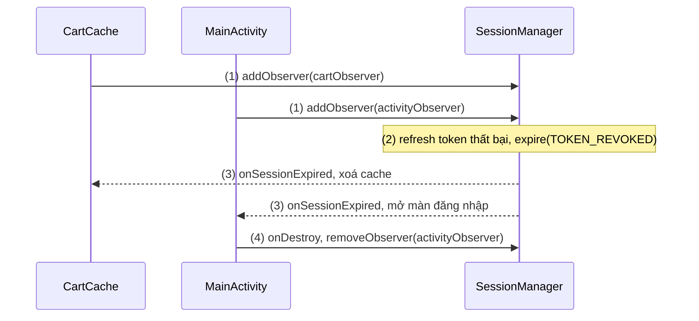
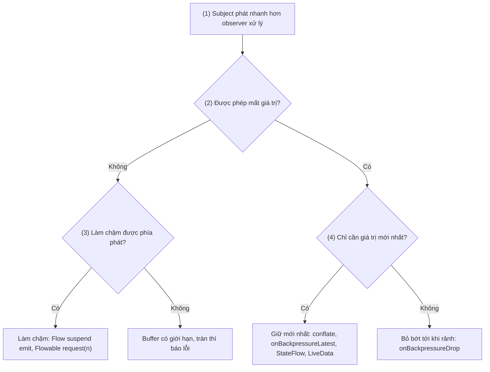
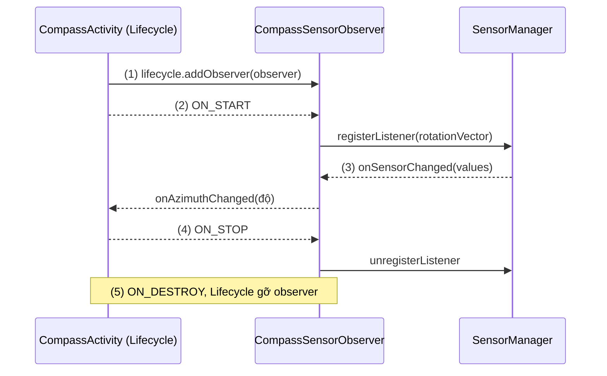
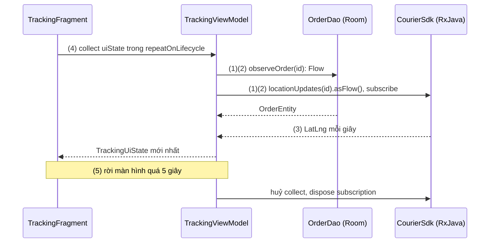

# Observer Pattern Overview

## Vấn đề cần giải quyết

Nhiều nơi trong app cần biết khi một thứ thay đổi: phiên đăng nhập hết hạn thì giỏ hàng xoá cache, lịch đồng bộ dừng, màn hình đang mở chuyển về trang đăng nhập. Cách viết đầu tiên thường là để nơi phát hiện thay đổi **gọi thẳng** từng nơi:

```kotlin
// SessionManager.kt (cách làm có vấn đề)
class SessionManager(
    private val cartCache: CartCache,
    private val syncScheduler: SyncScheduler,
    private val mainActivity: MainActivity          // giữ thẳng một Activity
) {
    fun expire() {
        cartCache.clear()
        syncScheduler.cancelAll()
        mainActivity.openLogin()
    }
}
```

`SessionManager` (tầng data) phải biết mọi nơi cần phản ứng, kể cả Activity; thêm một nơi là sửa nó. Nó sống cả đời app, còn Activity bị huỷ và tạo lại khi xoay màn hình: giữ Activity là leak, gọi vào Activity đã huỷ là crash. Cách ngược lại, để mỗi nơi **tự hỏi định kỳ** (polling), thì tốn pin và luôn trễ một nhịp.

Vấn đề cần giải quyết là: **một nơi thay đổi báo được cho nhiều nơi quan tâm mà không cần biết chúng là ai, và mỗi nơi tự quyết định khi nào bắt đầu và thôi nhận.**

## Sau khi học xong

- Giải thích được hai vai subject và observer, vòng đăng ký, thông báo, huỷ đăng ký, và vì sao subject chỉ biết observer qua một interface.
- Phân biệt được push với pull, và luồng hot với luồng cold.
- Giải thích được backpressure là gì và các chiến lược xử lý khi observer nhận chậm hơn subject phát.
- Nhận diện được Observer Pattern trong các API của Android và vì sao observer cập nhật UI phải gắn với lifecycle.
- Biết khi nào chọn LiveData, Flow hay RxJava cho từng tầng của app.

## Observer Pattern là gì?

**Observer Pattern** là pattern hành vi trong đó một object, gọi là **subject** (chủ thể được quan sát), giữ danh sách các **observer** (người quan sát) đã đăng ký và tự báo cho tất cả khi trạng thái của nó đổi; subject chỉ biết observer qua một interface, nên nơi phát thay đổi không phụ thuộc nơi nhận.

Mental model: **đặt báo dài hạn**. Toà soạn (subject) gửi mỗi số mới cho mọi người trong danh sách, không cần biết họ đọc để làm gì; người đọc (observer) tự đăng ký, tự huỷ. Các phần sau đều là câu hỏi về việc đặt báo: gửi cả tờ báo hay chỉ giấy báo "có số mới" (push/pull), báo có in khi chưa ai đặt không (hot/cold), hộp thư đầy thì sao (backpressure), đi vắng có tạm ngưng giao không (lifecycle).

## Cách hoạt động

### Hai vai và vòng đời của một lần đăng ký

| Thao tác | Ai gọi | Làm gì | Tên trong các API |
|---|---|---|---|
| Đăng ký | Observer | Subject thêm observer vào danh sách | `addObserver`, `observe`, `subscribe`, `collect` |
| Thông báo | Subject | Gọi hàm của interface cho từng observer | `onChanged`, `onNext`, `emit` |
| Huỷ đăng ký | Observer hoặc lifecycle | Subject bỏ observer, không còn giữ tham chiếu | `removeObserver`, `dispose`, huỷ coroutine |

Điểm cốt lõi là **hướng phụ thuộc**: subject chỉ biết interface `Observer` do chính nó định nghĩa; class cụ thể của observer mới biết subject. Tầng data báo cho tầng UI mà không phụ thuộc tầng UI ([DIP — Dependency Inversion Principle](../../../../../design-principles/02-solid/solid-dip.md)). Đổi lại, subject **giữ tham chiếu** tới observer cho tới khi nó huỷ đăng ký: observer quên huỷ sống mãi theo subject, nguồn leak phổ biến nhất của pattern.

#### Ví dụ: phiên đăng nhập hết hạn báo cho nhiều module

**Bài toán:** refresh token thất bại thì giỏ hàng xoá cache và màn hình đang mở chuyển về trang đăng nhập; `SessionManager` không được biết các class đó.

**Luồng chạy:**

1. `CartCache` đăng ký lúc khởi tạo, `MainActivity` trong `onCreate()`, qua interface `SessionObserver`.
2. Refresh token thất bại, `SessionManager.expire(reason)` được gọi.
3. `SessionManager` gọi `onSessionExpired(reason)` cho từng observer mà không biết observer nào là ai.
4. `MainActivity` huỷ đăng ký trong `onDestroy()`, nên Activity cũ không bị giữ sau khi xoay màn hình.



```kotlin
// SessionManager.kt
enum class ExpiryReason { TOKEN_REVOKED, PASSWORD_CHANGED }

fun interface SessionObserver {                                     // interface do subject định nghĩa
    fun onSessionExpired(reason: ExpiryReason)
}

class SessionManager {
    // Copy-on-write: observer tự huỷ đăng ký ngay trong lúc được báo vẫn an toàn
    private val observers = CopyOnWriteArraySet<SessionObserver>()

    fun addObserver(observer: SessionObserver) { observers += observer }      // (1)
    fun removeObserver(observer: SessionObserver) { observers -= observer }   // (4)

    fun expire(reason: ExpiryReason) {                                        // (2)
        observers.forEach { it.onSessionExpired(reason) }                     // (3)
    }
}

// MainActivity.kt
private val sessionObserver = SessionObserver {
    runOnUiThread { startActivity(Intent(this, LoginActivity::class.java)); finish() }
}

override fun onCreate(savedInstanceState: Bundle?) {
    super.onCreate(savedInstanceState)
    sessionManager.addObserver(sessionObserver)                               // (1)
}

override fun onDestroy() {
    sessionManager.removeObserver(sessionObserver)                            // (4)
    super.onDestroy()
}
```

`runOnUiThread` cần vì subject báo trên thread của nó: `expire()` thường chạy trên thread của thư viện mạng.

**Kết quả:** thêm một module cần biết phiên hết hạn chỉ là thêm một observer, `SessionManager` không đổi. Unit test trên JVM: đăng ký observer ghi lại `reason`, gọi `expire()`, huỷ đăng ký, gọi `expire()` lần nữa, danh sách chỉ có một phần tử. Xoay màn hình nhiều lần rồi cho phiên hết hạn: màn đăng nhập mở một lần, LeakCanary không báo leak. Trong app thật, thư viện (phần cuối bài) làm sẵn danh sách observer, đổi thread và huỷ đăng ký.

### Push và pull: thông báo mang theo gì

- **Push (đẩy):** thông báo mang luôn giá trị mới. Toà soạn gửi cả tờ báo. LiveData (`onChanged(value)`), Flow (`emit(value)`), RxJava (`onNext(value)`) đều push.
- **Pull (kéo):** thông báo chỉ nói "có thay đổi", observer tự hỏi lại. Toà soạn gửi giấy báo "có số mới, mời tới lấy". `ContentObserver.onChange(selfChange, uri)` là pull: nó chỉ cho biết URI nào đổi, app phải query lại ([Content Provider](../../../session_04/components/content_provider.md), mục "Lắng nghe thay đổi thời gian thực (ContentObserver)").

Push hợp với state nhỏ mà mọi observer cần như nhau; pull hợp với dữ liệu lớn hoặc mỗi observer cần một phần khác nhau. Room kết hợp cả hai: nhận tín hiệu "bảng `orders` đổi", tự query lại rồi **push** kết quả qua `Flow` hoặc `LiveData` ([Async Transactions & Flow](../../../session_05/data_store/room_transactions.md)).

### Hot và cold: nguồn có chạy khi chưa ai quan sát?

- **Cold (lạnh):** nguồn chỉ chạy khi có observer đăng ký, và **chạy riêng cho từng observer** từ đầu. Mỗi người đặt được in riêng một bộ từ số 1. Ví dụ: `flow { }` của Kotlin, `Single` của Retrofit với RxJava (mỗi lần subscribe là một request).
- **Hot (nóng):** nguồn chạy **độc lập** với observer, mọi observer dùng chung một lần chạy và nhận từ lúc đăng ký trở đi. Báo in theo lịch, người đặt muộn chỉ nhận từ số hiện tại. Ví dụ: broadcast của hệ thống, cảm biến, `StateFlow`, `SharedFlow`, `Subject` của RxJava, LiveData.

| Loại | Observer mới đăng ký nhận gì | Ví dụ |
|---|---|---|
| Hot, giữ giá trị cuối | Ngay giá trị hiện tại, rồi các giá trị sau | LiveData, `StateFlow`, `BehaviorSubject`, sticky broadcast `ACTION_BATTERY_CHANGED` |
| Hot, không giữ | Chỉ các giá trị phát sau khi đăng ký | `SharedFlow` (replay 0), `PublishSubject`, broadcast `ACTION_POWER_CONNECTED` |
| Cold | Toàn bộ chuỗi, chạy lại cho riêng mình | `flow { }`, `Observable.fromCallable { }`, query Room trả `Flow` |

Quy tắc chọn: **state** cần hot và giữ giá trị cuối, để màn hình vừa tạo lại có ngay dữ liệu; **việc tốn kém dùng chung** (một kết nối, một request) chuyển từ cold sang hot để không chạy lặp; **việc của riêng một người gọi** để cold.

Ví dụ: màn chuyển tiền và widget ở màn chính cùng hiện tỷ giá. Với nguồn cold, mở hai màn là hai request; chuyển nguồn thành hot và giữ giá trị cuối thì observer đầu tiên khởi động request, observer thứ hai nhận ngay giá trị đang giữ. Đoạn code dùng trước Flow ở mức tối thiểu (`flow { }` tạo luồng cold, `stateIn` biến nó thành `StateFlow` hot), học ở [Flow](flow.md):

```kotlin
// RateRepository.kt
val rates: Flow<Rates> = flow { emit(rateApi.getRates()) }            // cold: mỗi collector một request

val sharedRates: StateFlow<Rates?> = rates                            // hot: dùng chung, giữ giá trị cuối
    .stateIn(applicationScope, SharingStarted.WhileSubscribed(5_000), initialValue = null)
```

Mở hai màn với `rates`, Network Inspector của Android Studio thấy hai request `GET /rates`; với `sharedRates` chỉ còn một.

### Backpressure: observer nhận không kịp

Khi subject phát nhanh hơn observer xử lý (cảm biến 200 lần mỗi giây, UI vẽ 60 khung hình; import 100.000 dòng CSV), giá trị dồn lại. **Backpressure** (áp lực ngược) là cơ chế để phía nhận báo phía phát biết nó xử lý được bao nhiêu, hoặc để quyết định làm gì với phần thừa. Hộp thư đầy thì toà soạn chọn: in chậm lại, giữ lại, bỏ bớt, hay chỉ để số mới nhất.

1. Có chênh lệch tốc độ không? Một request hay vài cú click thì không cần nghĩ tới backpressure.
2. Dữ liệu không được mất (dòng CSV, tin nhắn)?
3. Nếu không được mất: làm chậm phía phát; nguồn không chờ được (sự kiện hệ thống) thì buffer có giới hạn.
4. Nếu là state (vị trí, tiến độ, giá): chỉ giá trị mới nhất có nghĩa, bỏ giá trị cũ là đúng.



| Công cụ | Mặc định khi observer chậm |
|---|---|
| LiveData | Chỉ giữ giá trị mới nhất ([LiveData](../../../session_06/livedata.md), mục "`setValue` và `postValue`") |
| Flow | `emit()` là hàm suspend nên phía phát **tự dừng** chờ collector; có `buffer`, `conflate`, `collectLatest` ([Flow](flow.md)) |
| RxJava `Observable` | Không có backpressure: buffer không giới hạn, có thể `OutOfMemoryError` |
| RxJava `Flowable` | Phía nhận `request(n)` theo Reactive Streams, kèm chiến lược buffer, drop, latest ([RxJava / RxAndroid](rxjava.md)) |

### Quan sát theo lifecycle

Observer cập nhật UI sống ngắn hơn hẳn subject. Observer UI an toàn theo ba quy tắc, như tạm ngưng giao báo khi đi vắng và huỷ hẳn khi chuyển nhà:

1. **Bắt đầu nhận** khi UI hiển thị (`STARTED`).
2. **Ngừng nhận** khi UI không hiển thị (`STOPPED`): không cập nhật View đang ẩn, không giữ nguồn tốn pin chạy vô ích.
3. **Huỷ đăng ký hẳn** khi UI bị huỷ (`DESTROYED`): subject không giữ Activity cũ.

`Lifecycle` của Android chính là một subject phát event `ON_START`, `ON_STOP`, `ON_DESTROY`; `DefaultLifecycleObserver` là observer của nó ([Activity Lifecycle](../../../session_04/components/activity/lifecycle.md), mục "Cách hoạt động — Bộ ba cốt lõi"). Gắn observer dữ liệu vào lifecycle là dùng observer của lifecycle để bật, tắt observer của dữ liệu.

| Công cụ | Gắn với lifecycle bằng cách nào |
|---|---|
| Listener của framework (`SensorManager`, `LocationManager`) | Tự đăng ký ở `onStart`, huỷ ở `onStop`, hoặc gom vào một `DefaultLifecycleObserver` |
| LiveData | Có sẵn: `observe(lifecycleOwner, observer)` làm đủ ba quy tắc |
| Flow | Collect trong `repeatOnLifecycle(Lifecycle.State.STARTED)`, hoặc `collectAsStateWithLifecycle()` ở Compose |
| RxJava | Tự `dispose()`, thường gom trong `CompositeDisposable` |

#### Ví dụ: la bàn chỉ nghe cảm biến khi màn hình hiển thị

**Bài toán:** màn la bàn đọc cảm biến xoay (`TYPE_ROTATION_VECTOR`), vốn tốn pin; chỉ được nghe khi màn hình hiển thị.

**Luồng chạy:**

1. Activity gắn `CompassSensorObserver` vào `lifecycle` trong `onCreate()`.
2. Activity tới `STARTED`: observer đăng ký listener với `SensorManager`.
3. Cảm biến phát giá trị: observer tính góc, Activity xoay kim.
4. Bấm Home: `onStop()` huỷ đăng ký listener, cảm biến tắt.
5. Activity bị huỷ: `Lifecycle` tự gỡ observer.



```kotlin
// CompassSensorObserver.kt
class CompassSensorObserver(
    private val sensorManager: SensorManager,
    private val onAzimuthChanged: (Float) -> Unit
) : DefaultLifecycleObserver, SensorEventListener {

    private val rotationMatrix = FloatArray(9)
    private val orientation = FloatArray(3)

    override fun onStart(owner: LifecycleOwner) {                                   // (2)
        sensorManager.getDefaultSensor(Sensor.TYPE_ROTATION_VECTOR)?.let { sensor ->
            sensorManager.registerListener(this, sensor, SensorManager.SENSOR_DELAY_UI)
        }
    }

    override fun onSensorChanged(event: SensorEvent) {                              // (3) main thread
        SensorManager.getRotationMatrixFromVector(rotationMatrix, event.values)
        SensorManager.getOrientation(rotationMatrix, orientation)
        onAzimuthChanged(Math.toDegrees(orientation[0].toDouble()).toFloat())
    }

    override fun onAccuracyChanged(sensor: Sensor, accuracy: Int) = Unit

    override fun onStop(owner: LifecycleOwner) {                                    // (4)
        sensorManager.unregisterListener(this)
    }
}

// CompassActivity.kt, trong onCreate()
val sensorManager = getSystemService(Context.SENSOR_SERVICE) as SensorManager
lifecycle.addObserver(CompassSensorObserver(sensorManager) { azimuth ->           // (1)
    binding.needle.rotation = -azimuth
})
// (5) không cần removeObserver: Lifecycle tự gỡ khi DESTROYED
```

`registerListener` không truyền `Handler` thì callback chạy trên main thread, nên gán `rotation` trực tiếp được.

**Kết quả:** kim xoay theo điện thoại; bấm Home thì breakpoint trong `onSensorChanged` không còn dừng.

### Observer Pattern trong các API của Android

| API | Subject | Observer | Push / pull | Hot / cold | Tự gắn lifecycle |
|---|---|---|---|---|---|
| `setOnClickListener`, `addTextChangedListener` | `View`, `TextView` | `OnClickListener` (chỉ **một**, gán mới là thay cũ), `TextWatcher` (nhiều) | Push | Hot | Không, sống cùng View |
| `ContentObserver` | URI của Content Provider | `ContentObserver` | Pull | Hot | Không |
| `BroadcastReceiver` | Hệ thống hoặc app khác, qua OS | `BroadcastReceiver` | Push (`Intent`) | Hot | Không, dynamic receiver tự huỷ |
| `Lifecycle` | Activity, Fragment | `LifecycleObserver` | Push (event) | Hot, observer mới được đưa lên state hiện tại | Là chính lifecycle |

`BroadcastReceiver` là biến thể **publish-subscribe**: bên phát gửi qua một trung gian (hệ điều hành), hai bên không biết nhau ([Broadcast Receiver](../../../session_04/components/broadcast/broadcast_receiver.md)). LiveData, Flow và RxJava là ba thư viện hiện thực pattern, so sánh ở mục "So sánh với các cách tiếp cận khác".

## Ví dụ thực tế

Bài toán chính bên dưới ghép nhiều cơ chế quan sát trong một màn hình. Hai bài toán khác: bọc listener của SDK thành luồng bằng `callbackFlow` (như `ContentObserver` ở [Content Provider](../../../session_04/components/content_provider.md), mục "Ví dụ thực tế"), và thay broadcast nội bộ bằng `SharedFlow` ([Broadcast Receiver](../../../session_04/components/broadcast/broadcast_receiver.md), mục "LocalBroadcastManager — Deprecated và thay thế").

### Màn theo dõi đơn giao hàng: chọn cơ chế quan sát theo tầng

**Bài toán:** màn theo dõi đơn hiện trạng thái đơn (lưu trong Room, đổi khi server đẩy cập nhật) và vị trí shipper (SDK của đối tác vận chuyển trả `Observable<LatLng>` của RxJava, phát mỗi giây). Rời màn hình thì SDK phải ngừng gửi vị trí.

> [!NOTE]
> Kiến thức dùng trước: `combine`, `stateIn`, `repeatOnLifecycle` học ở [Flow](flow.md); `asFlow()` nối RxJava sang Flow học ở [RxJava / RxAndroid](rxjava.md); `viewModelScope`, `lifecycleScope` là coroutine scope, học ở 8.4.3 Coroutines (chưa có bài).

**Luồng chạy:**

1. **Data layer:** DAO trả `Flow<OrderEntity>` (cold, push); Repository đổi `Observable` của SDK thành `Flow` bằng `asFlow()`, để tầng trên chỉ thấy một loại luồng.
2. **ViewModel:** `combine` hai luồng, rồi `stateIn(... WhileSubscribed(5_000))` biến kết quả thành hot, giữ giá trị cuối.
3. **Backpressure:** UI chỉ cần vị trí mới nhất, đúng cách `StateFlow` vốn giữ giá trị.
4. **UI:** Fragment collect trong `repeatOnLifecycle(STARTED)`.
5. Rời màn hình quá 5 giây: `stateIn` huỷ upstream, `asFlow()` dispose subscription của SDK.



```kotlin
// TrackingRepository.kt
class TrackingRepository(private val orderDao: OrderDao, private val courierSdk: CourierSdk) {
    fun observeOrder(orderId: Long): Flow<OrderEntity> = orderDao.observeOrder(orderId)      // (1)
    fun observeCourierLocation(orderId: Long): Flow<LatLng> =
        courierSdk.locationUpdates(orderId).asFlow()                                          // (1) RxJava → Flow
}

// TrackingViewModel.kt
class TrackingViewModel(savedStateHandle: SavedStateHandle, repository: TrackingRepository) : ViewModel() {
    private val orderId: Long = checkNotNull(savedStateHandle["orderId"])

    val uiState: StateFlow<TrackingUiState> = combine(                                        // (2)
        repository.observeOrder(orderId),
        repository.observeCourierLocation(orderId)
    ) { order, location ->
        TrackingUiState.Tracking(status = order.status, courierLocation = location)          // (3)
    }.stateIn(viewModelScope, SharingStarted.WhileSubscribed(5_000), TrackingUiState.Loading) // (5)
}

// TrackingFragment.kt, trong onViewCreated()
viewLifecycleOwner.lifecycleScope.launch {
    viewLifecycleOwner.repeatOnLifecycle(Lifecycle.State.STARTED) {                           // (4)
        viewModel.uiState.collect { state -> render(state) }
    }
}
```

`TrackingUiState` là `sealed interface` gồm `Loading` và `Tracking`, theo mẫu một `uiState` ở [MVVM](../../architecture/mvvm.md), mục "UI state và luồng dữ liệu một chiều".

**Kết quả:** đơn đổi trạng thái trong Room thì màn hình tự cập nhật. Xoay màn hình: log của SDK không có subscribe mới. Bấm Home quá 5 giây: subscription bị dispose; mở lại thì subscribe lại.

## So sánh với các cách tiếp cận khác

**Chọn LiveData, Flow hay RxJava.** Cả ba hiện thực Observer Pattern; lifecycle và backpressure đã so ở hai bảng trên, còn lại:

| Tiêu chí | LiveData | Flow | RxJava 3 |
|---|---|---|---|
| Hot / cold | Hot, giữ giá trị cuối | `Flow` cold; `StateFlow`, `SharedFlow` hot | Mặc định cold; `Subject` hot |
| Thread | Giao trên main thread | Dispatcher, `flowOn` | `subscribeOn`, `observeOn` |
| Toán tử | Ít | Nhiều | Rất nhiều |
| Nền tảng | Android, Java và Kotlin | Kotlin, cả Kotlin Multiplatform | JVM, Java và Kotlin |
| Hợp với | UI (ViewModel → View) | Mọi tầng | Codebase Java hoặc đã dùng Rx |

Khuyến nghị kiến trúc hiện nay của Android: **Flow ở data layer và domain layer, `StateFlow` cho UI state**. LiveData vẫn dùng được ở UI, nhất là codebase Java hoặc View/XML đã dùng nó; RxJava gặp chủ yếu trong codebase cũ và được chuyển dần sang Flow. Chi tiết: [Flow](flow.md), [RxJava / RxAndroid](rxjava.md), [LiveData](livedata.md).

**Observer và publish-subscribe (event bus).** Trong publish-subscribe, hai bên chỉ biết một **trung gian** (event bus, hệ điều hành) và một chủ đề (kiểu event, action của `Intent`), không đăng ký thẳng với nhau. Tách xa hơn nhưng khó lần theo ai phát, ai nhận; event bus toàn cục trong app (`LocalBroadcastManager`, thư viện EventBus) vì vậy đã nhường chỗ cho luồng có kiểu rõ ràng đi qua Repository hoặc ViewModel.

## Khi nào nên và không nên dùng

- **Nên dùng** khi một nguồn thay đổi theo thời gian và nhiều nơi, hoặc nơi có vòng đời khác, cần phản ứng: UI state, dữ liệu database, trạng thái mạng, phiên đăng nhập, tiến độ.
- **Không cần** cho lời gọi một lần, một kết quả, một người gọi (đăng nhập, gửi đơn): hàm `suspend` hoặc `Single` đơn giản hơn.
- **Không nên** dùng cho chuỗi bước phải chạy đúng thứ tự ("trừ kho, rồi tạo đơn, rồi gửi email"): các observer độc lập không đảm bảo thứ tự hay giao dịch.

## Sai lầm thường gặp

### 1. Quên huỷ đăng ký

```kotlin
// Sai: đăng ký mỗi lần onCreate, không bao giờ huỷ
sessionManager.addObserver { openLogin() }      // lambda giữ this (Activity)
```

**Lỗi lộ ra thế nào:** mỗi lần xoay màn hình thêm một observer; `SessionManager` giữ mọi Activity cũ (LeakCanary báo leak), và phiên hết hạn thì màn đăng nhập mở nhiều lần.

**Cách sửa:** giữ observer trong field và huỷ ở callback đối xứng (`onCreate`/`onDestroy`, `onStart`/`onStop`), hoặc dùng công cụ tự gắn lifecycle (LiveData, `repeatOnLifecycle`, `DefaultLifecycleObserver`).

### 2. Cập nhật View trên thread của subject

```kotlin
// Sai: expire() được gọi từ thread của OkHttp
sessionManager.addObserver { binding.sessionBanner.isVisible = true }
```

**Lỗi lộ ra thế nào:** crash `CalledFromWrongThreadException: Only the original thread that created a view hierarchy can touch its views`, chỉ khi token hết hạn đúng lúc đang dùng app nên khó tái hiện.

**Cách sửa:** observer UI chuyển sang main thread (`runOnUiThread`), hoặc dùng công cụ quy định rõ thread giao: LiveData giao trên main thread, Flow collect trong `lifecycleScope`, RxJava `observeOn(AndroidSchedulers.mainThread())`.

### 3. Sửa danh sách observer trong lúc đang thông báo

```kotlin
// Sai: ArrayList thường, observer tự gỡ mình trong callback
private val observers = mutableListOf<SessionObserver>()
fun expire(reason: ExpiryReason) = observers.forEach { it.onSessionExpired(reason) }
```

**Lỗi lộ ra thế nào:** observer gọi `removeObserver(this)` trong callback làm vòng lặp ném `ConcurrentModificationException`.

**Cách sửa:** `CopyOnWriteArraySet`/`CopyOnWriteArrayList` (duyệt trên bản chụp), hoặc duyệt trên `observers.toList()`.

### 4. Nhầm hot và cold

```kotlin
// Sai: mỗi lần gọi là một luồng cold mới, ba màn cùng gọi
fun observeUnreadCount(): Flow<Int> = flow {
    while (true) { emit(notificationApi.getUnreadCount()); delay(30_000) }
}
```

**Lỗi lộ ra thế nào:** ba màn đang mở là ba vòng polling song song tới server; màn mới mở hiện "0" tới khi request của riêng nó về.

**Cách sửa:** biến nguồn dùng chung thành hot, giữ giá trị cuối (`stateIn`/`shareIn` ở [Flow](flow.md), `BehaviorSubject` ở RxJava), tạo một lần trong Repository. Ngược lại, đừng dùng luồng hot không giữ giá trị (`SharedFlow` replay 0) cho state: observer đăng ký muộn không thấy gì.

## Lịch sử phát triển

- **1994:** cuốn *Design Patterns* của "Gang of Four" (Gamma, Helm, Johnson, Vlissides) đặt tên Observer.
- **2008 (Android 1.0, API 1):** listener của View, `ContentObserver`, `BroadcastReceiver` có từ đầu.
- **2009:** Microsoft công bố Reactive Extensions (Rx) cho .NET: Observer cộng với toán tử ghép luồng.
- **11/2014:** RxJava 1.0.0, bản Rx cho JVM do Netflix khởi xướng; RxJava 2 (10/2016) thêm `Flowable` có backpressure.
- **04/2015:** chuẩn Reactive Streams 1.0.0 cho JVM, backpressure bằng `request(n)`.
- **05/2017 (Google I/O):** Architecture Components giới thiệu LiveData, observer gắn lifecycle sẵn.
- **09/2017 (Java 9):** `java.util.Observer`/`Observable` (có từ Java 1.0) bị deprecated; thêm `java.util.concurrent.Flow` theo Reactive Streams.
- **08/2019 (kotlinx.coroutines 1.3.0):** bản stable đầu tiên của Flow.
- **10/2020 (kotlinx.coroutines 1.4.0):** `StateFlow` và `SharedFlow` stable.
- **10/2021 (Lifecycle 2.4.0):** `repeatOnLifecycle` để collect Flow theo lifecycle.
- **Hiện nay:** Android khuyên Flow ở data layer, `StateFlow` cho UI state; LiveData vẫn được duy trì; RxJava 4 đang ở giai đoạn alpha.

## Kết nối hệ thống

- **Tiên quyết:**
  - [Kotlin](../../../session_01/languages/kotlin.md): `fun interface`, lambda.
  - [Activity Lifecycle](../../../session_04/components/activity/lifecycle.md): `Lifecycle` là subject, `LifecycleObserver` là observer.
  - [LiveData](../../../session_06/livedata.md): hiện thực Observer gắn lifecycle đã dùng ở Session 06.
- **Liên quan:**
  - [Content Provider](../../../session_04/components/content_provider.md), [Broadcast Receiver](../../../session_04/components/broadcast/broadcast_receiver.md), [Working with Thread](../../../session_05/working_with_thread.md), [Async Transactions & Flow](../../../session_05/data_store/room_transactions.md): `ContentObserver`, publish-subscribe qua OS, main thread, Room báo thay đổi bảng.
  - [MVVM](../../architecture/mvvm.md): View quan sát ViewModel.
- **Học tiếp:**
  - [Flow](flow.md) (7.1.4.2): nên học ngay sau bài này.
  - [RxJava / RxAndroid](rxjava.md) (7.1.4.1) và [LiveData](livedata.md) (7.1.4.3): hai hiện thực còn lại, so với Flow.
  - 8.4.3 Coroutines (chưa có bài): nền của Flow.

## Tham khảo

- [Kotlin flows on Android - Android Developers](https://developer.android.com/kotlin/flow)
- [StateFlow and SharedFlow - Android Developers](https://developer.android.com/kotlin/flow/stateflow-and-sharedflow)
- [Handling lifecycles with lifecycle-aware components - Android Developers](https://developer.android.com/topic/libraries/architecture/lifecycle)
- [RxJava README (base classes, backpressure) - GitHub ReactiveX](https://github.com/ReactiveX/RxJava)
- [java.util.Observable (deprecated từ Java 9) - Oracle](https://docs.oracle.com/javase/9/docs/api/java/util/Observable.html)
- [kotlinx.coroutines changelog (Flow 1.3.0, StateFlow 1.4.0) - GitHub](https://github.com/Kotlin/kotlinx.coroutines/blob/master/CHANGES_UP_TO_1.7.md)
- [Lifecycle release notes - Android Developers](https://developer.android.com/jetpack/androidx/releases/lifecycle)
