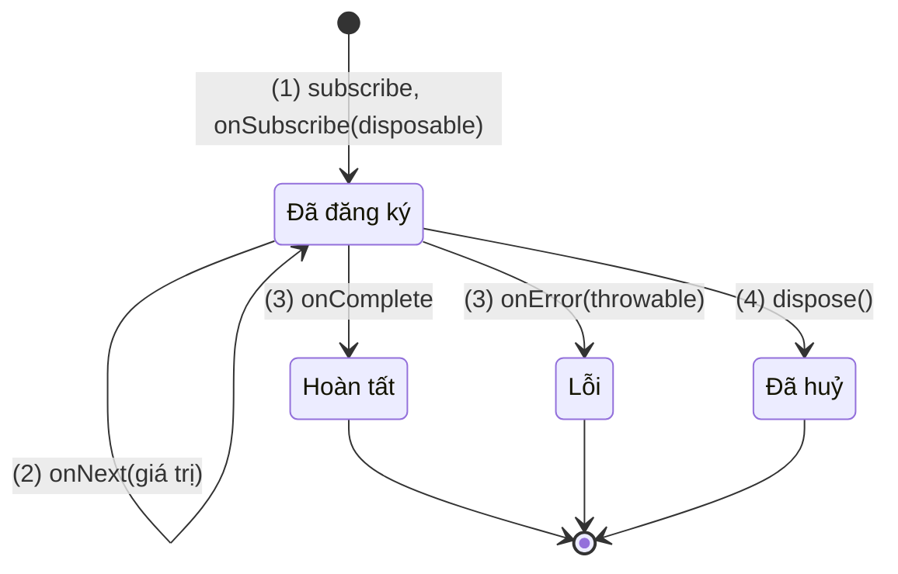
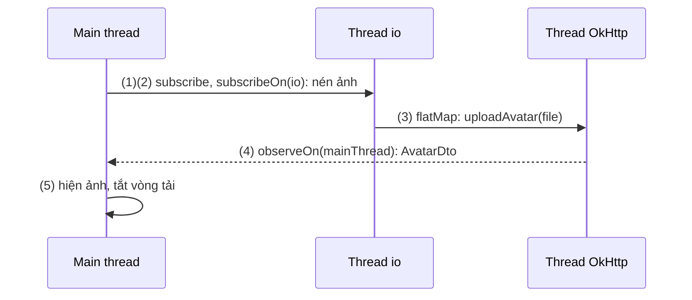
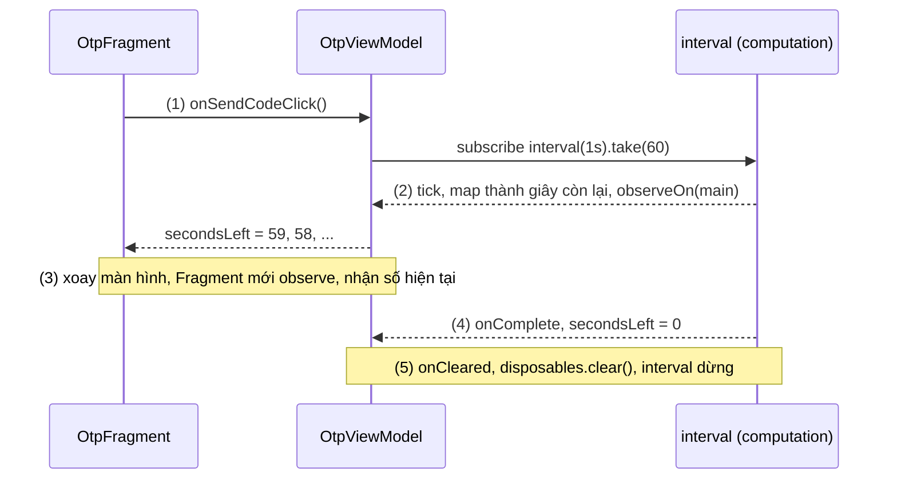
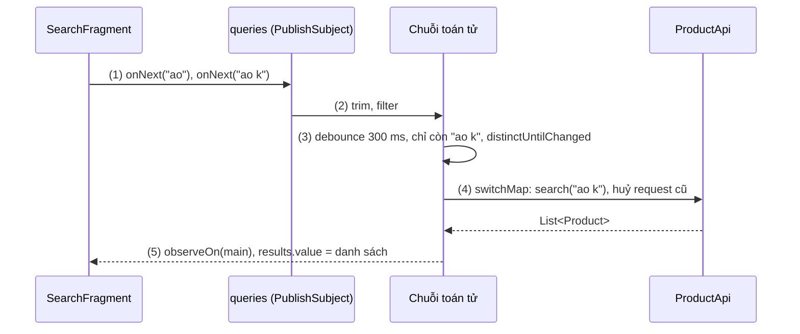
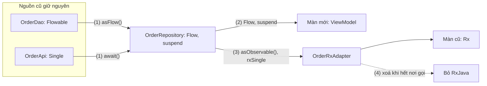
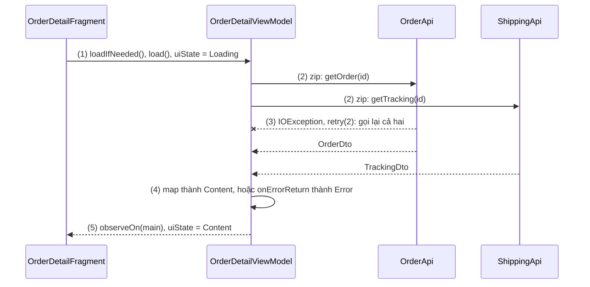

# RxJava / RxAndroid

## Vấn đề cần giải quyết

Trước khi có coroutine, code bất đồng bộ trên Android thường là callback lồng nhau. Ví dụ màn chi tiết đơn hàng: lấy đơn, lấy thông tin vận chuyển, rồi hiện cả hai lên màn hình.

```kotlin
// OrderDetailActivity.kt (cách làm có vấn đề)
orderApi.getOrder(orderId, object : Callback<Order> {
    override fun onSuccess(order: Order) {                                // thread của thư viện mạng
        shippingApi.getTracking(orderId, object : Callback<Tracking> {       // chạy tuần tự dù không phụ thuộc nhau
            override fun onSuccess(tracking: Tracking) {
                runOnUiThread { render(order, tracking) }                // tự chuyển về main thread
            }
            override fun onError(error: Throwable) { runOnUiThread { showError() } }
        })
    }
    override fun onError(error: Throwable) { runOnUiThread { showError() } }
})
```

Mỗi bước thêm một tầng lồng. Lỗi phải xử lý ở từng tầng ("thử lại 2 lần" là một vòng lặp quanh cả khối); mọi callback chạm UI phải tự đổi thread; đóng màn hình khi request đang chạy thì callback vẫn tới và gọi `render()` trên Activity đã huỷ; còn "gọi hai API song song rồi gộp" hay "chờ người dùng ngừng gõ 300 ms" phải tự viết bằng cờ và `Handler`.

Vấn đề cần giải quyết là: **biểu diễn công việc bất đồng bộ thành một luồng giá trị ghép, đổi thread, xử lý lỗi và huỷ được ở một chỗ.**

## Sau khi học xong

- Phân biệt được năm kiểu nguồn Observable, Flowable, Single, Maybe, Completable và chọn đúng kiểu theo số giá trị và nhu cầu backpressure.
- Giải thích được subscribeOn và observeOn đổi thread ở đâu trong chuỗi, và dùng AndroidSchedulers.mainThread() để nhận kết quả trên main thread.
- Áp dụng được các toán tử chính như map, filter, debounce, switchMap, flatMap, zip, combineLatest để ghép luồng.
- Xử lý được vòng đời subscription bằng Disposable, CompositeDisposable và lỗi bằng onError, onErrorReturn, retry.
- Áp dụng được kotlinx-coroutines-rx3 để chuyển dần code RxJava sang coroutine và Flow.

## RxJava là gì?

**RxJava** là thư viện hiện thực Reactive Extensions (Rx) trên JVM: nó mở rộng Observer Pattern ([Observer Pattern Overview](overview.md)) thành các **luồng giá trị bất đồng bộ** có tín hiệu hoàn tất và lỗi (`Observable`, `Flowable`, `Single`, `Maybe`, `Completable`), ghép được bằng **toán tử** và chạy trên các **Scheduler**. **RxAndroid** là thư viện nhỏ đi kèm, bổ sung Scheduler cho main thread (và `Looper` bất kỳ) của Android.

Mental model: một chuỗi Rx là **dây chuyền lắp ráp**. Nguồn đặt sản phẩm lên băng chuyền, mỗi toán tử là một trạm gia công, observer là người nhận ở cuối. Dây chuyền chỉ chạy khi có người nhận đăng ký (`subscribe`), Scheduler quyết định mỗi đoạn chạy ở phân xưởng (thread) nào, `Disposable` là nút dừng.

Phiên bản hiện hành là **RxJava 3** (package `io.reactivex.rxjava3`) và **RxAndroid 3**:

```kotlin
// build.gradle.kts (module app)
dependencies {
    implementation("io.reactivex.rxjava3:rxjava:3.1.12")
    implementation("io.reactivex.rxjava3:rxandroid:3.0.2")
}
```

## Cách hoạt động

### Một chuỗi Rx: nguồn, toán tử, observer

Một chuỗi có ba phần: **nguồn** (upstream đầu tiên), các **toán tử** (mỗi toán tử trả về một nguồn mới bọc nguồn trước), và **observer** ở cuối. Observer nhận tín hiệu theo hợp đồng cố định: `onSubscribe` một lần, `onNext` không hoặc nhiều lần, rồi **tối đa một** trong `onError` hoặc `onComplete`; sau tín hiệu kết thúc thì không còn gì nữa.

1. `subscribe()` nối observer vào chuỗi; observer nhận một `Disposable` để huỷ về sau.
2. Nguồn phát các giá trị qua `onNext`.
3. Chuỗi kết thúc bằng `onComplete` hoặc `onError`; lỗi ở bất kỳ trạm nào cũng chảy thẳng xuống observer.
4. Hoặc observer huỷ trước bằng `dispose()`; nguồn ngừng phát.



Hầu hết nguồn của RxJava là **cold** ([Observer Pattern Overview](overview.md), mục "Hot và cold"): khai báo chuỗi chưa chạy gì, mỗi lần `subscribe()` chạy lại từ đầu cho riêng observer đó. Từ RxJava 2, chuỗi **không nhận `null`** (`map { null }` gây `NullPointerException`); giá trị có thể không có dùng `Maybe`.

### Năm kiểu nguồn

| Kiểu | Số giá trị | Backpressure | Ví dụ trên Android |
|---|---|---|---|
| `Observable<T>` | 0..N | Không | Sự kiện UI, chuỗi ngắn trong bộ nhớ |
| `Flowable<T>` | 0..N | Có (Reactive Streams) | Query Room quan sát được, dữ liệu lớn hoặc nhanh |
| `Single<T>` | Đúng 1 (`onSuccess`), hoặc lỗi | Không cần | Một request Retrofit |
| `Maybe<T>` | 0 hoặc 1, hoặc lỗi | Không cần | Đọc cache có thể trống |
| `Completable` | Không có, chỉ xong hoặc lỗi | Không cần | Insert vào Room, đăng xuất |

Chọn kiểu theo câu hỏi "nguồn phát bao nhiêu giá trị?"; kiểu đúng làm chữ ký hàm tự mô tả (`fun logout(): Completable`). Retrofit (adapter `com.squareup.retrofit2:adapter-rxjava3`) và Room (artifact `androidx.room:room-rxjava3`) đều trả thẳng các kiểu này:

```kotlin
// OrderApi.kt (Retrofit, học ở 8.1.1 Retrofit)
interface OrderApi {
    @GET("orders/{id}") fun getOrder(@Path("id") id: Long): Single<OrderDto>
}

// OrderDao.kt (Room)
@Dao
interface OrderDao {
    @Query("SELECT * FROM orders ORDER BY created_at DESC")
    fun observeOrders(): Flowable<List<OrderEntity>>        // phát lại mỗi khi bảng đổi
    @Query("SELECT * FROM orders WHERE id = :id")
    fun findById(id: Long): Maybe<OrderEntity>              // có thể không có dòng nào
    @Insert(onConflict = OnConflictStrategy.REPLACE)
    fun insert(order: OrderEntity): Completable
}
```

Retrofit đăng ký adapter bằng `addCallAdapterFactory(RxJava3CallAdapterFactory.create())`; với RxJava 3, `create()` chạy request **bất đồng bộ** trên thread của OkHttp.

**`Subject`** vừa là observer (gọi `onNext` từ ngoài được) vừa là nguồn hot: `PublishSubject` chỉ phát giá trị sau khi đăng ký, `BehaviorSubject` phát ngay giá trị cuối cho observer mới, như `StateFlow`.

### Scheduler: `subscribeOn` và `observeOn`

RxJava không làm việc trực tiếp với `Thread` mà với **Scheduler**, lớp trừu tượng trên một nhóm thread:

| Scheduler | Dùng cho |
|---|---|
| `Schedulers.io()` | Việc chờ I/O hoặc chặn thread: file, database, mạng chặn |
| `Schedulers.computation()` | Việc tốn CPU, số thread theo số nhân; mặc định của `debounce`, `interval` |
| `Schedulers.single()` | Một thread, chạy tuần tự |
| `AndroidSchedulers.mainThread()` (RxAndroid) | Main thread của Android, để chạm View |

Hai toán tử đổi thread khác nhau ở **hướng tác động**:

- **`subscribeOn(scheduler)`** quyết định thread mà **nguồn** bắt đầu chạy. Đặt ở đâu trong chuỗi cũng được; có nhiều `subscribeOn` thì chỉ cái **gần nguồn nhất** có tác dụng.
- **`observeOn(scheduler)`** chuyển mọi bước **phía sau nó** sang scheduler mới; thường đặt `observeOn(AndroidSchedulers.mainThread())` ngay trước `subscribe`.

Main thread và `Looper` đã học ở [Working with Thread](../../../session_05/working_with_thread.md).

#### Ví dụ: nén ảnh rồi tải lên

**Bài toán:** người dùng chọn ảnh đại diện; app nén ảnh, tải lên server, rồi hiện ảnh mới. Ba bước chạy trên ba thread khác nhau.

**Luồng chạy:**

1. `subscribe()` được gọi trên main thread.
2. `subscribeOn(Schedulers.io())`: nguồn `Single.fromCallable` chạy việc nén trên thread io.
3. `flatMap` gọi `profileApi.uploadAvatar()`; adapter RxJava 3 của Retrofit chạy request bất đồng bộ và phát kết quả trên thread của OkHttp.
4. `observeOn(AndroidSchedulers.mainThread())` chuyển kết quả về main thread.
5. Observer cập nhật `ImageView` và tắt vòng tải.



```kotlin
// EditProfileViewModel.kt
fun uploadAvatar(source: File) {
    _isUploading.value = true
    disposables += Single.fromCallable { imageCompressor.compress(source, maxSide = 1080) }  // (2)
        .subscribeOn(Schedulers.io())                                                        // (2)
        .flatMap { compressed -> profileApi.uploadAvatar(compressed.asMultipartPart()) }    // (3)
        .observeOn(AndroidSchedulers.mainThread())                                          // (4)
        .subscribe(
            { avatar -> _avatarUrl.value = avatar.url; _isUploading.value = false },        // (5)
            { _isUploading.value = false; _errorMessage.value = R.string.upload_failed }
        )
}
```

`_isUploading`, `_avatarUrl`, `_errorMessage` là `MutableLiveData` ([LiveData](../../../session_06/livedata.md)); vì observer chạy trên main thread nên gán `value` được. `disposables` là `CompositeDisposable` (mục sau); `+=` là extension một dòng của dự án, `operator fun CompositeDisposable.plusAssign(d: Disposable) { add(d) }` (thư viện RxKotlin có sẵn hàm này).

**Kết quả:** log `Thread.currentThread().name` ở từng bước: nén chạy trên `RxCachedThreadScheduler-1`, kết quả upload tới trên thread `OkHttp ...`, observer chạy trên `main`. Bỏ `observeOn` thì crash `Cannot invoke setValue on a background thread`.

### `Disposable` và `CompositeDisposable`: huỷ đúng lúc

`subscribe()` trả về một **`Disposable`**. Gọi `dispose()` là huỷ đăng ký: nguồn ngừng phát, request đang chạy bị huỷ, observer không còn được gọi. Đây là bước "huỷ đăng ký" của Observer Pattern, và RxJava **không tự làm** theo lifecycle như LiveData: không dispose thì chuỗi chạy tiếp, giữ mọi thứ observer tham chiếu (Activity, Fragment, binding).

**`CompositeDisposable`** gom nhiều `Disposable` để huỷ một lần:

| Hàm | Làm gì | Dùng sau đó được không |
|---|---|---|
| `add(d)` (Kotlin: `+=`) | Thêm vào nhóm | |
| `clear()` | Dispose mọi thứ trong nhóm, **nhóm vẫn dùng tiếp được** | Có |
| `dispose()` | Dispose mọi thứ và **khoá nhóm**: thứ thêm vào sau bị dispose ngay (Fragment gọi `dispose()` ở `onDestroyView()` rồi quay lại từ backstack sẽ không còn cập nhật) | Không |

Đặt `CompositeDisposable` theo vòng đời của việc: việc thuộc **màn hình** (tải dữ liệu, đếm ngược cần sống qua xoay màn hình) ở ViewModel, `clear()` trong `onCleared()` ([ViewModel](../../../session_06/viewmodel.md)); việc thuộc **View** (click, animation) ở Fragment, `clear()` trong `onDestroyView()`.

#### Ví dụ: đếm ngược "Gửi lại mã OTP"

**Bài toán:** sau khi gửi mã OTP, nút "Gửi lại" bị khoá 60 giây và hiện số giây còn lại. Xoay màn hình không được đếm lại từ đầu; thoát màn hình thì đồng hồ phải dừng.

**Luồng chạy:**

1. Bấm "Gửi mã": đang gửi hoặc đang đếm thì bỏ qua (chống bấm đúp); gửi xong thì ViewModel phát 60 rồi chạy `Observable.interval(1, SECONDS).take(60)`.
2. Mỗi giây, `map` đổi tick thành số giây còn lại, `observeOn(mainThread)` rồi ghi vào `LiveData`.
3. Xoay màn hình: ViewModel và chuỗi vẫn chạy; Fragment mới observe và nhận ngay số giây hiện tại.
4. Hết 60 giây: `take` phát `onComplete`, nút mở lại.
5. Thoát màn hình: `onCleared()` gọi `disposables.clear()`, `interval` dừng.



```kotlin
// OtpViewModel.kt
class OtpViewModel(private val authApi: AuthApi) : ViewModel() {

    private val disposables = CompositeDisposable()
    private var countdown: Disposable? = null
    private val _secondsLeft = MutableLiveData(0)
    val secondsLeft: LiveData<Int> = _secondsLeft

    fun onSendCodeClick(phone: String) {
        if (countdown?.isDisposed == false) return                              // (1) đang gửi hoặc đang đếm
        countdown = authApi.sendOtp(phone)                                      // Completable
            .andThen(
                Observable.interval(1, TimeUnit.SECONDS)                        // (1) bắt đầu sau khi gửi xong
                    .take(RESEND_SECONDS)
                    .map { tick -> (RESEND_SECONDS - 1 - tick).toInt() }        // (2)
                    .startWithItem(RESEND_SECONDS.toInt())                      // 60 cũng chỉ hiện sau khi gửi xong
            )
            .observeOn(AndroidSchedulers.mainThread())
            .subscribe(
                { seconds -> _secondsLeft.value = seconds },                    // (2)(3)
                { _secondsLeft.value = 0 }                                      // lỗi gửi mã: mở nút
            )                                                                    // (4) take(60) tự onComplete
            .also { disposables += it }
    }

    override fun onCleared() {
        disposables.clear()                                                     // (5)
    }

    private companion object { const val RESEND_SECONDS = 60L }
}
```

`Disposable` của `subscribe` tự thành disposed khi chuỗi xong hoặc lỗi, nên `isDisposed == false` là đang gửi hoặc đang đếm. Fragment observe `secondsLeft` bằng `viewLifecycleOwner`: `0` thì bật nút, khác `0` thì khoá nút và hiện "Gửi lại sau 42 giây".

**Kết quả:** bấm "Gửi mã", đếm ngược từ 60; xoay màn hình ở giây 42 thì màn mới hiện ngay 42. Thoát màn hình rồi đặt breakpoint trong `map`: không còn dừng, vì chuỗi đã bị dispose.

### Toán tử chính

| Nhóm | Toán tử | Làm gì |
|---|---|---|
| Biến đổi, lọc | `map`, `filter`, `distinctUntilChanged` | Đổi từng giá trị, bỏ giá trị không hợp, bỏ giá trị trùng liền trước |
| Theo thời gian | `debounce`, `throttleFirst` | Chỉ lấy giá trị khi nguồn "lặng" đủ lâu; lấy giá trị đầu rồi bỏ qua trong một khoảng (chống bấm đúp) |
| Làm phẳng | `flatMap`, `concatMap`, `switchMap` | Mỗi giá trị sinh một nguồn con: chạy song song, lần lượt, hoặc **huỷ nguồn con cũ** khi có giá trị mới |
| Kết hợp | `zip`, `combineLatest`, `merge` | Ghép từng cặp; ghép giá trị mới nhất của mỗi nguồn mỗi khi một nguồn đổi; trộn nhiều nguồn cùng kiểu |
| Lỗi | `onErrorReturn`, `onErrorResumeNext`, `retry` | Mục "Xử lý lỗi" |

Ba toán tử làm phẳng hay bị nhầm nhất: với mỗi từ khoá gọi một request, `flatMap` trộn kết quả theo thứ tự **request nào về trước**, `concatMap` chờ từng request xong mới chạy request sau, `switchMap` huỷ request cũ nên chỉ kết quả của từ khoá cuối tới được observer.

#### Ví dụ: ô tìm kiếm sản phẩm

**Bài toán:** ô tìm kiếm gọi API khi người dùng ngừng gõ 300 ms, bỏ từ khoá dưới 2 ký tự hoặc trùng lần trước, chỉ hiện kết quả của từ khoá mới nhất.

**Luồng chạy:**

1. Mỗi lần text đổi, ViewModel đẩy từ khoá vào `PublishSubject` (nguồn hot).
2. `map { trim }`, `filter { length >= 2 }` làm sạch từ khoá.
3. `debounce(300 ms)` chỉ cho từ khoá đi tiếp khi 300 ms không có từ khoá mới; sau đó `distinctUntilChanged()` bỏ từ khoá trùng lần tìm trước. Đặt sau `debounce` để so các từ khoá đã dừng gõ: vừa tìm "ao", gõ thêm " k" rồi xoá về "ao" trong 300 ms thì không gọi lại API.
4. `switchMap` gọi `searchProducts()`, huỷ request của từ khoá trước nếu nó chưa xong.
5. `observeOn(main)` rồi ghi kết quả vào `LiveData`.



```kotlin
// ProductSearchViewModel.kt
class ProductSearchViewModel(
    private val productApi: ProductApi,
    private val schedulers: AppSchedulers            // bọc io/computation/main để test thay được
) : ViewModel() {

    private val queries = PublishSubject.create<String>()
    private val disposables = CompositeDisposable()
    private val _results = MutableLiveData<List<Product>>(emptyList())
    val results: LiveData<List<Product>> = _results

    init {
        disposables += queries
            .map { it.trim() }                                                       // (2)
            .filter { it.length >= 2 }
            .debounce(300, TimeUnit.MILLISECONDS, schedulers.computation)           // (3)
            .distinctUntilChanged()                                                  // (3) so từ khoá đã dừng gõ
            .switchMap { keyword ->                                                  // (4)
                productApi.searchProducts(keyword)                                   // Single<List<Product>>
                    .toObservable()
                    .onErrorReturnItem(emptyList())                                  // lỗi một lần tìm không giết chuỗi
            }
            .observeOn(schedulers.main)                                              // (5)
            .subscribe { products -> _results.value = products }
    }

    fun onQueryChanged(text: String) = queries.onNext(text)                         // (1)

    override fun onCleared() = disposables.clear()
}

// AppSchedulers.kt
data class AppSchedulers(val io: Scheduler, val computation: Scheduler, val main: Scheduler)
```

`onErrorReturnItem` nằm **bên trong** `switchMap`: một request lỗi chỉ cho ra danh sách rỗng, chuỗi vẫn sống; đặt ở ngoài thì lỗi đầu tiên kết thúc cả chuỗi, ô tìm kiếm chết từ đó. Vì vậy `subscribe` chỉ cần `onNext`.

```kotlin
// ProductSearchViewModelTest.kt (src/test, có @get:Rule InstantTaskExecutorRule)
@Test
fun onlyLatestKeywordAfterPause_isSearched() {
    val time = TestScheduler()
    val api = FakeProductApi()                                  // ghi lại các từ khoá được gọi
    val viewModel = ProductSearchViewModel(
        api, AppSchedulers(io = Schedulers.trampoline(), computation = time, main = Schedulers.trampoline())
    )

    viewModel.onQueryChanged("ao")
    time.advanceTimeBy(100, TimeUnit.MILLISECONDS)
    viewModel.onQueryChanged("ao khoac")
    time.advanceTimeBy(300, TimeUnit.MILLISECONDS)

    assertEquals(listOf("ao khoac"), api.searchedKeywords)
}
```

`TestScheduler` cho test tự đẩy thời gian ảo, `Schedulers.trampoline()` chạy ngay trên thread của test; `InstantTaskExecutorRule` cho phép gán `LiveData.value` trong JVM test ([LiveData](../../../session_06/livedata.md), mục "`observe(owner)` và `observeForever`").

**Kết quả:** gõ nhanh "ao khoac" chỉ sinh một request (Network Inspector); sửa từ khoá khi request đầu chưa về thì request đầu bị huỷ.

### Backpressure với `Flowable`

`Observable` không có backpressure: nguồn phát nhanh hơn observer xử lý thì giá trị dồn vào buffer không giới hạn ở các toán tử như `observeOn` (khái niệm ở [Observer Pattern Overview](overview.md), mục "Backpressure"). `Flowable` theo chuẩn Reactive Streams: observer (`Subscriber`) gọi `request(n)` để xin đúng số giá trị nó xử lý được, mặc định các toán tử xin theo lô 128.

Nguồn không chờ được (sự kiện từ cảm biến, từ SDK) phải chọn chiến lược khi phía sau chưa xin thêm:

```kotlin
// LocationRepository.kt: vị trí từ callback (cần quyền vị trí), UI chỉ cần cái mới nhất
fun locationUpdates(): Flowable<Location> = Flowable.create({ emitter ->
    val listener = LocationListener { location -> emitter.onNext(location) }
    locationManager.requestLocationUpdates(LocationManager.GPS_PROVIDER, 1_000L, 0f, listener, Looper.getMainLooper())
    emitter.setCancellable { locationManager.removeUpdates(listener) }      // dispose thì gỡ listener
}, BackpressureStrategy.LATEST)                                              // chậm thì chỉ giữ vị trí mới nhất
```

`BackpressureStrategy` có `BUFFER` (giữ hết), `DROP` (bỏ giá trị mới khi phía sau chưa xin), `LATEST` (giữ giá trị mới nhất), `ERROR` (báo `MissingBackpressureException`), `MISSING` (để toán tử sau như `onBackpressureDrop()` quyết định); `Observable` đổi sang được bằng `toFlowable(strategy)`.

### Xử lý lỗi

Theo hợp đồng, lỗi ở bất kỳ trạm nào chảy xuống observer qua `onError` và **kết thúc** chuỗi. Các toán tử lỗi chặn nó lại trước khi tới observer:

```kotlin
// OrderRepository.kt
fun getOrder(id: Long): Single<Order> = orderApi.getOrder(id)
    .retry(2) { error -> error is IOException }                      // lỗi mạng: thử lại tối đa 2 lần
    .map { dto -> dto.toDomain() }
    .onErrorResumeNext { error ->                                    // vẫn lỗi: đọc cache nếu có
        orderDao.findById(id).map { it.toDomain() }.switchIfEmpty(Single.error(error))
    }
```

`onErrorReturn`/`onErrorReturnItem` thay lỗi bằng một giá trị; `onErrorResumeNext` thay bằng một nguồn khác (cache); `retry(n)` subscribe lại nguồn tối đa n lần, mỗi lần là một request mới vì nguồn cold; `retryWhen` cho phép chờ trước khi thử (backoff).

Observer **luôn phải có** nhánh lỗi, trừ khi chuỗi đã biến mọi lỗi thành giá trị (như ví dụ tìm kiếm): thiếu nó, lỗi thành `OnErrorNotImplementedException` gửi tới `RxJavaPlugins.onError`, mặc định gọi uncaught exception handler, tức **crash**. Lỗi phát ra sau khi chuỗi đã bị dispose (request về muộn) được bọc thành `UndeliverableException` và cũng tới đó; app dùng RxJava thường đặt handler toàn cục trong `Application.onCreate()` để bỏ qua loại lỗi này:

```kotlin
// ShopApplication.kt
RxJavaPlugins.setErrorHandler { error ->
    val cause = if (error is UndeliverableException) error.cause else error
    if (cause is IOException || cause is InterruptedException) return@setErrorHandler  // request bị huỷ: bỏ qua
    Thread.currentThread().uncaughtExceptionHandler?.uncaughtException(Thread.currentThread(), error)
}
```

### Tình trạng hiện nay và chuyển sang coroutine, Flow

RxJava 3 vẫn được duy trì và RxJava 4 đang ở giai đoạn alpha, nhưng trên Android hướng dẫn chính thức dùng **coroutine và Flow** ([Flow](flow.md)): một `Flow` và hàm `suspend` thay cho năm kiểu nguồn, huỷ theo scope thay vì nhớ dispose. Codebase đang dùng Rx không cần viết lại một lần: **`kotlinx-coroutines-rx3`** cho hai thế giới gọi nhau.

| Hướng | API | Ghi chú |
|---|---|---|
| Rx → coroutine | `single.await()`, `maybe.awaitSingleOrNull()`, `completable.await()` | Gọi trong hàm `suspend` |
| Rx → Flow | `observable.asFlow()`, `flowable.asFlow()` | Huỷ collect thì dispose subscription |
| Coroutine → Rx | `rxSingle { }`, `rxCompletable { }`, `rxMaybe { }` | Nguồn cold, chạy coroutine khi subscribe |
| Flow → Rx | `flow.asObservable()`, `flow.asFlowable()` | Cho nơi gọi cũ vẫn cần Rx |

#### Ví dụ: chuyển dần một Repository từ Rx sang Flow

**Bài toán:** `OrderRepository` cũ trả `Flowable` và `Single`; màn mới viết bằng ViewModel dùng Flow, trong khi vài màn cũ vẫn gọi API Rx. Mục tiêu: lõi Repository chuyển sang `suspend`/`Flow`, màn cũ không phải sửa.

**Luồng chạy:**

1. DAO và API cũ giữ nguyên kiểu Rx; Repository mới đổi chúng sang `Flow` và `suspend` bằng `asFlow()`, `await()`.
2. ViewModel mới dùng thẳng `Flow`/`suspend` (`stateIn`, `viewModelScope`).
3. Màn cũ vẫn cần `Observable`/`Single`: lớp `OrderRxAdapter` bọc ngược bằng `asObservable()`, `rxSingle { }`.
4. Khi không còn ai gọi `OrderRxAdapter`, xoá nó; sau đó đổi DAO, API sang `Flow`/`suspend` (Room và Retrofit hỗ trợ sẵn) và bỏ dependency RxJava.



```kotlin
// build.gradle.kts: implementation("org.jetbrains.kotlinx:kotlinx-coroutines-rx3:$coroutinesVersion")

// OrderRepository.kt: lõi mới
class OrderRepository(private val orderDao: OrderDao, private val orderApi: OrderApi) {

    fun observeOrders(): Flow<List<Order>> =
        orderDao.observeOrders().asFlow()                                   // (1) Flowable → Flow
            .map { rows -> rows.map(OrderEntity::toDomain) }

    suspend fun refreshOrder(id: Long): Order {
        val order = orderApi.getOrder(id).await().toDomain()               // (1) Single → suspend
        orderDao.insert(order.toEntity()).await()                           // Completable → suspend
        return order
    }
}

// OrderRxAdapter.kt: cho màn cũ, xoá ở bước (4)
class OrderRxAdapter(private val repository: OrderRepository) {
    fun observeOrders(): Observable<List<Order>> = repository.observeOrders().asObservable()  // (3)
    fun refreshOrder(id: Long): Single<Order> = rxSingle { repository.refreshOrder(id) }      // (3)
}
```

`asFlow()` của `Flowable` nằm ở package `kotlinx.coroutines.reactive` (`Flowable` là `Publisher` của Reactive Streams), của `Observable` ở `kotlinx.coroutines.rx3`. `rxSingle { }` không truyền context thì chạy trên `Dispatchers.Default`; màn cũ vẫn `observeOn(AndroidSchedulers.mainThread())` như trước.

**Kết quả:** màn cũ chạy không đổi (cùng `Observable`, cùng `Single`); màn mới không import gì của RxJava. Find Usages trên `OrderRxAdapter` cho biết còn bao nhiêu chỗ phải chuyển.

## Ví dụ thực tế

1. **Màn chi tiết đơn hàng:** bài toán chính, code bên dưới.
2. **Ô tìm kiếm có debounce:** như ví dụ ở mục "Toán tử chính".
3. **Form đăng ký:** `combineLatest` ba luồng "ô hợp lệ" để bật, tắt nút "Đăng ký"; `throttleFirst(1, SECONDS)` trên luồng click chống bấm đúp.

### Màn chi tiết đơn hàng với `zip`, `retry` và UI state

**Bài toán:** màn chi tiết đơn cần thông tin đơn và trạng thái vận chuyển từ hai API độc lập: gọi song song, lỗi mạng thì thử lại 2 lần, vẫn lỗi thì hiện "Thử lại"; rời màn thì request bị huỷ.

**Luồng chạy:**

1. Fragment gọi `loadIfNeeded()`: chỉ lần đầu mới gọi `load()`, xoay màn hình không tải lại; `load()` đặt `Loading` rồi subscribe chuỗi.
2. `Single.zip` chạy cả hai request cùng lúc và chờ cả hai thành công.
3. Một trong hai lỗi mạng: `retry(2)` subscribe lại `zip`, tức gọi lại cả hai.
4. Thành công: gộp thành `Content`; vẫn lỗi: `onErrorReturn` thành `Error`.
5. `observeOn(main)` rồi ghi `uiState`; `onCleared()` huỷ request còn chạy.



```kotlin
// OrderDetailUiState.kt
sealed interface OrderDetailUiState {
    data object Loading : OrderDetailUiState
    data class Content(val order: Order, val tracking: Tracking) : OrderDetailUiState
    data object Error : OrderDetailUiState
}

// OrderDetailViewModel.kt
class OrderDetailViewModel(
    private val orderId: Long,
    private val orderApi: OrderApi,
    private val shippingApi: ShippingApi,
    private val mainScheduler: Scheduler                  // AndroidSchedulers.mainThread() khi chạy thật
) : ViewModel() {

    private val disposables = CompositeDisposable()
    private val _uiState = MutableLiveData<OrderDetailUiState>(OrderDetailUiState.Loading)
    val uiState: LiveData<OrderDetailUiState> = _uiState

    private var loaded = false

    fun loadIfNeeded() {                                                                  // (1) Fragment gọi trong onViewCreated
        if (loaded) return                                                                // xoay màn hình: không tải lại
        loaded = true
        load()
    }

    fun load() {                                                                          // nút "Thử lại" gọi thẳng
        _uiState.value = OrderDetailUiState.Loading                                       // (1)
        disposables.clear()                                                               // huỷ lần tải trước nếu có
        disposables += Single.zip(                                                        // (2)
            orderApi.getOrder(orderId),
            shippingApi.getTracking(orderId)
        ) { order, tracking ->
            OrderDetailUiState.Content(order.toDomain(), tracking.toDomain()) as OrderDetailUiState  // (4)
        }
            .retry(2) { error -> error is IOException }                                   // (3)
            .onErrorReturn { OrderDetailUiState.Error }                                   // (4)
            .observeOn(mainScheduler)                                                     // (5)
            .subscribe { state -> _uiState.value = state }
    }

    override fun onCleared() = disposables.clear()                                        // (5)
}
```

Ép kiểu `as OrderDetailUiState` để `Single` mang kiểu cha, nhờ đó `onErrorReturn` trả được `Error`; mọi lỗi đã thành state nên `subscribe` không cần nhánh lỗi. Fragment observe `uiState` bằng `viewLifecycleOwner`, nút "Thử lại" gọi `viewModel.load()`; lý do không tải trong `init` ở [ViewModel](../../../session_06/viewmodel.md), mục "Tải dữ liệu: lười, không launch trong init". Unit test (có `InstantTaskExecutorRule`) truyền `Schedulers.trampoline()` làm `mainScheduler` và một `FakeOrderApi` trả `Single.fromCallable { }` ném `IOException` hai lần đầu: sau khi gọi `loadIfNeeded()`, `uiState.value` là `Content` và API bị gọi đúng 3 lần.

**Kết quả:** tắt mạng rồi mở màn: sau ba lần thử, màn hình hiện "Thử lại"; bật mạng, bấm "Thử lại" thì nội dung hiện. Mở màn rồi bấm Back ngay: Network Inspector thấy request bị huỷ (`Canceled`), không có crash dù response về muộn.

## So sánh với các cách tiếp cận khác

| | RxJava 3 | Kotlin Flow + coroutine |
|---|---|---|
| Kiểu nguồn | Năm kiểu (`Observable`, `Flowable`, `Single`, `Maybe`, `Completable`) | `Flow` cho nhiều giá trị, hàm `suspend` cho một giá trị |
| Huỷ | Tự giữ `Disposable` và gọi `dispose()` | Huỷ theo scope (`viewModelScope`, `lifecycleScope`) |
| Đổi thread | `subscribeOn`, `observeOn` | Dispatcher, `flowOn`, `withContext` |
| Backpressure | Chỉ `Flowable`, chọn chiến lược | Mặc định suspend; `buffer`, `conflate` |
| Lỗi | `onError` kết thúc chuỗi | Exception thường, `try/catch`, toán tử `catch` |
| Lifecycle Android | Tự làm | `repeatOnLifecycle`, `collectAsStateWithLifecycle` |
| Ngôn ngữ, nền tảng | Java và Kotlin trên JVM | Kotlin, cả Kotlin Multiplatform |

Khác biệt lớn nhất là **ai chịu trách nhiệm huỷ**: RxJava để người viết nhớ dispose, coroutine gắn việc huỷ vào scope.

## Khi nào nên và không nên dùng

- **Nên dùng** khi bảo trì codebase đã dùng RxJava, chuyển dần sang Flow bằng `kotlinx-coroutines-rx3`; hoặc trong module Java thuần.
- **Không nên** đưa RxJava vào dự án Kotlin mới: coroutine và Flow là hướng chính thức của Android, ít khái niệm hơn, huỷ theo scope.
- **Không nên** dùng `Observable` cho một giá trị (dùng `Single`, `Completable`) hay cho nguồn nhanh không giới hạn (dùng `Flowable`).

## Sai lầm thường gặp

### 1. `subscribe` không có nhánh lỗi

```kotlin
// Sai: không có onError
disposables += orderApi.getOrder(id)
    .observeOn(AndroidSchedulers.mainThread())
    .subscribe { order -> render(order) }
```

**Lỗi lộ ra thế nào:** lần đầu mất mạng, app crash với `OnErrorNotImplementedException`, vì lỗi không có ai nhận được chuyển tới `RxJavaPlugins.onError`.

**Cách sửa:** luôn truyền nhánh lỗi `subscribe({ ... }, { error -> ... })`, hoặc biến lỗi thành state bằng `onErrorReturn` trước khi tới `subscribe`.

### 2. Không dispose

```kotlin
// Sai: kết quả của subscribe bị bỏ đi trong Fragment
Observable.interval(1, TimeUnit.SECONDS)
    .observeOn(AndroidSchedulers.mainThread())
    .subscribe { binding.clock.text = formatTime() }
```

**Lỗi lộ ra thế nào:** rời màn hình, `interval` vẫn chạy mỗi giây và giữ `binding` của View đã huỷ; LeakCanary báo leak, quay lại màn hình nhiều lần thì có nhiều đồng hồ cùng chạy. Android Lint cảnh báo `The result of subscribe is not used`, vì RxJava đánh dấu `subscribe` bằng `@CheckReturnValue`.

**Cách sửa:** thêm vào `CompositeDisposable` và `clear()` ở callback đối xứng: `onDestroyView()` với việc của View, `onCleared()` với việc của ViewModel.

### 3. Đặt `observeOn` sai chỗ

```kotlin
// Sai: observeOn(main) đặt trước việc nặng
photosDao.loadAll()
    .subscribeOn(Schedulers.io())
    .observeOn(AndroidSchedulers.mainThread())
    .map { photos -> photos.map { decodeThumbnail(it) } }   // giải mã ảnh trên main thread
    .subscribe(::showThumbnails, ::showError)
```

**Lỗi lộ ra thế nào:** UI giật, logcat có `Skipped 120 frames! The application may be doing too much work on its main thread`, hoặc ANR. Ngược lại, quên `observeOn` thì crash `CalledFromWrongThreadException`.

**Cách sửa:** việc nặng nằm **trước** `observeOn(AndroidSchedulers.mainThread())`, và `observeOn(main)` đặt ngay trước `subscribe`; thêm `subscribeOn` không kéo được các bước sau `observeOn` về thread nền.

### 4. `flatMap` cho ô tìm kiếm

```kotlin
// Sai: mọi request cùng chạy, kết quả trộn theo thứ tự về
queries.debounce(300, TimeUnit.MILLISECONDS)
    .flatMap { keyword -> productApi.searchProducts(keyword).toObservable() }
```

**Lỗi lộ ra thế nào:** gõ "ao", chờ, rồi gõ "ao khoac": nếu request "ao" về sau, danh sách hiện kết quả của "ao" dù ô tìm kiếm ghi "ao khoac". Lỗi chỉ xuất hiện khi mạng chậm.

**Cách sửa:** `switchMap` để huỷ request cũ khi có từ khoá mới.

## Lịch sử phát triển

- **2009:** Microsoft công bố Reactive Extensions cho .NET.
- **2013:** Netflix công bố RxJava, bản port Rx cho JVM.
- **11/2014:** RxJava 1.0.0; cùng Retrofit, nó thành lựa chọn phổ biến cho code bất đồng bộ trên Android, phần đặc thù Android nằm ở RxAndroid.
- **10/2016:** RxJava 2.0.0 viết lại theo Reactive Streams (1.0.0, 04/2015): tách `Flowable` khỏi `Observable`, thêm `Maybe`, cấm `null`; RxAndroid 2.0.0 cùng tháng.
- **08/2019:** kotlinx.coroutines 1.3.0 có Flow stable.
- **02/2020:** RxJava 3.0.0 (package `io.reactivex.rxjava3`, nền Java 8) và RxAndroid 3.0.0; Retrofit 2.9.0 (05/2020) thêm `adapter-rxjava3`.
- **02/2021:** RxJava 2.x hết vòng đời (bản cuối 2.2.21); 1.x đã hết từ 03/2018.
- **05/2021:** kotlinx.coroutines 1.5.0 đưa toàn bộ API của `kotlinx-coroutines-rx3` lên stable.
- **11/2022 và 09/2025:** RxAndroid 3.0.2 và RxJava 3.1.12, các bản mới nhất của nhánh 3.
- **2026:** RxJava 4 ra bản alpha từ 03/2026 (`io.reactivex.rxjava4:rxjava`, nền Java 26 và virtual thread, dùng trên Android tuỳ API level và desugaring); README ghi RxJava 3 còn được hỗ trợ khoảng một năm sau khi 4.0 phát hành.

## Kết nối hệ thống

- **Tiên quyết:**
  - [Observer Pattern Overview](overview.md): subject, observer, hot/cold, backpressure.
  - [Working with Thread](../../../session_05/working_with_thread.md): main thread và `Looper`, nền của Scheduler.
  - [ViewModel](../../../session_06/viewmodel.md): nơi giữ `CompositeDisposable` và `onCleared()`.
- **Liên quan:**
  - [Flow](flow.md) (7.1.4.2): hướng thay thế được khuyên dùng.
  - [LiveData](livedata.md) (7.1.4.3): so sánh LiveData với Flow và RxJava, `toLiveData()` cho `Flowable`.
  - [LiveData](../../../session_06/livedata.md), [Async Transactions & Flow](../../../session_05/data_store/room_transactions.md), [Networking](../../../session_05/networking.md), [MVVM](../../architecture/mvvm.md): LiveData, Room, tầng mạng và UI state trong các ví dụ.
- **Học tiếp:**
  - [8.4.4 RxJava, RxAndroid, RxKotlin](../../../session_08/async_threads/rxjava.md), [8.4.3 Coroutines](../../../session_08/async_threads/coroutines.md), [8.1.1 Retrofit](../../../session_08/networks/retrofit.md).

## Tham khảo

- [RxJava README (base classes, Schedulers, backpressure) - GitHub ReactiveX](https://github.com/ReactiveX/RxJava/tree/3.x)
- [What's different in 2.0 (null, error handling, UndeliverableException) - RxJava Wiki](https://github.com/ReactiveX/RxJava/wiki/What's-different-in-2.0)
- [RxJava releases - GitHub](https://github.com/ReactiveX/RxJava/releases)
- [RxAndroid README - GitHub ReactiveX](https://github.com/ReactiveX/RxAndroid)
- [kotlinx-coroutines-rx3 - GitHub Kotlin](https://github.com/Kotlin/kotlinx.coroutines/tree/master/reactive/kotlinx-coroutines-rx3)
- [Retrofit CHANGELOG (adapter-rxjava3, 2.9.0) - GitHub Square](https://github.com/square/retrofit/blob/trunk/CHANGELOG.md)
- [Write asynchronous DAO queries (RxJava, Flow) - Android Developers](https://developer.android.com/training/data-storage/room/async-queries)
- [Kotlin flows on Android - Android Developers](https://developer.android.com/kotlin/flow)
