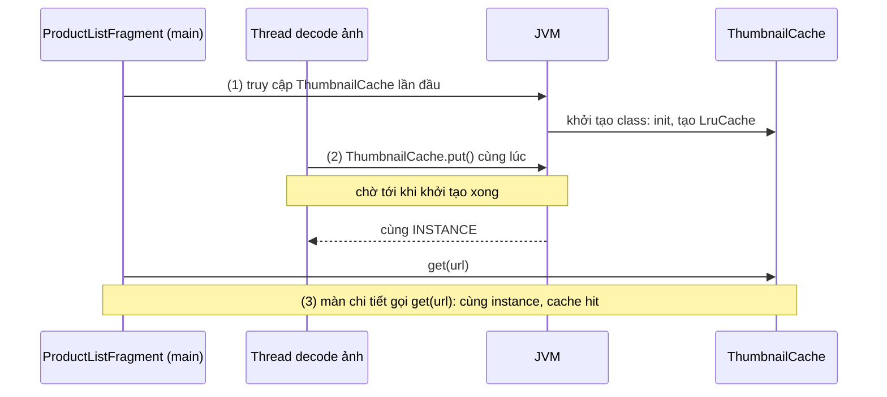
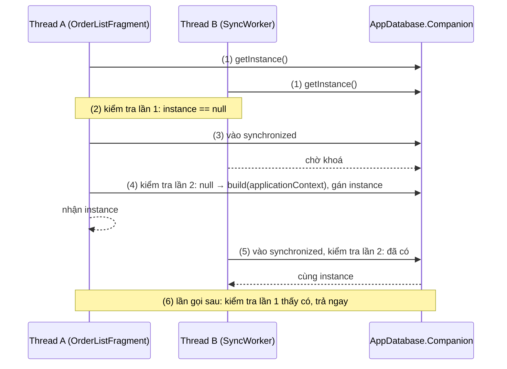
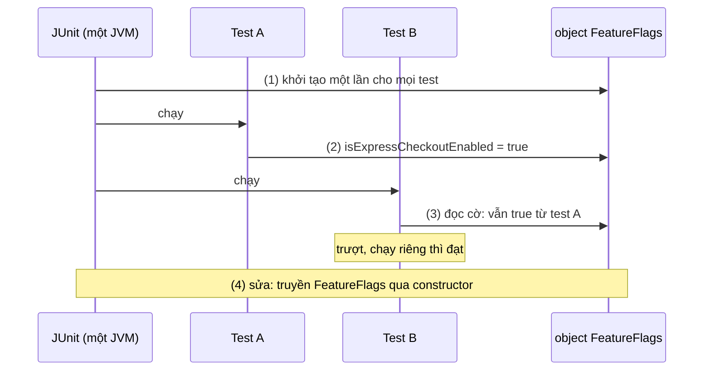
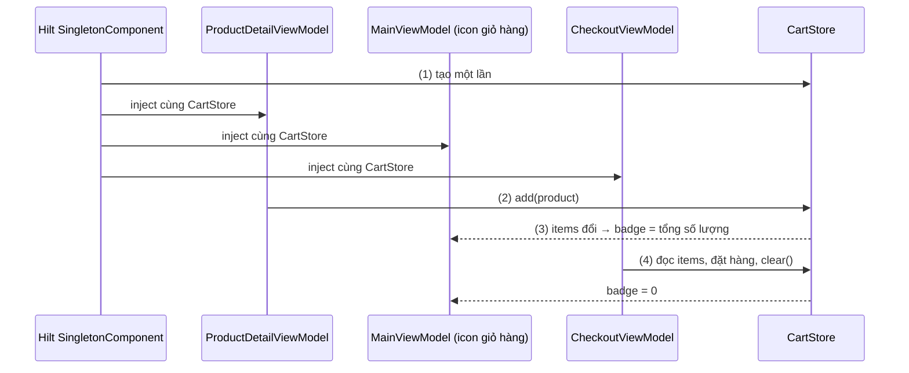

# Singleton Pattern

## Vấn đề cần giải quyết

Một số object trong app phải **có đúng một**: database, HTTP client, kho lưu cài đặt, bộ nhớ đệm ảnh. Nếu mỗi màn hình tự tạo riêng, lỗi xuất hiện ngay:

```kotlin
// OrderListFragment.kt và CartFragment.kt (cách làm có vấn đề): mỗi màn tự tạo database
private val database by lazy {
    Room.databaseBuilder(requireContext(), AppDatabase::class.java, "shop.db").build()
}
```

- **Tốn tài nguyên:** mỗi `AppDatabase` mở kết nối và cache riêng; mỗi `OkHttpClient` có connection pool và thread pool riêng.
- **Dữ liệu lệch nhau:** màn giỏ hàng ghi qua instance của nó, màn danh sách đang quan sát instance khác nên không nhận được thay đổi.
- **Crash:** DataStore phát hiện hai instance cùng mở một file thì ném `IllegalStateException` ([Key-Value Storage](../../session_05/data_store/key_value.md), mục "Sai lầm thường gặp", phần 1).
- **Trạng thái bộ nhớ không nhất quán:** giỏ hàng giữ trong bộ nhớ của màn chi tiết sản phẩm khác giỏ hàng của màn thanh toán.

Vấn đề cần giải quyết là: **bảo đảm một class chỉ có một instance, và mọi nơi cần nó đều lấy được đúng instance đó**, mà không đánh đổi khả năng test và không làm rò rỉ bộ nhớ.

## Sau khi học xong

- Giải thích được hai cam kết của Singleton (một instance, một điểm truy cập chung) và vì sao trên Android "một instance" nghĩa là một instance trong một process.
- Triển khai được Singleton bằng Kotlin object, by lazy và double-checked locking với @Volatile cho class cần tham số như Context.
- Xử lý được Context trong Singleton bằng applicationContext để không giữ Activity sau khi nó bị huỷ.
- Phân biệt được Singleton tự quản (object, getInstance) với instance duy nhất do DI cấp qua scope @Singleton, và biết khi nào chọn cách nào.
- Nhận diện được các sai lầm như giữ Activity Context, trạng thái toàn cục làm test phụ thuộc thứ tự, tin singleton sống qua process death và singleton trong app nhiều process.

## Singleton Pattern là gì?

**Singleton Pattern** là một creational design pattern bảo đảm một class chỉ có **đúng một instance** trong một phạm vi, và cung cấp **một điểm truy cập chung** tới instance đó. Trên Android, phạm vi mặc định là **một process**: instance ra đời khi được dùng lần đầu và mất khi process chết.

Mental model: singleton là **quầy lễ tân duy nhất của một toà nhà**. Ai trong toà nhà (process) cũng đến đúng quầy đó nên thông tin luôn nhất quán. Nhưng toà nhà khác (process khác) có quầy riêng; toà nhà bị phá (process death) thì quầy mất theo; và vì ai cũng đến được quầy, quầy biết chuyện của mọi người (trạng thái toàn cục), nên rất khó thay quầy bằng một quầy giả khi muốn thử nghiệm.

## Cách hoạt động

### Hai cam kết và phạm vi "một instance"

Mọi cách hiện thực Singleton đều làm hai việc:

1. **Chặn việc tạo thêm instance:** constructor `private`, chỉ chính class tạo được instance.
2. **Giữ instance ở một chỗ tĩnh và cho mọi nơi truy cập:** một field static (Java) hoặc một `object` (Kotlin), kèm một accessor như `getInstance()`.

Field static thuộc về class, mà class được nạp **một lần cho mỗi process** (chính xác hơn là mỗi classloader). Vì vậy trên Android:

| Tình huống | Singleton |
|---|---|
| Xoay màn hình, Activity bị tạo lại | **Còn nguyên**, vì process vẫn chạy |
| Người dùng rời app, process vẫn sống trong cache | Còn nguyên |
| Process bị hệ thống kill (thiếu bộ nhớ) rồi người dùng quay lại | **Mới tinh**: process mới, class được nạp lại, mọi trạng thái về giá trị ban đầu ([Activity State Changes](../../session_04/components/activity/state_changes.md), mục "Process Death — toàn bộ app chết") |
| Component chạy trong process khác (`android:process=":sync"`) | **Instance thứ hai**, độc lập với instance của process chính |

Đây là lý do singleton phù hợp để **dùng chung tài nguyên** (database, client, cache tạo lại được), nhưng không phải nơi **lưu dữ liệu cần giữ** (giỏ hàng chưa thanh toán, form đang nhập).

### Kotlin `object`: singleton không cần tham số

Kotlin có sẵn cú pháp cho Singleton: **object declaration**. Compiler sinh một class có constructor `private` và một field static `INSTANCE` được khởi tạo trong khối khởi tạo static của class. Tài liệu Kotlin cam kết: việc khởi tạo một object declaration là **thread-safe** và diễn ra **ở lần truy cập đầu tiên**. Cả hai tính chất đến từ JVM: class chỉ được khởi tạo một lần, và thread nào truy cập trong lúc class đang khởi tạo sẽ phải chờ.

Giới hạn duy nhất: `object` **không có constructor nhận tham số**, nên không nhận được `Context` hay cấu hình lúc chạy. `AppExecutors` ở [Working with Thread](../../session_05/working_with_thread.md), mục "Ví dụ: `AppExecutors` Singleton chuẩn kiến trúc Android" là một `object` điển hình: chỉ cần số nhân CPU, không cần gì từ bên ngoài.

#### Ví dụ: bộ nhớ đệm thumbnail dùng chung giữa các màn

**Bài toán:** danh sách sản phẩm tải thumbnail; mở màn chi tiết thì ảnh nhỏ phải hiện ngay từ bộ nhớ, không tải lại. Cả hai màn phải dùng **cùng một** cache, và cache không cần gì ngoài kích thước heap.

**Luồng chạy:**

1. Màn danh sách gọi `ThumbnailCache.get(url)` lần đầu: JVM khởi tạo class `ThumbnailCache`, chạy khối `init` và tạo `LruCache`.
2. Một thread nền đang decode ảnh gọi `ThumbnailCache.put()` đúng lúc đó: JVM bắt nó chờ khởi tạo xong, nên không có instance thứ hai.
3. Màn chi tiết gọi `ThumbnailCache.get(url)`: cùng instance, ảnh có sẵn.



```kotlin
// ThumbnailCache.kt
object ThumbnailCache {                                                           // một instance cho process

    private val maxSizeKb = (Runtime.getRuntime().maxMemory() / 1024 / 8).toInt() // 1/8 heap của app

    private val cache = object : LruCache<String, Bitmap>(maxSizeKb) {
        override fun sizeOf(key: String, value: Bitmap): Int = value.byteCount / 1024
    }

    init {
        Log.d("ThumbnailCache", "init trên ${Thread.currentThread().name}")       // (1) chạy đúng một lần
    }

    fun get(url: String): Bitmap? = cache.get(url)                                // (3)

    fun put(url: String, bitmap: Bitmap) {                                        // (2) gọi từ thread nền
        cache.put(url, bitmap)
    }
}
```

`object` chỉ bảo đảm việc **khởi tạo** an toàn khi nhiều thread cùng truy cập. Các hàm sau đó có an toàn hay không là việc của bạn: ở đây `android.util.LruCache` tự đồng bộ hoá các thao tác của nó, nên `get()`/`put()` gọi từ nhiều thread được. Một `object` giữ `MutableMap` thường thì phải tự đồng bộ ([Working with Thread](../../session_05/working_with_thread.md), mục "Race Condition và đồng bộ hoá dữ liệu dùng chung"). Code Java gọi object qua `ThumbnailCache.INSTANCE.get(url)`, hoặc `ThumbnailCache.get(url)` nếu hàm có `@JvmStatic`.

**Kết quả:** Logcat có đúng một dòng `init`, dù danh sách và thread nền truy cập gần như cùng lúc. Mở màn chi tiết, thumbnail hiện ngay. Kill process từ Android Studio rồi mở lại app: dòng `init` xuất hiện lại và cache rỗng, đúng như phạm vi "một process".

### Singleton cần tham số: double-checked locking và `by lazy`

Room database cần `Context` để biết thư mục lưu file, nên không viết được bằng `object`. Tài liệu Room khuyên: nếu app chạy trong một process, hãy theo Singleton khi tạo `AppDatabase`, vì mỗi instance khá tốn kém và hiếm khi cần nhiều instance. Cách viết quen thuộc là **double-checked locking** (kiểm tra hai lần có khoá):

- **Kiểm tra lần 1, không khoá:** đa số lần gọi thấy instance đã có và trả về ngay, không tốn chi phí khoá.
- **Kiểm tra lần 2, trong `synchronized`:** chỉ một thread được tạo instance; thread khác vào sau phải thấy instance đã được tạo.
- **`@Volatile`:** bảo đảm instance mà một thread ghi được thread khác nhìn thấy ngay và đầy đủ. Thiếu nó, thread khác có thể đọc giá trị cũ (`null`) hoặc, trên JVM cũ, một object chưa khởi tạo xong. Visibility và `@Volatile` đã giải thích ở [Working with Thread](../../session_05/working_with_thread.md), mục "Các giải pháp bảo vệ dữ liệu".

#### Ví dụ: một `AppDatabase` cho cả app

**Bài toán:** màn đơn hàng (main thread) và một worker đồng bộ (thread nền) cùng gọi `AppDatabase.getInstance()` lúc app vừa mở. Phải chỉ có một database được tạo, và database không được giữ Activity.

**Luồng chạy:**

1. Hai thread gọi `getInstance(context)` gần như cùng lúc.
2. Cả hai kiểm tra lần 1 (không khoá): `instance` còn `null`.
3. Thread A vào khối `synchronized`; thread B phải chờ khoá.
4. A kiểm tra lần 2: vẫn `null`, nên build database bằng `context.applicationContext`, gán vào `instance`.
5. A nhả khoá; B vào, kiểm tra lần 2 thấy `instance` khác `null` và trả về **cùng** instance.
6. Mọi lần gọi sau dừng ở kiểm tra lần 1, không khoá.



```kotlin
// AppDatabase.kt
@Database(entities = [Order::class, Product::class], version = 3)
abstract class AppDatabase : RoomDatabase() {

    abstract fun orderDao(): OrderDao

    companion object {
        @Volatile                                                       // ghi xong là thread khác thấy
        private var instance: AppDatabase? = null

        fun getInstance(context: Context): AppDatabase =
            instance ?: synchronized(this) {                            // (2) lần 1 không khoá, (3) vào khoá
                instance ?: Room.databaseBuilder(                       // (4)(5) kiểm tra lần 2 trong khoá
                    context.applicationContext,                         // không giữ Activity
                    AppDatabase::class.java,
                    "shop.db"
                ).build().also { instance = it }                        // (4) gán một lần
            }
    }
}
```

`Room.databaseBuilder(...)` là một builder ([Builder Pattern](builder_pattern.md)): Singleton quyết định **bao nhiêu** instance, Builder quyết định instance đó **được cấu hình thế nào**.

**Kết quả:** đặt breakpoint ở `build()`: nó dừng đúng một lần dù nhiều thread gọi `getInstance()`. Bỏ lần kiểm tra thứ hai thì thread B cũng build, và app có hai `AppDatabase`; bỏ `@Volatile` thì code vẫn chạy trong đa số lần thử, nên lỗi rất khó tái hiện.

`by lazy` là cách ngắn hơn khi đã có sẵn chỗ chứa tham số. Ở chế độ mặc định `LazyThreadSafetyMode.SYNCHRONIZED`, `lazy` dùng chính kỹ thuật kiểm tra hai lần với field volatile bên trong, nên `val database by lazy { ... }` cho cùng bảo đảm mà không phải tự viết khoá. Chi phí của `lazy` đã nói ở [Kotlin](../../session_01/languages/kotlin.md), mục "Chi phí ẩn của tính năng Kotlin".

### `Application` làm nơi giữ instance dùng chung

`Application` được hệ thống tạo **một lần cho mỗi process, trước mọi Activity, Service, Receiver** ([Manifest tags](../../session_04/android_manifest/tags.md), mục "Application class (`android:name`)"), và có sẵn `Context` sống bằng process. Vì vậy nó là chỗ tự nhiên để giữ các instance dùng chung:

```kotlin
// ShopApplication.kt
class ShopApplication : Application() {
    val database: AppDatabase by lazy {
        Room.databaseBuilder(this, AppDatabase::class.java, "shop.db").build()
    }
}

// Ở bất kỳ component nào có Context
val database = (context.applicationContext as ShopApplication).database
```

Tài liệu của class `Application` lại ghi rằng thường **không cần** kế thừa nó: trong đa số trường hợp, static singleton cho cùng chức năng một cách mô-đun hơn, và nếu singleton cần context toàn cục thì truyền `Context.getApplicationContext()` vào `getInstance()`. Hai cách không loại trừ nhau. Cách mà các bài trước đã dùng là gom mọi instance vào **một container** thuộc `Application` (`ShopApplication.container` ở [ViewModel](../../session_06/viewmodel.md), mục "Factory và CreationExtras: ViewModel có dependency"): đó là manual dependency injection, bước đầu tiên của mục cuối phần này.

### Context, trạng thái toàn cục và test

Singleton sống bằng process, nên mọi thứ nó giữ cũng sống bằng process. Hai hệ quả:

- **Leak Context:** singleton giữ một `Activity` (kể cả gián tiếp qua View, Fragment, listener hay lambda của màn hình) thì Activity đó và cả cây View không bao giờ được thu hồi, kể cả sau khi bị huỷ. Quy tắc: singleton chỉ giữ `applicationContext`, và listener của UI phải được gỡ khi UI bị huỷ.
- **Trạng thái toàn cục:** mọi class có thể đọc và ghi singleton mà không khai báo phụ thuộc đó trong constructor. Code khó đọc (không nhìn constructor là biết class cần gì), và khó test (không thay được bằng bản giả, trạng thái còn lại từ test trước).

#### Ví dụ: cờ tính năng làm test lúc đạt lúc trượt

**Bài toán:** màn thanh toán hiện thêm lựa chọn "Giao nhanh" khi cờ tính năng bật. Cờ được giữ trong một `object` để mọi nơi đọc được. Hai unit test kiểm tra hai trường hợp bật và tắt.

**Luồng chạy:**

1. JUnit chạy mọi test của module trong cùng một JVM, nên `FeatureFlags` chỉ được khởi tạo một lần cho tất cả test.
2. Test A bật cờ rồi kiểm tra có hai lựa chọn: đạt.
3. Test B chạy sau A, giả định cờ đang tắt (giá trị mặc định), nhưng cờ vẫn bật từ test A: trượt. Chạy riêng test B thì đạt.
4. Sửa: `CheckoutViewModel` nhận `FeatureFlags` qua constructor; mỗi test tạo bản giả riêng.



```kotlin
// Cách có vấn đề: ViewModel tự với tới trạng thái toàn cục
object FeatureFlags {
    var isExpressCheckoutEnabled = false
}

class CheckoutViewModel : ViewModel() {
    fun shippingOptions(): List<ShippingOption> =
        if (FeatureFlags.isExpressCheckoutEnabled) listOf(ShippingOption.STANDARD, ShippingOption.EXPRESS)
        else listOf(ShippingOption.STANDARD)
}

class CheckoutViewModelTest {
    @Test fun expressEnabled_showsTwoOptions() {
        FeatureFlags.isExpressCheckoutEnabled = true                                   // (2)
        assertEquals(2, CheckoutViewModel().shippingOptions().size)
    }

    @Test fun byDefault_showsStandardOnly() {
        assertEquals(1, CheckoutViewModel().shippingOptions().size)                    // (3) phụ thuộc thứ tự
    }
}
```

```kotlin
// Cách sửa: (4) phụ thuộc hiện ra ở constructor
interface FeatureFlags {
    val isExpressCheckoutEnabled: Boolean
}

class CheckoutViewModel(private val flags: FeatureFlags) : ViewModel() {
    fun shippingOptions(): List<ShippingOption> =
        if (flags.isExpressCheckoutEnabled) listOf(ShippingOption.STANDARD, ShippingOption.EXPRESS)
        else listOf(ShippingOption.STANDARD)
}

class FakeFeatureFlags(override val isExpressCheckoutEnabled: Boolean = false) : FeatureFlags

// Test: CheckoutViewModel(FakeFeatureFlags(isExpressCheckoutEnabled = true))
```

**Kết quả:** sau khi sửa, mỗi test tự tạo bản giả nên kết quả không đổi dù chạy theo thứ tự nào. Ở bản chạy thật, app vẫn chỉ có **một** implementation của `FeatureFlags` (đọc remote config), được tạo một lần và truyền vào: yêu cầu "một instance" vẫn giữ, chỉ bỏ đi "mọi nơi tự với tới".

### Thay bằng scope của DI: `@Singleton`

Ví dụ trên tách Singleton thành hai ý:

- **Chỉ có một instance:** đây là yêu cầu thật của database, client, cache.
- **Class tự giữ instance và mọi nơi tự lấy nó:** đây là phần gây leak, khó test, phụ thuộc ẩn.

Dependency Injection giữ ý thứ nhất và bỏ ý thứ hai: một **container** tạo instance đúng một lần trong một **scope** (phạm vi sống), rồi truyền nó vào constructor của class cần. Class không biết instance là duy nhất; nó chỉ nhận một tham số. Khái niệm container và scope là chủ đề của [Dependency Injection Overview](di/overview.md).

Hilt (thư viện DI của Jetpack, học ở [Hilt](di/hilt.md)) có scope `@Singleton` gắn với `SingletonComponent`, component được tạo ở `Application#onCreate()` và sống tới khi `Application` bị huỷ, tức đúng phạm vi một process như singleton tự viết:

```kotlin
// DatabaseModule.kt
@Module
@InstallIn(SingletonComponent::class)
object DatabaseModule {

    @Provides
    @Singleton                                              // một instance cho cả SingletonComponent
    fun provideDatabase(@ApplicationContext context: Context): AppDatabase =
        Room.databaseBuilder(context, AppDatabase::class.java, "shop.db").build()

    @Provides
    fun provideOrderDao(database: AppDatabase): OrderDao = database.orderDao()
}

// OrderRepository.kt: không biết AppDatabase là duy nhất, chỉ nhận OrderDao
class OrderRepository @Inject constructor(private val orderDao: OrderDao)
```

`@ApplicationContext` bảo đảm Hilt chỉ đưa `applicationContext`, nên lỗi leak Activity không xảy ra. Tài liệu Hilt nhắc rằng gắn scope cho một binding có chi phí, vì object nằm trong bộ nhớ tới khi component bị huỷ: chỉ dùng `@Singleton` cho object có trạng thái cần dùng chung, cần đồng bộ, hoặc đã đo được là tạo ra tốn kém.

| Cách | Nhận tham số | Thay trong test | Ai quản vòng đời |
|---|---|---|---|
| `object` | Không | Khó (trạng thái dùng chung giữa các test) | JVM, theo class |
| `companion object` + `getInstance()` (double-checked locking) | Có | Khó, phải thêm hàm reset riêng cho test | Chính class |
| `Application` + `by lazy` | Có (`Context` của Application) | Khó, cần Application giả | `Application` |
| DI scope `@Singleton` | Có | Dễ: truyền bản giả qua constructor | Container (Hilt, Koin, manual) |

## Ví dụ thực tế

Ba bài toán hay gặp cần "một instance" trong app Android:

1. **Giỏ hàng trong bộ nhớ dùng chung giữa nhiều màn**, cấp qua `@Singleton` của Hilt, có unit test. Đây là bài toán chính, code đầy đủ bên dưới.
2. **Một DataStore cho mỗi file:** khai báo property delegate `preferencesDataStore` ở top-level, hoặc `@Singleton` trong module Hilt, như [Key-Value Storage](../../session_05/data_store/key_value.md), mục "Hilt module — cung cấp DataStore và Repository".
3. **Một `OkHttpClient` cho cả app:** tạo một lần rồi dùng chung; endpoint cần cấu hình khác thì `newBuilder()` ([Networking](../../session_05/networking.md), mục "Sai lầm thường gặp", phần 2).

### Giỏ hàng dùng chung với `@Singleton`

**Bài toán:** người dùng thêm sản phẩm ở màn chi tiết; icon giỏ hàng trên thanh điều hướng của `MainActivity` phải cập nhật số lượng ngay; màn thanh toán đọc cùng giỏ hàng và xoá nó sau khi đặt hàng. Ba màn có ba ViewModel khác nhau, nên giỏ hàng phải là **một** instance nằm ngoài các ViewModel.

> [!NOTE]
> Kiến thức dùng trước: `@HiltViewModel`, `@Inject` là annotation của Hilt để tạo và cấp object, học ở [Hilt](di/hilt.md). `StateFlow` là dòng dữ liệu luôn có giá trị hiện tại, `map`/`stateIn` là toán tử của nó, học ở [Flow](observer/flow.md).

**Luồng chạy:**

1. Lần đầu có class cần `CartStore`, Hilt tạo nó trong `SingletonComponent`; mọi lần sau Hilt đưa lại đúng instance đó.
2. `ProductDetailViewModel` nhận `CartStore` qua constructor; người dùng bấm "Thêm vào giỏ" thì gọi `add()`.
3. `MainViewModel` quan sát `cartStore.items` và đưa ra số lượng cho icon giỏ hàng.
4. `CheckoutViewModel` đọc `items`, đặt hàng xong thì `clear()`.
5. Unit test tạo `CartStore()` mới cho mỗi test, không cần Hilt.



```kotlin
// CartStore.kt
data class Product(val id: String, val name: String, val price: Long)
data class CartItem(val productId: String, val name: String, val unitPrice: Long, val quantity: Int)

@Singleton                                                                   // (1) một instance cho process
class CartStore @Inject constructor() {

    private val _items = MutableStateFlow<Map<String, CartItem>>(emptyMap())
    val items: StateFlow<Map<String, CartItem>> = _items.asStateFlow()

    fun add(product: Product) {                                              // (2)
        _items.update { current ->                                           // update: đọc-sửa-ghi nguyên tử
            val existing = current[product.id]
            val item = existing?.copy(quantity = existing.quantity + 1)
                ?: CartItem(product.id, product.name, product.price, quantity = 1)
            current + (product.id to item)
        }
    }

    fun clear() {                                                            // (4)
        _items.value = emptyMap()
    }
}
```

```kotlin
// ProductDetailViewModel.kt
@HiltViewModel
class ProductDetailViewModel @Inject constructor(
    private val cartStore: CartStore                                         // (2) cùng instance
) : ViewModel() {
    fun onAddToCartClick(product: Product) = cartStore.add(product)
}

// MainViewModel.kt
@HiltViewModel
class MainViewModel @Inject constructor(cartStore: CartStore) : ViewModel() {
    val cartBadgeCount: StateFlow<Int> = cartStore.items                     // (3)
        .map { items -> items.values.sumOf { it.quantity } }
        .stateIn(viewModelScope, SharingStarted.WhileSubscribed(5_000), 0)
}
```

`MutableStateFlow.update` thực hiện đọc-sửa-ghi một cách nguyên tử, nên hai lần bấm "Thêm vào giỏ" từ hai thread không làm mất một lần cộng. `CheckoutViewModel` theo cùng mẫu: nhận `CartStore` qua constructor, đọc `items.value` khi đặt hàng rồi gọi `clear()`.

```kotlin
// CartStoreTest.kt (src/test): (5) mỗi test một instance mới, không cần Hilt
class CartStoreTest {

    private val milkTea = Product(id = "sku-1", name = "Trà sữa", price = 35_000)

    @Test
    fun addSameProductTwice_increasesQuantity() {
        val store = CartStore()
        store.add(milkTea)
        store.add(milkTea)
        assertEquals(2, store.items.value.getValue("sku-1").quantity)
    }

    @Test
    fun clear_emptiesCart() {
        val store = CartStore()
        store.add(milkTea)
        store.clear()
        assertTrue(store.items.value.isEmpty())
    }
}
```

**Kết quả:** thêm một ly trà sữa ở màn chi tiết thì icon giỏ hàng hiện 1 ngay, không cần truyền dữ liệu giữa các màn; đặt hàng xong icon về 0. Hai test luôn đạt bất kể thứ tự, vì không dùng chung trạng thái. Kill process khi giỏ đang có hàng rồi mở lại app: giỏ rỗng. Nếu sản phẩm cần giữ giỏ hàng qua process death, `CartStore` phải ghi xuống Room hoặc DataStore; singleton chỉ là nơi dùng chung, không phải nơi lưu.

## Khi nào nên và không nên dùng

- **Nên có một instance** cho tài nguyên tốn kém hoặc phải duy nhất: database, HTTP client, DataStore, cache trong bộ nhớ, thread pool.
- **Nên dùng `object`** cho tiện ích không trạng thái hoặc trạng thái tạo lại được, không cần tham số, ít khi cần thay trong test (formatter, `AppExecutors`, cache thumbnail).
- **Nên để DI cấp** (`@Singleton` hoặc container trong `Application`) cho mọi thứ mà class khác phụ thuộc và cần thay bằng bản giả khi test: Repository, `CartStore`, `FeatureFlags`.
- **Không nên** dùng singleton làm nơi truyền dữ liệu giữa các màn hình hoặc lưu dữ liệu người dùng: process death xoá sạch nó. Dùng argument, `SavedStateHandle` hoặc lưu trữ bền.
- **Không nên** để singleton giữ Activity, Fragment, View hoặc listener của UI.

## Sai lầm thường gặp

### 1. Truyền Activity vào `getInstance()` rồi giữ nó

```kotlin
// Sai: singleton giữ Context được truyền vào
class SessionManager private constructor(private val context: Context) {
    companion object {
        @Volatile private var instance: SessionManager? = null
        fun getInstance(context: Context) =
            instance ?: synchronized(this) { instance ?: SessionManager(context).also { instance = it } }
    }
}
// LoginActivity: SessionManager.getInstance(this)
```

**Lỗi lộ ra thế nào:** `LoginActivity` là nơi đầu tiên gọi, nên singleton giữ chính Activity đó mãi mãi. Sau khi đăng nhập xong và Activity bị huỷ, LeakCanary báo `LoginActivity` bị `SessionManager.context` giữ, kèm toàn bộ cây View của nó.

**Cách sửa:** lưu `context.applicationContext` thay vì `context`; với Hilt, nhận `@ApplicationContext context: Context`.

### 2. Double-checked locking thiếu `@Volatile` hoặc thiếu lần kiểm tra thứ hai

```kotlin
// Sai: kiểm tra một lần, rồi khoá
fun getInstance(context: Context): AppDatabase {
    if (instance == null) {
        synchronized(this) { instance = build(context.applicationContext) }
    }
    return instance!!
}
```

**Lỗi lộ ra thế nào:** hai thread cùng thấy `null` ở lần kiểm tra duy nhất, lần lượt vào khoá và **cùng** build: app có hai `AppDatabase`, ghi ở instance này không phát cập nhật cho Flow đang quan sát instance kia. Thiếu `@Volatile` thì lỗi hiếm hơn, chỉ lộ trên một số thiết bị, nên gần như không tái hiện được.

**Cách sửa:** kiểm tra lại bên trong `synchronized` và đánh dấu field `@Volatile` như ví dụ `AppDatabase`, hoặc dùng `by lazy` để không phải tự viết.

### 3. Dùng singleton để truyền dữ liệu giữa các màn hình

```kotlin
// Sai: màn danh sách đặt, màn chi tiết đọc
object SelectedOrderHolder { var order: Order? = null }
// OrderDetailFragment: val order = SelectedOrderHolder.order!!
```

**Lỗi lộ ra thế nào:** chạy bình thường mọi lần thử, cho tới khi người dùng để app ở background lâu, process bị kill, rồi quay lại: hệ thống khôi phục thẳng màn chi tiết, `SelectedOrderHolder` là object mới với `order = null`, và `!!` crash. Bật "Don't keep activities" không tái hiện được lỗi này vì process vẫn sống.

**Cách sửa:** truyền id qua argument của màn hình, đọc từ `SavedStateHandle` và tải lại từ Repository ([ViewModel](../../session_06/viewmodel.md), mục "Factory và CreationExtras: ViewModel có dependency"). Cách tái hiện process death nằm ở [Activity State Changes](../../session_04/components/activity/state_changes.md), mục "Process Death — hiểu và test".

### 4. Quên rằng mỗi process có singleton riêng

```xml
<!-- AndroidManifest.xml: worker đồng bộ chạy ở process riêng -->
<service
    android:name=".sync.SyncService"
    android:process=":sync" />
```

**Lỗi lộ ra thế nào:** `SyncService` gọi `AppDatabase.getInstance()` và nhận một instance **khác** với process chính. Nó ghi đơn hàng mới, nhưng màn danh sách ở process chính không cập nhật, vì cơ chế báo thay đổi của Room nằm trong từng instance. Cache trong `object` cũng tách đôi.

**Cách sửa:** tránh nhiều process nếu không thật sự cần. Nếu cần, bật `enableMultiInstanceInvalidation()` trong builder của Room như tài liệu Room hướng dẫn, và không dựa vào trạng thái trong bộ nhớ để chia sẻ giữa các process.

### 5. `object` với `lateinit var` phải được khởi tạo từ bên ngoài

```kotlin
// Sai: giả lập "singleton có tham số" bằng lateinit
object ApiClient {
    lateinit var baseUrl: String
    val retrofit by lazy { Retrofit.Builder().baseUrl(baseUrl).build() }
}
// ShopApplication.onCreate(): ApiClient.baseUrl = BuildConfig.API_URL
```

**Lỗi lộ ra thế nào:** mọi chỗ dùng `ApiClient` ngầm phụ thuộc vào việc `Application.onCreate()` đã chạy dòng gán. Một `ContentProvider` (được tạo **trước** `Application.onCreate()`) hoặc một unit test dùng `ApiClient` sẽ crash `UninitializedPropertyAccessException`; đổi thứ tự khởi tạo trong `onCreate()` cũng gây lỗi tương tự.

**Cách sửa:** class cần tham số thì nhận tham số qua constructor và để container (DI hoặc `Application`) tạo nó một lần, thay vì một `object` chờ được "nạp" tham số.

## Lịch sử phát triển

- **10/1994:** sách *Design Patterns* của nhóm "Gang of Four" mô tả Singleton là một trong năm creational pattern: "bảo đảm class chỉ có một instance và cung cấp một điểm truy cập toàn cục tới nó".
- **Cuối thập niên 1990 – đầu 2000:** double-checked locking trong Java được chứng minh là không an toàn với memory model cũ; tuyên bố "Double-Checked Locking is Broken" của nhóm Bill Pugh giải thích vì sao thread khác có thể thấy object chưa khởi tạo xong.
- **Java 5 (09/2004):** memory model mới (JSR-133) định nghĩa lại `volatile`; double-checked locking với field `volatile` trở nên đúng.
- **2008:** *Effective Java* bản thứ hai khuyên hiện thực Singleton bằng `enum` một phần tử trong Java.
- **Android 1.0 (API 1, 2008):** class `Application`; tài liệu của nó ghi chú rằng static singleton thường là cách mô-đun hơn so với kế thừa `Application`.
- **2015:** Dagger 2 (Google) ra mắt, scope `@Singleton` được kiểm tra lúc compile: instance duy nhất do container quản, không còn do class tự giữ.
- **Kotlin 1.0 (02/2016):** object declaration và `lazy` thành cú pháp chuẩn cho Singleton.
- **Room 1.0 (11/2017):** tài liệu Room khuyên dùng một instance `RoomDatabase` cho mỗi process, phổ biến mẫu `getInstance()` với double-checked locking.
- **Hilt (alpha 06/2020, stable 04/2021):** `SingletonComponent` và `@Singleton` thành cách khuyên dùng để có instance dùng chung trong app Android.

## Kết nối hệ thống

- **Tiên quyết:**
  - [Kotlin](../../session_01/languages/kotlin.md): `companion object`, `by lazy` và chi phí của nó.
  - [Working with Thread](../../session_05/working_with_thread.md): race condition, `@Volatile`, `synchronized`, ví dụ `AppExecutors`.
- **Liên quan:**
  - [Activity State Changes](../../session_04/components/activity/state_changes.md): process death xoá singleton.
  - [Manifest tags](../../session_04/android_manifest/tags.md): class `Application` và thuộc tính `android:process`.
  - [Room Architecture](../../session_05/data_store/room_architecture.md), [Key-Value Storage](../../session_05/data_store/key_value.md), [Networking](../../session_05/networking.md): database, DataStore, HTTP client dùng một instance.
  - [Unit Testing](../../coding_analyst_and_testing/unit_testing.md): vì sao trạng thái toàn cục làm test không độc lập.
  - [Builder Pattern](builder_pattern.md): cấu hình instance mà Singleton giữ.
- **Học tiếp:**
  - [Dependency Injection Overview](di/overview.md): container, scope, manual DI.
  - [Hilt](di/hilt.md): `SingletonComponent`, `@Singleton`, `@ApplicationContext`.

## Tham khảo

- [Object declarations and expressions - Kotlin](https://kotlinlang.org/docs/object-declarations.html)
- [Application (ghi chú về static singleton) - Android Developers](https://developer.android.com/reference/android/app/Application)
- [Save data in a local database using Room (singleton AppDatabase) - Android Developers](https://developer.android.com/training/data-storage/room)
- [Dependency injection with Hilt (component scopes) - Android Developers](https://developer.android.com/training/dependency-injection/hilt-android)
- [LruCache - Android Developers](https://developer.android.com/reference/android/util/LruCache)
- [The "Double-Checked Locking is Broken" Declaration - University of Maryland](https://www.cs.umd.edu/~pugh/java/memoryModel/DoubleCheckedLocking.html)
- [JSR 133 (Java Memory Model) FAQ - University of Maryland](https://www.cs.umd.edu/~pugh/java/memoryModel/jsr-133-faq.html)
- [Dagger releases (2.28 Hilt alpha, 2.35 Hilt stable) - GitHub](https://github.com/google/dagger/releases)
