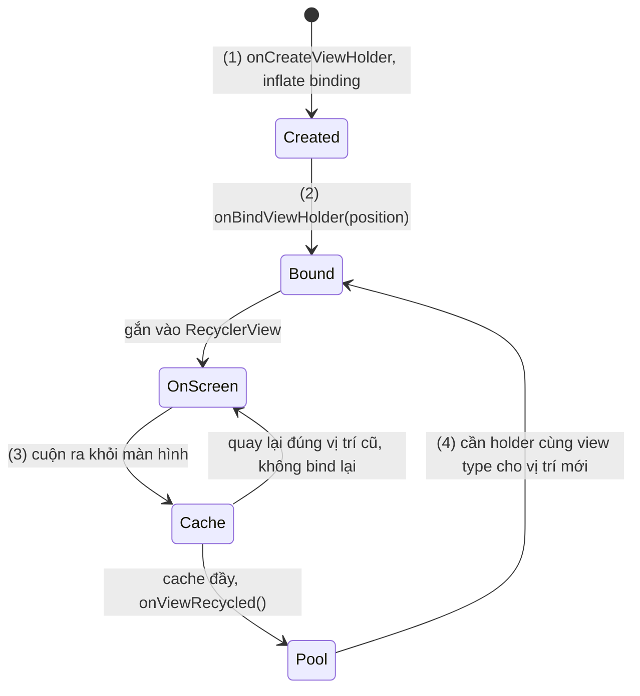
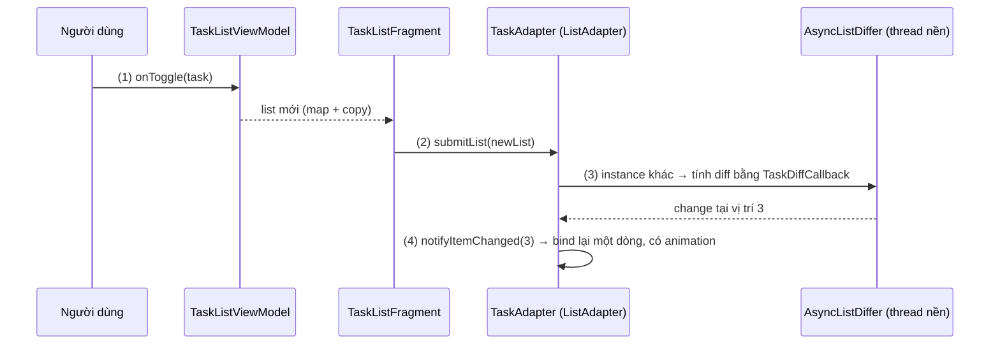
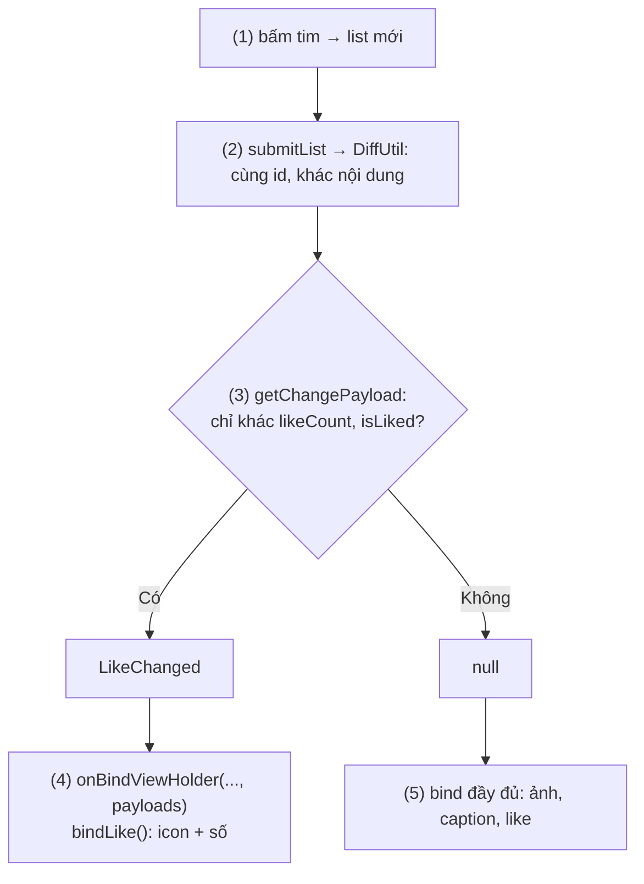
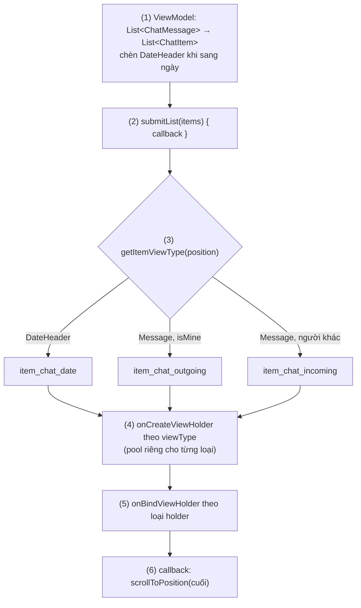

# ViewHolder Pattern

## Vấn đề cần giải quyết

Danh sách trong app có thể có hàng nghìn dòng (danh bạ, tin nhắn, sản phẩm), nhưng màn hình chỉ hiện khoảng mười dòng một lúc. Cách viết ngây thơ là tạo View cho từng dòng mỗi lần dòng đó xuất hiện:

```kotlin
// ProductListAdapter.kt (ListView, cách làm có vấn đề)
override fun getView(position: Int, convertView: View?, parent: ViewGroup): View {
    val view = LayoutInflater.from(parent.context)
        .inflate(R.layout.item_product, parent, false)                    // inflate lại mỗi lần
    view.findViewById<TextView>(R.id.name_text).text = products[position].name   // duyệt cây View
    view.findViewById<TextView>(R.id.price_text).text = formatPrice(products[position].price)
    return view
}
```

Khi người dùng cuộn nhanh, mỗi dòng mới hiện ra tốn:

- **Inflate:** đọc layout XML đã biên dịch và tạo mới mọi object View của dòng. Đây là thao tác đắt nhất.
- **`findViewById`:** mỗi lần gọi duyệt cây View của dòng để tìm id.
- **Rác cho GC:** View của dòng vừa cuộn qua bị bỏ đi, GC phải dọn.

Tất cả chạy trên main thread, trong ngân sách khoảng 16.6 ms mỗi frame ở 60 Hz ([Working with Thread](../../session_05/working_with_thread.md), mục "Vòng lặp Frame 16.6ms / 8.3ms và sự hình thành của Lag"). Vượt ngân sách là danh sách giật. Vấn đề cần giải quyết là: **hiển thị danh sách dài chỉ với số View đủ cho phần đang nhìn thấy, và đổi nội dung của chúng thật rẻ khi cuộn.**

## Sau khi học xong

- Giải thích được vì sao ViewHolder tồn tại (chi phí inflate và findViewById khi cuộn) và cách RecyclerView tạo, bind, tái chế ViewHolder.
- Triển khai được RecyclerView.Adapter và ListAdapter với DiffUtil.ItemCallback, trong đó ViewHolder giữ binding của item.
- Xử lý được trạng thái của View khi ViewHolder được tái sử dụng, bằng cách đặt lại mọi thuộc tính trong bind và lấy vị trí bằng bindingAdapterPosition.
- Áp dụng được nhiều view type, stable id và payload để hiển thị nhiều loại item và cập nhật một phần item mà không bind lại toàn bộ.
- Nhận diện được các sai lầm như bind thiếu nhánh else, notifyDataSetChanged cho mọi thay đổi, submitList cùng một list đã sửa và giữ position trong listener.

## ViewHolder Pattern là gì?

**ViewHolder Pattern** là cách tổ chức danh sách cuộn trong đó mỗi item đang hiển thị là một **ViewHolder**: object giữ sẵn cây View của một item cùng tham chiếu tới các View con. ViewHolder được tạo một lần, rồi **tái sử dụng** cho item khác bằng cách **bind** (gán dữ liệu của item vào các View) lại khi người dùng cuộn.

Mental model: ViewHolder là **khung tranh trong một phòng triển lãm có số khung cố định**. Phòng chỉ có đủ khung cho những bức đang được nhìn thấy. Khi người xem đi tiếp, khung ở phía sau được tháo tranh cũ, lồng tranh mới và mang lên phía trước. Lồng tranh mới phải thay **toàn bộ** nội dung khung: để sót tấm nhãn của bức cũ thì người xem đọc nhầm nhãn.

## Cách hoạt động

### Từ ListView đến RecyclerView

`ListView` có từ Android 1.0 và đã có cơ chế tái sử dụng: tham số `convertView` của `getView()` là một View cũ vừa cuộn ra khỏi màn hình. Nhưng tái sử dụng là **tuỳ chọn**: adapter phải tự kiểm tra `convertView`, và ViewHolder chỉ là một mẹo được khuyên dùng, gắn vào View bằng `setTag()` để khỏi `findViewById` lại:

```kotlin
// ListView: ViewHolder là mẹo tự nguyện, gắn bằng setTag()
override fun getView(position: Int, convertView: View?, parent: ViewGroup): View {
    val view = convertView ?: LayoutInflater.from(parent.context).inflate(R.layout.item_product, parent, false)
        .also { it.tag = ProductViewHolder(it) }                  // chỉ khi tạo mới
    (view.tag as ProductViewHolder).bind(products[position])      // tái sử dụng tham chiếu
    return view
}
```

`RecyclerView` (2014) biến mẹo đó thành **bắt buộc**: adapter không trả View mà trả `RecyclerView.ViewHolder`, và RecyclerView tự quyết định khi nào tạo, khi nào tái sử dụng. Nó còn tách các trách nhiệm mà `ListView` gộp chung:

| Trách nhiệm | Thành phần |
|---|---|
| Tạo và bind ViewHolder | `RecyclerView.Adapter` (bài này) |
| Sắp xếp item: dọc, ngang, lưới | `LayoutManager` (`LinearLayoutManager`, `GridLayoutManager`...) |
| Đường kẻ, khoảng cách giữa item | `ItemDecoration` |
| Animation thêm, xoá, đổi item | `ItemAnimator` (mặc định `DefaultItemAnimator`) |
| Giữ và cấp lại ViewHolder | `RecyclerView.Recycler` và `RecycledViewPool` |

Ranh giới với 8.5.1 Layouts (chưa có bài): bài này dạy Adapter, ViewHolder, `DiffUtil`, `ListAdapter`, view type, stable id và payload; 8.5.1 chỉ dạy RecyclerView ở góc độ bố cục, gồm `LayoutManager`, `ItemDecoration` và `ItemAnimator`.

### `RecyclerView.Adapter` và vòng đời ViewHolder

Adapter override ba hàm:

- **`onCreateViewHolder(parent, viewType)`:** inflate layout của item và tạo ViewHolder **chưa có dữ liệu**. Chỉ được gọi khi không còn ViewHolder nào dùng lại được.
- **`onBindViewHolder(holder, position)`:** lấy item ở `position` và gán vào View của holder. Được gọi mỗi khi một holder cần hiện một item.
- **`getItemCount()`:** số item, để RecyclerView biết khi nào hết danh sách.

Khi cần một ViewHolder cho vị trí N, `RecyclerView.Recycler` tìm theo thứ tự: **scrap** (holder tạm tháo ra trong lúc layout lại) → **cache** (vài holder vừa cuộn ra khỏi màn hình, mặc định 2, vẫn giữ dữ liệu của vị trí cũ nên quay lại đúng vị trí đó thì không cần bind lại) → **`RecycledViewPool`** (holder đã "rửa sạch", chia theo view type, mặc định tối đa 5 mỗi loại, **phải bind lại**) → cuối cùng mới gọi `onCreateViewHolder()`. Holder bị đẩy từ cache sang pool thì adapter nhận `onViewRecycled(holder)`, chỗ để giải phóng tài nguyên nặng như request tải ảnh.

#### Ví dụ: danh bạ một nghìn liên hệ

**Bài toán:** màn danh bạ hiện 1.000 liên hệ, mỗi dòng có tên và số điện thoại, bấm vào thì mở chi tiết. Muốn thấy tận mắt rằng số ViewHolder được tạo chỉ xấp xỉ số dòng trên màn hình, còn số lần bind tăng theo quãng đường cuộn.

**Luồng chạy:**

1. Lần đầu hiển thị, `LayoutManager` cần đủ dòng để lấp màn hình; mỗi dòng chưa có holder, nên adapter `onCreateViewHolder()`: inflate `ItemContactBinding` và gắn click listener **một lần**.
2. Ngay sau đó `onBindViewHolder(holder, position)` gán tên và số điện thoại.
3. Người dùng cuộn xuống: dòng ở trên ra khỏi màn hình, holder vào cache; cache đầy thì holder cũ nhất sang `RecycledViewPool` và adapter nhận `onViewRecycled()`.
4. Dòng mới xuất hiện ở dưới: Recycler lấy holder từ pool và gọi `onBindViewHolder()` với vị trí mới, **không** inflate.



```kotlin
// ContactAdapter.kt
class ContactAdapter(
    private val contacts: List<Contact>,
    private val onContactClick: (Contact) -> Unit
) : RecyclerView.Adapter<ContactAdapter.ContactViewHolder>() {

    private var createCount = 0
    private var bindCount = 0

    override fun onCreateViewHolder(parent: ViewGroup, viewType: Int): ContactViewHolder {
        Log.d(TAG, "create #${++createCount}")                                   // (1)
        val binding = ItemContactBinding.inflate(LayoutInflater.from(parent.context), parent, false)
        return ContactViewHolder(binding)
    }

    override fun onBindViewHolder(holder: ContactViewHolder, position: Int) {
        Log.d(TAG, "bind #${++bindCount} → position $position")                 // (2)(4)
        holder.bind(contacts[position])
    }

    override fun getItemCount(): Int = contacts.size

    override fun onViewRecycled(holder: ContactViewHolder) {
        Log.d(TAG, "recycled → vào RecycledViewPool")                            // (3)
    }

    inner class ContactViewHolder(
        private val binding: ItemContactBinding                                   // giữ tham chiếu một lần
    ) : RecyclerView.ViewHolder(binding.root) {

        init {
            binding.root.setOnClickListener {                                    // (1) gắn khi tạo, không gắn khi bind
                val position = bindingAdapterPosition
                if (position != RecyclerView.NO_POSITION) onContactClick(contacts[position])
            }
        }

        fun bind(contact: Contact) {                                             // (2)(4) chỉ gán dữ liệu
            binding.nameText.text = contact.displayName
            binding.phoneText.text = contact.phone
        }
    }

    private companion object {
        const val TAG = "ContactAdapter"
    }
}
```

```kotlin
// ContactListFragment.kt (trong onViewCreated)
binding.contactList.layoutManager = LinearLayoutManager(requireContext())
binding.contactList.adapter = ContactAdapter(contacts) { contact -> openContactDetail(contact.id) }
```

ViewHolder giữ **binding** của item thay cho từng field `TextView`: class binding đã giữ sẵn mọi View có id, đúng việc mà ViewHolder thời `ListView` phải tự làm ([View Binding](../../session_06/view_binding.md), mục "Ví dụ thực tế", bài toán 2). Click listener lấy vị trí bằng `bindingAdapterPosition` tại **lúc bấm**, vì vị trí của một holder thay đổi mỗi lần nó được tái sử dụng.

**Kết quả:** trên điện thoại hiện khoảng 12 dòng, số dòng `create` trong Logcat chỉ nhỉnh hơn số dòng nhìn thấy (thêm vài holder cho cache và dòng đang trượt vào) rồi gần như dừng; cuộn hết 1.000 liên hệ thì `bind` lên khoảng 1.000 còn `create` hầu như không tăng.

### Bind là ghi đè toàn bộ: trạng thái của holder tái sử dụng

Vì holder được tái sử dụng, View của nó **còn nguyên** mọi thứ mà lần bind trước đã đặt: text, màu, `isVisible`, trạng thái check, ảnh, listener. Quy tắc duy nhất: **mỗi thuộc tính mà `bind()` có thể đổi thì `bind()` phải đặt nó ở mọi nhánh.**

```kotlin
// Đúng: mỗi lần bind đặt lại cả hai View, không phụ thuộc lần bind trước
fun bind(product: Product) {
    binding.nameText.text = product.name
    binding.addToCartButton.isVisible = product.stock > 0
    binding.outOfStockLabel.isVisible = product.stock == 0
}
```

Viết `if (product.stock == 0) outOfStockLabel.isVisible = true` mà không có nhánh ngược lại là để sót "tấm nhãn của bức cũ": holder vừa hiện một sản phẩm hết hàng sẽ mang nhãn đó sang sản phẩm còn hàng. Đây chính là ví dụ mở đầu của [Jetpack Compose Overview](../../jetpack_compose_ui/overview.md), mục "Vấn đề cần giải quyết". Tài nguyên không gán lại được bằng một dòng (request tải ảnh, animation đang chạy) thì huỷ trong `onViewRecycled()`; ví dụ với Coil là `imageView.dispose()`.

Item dùng Data Binding thì gọi thêm `executePendingBindings()` cuối `onBindViewHolder()`, để View được gán ngay trước khi RecyclerView đo item ([Data Binding](../../session_06/data_binding.md), mục "Từ layout đến class binding: build-time và thời điểm cập nhật").

### `ListAdapter` và `DiffUtil`: chỉ cập nhật phần thay đổi

Khi dữ liệu đổi, adapter phải báo cho RecyclerView **cái gì** đổi:

- **`notifyDataSetChanged()`:** "mọi thứ có thể đã đổi". RecyclerView bind lại mọi holder đang hiện và không chạy animation; lint cảnh báo hàm này.
- **`notifyItemInserted/Removed/Changed/Moved(position)`:** chính xác và có animation, nhưng tự tính đúng các vị trí là việc dễ sai; báo sai thì crash `IndexOutOfBoundsException: Inconsistency detected`.

**`DiffUtil`** tính hộ việc đó: so list cũ với list mới bằng thuật toán của Eugene Myers, cho ra số thao tác insert/remove ít nhất; thuật toán này không xử lý item dời chỗ, nên `DiffUtil` chạy thêm một lượt để nhận ra các move. Item cùng id nhưng khác nội dung thành thao tác change. Nó cần một `DiffUtil.ItemCallback<T>` trả lời hai câu hỏi:

- **`areItemsTheSame(old, new)`:** hai phần tử có phải **cùng một item** không (so id).
- **`areContentsTheSame(old, new)`:** nếu cùng item, **nội dung** hiển thị có giống không (thường so `==` của `data class`).

**`ListAdapter<T, VH>`** gói `AsyncListDiffer` (bộ chạy `DiffUtil`): gọi `submitList(newList)`, nó tính diff **trên thread nền** rồi áp kết quả trên main thread. `getItem(position)` và `currentList` đọc list hiện tại. `PagingDataAdapter` của Paging cũng dùng cùng `DiffUtil.ItemCallback` ([Paging](../../session_06/paging.md), mục "Hiển thị: PagingDataAdapter và DiffUtil").

#### Ví dụ: danh sách việc cần làm, đánh dấu xong và xoá

**Bài toán:** danh sách việc cần làm; bấm checkbox thì việc đó mờ đi, bấm nút xoá thì dòng trượt mất. Chỉ dòng bị đổi được bind lại, và có animation, không làm cả danh sách nhấp nháy.

> [!NOTE]
> Kiến thức dùng trước: `StateFlow` (dòng dữ liệu luôn có giá trị hiện tại) và `collect` theo lifecycle, học ở [Flow](observer/flow.md); cách ViewModel đưa state ra cho Fragment đã có ở [MVVM](../architecture/mvvm.md), mục "UI state và luồng dữ liệu một chiều".

**Luồng chạy:**

1. Người dùng bấm checkbox; ViewModel tạo **list mới** bằng `map` và `copy(isDone = ...)`, không sửa list cũ.
2. Fragment nhận list mới và gọi `adapter.submitList(newList)`.
3. `AsyncListDiffer` thấy đây là instance khác list hiện tại, chạy `DiffUtil` trên thread nền với `TaskDiffCallback`: cùng `id` nhưng khác `isDone` → một thao tác "change".
4. Trên main thread, kết quả được báo cho RecyclerView như `notifyItemChanged(3)`: chỉ holder ở vị trí 3 được bind lại, `ItemAnimator` chạy animation.



```kotlin
// Task.kt
data class Task(val id: Long, val title: String, val isDone: Boolean)

// TaskDiffCallback.kt
object TaskDiffCallback : DiffUtil.ItemCallback<Task>() {
    override fun areItemsTheSame(oldItem: Task, newItem: Task) = oldItem.id == newItem.id      // (3) cùng việc?
    override fun areContentsTheSame(oldItem: Task, newItem: Task) = oldItem == newItem         // (3) nội dung đổi?
}

// TaskAdapter.kt
class TaskAdapter(
    private val onToggle: (Task) -> Unit,
    private val onDelete: (Task) -> Unit
) : ListAdapter<Task, TaskAdapter.TaskViewHolder>(TaskDiffCallback) {

    override fun onCreateViewHolder(parent: ViewGroup, viewType: Int) = TaskViewHolder(
        ItemTaskBinding.inflate(LayoutInflater.from(parent.context), parent, false)
    )

    override fun onBindViewHolder(holder: TaskViewHolder, position: Int) {
        holder.bind(getItem(position))                                                         // (4)
    }

    inner class TaskViewHolder(private val binding: ItemTaskBinding) : RecyclerView.ViewHolder(binding.root) {
        init {
            binding.doneCheckBox.setOnClickListener {
                val position = bindingAdapterPosition
                if (position != RecyclerView.NO_POSITION) onToggle(getItem(position))         // (1)
            }
            binding.deleteButton.setOnClickListener {
                val position = bindingAdapterPosition
                if (position != RecyclerView.NO_POSITION) onDelete(getItem(position))
            }
        }

        fun bind(task: Task) {
            binding.titleText.text = task.title
            binding.doneCheckBox.isChecked = task.isDone
            binding.titleText.alpha = if (task.isDone) 0.5f else 1f                            // đặt ở cả hai nhánh
        }
    }
}
```

```kotlin
// TaskListViewModel.kt
class TaskListViewModel : ViewModel() {
    private val _tasks = MutableStateFlow<List<Task>>(emptyList())
    val tasks: StateFlow<List<Task>> = _tasks.asStateFlow()

    fun onToggle(task: Task) = _tasks.update { list ->                                         // (1) list mới
        list.map { if (it.id == task.id) it.copy(isDone = !it.isDone) else it }
    }

    fun onDelete(taskId: Long) = _tasks.update { list -> list.filterNot { it.id == taskId } }
}

// TaskListFragment.kt (trong onViewCreated)
val adapter = TaskAdapter(onToggle = viewModel::onToggle, onDelete = { task -> viewModel.onDelete(task.id) })
binding.taskList.adapter = adapter
viewLifecycleOwner.lifecycleScope.launch {
    viewLifecycleOwner.repeatOnLifecycle(Lifecycle.State.STARTED) {
        viewModel.tasks.collect { tasks -> adapter.submitList(tasks) }                         // (2)
    }
}
```

**Kết quả:** đặt log trong `onBindViewHolder`: bấm checkbox một việc chỉ in một dòng log với đúng vị trí đó. Bấm nút xoá thì `DiffUtil` sinh một thao tác remove: dòng trượt ra và các dòng dưới dồn lên có animation.

### Nhiều view type

Một danh sách có thể có nhiều loại item với layout khác nhau: tiêu đề nhóm, item thường, quảng cáo, footer "đang tải". Adapter override thêm `getItemViewType(position)` trả một số nguyên cho mỗi loại; RecyclerView truyền số đó vào `onCreateViewHolder(parent, viewType)` và **chia pool theo view type**, nên holder của tiêu đề không bao giờ bị đưa cho item thường. Tài liệu `getItemViewType()` gợi ý dùng id resource (ví dụ `R.layout.item_chat_date`) làm giá trị để mỗi loại có một số duy nhất.

Khi các phần của màn hình đến từ những nguồn độc lập (header khuyến mãi, danh sách, footer), có thể ghép nhiều adapter bằng `ConcatAdapter(headerAdapter, listAdapter, footerAdapter)` thay vì gộp hết vào một adapter nhiều view type. Mã đầy đủ của trường hợp nhiều view type nằm ở mục "Ví dụ thực tế".

### Stable id và payload

**Stable id** là một `Long` duy nhất, không đổi theo thời gian, cho mỗi item:

```kotlin
// ContactAdapter có stable id
init { setHasStableIds(true) }                                    // phải gọi trước khi gán adapter cho RecyclerView
override fun getItemId(position: Int): Long = contacts[position].id
```

Có stable id, RecyclerView nhận ra "item này vẫn là item đó" ngay cả khi adapter chỉ gọi `notifyDataSetChanged()`, nên tìm lại đúng holder và dựng được animation thay đổi cấu trúc. Nhưng mọi holder đang hiện vẫn bị bind và layout lại, vì `notifyDataSetChanged()` không nói nội dung nào đổi. `setHasStableIds()` gọi sau khi adapter đã gắn vào RecyclerView thì ném `IllegalStateException`. Với `ListAdapter`, `areItemsTheSame()` đã làm việc nhận diện item, nên thường không cần stable id.

**Payload** là cách nói "item này đổi, nhưng **chỉ phần này**". RecyclerView luôn gọi bản ba tham số `onBindViewHolder(holder, position, payloads)`; bản mặc định của nó gọi sang bản hai tham số, nên mặc định một thao tác "change" bind lại cả holder và chạy animation crossfade cả dòng. Nếu `DiffUtil.ItemCallback.getChangePayload()` trả về một object khác `null`, object đó nằm trong `payloads`, và `DefaultItemAnimator` dùng lại chính holder đang hiện thay vì crossfade.

#### Ví dụ: nút thích trên feed ảnh

**Bài toán:** feed ảnh có nút tim và số lượt thích. Bấm tim chỉ đổi icon và con số; nếu bind lại cả dòng, ảnh lớn bị gán lại và dòng chớp một cái.

**Luồng chạy:**

1. Người dùng bấm tim; ViewModel tạo list mới với `likeCount` và `isLiked` mới cho ảnh đó.
2. `submitList()`; `DiffUtil` thấy cùng `id`, khác nội dung.
3. `getChangePayload()` so hai bản: nếu chỉ khác phần thích, trả `LikeChanged`; khác phần khác thì trả `null`.
4. Payload là `LikeChanged`: adapter chỉ cập nhật icon và số lượt thích.
5. Không có payload (bind lần đầu, hoặc đổi caption, ảnh): bind đầy đủ.



```kotlin
// Photo.kt
data class Photo(
    val id: String,
    val imageUrl: String,
    val caption: String,
    val likeCount: Int,
    val isLiked: Boolean
)

object LikeChanged                                                                  // payload

object PhotoDiffCallback : DiffUtil.ItemCallback<Photo>() {
    override fun areItemsTheSame(oldItem: Photo, newItem: Photo) = oldItem.id == newItem.id
    override fun areContentsTheSame(oldItem: Photo, newItem: Photo) = oldItem == newItem

    override fun getChangePayload(oldItem: Photo, newItem: Photo): Any? {           // (3)
        val onlyLikeChanged = oldItem.copy(likeCount = newItem.likeCount, isLiked = newItem.isLiked) == newItem
        return if (onlyLikeChanged) LikeChanged else null
    }
}

// PhotoAdapter.kt
class PhotoAdapter(private val onLikeClick: (Photo) -> Unit) :
    ListAdapter<Photo, PhotoAdapter.PhotoViewHolder>(PhotoDiffCallback) {

    override fun onCreateViewHolder(parent: ViewGroup, viewType: Int) = PhotoViewHolder(
        ItemPhotoBinding.inflate(LayoutInflater.from(parent.context), parent, false)
    )

    override fun onBindViewHolder(holder: PhotoViewHolder, position: Int) {
        holder.bind(getItem(position))                                              // (5) bind đầy đủ
    }

    override fun onBindViewHolder(holder: PhotoViewHolder, position: Int, payloads: MutableList<Any>) {
        if (payloads.isNotEmpty() && payloads.all { it == LikeChanged }) {
            holder.bindLike(getItem(position))                                      // (4) chỉ phần thích
        } else {
            super.onBindViewHolder(holder, position, payloads)                      // gọi bản hai tham số
        }
    }

    inner class PhotoViewHolder(private val binding: ItemPhotoBinding) : RecyclerView.ViewHolder(binding.root) {
        init {
            binding.likeButton.setOnClickListener {
                val position = bindingAdapterPosition
                if (position != RecyclerView.NO_POSITION) onLikeClick(getItem(position))   // (1)
            }
        }

        fun bind(photo: Photo) {
            binding.photoImage.load(photo.imageUrl)                                 // tải ảnh: tốn kém
            binding.captionText.text = photo.caption
            bindLike(photo)
        }

        fun bindLike(photo: Photo) {
            binding.likeButton.isSelected = photo.isLiked
            binding.likeCountText.text = photo.likeCount.toString()
        }
    }
}
```

`payloads` là một list vì nhiều thay đổi liên tiếp trước khi kịp bind có thể được gộp lại; chỉ cập nhật một phần khi **mọi** payload đều là loại đã biết. `load()` là hàm tải ảnh của Coil, học ở 8.2.4 Coil (chưa có bài).

**Kết quả:** bấm tim thì chỉ icon và số đổi, ảnh đứng yên, không chớp. Đặt log trong `bind()`: bấm tim không in log của `bind()`, chỉ của `bindLike()`. Sửa caption thì `getChangePayload()` trả `null` và dòng được bind đầy đủ.

## Ví dụ thực tế

Ba bài toán hay gặp với ViewHolder:

1. **Màn chat với tin đến, tin đi và tiêu đề ngày:** ba view type trong một `ListAdapter`, cuộn tới tin mới nhất sau khi cập nhật. Đây là bài toán chính, code đầy đủ bên dưới.
2. **Feed vô hạn tải theo trang:** dùng `PagingDataAdapter` thay cho `ListAdapter`; ViewHolder phải bind được `null` (placeholder) như ở [Paging](../../session_06/paging.md), mục "Hiển thị: PagingDataAdapter và DiffUtil".
3. **Màn có banner, danh sách và footer từ ba nguồn:** ghép ba adapter bằng `ConcatAdapter`; mỗi adapter giữ ViewHolder của riêng nó, và vị trí trong từng adapter lấy bằng `bindingAdapterPosition` (vị trí trong toàn RecyclerView là `absoluteAdapterPosition`).

### Màn chat với ba loại item

**Bài toán:** màn chat hiện tin nhắn theo thời gian, tin của mình bên phải, tin của người khác bên trái, và một dòng tiêu đề "Hôm nay", "Hôm qua" mỗi khi sang ngày mới. Có tin mới thì danh sách tự cuộn xuống cuối.

**Luồng chạy:**

1. ViewModel biến danh sách tin nhắn thành `List<ChatItem>`, chèn `DateHeader` mỗi khi ngày đổi.
2. Fragment gọi `submitList(items) { ... }`; callback chạy khi list mới đã được áp vào adapter.
3. Với mỗi vị trí, `getItemViewType()` trả id layout tương ứng: tiêu đề ngày, tin đi hoặc tin đến.
4. `onCreateViewHolder()` tạo holder theo `viewType`; mỗi loại có pool riêng.
5. `onBindViewHolder()` gán dữ liệu theo loại holder.
6. Callback của bước 2 cuộn tới phần tử cuối.



```kotlin
// ChatItem.kt
data class ChatMessage(val id: Long, val text: String, val isMine: Boolean, val dayLabel: String, val timeLabel: String)

sealed interface ChatItem {
    val key: String
    data class DateHeader(val dayLabel: String) : ChatItem { override val key = "date-$dayLabel" }
    data class Message(val message: ChatMessage) : ChatItem { override val key = "msg-${message.id}" }
}

// ChatViewModel.kt (trích): (1) chèn tiêu đề ngày
fun toChatItems(messages: List<ChatMessage>): List<ChatItem> = buildList {
    var currentDay: String? = null
    for (message in messages) {
        if (message.dayLabel != currentDay) {
            add(ChatItem.DateHeader(message.dayLabel))
            currentDay = message.dayLabel
        }
        add(ChatItem.Message(message))
    }
}
```

```kotlin
// ChatAdapter.kt
object ChatDiffCallback : DiffUtil.ItemCallback<ChatItem>() {
    override fun areItemsTheSame(oldItem: ChatItem, newItem: ChatItem) = oldItem.key == newItem.key
    override fun areContentsTheSame(oldItem: ChatItem, newItem: ChatItem) = oldItem == newItem
}

class ChatAdapter : ListAdapter<ChatItem, RecyclerView.ViewHolder>(ChatDiffCallback) {

    override fun getItemViewType(position: Int): Int = when (val item = getItem(position)) {    // (3)
        is ChatItem.DateHeader -> R.layout.item_chat_date
        is ChatItem.Message -> if (item.message.isMine) R.layout.item_chat_outgoing else R.layout.item_chat_incoming
    }

    override fun onCreateViewHolder(parent: ViewGroup, viewType: Int): RecyclerView.ViewHolder {
        val inflater = LayoutInflater.from(parent.context)
        return when (viewType) {                                                                 // (4)
            R.layout.item_chat_date -> DateViewHolder(ItemChatDateBinding.inflate(inflater, parent, false))
            R.layout.item_chat_outgoing -> OutgoingViewHolder(ItemChatOutgoingBinding.inflate(inflater, parent, false))
            R.layout.item_chat_incoming -> IncomingViewHolder(ItemChatIncomingBinding.inflate(inflater, parent, false))
            else -> error("viewType không hỗ trợ: $viewType")
        }
    }

    override fun onBindViewHolder(holder: RecyclerView.ViewHolder, position: Int) {
        when (val item = getItem(position)) {                                                    // (5)
            is ChatItem.DateHeader -> (holder as DateViewHolder).bind(item)
            is ChatItem.Message -> when (holder) {
                is OutgoingViewHolder -> holder.bind(item.message)
                is IncomingViewHolder -> holder.bind(item.message)
                else -> error("Holder không khớp item ở vị trí $position")
            }
        }
    }

    class DateViewHolder(private val binding: ItemChatDateBinding) : RecyclerView.ViewHolder(binding.root) {
        fun bind(header: ChatItem.DateHeader) {
            binding.dayText.text = header.dayLabel
        }
    }

    class OutgoingViewHolder(private val binding: ItemChatOutgoingBinding) : RecyclerView.ViewHolder(binding.root) {
        fun bind(message: ChatMessage) {
            binding.messageText.text = message.text
            binding.timeText.text = message.timeLabel
        }
    }

    class IncomingViewHolder(private val binding: ItemChatIncomingBinding) : RecyclerView.ViewHolder(binding.root) {
        fun bind(message: ChatMessage) {
            binding.messageText.text = message.text
            binding.timeText.text = message.timeLabel
        }
    }
}
```

```kotlin
// ChatFragment.kt (trong onViewCreated)
val adapter = ChatAdapter()
binding.messageList.layoutManager = LinearLayoutManager(requireContext()).apply { stackFromEnd = true }
binding.messageList.adapter = adapter

viewLifecycleOwner.lifecycleScope.launch {
    viewLifecycleOwner.repeatOnLifecycle(Lifecycle.State.STARTED) {
        viewModel.chatItems.collect { items ->
            adapter.submitList(items) {                                                          // (2)
                if (items.isNotEmpty()) binding.messageList.scrollToPosition(items.lastIndex)   // (6)
            }
        }
    }
}
```

Cuộn được đặt trong callback của `submitList()`, vì diff chạy bất đồng bộ: gọi `scrollToPosition()` ngay sau `submitList()` có thể cuộn theo list **cũ**. `stackFromEnd = true` của `LinearLayoutManager` xếp item từ đáy lên như các app chat; chi tiết về `LayoutManager` ở 8.5.1 Layouts (chưa có bài).

**Kết quả:** tin của mình hiện bên phải, tin của người khác bên trái, tiêu đề ngày xuất hiện đúng chỗ chuyển ngày. Gửi tin mới: chỉ một dòng được thêm với animation và danh sách cuộn xuống tin đó. Đặt log ở `onCreateViewHolder` thì thấy mỗi loại có số holder riêng, và holder của tiêu đề ngày không bao giờ được dùng cho tin nhắn.

## Khi nào nên và không nên dùng

- **Nên dùng `RecyclerView` với ViewHolder** cho mọi danh sách dài hoặc không biết trước độ dài trong UI viết bằng View/XML.
- **Nên dùng `ListAdapter` + `DiffUtil`** làm mặc định khi dữ liệu là một list thay đổi theo thời gian; chỉ tự gọi `notifyItem...` khi thật sự biết chính xác thay đổi (ví dụ thao tác kéo thả do chính adapter thực hiện).
- **Dùng `PagingDataAdapter`** khi dữ liệu tải theo trang từ mạng hoặc database.
- **Không cần** RecyclerView cho vài item cố định (màn cài đặt có năm dòng): một `LinearLayout` trong `ScrollView` đơn giản hơn.
- **Không áp dụng** cho UI viết bằng Compose: `LazyColumn` tự quản việc tạo và tái sử dụng, và bạn khai báo item bằng `items(list, key = { it.id })` thay vì viết ViewHolder (9.5.4 Lazy Column (chưa có bài)).

## Sai lầm thường gặp

### 1. Bind thiếu nhánh else

```kotlin
// Sai: chỉ đặt khi true
fun bind(order: Order) {
    binding.orderIdText.text = order.code
    if (order.isUrgent) binding.urgentBadge.isVisible = true
}
```

**Lỗi lộ ra thế nào:** cuộn vài lần thì những đơn bình thường cũng mang nhãn "Gấp": holder vừa hiện một đơn gấp được tái sử dụng cho đơn khác mà nhãn không bao giờ bị tắt. Lỗi không có khi danh sách ngắn hơn màn hình, nên dễ lọt qua khi test.

**Cách sửa:** gán theo điều kiện thay vì chỉ gán khi đúng: `binding.urgentBadge.isVisible = order.isUrgent`. Mỗi thuộc tính mà `bind()` chạm vào phải được đặt ở mọi lần bind.

### 2. `notifyDataSetChanged()` cho mọi thay đổi

```kotlin
// Sai: thêm một tin nhắn nhưng báo "mọi thứ đã đổi"
fun addMessage(message: ChatMessage) {
    messages.add(message)
    notifyDataSetChanged()
}
```

**Lỗi lộ ra thế nào:** mọi holder đang hiện bị bind lại, ảnh trong từng dòng tải lại và chớp, không có animation chèn, và lint báo `NotifyDataSetChanged`. Với danh sách lớn, mỗi lần cập nhật làm rớt frame.

**Cách sửa:** chuyển sang `ListAdapter` và `submitList(newList)`; nếu buộc phải dùng adapter thường, gọi đúng `notifyItemInserted(messages.lastIndex)`.

### 3. Sửa list rồi `submitList()` lại chính list đó

```kotlin
// Sai: cùng một instance MutableList
val tasks = adapter.currentList.toMutableList()
adapter.submitList(tasks)
tasks.add(newTask)
adapter.submitList(tasks)     // không có gì xảy ra
```

**Lỗi lộ ra thế nào:** việc mới không hiện. `AsyncListDiffer` thấy list mới **là chính** list hiện tại nên bỏ qua, không tính diff. Lỗi khác cùng nguyên nhân: sửa thuộc tính của một object trong list (`task.isDone = true` trên class mutable) thì `areContentsTheSame()` so một object với chính nó và luôn trả `true`.

**Cách sửa:** luôn tạo list mới (`currentList + newTask`, `map`, `filter`) và dùng `data class` bất biến với `copy()`, như ví dụ `TaskListViewModel`.

### 4. Giữ `position` trong listener được gắn lúc bind

```kotlin
// Sai: position bị chụp lại tại thời điểm bind
override fun onBindViewHolder(holder: TaskViewHolder, position: Int) {
    holder.itemView.setOnClickListener { onTaskClick(getItem(position)) }
}
```

**Lỗi lộ ra thế nào:** sau khi xoá một việc ở phía trên, các dòng bên dưới dồn lên nhưng chưa bị bind lại (chỉ dịch chỗ), nên listener của chúng vẫn giữ vị trí cũ: bấm một việc lại mở việc bên dưới nó, hoặc crash `IndexOutOfBoundsException` ở dòng cuối.

**Cách sửa:** gắn listener một lần trong `init` của ViewHolder và đọc `bindingAdapterPosition` lúc bấm, kiểm tra `RecyclerView.NO_POSITION` (holder vừa bị gỡ khỏi adapter). `getAdapterPosition()` đã deprecated từ RecyclerView 1.2.0, thay bằng `getBindingAdapterPosition()` và `getAbsoluteAdapterPosition()`.

### 5. Tạo adapter mới mỗi lần dữ liệu đổi

```kotlin
// Sai: thay cả adapter
viewModel.tasks.collect { tasks -> binding.taskList.adapter = TaskAdapter(tasks) }
```

**Lỗi lộ ra thế nào:** mỗi lần cập nhật, RecyclerView bỏ hết holder cũ, tạo lại từ đầu và **nhảy về đầu danh sách**; không có animation. Người dùng đang cuộn ở giữa thì bị đưa lên đầu sau mỗi thay đổi.

**Cách sửa:** tạo adapter một lần trong `onViewCreated()`, gắn vào RecyclerView, rồi chỉ `submitList()` khi dữ liệu đổi.

## Lịch sử phát triển

- **Android 1.0 (API 1, 2008):** `ListView` và `BaseAdapter.getView(position, convertView, parent)`; tái sử dụng View qua `convertView` là tuỳ chọn.
- **Google I/O 2010:** phiên "The World of ListView" (Romain Guy, Adam Powell) phổ biến việc dùng `convertView` và mẫu ViewHolder gắn bằng `setTag()` để tránh inflate và `findViewById` khi cuộn.
- **Support Library 21 (10/2014):** thư viện `recyclerview-v7` ra mắt cùng Android 5.0 với `RecyclerView`, biến ViewHolder thành bắt buộc và tách `LayoutManager`, `ItemDecoration`, `ItemAnimator`.
- **Support Library 24.2.0 (08/2016):** `DiffUtil` tính sự khác biệt giữa hai list và sinh các lệnh cập nhật cho `RecyclerView.Adapter`.
- **Support Library 27.1.0 (02/2018):** `ListAdapter` và `AsyncListDiffer` tính diff trên thread nền.
- **AndroidX (2018):** RecyclerView chuyển sang `androidx.recyclerview:recyclerview`.
- **RecyclerView 1.2.0 (04/2021):** `ConcatAdapter` để ghép nhiều adapter; `getAdapterPosition()` bị deprecated, thay bằng `getBindingAdapterPosition()` và `getAbsoluteAdapterPosition()`; adapter có thể hoãn khôi phục vị trí cuộn tới khi có dữ liệu.
- **Hiện nay (RecyclerView 1.4.0, 01/2025):** RecyclerView vẫn là lựa chọn cho UI View/XML; UI mới viết bằng Compose dùng `LazyColumn`, nơi việc tái sử dụng được thư viện quản và không còn ViewHolder.

## Kết nối hệ thống

- **Tiên quyết:**
  - [View Binding](../../session_06/view_binding.md): ViewHolder giữ binding của item.
- **Liên quan:**
  - [Data Binding](../../session_06/data_binding.md): `executePendingBindings()` trong `onBindViewHolder()`.
  - [Paging](../../session_06/paging.md): `PagingDataAdapter` dùng cùng `DiffUtil.ItemCallback`.
  - [MVVM](../architecture/mvvm.md): ViewModel đưa list ra, Fragment chỉ `submitList()`.
  - [Working with Thread](../../session_05/working_with_thread.md): ngân sách frame của main thread.
  - [Builder Pattern](builder_pattern.md): `buildList` dùng để dựng danh sách item.
- **Học tiếp:**
  - 8.5.1 Layouts (chưa có bài): RecyclerView ở góc độ bố cục, gồm `LayoutManager`, `ItemDecoration`, `ItemAnimator`.
  - [Jetpack Compose Overview](../../jetpack_compose_ui/overview.md) và 9.5.4 Lazy Column (chưa có bài): danh sách trong Compose không cần ViewHolder.
  - 8.2.4 Coil (chưa có bài): tải ảnh trong item.

## Tham khảo

- [Create dynamic lists with RecyclerView - Android Developers](https://developer.android.com/develop/ui/views/layout/recyclerview)
- [RecyclerView.Adapter - Android Developers](https://developer.android.com/reference/androidx/recyclerview/widget/RecyclerView.Adapter)
- [ListAdapter - Android Developers](https://developer.android.com/reference/androidx/recyclerview/widget/ListAdapter)
- [DiffUtil - Android Developers](https://developer.android.com/reference/androidx/recyclerview/widget/DiffUtil)
- [RecyclerView release notes - Android Developers](https://developer.android.com/jetpack/androidx/releases/recyclerview)
- [Recent Support Library Revisions (27.1.0: ListAdapter) - Android Developers](https://developer.android.com/topic/libraries/support-library/revisions)
- [Support Library Revision Archive (21: RecyclerView, 24.2.0: DiffUtil) - Android Developers](https://developer.android.com/topic/libraries/support-library/rev-archive)
- [RecyclerView.java (Recycler, cache, RecycledViewPool) - AndroidX source](https://github.com/androidx/androidx/blob/androidx-main/recyclerview/recyclerview/src/main/java/androidx/recyclerview/widget/RecyclerView.java)
