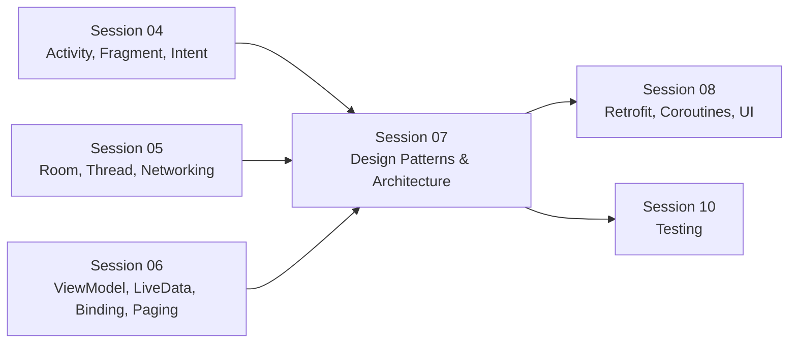
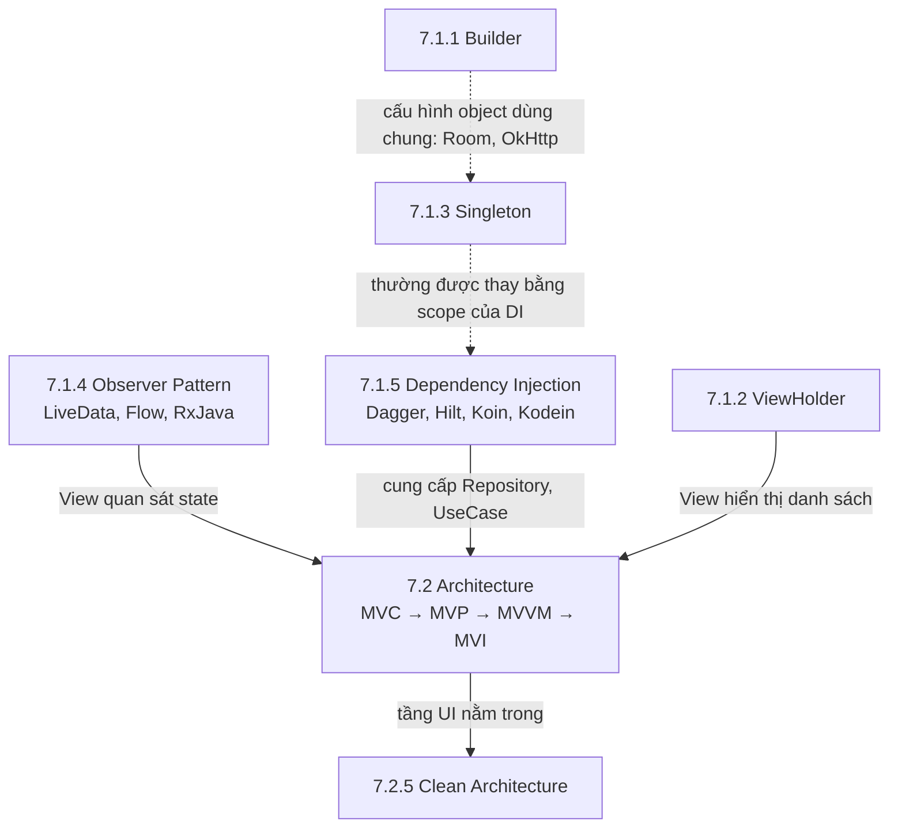
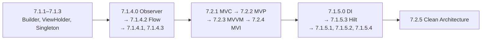

# Session 07 Overview

## Vấn đề cần giải quyết

Session 04–06 cho bạn các viên gạch: Activity, Fragment, Room, Networking, ViewModel, LiveData. Khi app lớn dần, câu hỏi chuyển từ "dùng API nào" sang "**sắp xếp code thế nào**":

1. **Những vấn đề nhỏ lặp lại khắp nơi:** tạo object nhiều tham số tuỳ chọn, giữ đúng một instance dùng chung, tái sử dụng View trong danh sách dài, báo cho nhiều nơi khi dữ liệu đổi, đưa dependency vào class mà không để class tự tạo. Mỗi vấn đề có một lời giải đã thành tên gọi: **design pattern**.
2. **Trách nhiệm của cả màn hình và cả app:** ai giữ state, ai gọi dữ liệu, tầng nào được biết tầng nào. Đó là **kiến trúc**.

Session 07 gom cả hai nhóm, nhìn từ góc độ code Android thật: pattern đó xuất hiện ở đâu trong framework và thư viện Jetpack, và khi nào nên tự áp dụng.

## Vị trí Session 07 trong lộ trình

- **Kế thừa:** Session 06 đã dùng ViewModel, LiveData, `StateFlow` và Repository mà chưa gọi tên pattern đứng sau; Session 07 gọi tên và giải thích chúng.
- **Bắc cầu:** nhiều bài trước đã dùng tối thiểu Flow, Hilt, MVVM, Clean Architecture như "kiến thức dùng trước"; đây là nơi học đầy đủ. Session 08 (Coroutines, Retrofit) và Session 10 (Testing) dựa vào DI và kiến trúc nhiều tầng để code dễ thay thế và dễ test.

## Session 07 học những gì?

Mỗi Topic dưới đây chỉ được tóm tắt. Cơ chế, code và sai lầm thường gặp nằm trong bài của từng Topic.

### 7.1 Design Pattern

| Topic | Câu hỏi trả lời |
|---|---|
| [7.1.1 Builder Pattern](design_pattern/builder_pattern.md) | Tạo object nhiều tham số tuỳ chọn thế nào cho dễ đọc, và Kotlin đã thay đổi nhu cầu này ra sao? |
| [7.1.2 ViewHolder Pattern](design_pattern/viewholder_pattern.md) | Danh sách hàng nghìn dòng cuộn mượt thế nào khi chỉ tạo đủ ViewHolder cho phần đang nhìn thấy? |
| [7.1.3 Singleton Pattern](design_pattern/singleton_pattern.md) | Khi nào cần đúng một instance, và vì sao Singleton tự viết dễ gây leak và khó test? |
| [7.1.4.0 Observer Pattern Overview](design_pattern/observer/overview.md) | Một nơi báo thay đổi cho nhiều nơi quan sát thế nào; hot/cold, push/pull nghĩa là gì? |
| [7.1.4.1 RxJava / RxAndroid](design_pattern/observer/rxjava.md) | Observer Pattern kiểu Rx hoạt động thế nào, và vì sao code mới chuyển sang Flow? |
| [7.1.4.2 Flow](design_pattern/observer/flow.md) | Kotlin Flow, `StateFlow`, `SharedFlow` và cách collect an toàn trong Android. |
| [7.1.4.3 LiveData](design_pattern/observer/livedata.md) | LiveData đứng ở đâu so với Flow và RxJava khi nhìn như một Observer? |
| [7.1.5.0 Dependency Injection Overview](design_pattern/di/overview.md) | DI là gì, khác Service Locator ra sao, và chọn Dagger, Hilt, Koin hay Kodein? |
| [7.1.5.1 Dagger2](design_pattern/di/dagger2.md) | Dagger dựng graph dependency lúc compile thế nào? |
| [7.1.5.2 Koin](design_pattern/di/koin.md) | DI bằng DSL Kotlin, resolve lúc runtime, đánh đổi gì? |
| [7.1.5.3 Hilt](design_pattern/di/hilt.md) | Hilt chuẩn hoá Dagger cho Activity, Fragment, ViewModel, WorkManager thế nào? |
| [7.1.5.4 Kodein](design_pattern/di/kodein.md) | Kodein-DI khác Koin ở đâu, và khi nào còn gặp nó? |

### 7.2 Architecture

| Topic | Câu hỏi trả lời |
|---|---|
| [7.2.1 MVC](architecture/mvc.md) | MVC gốc là gì, và vì sao "MVC kiểu Android" dẫn tới Massive Activity? |
| [7.2.2 MVP](architecture/mvp.md) | Presenter tách logic khỏi View thế nào, và vướng gì với vòng đời Android? |
| [7.2.3 MVVM](architecture/mvvm.md) | Ba vai Model, View, ViewModel và luồng dữ liệu một chiều với một `uiState`. |
| [7.2.4 MVI](architecture/mvi.md) | Mọi thay đổi đi qua một reducer với state bất biến thì được gì? |
| [7.2.5 Clean Architecture](architecture/clean_architecture.md) | Chia app thành presentation, domain, data với quy tắc phụ thuộc hướng vào trong thế nào, và khi nào là quá tay? |

## Mối liên hệ giữa các Topic

1. **Observer** là cơ chế để View quan sát state trong MVVM/MVI và để tầng data báo dữ liệu mới.
2. **Dependency Injection** đưa Repository và use case vào ViewModel; nó cũng thay thế phần lớn Singleton tự viết bằng scope.
3. **MVC → MVP → MVVM → MVI** là các cách tổ chức tầng UI, mỗi pattern sửa một điểm yếu của pattern trước; **Clean Architecture** đặt tầng UI đó vào cấu trúc lớn hơn của cả app.
4. **Builder** và **ViewHolder** là pattern cục bộ, gặp mỗi ngày khi cấu hình thư viện và hiển thị danh sách.

## Điều kiện tiên quyết

- [ViewModel](../session_06/viewmodel.md) và [LiveData](../session_06/livedata.md): MVVM, Observer và DI đều xoay quanh chúng.
- [View Binding](../session_06/view_binding.md): ViewHolder và các ví dụ UI dùng binding.
- [Room Architecture](../session_05/data_store/room_architecture.md) và [Networking](../session_05/networking.md): tầng data mà Clean Architecture và DI tổ chức.
- [Kotlin](../session_01/languages/kotlin.md): Java gọi Kotlin (`companion object`, tham số mặc định, `@JvmOverloads`), `data class` và chi phí của `by lazy`, nền của Singleton và Builder. Object declaration, named arguments và lambda có receiver được giải thích ngắn trong bài Singleton và Builder khi cần.

## Sau khi học xong Session 07, bạn làm được gì?

- Giải thích được vị trí của Session 07 trong lộ trình và vì sao pattern và kiến trúc được học sau Architecture Components.
- Phân biệt được nhóm design pattern (giải quyết một vấn đề cục bộ trong code) với nhóm kiến trúc (chia trách nhiệm của cả màn hình hoặc cả app).
- Áp dụng được thứ tự học đề xuất của Session 07 dựa trên phụ thuộc giữa các Topic.

## Thứ tự học đề xuất

1. **Pattern cục bộ trước:** Builder, ViewHolder, Singleton quen thuộc nhất và gần như không cần bài khác trong session; vài ví dụ của chúng dùng tối thiểu Flow và Hilt dưới dạng "kiến thức dùng trước", học đầy đủ ở các bước sau.
2. **Observer trước kiến trúc:** MVVM và MVI dựa vào việc View quan sát state. Trong nhóm Observer, học Flow ngay sau bài tổng quan vì code hiện nay dùng nó nhiều nhất.
3. **MVC → MVP → MVVM → MVI theo thứ tự lịch sử:** mỗi pattern dễ hiểu hơn khi đã thấy vấn đề của pattern trước.
4. **DI trước Clean Architecture:** Clean Architecture cần DI để nối các tầng mà không để tầng trong biết tầng ngoài. Trong nhóm DI, học Hilt ngay sau bài tổng quan vì đó là lựa chọn được khuyên dùng cho Android.

Thứ tự này khác số thứ tự trong mục lục; mục lục giữ nguyên, đây chỉ là gợi ý đọc.

## Nguồn tham khảo

- [Guide to app architecture — Android Developers](https://developer.android.com/topic/architecture)
- [Recommendations for Android architecture — Android Developers](https://developer.android.com/topic/architecture/recommendations)
- [Dependency injection in Android — Android Developers](https://developer.android.com/training/dependency-injection)
- [Kotlin flows on Android — Android Developers](https://developer.android.com/kotlin/flow)
- [Create dynamic lists with RecyclerView — Android Developers](https://developer.android.com/develop/ui/views/layout/recyclerview)
