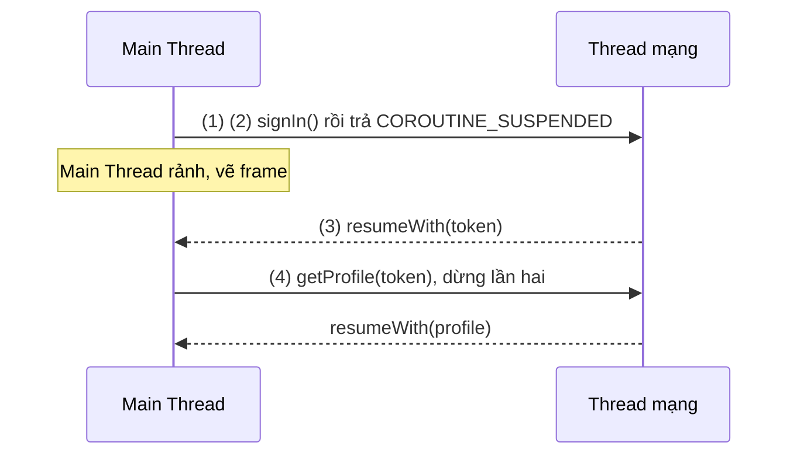
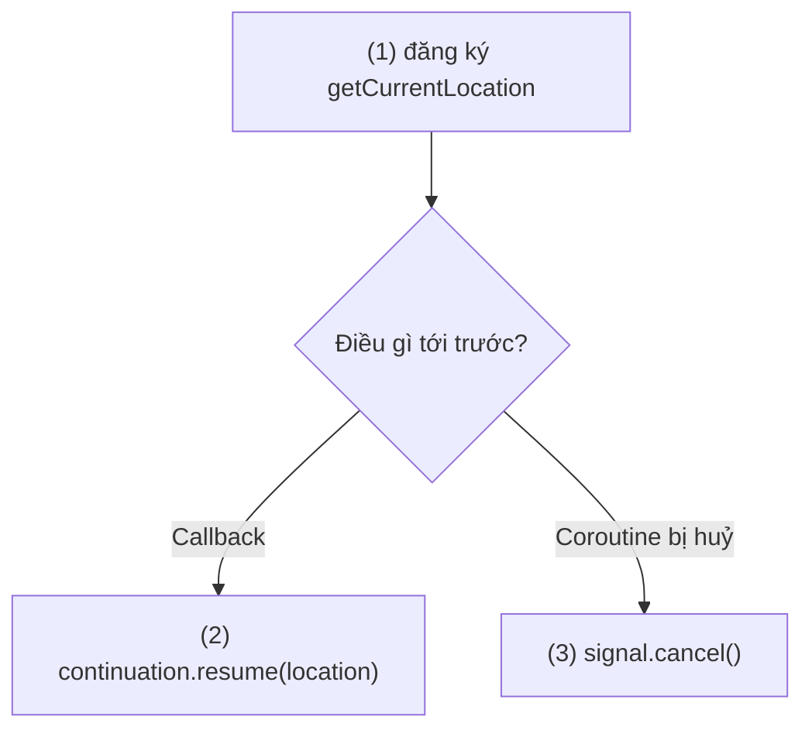
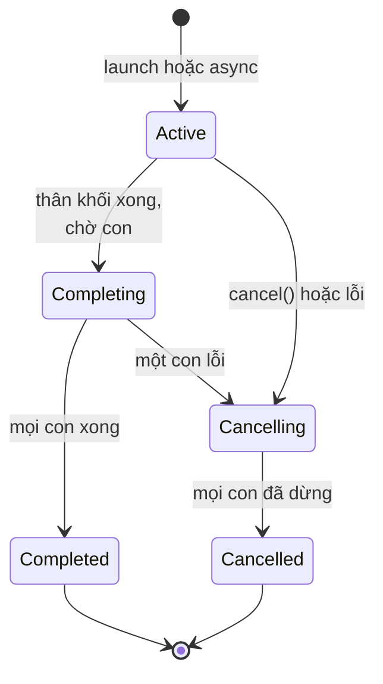
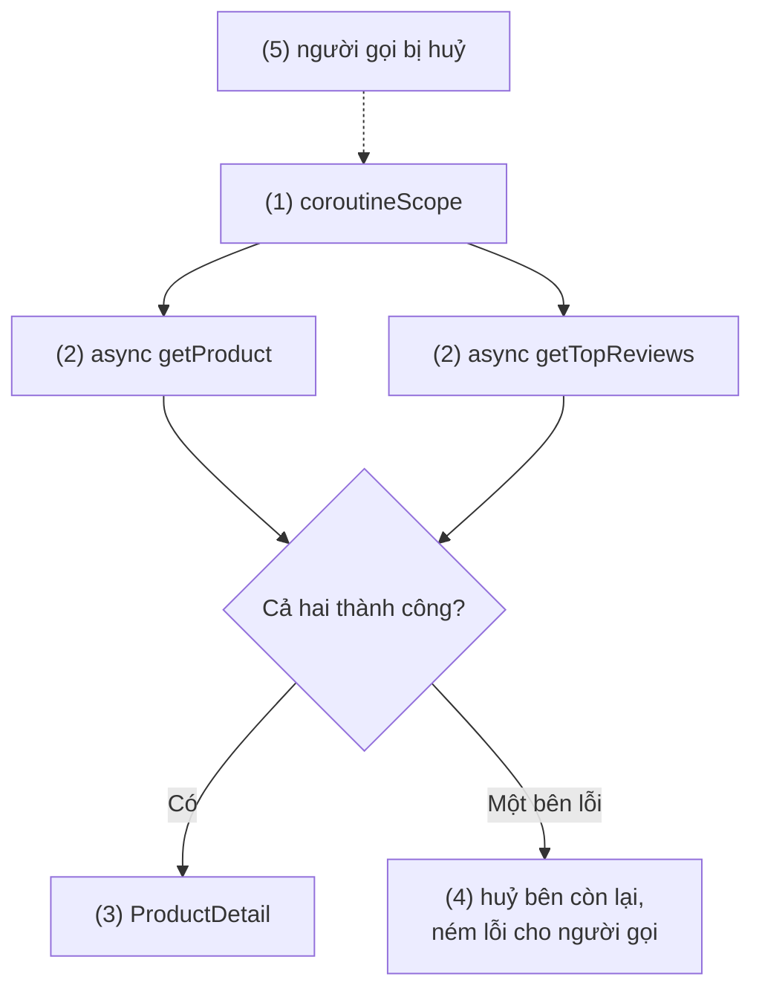
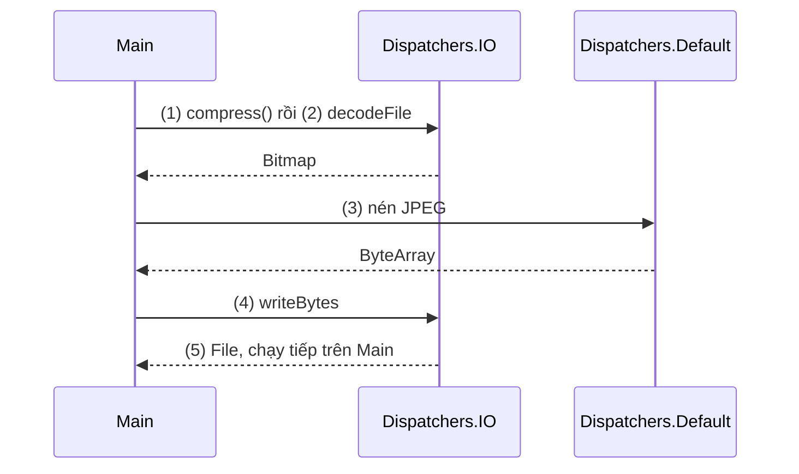
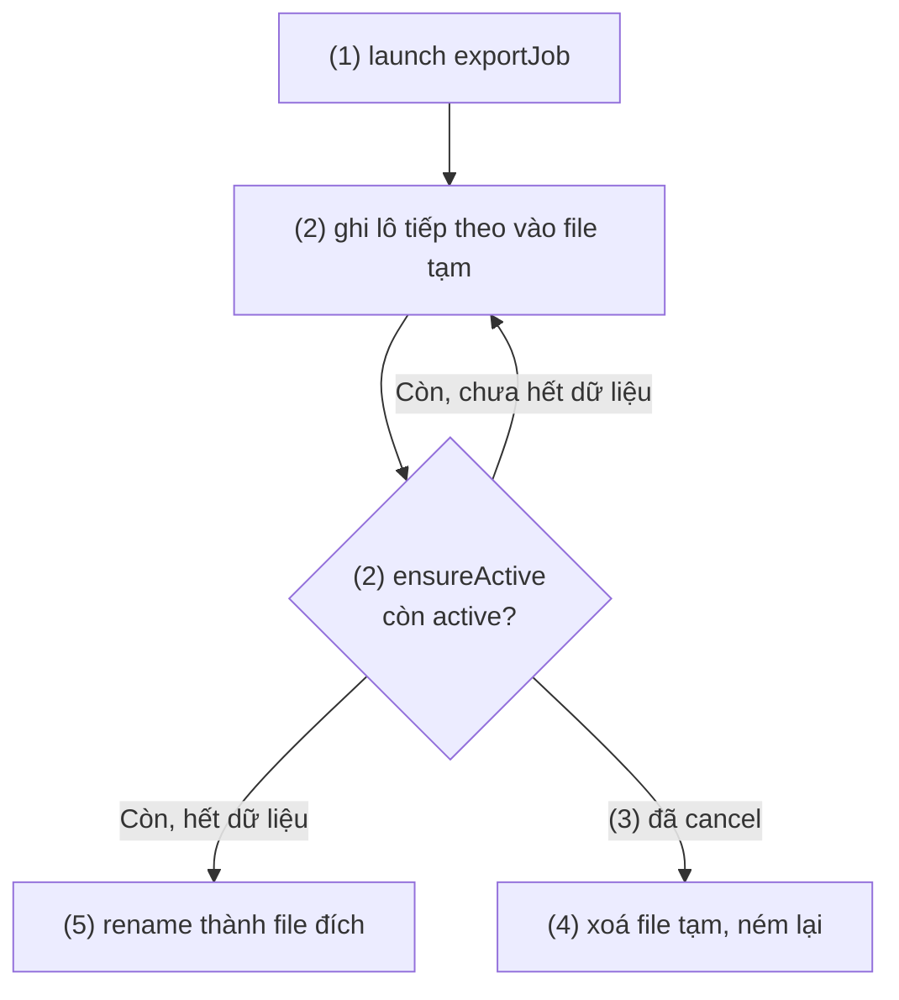
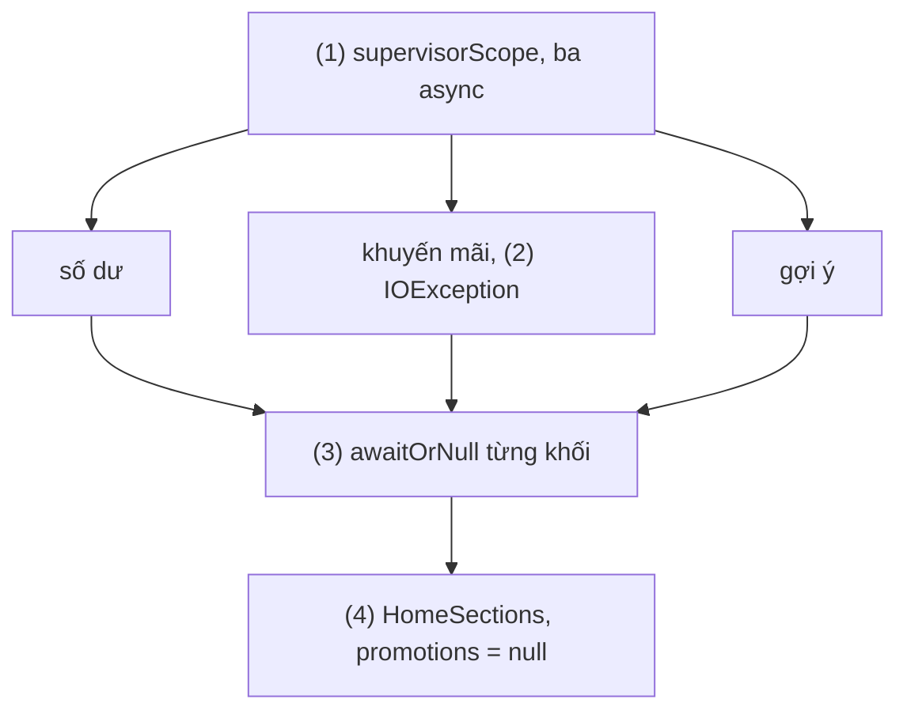
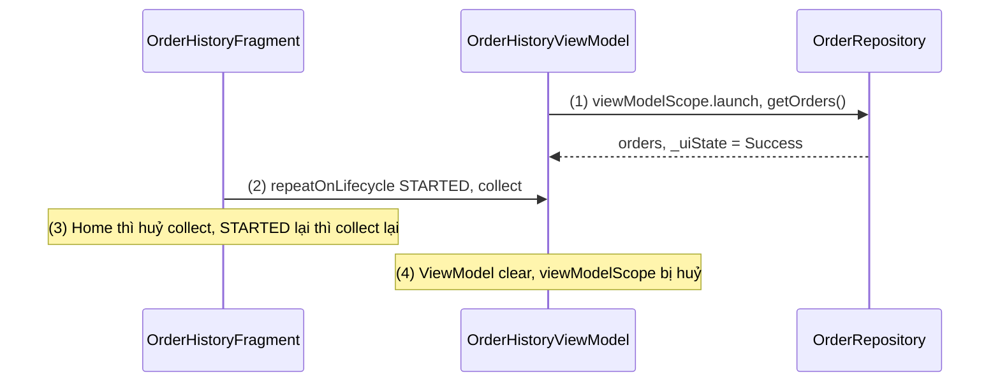
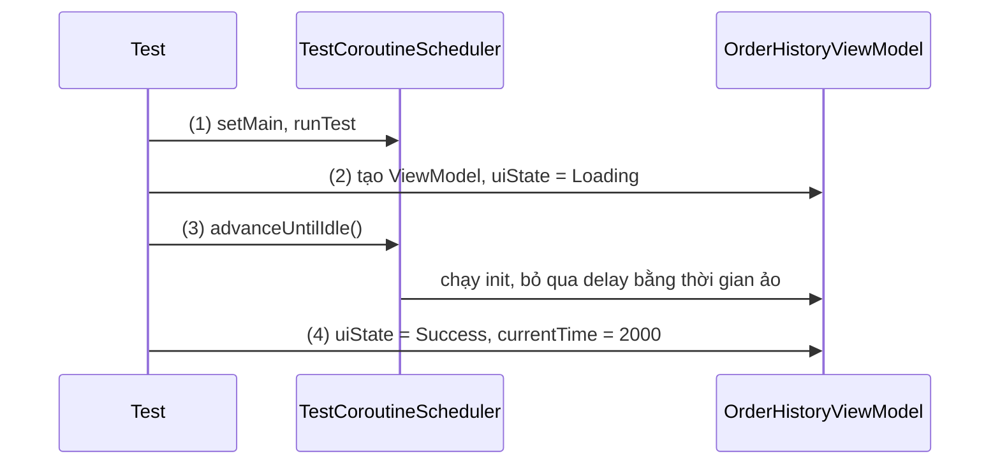
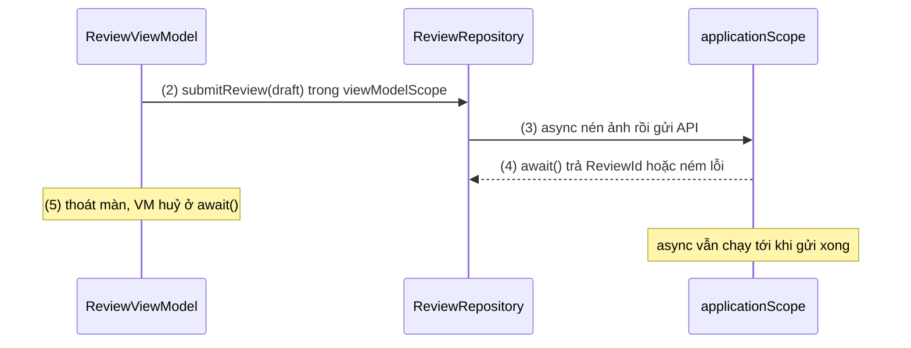

# Coroutines

## Vấn đề cần giải quyết

Một màn hình thường phải làm chuỗi việc phải chờ: đăng nhập lấy token, rồi tải hồ sơ bằng token đó. Main Thread không được chờ (chờ là đứng UI, quá lâu là ANR, xem [Working with Thread](../../session_05/working_with_thread.md), mục "ANR"). Cách cũ là callback:

```kotlin
authApi.signIn(email, password, onSuccess = { token ->
    profileApi.getProfile(token, onSuccess = { profile ->
        mainHandler.post { showProfile(profile) }
    }, onError = { error -> mainHandler.post { showError(error) } })
}, onError = { error -> mainHandler.post { showError(error) } })
```

Cách này có ba điểm yếu:

- **Logic tuần tự bị bẻ thành các tầng lồng nhau:** `if`, vòng lặp, `try/catch` không còn dùng tự nhiên; lỗi phải xử lý ở từng tầng.
- **Không có cách huỷ chung:** người dùng rời màn thì request vẫn chạy và callback vẫn chạm vào View đã huỷ.
- **Tự đổi thread bằng tay:** mỗi lần về UI phải `post` qua Handler.

Tạo thread riêng cho mỗi việc chờ thì đắt (5.2). Vấn đề cần giải quyết là: **viết code bất đồng bộ đọc từ trên xuống như code đồng bộ, không chặn thread trong lúc chờ, và huỷ được cả nhóm việc khi không còn cần.**

## Sau khi học xong

- Giải thích được vì sao hàm suspend tạm dừng mà không chặn thread, qua cách compiler biến nó thành state machine giữ trạng thái trong Continuation.
- Áp dụng được CoroutineScope, Job, launch, async, withContext và Dispatchers để viết code bất đồng bộ main-safe theo structured concurrency.
- Xử lý được cancellation và exception trong cây coroutine bằng ensureActive, CancellationException, supervisorScope và CoroutineExceptionHandler.
- Triển khai được coroutine theo vòng đời Android bằng viewModelScope, lifecycleScope, repeatOnLifecycle và kiểm thử bằng runTest.
- Nhận diện được các lỗi thường gặp như GlobalScope, nuốt CancellationException, gọi hàm chặn trong coroutine và tự tạo Job phá structured concurrency.

## Coroutines là gì?

**Coroutine** là một **phép tính có thể tạm dừng** (suspendable computation): một khối code chạy tuần tự, nhưng có thể dừng lại ở các điểm gọi hàm `suspend` mà **không chặn thread** đang chạy nó, rồi chạy tiếp từ đúng chỗ đó khi kết quả có, có thể trên một thread khác.

Mental model: coroutine là **một cuốn sách có kẹp dấu trang**, thread là **người đọc**. Gặp đoạn phải chờ, coroutine kẹp dấu trang (lưu vị trí và biến cục bộ vào một object gọi là `Continuation`) rồi trả người đọc cho việc khác. Khi kết quả về, một người đọc (do dispatcher chọn) mở đúng trang đó và đọc tiếp. Vì thread chỉ bận khi có trang cần đọc, một thread phục vụ được rất nhiều coroutine.

Ngôn ngữ Kotlin chỉ cung cấp `suspend` và `Continuation`; `launch`, `async`, `Dispatchers`, `Job` nằm trong thư viện `kotlinx.coroutines`.

```kotlin
// app/build.gradle.kts (1.11.0 là bản stable tại thời điểm viết, 05/2026)
dependencies {
    implementation("org.jetbrains.kotlinx:kotlinx-coroutines-android:1.11.0") // có Dispatchers.Main
    testImplementation("org.jetbrains.kotlinx:kotlinx-coroutines-test:1.11.0")
}
```

## Cách hoạt động

### Hàm suspend và state machine

`suspend` không có nghĩa "chạy nền". Nó có nghĩa: **hàm này được phép dừng giữa chừng**. Để làm được điều đó trên JVM (vốn không có khái niệm tạm dừng một hàm), compiler biến đổi mỗi hàm `suspend` theo kiểu Continuation-Passing Style (CPS, truyền phần còn lại của phép tính như một tham số):

- Thêm một tham số ẩn `Continuation<T>`: đây là "dấu trang", chứa chỗ cần chạy tiếp và cách trả kết quả cho người gọi.
- Đổi kiểu trả về thành `Any?`: hàm trả về kết quả thật, hoặc một giá trị đặc biệt `COROUTINE_SUSPENDED` nghĩa là "tôi đã dừng, sẽ báo sau".
- Cắt thân hàm thành các đoạn tại mỗi điểm gọi `suspend`, gắn nhãn `label` 0, 1, 2…, và chuyển biến cục bộ cần dùng sau điểm dừng thành field của một object state machine.

Khi hàm `suspend` bên dưới (ví dụ request mạng) trả `COROUTINE_SUSPENDED`, mọi hàm phía trên return ngay và thread được trả lại. Khi có kết quả, `continuation.resumeWith(result)` được gọi, state machine nhảy vào đúng `label` đã lưu và chạy tiếp.

#### Ví dụ: đăng nhập rồi tải hồ sơ

**Bài toán:** chuỗi ở phần "Vấn đề": đăng nhập lấy token, rồi tải hồ sơ bằng token. Viết bằng `suspend` để thấy hai điểm dừng và thread được giải phóng.

**Luồng chạy:**

1. Coroutine trên Main Thread gọi `signInAndLoadProfile()`.
2. `signIn()` gửi request (thư viện mạng chạy I/O trên thread riêng) và trả `COROUTINE_SUSPENDED`; hàm lưu `label = 1` rồi return. Main Thread rảnh để vẽ frame.
3. Response về: `resumeWith(token)` được gọi, dispatcher đưa phần tiếp theo về Main Thread, state machine chạy từ `label = 1`.
4. `getProfile(token)` dừng lần hai theo cùng cách, rồi trả `Profile` cho người gọi.



```kotlin
// ProfileRepository.kt
class ProfileRepository(private val authApi: AuthApi, private val profileApi: ProfileApi) {
    suspend fun signInAndLoadProfile(email: String, password: String): Profile {
        val token = authApi.signIn(email, password) // (2) điểm dừng 1
        return profileApi.getProfile(token)         // (4) điểm dừng 2
    }
}
```

Compiler sinh ra code có hình dạng như mã giả dưới đây (rút gọn, không chạy được):

```kotlin
// Mã giả: state machine do compiler sinh
fun signInAndLoadProfile(email: String, password: String, completion: Continuation<Any?>): Any? {
    val sm = completion as? SignInStateMachine ?: SignInStateMachine(completion)
    when (sm.label) {
        0 -> {
            sm.label = 1                                     // (2) kẹp dấu trang trước khi dừng
            val result = authApi.signIn(email, password, sm)
            if (result == COROUTINE_SUSPENDED) return COROUTINE_SUSPENDED
            sm.token = result as String
        }
        1 -> sm.token = sm.result as String                  // (3) chạy tiếp từ dấu trang
    }
    sm.label = 2
    return profileApi.getProfile(sm.token, sm)               // (4)
}
```

**Kết quả:** đặt breakpoint sau `signIn()`, xem tab Threads: lúc chờ mạng, Main Thread đang xử lý message khác của Looper. Gọi hàm từ hàm thường (không `suspend`) thì không compile, vì không có `Continuation` để truyền vào.

### Bọc callback thành hàm suspend

Nhiều SDK chỉ có API callback. `suspendCancellableCoroutine { continuation -> … }` dừng coroutine, đưa `continuation` để gọi `resume(value)` hoặc `resumeWithException(error)` khi callback tới, và `invokeOnCancellation { }` để huỷ việc bên dưới. Bản `suspendCoroutine` không huỷ được. `Task` của Google Play services đã có sẵn `await()` ([Google Services](../../session_04/components/services/google_service.md)).

#### Ví dụ: lấy vị trí hiện tại một lần

**Bài toán:** màn đặt xe cần vị trí hiện tại một lần qua `LocationManager.getCurrentLocation()` (API 30), API nhận callback và `CancellationSignal`. Người dùng thoát màn thì phải huỷ yêu cầu GPS.

**Luồng chạy:**

1. Dừng coroutine và đăng ký callback.
2. Callback trả `Location?` → `resume(location)`, coroutine chạy tiếp.
3. Coroutine bị huỷ trước khi có vị trí → `invokeOnCancellation` gọi `signal.cancel()`.



```kotlin
// LocationReader.kt
class LocationReader(private val locationManager: LocationManager, private val executor: Executor) {
    @RequiresApi(Build.VERSION_CODES.R)
    @RequiresPermission(Manifest.permission.ACCESS_FINE_LOCATION)
    suspend fun currentLocation(): Location? = suspendCancellableCoroutine { continuation ->
        val signal = CancellationSignal()
        locationManager.getCurrentLocation(LocationManager.GPS_PROVIDER, signal, executor) { location: Location? ->
            continuation.resume(location)                      // (2)
        }                                                      // (1)
        continuation.invokeOnCancellation { signal.cancel() }  // (3)
    }
}
```

**Kết quả:** gọi `currentLocation()` rồi thoát màn ngay: breakpoint trong `invokeOnCancellation` dừng, biểu tượng vị trí tắt. Callback gọi nhiều lần (theo dõi vị trí liên tục) là việc của `callbackFlow`, học ở [7.1.4.2 Flow](../../session_07/design_pattern/observer/flow.md).

### CoroutineScope, Job và structured concurrency

Coroutine luôn được tạo trong một **`CoroutineScope`** bằng **coroutine builder**:

- **`launch { }`** trả về **`Job`**: "làm việc này, không cần kết quả". `Job` là handle để `join()` (chờ xong) hoặc `cancel()`.
- **`async { }`** trả về **`Deferred<T>`** (một `Job` có kết quả): `await()` dừng cho tới khi có kết quả hoặc ném lại lỗi.
- **`coroutineScope { }`** là hàm `suspend` tạo một scope con, chạy khối bên trong và **chỉ trả về khi mọi coroutine con đã xong**.

**Structured concurrency** (đồng thời có cấu trúc) là quy tắc gắn các coroutine thành **cây cha – con** qua `Job`:

- Coroutine tạo trong scope của cha có `Job` là con của `Job` cha; cha chỉ hoàn tất khi mọi con hoàn tất.
- Huỷ cha thì huỷ mọi con.
- Con thất bại (lỗi không phải `CancellationException`) thì huỷ cha, cha huỷ các con còn lại, và lỗi đi tiếp lên trên.

Nhờ đó, huỷ một scope là chắc chắn dọn hết việc bên trong. Vòng đời của một `Job`:



#### Ví dụ: tải song song thông tin sản phẩm và đánh giá

**Bài toán:** màn chi tiết sản phẩm cần hai API độc lập: thông tin sản phẩm và đánh giá. Gọi song song thì thời gian gần bằng request chậm hơn thay vì tổng hai request; một bên lỗi thì màn vô nghĩa, nên bên còn lại phải dừng.

**Luồng chạy:**

1. `coroutineScope { }` tạo scope con gắn với coroutine đang gọi.
2. Hai `async` bắt đầu ngay, chạy đồng thời.
3. `await()` cả hai, ghép thành `ProductDetail`; `coroutineScope` trả về khi cả hai xong.
4. Nếu `getTopReviews()` lỗi: scope huỷ `async` còn lại và ném lỗi ra cho người gọi.
5. Nếu người gọi bị huỷ (người dùng thoát màn), cả hai `async` bị huỷ theo.



```kotlin
// ProductDetailRepository.kt
class ProductDetailRepository(
    private val productApi: ProductApi,
    private val reviewApi: ReviewApi,
) {
    suspend fun loadDetail(productId: String): ProductDetail = coroutineScope { // (1)
        val product = async { productApi.getProduct(productId) }                // (2)
        val reviews = async { reviewApi.getTopReviews(productId, limit = 5) }   // (2)
        ProductDetail(product.await(), reviews.await())                         // (3)
    } // (4) (5) do structured concurrency lo, không cần code thêm
}
```

**Kết quả:** với hai API giả lập 800 ms và 500 ms, `loadDetail()` mất khoảng 800 ms thay vì 1,3 giây. Cho `getTopReviews()` ném `IOException`: `getProduct()` bị huỷ giữa chừng và lỗi đi ra người gọi. Lưu ý: viết `async { … }.await()` liền nhau cho từng request thì lại thành tuần tự.

### CoroutineContext, Dispatchers và withContext

Mỗi coroutine mang một **`CoroutineContext`**: tập phần tử có khoá, ghép bằng `+`, gồm `Job` (vị trí trong cây), dispatcher (chạy trên thread nào), `CoroutineName` (tên để debug) và `CoroutineExceptionHandler` (phần exception bên dưới). Coroutine con thừa kế context của cha, trừ `Job`: mỗi con luôn có `Job` mới làm con của `Job` cha.

**Dispatcher** trả lời câu "người đọc nào mở lại cuốn sách":

- `Dispatchers.Main`: Main Thread qua Looper chính; `Dispatchers.Main.immediate` chạy ngay nếu đã ở Main Thread, không post thêm message.
- `Dispatchers.Default`: việc tốn CPU (sắp xếp, parse JSON lớn, nén ảnh).
- `Dispatchers.IO`: việc chặn thread (file, socket); dùng chung thread với `Default`, nên chuyển từ `Default` sang `IO` thường không đổi thread thật.

Dispatcher ánh xạ xuống thread pool ra sao (số thread, giới hạn 64 của `IO`) đã có ở [Working with Thread](../../session_05/working_with_thread.md), mục "Coroutine Dispatchers thực chất là gì?". `Dispatchers.IO.limitedParallelism(n)` tạo một view chỉ cho tối đa `n` việc song song, dùng khi tài nguyên chỉ chịu được ít kết nối.

**`withContext(dispatcher) { }`** chạy khối trên dispatcher khác, chờ xong, rồi **quay về dispatcher cũ** với kết quả. Nó là công cụ của quy tắc **main-safe**: hàm `suspend` phải gọi được an toàn từ Main Thread, lớp làm việc chặn tự chịu trách nhiệm chuyển thread. Android khuyên **inject dispatcher** qua constructor thay vì viết cứng, để test thay bằng test dispatcher.

#### Ví dụ: nén ảnh đính kèm trước khi gửi

**Bài toán:** ảnh đính kèm phiếu hỗ trợ phải được đọc từ file (I/O), nén JPEG (CPU), rồi ghi ra file tạm (I/O). ViewModel gọi từ Main Thread và không cần biết bước nào chạy ở đâu.

**Luồng chạy:**

1. ViewModel gọi `compress()` trên Main Thread.
2. `withContext(io)` decode file thành `Bitmap`.
3. `withContext(default)` nén thành mảng byte JPEG.
4. `withContext(io)` ghi mảng byte ra file đích.
5. Hàm trả về; coroutine chạy tiếp trên Main Thread với file kết quả.



```kotlin
// AttachmentCompressor.kt
class AttachmentCompressor(
    private val ioDispatcher: CoroutineDispatcher = Dispatchers.IO,
    private val defaultDispatcher: CoroutineDispatcher = Dispatchers.Default,
) {
    suspend fun compress(source: File, target: File, quality: Int = 80): File {   // (1) main-safe
        val bitmap = withContext(ioDispatcher) { BitmapFactory.decodeFile(source.path) } // (2)
            ?: throw IOException("Không đọc được ảnh ${source.name}")
        val jpegBytes = withContext(defaultDispatcher) {                           // (3)
            ByteArrayOutputStream().use { output ->
                bitmap.compress(Bitmap.CompressFormat.JPEG, quality, output)
                output.toByteArray()
            }
        }
        withContext(ioDispatcher) { target.writeBytes(jpegBytes) }                 // (4)
        return target                                                              // (5)
    }
}
```

**Kết quả:** bật `StrictMode` với `detectDiskReads()`, `detectDiskWrites()` (5.2, mục "Bật StrictMode"): gọi `compress()` từ `viewModelScope` không có vi phạm. Decode ảnh lớn còn cần downsample, phần đó thuộc [8.2.1 Glide](../loading_image/glide.md).

### Cancellation: huỷ có hợp tác

Huỷ coroutine là **cooperative** (có hợp tác): `job.cancel()` chỉ đặt `Job` sang trạng thái `Cancelling`. Coroutine thật sự dừng khi nó **kiểm tra** trạng thái đó:

- Mọi hàm `suspend` của `kotlinx.coroutines` (`delay`, `withContext`, `await`, `yield`…) đều kiểm tra và ném **`CancellationException`** khi coroutine đã bị huỷ.
- Vòng lặp tính toán hoặc I/O chặn không có điểm dừng thì phải tự kiểm tra bằng `ensureActive()`, `isActive` hoặc `yield()`.
- `finally` vẫn chạy khi bị huỷ, nên là chỗ dọn tài nguyên; trong đó gọi hàm `suspend` sẽ ném ngay, cần thì bọc bằng `withContext(NonCancellable) { }`.
- `withTimeout(ms) { }` huỷ khối khi quá giờ (`TimeoutCancellationException`); `withTimeoutOrNull` trả `null`.

`CancellationException` mang nghĩa "đang được huỷ", nên **không được nuốt**: bắt thì phải ném lại.

#### Ví dụ: xuất lịch sử giao dịch ra file CSV và cho phép huỷ

**Bài toán:** xuất 200.000 giao dịch ra CSV mất vài giây. Người dùng có nút "Huỷ"; huỷ thì không được để lại file CSV dở dang.

**Luồng chạy:**

1. ViewModel `launch` việc xuất và giữ `Job` lại cho nút "Huỷ".
2. Exporter ghi vào file tạm theo lô 500 dòng; đầu mỗi lô gọi `ensureActive()`.
3. Bấm "Huỷ" → `exportJob.cancel()`; lần `ensureActive()` kế tiếp ném `CancellationException`.
4. Khối `catch` xoá file tạm rồi **ném lại** exception để coroutine kết thúc ở trạng thái `Cancelled`.
5. Không bị huỷ: ghi xong thì đổi tên file tạm thành file đích.



```kotlin
// TransactionCsvExporter.kt
class TransactionCsvExporter(
    private val ioDispatcher: CoroutineDispatcher = Dispatchers.IO,
) {
    suspend fun export(transactions: List<Transaction>, target: File) = withContext(ioDispatcher) {
        val tempFile = File(target.parentFile, "${target.name}.tmp")
        try {
            tempFile.bufferedWriter().use { writer ->
                writer.appendLine("id,date,amount")
                for (batch in transactions.chunked(500)) {
                    ensureActive()                                   // (2) (3) điểm kiểm tra huỷ
                    batch.forEach { tx -> writer.appendLine("${tx.id},${tx.date},${tx.amount}") }
                }
            }
            if (!tempFile.renameTo(target)) throw IOException("Không đổi tên được ${tempFile.name}") // (5)
        } catch (e: CancellationException) {
            tempFile.delete()                                        // (4) dọn file dở dang
            throw e                                                  // (4) bắt buộc ném lại
        }
    }
}

// ExportViewModel.kt
fun startExport(transactions: List<Transaction>, target: File) {
    exportJob = viewModelScope.launch { exporter.export(transactions, target) } // (1)
}
fun cancelExport() { exportJob?.cancel() }                                      // (3)
```

Ghi file an toàn (file tạm rồi rename, `AtomicFile`) được học ở [8.3 Local Storage](../local_storage.md).

**Kết quả:** bấm "Huỷ" giữa chừng: thư mục đích không có file `.tmp` hay CSV dở. Xoá `ensureActive()` thì "Huỷ" không có tác dụng tới khi vòng lặp chạy hết, vì `appendLine` là hàm chặn thường, không phải điểm dừng.

### Exception handling trong cây coroutine

Lỗi đi theo cây giống cancellation, theo chiều ngược lại:

- Con ném lỗi (không phải `CancellationException`) → huỷ cha → cha huỷ các con khác → lỗi đi lên tới **root coroutine** (coroutine không có cha).
- Root tạo bằng `launch`: lỗi tới `CoroutineExceptionHandler` nếu có, không thì tới uncaught exception handler của thread; trên Android là **crash app**.
- Root tạo bằng `async`: lỗi được giữ trong `Deferred` và ném ra khi `await()`. `async` là **con** thì vẫn huỷ cha ngay khi lỗi, dù chưa ai `await`.
- **`SupervisorJob`** và **`supervisorScope { }`**: con thất bại **không** huỷ cha và anh em; mỗi con tự xử lý lỗi của mình. Huỷ supervisor vẫn huỷ mọi con.
- **`CoroutineExceptionHandler`** chỉ có tác dụng ở root (hoặc con trực tiếp của supervisor). Khi nó được gọi, coroutine đã kết thúc với lỗi; nó là chỗ log hoặc báo crash cuối cùng, không phải chỗ phục hồi.

Phục hồi thì dùng `try/catch` quanh lời gọi có thể lỗi, bắt kiểu lỗi cụ thể (`IOException`), không bắt `Exception` chung.

#### Ví dụ: trang chủ nhiều khối dữ liệu độc lập

**Bài toán:** trang chủ app ngân hàng có ba khối: số dư, khuyến mãi, gợi ý. API khuyến mãi lỗi thì vẫn phải hiện số dư; khối lỗi chỉ hiện "Không tải được". Với `coroutineScope`, một khối lỗi sẽ huỷ cả ba.

**Luồng chạy:**

1. `supervisorScope { }` tạo scope mà con lỗi không huỷ anh em; ba `async` chạy đồng thời.
2. `getPromotions()` lỗi: chỉ `Deferred` đó kết thúc với lỗi, hai khối kia chạy tiếp.
3. `awaitOrNull()` đổi lỗi mạng của từng khối thành `null`; `CancellationException` thì ném lại.
4. Ghép `HomeSections`, khối `null` hiện trạng thái lỗi riêng.



```kotlin
// HomeRepository.kt
suspend fun loadHome(): HomeSections = supervisorScope {             // (1)
    val balance = async { balanceApi.getBalance() }
    val promotions = async { promotionApi.getPromotions() }          // (2) có thể lỗi
    val picks = async { recommendationApi.getPicks() }
    HomeSections(balance.awaitOrNull(), promotions.awaitOrNull(), picks.awaitOrNull()) // (4)
}

private suspend fun <T> Deferred<T>.awaitOrNull(): T? =              // (3)
    try {
        await()
    } catch (e: CancellationException) {
        throw e                     // scope bị huỷ: không biến thành null
    } catch (e: IOException) {
        null                        // lỗi mạng của riêng khối này
    }
```

**Kết quả:** cho `getPromotions()` ném `IOException`: màn vẫn hiện số dư và gợi ý. Đổi sang `coroutineScope` thì cả ba khối mất. Lỗi kiểu khác (bug `IllegalStateException`) vẫn đi ra ngoài, đúng ý: bug không bị giấu thành "không tải được".

### Coroutine theo vòng đời Android

Structured concurrency chỉ có ích khi root scope bị huỷ đúng lúc. Jetpack cung cấp các scope gắn với vòng đời:

| Scope | Bị huỷ khi | Dùng cho |
|---|---|---|
| `viewModelScope` | ViewModel bị clear | Logic màn hình, sống qua configuration change |
| `lifecycleScope` | Owner tới `DESTROYED` | Việc UI; Fragment dùng `viewLifecycleOwner.lifecycleScope` |
| `repeatOnLifecycle(STARTED)` | Xuống dưới `STARTED` (chạy lại khi `STARTED`) | Collect chỉ khi UI đang hiện |
| Scope tự tạo ở `Application` | Không bao giờ | Việc phải xong dù người dùng rời màn |

`viewModelScope` và `lifecycleScope` đều dùng `SupervisorJob` cộng `Dispatchers.Main.immediate`: một coroutine lỗi không huỷ coroutine khác của màn, và code mặc định chạy trên Main Thread. Chi tiết `repeatOnLifecycle`, `flowWithLifecycle` ở [Activity Lifecycle](../../session_04/components/activity/lifecycle.md), mục "repeatOnLifecycle"; thứ tự huỷ `viewModelScope` ở [ViewModel](../../session_06/viewmodel.md), mục "Vòng đời ViewModel và `onCleared()`".

> [!NOTE]
> Ví dụ dưới đây dùng trước `StateFlow` (luồng giữ một giá trị hiện tại), học ở [7.1.4.2 Flow](../../session_07/design_pattern/observer/flow.md): `value` là giá trị hiện tại, `collect` nhận mỗi giá trị mới.

#### Ví dụ: màn lịch sử đơn hàng

**Bài toán:** màn lịch sử đơn hàng tải danh sách một lần, không tải lại khi xoay, không vẽ UI khi ở background, dừng tải khi người dùng rời màn.

**Luồng chạy:**

1. ViewModel được tạo lần đầu → `viewModelScope.launch` gọi repository main-safe, rồi đặt `_uiState`.
2. Fragment collect `uiState` trong `repeatOnLifecycle(STARTED)` của `viewLifecycleOwner`.
3. Bấm Home → khối collect bị huỷ, coroutine của ViewModel vẫn chạy; mở lại → collect lại, nhận ngay giá trị mới nhất.
4. Thoát hẳn màn → ViewModel clear → `viewModelScope` huỷ việc tải nếu còn chạy.



```kotlin
// OrderHistoryViewModel.kt
class OrderHistoryViewModel(private val repository: OrderRepository) : ViewModel() {

    private val _uiState = MutableStateFlow<OrderHistoryUiState>(OrderHistoryUiState.Loading)
    val uiState: StateFlow<OrderHistoryUiState> = _uiState.asStateFlow()

    init {
        viewModelScope.launch {                                      // (1) (4) huỷ khi clear
            _uiState.value = try {
                OrderHistoryUiState.Success(repository.getOrders())
            } catch (e: IOException) {
                OrderHistoryUiState.Error("Không tải được lịch sử đơn hàng")
            }
        }
    }
}

sealed interface OrderHistoryUiState {
    data object Loading : OrderHistoryUiState
    data class Success(val orders: List<Order>) : OrderHistoryUiState
    data class Error(val message: String) : OrderHistoryUiState
}

// OrderHistoryFragment.kt, trong onViewCreated()
viewLifecycleOwner.lifecycleScope.launch {
    viewLifecycleOwner.repeatOnLifecycle(Lifecycle.State.STARTED) {  // (2) (3)
        viewModel.uiState.collect { state -> render(state) }
    }
}
```

**Kết quả:** xoay màn hình: log trong `getOrders()` chỉ in một lần. Bấm Home rồi mở lại: `render()` không chạy lúc ở background. Thoát màn khi API đang chậm: repository nhận `CancellationException`, request bị huỷ.

### Test coroutine với runTest

Test coroutine gặp hai khó khăn: `delay` làm test chậm thật, và code trên dispatcher khác khiến test kết thúc trước coroutine. `kotlinx-coroutines-test` giải quyết bằng:

- **`runTest { }`**: chạy thân test trong một coroutine với `TestCoroutineScheduler`; `delay` được **bỏ qua bằng thời gian ảo** (virtual time), và `runTest` chờ mọi coroutine con xong mới kết thúc.
- **`StandardTestDispatcher`**: xếp coroutine vào hàng đợi, chỉ chạy khi test gọi `advanceUntilIdle()`, `advanceTimeBy(ms)`, `runCurrent()`, nên quan sát được trạng thái trung gian. `UnconfinedTestDispatcher` chạy ngay, dễ viết nhưng ít kiểm soát.
- **`Dispatchers.setMain(testDispatcher)`**: thay `Dispatchers.Main` (mà `viewModelScope` dùng cứng) bằng test dispatcher; `resetMain()` sau test.

Mọi test dispatcher trong một test phải dùng chung scheduler; đó là lý do inject dispatcher vào class thay vì viết cứng `Dispatchers.IO`.

#### Ví dụ: kiểm tra ViewModel đi từ Loading sang Success

**Bài toán:** kiểm tra `OrderHistoryViewModel` ở trên đi từ `Loading` sang `Success`. Repository giả có `delay(2_000)` nhưng test không được chậm 2 giây.

**Luồng chạy:**

1. `@Before` đặt `StandardTestDispatcher` làm `Dispatchers.Main`; `runTest` dùng cùng dispatcher nên chung scheduler.
2. Tạo ViewModel: coroutine trong `init` được xếp hàng, chưa chạy; trạng thái là `Loading`.
3. `advanceUntilIdle()` chạy mọi việc đang chờ, nhảy qua `delay(2_000)` bằng thời gian ảo.
4. Trạng thái là `Success`; `currentTime` là 2000 ms ảo dù test chỉ chạy vài mili giây thật.



```kotlin
// OrderHistoryViewModelTest.kt
@OptIn(ExperimentalCoroutinesApi::class)
class OrderHistoryViewModelTest {

    private val testDispatcher = StandardTestDispatcher()

    @Before
    fun setUp() = Dispatchers.setMain(testDispatcher)                      // (1)

    @After
    fun tearDown() = Dispatchers.resetMain()

    @Test
    fun loadingThenSuccess() = runTest(testDispatcher) {                   // (1)
        val repository = FakeOrderRepository(delayMs = 2_000)
        val viewModel = OrderHistoryViewModel(repository)
        assertEquals(OrderHistoryUiState.Loading, viewModel.uiState.value) // (2)

        advanceUntilIdle()                                                 // (3)

        assertEquals(OrderHistoryUiState.Success(repository.orders), viewModel.uiState.value) // (4)
        assertEquals(2_000L, currentTime)
    }
}

// FakeOrderRepository.kt (source set test; OrderRepository là interface)
class FakeOrderRepository(private val delayMs: Long) : OrderRepository {
    val orders = listOf(Order(id = "DH-1001", total = 250_000))
    override suspend fun getOrders(): List<Order> {
        delay(delayMs)
        return orders
    }
}
```

**Kết quả:** test chạy trong vài mili giây. Bỏ `advanceUntilIdle()` thì assert thứ hai thất bại; quên `setMain` thì test ném `IllegalStateException` (`Module with the Main dispatcher had failed to initialize`), vì Main dispatcher của Android cần Looper. Test Flow bằng Turbine có ở [Async Transactions & Flow](../../session_05/data_store/room_transactions.md), mục "Test Flow với Turbine".

## Ví dụ thực tế

Ba bài toán hay gặp với coroutine:

1. **Việc phải hoàn tất dù người dùng rời màn** (gửi đánh giá, lưu nháp lên server): chạy trong scope sống lâu hơn màn hình. Đây là bài toán chính, code bên dưới.
2. **Bọc SDK callback** (thanh toán, đăng nhập mạng xã hội): `suspendCancellableCoroutine` như mục "Bọc callback thành hàm suspend".
3. **Việc phải chạy cả khi process đã chết** (đồng bộ ban đêm): dùng `CoroutineWorker` của WorkManager ([Android Service](../../session_04/components/services/android_service.md)).

### Gửi đánh giá sản phẩm kèm ảnh

**Bài toán:** người dùng bấm "Gửi" đánh giá kèm ảnh rồi thoát màn ngay. Chạy trong `viewModelScope` thì việc gửi bị huỷ khi ViewModel clear. Việc gửi phải sống theo app; màn hình chỉ chờ kết quả khi còn mở.

**Luồng chạy:**

1. `Application` tạo `applicationScope` với `SupervisorJob()` để một việc lỗi không huỷ việc khác.
2. ViewModel gọi `submitReview()` trong `viewModelScope`.
3. Repository chạy việc thật bằng `externalScope.async { }`: nén ảnh rồi gọi API.
4. Repository `await()`; lỗi trong `async` được ném lại ở đây cho ViewModel bắt.
5. Người dùng thoát màn: coroutine của ViewModel bị huỷ ở `await()`, còn `async` thuộc `applicationScope` nên chạy tới khi gửi xong.



```kotlin
// ShopApplication.kt
class ShopApplication : Application() {
    val applicationScope = CoroutineScope(SupervisorJob() + Dispatchers.Default) // (1)
}

// ReviewRepository.kt
class ReviewRepository(
    private val reviewApi: ReviewApi,
    private val compressor: AttachmentCompressor,
    private val externalScope: CoroutineScope,   // inject applicationScope; test inject TestScope
    private val cacheDir: File,
) {
    suspend fun submitReview(draft: ReviewDraft): ReviewId =
        externalScope.async {                                            // (3)
            val photo = draft.photoFile?.let { source ->
                compressor.compress(source, File(cacheDir, "review_${draft.productId}.jpg"))
            }
            reviewApi.submit(draft.productId, draft.rating, draft.comment, photo)
        }.await()                                                        // (4)
}

// ReviewViewModel.kt
fun submit(draft: ReviewDraft) {
    viewModelScope.launch {                                              // (2)
        _state.value = SubmitState.Sending
        _state.value = try {
            SubmitState.Sent(repository.submitReview(draft))
        } catch (e: IOException) {
            SubmitState.Failed("Gửi đánh giá thất bại, thử lại sau")
        }                                                                // (5) bị huỷ thì không cập nhật
    }
}
```

**Kết quả:** bấm "Gửi" rồi Back ngay: server vẫn nhận đánh giá. Ở lại màn: trạng thái đi từ "Đang gửi" sang "Đã gửi". Giới hạn: người dùng đã thoát mà lần gửi lỗi thì không ai `await()`, lỗi chỉ nằm trong `Deferred`; việc cần thử lại chắc chắn nên chuyển sang WorkManager.


## Khi nào nên và không nên dùng

- **Nên dùng** cho việc bất đồng bộ trong app Kotlin: gọi API, đọc ghi Room, DataStore, file (các thư viện này đều có API `suspend`), và khi nhiều việc đồng thời phải chờ nhau hoặc huỷ cùng nhau.
- **Không đủ** khi việc phải chạy sau khi process chết: dùng WorkManager (bên trong vẫn là coroutine).
- **Không thay được** thread chuyên dụng cho việc thời gian thực hoặc vòng lặp chặn rất dài (engine audio, socket lắng nghe liên tục): 5.2, mục "Khi nào dùng công nghệ nào?".
- **Không nên** bọc API đã là `suspend` (Retrofit, Room) bằng `withContext(Dispatchers.IO)`: chúng đã main-safe.
- **Code đang dùng RxJava:** không cần viết lại một lần; so sánh và cầu nối hai bên ở [8.4.4 RxJava, RxAndroid, RxKotlin](rxjava.md).

## Sai lầm thường gặp

### 1. `GlobalScope.launch` trong màn hình

```kotlin
// Sai: coroutine không thuộc vòng đời nào
class CartFragment : Fragment() {
    fun refreshCart() {
        GlobalScope.launch(Dispatchers.Main) {
            binding.totalText.text = cartApi.getCart().total.toString()
        }
    }
}
```

**Lỗi lộ ra thế nào:** thoát màn khi API chậm, coroutine vẫn chạy rồi chạm `binding` đã null và crash, hoặc giữ Fragment cũ gây leak.

**Cách sửa:** dùng `viewLifecycleOwner.lifecycleScope` hoặc `viewModelScope`; việc cần sống lâu hơn màn thì inject scope ở `Application` như phần "Ví dụ thực tế".

### 2. Nuốt `CancellationException`

```kotlin
// Sai: runCatching và catch (e: Exception) bắt cả CancellationException
viewModelScope.launch {
    while (true) {
        runCatching {
            priceRepository.refreshPrices()
            delay(30_000)
        }
    }
}
```

**Lỗi lộ ra thế nào:** khi ViewModel bị clear, `delay` ném `CancellationException`, `runCatching` nuốt nó, vòng lặp chạy tiếp; lần sau lại ném ngay, nên coroutine quay vòng không dừng và tốn CPU.

**Cách sửa:** bắt kiểu lỗi cụ thể (`catch (e: IOException)`); phải bắt rộng thì ném lại `CancellationException` trước, hoặc gọi `ensureActive()` sau khối bắt lỗi.

### 3. Tưởng `suspend` tự đưa việc ra khỏi Main Thread

```kotlin
// Sai: hàm suspend nhưng thân là code chặn
suspend fun loadInvoicePdf(file: File): ByteArray = file.readBytes()
```

**Lỗi lộ ra thế nào:** gọi trong `viewModelScope.launch` (chạy trên Main), UI giật khi file lớn; StrictMode báo disk read. `suspend` chỉ cho phép dừng, không chuyển thread.

**Cách sửa:** `withContext(ioDispatcher) { file.readBytes() }`; thay `Thread.sleep()` bằng `delay()`.

### 4. Tự tạo `Job` mới phá structured concurrency

```kotlin
// Sai: Job() mới thay cho Job của viewModelScope
viewModelScope.launch(Job()) { syncRepository.syncDrafts() }
```

**Lỗi lộ ra thế nào:** `Job()` truyền vào builder thành **cha** của coroutine mới, cắt liên kết với `viewModelScope`: ViewModel bị clear nhưng việc vẫn chạy và không ai huỷ được. Cùng lỗi với `withContext(SupervisorJob()) { }`.

**Cách sửa:** không truyền `Job` vào `launch`, `async`, `withContext`; cần supervisor thì dùng `supervisorScope { }`, cần sống lâu hơn thì dùng scope có chủ sở hữu rõ ràng.


## Lịch sử phát triển

- **1963:** Melvin Conway mô tả khái niệm coroutine khi thiết kế trình biên dịch COBOL.
- **Kotlin 1.1 (03/2017):** coroutine ra mắt ở dạng experimental, cùng thư viện `kotlinx.coroutines`.
- **kotlinx.coroutines 0.26.0 (09/2018):** structured concurrency; builder thành extension của `CoroutineScope`, thêm `GlobalScope` cho code cũ.
- **Kotlin 1.3 và kotlinx.coroutines 1.0 (10/2018):** coroutine stable.
- **2019–2020:** Google I/O 2019 công bố Android Kotlin-first; Lifecycle 2.1.0 thêm `viewModelScope`, Lifecycle 2.2.0 (01/2020) thêm `lifecycleScope`; kotlinx.coroutines 1.3.0 (08/2019) có Flow stable. Android 11 deprecate `AsyncTask`, docs khuyên dùng coroutine.
- **Lifecycle 2.4.0 (10/2021):** thêm `repeatOnLifecycle`, thay cho `launchWhenStarted` (deprecated sau đó).
- **kotlinx.coroutines 1.6.0 (12/2021):** API test mới với `runTest`, `StandardTestDispatcher` (stable từ 1.7.0); thêm `limitedParallelism`.
- **kotlinx.coroutines 1.11.0 (05/2026):** bản stable tại thời điểm viết, build với Kotlin 2.2.20; deprecate việc dùng `CoroutineDispatcher` làm khoá context.

## Kết nối hệ thống

- **Tiên quyết:**
  - [8.4.1 What Sync / Async](sync_async.md): blocking, non-blocking và các mô hình bất đồng bộ.
  - [8.4.2 Thread and Multi-Thread](thread_multithread.md): coroutine chạy trên thread, nên dữ liệu dùng chung vẫn cần đồng bộ hoá như ở bài này.
  - [Working with Thread](../../session_05/working_with_thread.md): Main Thread, ANR, Dispatchers ánh xạ xuống thread pool.
- **Liên quan:**
  - [ViewModel](../../session_06/viewmodel.md): `viewModelScope` bị huỷ khi ViewModel clear.
  - [Activity Lifecycle](../../session_04/components/activity/lifecycle.md) và [Fragment Lifecycle](../../session_04/components/fragment/lifecycle.md): `lifecycleScope`, `repeatOnLifecycle`, `viewLifecycleOwner`.
  - [Async Transactions & Flow](../../session_05/data_store/room_transactions.md): Room với `suspend`, `withTransaction`, rollback khi bị huỷ.
  - [Networking](../../session_05/networking.md): retry, backoff, lỗi mạng trong hàm `suspend`.
  - [8.1.1 Retrofit](../networks/retrofit.md): interface API với hàm `suspend`.
  - [8.4.4 RxJava, RxAndroid, RxKotlin](rxjava.md): cách tiếp cận reactive và cầu nối với coroutine.
- **Học tiếp:**
  - [7.1.4.2 Flow](../../session_07/design_pattern/observer/flow.md): luồng nhiều giá trị dựa trên coroutine.
  - [Android Service](../../session_04/components/services/android_service.md), mục "WorkManager": `CoroutineWorker`.

## Tham khảo

- [Coroutines guide - Kotlin](https://kotlinlang.org/docs/coroutines-guide.html)
- [Cancellation and timeouts - Kotlin](https://kotlinlang.org/docs/cancellation-and-timeouts.html)
- [Coroutine exceptions handling - Kotlin](https://kotlinlang.org/docs/exception-handling.html)
- [Coroutine context and dispatchers - Kotlin](https://kotlinlang.org/docs/coroutine-context-and-dispatchers.html)
- [Dispatchers.IO (API reference) - kotlinx.coroutines](https://kotlinlang.org/api/kotlinx.coroutines/kotlinx-coroutines-core/kotlinx.coroutines/-dispatchers/-i-o.html)
- [KEEP: Kotlin Coroutines design (CPS, state machine) - GitHub](https://github.com/Kotlin/KEEP/blob/master/proposals/coroutines.md)
- [kotlinx.coroutines releases and CHANGES - GitHub](https://github.com/Kotlin/kotlinx.coroutines/releases)
- [Best practices for coroutines in Android - Android Developers](https://developer.android.com/kotlin/coroutines/coroutines-best-practices)
- [Use Kotlin coroutines with lifecycle-aware components - Android Developers](https://developer.android.com/topic/libraries/architecture/coroutines)
- [Testing Kotlin coroutines on Android - Android Developers](https://developer.android.com/kotlin/coroutines/test)
- [LocationManager (getCurrentLocation) - Android Developers](https://developer.android.com/reference/android/location/LocationManager)
