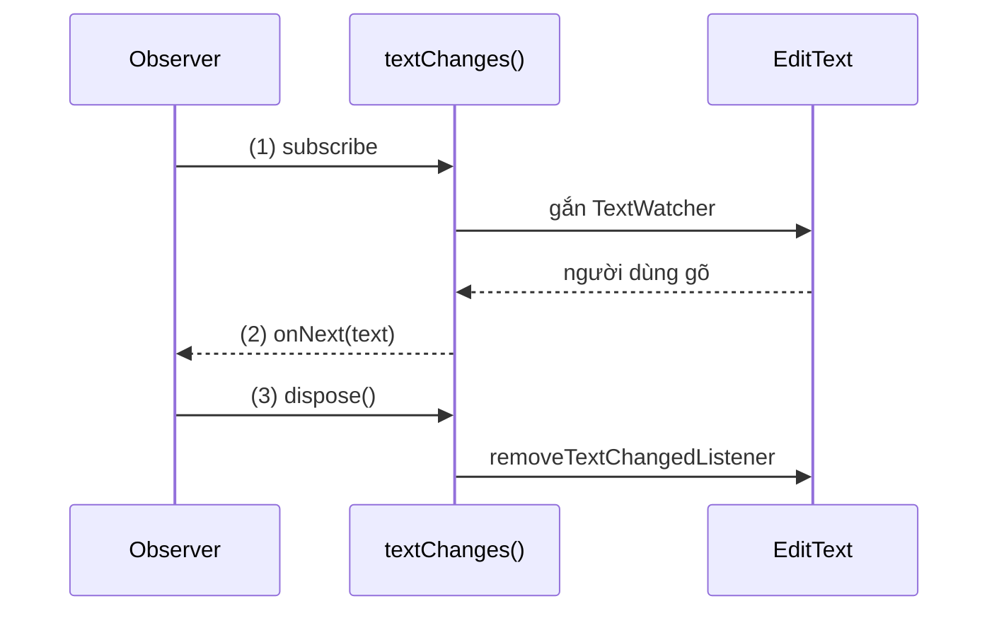
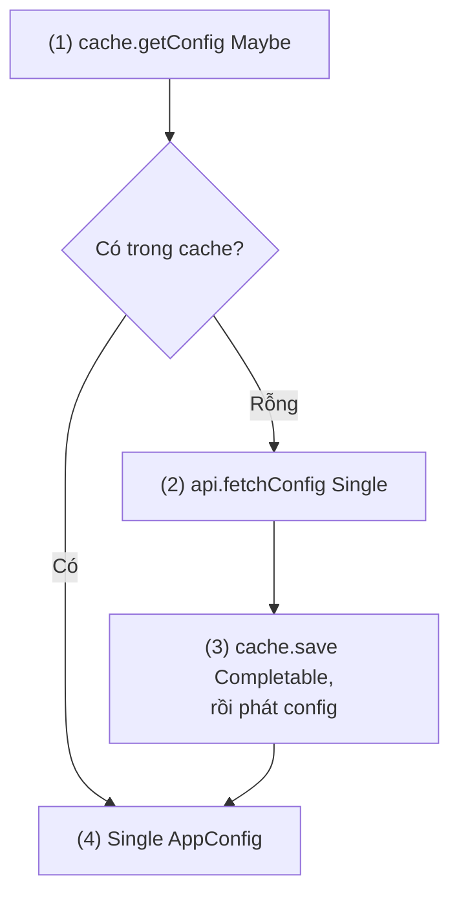
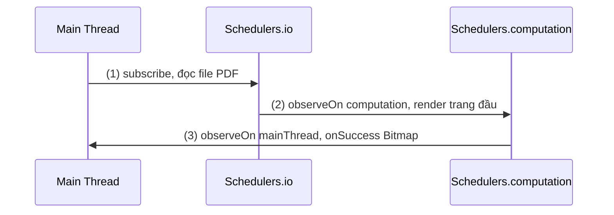
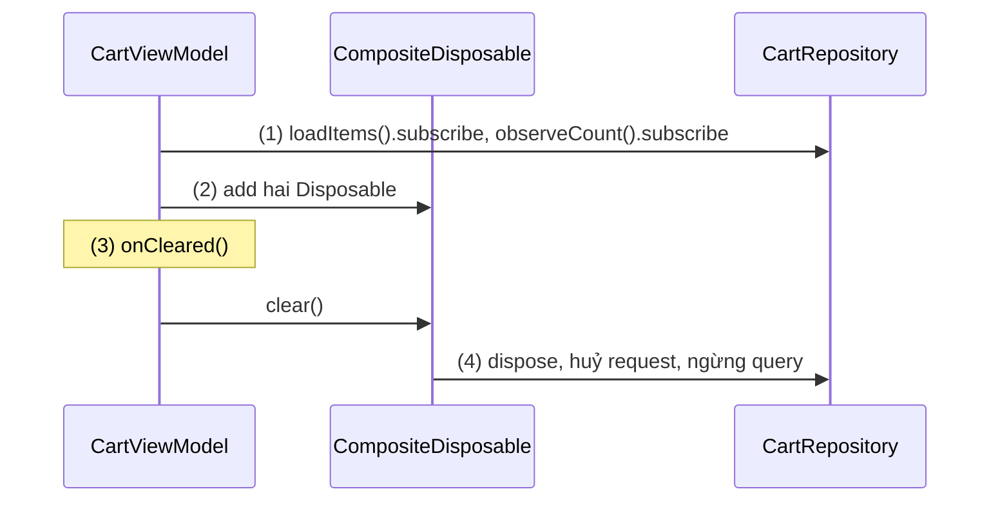
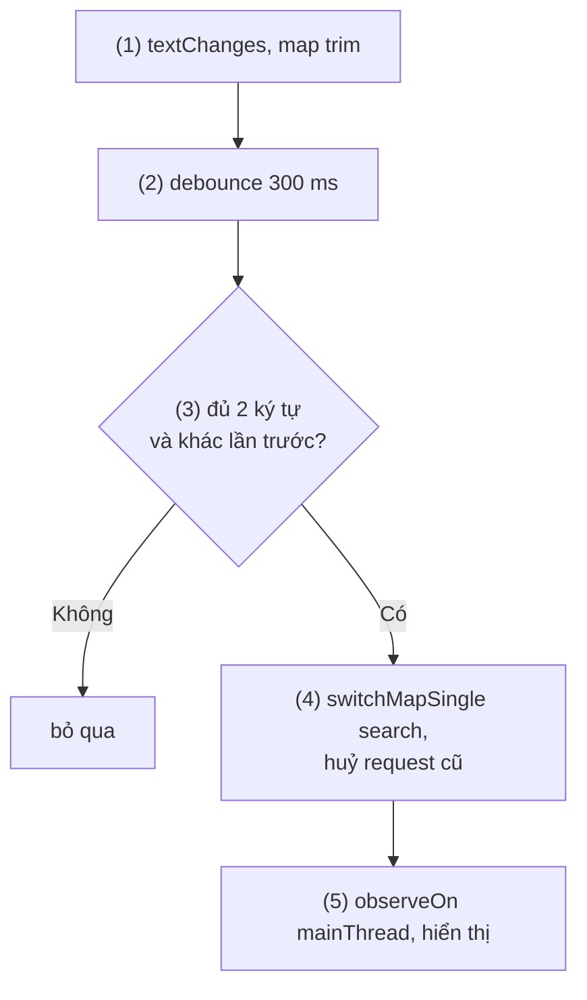
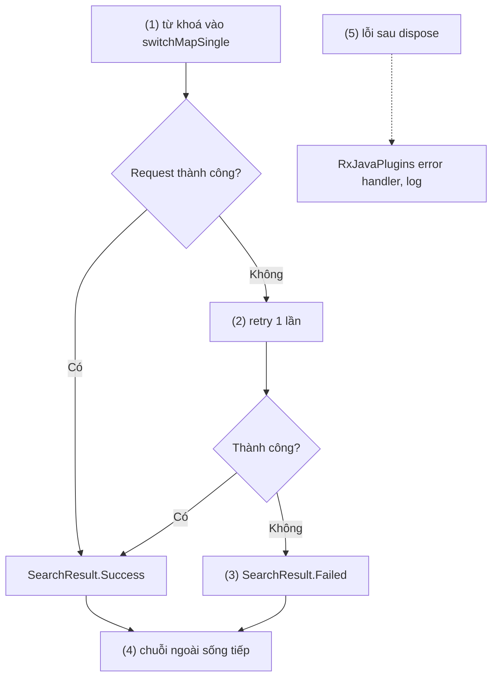
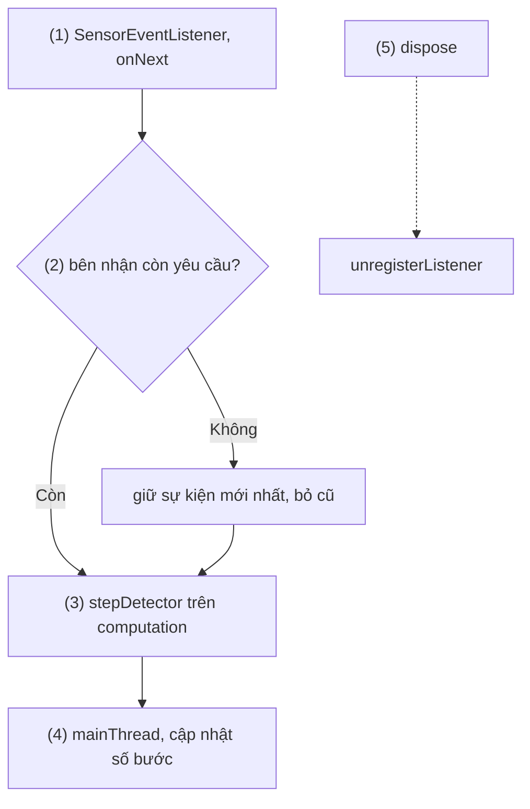
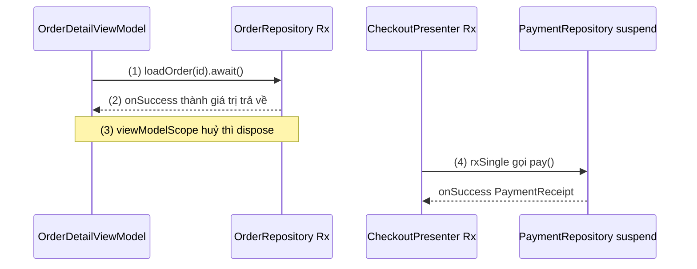
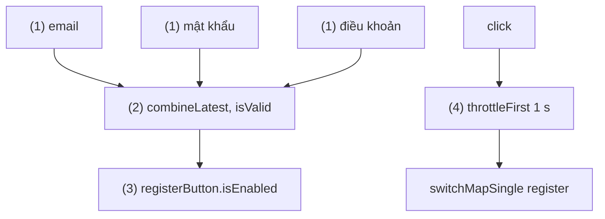

# RxJava, RxAndroid, RxKotlin

## Vấn đề cần giải quyết

Nhiều bài toán trong app không phải "một request, một kết quả" mà là **chuỗi sự kiện theo thời gian**: chữ người dùng gõ, vị trí GPS, cảm biến, trạng thái mạng. Ô tìm kiếm là ví dụ điển hình. Viết bằng listener và callback:

```kotlin
searchInput.doAfterTextChanged { text ->
    pendingSearch?.let(mainHandler::removeCallbacks)        // tự debounce bằng tay
    pendingSearch = Runnable {
        searchApi.search(text.toString(), callback = { results ->
            mainHandler.post { adapter.submitList(results) } // tự về Main Thread
        })
    }.also { mainHandler.postDelayed(it, 300) }
}
```

Code chạy, nhưng còn ba lỗ hổng:

- **Kết quả cũ đè kết quả mới:** gõ "ao" rồi "ao khoác"; request "ao" về chậm hơn sẽ ghi đè danh sách đúng.
- **Không có cách huỷ chung:** rời màn hình thì request đang chạy vẫn gọi về adapter.
- **Mỗi việc tự viết, không ghép được:** debounce, bỏ từ khoá trùng, đổi thread, xử lý lỗi; thêm một nguồn (bộ lọc giá) là phải tự giữ trạng thái của cả hai.

Vấn đề cần giải quyết là: **mô tả xử lý một chuỗi sự kiện bất đồng bộ bằng các bước ghép được (lọc, chờ, biến đổi, gộp, đổi thread), với một điểm duy nhất để dừng toàn bộ.**

## Sau khi học xong

- Giải thích được hợp đồng giữa Observable và Observer (onSubscribe, onNext, onError, onComplete) và vì sao một chuỗi cold chỉ chạy khi có subscribe.
- Phân biệt được Observable, Flowable, Single, Maybe, Completable và chọn kiểu theo số phần tử và nhu cầu backpressure.
- Áp dụng được subscribeOn, observeOn, AndroidSchedulers.mainThread() và các operator map, flatMap, concatMap, switchMap, combineLatest, zip, debounce.
- Xử lý được vòng đời subscription bằng Disposable, CompositeDisposable và lỗi bằng operator xử lý lỗi, RxJavaPlugins.
- Biết khi nào giữ RxJava, khi nào chuyển sang coroutine và Flow, và cách nối hai bên bằng kotlinx-coroutines-rx3.

## RxJava, RxAndroid, RxKotlin là gì?

**RxJava** là bản hiện thực Reactive Extensions (ReactiveX) cho JVM: nó mô hình hoá dữ liệu và sự kiện thành **luồng phát bất đồng bộ** (`Observable` và các kiểu tương tự) mà **Observer** đăng ký nhận, biến đổi luồng bằng **chuỗi operator** khai báo, và chọn thread chạy bằng **Scheduler**. **RxAndroid** là thư viện nhỏ thêm Scheduler cho Main Thread của Android; **RxKotlin** thêm các extension function cho Kotlin.

Mental model: chuỗi Rx là một **dây chuyền sản xuất**. Nguồn đặt hàng vào đầu băng chuyền, mỗi operator là một trạm (lọc, đổi, gộp), Observer đứng cuối nhận thành phẩm. Lắp dây chuyền xong chưa có gì chạy; chỉ khi có người đứng cuối (`subscribe`) dây chuyền mới khởi động. Scheduler quyết định xưởng (thread) nào chạy đoạn nào, còn `Disposable` là công tắc dừng cả dây chuyền.

```kotlin
// app/build.gradle.kts (version stable tại thời điểm viết)
dependencies {
    implementation("io.reactivex.rxjava3:rxjava:3.1.12")
    implementation("io.reactivex.rxjava3:rxandroid:3.0.2")
    implementation("io.reactivex.rxjava3:rxkotlin:3.0.1")
}
```

## Cách hoạt động

### Observable, Observer và hợp đồng phát

Khi `subscribe(observer)`, nguồn và Observer tuân theo một **hợp đồng** (Observable Contract):

1. `onSubscribe(disposable)` được gọi đúng một lần, trao cho Observer công tắc dừng.
2. `onNext(item)` được gọi 0 tới nhiều lần, **tuần tự** (không bao giờ hai lời gọi chồng lên nhau).
3. Kết thúc bằng **tối đa một** trong hai: `onComplete()` hoặc `onError(throwable)`. Sau đó không còn tín hiệu nào.

Hai hệ quả quan trọng: lỗi là **trạng thái kết thúc**, chuỗi gặp `onError` là chết; và từ RxJava 2 trở đi, `null` không được phép đi qua chuỗi (phát `null` ném `NullPointerException`).

Nguồn chia hai loại:

- **Cold:** mỗi lần `subscribe` là một lần chạy riêng từ đầu (`Observable.fromCallable`, request Retrofit). Chưa subscribe thì chưa có gì xảy ra, đúng như dây chuyền chưa có người nhận.
- **Hot:** phát dù có ai nghe hay không (click, `PublishSubject`, `BehaviorSubject`); người đến muộn chỉ nhận phần phát sau khi họ đến (`BehaviorSubject` cho thêm giá trị gần nhất).

#### Ví dụ: biến ô nhập thành Observable

**Bài toán:** ô tìm kiếm ở phần "Vấn đề" là nguồn sự kiện. Bước đầu là biến nó thành `Observable<String>`, và bảo đảm khi dừng dây chuyền thì listener được gỡ khỏi `EditText`, không giữ View.

**Luồng chạy:**

1. Có người `subscribe` → khối `create` chạy, gắn `TextWatcher` vào `EditText`.
2. Mỗi lần text đổi → `emitter.onNext(text)` đưa giá trị vào dây chuyền.
3. `dispose()` → khối `setCancellable` chạy, gỡ `TextWatcher`.



```kotlin
// EditTextObservables.kt
fun EditText.textChanges(): Observable<String> = Observable.create { emitter ->
    val watcher = doAfterTextChanged { text ->              // (1) gắn listener khi có subscribe
        emitter.onNext(text?.toString().orEmpty())          // (2) phát giá trị, không bao giờ null
    }
    emitter.setCancellable { removeTextChangedListener(watcher) } // (3) dọn khi dispose
}
```

`doAfterTextChanged` là extension của `androidx.core:core-ktx`, vừa tạo vừa gắn `TextWatcher`. Thư viện RxBinding có sẵn các hàm kiểu này cho nhiều View.

**Kết quả:** subscribe rồi gõ "ao": Observer nhận "a", "ao". Gọi `dispose()` rồi gõ tiếp: không nhận gì, và heap dump không còn watcher nào trỏ tới Observer. Khối `create` chạm vào View nên phải subscribe trên Main Thread.

### Năm kiểu nguồn

RxJava 3 có năm kiểu, khác nhau ở **số phần tử** và **backpressure** (khả năng bên nhận báo cho bên phát biết mình nhận được bao nhiêu):

| Kiểu | Phát | Backpressure | Bài toán hợp |
|---|---|---|---|
| `Observable<T>` | 0..n phần tử, rồi complete hoặc error | Không | Sự kiện UI, luồng ít phần tử |
| `Flowable<T>` | 0..n phần tử | Có (theo Reactive Streams) | Nguồn phát nhanh, nhiều phần tử: cảm biến, đọc DB lớn |
| `Single<T>` | Đúng 1 phần tử hoặc error | Không cần | Một request API |
| `Maybe<T>` | 0 hoặc 1 phần tử, hoặc error | Không cần | Tìm trong cache, có thể không có |
| `Completable` | Chỉ complete hoặc error | Không cần | Ghi DB, đăng xuất |

Các kiểu đổi qua lại được: `Single.toObservable()`, `Observable.firstOrError()`, `Single.ignoreElement()`, `Maybe.switchIfEmpty(single)`. Retrofit trả `Single` qua `RxJava3CallAdapterFactory` ([8.1.1 Retrofit](../networks/retrofit.md)); Room trả `Flowable`, `Single`, `Maybe`, `Completable` qua `room-rxjava3`.

#### Ví dụ: lấy cấu hình từ cache, thiếu thì gọi mạng

**Bài toán:** app cần cấu hình (feature flag, URL) lúc mở. Có trong cache thì dùng ngay; không có thì gọi API rồi lưu lại. Ba bước có ba bản chất khác nhau: tìm cache có thể không có (`Maybe`), gọi API luôn có một kết quả (`Single`), lưu chỉ cần biết xong (`Completable`).

**Luồng chạy:**

1. `cache.getConfig()` là `Maybe<AppConfig>`: có thì phát, không thì complete rỗng.
2. Rỗng → `switchIfEmpty` chuyển sang `api.fetchConfig()` (`Single`).
3. Có cấu hình từ mạng → `cache.save(config)` (`Completable`) rồi phát lại chính `config`.
4. Kết quả cuối là `Single<AppConfig>`: luôn có đúng một cấu hình hoặc một lỗi.



```kotlin
// ConfigRepository.kt
class ConfigRepository(
    private val cache: ConfigCache,   // getConfig(): Maybe<AppConfig>, save(config): Completable
    private val api: ConfigApi,       // fetchConfig(): Single<AppConfig> (Retrofit)
) {
    fun loadConfig(): Single<AppConfig> =
        cache.getConfig()                                          // (1)
            .switchIfEmpty(                                        // (2)
                api.fetchConfig().flatMap { config ->
                    cache.save(config).toSingleDefault(config)     // (3)
                }
            )                                                      // (4)
}
```

**Kết quả:** lần mở đầu (cache rỗng) log thấy một request; lần sau không có request nào. Đổi `getConfig()` thành `Single` thì không còn cách nói "không có" ngoài việc ném lỗi; `Maybe` biểu diễn đúng trường hợp này.

### Schedulers: subscribeOn và observeOn

Mặc định, chuỗi chạy trên **thread gọi `subscribe`**. Scheduler là trừu tượng của "nơi chạy việc", tương tự dispatcher của coroutine:

| Scheduler | Bản chất | Dùng cho |
|---|---|---|
| `Schedulers.io()` | Pool thread tái sử dụng, tăng theo nhu cầu, không giới hạn | Việc chặn: file, mạng, DB |
| `Schedulers.computation()` | Pool cố định bằng số nhân CPU | Tính toán; mặc định của `debounce`, `interval`, `delay` |
| `Schedulers.single()` | Một thread dùng chung | Việc phải tuần tự |
| `AndroidSchedulers.mainThread()` (RxAndroid) | Gửi việc vào Looper chính | Cập nhật UI |

Thread pool và Main Thread bên dưới được học ở [Working with Thread](../../session_05/working_with_thread.md). Hai operator chọn Scheduler:

- **`subscribeOn(s)`**: chọn thread mà **lời subscribe đi lên nguồn** chạy trên đó, nên nguồn bắt đầu phát trên `s`. Vị trí trong chuỗi không quan trọng; có nhiều `subscribeOn` thì chỉ cái **gần nguồn nhất** quyết định thread phát.
- **`observeOn(s)`**: mọi bước **phía sau** nó nhận tín hiệu trên `s`. Đặt nhiều lần được, mỗi lần đổi thread cho đoạn sau.

#### Ví dụ: mở file PDF hoá đơn

**Bài toán:** màn chi tiết hoá đơn đọc file PDF đã tải về (I/O), render trang đầu thành `Bitmap` (CPU), rồi hiển thị (UI). Mỗi bước phải chạy đúng chỗ, và UI không được giật.

**Luồng chạy:**

1. `subscribe` trên Main Thread; `subscribeOn(io)` đưa lời subscribe sang thread I/O, nên `fromCallable` đọc file trên đó.
2. `observeOn(computation)`: bước `map` render trang đầu chạy trên thread tính toán.
3. `observeOn(mainThread())`: Observer nhận `Bitmap` trên Main Thread và gán vào `ImageView`.



```kotlin
// InvoiceDetailFragment.kt
private fun showInvoicePreview(pdfFile: File) {
    previewDisposable = Single.fromCallable { ParcelFileDescriptor.open(pdfFile, MODE_READ_ONLY) }
        .subscribeOn(Schedulers.io())                       // (1) mở file trên io
        .observeOn(Schedulers.computation())                // (2) đoạn sau chạy trên computation
        .map { descriptor -> invoiceRenderer.renderFirstPage(descriptor) }
        .observeOn(AndroidSchedulers.mainThread())          // (3) về Main Thread
        .subscribe(
            { bitmap -> binding.previewImage.setImageBitmap(bitmap) },
            { error -> binding.errorText.text = getString(R.string.invoice_open_failed) }
        )
}
```

`invoiceRenderer.renderFirstPage()` dùng `PdfRenderer` để vẽ trang đầu; `previewDisposable` được dọn ở phần tiếp theo.

**Kết quả:** log `Thread.currentThread().name` ở mỗi bước: `RxCachedThreadScheduler-1` khi mở file, `RxComputationThreadPool-1` khi render, `main` khi gán ảnh. Dời `subscribeOn(Schedulers.io())` xuống cuối chuỗi vẫn cho cùng kết quả; xoá nó thì file được mở trên Main Thread và StrictMode báo disk read.

### Disposable và CompositeDisposable

`subscribe()` trả về **`Disposable`**, công tắc dừng dây chuyền. `dispose()` lan ngược lên nguồn: khối `setCancellable` chạy, request Retrofit bị huỷ, timer dừng. Dây chuyền không có công tắc thì chạy tới khi nguồn tự kết thúc; với nguồn vô hạn (ô nhập, cảm biến) là **mãi mãi**, giữ luôn Observer và mọi thứ nó tham chiếu (Fragment, View).

**`CompositeDisposable`** gom nhiều `Disposable` để dừng một lần:

- `clear()`: dispose mọi thứ đang giữ, composite **vẫn dùng tiếp** được.
- `dispose()`: như `clear()` và composite **hỏng luôn**; `add()` sau đó dispose ngay thứ vừa thêm.

Chỗ dọn theo vòng đời: ViewModel dọn trong `onCleared()` ([ViewModel](../../session_06/viewmodel.md)); Fragment dọn subscription chạm View trong `onDestroyView()` ([Fragment Lifecycle](../../session_04/components/fragment/lifecycle.md)).

#### Ví dụ: ViewModel giỏ hàng giữ nhiều subscription

**Bài toán:** ViewModel giỏ hàng vừa tải danh sách sản phẩm một lần (`Single`) vừa theo dõi số lượng trong giỏ từ DB (`Flowable` vô hạn). Người dùng rời màn thì cả hai phải dừng, kể cả request đang chạy.

**Luồng chạy:**

1. Mỗi `subscribe` trả về một `Disposable`.
2. `Disposable` được thêm vào `disposables`.
3. ViewModel bị clear → `onCleared()` gọi `disposables.clear()`.
4. `dispose()` lan lên nguồn: request Retrofit bị huỷ, query Room ngừng theo dõi.



```kotlin
// CartViewModel.kt
class CartViewModel(private val repository: CartRepository) : ViewModel() {

    private val disposables = CompositeDisposable()
    val items = MutableLiveData<List<CartItem>>()
    val itemCount = MutableLiveData<Int>()

    init {
        disposables.add(                                             // (2)
            repository.loadItems()                                   // Single<List<CartItem>>
                .observeOn(AndroidSchedulers.mainThread())
                .subscribe({ items.value = it }, { items.value = emptyList() }) // (1)
        )
        disposables.add(                                             // (2)
            repository.observeCount()                                // Flowable<Int> từ Room
                .observeOn(AndroidSchedulers.mainThread())
                .subscribe({ itemCount.value = it }, { itemCount.value = 0 })   // (1)
        )
    }

    override fun onCleared() {
        disposables.clear()                                          // (3) (4)
    }
}
```

`LiveData` ở đây là kênh đưa dữ liệu cho UI, học ở [LiveData](../../session_06/livedata.md).

**Kết quả:** mở rồi đóng màn giỏ hàng nhiều lần: OkHttp log `Canceled` cho request đang dở, LeakCanary không báo leak. Xoá dòng `disposables.clear()`: subscription của `observeCount()` vẫn sống sau khi ViewModel bị clear và giữ ViewModel cũ.

### Operator: biến đổi, gộp và chờ

Mỗi operator tạo một `Observable` mới bọc lấy cái phía trên (upstream). Lúc lắp chuỗi (assembly) chỉ tạo các trạm; lúc `subscribe`, lời subscribe đi ngược lên nguồn qua từng trạm, rồi dữ liệu chảy xuôi xuống. Các nhóm hay dùng:

- **`map`, `filter`, `distinctUntilChanged`**: đổi, lọc, bỏ giá trị trùng liên tiếp.
- **Ánh xạ sang một nguồn khác** (mỗi giá trị kéo theo một request):
  - `flatMap`: chạy song song mọi nguồn con, kết quả về theo thứ tự xong trước; dùng khi thứ tự không quan trọng.
  - `concatMap`: chạy tuần tự từng nguồn con, giữ thứ tự; dùng khi phải lần lượt (upload từng ảnh).
  - `switchMap`: có giá trị mới thì **huỷ** nguồn con đang chạy; dùng khi chỉ giá trị mới nhất có nghĩa (tìm kiếm).
- **Gộp nhiều nguồn:**
  - `combineLatest`: mỗi khi **một** nguồn phát, ghép giá trị **mới nhất** của tất cả (form: nút bật khi mọi ô hợp lệ).
  - `zip`: ghép theo **cặp thứ tự** (phần tử thứ n của mỗi nguồn); dùng khi cần cả hai kết quả của hai request song song.
- **Theo thời gian:** `debounce(300, MILLISECONDS)` chỉ phát khi nguồn **im lặng** đủ 300 ms (giá trị cuối cùng); `throttleFirst` lấy giá trị đầu mỗi khoảng (chống bấm liên tục).

Các biến thể `flatMapSingle`, `switchMapSingle`, `concatMapCompletable` dùng khi nguồn con là `Single`, `Completable`.

#### Ví dụ: tìm kiếm sản phẩm khi gõ

**Bài toán:** giải quyết ô tìm kiếm ở phần "Vấn đề": không gọi API với mỗi phím, bỏ từ khoá quá ngắn hoặc trùng, và kết quả của từ khoá cũ không được đè kết quả mới.

**Luồng chạy:**

1. `textChanges()` phát mỗi lần gõ; `map` bỏ khoảng trắng thừa.
2. `debounce(300 ms)` chờ người dùng ngừng gõ.
3. `filter` bỏ từ khoá dưới 2 ký tự; `distinctUntilChanged` bỏ từ khoá giống lần trước.
4. `switchMapSingle` gọi API; từ khoá mới tới khi request cũ chưa xong thì request cũ bị huỷ.
5. `observeOn(mainThread())` rồi hiển thị kết quả.



```kotlin
// ProductSearchFragment.kt, trong onViewCreated()
searchDisposable = binding.searchInput.textChanges()
    .map { it.trim() }                                       // (1)
    .debounce(300, TimeUnit.MILLISECONDS)                    // (2) chạy trên computation
    .filter { it.length >= 2 }                               // (3)
    .distinctUntilChanged()                                  // (3)
    .switchMapSingle { query -> searchApi.search(query) }    // (4) Single<List<Product>>
    .observeOn(AndroidSchedulers.mainThread())               // (5)
    .subscribe(
        { products -> productAdapter.submitList(products) },
        { error -> showSearchError(error) }
    )
// onDestroyView(): searchDisposable?.dispose()
```

**Kết quả:** gõ nhanh "ao khoác" chỉ sinh một request. Mạng chậm, gõ "ao" chờ 300 ms rồi gõ tiếp "khoác": OkHttp log `Canceled` cho request "ao", danh sách chỉ hiện kết quả "ao khoác". Đổi `switchMapSingle` thành `flatMapSingle` thì có lúc danh sách nhảy về kết quả "ao". Còn một lỗ hổng: một lần lỗi mạng làm cả chuỗi kết thúc, ô tìm kiếm "chết"; phần tiếp theo sửa điều này.

### Xử lý lỗi

Lỗi là tín hiệu kết thúc, nên câu hỏi là **chặn lỗi ở đâu** để phần chuỗi cần sống tiếp không bị kéo theo:

- `onErrorReturnItem(value)` / `onErrorReturn { }`: thay lỗi bằng một giá trị rồi complete.
- `onErrorResumeNext { }`: thay lỗi bằng một nguồn khác (fallback sang cache).
- `retry(n)`, `retryWhen { }`: subscribe lại nguồn; chiến lược retry và backoff đã có ở [Networking](../../session_05/networking.md).
- Đặt các operator này **bên trong** nguồn con của `switchMap`/`flatMap` thì chỉ nguồn con đó kết thúc, chuỗi ngoài sống tiếp.

Lỗi không có chỗ đi sẽ tới **`RxJavaPlugins`**:

- `subscribe()` không truyền `onError` → `OnErrorNotImplementedException`, mặc định **crash app**.
- Lỗi xảy ra **sau khi đã dispose** (request bị huỷ ném `IOException`, `InterruptedException`) không còn Observer nhận → `UndeliverableException`, mặc định cũng crash. Đặt `RxJavaPlugins.setErrorHandler { }` trong `Application` để log các lỗi này.

#### Ví dụ: giữ ô tìm kiếm sống khi mất mạng

**Bài toán:** với chuỗi ở ví dụ trước, mất mạng một lần làm ô tìm kiếm ngừng hoạt động tới khi mở lại màn. Lỗi của một từ khoá chỉ nên làm từ khoá đó thất bại.

**Luồng chạy:**

1. Từ khoá đi vào `switchMapSingle` như trước.
2. Request lỗi → `retry(1)` thử lại một lần.
3. Vẫn lỗi → `onErrorReturn` đổi thành `SearchResult.Failed`, nguồn con complete bình thường.
4. Chuỗi ngoài không thấy lỗi, tiếp tục nhận từ khoá tiếp theo.
5. Lỗi đến sau khi đã dispose đi tới error handler toàn cục, chỉ được log.



```kotlin
// ProductSearchFragment.kt: chỉ đổi bước (4) của chuỗi trước
.switchMapSingle { query ->                                       // (1)
    searchApi.search(query)
        .retry(1)                                                 // (2)
        .map<SearchResult> { SearchResult.Success(it) }
        .onErrorReturn { error -> SearchResult.Failed(query, error) } // (3) lỗi dừng ở nguồn con
}                                                                 // (4)

// ShopApplication.kt
override fun onCreate() {
    super.onCreate()
    RxJavaPlugins.setErrorHandler { error ->                      // (5)
        val cause = (error as? UndeliverableException)?.cause ?: error
        if (cause is IOException || cause is InterruptedException) {
            Log.w("Rx", "Lỗi tới sau khi đã dispose", cause)       // bình thường, chỉ log
        } else {
            Thread.currentThread().uncaughtExceptionHandler?.uncaughtException(Thread.currentThread(), cause)
        }
    }
}
```

`SearchResult` là sealed interface có `Success(products)` và `Failed(query, error)`; Fragment hiển thị "Không tải được, thử lại" cho `Failed`.

**Kết quả:** tắt mạng, gõ "ao": hiện thông báo lỗi; bật mạng, gõ tiếp: kết quả về bình thường, không cần mở lại màn. Lỗi không phải mạng (bug) vẫn được ném tới uncaught handler, nên bug không bị giấu.

### Backpressure với Flowable

**Backpressure** là tình huống nguồn phát nhanh hơn bên nhận xử lý. Với `Observable`, `observeOn` xếp phần tử chưa xử lý vào hàng đợi **không giới hạn**: nguồn nhanh mãi thì bộ nhớ tăng mãi. `Flowable` hiện thực Reactive Streams: bên nhận **yêu cầu** (`request(n)`) số phần tử nó nhận được, `observeOn` mặc định chỉ đệm 128 phần tử (`Flowable.bufferSize()`). Khi nguồn không tuân theo yêu cầu (sự kiện từ cảm biến không thể "chậm lại"), bạn chọn chiến lược:

| Chiến lược | Khi bên nhận không kịp |
|---|---|
| `BUFFER` / `onBackpressureBuffer()` | Đệm hết (có thể đặt giới hạn) |
| `DROP` / `onBackpressureDrop()` | Bỏ phần tử mới |
| `LATEST` / `onBackpressureLatest()` | Chỉ giữ phần tử mới nhất |
| `ERROR` | Ném `MissingBackpressureException` |
| `MISSING` | Không xử lý, để operator phía sau lo |

#### Ví dụ: đếm bước chân từ cảm biến gia tốc

**Bài toán:** app chạy bộ đọc cảm biến gia tốc ở `SENSOR_DELAY_FASTEST` (hàng trăm sự kiện mỗi giây trên nhiều máy), còn thuật toán phát hiện bước chân chậm hơn. Chỉ trạng thái mới nhất có nghĩa, đệm hết sự kiện cũ là phí bộ nhớ và làm số bước trễ dần.

**Luồng chạy:**

1. `subscribe` → đăng ký `SensorEventListener`; mỗi sự kiện được `emitter.onNext()`.
2. `BackpressureStrategy.LATEST`: khi bên nhận chưa yêu cầu thêm, chỉ giữ sự kiện mới nhất, bỏ phần còn lại.
3. `observeOn(computation)` chạy `stepDetector` trên thread tính toán, mỗi lần nhận đúng số phần tử nó yêu cầu.
4. `observeOn(mainThread())` cập nhật số bước.
5. `dispose()` → `unregisterListener`.



```kotlin
// SensorFlowables.kt
fun SensorManager.accelerometerEvents(): Flowable<FloatArray> =
    Flowable.create<FloatArray>({ emitter ->
        val listener = object : SensorEventListener {
            override fun onSensorChanged(event: SensorEvent) {
                emitter.onNext(event.values.clone())                     // (1)
            }
            override fun onAccuracyChanged(sensor: Sensor?, accuracy: Int) = Unit
        }
        registerListener(listener, getDefaultSensor(Sensor.TYPE_ACCELEROMETER), SensorManager.SENSOR_DELAY_FASTEST)
        emitter.setCancellable { unregisterListener(listener) }          // (5)
    }, BackpressureStrategy.LATEST)                                      // (2)

// RunTrackerViewModel.kt
disposables.add(
    sensorManager.accelerometerEvents()
        .observeOn(Schedulers.computation())                             // (3)
        .map { values -> stepDetector.process(values) }                  // trả tổng số bước
        .distinctUntilChanged()
        .observeOn(AndroidSchedulers.mainThread())                       // (4)
        .subscribe({ steps -> stepCount.value = steps }, { stepCount.value = 0 })
)
```

**Kết quả:** chạy 10 phút, Memory Profiler cho thấy heap ổn định. Đổi sang `Observable.create` với một `stepDetector` cố tình chậm: heap tăng đều vì hàng đợi của `observeOn` không giới hạn. Với `MISSING`, `observeOn` ném `MissingBackpressureException` khi đầy 128 phần tử.

### RxKotlin

RxKotlin là bộ extension nhỏ, không đổi cơ chế:

```kotlin
// Không có RxKotlin
disposables.add(repository.loadItems().subscribe({ show(it) }, { showError(it) }))

// Có RxKotlin: tham số có tên, addTo hoặc +=
repository.loadItems()
    .subscribeBy(onSuccess = { show(it) }, onError = { showError(it) })
    .addTo(disposables)

disposables += repository.observeCount().subscribeBy(onNext = { updateBadge(it) }, onError = { updateBadge(0) })

val productIds = listOf("SP-01", "SP-02").toObservable()   // collection thành Observable
```

Các helper `Observables.combineLatest`, `Singles.zip` ra đời vì Kotlin cũ không chuyển lambda thành SAM interface của Java khi hàm có nhiều overload; README ghi chúng lỗi thời từ Kotlin 1.4 và sẽ bị bỏ. Bản mới nhất là 3.0.1 (09/2020), README ghi dự án không nhận đóng góp vì thiếu người duy trì; vài extension tự viết thường đủ thay dependency này.

### Nối RxJava với coroutine

`kotlinx-coroutines-rx3` (cùng version với kotlinx.coroutines) chuyển đổi hai chiều, nên dự án migrate được từng phần:

| Hướng | API |
|---|---|
| Rx → coroutine | `Single.await()`, `Maybe.awaitSingleOrNull()`, `Completable.await()`, `Observable.asFlow()` |
| Coroutine → Rx | `rxSingle { }`, `rxCompletable { }`, `rxMaybe { }`, `Flow.asObservable()`, `Flow.asFlowable()` |

Huỷ đi xuyên qua cầu nối: coroutine đang `await()` bị huỷ thì subscription bị dispose; dispose một `rxSingle` thì coroutine bên trong bị huỷ. `rxSingle { }` không truyền context thì chạy trên `Dispatchers.Default`.

#### Ví dụ: ViewModel mới dùng repository RxJava cũ, code cũ dùng repository mới

**Bài toán:** app có `OrderRepository` viết bằng RxJava. Màn mới viết bằng coroutine, không muốn viết lại repository; ngược lại, `PaymentRepository` mới viết bằng `suspend` nhưng màn thanh toán cũ vẫn là RxJava.

**Luồng chạy:**

1. ViewModel mới gọi `orderRepository.loadOrder(id).await()` trong `viewModelScope`.
2. `await()` subscribe vào `Single`, dừng coroutine tới khi có `onSuccess` hoặc ném lỗi từ `onError`.
3. ViewModel bị clear → coroutine bị huỷ → subscription bị dispose, request bị huỷ.
4. Màn cũ cần `Single` → bọc hàm `suspend` mới bằng `rxSingle { }`.



```kotlin
// OrderDetailViewModel.kt (code mới)
fun load(orderId: String) {
    viewModelScope.launch {
        _uiState.value = try {
            OrderUiState.Loaded(orderRepository.loadOrder(orderId).await()) // (1) (2) (3)
        } catch (e: IOException) {
            OrderUiState.Error
        }
    }
}

// PaymentRepositoryRx.kt (lớp vỏ cho code cũ)
class PaymentRepositoryRx(private val paymentRepository: PaymentRepository) {
    fun pay(request: PaymentRequest): Single<PaymentReceipt> =
        rxSingle(Dispatchers.IO) { paymentRepository.pay(request) }          // (4)
}
```

Coroutine, `viewModelScope` và cách huỷ được học ở [8.4.3 Coroutines](coroutines.md).

**Kết quả:** màn mới và màn cũ cùng chạy trên một codebase; thoát màn mới khi request chậm, OkHttp log `Canceled`, chứng tỏ huỷ đi qua `await()`. Lớp vỏ `PaymentRepositoryRx` bị xoá khi màn thanh toán cũ được viết lại.

## Ví dụ thực tế

Ba bài toán mà RxJava xử lý gọn:

1. **Form đăng ký có nút bật/tắt theo dữ liệu** (email hợp lệ, mật khẩu đủ mạnh, đã đồng ý điều khoản): `combineLatest` ba nguồn từ ba ô. Đây là bài toán chính, code bên dưới.
2. **Tìm kiếm khi gõ:** `debounce` + `switchMap`, như mục operator và xử lý lỗi.
3. **Upload nhiều ảnh lần lượt rồi gửi bài viết:** `concatMapCompletable` upload từng ảnh theo thứ tự, `andThen(api.createPost())` khi xong hết.

### Form đăng ký

**Bài toán:** nút "Đăng ký" chỉ bật khi email hợp lệ, mật khẩu từ 8 ký tự và ô điều khoản được chọn. Bấm liên tục không được gửi nhiều request.

**Luồng chạy:**

1. Ba nguồn: `textChanges()` của email, của mật khẩu, và `checkedChanges()` của ô điều khoản (viết như `textChanges()`, bắt đầu bằng trạng thái hiện tại).
2. `combineLatest` ghép giá trị mới nhất của cả ba mỗi khi một ô đổi, tính `isValid`.
3. `isValid` bật/tắt nút.
4. Click nút qua `throttleFirst(1 s)` để chặn bấm liên tục, rồi `switchMapSingle` gửi đăng ký.



```kotlin
// RegisterFragment.kt, trong onViewCreated()
Observable.combineLatest(
    binding.emailInput.textChanges(),
    binding.passwordInput.textChanges(),
    binding.termsCheckbox.checkedChanges(),
) { email, password, accepted ->                                         // (2)
    Patterns.EMAIL_ADDRESS.matcher(email).matches() && password.length >= 8 && accepted
}
    .distinctUntilChanged()
    .subscribe { isValid -> binding.registerButton.isEnabled = isValid } // (3)
    .addTo(viewDisposables)

binding.registerButton.clicks()
    .throttleFirst(1, TimeUnit.SECONDS)                                  // (4)
    .switchMapSingle {
        registerApi.register(binding.emailInput.text.toString(), binding.passwordInput.text.toString())
            .map<RegisterResult> { RegisterResult.Success }
            .onErrorReturn { RegisterResult.Failed(it) }
    }
    .observeOn(AndroidSchedulers.mainThread())
    .subscribe { result -> showRegisterResult(result) }
    .addTo(viewDisposables)
// onDestroyView(): viewDisposables.clear()
```

`clicks()`, `checkedChanges()` tự viết theo mẫu `textChanges()`; `addTo` đến từ RxKotlin.

**Kết quả:** nhập email sai: nút tắt; sửa đúng, mật khẩu 8 ký tự, chọn điều khoản: nút bật. Bấm nút 5 lần trong một giây chỉ sinh một request. Lỗi mạng hiện thông báo mà nút vẫn bấm lại được, vì lỗi bị chặn trong nguồn con.

## So sánh với các cách tiếp cận khác

RxJava và coroutine + Flow giải cùng bài toán; bảng tương ứng giúp đọc qua lại hai bên:

| RxJava | Coroutine / Flow |
|---|---|
| `Single<T>` | `suspend fun (): T` |
| `Maybe<T>` | `suspend fun (): T?` |
| `Completable` | `suspend fun ()` |
| `Observable<T>`, `Flowable<T>` | `Flow<T>` (backpressure tự nhiên vì `emit` là hàm suspend) |
| `BehaviorSubject` / `PublishSubject` | `StateFlow` / `SharedFlow` |
| `subscribeOn` / `observeOn` | `flowOn` / dispatcher của coroutine collect |
| `Disposable`, `CompositeDisposable` | `Job`, `CoroutineScope` (huỷ theo cây, tự động) |
| `onErrorReturn`, `retryWhen` | `catch`, `retryWhen` |

Khác biệt cốt lõi: RxJava là thư viện Java, vòng đời do bạn tự `dispose`; coroutine là tính năng ngôn ngữ, code đọc như tuần tự và structured concurrency tự huỷ theo scope ([8.4.3 Coroutines](coroutines.md)). Flow được học ở 7.1.4.2 Flow (chưa có bài); 7.1.4.1 RxJava/RxAndroid (chưa có bài) nhìn RxJava dưới góc Observer Pattern.

## Khi nào nên và không nên dùng

- **Nên giữ** RxJava trong codebase đang dùng nó ổn định, nhất là codebase Java hoặc có thư viện nội bộ trả về kiểu Rx: viết lại một lần tốn công và dễ sinh lỗi.
- **Nên dùng** khi bài toán là luồng sự kiện phức tạp theo thời gian và đội đã thạo Rx (`window`, `buffer`, `groupBy`, `sample`).
- **Nên migrate dần** khi codebase Kotlin: code mới viết bằng coroutine và Flow (Android khuyên dùng cho code Kotlin, Jetpack có API `suspend`/Flow), nối với code cũ bằng `kotlinx-coroutines-rx3`, bắt đầu từ các lớp ngoài (ViewModel), rồi tới repository.
- **Không nên** đưa RxJava vào dự án Kotlin mới chỉ để gọi API một lần: `suspend` gọn hơn, không phải tự dispose.
- **Không nên** trộn hai mô hình trong cùng một lớp lâu dài; ranh giới nên là một lớp vỏ rõ ràng như `PaymentRepositoryRx`.

## Sai lầm thường gặp

### 1. Quên dispose

```kotlin
// Sai: Disposable bị bỏ đi
override fun onViewCreated(view: View, savedInstanceState: Bundle?) {
    locationUpdates().observeOn(AndroidSchedulers.mainThread())
        .subscribe({ binding.distanceText.text = it.formatted() }, { })
}
```

**Lỗi lộ ra thế nào:** nguồn vô hạn chạy tiếp sau `onDestroyView()`; lần cập nhật kế tiếp chạm `binding` đã null và crash, hoặc LeakCanary báo View cũ bị giữ.

**Cách sửa:** giữ `Disposable` trong `CompositeDisposable` và `clear()` ở `onDestroyView()` (Fragment) hoặc `onCleared()` (ViewModel).

### 2. `subscribe` không có `onError`

```kotlin
// Sai: chỉ truyền onSuccess
profileApi.getProfile().subscribe { profile -> showProfile(profile) }
```

**Lỗi lộ ra thế nào:** lần đầu mất mạng, app crash với `OnErrorNotImplementedException` bọc `IOException`, vì lỗi không có Observer nào nhận và đi tới `RxJavaPlugins`.

**Cách sửa:** luôn truyền `onError` (hoặc `subscribeBy(onError = …)`), hoặc chặn lỗi bằng `onErrorReturn` trước khi subscribe.

### 3. Thêm `subscribeOn` để đổi thread cho đoạn sau

```kotlin
// Sai: tưởng subscribeOn thứ hai đưa map về Main Thread
Single.fromCallable { invoiceDao.loadInvoice(id) }
    .subscribeOn(Schedulers.io())
    .map { it.toUiModel() }
    .subscribeOn(AndroidSchedulers.mainThread())
    .subscribe({ binding.totalText.text = it.total }, { })
```

**Lỗi lộ ra thế nào:** `subscribeOn` gần nguồn nhất (`io`) quyết định thread phát, nên `map` và `subscribe` vẫn chạy trên thread I/O; chạm View ném `CalledFromWrongThreadException`.

**Cách sửa:** đổi thread cho phía sau bằng `observeOn(AndroidSchedulers.mainThread())`; `subscribeOn` chỉ cần một lần.

### 4. `flatMap` cho bài toán chỉ cần kết quả mới nhất

**Lỗi lộ ra thế nào:** tìm kiếm hay chọn tab bằng `flatMap`: request cũ không bị huỷ, kết quả về sau đè kết quả mới; tốn băng thông cho request không ai cần.

**Cách sửa:** `switchMap`/`switchMapSingle` khi chỉ giá trị mới nhất có nghĩa; `concatMap` khi phải giữ thứ tự; `flatMap` khi mọi kết quả đều cần và thứ tự không quan trọng.

### 5. Phát `null`

```kotlin
// Sai: DAO trả null khi không có bản ghi
Single.fromCallable { userDao.findById(id) }   // findById(): User?
```

**Lỗi lộ ra thế nào:** không có bản ghi → `NullPointerException: Callable returned a null value`, vì từ RxJava 2 trở đi `null` không được đi qua chuỗi.

**Cách sửa:** dùng `Maybe.fromCallable { userDao.findById(id) }` (trả `null` thì complete rỗng), hoặc biểu diễn "không có" bằng một kiểu rõ ràng.

## Lịch sử phát triển

- **2009:** Microsoft phát hành Reactive Extensions cho .NET (Rx.NET), đội của Erik Meijer, ý tưởng "LINQ cho sự kiện bất đồng bộ".
- **2013:** Netflix công bố RxJava, port Rx sang JVM; cộng đồng Android dùng nó thay `AsyncTask` và callback lồng nhau.
- **RxJava 1.0 (11/2014), RxAndroid 1.0 (08/2015):** bản stable đầu; RxAndroid thu gọn còn Scheduler cho Main Thread.
- **RxJava 2.0 (10/2016):** viết lại theo chuẩn Reactive Streams; tách `Flowable` (có backpressure) khỏi `Observable` (không có), thêm `Maybe`, cấm `null`. RxJava 1 hết hỗ trợ ngày 31/03/2018.
- **RxJava 3.0 (02/2020):** package mới `io.reactivex.rxjava3`, sửa API và hành vi lỗi; RxAndroid 3.0 cùng thời điểm, RxKotlin 3.0.1 (09/2020). RxJava 2 hết hỗ trợ ngày 28/02/2021.
- **2019 trở đi:** Android chuyển sang Kotlin-first; coroutine và Flow trở thành hướng khuyên dùng cho code Kotlin, `kotlinx-coroutines-rx3` (từ kotlinx.coroutines 1.3.6) làm cầu nối migrate.
- **Hiện tại (11/2026):** stable mới nhất là RxJava 3.1.12 (09/2025), RxAndroid 3.0.2 (11/2022). README ghi 3.x chỉ nhận bugfix, tính năng mới vào 4.x (đang alpha, nhắm Java 26 và virtual thread, lịch 4.0.0 ghi 30/11/2026); khả năng dùng 4.x trên Android chưa rõ tại thời điểm viết.

## Kết nối hệ thống

- **Tiên quyết:**
  - [8.4.1 What Sync / Async](sync_async.md): bất đồng bộ và các mô hình async, trong đó có reactive stream.
  - [8.4.2 Thread and Multi-Thread](thread_multithread.md) và [Working with Thread](../../session_05/working_with_thread.md): thread pool và Main Thread mà Schedulers dùng bên dưới.
- **Liên quan:**
  - [8.4.3 Coroutines](coroutines.md): mô hình thay thế, và đích migrate.
  - [8.1.1 Retrofit](../networks/retrofit.md): `RxJava3CallAdapterFactory` trả `Single`, `Observable`.
  - [Networking](../../session_05/networking.md): retry, backoff, lỗi mạng.
  - [ViewModel](../../session_06/viewmodel.md) và [Fragment Lifecycle](../../session_04/components/fragment/lifecycle.md): nơi dọn `CompositeDisposable`.
  - [LiveData](../../session_06/livedata.md): kênh đưa dữ liệu cho UI trong ví dụ giỏ hàng.
- **Học tiếp:**
  - 7.1.4.1 RxJava/RxAndroid (chưa có bài): RxJava dưới góc Observer Pattern.
  - 7.1.4.2 Flow (chưa có bài): phiên bản coroutine của luồng nhiều giá trị.

## Tham khảo

- [ReactiveX: Observable Contract](https://reactivex.io/documentation/contract.html)
- [RxJava README (3.x, 4.x, end of life 1.x và 2.x) - GitHub](https://github.com/ReactiveX/RxJava)
- [RxJava wiki: Backpressure - GitHub](https://github.com/ReactiveX/RxJava/wiki/Backpressure-%282.0%29)
- [What's different in 3.0 - RxJava wiki](https://github.com/ReactiveX/RxJava/wiki/What's-different-in-3.0)
- [RxAndroid releases - GitHub](https://github.com/ReactiveX/RxAndroid/releases)
- [RxKotlin README - GitHub](https://github.com/ReactiveX/RxKotlin)
- [kotlinx-coroutines-rx3 - GitHub](https://github.com/Kotlin/kotlinx.coroutines/tree/master/reactive/kotlinx-coroutines-rx3)
- [rxjava3:rxjava trên Maven Central](https://central.sonatype.com/artifact/io.reactivex.rxjava3/rxjava)
