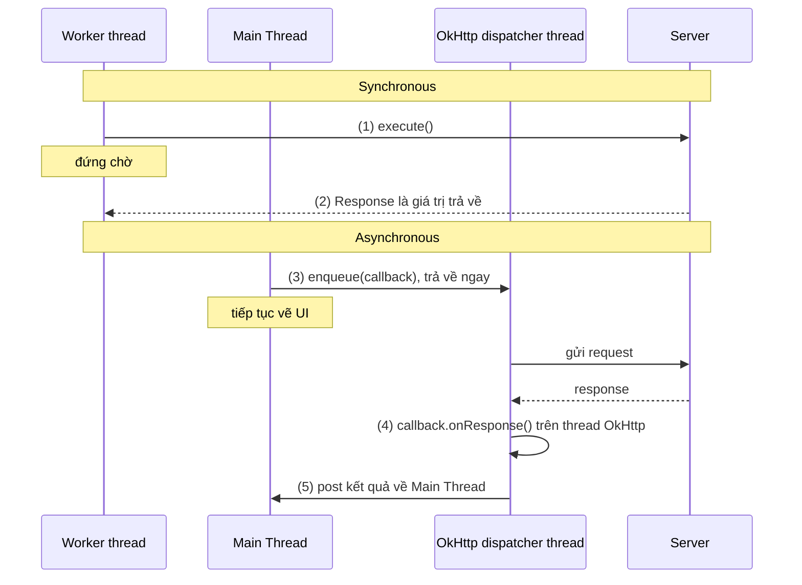
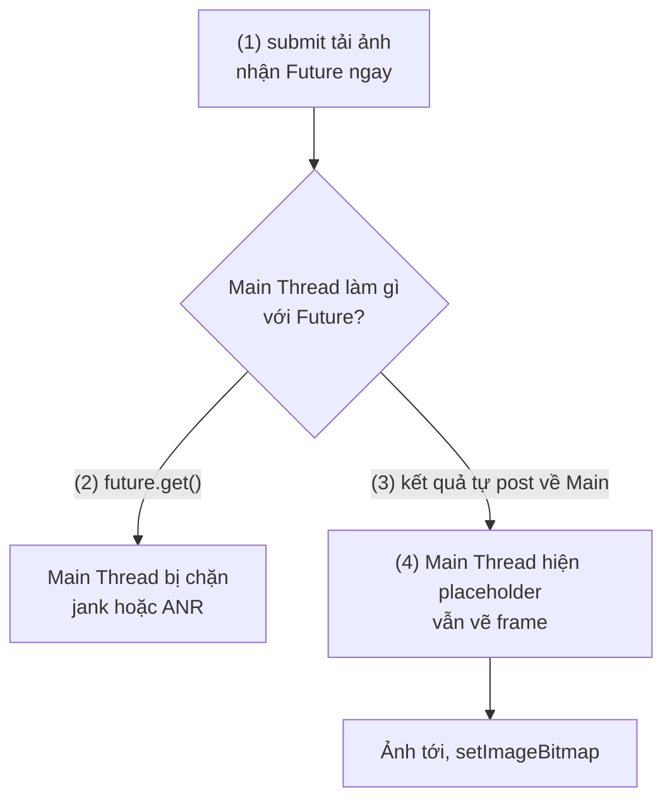
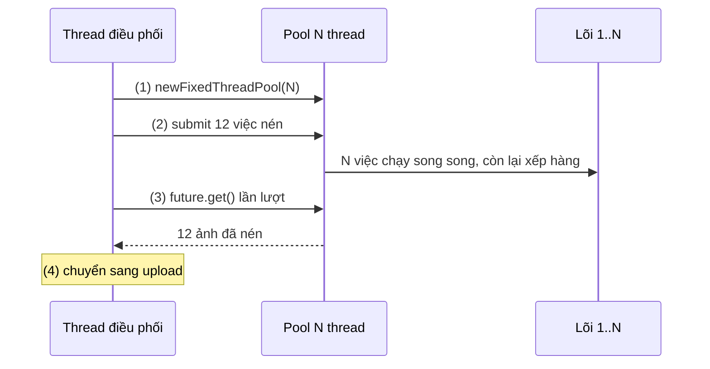
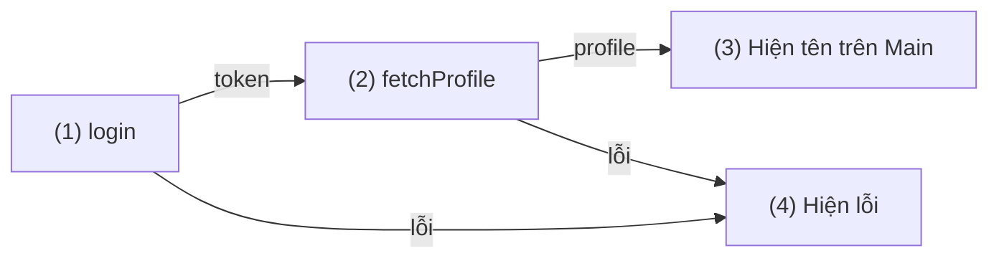
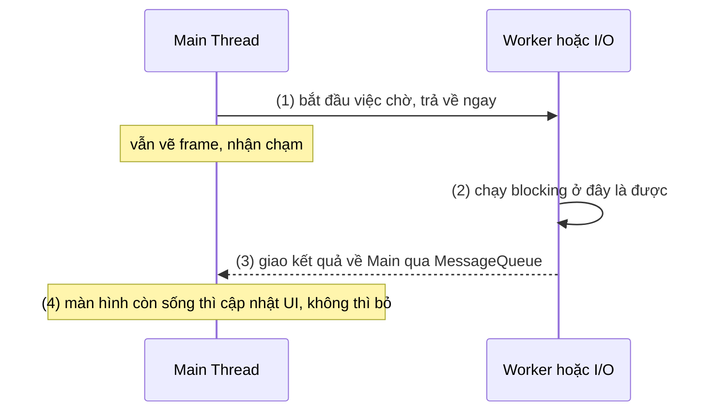
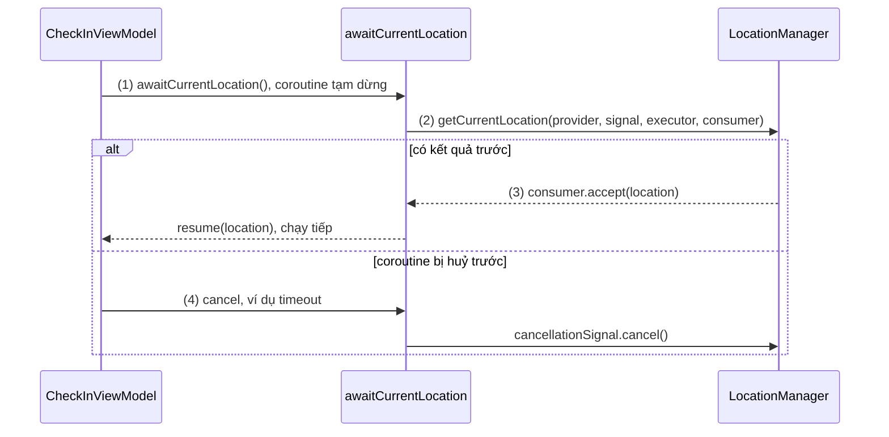

# Synchronous và Asynchronous

## Vấn đề cần giải quyết

Một lời gọi hàm bình thường có một hợp đồng đơn giản: gọi, chờ, nhận kết quả, chạy dòng tiếp theo. Hợp đồng đó ổn khi hàm chạy trong vài micro giây. Nó thành vấn đề khi hàm phải **chờ** thứ nằm ngoài CPU: server trả lời sau 800 ms, file 50 MB đọc xong sau 300 ms, GPS có toạ độ sau vài giây.

```kotlin
// Trên Main Thread: mỗi dòng giữ thread đứng yên cho tới khi xong
val config = api.fetchConfig()          // 800 ms chờ mạng
val avatar = File(path).readBytes()     // 300 ms chờ đĩa
render(config, avatar)
```

Trong lúc chờ, thread gọi hàm không làm được gì khác. Trên Android, thread đó thường là Main Thread, thread duy nhất được vẽ UI: chờ quá một frame (khoảng 16 ms ở 60 Hz) là giật, chờ 5 giây là ANR ([Working with Thread](../../session_05/working_with_thread.md), mục "Main Thread").

Để không phải chờ, code phải đổi hợp đồng: **gọi để bắt đầu việc, rồi nhận kết quả sau**. Ngay khi đổi, câu hỏi xuất hiện: kết quả đến bằng đường nào, trên thread nào, lỗi đi đâu, huỷ thế nào khi người dùng rời màn hình, nối nhiều bước ra sao. Mỗi thư viện trả lời một kiểu (callback, Future, coroutine, RxJava), và người mới hay trộn các khái niệm nền: "async" với "chạy trên thread khác", "không chặn" với "chạy song song".

Bài này dựng bộ khái niệm nền đó; 8.4.2 đến 8.4.4 là các cách hiện thực nó.

## Sau khi học xong

- Phân biệt được synchronous với asynchronous, blocking với non-blocking, concurrency với parallelism.
- Giải thích được vì sao Android buộc việc chặn phải chạy bất đồng bộ so với Main Thread và kết quả phải quay về Main Thread.
- Nhận diện được khi nào một API async bị dùng theo kiểu blocking, như gọi Future.get() trên Main Thread.
- Phân biệt được các mô hình async callback, Future, Promise/Deferred, suspend function và reactive stream theo cách giao kết quả, xử lý lỗi và huỷ.
- Áp dụng được việc bọc một API callback thành suspend function có hỗ trợ huỷ.

## Synchronous và Asynchronous là gì?

**Synchronous (đồng bộ)** và **asynchronous (bất đồng bộ)** mô tả **lúc kết quả đến tay người gọi**. Lời gọi synchronous chỉ trả về khi công việc đã xong và mang theo kết quả. Lời gọi asynchronous trả về ngay sau khi công việc được khởi động; kết quả được giao lại sau, qua một kênh khác với giá trị trả về của hàm (callback, Future, coroutine được resume, stream).

Mental model: **gọi đồ uống ở quầy**. Synchronous là đứng ở quầy tới khi nhận được ly. Asynchronous là nhận một **máy rung báo** rồi về bàn: lời gọi (đặt món) đã xong, còn đồ uống đến sau, khi máy rung. Máy rung chính là kênh giao kết quả; mỗi mô hình async là một kiểu máy rung khác nhau. Và có máy rung trong tay rồi mà vẫn đứng ở quầy nhìn chằm chằm vào nó thì cũng chẳng khác gì đứng chờ.

## Cách hoạt động

### Synchronous và asynchronous: kết quả đến lúc nào

Với lời gọi synchronous, **dòng code tiếp theo chỉ chạy khi có kết quả**; kết quả là giá trị trả về, lỗi là exception ném ra tại chỗ. Với lời gọi asynchronous, dòng tiếp theo chạy ngay; kết quả và lỗi đến sau qua kênh giao kết quả, thường trên một thread khác, và người gọi phải nói trước "khi có kết quả thì làm gì".

Sync/async là thuộc tính của **API**, không phải của thread. Cùng một việc (gửi HTTP request) có thể có cả hai dạng API. OkHttp là ví dụ rõ nhất: `Call.execute()` là synchronous, `Call.enqueue(callback)` là asynchronous. OkHttp được học ở [8.1.3 OkHttp](../networks/okhttp.md).

#### Ví dụ: kiểm tra bản cập nhật bắt buộc

**Bài toán:** khi mở app, gọi `GET /app/min-version` để biết có phải ép người dùng cập nhật không. Cùng một request, viết bằng API sync và API async, để thấy kết quả đến tay người gọi ở hai thời điểm khác nhau.

**Luồng chạy:**

1. Sync: worker thread gọi `execute()`; dòng tiếp theo chỉ chạy khi có response.
2. Sync: response là giá trị trả về; lỗi mạng là `IOException` ném ra tại chỗ.
3. Async: Main Thread gọi `enqueue()`; hàm trả về ngay, Main Thread tiếp tục vẽ UI.
4. Async: khi có response, OkHttp gọi `onResponse()` hoặc `onFailure()` **trên thread của OkHttp**, không phải Main Thread.
5. Async: muốn cập nhật UI thì phải đưa kết quả về Main Thread.



```kotlin
// MinVersionChecker.kt
class MinVersionChecker(
    private val client: OkHttpClient,
    private val mainExecutor: Executor,          // ContextCompat.getMainExecutor(context)
) {
    private val request = Request.Builder().url("https://api.example.com/app/min-version").build()

    // Synchronous: chỉ gọi từ worker thread
    @WorkerThread
    fun fetchMinVersionSync(): Int {
        client.newCall(request).execute().use { response ->           // (1) chờ tại đây
            if (!response.isSuccessful) throw IOException("HTTP ${response.code}")
            return checkNotNull(response.body).string().trim().toInt() // (2) giá trị trả về
        }
    }

    // Asynchronous: gọi được từ Main Thread
    fun fetchMinVersionAsync(onResult: (Result<Int>) -> Unit) {
        client.newCall(request).enqueue(object : Callback {           // (3) trả về ngay
            override fun onResponse(call: Call, response: Response) { // (4) thread của OkHttp
                val result = runCatching {
                    response.use {
                        if (!it.isSuccessful) throw IOException("HTTP ${it.code}")
                        checkNotNull(it.body).string().trim().toInt()
                    }
                }
                mainExecutor.execute { onResult(result) }              // (5) về Main Thread
            }

            override fun onFailure(call: Call, e: IOException) {
                mainExecutor.execute { onResult(Result.failure(e)) }
            }
        })
    }
}
```

**Kết quả:** gọi `fetchMinVersionSync()` trên Main Thread thì app ném `NetworkOnMainThreadException` ngay. Gọi `fetchMinVersionAsync` trên Main Thread thì UI vẫn cuộn mượt trong lúc chờ; đặt breakpoint trong `onResponse` sẽ thấy tên thread dạng `OkHttp https://api.example.com/...`, còn trong `onResult` là `main`.

### Blocking và non-blocking: thread có bị giữ lại không

Sync/async trả lời câu hỏi "**kết quả đến lúc nào**". Blocking/non-blocking trả lời câu hỏi khác: "**trong lúc chờ, thread đang chạy có bị giữ lại không**".

- **Blocking (chặn):** thread bị hệ điều hành cho "ngủ" tới khi điều kiện xảy ra (dữ liệu tới, khoá được nhả, hết thời gian). Thread vẫn tồn tại, vẫn giữ stack và bộ nhớ, nhưng không làm được việc gì khác. Ví dụ: `InputStream.read()`, `Thread.sleep()`, `Call.execute()`.
- **Non-blocking (không chặn):** hàm trả về ngay, kể cả khi chưa có gì để trả. Ví dụ: `queue.poll()` trả `null` nếu hàng đợi rỗng, `lock.tryLock()` trả `false` nếu khoá đang bị giữ, `Call.enqueue()`.

Hai trục này thường đi cùng nhau nhưng không phải lúc nào cũng vậy:

| | Thread bị giữ trong lúc chờ | Thread không bị giữ |
|---|---|---|
| **Kết quả có ngay khi hàm trả về** | Sync + blocking: `execute()`, `readBytes()` | Sync + non-blocking: `poll()`, `tryLock()` (trả "chưa có" ngay) |
| **Kết quả đến sau** | Async nhưng bị dùng kiểu blocking: `future.get()` | Async + non-blocking: `enqueue()`, callback |

Có một trường hợp đặc biệt quan trọng: **suspend function** của Kotlin. Đọc code thì nó giống synchronous (dòng sau chạy khi có kết quả, lỗi ném ra tại chỗ), nhưng trong lúc chờ, coroutine **nhả thread** cho việc khác. Nói gọn: suspend là synchronous với người đọc code và non-blocking với thread. Cơ chế này được học ở [8.4.3 Coroutines](coroutines.md).

Hệ quả thực tế: **một API async không tự làm code của bạn non-blocking**. Có "máy rung" rồi mà vẫn đứng nhìn nó (`future.get()`, `latch.await()`, `runBlocking { }`) thì thread vẫn bị chặn như thường.

#### Ví dụ: tải trước ảnh đại diện bằng Future

**Bài toán:** màn hồ sơ tải trước ảnh đại diện bằng một `ExecutorService` (thread pool, xem [Working with Thread](../../session_05/working_with_thread.md), mục ThreadPoolExecutor). Bản đầu tiên gọi `future.get()` trong `onCreate()` "để chắc có ảnh rồi mới hiện", và màn hình đứng hình mỗi khi mạng chậm.

**Luồng chạy:**

1. `submit()` đưa việc tải ảnh sang worker thread, trả về một `Future` ngay: phần này non-blocking.
2. Bản sai: Main Thread gọi `future.get()` và bị chặn tới khi ảnh tải xong. Mạng chậm 5 giây là ANR.
3. Bản đúng: việc tải tự đẩy kết quả về Main Thread qua `mainExecutor` khi xong; Main Thread không chờ ai.
4. Trong lúc chờ, UI hiện ảnh giữ chỗ (placeholder).



```kotlin
// ProfileActivity.kt
class ProfileActivity : AppCompatActivity() {

    private val ioExecutor: ExecutorService = Executors.newSingleThreadExecutor()
    private lateinit var binding: ActivityProfileBinding

    override fun onCreate(savedInstanceState: Bundle?) {
        super.onCreate(savedInstanceState)
        binding = ActivityProfileBinding.inflate(layoutInflater)
        setContentView(binding.root)

        // (2) SAI: API async bị dùng kiểu blocking
        // val avatar = ioExecutor.submit<Bitmap> { avatarLoader.load(userId) }.get()

        binding.avatarImage.setImageResource(R.drawable.avatar_placeholder)   // (4)
        val mainExecutor = ContextCompat.getMainExecutor(this)
        ioExecutor.execute {                                                  // (1) worker thread
            val avatar = runCatching { avatarLoader.load(userId) }.getOrNull()
            mainExecutor.execute {                                            // (3) về Main Thread
                if (!isDestroyed && avatar != null) binding.avatarImage.setImageBitmap(avatar)
            }
        }
    }

    override fun onDestroy() {
        super.onDestroy()
        ioExecutor.shutdownNow()
    }
}
```

`avatarLoader` và `userId` là phần sẵn có của màn hình. Kiểm tra `isDestroyed` chỉ là cách tối thiểu để không chạm vào View đã huỷ; cách quản lý vòng đời đầy đủ (huỷ việc theo màn hình) là việc của `lifecycleScope` ở 8.4.3. Trong thực tế, ảnh được tải bằng thư viện như [8.2.1 Glide](../loading_image/glide.md).

**Kết quả:** bật Network throttling 2G trên emulator. Bản `get()` làm màn hình trắng vài giây, có thể hiện hộp thoại ANR. Bản đúng hiện placeholder ngay, cuộn được, ảnh hiện khi tải xong. StrictMode không bắt được lỗi `get()` vì bản thân `get()` không phải Disk/Network I/O; nó chỉ chờ.

### Concurrency và parallelism

Hai từ này hay bị dùng lẫn, nhưng nói về hai thứ khác nhau:

- **Concurrency (tính đồng thời):** nhiều việc **cùng đang diễn ra** trong một khoảng thời gian, tiến triển xen kẽ nhau. Đây là cách **tổ chức** chương trình: việc A đang chờ mạng thì việc B được chạy.
- **Parallelism (tính song song):** nhiều việc **chạy tại cùng một thời điểm** trên nhiều lõi CPU. Đây là cách **thực thi**, cần phần cứng nhiều lõi.

Main Thread của Android là ví dụ concurrency không có parallelism: nó xử lý xen kẽ hàng trăm message (vẽ frame, sự kiện chạm, callback) nhưng chỉ chạy trên một lõi tại mỗi thời điểm. Ngược lại, nén 8 ảnh trên 8 thread của một CPU 8 lõi là parallelism.

Phân biệt này quyết định chọn công cụ:

- **Việc I/O-bound** (chờ mạng, đĩa) cần **concurrency**: trong lúc chờ không cần CPU, nên một số ít thread (thậm chí một thread với async I/O) phục vụ được rất nhiều việc chờ cùng lúc.
- **Việc CPU-bound** (nén ảnh, mã hoá, parse JSON lớn) chỉ nhanh hơn nhờ **parallelism**, và giới hạn bởi số lõi. Thêm thread quá số lõi chỉ tốn thêm context switch ([Working with Thread](../../session_05/working_with_thread.md), mục "Công thức tính toán kích thước Thread Pool tối ưu").

Async là công cụ để có concurrency; nó không tự tạo ra parallelism. Một trăm coroutine chạy trên `Dispatchers.Main` là một trăm việc xen kẽ trên đúng một thread.

#### Ví dụ: nén 12 ảnh trước khi upload

**Bài toán:** người dùng chọn 12 ảnh để đăng bài; mỗi ảnh phải giảm kích thước và nén JPEG trước khi upload. Nén là việc CPU-bound, nên chạy song song trên các lõi CPU sẽ nhanh hơn chạy lần lượt.

**Luồng chạy:**

1. Tạo thread pool cố định với số thread bằng số lõi CPU.
2. Gửi 12 việc nén vào pool; pool chạy song song tối đa N việc cùng lúc, phần còn lại xếp hàng.
3. Thread điều phối (không phải Main Thread) chờ lần lượt từng `Future` theo thứ tự ảnh.
4. Có đủ 12 kết quả thì chuyển sang bước upload.



```kotlin
// PhotoCompressor.kt
class PhotoCompressor {

    private val cpuPool: ExecutorService =
        Executors.newFixedThreadPool(Runtime.getRuntime().availableProcessors())   // (1)

    // Gọi từ worker thread (ví dụ trong Worker của WorkManager), không gọi từ Main Thread
    @WorkerThread
    fun compressAll(photos: List<File>, outputDir: File): List<File> {
        val futures = photos.map { photo ->
            cpuPool.submit<File> { compress(photo, File(outputDir, "c_${photo.name}")) }  // (2)
        }
        return futures.map { it.get() }                                             // (3), (4)
    }

    private fun compress(source: File, target: File): File {
        val bitmap = BitmapFactory.decodeFile(source.path, BitmapFactory.Options().apply {
            inSampleSize = 2                                   // giảm một nửa mỗi chiều
        }) ?: throw IOException("Không đọc được ${source.name}")
        target.outputStream().use { bitmap.compress(Bitmap.CompressFormat.JPEG, 85, it) }
        bitmap.recycle()
        return target
    }
}
```

Ở đây `future.get()` là chấp nhận được: nó chặn thread điều phối, một worker thread vốn chỉ có nhiệm vụ chờ. Điều cấm là chặn Main Thread.

**Kết quả:** đo bằng `SystemClock.elapsedRealtime()` trên máy 8 lõi: chạy lần lượt (pool 1 thread) mất khoảng 12 lần thời gian một ảnh; pool N thread nhanh hơn rõ rệt nhưng không đạt đúng N lần, vì decode còn tốn băng thông bộ nhớ và các lõi trên điện thoại không đồng đều. Tăng pool lên 32 thread không nhanh hơn nữa.

### Các mô hình async: kết quả được giao bằng cách nào

Mọi mô hình async đều phải trả lời bốn câu hỏi: kết quả **được giao qua kênh nào**, **nối nhiều bước** ra sao, **lỗi** đi đâu, và **huỷ** thế nào. Năm mô hình phổ biến trên Android trả lời khác nhau:

| Mô hình | Kênh giao kết quả | Nối bước | Lỗi | Huỷ |
|---|---|---|---|---|
| **Callback** | Hàm được gọi lại khi xong | Lồng callback trong callback | Tham số riêng (`onFailure`) | Tuỳ API, thường phải tự làm |
| **Future** (`java.util.concurrent.Future`) | Đối tượng giữ kết quả tương lai; lấy bằng `get()` | Không nối được, phải `get()` (chặn) | `ExecutionException` khi `get()` | `cancel(mayInterrupt)` |
| **Promise/Deferred** (`CompletableFuture`, `ListenableFuture`, coroutine `Deferred`) | Future có thể đăng ký "khi xong thì..." | Chuỗi `thenApply`, `thenCompose`; `Deferred` dùng `await()` | Đi theo chuỗi (`exceptionally`) | `cancel()`; mức độ lan truyền tuỳ thư viện |
| **Suspend function** (Kotlin coroutine) | Coroutine được resume với giá trị trả về | Viết tuần tự như code sync | `try/catch` bình thường | Structured concurrency: huỷ scope là huỷ hết |
| **Reactive stream** (RxJava, Kotlin Flow) | Luồng **nhiều** giá trị theo thời gian | Operator (`map`, `flatMap`, `debounce`) | Sự kiện lỗi kết thúc luồng | Huỷ đăng ký (`dispose`, huỷ coroutine thu thập) |

Một số điểm đáng chú ý:

- **Promise** là đối tượng đại diện cho một kết quả **chưa có**, có thể chuyền đi và đăng ký xử lý; **Deferred** là tên của khái niệm này trong kotlinx.coroutines (kết quả của `async { }`). `CompletableFuture` có từ Java 8, trên Android cần API 24. `ListenableFuture` (Guava, bản androidx `concurrent-futures`) là kiểu mà WorkManager và CameraX trả về.
- **Callback, Future, Promise, suspend** giao **một** kết quả. **Reactive stream** giao **nhiều** giá trị theo thời gian (vị trí GPS liên tục, ô tìm kiếm thay đổi từng phím, dữ liệu database thay đổi), nên nó là một mô hình khác về bản chất, không chỉ khác cú pháp. RxJava được học ở [8.4.4 RxJava, RxAndroid, RxKotlin](rxjava.md); Flow ở 7.1.4.2 Flow (chưa có bài).
- Chỉ suspend function giữ được **cấu trúc code tuần tự** (if, for, try/catch dùng như code sync) mà vẫn non-blocking. Đây là lý do coroutine trở thành khuyến nghị cho async trên Android.

#### Ví dụ: đăng nhập rồi tải hồ sơ

**Bài toán:** đăng nhập trả về token; dùng token để tải hồ sơ; hiện tên người dùng. Bước 2 phụ thuộc kết quả bước 1, và lỗi ở bất kỳ bước nào phải hiện thông báo. Cùng một luồng, viết bằng ba mô hình để thấy cách nối bước và xử lý lỗi khác nhau.

**Luồng chạy:**

1. Gọi `login(email, password)` để lấy token.
2. Dùng token gọi `fetchProfile(token)`.
3. Hiện tên người dùng trên Main Thread.
4. Lỗi ở bước 1 hoặc 2 thì hiện thông báo lỗi.



```kotlin
// Callback: mỗi bước phụ thuộc là một tầng lồng, lỗi xử lý ở từng tầng
fun signIn(email: String, password: String) {
    authApi.login(email, password, object : ApiCallback<Token> {                 // (1)
        override fun onSuccess(token: Token) {
            profileApi.fetchProfile(token, object : ApiCallback<Profile> {       // (2)
                override fun onSuccess(profile: Profile) {
                    mainExecutor.execute { showName(profile.displayName) }       // (3)
                }
                override fun onError(error: Throwable) {
                    mainExecutor.execute { showError(error) }                    // (4)
                }
            })
        }
        override fun onError(error: Throwable) {
            mainExecutor.execute { showError(error) }                            // (4) lặp lại
        }
    })
}
```

```kotlin
// CompletableFuture (API 24+): chuỗi phẳng, lỗi đi một đường
fun signIn(email: String, password: String) {
    authApi.loginAsync(email, password)                                          // (1)
        .thenCompose { token -> profileApi.fetchProfileAsync(token) }            // (2)
        .whenCompleteAsync({ profile, error ->
            if (error != null) showError(error) else showName(profile.displayName) // (3), (4)
        }, mainExecutor)
}
```

```kotlin
// Suspend function: đọc như code sync, không chặn thread
suspend fun signIn(email: String, password: String) {
    try {
        val token = authApi.login(email, password)                               // (1)
        val profile = profileApi.fetchProfile(token)                             // (2)
        showName(profile.displayName)                                            // (3) đang ở Main
    } catch (e: IOException) {
        showError(e)                                                             // (4)
    }
}
```

`ApiCallback`, `loginAsync` hay `login` dạng suspend là ba kiểu interface khác nhau của cùng một API đăng nhập; trong dự án thật, Retrofit sinh được dạng suspend ([8.1.1 Retrofit](../networks/retrofit.md)). Bản suspend được gọi từ một coroutine chạy trên Main Thread (ví dụ `viewModelScope.launch`), cơ chế ở [8.4.3 Coroutines](coroutines.md).

**Kết quả:** cả ba bản cho cùng hành vi. Thêm bước thứ ba (tải danh sách đơn hàng bằng `profile.id`) vào từng bản: bản callback thêm một tầng lồng và một chỗ xử lý lỗi nữa; bản `CompletableFuture` thêm một `thenCompose`; bản suspend thêm một dòng.

### Vì sao Android buộc phải async

Android áp dụng mô hình **một thread UI**: chỉ Main Thread được chạm vào View, và Main Thread phải xong mỗi frame trong ngân sách khoảng 16,6 ms ở 60 Hz. Cơ chế Looper, MessageQueue, Handler, ngân sách frame và điều kiện ANR được giải thích ở [Working with Thread](../../session_05/working_with_thread.md); ở đây chỉ rút ra hệ quả về sync/async:

1. **Với Main Thread, mọi việc chờ phải là async.** Main Thread không được gọi API blocking (mạng, đĩa, chờ khoá, `get()`); Android còn chặn cứng trường hợp mạng bằng `NetworkOnMainThreadException`.
2. **Việc chờ vẫn có thể là sync ở nơi khác.** `execute()` hay `readBytes()` hoàn toàn ổn trên worker thread. Async ở đây là quan hệ **giữa Main Thread và việc đó**, không phải bản thân việc đó.
3. **Kết quả phải quay về Main Thread** trước khi chạm UI: qua `Handler(Looper.getMainLooper())`, `mainExecutor`, `Activity.runOnUiThread`, hay `Dispatchers.Main`.
4. **Kết quả có thể đến khi màn hình đã mất.** Người dùng rời màn hình giữa chừng, nên mỗi việc async cần một cách huỷ hoặc bỏ qua kết quả gắn với vòng đời.



Nguyên tắc rút ra là **main-safety**: một hàm được gọi là main-safe nếu gọi nó từ Main Thread không bao giờ chặn Main Thread. Docs Android khuyên mọi hàm của tầng data (repository, data source) đều main-safe, tức là tự chuyển việc chặn sang thread phù hợp, để tầng UI gọi mà không cần biết bên trong làm gì. Hai ví dụ ở trên đều là main-safe: `fetchMinVersionAsync` và đoạn tải ảnh đại diện; với coroutine, việc này chỉ còn một dòng `withContext(Dispatchers.IO)`.

## Ví dụ thực tế

Ba bài toán async hay gặp trên Android:

1. **Bọc một API callback thành suspend function:** nhiều API của framework và SDK chỉ có dạng callback. Bọc một lần thành suspend để mọi nơi dùng kiểu tuần tự, có huỷ. Đây là bài toán chính, code đầy đủ bên dưới.
2. **Gọi song song hai request độc lập rồi gộp:** màn chi tiết sản phẩm cần thông tin sản phẩm và đánh giá; hai request không phụ thuộc nhau nên chạy đồng thời (concurrency), tổng thời gian bằng request chậm hơn thay vì tổng hai request. Với coroutine dùng hai `async { }` rồi `await()`, xem [8.4.3 Coroutines](coroutines.md).
3. **Ô tìm kiếm gợi ý theo từng phím:** mỗi phím tạo một giá trị mới, chỉ request của từ khoá mới nhất có ý nghĩa. Đây là bài toán của reactive stream (`debounce`, `switchMap`), xem [8.4.4 RxJava, RxAndroid, RxKotlin](rxjava.md).

### Bọc LocationManager.getCurrentLocation thành suspend function

**Bài toán:** màn check-in cần toạ độ hiện tại một lần. `LocationManager.getCurrentLocation()` (API 30+) là API callback: nhận một `CancellationSignal`, một `Executor` để chạy callback và một `Consumer<Location?>`. Ta muốn gọi nó như một hàm tuần tự trong coroutine, kèm timeout, và khi người dùng rời màn hình thì yêu cầu định vị phải bị huỷ thật, không chỉ bỏ qua kết quả.

**Luồng chạy:**

1. Coroutine gọi `awaitCurrentLocation()` và tạm dừng (suspend), Main Thread được nhả ra.
2. Bên trong, `suspendCancellableCoroutine` tạo một `CancellationSignal` và gọi API callback.
3. Khi hệ thống có toạ độ (hoặc trả `null`), callback gọi `continuation.resume(location)`: coroutine chạy tiếp từ dòng sau lời gọi.
4. Nếu coroutine bị huỷ trước (rời màn hình, hết timeout), `invokeOnCancellation` gọi `cancellationSignal.cancel()` để hệ thống dừng định vị.



```kotlin
// LocationExtensions.kt
@RequiresApi(Build.VERSION_CODES.R)
@RequiresPermission(anyOf = [ACCESS_COARSE_LOCATION, ACCESS_FINE_LOCATION])
suspend fun LocationManager.awaitCurrentLocation(
    provider: String,
    executor: Executor,
): Location? = suspendCancellableCoroutine { continuation ->        // (1) coroutine tạm dừng
    val cancellationSignal = CancellationSignal()
    continuation.invokeOnCancellation { cancellationSignal.cancel() } // (4) huỷ thật phía hệ thống
    getCurrentLocation(provider, cancellationSignal, executor) { location ->  // (2) API callback
        continuation.resume(location)                                  // (3) giao kết quả, chạy tiếp
    }
}
```

```kotlin
// CheckInViewModel.kt
class CheckInViewModel(
    private val locationManager: LocationManager,
    private val mainExecutor: Executor,
    private val checkInRepository: CheckInRepository,
) : ViewModel() {

    private val _state = MutableStateFlow<CheckInState>(CheckInState.Idle)
    val state: StateFlow<CheckInState> = _state

    @RequiresApi(Build.VERSION_CODES.R)
    @RequiresPermission(anyOf = [ACCESS_COARSE_LOCATION, ACCESS_FINE_LOCATION])
    fun checkIn(storeId: String) {
        viewModelScope.launch {
            _state.value = CheckInState.Locating
            val location = withTimeoutOrNull(10_000) {
                locationManager.awaitCurrentLocation(LocationManager.NETWORK_PROVIDER, mainExecutor)
            }
            _state.value = if (location == null) {
                CheckInState.LocationUnavailable
            } else {
                runCatching { checkInRepository.checkIn(storeId, location.latitude, location.longitude) }
                    .fold({ CheckInState.Done }, { CheckInState.Failed(it) })
            }
        }
    }
}
```

Vài điểm thiết kế:

- Đây là ranh giới giữa hai mô hình: phía trong là callback của framework, phía ngoài là suspend. Bọc **một lần** ở ranh giới, phần còn lại của app không phải biết đến callback.
- `suspendCancellableCoroutine` (khác `suspendCoroutine`) là thứ cho phép nối huỷ của coroutine sang huỷ của API callback. Không có bước (4), rời màn hình chỉ làm kết quả bị bỏ qua, còn GPS vẫn chạy và tốn pin.
- `resume` sau khi coroutine đã bị huỷ được kotlinx.coroutines bỏ qua, nên callback đến muộn không gây lỗi.
- `MutableStateFlow`, `viewModelScope`, `withTimeoutOrNull` là kiến thức dùng trước: StateFlow là luồng giữ trạng thái mới nhất (7.1.4.2 Flow, chưa có bài), phần còn lại học ở [8.4.3 Coroutines](coroutines.md). Quyền vị trí được xin trước theo cách ở [File Permissions](../../session_02/file_permissions.md), mục "Runtime: xin lúc chạy".

**Kết quả:** trên emulator, đặt vị trí giả trong Extended Controls → Location rồi bấm check-in: trạng thái chuyển `Locating` → `Done`. Tắt dịch vụ vị trí: sau 10 giây, `withTimeoutOrNull` trả `null`, trạng thái `LocationUnavailable`, và `cancellationSignal.cancel()` được gọi (đặt breakpoint trong `invokeOnCancellation` để thấy).

## Khi nào nên và không nên dùng

- **Nên dùng async** cho mọi việc phải chờ khi người gọi là Main Thread: mạng, đĩa, database, định vị, chờ kết quả từ process khác.
- **Nên dùng sync** bên trong worker thread hoặc bên trong code đã ở ngoài Main Thread: đơn giản hơn, dễ đọc và dễ test hơn. Không cần async hoá một hàm thuần tính toán vài micro giây.
- **Nên dùng parallelism** cho việc CPU-bound chia nhỏ được và đủ lớn để bù chi phí chia việc; không cần cho việc I/O-bound, ở đó concurrency là đủ.
- **Không dùng async như cách "sửa" chậm**: việc chậm vẫn chậm, async chỉ giữ cho UI không bị kéo theo. Tối ưu bản thân việc (cache, phân trang, giảm kích thước dữ liệu) là chuyện khác.
- **Không trộn nhiều mô hình async trong cùng một tầng** nếu không cần: chọn một (trên Android hiện nay docs khuyên coroutine), bọc callback của framework và SDK ở ranh giới như ví dụ trên.

## Sai lầm thường gặp

### 1. Tưởng "async" nghĩa là "chạy trên thread khác"

```kotlin
// Sai: callback này chạy trên Main Thread, việc nặng vẫn chặn UI
handler.post { val report = buildMonthlyReport(transactions) }  // tính toán 2 giây
```

**Lỗi lộ ra thế nào:** `post` trả về ngay nên trông như async, nhưng message được Main Looper xử lý trên chính Main Thread; 2 giây tính toán vẫn làm đứng UI.

**Cách sửa:** async chỉ nói về lúc kết quả đến. Muốn việc chạy ở nơi khác thì phải đưa nó sang một thread khác (executor, `Dispatchers.Default`), rồi mới post kết quả về.

### 2. Dùng API async kiểu blocking trên Main Thread

```kotlin
// Sai
val user = userRepository.loadUserAsync(userId).get()
val token = runBlocking { tokenStore.readToken() }
```

**Lỗi lộ ra thế nào:** chạy nhanh khi dữ liệu có sẵn, rồi ANR khi mạng hoặc đĩa chậm. Profiler cho thấy Main Thread ở trạng thái `WAITING`/`PARKED`, không tốn CPU nhưng không vẽ frame.

**Cách sửa:** đăng ký nhận kết quả (callback, `whenCompleteAsync(..., mainExecutor)`) hoặc gọi trong coroutine (`launch { val token = tokenStore.readToken() }`), không chờ kết quả trên Main Thread.

### 3. Cập nhật View từ callback chạy trên thread nền

```kotlin
// Sai: onResponse của OkHttp chạy trên thread của OkHttp
override fun onResponse(call: Call, response: Response) {
    binding.statusText.text = "Đã đồng bộ"
}
```

**Lỗi lộ ra thế nào:** `CalledFromWrongThreadException: Only the original thread that created a view hierarchy can touch its views`, đôi khi không crash ngay mà làm UI hiển thị sai.

**Cách sửa:** luôn đọc docs xem callback chạy trên thread nào; đưa phần chạm UI về Main Thread bằng `mainExecutor.execute { }` hoặc `runOnUiThread { }`.

### 4. Nghĩ concurrency là parallelism

```kotlin
// Sai: 100 coroutine, nhưng tất cả trên Main Thread
repeat(100) { index -> lifecycleScope.launch { resizeThumbnail(images[index]) } }
```

**Lỗi lộ ra thế nào:** UI vẫn đứng; tổng thời gian không giảm vì 100 việc CPU-bound chạy xen kẽ trên đúng một thread.

**Cách sửa:** việc CPU-bound chạy trên dispatcher hoặc pool có nhiều thread (`withContext(Dispatchers.Default)`), giới hạn mức song song theo số lõi.

### 5. Không có cách huỷ việc async

**Lỗi lộ ra thế nào:** người dùng mở rồi đóng màn hình nhiều lần, mỗi lần để lại một request và một callback giữ tham chiếu tới Activity cũ: tốn mạng, tốn pin, memory leak ([Working with Thread](../../session_05/working_with_thread.md), mục "Sai lầm thường gặp", phần 4).

**Cách sửa:** gắn mỗi việc async với vòng đời của nơi khởi động nó: `Call.cancel()`, `future.cancel(true)`, `CancellationSignal.cancel()`, hoặc dùng scope của coroutine để huỷ tự động.

## Lịch sử phát triển

- **Android 1.0 (2008):** async trên Android là callback và `Handler`/`Looper` ngay từ đầu; framework giao sự kiện qua listener (`View.OnClickListener`, `LocationListener`). `java.util.concurrent` (`Executor`, `Future`) có sẵn vì nó thuộc Java 5 (2004, JSR-166).
- **Android 1.5 (API 3):** `AsyncTask`, lớp tiện ích chạy việc nền rồi trả kết quả về UI thread. Nó bị deprecated ở API 30 vì dễ leak Context, mất callback khi đổi cấu hình và nuốt exception.
- **Android 3.0 (API 11):** `NetworkOnMainThreadException` biến "gọi mạng sync trên Main Thread" từ lỗi hiệu năng thành crash.
- **2012–2017, ngoài Android:** C# 5.0 (2012) đưa `async`/`await` vào ngôn ngữ; JavaScript chuẩn hoá Promise ở ES2015 và `async`/`await` ở ES2017. Hướng chung là viết code async theo dạng tuần tự.
- **Java 8 (2014), Android API 24:** `CompletableFuture`, Promise của Java, nối được bằng `thenApply`/`thenCompose`.
- **RxJava 1.0 (11/2014), Reactive Streams 1.0 (2015):** mô hình stream nhiều giá trị, có operator và Scheduler; RxJava 2 (2016) theo chuẩn Reactive Streams, RxJava 3 (2020). Chi tiết ở [8.4.4 RxJava, RxAndroid, RxKotlin](rxjava.md).
- **Kotlin 1.3 (10/2018):** coroutine stable; suspend function trở thành cách viết async tuần tự mà không chặn thread. Kotlin Flow stable trong kotlinx.coroutines 1.3 (2019).
- **Google I/O 2019:** Android chuyển sang hướng Kotlin-first; docs hiện khuyên coroutine là giải pháp cho lập trình bất đồng bộ trên Android; Room, WorkManager, DataStore và Retrofit (từ 2.6.0) đều có API suspend hoặc Flow.

## Kết nối hệ thống

- **Tiên quyết:** [Working with Thread](../../session_05/working_with_thread.md): Main Thread, Looper/MessageQueue/Handler, ANR, thread pool cho CPU-bound và I/O-bound.
- **Liên quan:**
  - [8.1.3 OkHttp](../networks/okhttp.md): một API có cả `execute()` (sync) và `enqueue()` (async).
  - [8.1.1 Retrofit](../networks/retrofit.md): interface API có thể khai báo dạng suspend.
  - [Android Service](../../session_04/components/services/android_service.md): WorkManager cho việc async phải chạy cả khi app đã đóng.
- **Học tiếp:**
  - [8.4.2 Thread and Multi-Thread](thread_multithread.md): khi nhiều thread cùng chạm vào một dữ liệu, cần gì để kết quả đúng.
  - [8.4.3 Coroutines](coroutines.md): suspend function, structured concurrency, Dispatchers, huỷ.
  - [8.4.4 RxJava, RxAndroid, RxKotlin](rxjava.md): reactive stream, Schedulers.
  - 7.1.4.2 Flow (chưa có bài): reactive stream của Kotlin.

## Tham khảo

- [Processes and threads overview - Android Developers](https://developer.android.com/guide/components/processes-and-threads)
- [Kotlin coroutines on Android - Android Developers](https://developer.android.com/kotlin/coroutines)
- [Keep your app responsive (ANR) - Android Developers](https://developer.android.com/topic/performance/vitals/anr)
- [LocationManager.getCurrentLocation - Android Developers](https://developer.android.com/reference/android/location/LocationManager#getCurrentLocation(java.lang.String,%20android.os.CancellationSignal,%20java.util.concurrent.Executor,%20java.util.function.Consumer%3Candroid.location.Location%3E))
- [suspendCancellableCoroutine - kotlinx.coroutines API](https://kotlinlang.org/api/kotlinx.coroutines/kotlinx-coroutines-core/kotlinx.coroutines/suspend-cancellable-coroutine.html)
- [Calls (execute và enqueue) - OkHttp](https://square.github.io/okhttp/features/calls/)
- [CompletableFuture - Android Developers](https://developer.android.com/reference/java/util/concurrent/CompletableFuture)
- [AsyncTask (deprecated) - Android Developers](https://developer.android.com/reference/android/os/AsyncTask)
- [Concurrency is not Parallelism - Rob Pike (2012)](https://go.dev/blog/waza-talk)
