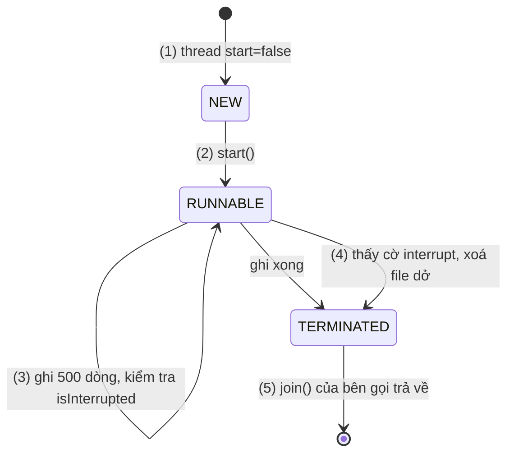
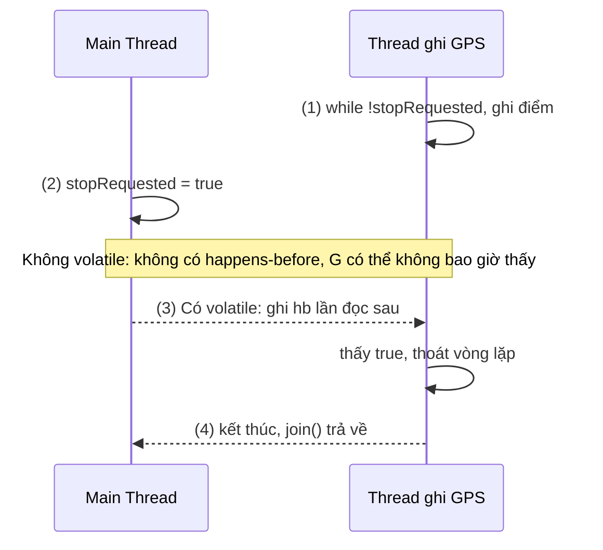
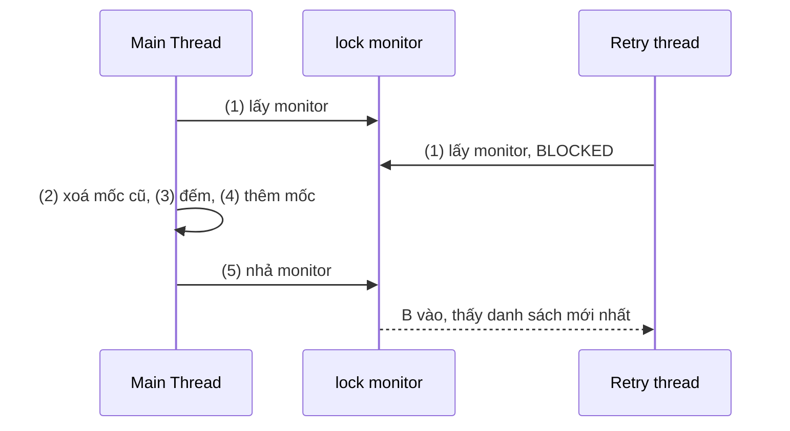
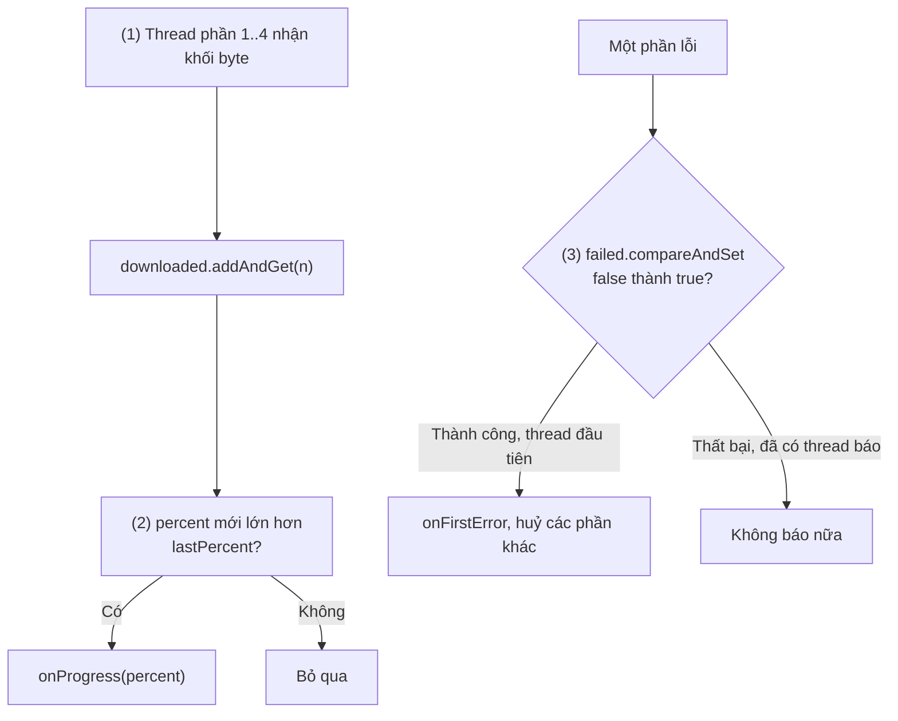
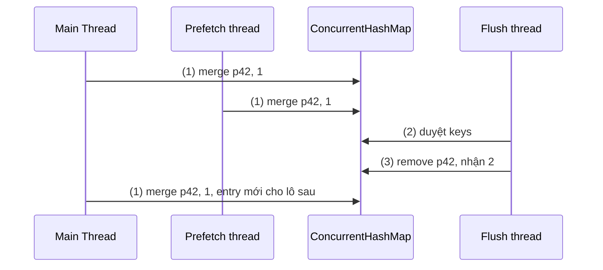
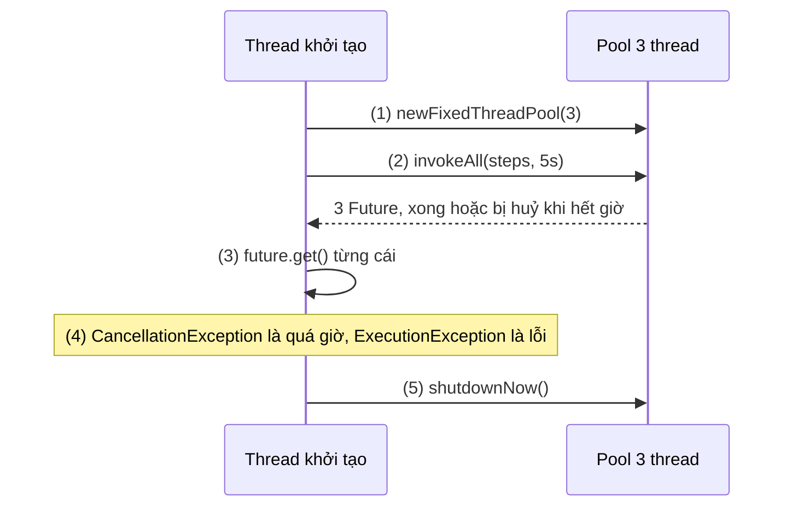
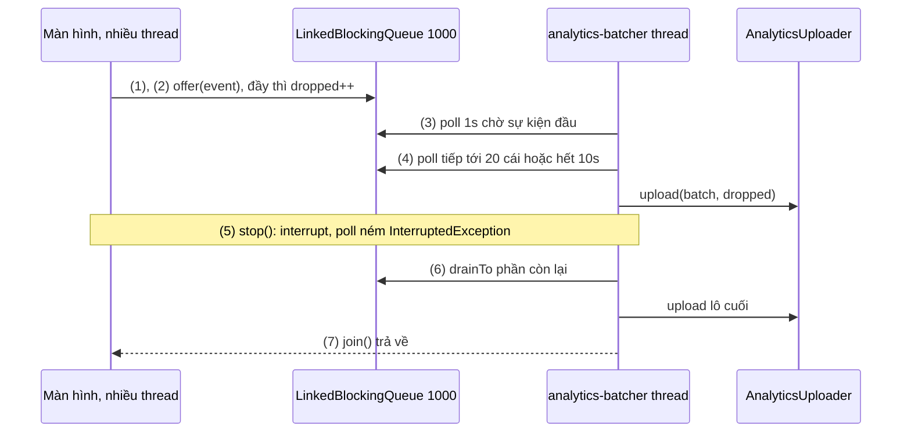

# Thread and Multi-Thread

## Vấn đề cần giải quyết

Code đúng trên một thread có thể sai khi hai thread cùng chạm vào một dữ liệu. [Working with Thread](../../session_05/working_with_thread.md) đã cho thấy `downloadCount++` đếm thiếu vì nó là ba bước đọc, cộng, ghi; đó chỉ là một trong ba cách code đa luồng hỏng:

```kotlin
// (a) Atomicity: hai thread cùng đọc giá trị cũ rồi ghi đè nhau
counter++

// (b) Visibility: thread nền có thể không bao giờ thấy cờ được Main Thread gán
var stopRequested = false
thread { while (!stopRequested) recordGpsPoint() }   // có thể chạy mãi
stopRequested = true

// (c) Ordering: thread khác có thể thấy tham chiếu trước khi object khởi tạo xong
if (instance == null) instance = HeavyIndex(loadWords())
```

Cả ba qua được code review và unit test, rồi hỏng lẻ tẻ trên máy người dùng, tuỳ CPU, cách JIT tối ưu và thời điểm scheduler đổi thread; debugger còn làm lỗi biến mất. Thêm `Thread.sleep` "cho chắc" không sửa được. Cần một mô hình chính xác về **khi nào lần ghi ở thread này được đảm bảo nhìn thấy ở thread khác**, và biết mỗi công cụ đảm bảo phần nào của mô hình đó. Bài này ở mức JVM và ngôn ngữ; phần riêng của Android (Main Thread, Looper/Handler, HandlerThread, ANR, kích thước `ThreadPoolExecutor`, deadlock) ở 5.2.

## Sau khi học xong

- Giải thích được vòng đời của Thread qua các trạng thái của Thread.State và cách start, join, interrupt tác động lên chúng.
- Giải thích được ba tính chất atomicity, visibility, ordering và quan hệ happens-before của Java Memory Model.
- Phân biệt được synchronized, volatile, atomic, ReentrantLock và concurrent collections theo tính chất mà mỗi công cụ đảm bảo.
- Triển khai được ExecutorService, Future và CountDownLatch để chia việc, chờ kết quả có timeout và điều phối nhiều thread.
- Nhận diện được lỗi check-then-act, publish object chưa an toàn, khoá sai đối tượng và nuốt InterruptedException.

## Thread and Multi-Thread là gì?

**Thread** là một luồng thực thi có call stack riêng, được hệ điều hành lập lịch chạy trên CPU ([Working with Thread](../../session_05/working_with_thread.md), mục "Thread trong Android là gì?"). **Multi-threading (đa luồng)** ở mức JVM là cho nhiều thread chạy trong cùng một process và dùng chung một heap; chương trình chỉ đúng khi mọi truy cập vào dữ liệu dùng chung có thể thay đổi được sắp thứ tự bằng quan hệ **happens-before** mà **Java Memory Model (JMM)** định nghĩa.

Mental model: mỗi thread làm việc trên **bản nháp riêng** của dữ liệu dùng chung. Những gì nó ghi chỉ chắc được **công bố** khi đi qua một điểm đồng bộ (nhả khoá, ghi `volatile`, kết thúc thread, đưa việc vào executor), và thread khác chỉ chắc **nhận** khi đi qua điểm tương ứng (lấy cùng khoá, đọc cùng biến `volatile`, `join`, `Future.get`). Không có cặp công bố – nhận thì không có gì đảm bảo. Đây là hình ảnh để suy luận, không phải mô tả cache phần cứng: JMM chỉ hứa về happens-before.

## Cách hoạt động

### Thread và vòng đời của nó

`Thread.State` có sáu trạng thái:

| Trạng thái | Nghĩa | Vào bằng cách nào |
|---|---|---|
| `NEW` | Đã tạo object, chưa chạy | `Thread(runnable)`, `thread(start = false) { }` |
| `RUNNABLE` | Đang chạy hoặc sẵn sàng chạy | `start()` |
| `BLOCKED` | Chờ lấy monitor của `synchronized` | Thread khác đang giữ khoá |
| `WAITING` | Chờ không thời hạn | `join()`, `Object.wait()`, `LockSupport.park()` (dùng bởi `Lock`, `BlockingQueue`) |
| `TIMED_WAITING` | Chờ có thời hạn | `sleep(ms)`, `join(ms)`, `poll(timeout)` |
| `TERMINATED` | `run()` đã kết thúc (bình thường hoặc ném exception) | |

Hai chi tiết hay gây hiểu nhầm:

- Thread đang chờ I/O native (socket, `java.io`) vẫn báo `RUNNABLE`: thấy `RUNNABLE` trong thread dump chưa chắc thread đang dùng CPU.
- **Interrupt là lời đề nghị, không phải lệnh dừng.** `interrupt()` chỉ bật một cờ. `sleep`, `join`, `wait`, `BlockingQueue.take/poll` thấy cờ thì xoá cờ và ném `InterruptedException`; code đang tính toán phải tự kiểm tra `Thread.currentThread().isInterrupted`; I/O của `java.io` không phản hồi. Không có cách an toàn để ép thread dừng từ ngoài (`Thread.stop()` đã bị bỏ).

#### Ví dụ: xuất báo cáo CSV có nút huỷ

**Bài toán:** app kế toán xuất giao dịch cả năm ra CSV trên một thread riêng, mất vài chục giây; bấm "Huỷ" thì thread phải dừng sớm và xoá file dở.

**Luồng chạy:**

1. Tạo thread với `start = false`: `NEW`.
2. `start()`: `RUNNABLE`, bắt đầu ghi từng dòng.
3. Mỗi 500 dòng, kiểm tra cờ interrupt.
4. Bấm "Huỷ": `interrupt()` bật cờ; lần kiểm tra sau, thread dừng và xoá file dở.
5. `run()` kết thúc: `TERMINATED`; bên đang `join()` (`WAITING`) được đánh thức.



```kotlin
// TransactionCsvExporter.kt
class TransactionCsvExporter(private val source: TransactionSource) {

    fun startExport(target: File, onDone: (Boolean) -> Unit): Thread {
        val worker = thread(start = false, name = "csv-export") {          // (1) NEW
            var completed = false
            try {
                target.bufferedWriter().use { writer ->
                    writer.appendLine("date,amount,category,note")
                    for ((index, tx) in source.allTransactions().withIndex()) {
                        if (index % 500 == 0 && Thread.currentThread().isInterrupted) {  // (3)
                            return@use                                       // (4) dừng sớm
                        }
                        writer.appendLine(tx.toCsvLine())
                    }
                    completed = true
                }
            } finally {
                if (!completed) target.delete()                              // (4) không để file dở
                onDone(completed)
            }
        }
        worker.start()                                                       // (2) RUNNABLE
        return worker
    }
}
```

Bên gọi giữ `Thread` trả về: nút "Huỷ" gọi `worker.interrupt()` (4); test hoặc worker thread khác gọi `worker.join()` (5).

**Kết quả:** `worker.state` là `NEW` trước `start()`, `RUNNABLE` ngay sau, `TERMINATED` sau `join()`. Huỷ giữa chừng thì `onDone(false)` và file bị xoá. Bỏ kiểm tra (3) thì `interrupt()` vô tác dụng.

### Java Memory Model: atomicity, visibility, ordering

Compiler, JIT của ART và CPU được phép giữ giá trị trong thanh ghi, đổi thứ tự lệnh không phụ thuộc nhau, gộp các lần ghi. Trên một thread điều đó vô hình; với nhiều thread nó lộ ra thành ba loại lỗi:

- **Atomicity (tính nguyên tử):** thao tác nhiều bước có bị chen ngang không. `counter++` không nguyên tử; theo JLS, ghi `Long`/`Double` không `volatile` còn có thể bị tách làm hai lần 32 bit.
- **Visibility (tính hiển thị):** lần ghi của thread A có được B nhìn thấy không. Không có đảm bảo thì JIT được đọc `stopRequested` một lần rồi dùng mãi.
- **Ordering (thứ tự):** B có thấy các lần ghi của A đúng thứ tự không. Không có đảm bảo thì B có thể thấy `instance != null` trước khi thấy field bên trong được gán.

JMM định nghĩa một quan hệ: **nếu X happens-before Y thì Y thấy mọi kết quả của X**. Hai thread truy cập cùng một biến, ít nhất một bên ghi, mà không có happens-before giữa hai truy cập là **data race**, kết quả không được đảm bảo. Các nguồn happens-before chính:

1. **Thứ tự chương trình:** trong một thread, lệnh trước happens-before lệnh sau.
2. **Monitor:** nhả một khoá happens-before lần lấy **cùng khoá đó** sau này.
3. **Volatile:** ghi một biến `volatile` happens-before mọi lần đọc **cùng biến đó** sau này.
4. **Thread:** `start()` happens-before mọi lệnh trong thread mới; mọi lệnh của một thread happens-before lúc `join()` của nó trả về.
5. **`java.util.concurrent`:** đưa việc vào executor happens-before việc đó chạy; việc chạy xong happens-before `Future.get()` trả về; `countDown()` happens-before `await()` trả về; đặt phần tử vào concurrent collection happens-before lấy nó ra.
6. **Bắc cầu:** X hb Y và Y hb Z thì X hb Z.

Mọi công cụ ở các phần sau là cách tạo các cạnh happens-before này, một số thêm cả atomicity.

`volatile` (`@Volatile` trong Kotlin) là cạnh rẻ nhất: ghi volatile công bố mọi thứ ghi trước nó, đọc volatile nhận mọi thứ đó. Nó **không** làm `count++` nguyên tử ([Working with Thread](../../session_05/working_with_thread.md), mục "Sai lầm thường gặp", phần 2); nó hợp với cờ do một bên ghi nhiều bên đọc, và với việc publish object đã khởi tạo xong.

#### Ví dụ: dừng thread ghi hành trình GPS

**Bài toán:** app chạy bộ có thread ghi điểm GPS mỗi giây; bấm "Kết thúc" trên Main Thread gán `stopRequested = true`. Thiếu `@Volatile` thì không có gì đảm bảo thread ghi dừng.

**Luồng chạy:**

1. Thread ghi lặp `while (!stopRequested)`; không có happens-before với Main Thread, JIT được đọc cờ một lần rồi giữ.
2. Main Thread gán `stopRequested = true`: lần ghi thường, không công bố gì.
3. Có `@Volatile`: lần ghi (2) happens-before lần đọc tiếp theo ở (1), vòng lặp thấy `true` và thoát.
4. Thread kết thúc; bên gọi `join()` thấy mọi thứ thread đã ghi.



```kotlin
// RunRecorder.kt
class RunRecorder(private val gps: GpsSource, private val output: TrackWriter) {

    @Volatile private var stopRequested = false                  // (3) điểm công bố – nhận

    private val worker = thread(start = false, name = "run-recorder") {
        while (!stopRequested) {                                 // (1) mỗi vòng đọc lại biến volatile
            output.append(gps.currentPoint())
            Thread.sleep(1_000)
        }
        output.close()
    }

    fun start() = worker.start()

    fun stop() {
        stopRequested = true                                     // (2) ghi volatile
        worker.join(2_000)                                       // (4)
    }
}
```

**Kết quả:** bản lỗi khó tái hiện chắc chắn, đó chính là bản chất data race: vòng lặp có `Thread.sleep` thường vẫn "tình cờ" thấy cờ, vòng lặp chặt thì JIT dễ hoist phép đọc ra ngoài. Có `@Volatile` thì đúng **theo đảm bảo** của JMM. Muốn dừng ngay thay vì chờ hết `sleep` thì thêm `interrupt()`.

### synchronized: loại trừ tương hỗ cộng visibility

Mỗi object trên JVM có một **monitor** (khoá nội tại). `synchronized(lock) { }` lấy monitor của `lock` khi vào khối và nhả khi ra (kể cả khi ném exception), cho hai đảm bảo:

- **Loại trừ tương hỗ (mutual exclusion):** mỗi lúc chỉ một thread ở trong các khối cùng khoá, thread khác `BLOCKED`. Đây là cách làm **một cụm nhiều bước** trên nhiều biến trở nên nguyên tử.
- **Visibility:** nhả khoá happens-before lần lấy cùng khoá tiếp theo.

Monitor là **reentrant** (thread đang giữ khoá vào lại được). Kotlin dùng hàm `synchronized(lock) { }` hoặc `@Synchronized` trên hàm (khoá là `this`). Khoá nên là **object riêng tư, cố định** (`private val lock = Any()`), để code bên ngoài không vô tình cùng khoá. Thread `BLOCKED` chờ monitor không phản hồi interrupt và không có timeout. `wait()`/`notify()` dễ sai; code ứng dụng nên dùng `BlockingQueue`, `CountDownLatch` hoặc coroutine. Deadlock ở [Working with Thread](../../session_05/working_with_thread.md), mục "Sai lầm thường gặp", phần 3.

#### Ví dụ: giới hạn số lần gửi OTP

**Bài toán:** đăng nhập bằng số điện thoại cho gửi tối đa 3 OTP trong 10 phút; yêu cầu đến từ nút "Gửi lại" (Main Thread) và từ luồng tự thử lại (worker). Logic là **check-then-act** trên một danh sách (xoá mốc cũ, đếm, thêm), nên cả cụm phải nguyên tử.

**Luồng chạy:**

1. `tryAcquire()` lấy monitor của `lock`; thread khác gọi cùng lúc `BLOCKED`.
2. Xoá mốc đã ra khỏi cửa sổ 10 phút.
3. Đủ 3 mốc thì trả `false`.
4. Chưa đủ thì ghi mốc hiện tại, trả `true`.
5. Nhả monitor; thread chờ tiếp theo vào và thấy danh sách đã cập nhật.



```kotlin
// OtpRateLimiter.kt
class OtpRateLimiter(
    private val maxRequests: Int = 3,
    private val windowMillis: Long = 10 * 60_000L,
    private val clock: () -> Long = SystemClock::elapsedRealtime,
) {
    private val lock = Any()                                 // khoá riêng tư, cố định
    private val sentAt = ArrayDeque<Long>()                  // chỉ chạm vào khi giữ lock

    fun tryAcquire(): Boolean {
        synchronized(lock) {                                 // (1)
            val now = clock()
            while (sentAt.isNotEmpty() && now - sentAt.first() >= windowMillis) {
                sentAt.removeFirst()                         // (2)
            }
            if (sentAt.size >= maxRequests) return false     // (3)
            sentAt.addLast(now)                              // (4)
            return true
        }                                                    // (5) nhả monitor
    }
}
```

**Kết quả:** với `clock` giả, 3 lần đầu `true`, lần 4 `false`, tiến đồng hồ 10 phút thì lại `true`. 50 thread cùng gọi: đúng 3 lần `true`. Bỏ `synchronized` thì đôi khi 4–5 lần `true` hoặc `NoSuchElementException`.

### Atomic và CAS: nguyên tử không cần khoá

Các lớp trong `java.util.concurrent.atomic` (`AtomicInteger`, `AtomicLong`, `AtomicBoolean`, `AtomicReference`) cho thao tác nguyên tử trên **một biến** mà không cần khoá. Chúng dựa trên lệnh **CAS (compare-and-swap)** của CPU: "nếu giá trị hiện tại vẫn là `expected` thì đổi thành `new`, báo thành công; nếu không thì không làm gì, báo thất bại". Các hàm như `incrementAndGet()` là một vòng lặp đọc → tính → CAS, thử lại khi có thread khác chen vào.

- Đọc ghi atomic có ngữ nghĩa như `volatile`, cộng thêm thao tác đọc-sửa-ghi nguyên tử. `compareAndSet` giải bài toán "chỉ người đầu tiên thắng".
- `updateAndGet`, `getAndAccumulate` (Java 8, Android API 24) nhận hàm có thể bị gọi lại khi CAS thất bại, nên hàm không được có side effect. Bộ đếm bị rất nhiều thread tăng thì `LongAdder` (API 24) nhanh hơn.
- Atomic **không** giữ bất biến giữa **nhiều** biến ("trừ ví A, cộng ví B"); lúc đó cần khoá.
- Kotlin 2.1.20 thêm `kotlin.concurrent.atomics` (`AtomicInt`, `AtomicLong`...) cho Multiplatform, ở trạng thái Experimental; trên JVM ánh xạ xuống `java.util.concurrent.atomic`.

#### Ví dụ: tiến độ tải file chia bốn phần song song

**Bài toán:** tải gói video 400 MB bằng 4 kết nối song song. Thanh tiến độ cần tổng byte từ cả 4 thread; nhiều phần lỗi gần như cùng lúc thì chỉ báo lỗi **một lần**.

**Luồng chạy:**

1. Mỗi khối byte nhận được, thread `addAndGet` vào tổng chung.
2. `getAndAccumulate(..., max)` giữ phần trăm lớn nhất đã báo; chỉ báo khi phần trăm tăng.
3. Khi lỗi, `compareAndSet(false, true)`: chỉ thread đầu tiên thành công và báo lỗi; thread khác thấy `hasFailed` và tự dừng.



```kotlin
// MultipartProgress.kt
class MultipartProgress(
    private val totalBytes: Long,
    private val onProgress: (Int) -> Unit,
    private val onFirstError: (Throwable) -> Unit,
) {
    private val downloaded = AtomicLong(0)
    private val lastPercent = AtomicInteger(-1)
    private val failed = AtomicBoolean(false)

    val hasFailed: Boolean get() = failed.get()

    // Gọi từ 4 thread tải cùng lúc
    fun onBytes(count: Int) {
        val now = downloaded.addAndGet(count.toLong())                       // (1)
        val percent = (now * 100 / totalBytes).toInt()
        val previous = lastPercent.getAndAccumulate(percent) { old, new -> maxOf(old, new) }  // (2)
        if (percent > previous) onProgress(percent)
    }

    fun onError(error: Throwable) {
        if (failed.compareAndSet(false, true)) onFirstError(error)          // (3)
    }
}
```

`onProgress` chạy trên thread tải; phía nhận đưa về Main Thread trước khi cập nhật UI ([8.4.1](sync_async.md)).

**Kết quả:** 4 thread, mỗi thread `onBytes(1)` 100 000 lần với `totalBytes = 400_000`: tổng đúng 400 000, mỗi phần trăm báo nhiều nhất một lần; `onError` từ 4 thread: `onFirstError` chạy đúng một lần. Thay bằng `var downloaded: Long` thì tổng thiếu.

### Lock và ReentrantLock: khoá có thêm lựa chọn

`java.util.concurrent.locks.Lock` làm cùng việc với `synchronized` (loại trừ tương hỗ, `unlock()` happens-before `lock()` sau đó) nhưng là một object có API, nên có thêm: `tryLock()` (không được thì trả `false` ngay), `tryLock(time, unit)` (chờ có giới hạn), `lockInterruptibly()` (chờ nhưng phản hồi interrupt), khoá công bằng `ReentrantLock(fair = true)`, nhiều `Condition` trên một khoá, và `ReentrantReadWriteLock` (nhiều thread đọc cùng lúc, ghi độc quyền). Cái giá là phải `unlock()` trong `finally`; Kotlin có `lock.withLock { }`, `rwLock.read { }`, `rwLock.write { }` (gói `kotlin.concurrent`) làm việc đó. Mặc định dùng `synchronized`; chuyển sang `Lock` khi cần một trong các khả năng trên.

```kotlin
// InboxSyncer.kt: kéo để làm mới khi đang đồng bộ thì bỏ qua, không xếp hàng
private val syncLock = ReentrantLock()

@WorkerThread
fun syncIfIdle(): SyncResult {
    if (!syncLock.tryLock()) return SyncResult.AlreadyRunning   // non-blocking
    try {
        return doSync()                                         // gọi API, ghi database
    } finally {
        syncLock.unlock()                                       // luôn nhả, kể cả khi lỗi
    }
}
```

`tryLock` ở đây là dạng non-blocking của việc lấy khoá ([8.4.1](sync_async.md), mục "Blocking và non-blocking"). Nếu chỉ cần đúng việc này thì `AtomicBoolean.compareAndSet` cũng đủ; `ReentrantLock` có lợi khi một hàm khác cần chờ cùng khoá có timeout, ví dụ `syncLock.tryLock(30, TimeUnit.SECONDS)` trước khi gửi thư.

### Concurrent collections

`ArrayList`, `HashMap` thường không an toàn khi nhiều thread cùng sửa (mất phần tử, `ConcurrentModificationException`, hỏng cấu trúc). `java.util.concurrent` có các bản an toàn, mỗi bản tối ưu cho một kiểu truy cập:

| Collection | Cơ chế | Hợp với |
|---|---|---|
| `ConcurrentHashMap` | Khoá rất mịn theo từng phần, đọc gần như không khoá | Map dùng chung đọc ghi nhiều; cache, bộ đếm theo key |
| `CopyOnWriteArrayList` / `CopyOnWriteArraySet` | Mỗi lần ghi tạo bản sao mảng mới; duyệt trên ảnh chụp | Danh sách đọc rất nhiều, ghi rất ít: listener |
| `LinkedBlockingQueue`, `ArrayBlockingQueue` | Hàng đợi có `put`/`take` chặn và `offer`/`poll` không chặn | Producer-consumer giữa các thread |
| `Collections.synchronizedList(...)` | Bọc mọi hàm bằng một khoá | Code cũ; duyệt vẫn phải tự `synchronized` |

Điều quan trọng nhất: **collection an toàn chỉ làm từng thao tác đơn lẻ nguyên tử**. `get` rồi `put` vẫn là check-then-act và vẫn race; muốn cả cụm nguyên tử thì dùng hàm gộp của `ConcurrentHashMap`: `putIfAbsent`, `computeIfAbsent`, `compute`, `merge`, `remove(key)`. Duyệt `ConcurrentHashMap` là **weakly consistent**: không ném lỗi khi map đổi trong lúc duyệt, nhưng có thể thấy hoặc không thấy thay đổi đó. Map này không nhận key hay value `null`.

#### Ví dụ: đếm lượt hiển thị sản phẩm rồi gửi theo lô

**Bài toán:** đếm số lần mỗi sản phẩm hiện trên màn hình (impression) từ Main Thread và thread prefetch; mỗi 30 giây một thread nền lấy số đếm gửi lên server và đếm lại từ 0, không mất lượt nào đến đúng lúc đang gửi.

**Luồng chạy:**

1. Mỗi lượt gọi `merge(productId, 1, Int::plus)`: tạo mới hoặc cộng thêm, nguyên tử theo key.
2. Thread gửi duyệt các key (weakly consistent).
3. `remove(productId)` lấy giá trị và xoá trong một bước; lượt đến sau tạo entry mới cho lô sau.



```kotlin
// ImpressionCounter.kt
class ImpressionCounter {

    private val counts = ConcurrentHashMap<String, Int>()

    fun record(productId: String) {
        counts.merge(productId, 1, Int::plus)                    // (1) nguyên tử theo key
    }

    // Gọi từ flush thread mỗi 30 giây
    fun drain(): Map<String, Int> {
        val batch = HashMap<String, Int>()
        for (productId in counts.keys) {                         // (2) weakly consistent
            val count = counts.remove(productId) ?: continue     // (3) lấy và xoá một bước
            batch[productId] = count
        }
        return batch
    }
}
```

**Kết quả:** 8 thread `record("p42")` 10 000 lần mỗi thread trong lúc thread khác `drain()` liên tục: tổng mọi lô đúng 80 000. Đổi (1) thành `counts["p42"] = (counts["p42"] ?: 0) + 1` thì tổng thiếu.

### ExecutorService, Future và CountDownLatch

Kiến trúc `ThreadPoolExecutor` và cách chọn kích thước pool ở [Working with Thread](../../session_05/working_with_thread.md). Ở mức API, `ExecutorService` tách **việc cần làm** khỏi **thread chạy nó**:

- `submit(callable)` trả `Future<T>` ngay. `get()` chờ kết quả, `get(timeout, unit)` ném `TimeoutException` khi quá giờ; lỗi trong việc được bọc trong `ExecutionException` (lỗi gốc ở `cause`). `cancel(true)` interrupt thread đang chạy việc.
- `invokeAll(tasks, timeout, unit)` chờ cả danh sách xong hoặc hết giờ; việc chưa xong bị huỷ.
- `shutdown()` ngừng nhận việc mới; `shutdownNow()` interrupt việc đang chạy. Pool không được shutdown thì thread của nó sống mãi.

**`CountDownLatch(n)`** là bộ đếm lùi dùng một lần: `countDown()` giảm, `await(timeout, unit)` chờ về 0; mỗi `countDown()` happens-before lúc `await()` trả về. Cùng họ có `Semaphore` (giới hạn số thread vào một vùng) và `CyclicBarrier` (hẹn nhau tại một điểm, dùng lại được).

#### Ví dụ: chuẩn bị dữ liệu ở lần mở đầu tiên, tối đa 5 giây

**Bài toán:** app từ điển offline ở lần mở đầu giải nén từ điển, nạp từ phổ biến và dọn dữ liệu cũ. Ba bước độc lập chạy song song, tổng không quá 5 giây; bước quá giờ bị huỷ và báo lại để lần sau làm tiếp.

**Luồng chạy:**

1. Tạo pool với số thread bằng số bước.
2. `invokeAll(steps, 5, SECONDS)` chờ cả ba xong hoặc hết 5 giây.
3. `get()` từng `Future` trả ngay vì việc đã xong hoặc đã bị huỷ.
4. Hết giờ thì `CancellationException`; lỗi thì `ExecutionException`, lấy `cause`.
5. `shutdownNow()` trong `finally`.



```kotlin
// FirstLaunchInitializer.kt
data class InitReport(val failures: List<Pair<String, Throwable>>)

class FirstLaunchInitializer(private val steps: Map<String, Callable<Unit>>) {

    @WorkerThread
    fun runAll(timeoutSeconds: Long = 5): InitReport {
        val names = steps.keys.toList()
        val pool = Executors.newFixedThreadPool(steps.size)                            // (1)
        try {
            val futures = pool.invokeAll(steps.values.toList(), timeoutSeconds, TimeUnit.SECONDS)  // (2)
            val failures = futures.mapIndexedNotNull { index, future ->
                try {
                    future.get()                                                       // (3)
                    null
                } catch (e: CancellationException) {
                    names[index] to TimeoutException("${names[index]} quá $timeoutSeconds giây")  // (4)
                } catch (e: ExecutionException) {
                    names[index] to (e.cause ?: e)                                     // (4)
                }
            }
            return InitReport(failures)
        } finally {
            pool.shutdownNow()                                                         // (5)
        }
    }
}
```

`CancellationException` ở đây là `java.util.concurrent.CancellationException`. `runAll` chạy trên worker thread (ví dụ `doWork()` của WorkManager). Một cách dùng `CountDownLatch` rất phổ biến là **test API callback**: test chờ callback chạy trên thread khác rồi mới kiểm tra.

```kotlin
// MinVersionCheckerTest.kt: test API async ở 8.4.1 bằng CountDownLatch
@Test
fun fetchMinVersionAsync_deliversParsedVersion() {
    server.enqueue(MockResponse().setBody("42"))          // MockWebServer của OkHttp
    val checker = MinVersionChecker(OkHttpClient(), Executor { it.run() })
    val latch = CountDownLatch(1)
    var result: Result<Int>? = null

    checker.fetchMinVersionAsync { result = it; latch.countDown() }

    assertTrue(latch.await(5, TimeUnit.SECONDS))          // chờ có giới hạn, không treo test
    assertEquals(42, result?.getOrNull())                 // an toàn: countDown hb await
}
```

`result` là `var` thường nhưng đọc an toàn sau `await()`: lần ghi xảy ra trước `countDown()`, và `countDown()` happens-before `await()` trả về (quy tắc 5).

**Kết quả:** giả lập bước giải nén chạy 8 giây: `runAll()` trả về sau khoảng 5 giây, báo `TimeoutException` cho bước đó, hai bước còn lại thành công. Bước ném `IOException` thì báo cáo chứa lỗi gốc, không phải `ExecutionException`.

## Ví dụ thực tế

Ba bài toán đa luồng hay gặp trong app Android:

1. **Gom sự kiện analytics rồi gửi theo lô (producer-consumer):** bài toán chính, code đầy đủ bên dưới.
2. **Nhiều request cùng nhận 401, chỉ refresh token một lần:** refresh trong khối `synchronized` và kiểm tra lại token sau khi lấy khoá; lời giải ở [8.1.3 OkHttp](../networks/okhttp.md), mục "Nhiều request cùng nhận 401".
3. **Listener được gọi từ thread nền:** dùng `CopyOnWriteArraySet` để `add`/`remove` từ Main Thread trong lúc thread nền đang duyệt.

### Gom sự kiện analytics và gửi theo lô

**Bài toán:** mọi màn hình gọi `track(event)`, kể cả từ Main Thread, nên `track` không được chặn. Một thread nền gom lô tối đa 20 sự kiện hoặc chờ tối đa 10 giây rồi gửi. Hàng đợi có giới hạn để không ăn hết bộ nhớ khi mất mạng lâu, sự kiện bị bỏ được đếm. Khi dừng, thread gửi nốt phần còn lại.

**Luồng chạy:**

1. `LinkedBlockingQueue` giới hạn 1000 phần tử nối các thread gọi `track` với thread gom.
2. `track()` dùng `offer()` (non-blocking); hàng đầy thì tăng `dropped` (atomic).
3. Thread gom chờ sự kiện đầu bằng `poll(1, SECONDS)`.
4. Rồi `poll` tiếp với thời gian còn lại tới khi đủ 20 hoặc hết 10 giây, rồi gửi lô.
5. `stop()` gọi `interrupt()`: `poll` ném `InterruptedException`, vòng lặp kết thúc.
6. `finally` lấy hết phần còn lại (`drainTo`) và gửi nốt.
7. Bên gọi `join()` có giới hạn thời gian.



```kotlin
// AnalyticsBatcher.kt
class AnalyticsBatcher(
    private val uploader: AnalyticsUploader,           // upload() là blocking, chạy trên thread gom
    private val batchSize: Int = 20,
    private val maxWaitMillis: Long = 10_000,
) {
    private val queue = LinkedBlockingQueue<AnalyticsEvent>(1_000)          // (1) có giới hạn
    private val dropped = AtomicInteger(0)
    private val worker = thread(start = false, name = "analytics-batcher") { runLoop() }

    fun start() = worker.start()

    // Gọi được từ mọi thread, kể cả Main Thread: không bao giờ chặn
    fun track(event: AnalyticsEvent) {
        if (!queue.offer(event)) dropped.incrementAndGet()                  // (2)
    }

    fun stop(timeoutMillis: Long = 3_000) {
        worker.interrupt()                                                  // (5)
        worker.join(timeoutMillis)                                          // (7)
    }

    private fun runLoop() {
        val batch = ArrayList<AnalyticsEvent>(batchSize)
        try {
            while (!Thread.currentThread().isInterrupted) {
                val first = queue.poll(1, TimeUnit.SECONDS) ?: continue    // (3)
                batch += first
                val deadline = SystemClock.elapsedRealtime() + maxWaitMillis
                while (batch.size < batchSize) {                            // (4)
                    val remaining = deadline - SystemClock.elapsedRealtime()
                    if (remaining <= 0) break
                    batch += queue.poll(remaining, TimeUnit.MILLISECONDS) ?: break
                }
                send(batch)
            }
        } catch (e: InterruptedException) {
            // (5) được yêu cầu dừng trong lúc chờ: thoát vòng lặp, xuống finally
        } finally {
            queue.drainTo(batch)                                            // (6)
            if (batch.isNotEmpty()) send(batch)
        }
    }

    private fun send(batch: MutableList<AnalyticsEvent>) {
        val droppedCount = dropped.getAndSet(0)
        runCatching { uploader.upload(batch.toList(), droppedCount) }
            .onFailure { Log.w("AnalyticsBatcher", "Gửi lô thất bại", it) }
        batch.clear()
    }
}
```

Vì sao thiết kế như vậy:

- **Chỉ một thread chạm vào `batch`** nên nó là `ArrayList` thường. Các thread chỉ giao tiếp qua `queue`, và mỗi `offer` happens-before lần `poll` lấy phần tử đó ra.
- **`offer` thay vì `put`** để `track()` không bao giờ chặn Main Thread; hàng đầy được báo bằng `droppedCount`.
- **Dừng bằng interrupt** chứ không chỉ bằng cờ, vì thread thường đang nằm trong `poll`.
- Lô gửi lỗi ở đây chỉ được log; cần không mất sự kiện thì ghi vào Room và để WorkManager gửi lại.

**Kết quả:** với uploader giả, `track` 45 lần rồi chờ: nhận ba lô 20, 20, 5. `track` 1500 lần khi uploader bị chặn: lô kế tiếp có `droppedCount` khoảng 500. `stop()` ngay sau 3 lần `track`: lô cuối đúng 3 sự kiện.

## Khi nào nên và không nên dùng

| Cần gì | Dùng |
|---|---|
| Một cờ do một bên ghi, nhiều bên đọc; publish object đã khởi tạo xong | `@Volatile` |
| Đếm, cờ "chỉ người đầu tiên", thay một tham chiếu nguyên tử | `AtomicInteger`, `AtomicLong`, `AtomicBoolean`, `AtomicReference` |
| Cụm nhiều bước, bất biến giữa nhiều biến | `synchronized` trên một khoá riêng tư |
| Như trên nhưng cần `tryLock`, timeout, đọc ghi tách riêng | `ReentrantLock`, `ReentrantReadWriteLock` |
| Map, list, hàng đợi dùng chung | `ConcurrentHashMap`, `CopyOnWriteArrayList`, `BlockingQueue` |
| Chạy việc trên thread khác, nhận kết quả, giới hạn số thread | `ExecutorService` + `Future` |
| Chờ N việc hoặc N sự kiện xong | `CountDownLatch`, `invokeAll` |

- **Nên** ưu tiên **không chia sẻ** trước khi nghĩ tới khoá: dữ liệu bất biến, dữ liệu chỉ một thread chạm vào, truyền qua hàng đợi thay vì cùng sửa một biến.
- **Nên** dùng công cụ mức cao nhất đủ cho bài toán: concurrent collection và executor trước, `synchronized` sau, `wait`/`notify` gần như không bao giờ.
- **Không nên** tự quản lý thread trong code ứng dụng mới khi coroutine giải quyết được (chuyển thread, chờ kết quả, huỷ theo vòng đời: [8.4.3 Coroutines](coroutines.md)). Dữ liệu dùng chung giữa coroutine trên nhiều thread vẫn tuân theo JMM.
- **Không nên** bọc I/O chậm bằng khoá mà Main Thread cũng cần: Main Thread `BLOCKED` chờ khoá cũng jank như chính I/O.

## Sai lầm thường gặp

### 1. Check-then-act trên collection an toàn

```kotlin
// Sai: mỗi thao tác an toàn, nhưng cụm hai thao tác thì không
if (!thumbnailCache.containsKey(url)) {
    thumbnailCache[url] = decodeThumbnail(url)
}
counts[productId] = (counts[productId] ?: 0) + 1
```

**Lỗi lộ ra thế nào:** cùng một ảnh decode hai lần; bộ đếm thiếu dưới tải; không có exception nào báo hiệu.

**Cách sửa:** `thumbnailCache.computeIfAbsent(url) { decodeThumbnail(it) }`, `counts.merge(productId, 1, Int::plus)`. Hàm truyền vào `computeIfAbsent` chạy trong lúc giữ khoá một phần map, nên phải ngắn và không sửa chính map.

### 2. Publish object chưa an toàn (double-checked locking thiếu volatile)

```kotlin
// Sai
object DictionaryIndex {
    private var instance: WordIndex? = null
    fun get(): WordIndex {
        instance?.let { return it }                  // đọc ngoài khoá, không có happens-before
        synchronized(this) {
            return instance ?: WordIndex(loadWords()).also { instance = it }
        }
    }
}
```

**Lỗi lộ ra thế nào:** hiếm nhưng có thật: thread thấy `instance != null` nhưng field bên trong còn mặc định, vì việc gán tham chiếu có thể được thấy trước việc gán field; kết quả là `NullPointerException` ở chỗ "không thể null".

**Cách sửa:** `@Volatile private var instance`, hoặc gọn hơn `val index by lazy { WordIndex(loadWords()) }` (`lazy` mặc định `LazyThreadSafetyMode.SYNCHRONIZED`).

### 3. Khoá trên các đối tượng khác nhau

```kotlin
// Sai: mỗi lần gọi tạo một khoá mới, không có loại trừ tương hỗ nào
fun addToCart(item: CartItem) {
    synchronized(Any()) { cartItems.add(item) }
}
```

Biến thể: hàm ghi dùng `@Synchronized` (khoá `this`) còn hàm đọc dùng `synchronized(lock)`; khoá trên chuỗi hằng hay `Integer` được box.

**Lỗi lộ ra thế nào:** code "có synchronized" vẫn mất phần tử, vẫn `ConcurrentModificationException`: loại trừ và happens-before chỉ có giữa các khối **cùng một khoá**.

**Cách sửa:** mọi truy cập vào một dữ liệu dùng chung đi qua cùng một `private val lock = Any()`, ghi chú "field X chỉ chạm khi giữ lock".

### 4. Nuốt `InterruptedException`

```kotlin
// Sai: interrupt bị nuốt, cờ đã bị xoá, vòng lặp chạy tiếp mãi
while (true) {
    try {
        val job = uploadQueue.take()
        upload(job)
    } catch (e: InterruptedException) {
        // bỏ qua
    }
}
```

**Lỗi lộ ra thế nào:** `shutdownNow()`/`interrupt()` không dừng được thread; `awaitTermination` luôn hết giờ.

**Cách sửa:** bắt `InterruptedException` thì thoát vòng lặp, hoặc khôi phục cờ bằng `Thread.currentThread().interrupt()`. Không để trống khối `catch`.

## Lịch sử phát triển

- **Java 1.0 (1996):** `Thread`, `Runnable`, `synchronized`, `volatile`, `wait`/`notify`. Memory model gốc có lỗ hổng (`volatile` không ngăn đổi thứ tự với biến thường, field `final` có thể bị thấy thay đổi), nên double-checked locking không viết đúng được.
- **Java 5 (2004):** JSR-133 viết lại JMM dựa trên happens-before, cho `volatile` ngữ nghĩa công bố – nhận và sửa ngữ nghĩa field `final`. JSR-166 (Doug Lea) đưa vào `java.util.concurrent`: executor, `Future`, `Lock`, atomic, `ConcurrentHashMap`, `CountDownLatch`, `BlockingQueue`.
- **Android 1.0 (2008):** `java.util.concurrent` có từ API 1. **API 21:** `ForkJoinPool`, `Phaser` (Java 7). **API 24:** `CompletableFuture`, `LongAdder`, `StampedLock`, `updateAndGet`/`accumulateAndGet` (Java 8).
- **Android 5.0 (2014):** ART thay Dalvik; code có data race có thể đổi hành vi giữa các phiên bản runtime vì tối ưu khác nhau.
- **Kotlin 1.0 (2016):** không có từ khoá `synchronized`/`volatile`, thay bằng hàm `synchronized()`, `@Synchronized`, `@Volatile` và gói `kotlin.concurrent`; `by lazy` mặc định thread-safe. **Kotlin 2.1.20 (2025):** `kotlin.concurrent.atomics` (Experimental).
- **Java 21 (2023):** virtual thread cho JVM. Tại thời điểm viết, tài liệu Android không liệt kê virtual thread trong API được hỗ trợ; trên Android, coroutine đảm nhận vai trò "nhiều việc chờ trên ít thread".

## Kết nối hệ thống

- **Tiên quyết:** [Working with Thread](../../session_05/working_with_thread.md) (Main Thread, Looper/Handler, `ThreadPoolExecutor`, race condition, deadlock), [8.4.1 Synchronous và Asynchronous](sync_async.md) (blocking/non-blocking, Future).
- **Liên quan:** [8.1.3 OkHttp](../networks/okhttp.md) (refresh token đồng thời bằng `synchronized`), [8.3 Local Storage](../local_storage.md) (`AtomicFile` không khoá), [Unit Testing](../../coding_analyst_and_testing/unit_testing.md) (test code bất đồng bộ).
- **Học tiếp:** [8.4.3 Coroutines](coroutines.md) (Dispatchers, `Mutex`, huỷ có cấu trúc thay cho interrupt), [8.4.4 RxJava, RxAndroid, RxKotlin](rxjava.md) (Schedulers), 7.1.3 Singleton Pattern (chưa có bài) cho khởi tạo singleton an toàn.

## Tham khảo

- [Java Language Specification, Chapter 17: Threads and Locks (Java Memory Model)](https://docs.oracle.com/javase/specs/jls/se17/html/jls-17.html)
- [JSR 133 (Java Memory Model) FAQ - Jeremy Manson, Brian Goetz](https://www.cs.umd.edu/~pugh/java/memoryModel/jsr-133-faq.html)
- [java.util.concurrent package summary (Memory Consistency Properties) - Android Developers](https://developer.android.com/reference/java/util/concurrent/package-summary)
- [Thread.State - Android Developers](https://developer.android.com/reference/java/lang/Thread.State)
- [ConcurrentHashMap - Android Developers](https://developer.android.com/reference/java/util/concurrent/ConcurrentHashMap)
- [ExecutorService - Android Developers](https://developer.android.com/reference/java/util/concurrent/ExecutorService)
- [CountDownLatch - Android Developers](https://developer.android.com/reference/java/util/concurrent/CountDownLatch)
- [kotlin.concurrent.atomics - Kotlin API reference](https://kotlinlang.org/api/core/kotlin-stdlib/kotlin.concurrent.atomics/)
- [SMP Primer for Android - Android Developers](https://developer.android.com/training/articles/smp)
