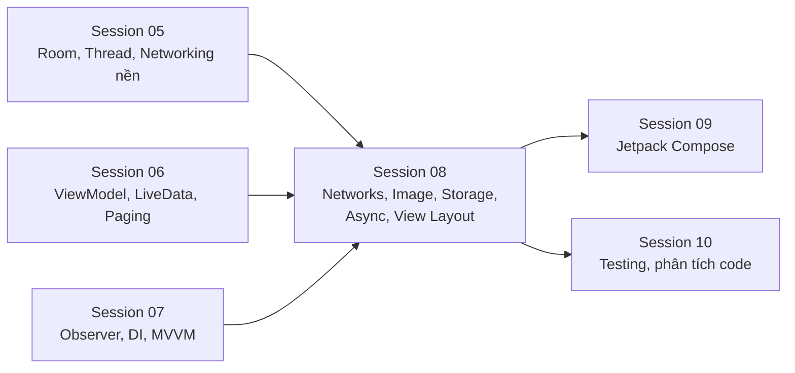
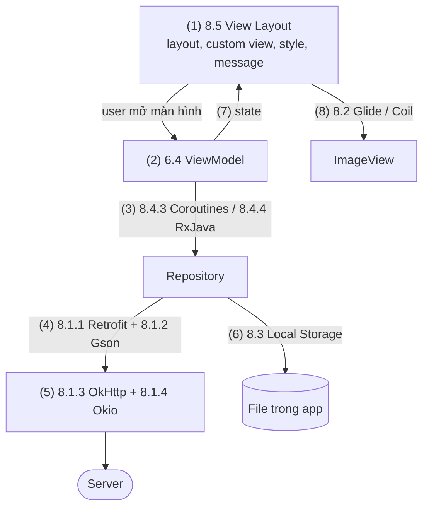
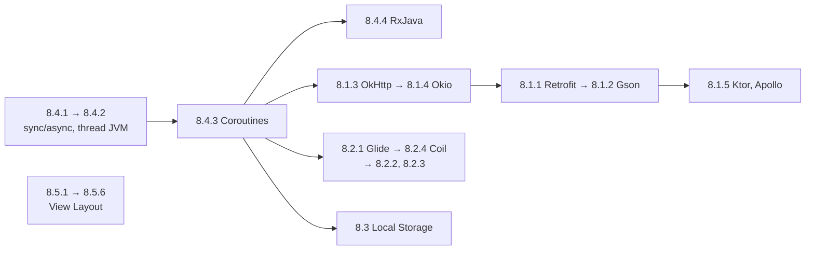

# Session 08 Overview

## Vấn đề cần giải quyết

Sau Session 05–07, bạn đã biết dữ liệu nằm ở đâu (Room, DataStore), state màn hình sống ở đâu (ViewModel) và tổ chức code thế nào (MVVM). Để dựng một app thật vẫn còn năm nhóm việc lặp lại ở mọi dự án:

1. **Gọi API thế nào cho gọn và đúng?** Tự viết `HttpURLConnection`, tự parse JSON, tự quản lý kết nối là nhiều code và nhiều lỗi.
2. **Hiển thị ảnh từ mạng thế nào mà không tràn bộ nhớ?** Một ảnh 12 MP decode nguyên kích thước ở `ARGB_8888` tốn khoảng 48 MB RAM; danh sách cuộn nhanh thì request ảnh cũ phải huỷ, ảnh đã tải phải được cache.
3. **Lưu file của app ở đâu?** Ảnh tải về, file export, cache tạm mỗi thứ có chỗ riêng, quy tắc xoá và backup riêng.
4. **Chạy việc nặng thế nào mà UI không đứng?** Thread, Coroutines, RxJava là ba cách khác nhau để làm cùng một việc.
5. **Dựng giao diện View/XML thế nào cho nhanh, đẹp và nhất quán?** Chọn layout, viết View riêng, quản lý style/theme, theo Material Design, báo tin cho user và thêm chuyển động.

Session 08 trả lời năm câu này bằng các thư viện và API phổ biến nhất của hệ sinh thái Android.

## Vị trí Session 08 trong lộ trình

- **Kế thừa:** 5.3 Networking dạy phần nền (TCP, TLS, retry, trạng thái kết nối) mà 8.1 dựng thư viện lên trên; 5.2 Working with Thread dạy Main Thread, Looper và Handler mà 8.4 dùng làm điểm xuất phát; 6.4 ViewModel là nơi gọi Retrofit và chạy coroutine.
- **Bắc cầu:** Session 09 thay View/XML bằng Compose, nhưng Retrofit, OkHttp, Coil và Coroutines vẫn giữ nguyên; chỉ 8.5 View Layout có bản tương đương mới trong Compose.

## Session 08 học những gì?

Mỗi Topic dưới đây chỉ được tóm tắt. Cơ chế, code và sai lầm thường gặp nằm trong bài của từng Topic.

### 8.1 Networks

| Topic | Câu hỏi trả lời |
|---|---|
| [8.1.1 Retrofit](networks/retrofit.md) | Biến một REST API thành Kotlin interface có kiểu thế nào? |
| [8.1.2 Gson](networks/gson.md) | Đổi JSON thành object và ngược lại thế nào, và bẫy gì khi dùng với Kotlin? |
| [8.1.3 OkHttp](networks/okhttp.md) | Request đi qua những tầng nào trước khi ra mạng, và làm sao chen vào đó? |
| [8.1.4 Okio](networks/okio.md) | Đọc ghi byte hiệu quả thế nào ở tầng dưới OkHttp? |
| [8.1.5 Ktor and Apollo Android](networks/ktor_apollo.md) | Khi nào chọn HTTP client Kotlin Multiplatform hay GraphQL client thay cho Retrofit? |

### 8.2 Loading Image

| Topic | Câu hỏi trả lời |
|---|---|
| [8.2.1 Glide](loading_image/glide.md) | Một thư viện tải ảnh làm những gì (decode, downsample, cache, huỷ theo lifecycle) và Glide làm thế nào? |
| [8.2.2 Picasso](loading_image/picasso.md) | Thư viện ảnh tối giản trông thế nào, và vì sao dự án mới ít chọn nó? |
| [8.2.3 Fresco](loading_image/fresco.md) | Image pipeline của Meta khác gì, khi nào đáng dùng? |
| [8.2.4 Coil](loading_image/coil.md) | Thư viện ảnh viết bằng Kotlin và Coroutines hợp với Compose thế nào? |

### 8.3 Local Storage

| Topic | Câu hỏi trả lời |
|---|---|
| [8.3 Local Storage](local_storage.md) | Đọc ghi file của app ở đâu, ghi thế nào để không hỏng file, và khi nào chọn file thay cho DataStore hay Room? |

### 8.4 Synchronous / Asynchronous Threads

| Topic | Câu hỏi trả lời |
|---|---|
| [8.4.1 What Sync / Async](async_threads/sync_async.md) | Blocking, non-blocking, synchronous, asynchronous, concurrency, parallelism khác nhau thế nào? |
| [8.4.2 Thread and Multi-Thread](async_threads/thread_multithread.md) | Nhiều thread cùng chạm một dữ liệu thì JVM đảm bảo gì, và dùng `synchronized`, `volatile`, Atomic, Executor thế nào? |
| [8.4.3 Coroutines](async_threads/coroutines.md) | Viết code bất đồng bộ như code tuần tự, có huỷ và có phạm vi sống, thế nào? |
| [8.4.4 RxJava, RxAndroid, RxKotlin](async_threads/rxjava.md) | Luồng sự kiện với operator và Scheduler hoạt động thế nào, và khi nào chuyển sang Flow? |

### 8.5 View Layout

| Topic | Câu hỏi trả lời |
|---|---|
| [8.5.1 Layouts](view_layout/layouts.md) | Chọn ConstraintLayout, LinearLayout, FrameLayout, MotionLayout hay RecyclerView cho từng bố cục thế nào? |
| [8.5.2 View Custom](view_layout/views.md) | View đo, đặt và vẽ thế nào, và viết View riêng bằng Canvas ra sao? |
| [8.5.3 Styles](view_layout/styles.md) | Style, theme, theme overlay khác nhau thế nào, attribute được lấy theo thứ tự nào? |
| [8.5.4 Design Guide](view_layout/design_guide.md) | Material Design (và Flat design trước nó) quy định gì, áp dụng vào app thế nào? |
| [8.5.5 Message](view_layout/message.md) | Báo tin cho user bằng Toast, Snackbar hay Notification trong từng tình huống? |
| [8.5.6 Animation](view_layout/animation.md) | Thêm chuyển động bằng Animator, AnimationSet, Lottie hay Material Motion thế nào? |

## Mối liên hệ giữa các Topic

Các Topic xếp thành tầng trong một màn hình tải dữ liệu từ mạng rồi hiển thị:

1. Màn hình dựng bằng layout và style của 8.5.
2. ViewModel nhận yêu cầu tải dữ liệu.
3. ViewModel chạy việc nền bằng coroutine (hoặc RxJava trong code cũ), không chặn Main Thread.
4. Repository gọi API qua interface Retrofit; Gson (hoặc converter khác) đổi JSON thành object.
5. Retrofit giao request cho OkHttp; OkHttp đọc ghi byte qua Okio.
6. Dữ liệu cần giữ dạng file (ảnh tải về, file export) được ghi vào thư mục của app.
7. ViewModel đưa state mới ra UI.
8. UI giao URL ảnh cho Glide hoặc Coil để tải, cache và gán vào `ImageView`.

## Điều kiện tiên quyết

- [5.3 Networking](../session_05/networking.md): TCP, TLS, retry, trạng thái kết nối — nền của mọi bài 8.1.
- [5.2 Working with Thread](../session_05/working_with_thread.md): Main Thread, Looper, Handler, thread pool — nền của 8.4.
- [5.1.1 Key-Value Storage](../session_05/data_store/key_value.md), [5.1.2 Room](../session_05/data_store/room_architecture.md) và [2.1 File Permissions](../session_02/file_permissions.md): các cách lưu khác mà 8.3 so sánh và link tới.
- [6.4 ViewModel](../session_06/viewmodel.md) và [Activity Lifecycle](../session_04/components/activity/lifecycle.md): nơi gọi mạng, chạy coroutine, và vòng đời mà thư viện ảnh dựa vào để huỷ request.

## Sau khi học xong Session 08, bạn làm được gì?

- Giải thích được vị trí của Session 08 trong lộ trình và vai trò của từng nhóm Topic trong một app viết bằng View/XML.
- Phân biệt được các thư viện cùng nhóm (Retrofit với OkHttp, Glide với Coil, Coroutines với RxJava) theo tầng mà mỗi thư viện đảm nhận.
- Áp dụng được thứ tự học 8.4 → 8.1 → 8.2 → 8.3 → 8.5 dựa trên phụ thuộc giữa các Topic.

## Thứ tự học đề xuất

1. **8.4 trước tiên:** mọi bài còn lại đều chạy việc nền; 8.4.3 Coroutines là cách các ví dụ trong session dùng.
2. **OkHttp trước Retrofit:** Retrofit giao request cho OkHttp; hiểu interceptor và connection pool thì mới thấy Retrofit thêm được gì.
3. **Glide trước các thư viện ảnh khác:** 8.2.1 giữ phần chung của mọi thư viện ảnh; 8.2.2–8.2.4 chỉ nói điểm khác.
4. **8.5 học độc lập:** View Layout không phụ thuộc 8.1–8.4, có thể đọc song song.

Thứ tự này khác số thứ tự trong mục lục; mục lục giữ nguyên, đây chỉ là gợi ý đọc.

## Nguồn tham khảo

- [Guide to app architecture — Android Developers](https://developer.android.com/topic/architecture)
- [Kotlin coroutines on Android — Android Developers](https://developer.android.com/kotlin/coroutines)
- [Retrofit](https://square.github.io/retrofit/) và [OkHttp](https://square.github.io/okhttp/) — Square
- [Loading large bitmaps efficiently — Android Developers](https://developer.android.com/topic/performance/graphics/load-bitmap)
- [App-specific storage — Android Developers](https://developer.android.com/training/data-storage/app-specific)
- [Layouts in views — Android Developers](https://developer.android.com/develop/ui/views/layout/declaring-layout)
- [Material Design 3](https://m3.material.io/)
