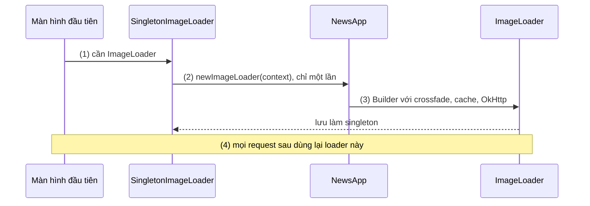
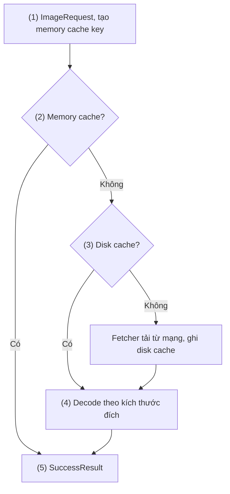
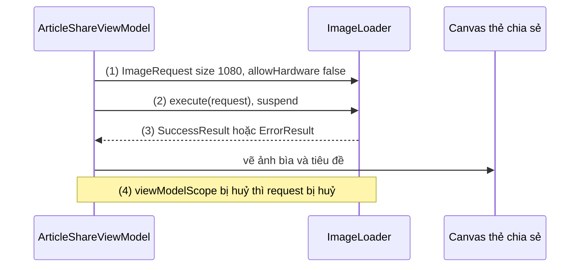
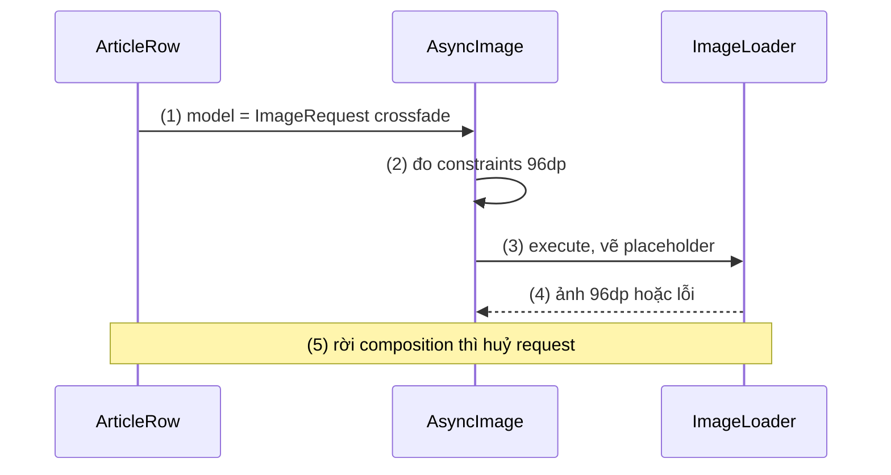
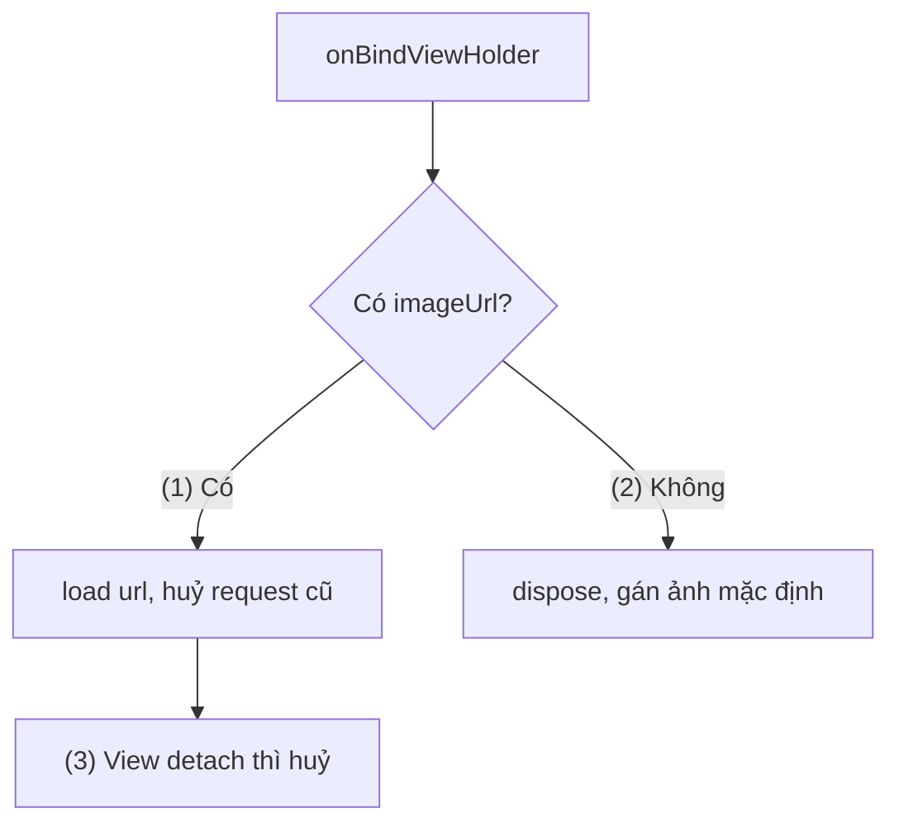
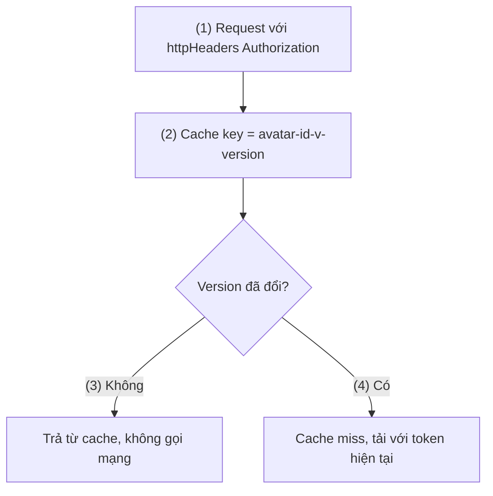

# Coil

## Vấn đề cần giải quyết

Bài toán chung của image loading (bộ nhớ của Bitmap, downsample theo target, cache nhiều tầng, huỷ theo vòng đời và tái sử dụng View) đã được giải thích ở [Glide](glide.md), mục "Bài toán chung: decode đúng cỡ, ngoài main thread, có cache". Bài này không lặp lại.

Coil trả lời một câu hỏi khác: **nếu viết lại thư viện tải ảnh cho một app thuần Kotlin, UI bằng Compose, thì nó trông thế nào?** Với các thư viện cũ, app Kotlin hiện đại gặp ba điểm vướng:

- API được thiết kế cho Java và `ImageView`; lấy ảnh trong một hàm `suspend` cần bọc callback.
- Compose không có `ImageView` để "into"; tích hợp Compose của Glide vẫn là beta, Picasso và Fresco không có API Compose ổn định.
- Code UI chia sẻ giữa Android và iOS (Compose Multiplatform) cần một thư viện ảnh không phụ thuộc `android.graphics`.

## Sau khi học xong

- Giải thích được vai trò của ImageLoader và ImageRequest, và luồng một request Coil đi qua memory cache, fetcher, decoder trong coroutine.
- Triển khai được Coil 3 với artifact network, ImageLoader singleton cấu hình trong Application, AsyncImage trong Compose và ImageView.load trong View.
- Phân biệt được AsyncImage, rememberAsyncImagePainter và SubcomposeAsyncImage theo cách chúng xác định kích thước và chi phí.
- Xử lý được ảnh cần header xác thực và ảnh đổi nội dung nhưng giữ URL bằng httpHeaders và cache key tuỳ chỉnh.
- Nhận diện được các lỗi thường gặp như thiếu artifact network của Coil 3, tạo nhiều ImageLoader và dùng hardware bitmap với Canvas phần mềm.

## Coil là gì?

**Coil** (viết tắt của **Co**routine **I**mage **L**oader) là thư viện image loading viết bằng Kotlin: một **`ImageLoader`** dùng chung toàn app thực thi các **`ImageRequest`** (mô tả ảnh cần lấy, kích thước, cách biến đổi, đích hiển thị) bằng coroutine, qua memory cache, disk cache, fetcher và decoder, rồi trả kết quả cho View, composable hoặc cho code gọi trực tiếp.

Mental model: `ImageLoader` là **một tổng đài**, `ImageRequest` là **phiếu yêu cầu**. Cả app gửi phiếu về cùng một tổng đài; tổng đài giữ chung kho (cache) và đường dây (HTTP client), xử lý mỗi phiếu như một coroutine, và huỷ phiếu khi người gửi (View, composable, scope) không còn chờ nữa.

## Cách hoạt động

### Thiết lập Coil 3 và ImageLoader singleton

Coil 3 dùng group `io.coil-kt.coil3` và package `coil3` (khác Coil 2 là `io.coil-kt` và `coil`), nên hai bản có thể cùng tồn tại khi chuyển dần. Các artifact chính:

| Artifact | Dùng khi |
|---|---|
| `coil-compose` | UI Compose: `AsyncImage`, kèm singleton `ImageLoader` |
| `coil` | UI View: `ImageView.load`, kèm singleton |
| `coil-core` | Thư viện hoặc app tự quản lý `ImageLoader`, không có singleton |
| `coil-network-okhttp` / `coil-network-ktor3` | **Bắt buộc** để tải URL `http(s)`; Compose Multiplatform dùng Ktor |
| `coil-gif`, `coil-svg`, `coil-video` | Decoder cho GIF động, SVG, khung hình video |

Điểm dễ quên nhất: **`coil-core` của Coil 3 không còn tự tải ảnh từ mạng.** Thiếu artifact network thì ảnh URL không hiện và request lỗi vì không có fetcher cho URL đó.

Coil có sẵn một `ImageLoader` singleton với cấu hình mặc định: memory cache khoảng 20% bộ nhớ app (15% trên máy RAM thấp), disk cache khoảng 2% dung lượng trống, giới hạn trong 10–250 MB. Docs nhấn mạnh Coil chạy tốt nhất khi **cả app dùng một `ImageLoader`**, vì mỗi instance có memory cache, disk cache và HTTP client riêng. Muốn đổi cấu hình singleton, chọn **một** trong ba cách: implement `SingletonImageLoader.Factory` trên `Application` (hợp nhất cho app Android), gọi `SingletonImageLoader.setSafe`, hoặc `setSingletonImageLoaderFactory` trong composable gốc (hợp với Compose Multiplatform).

#### Ví dụ: cấu hình ImageLoader cho app tin tức

**Bài toán:** app tin tức muốn ảnh hiện với cross-fade, disk cache lớn hơn mặc định cho người đọc offline, và ảnh tải qua `OkHttpClient` chung của app (cùng connection pool, cùng interceptor log).

**Luồng chạy:**

1. Màn hình đầu tiên gửi request; Coil cần singleton nên gọi `SingletonImageLoader.get(context)`.
2. `Application` implement `SingletonImageLoader.Factory`, nên Coil gọi `newImageLoader()` **một lần**.
3. `newImageLoader()` dựng loader với cross-fade, memory cache 25%, disk cache 5% trong `cacheDir/news_images`, fetcher OkHttp dùng client chung.
4. Mọi request sau dùng lại đúng loader đó.



```kotlin
// app/build.gradle.kts
dependencies {
    implementation("io.coil-kt.coil3:coil-compose:3.6.3")          // bản mới nhất tại thời điểm viết
    implementation("io.coil-kt.coil3:coil-network-okhttp:3.6.3")   // bắt buộc cho URL http(s)
}
```

```kotlin
// NewsApp.kt
class NewsApp : Application(), SingletonImageLoader.Factory {

    val httpClient: OkHttpClient by lazy { OkHttpClient.Builder().build() }

    override fun newImageLoader(context: PlatformContext): ImageLoader =   // (2) gọi một lần
        ImageLoader.Builder(context)
            .crossfade(true)                                               // (3)
            .memoryCache {
                MemoryCache.Builder()
                    .maxSizePercent(context, 0.25)
                    .build()
            }
            .diskCache {
                DiskCache.Builder()
                    .directory(context.cacheDir.resolve("news_images").toOkioPath())
                    .maxSizePercent(0.05)
                    .build()
            }
            .components {
                add(OkHttpNetworkFetcherFactory(callFactory = { httpClient })) // dùng client chung
            }
            .build()
}
```

`PlatformContext` trên Android chính là `Context` (typealias); tên này tồn tại vì Coil 3 là thư viện multiplatform. `toOkioPath()` đổi `File` sang `Path` của Okio, thư viện I/O mà Coil dùng ([Okio](../networks/okio.md)).

**Kết quả:** ảnh mọi màn hiện với cross-fade; Device Explorer cho thấy thư mục `cache/news_images`. Đặt breakpoint trong `newImageLoader()`: chỉ dừng một lần mỗi process.

### Luồng một request: coroutine, cache, fetcher, decoder

Mỗi `ImageRequest` được `ImageLoader` thực thi như một coroutine:

1. **Map và key:** `data` (String, `Uri`, `File`, resource…) được chuẩn hoá; Coil tạo **memory cache key** từ data cùng kích thước và transformation.
2. **Memory cache:** có ảnh đã decode thì trả ngay.
3. **Fetcher:** chọn fetcher theo kiểu data. Với URL, network fetcher hỏi **disk cache** trước, không có mới tải. Coil 3 mặc định **không** theo header `Cache-Control` và luôn ghi response vào disk cache; muốn theo header thì dùng `CacheControlCacheStrategy` trong artifact `coil-network-cache-control`.
4. **Decoder:** decode và downsample theo **kích thước đã xác định** (từ View, từ constraints của composable, hoặc `size()` tường minh), áp transformation, lưu memory cache.
5. **Kết quả:** `SuccessResult` hoặc `ErrorResult` được giao cho target, hoặc trả về cho code gọi `execute()`.

Vì là coroutine, **huỷ là huỷ Job**: request gắn với `ImageView` bị huỷ khi View detach hoặc được gán request mới; request trong composable bị huỷ khi composable rời composition; `execute()` bị huỷ cùng scope gọi nó. Coroutine được học ở [8.4.3 Coroutines](../async_threads/coroutines.md); ở đây chỉ cần biết hàm `suspend` có thể tạm dừng mà không chặn thread, và bị huỷ theo scope.



#### Ví dụ: lấy Bitmap ảnh bìa để tạo ảnh chia sẻ

**Bài toán:** nút "Chia sẻ bài viết" ghép ảnh bìa với tiêu đề thành một ảnh 1080px để gửi qua app khác. Ở đây cần Bitmap trong code, không hiển thị vào View, nên dùng `execute()` trong coroutine.

**Luồng chạy:**

1. Tạo `ImageRequest` với `size(1080)` và `allowHardware(false)`, vì Bitmap sẽ được vẽ lên `Canvas` phần mềm.
2. `imageLoader.execute(request)` là hàm `suspend`, chạy qua các bước cache, fetcher, decoder ở trên.
3. Kết quả là `SuccessResult` thì đổi `Image` sang `Bitmap` và vẽ; `ErrorResult` thì báo lỗi.
4. Người dùng rời màn hình giữa chừng: scope bị huỷ, request bị huỷ theo.



```kotlin
// ArticleShareViewModel.kt
class ArticleShareViewModel(application: Application) : AndroidViewModel(application) {

    private val _shareCard = MutableStateFlow<Bitmap?>(null)
    val shareCard: StateFlow<Bitmap?> = _shareCard

    fun buildShareCard(article: Article) = viewModelScope.launch {          // (4) huỷ theo scope
        val context = getApplication<Application>()
        val request = ImageRequest.Builder(context)
            .data(article.coverUrl)
            .size(1080)                                                     // (1) downsample tới 1080px
            .allowHardware(false)                                           // (1) để vẽ lên Canvas
            .build()

        when (val result = context.imageLoader.execute(request)) {          // (2)
            is SuccessResult -> {                                           // (3)
                val cover = result.image.toBitmap()
                _shareCard.value = ShareCardPainter.paint(cover, article.title)
            }
            is ErrorResult -> _shareCard.value = null
        }
    }
}
```

`AndroidViewModel` và `viewModelScope` được học ở [ViewModel](../../session_06/viewmodel.md); `StateFlow` ở 7.1.4.2 Flow (chưa có bài). `ShareCardPainter` là hàm vẽ bằng `Canvas` của app.

**Kết quả:** bấm "Chia sẻ" cho ra ảnh 1080px; mở lại cùng bài thì ảnh bìa lấy từ cache, nhanh hơn rõ. Bỏ `allowHardware(false)` thì việc vẽ lên `Canvas` phần mềm có thể crash với `IllegalArgumentException: Software rendering doesn't support hardware bitmaps`.

### Compose: `AsyncImage` và hai lựa chọn còn lại

Coil có ba API Compose, khác nhau ở cách biết kích thước cần tải:

| API | Kích thước tải | Chi phí | Dùng khi |
|---|---|---|---|
| `AsyncImage` | Từ constraints của layout | Composition thường | Hầu hết trường hợp, docs khuyên dùng |
| `rememberAsyncImagePainter` | Không biết cỡ trên màn hình, mặc định tải **cỡ gốc** | Thấp | Cần `Painter` (ví dụ cho `Icon`) hoặc theo dõi state; phải tự truyền size |
| `SubcomposeAsyncImage` | Từ constraints, state có ngay frame đầu | **Subcomposition, chậm hơn** | Slot `loading`/`error` tuỳ biến, không dùng trong `LazyColumn` dày đặc |

`AsyncImage` nhận `model` (URL hoặc `ImageRequest`), `contentDescription` cho accessibility, các `Painter` `placeholder`, `error`, `fallback` và `contentScale`. Trong Compose Preview, mạng bị tắt nên URL luôn lỗi; `LocalAsyncImagePreviewHandler` cho trả về ảnh giả để xem trước và chụp screenshot test. Compose được học ở [Jetpack Compose Overview](../../jetpack_compose_ui/overview.md).

#### Ví dụ: danh sách bài viết trong `LazyColumn`

**Bài toán:** màn tin tức là `LazyColumn` các bài viết, mỗi dòng có ảnh thumbnail 96dp, placeholder khi chờ và ảnh lỗi khi URL hỏng.

**Luồng chạy:**

1. Mỗi dòng gọi `AsyncImage` với `model` là một `ImageRequest` bật cross-fade.
2. `AsyncImage` đo constraints (96dp) và dùng nó làm kích thước tải.
3. Trong lúc chờ, vẽ `placeholder`; request đi qua singleton `ImageLoader` như mục trước.
4. Thành công thì cross-fade sang ảnh; lỗi thì vẽ `error`.
5. Dòng cuộn ra khỏi màn hình và rời composition: request còn chạy bị huỷ.



```kotlin
// ArticleList.kt
@Composable
fun ArticleList(articles: List<Article>, onOpen: (Article) -> Unit) {
    LazyColumn {
        items(articles, key = { it.id }) { article ->
            ArticleRow(article, onClick = { onOpen(article) })
        }
    }
}

@Composable
private fun ArticleRow(article: Article, onClick: () -> Unit) {
    Row(
        modifier = Modifier
            .fillMaxWidth()
            .clickable(onClick = onClick)
            .padding(16.dp)
    ) {
        AsyncImage(
            model = ImageRequest.Builder(LocalPlatformContext.current)  // (1)
                .data(article.thumbnailUrl)
                .crossfade(true)
                .build(),
            contentDescription = null,                                  // ảnh trang trí, tiêu đề đã mô tả
            placeholder = painterResource(R.drawable.thumb_placeholder),// (3)
            error = painterResource(R.drawable.thumb_error),            // (4)
            contentScale = ContentScale.Crop,
            modifier = Modifier
                .size(96.dp)                                            // (2) kích thước tải
                .clip(RoundedCornerShape(8.dp))
        )
        Spacer(Modifier.width(12.dp))
        Text(article.title, style = MaterialTheme.typography.titleMedium)
    }
}
```

**Kết quả:** cuộn danh sách mượt; Memory Profiler cho thấy mỗi thumbnail được decode ở khoảng 96dp chứ không phải cỡ gốc. Đổi sang `Image(painter = rememberAsyncImagePainter(article.thumbnailUrl), …)` mà không truyền size thì mỗi ảnh được tải ở cỡ gốc, RAM tăng rõ.

### Dùng với View: `ImageView.load`

App còn View dùng artifact `coil` và extension `ImageView.load(data) { … }`. Kích thước lấy từ `ImageView` sau khi layout, `scaleType` của ImageView được tôn trọng. Gọi `load()` lên một ImageView đang có request thì request cũ bị huỷ, nên trong `RecyclerView` chỉ cần mỗi lần bind gọi `load()`; item không có ảnh thì gọi `dispose()` rồi gán ảnh mặc định. Request cũng bị huỷ khi View detach khỏi window.

#### Ví dụ: ảnh sản phẩm trong `RecyclerView`

**Bài toán:** danh sách sản phẩm dựng bằng View, có sản phẩm chưa có ảnh; không được hiện nhầm ảnh của item trước.

**Luồng chạy:**

1. Có URL: `load(url)` huỷ request cũ trên ImageView và chạy request mới với placeholder, bo góc.
2. Không có URL: `dispose()` huỷ request cũ, rồi gán ảnh mặc định.
3. ViewHolder cuộn ra và View detach: Coil huỷ request còn chạy.



```kotlin
// ProductAdapter.kt (trong onBindViewHolder)
val image = holder.binding.productImage
if (product.imageUrl != null) {
    image.load(product.imageUrl) {                                     // (1)
        placeholder(R.drawable.product_placeholder)
        error(R.drawable.product_no_image)
        transformations(RoundedCornersTransformation(12f))
    }
} else {
    image.dispose()                                                    // (2) huỷ request cũ trước
    image.setImageResource(R.drawable.product_no_image)
}
```

Với Data Binding, `load()` được gọi trong một `@BindingAdapter`; ví dụ đã có ở [Data Binding](../../session_06/data_binding.md), mục "`@BindingAdapter`: dạy binding cách gán một thuộc tính", ví dụ ảnh đại diện tải từ URL.

**Kết quả:** cuộn nhanh danh sách có xen sản phẩm không ảnh: không ô nào hiện nhầm ảnh. Đây là cùng nguyên tắc với `clear()` của Glide, chỉ khác tên hàm.

## Ví dụ thực tế

Ba bài toán hay gặp với Coil:

1. **Avatar riêng tư cần header xác thực, đổi nội dung nhưng giữ URL:** bài toán chính, code đầy đủ bên dưới.
2. **GIF động và SVG:** thêm `coil-gif`, `coil-svg`, rồi đăng ký `components { add(AnimatedImageDecoder.Factory()); add(SvgDecoder.Factory()) }` trên `ImageLoader.Builder`. `AnimatedImageDecoder` dùng `ImageDecoder` của Android 9+; máy cũ hơn dùng `GifDecoder.Factory()`. Docs ghi `coil-gif` và `coil-video` hiện chỉ có trên Android.
3. **Compose Multiplatform:** module `commonMain` dùng `coil-compose` và `coil-network-ktor3`; cùng một `AsyncImage` chạy trên Android, iOS, desktop. `coil3.Image` thay cho `Drawable` để code chung không phụ thuộc Android.

### Avatar riêng tư có version

**Bài toán:** avatar nằm ở URL cố định `https://api.example.com/users/{id}/avatar`, yêu cầu header `Authorization`. Người dùng đổi avatar thì URL giữ nguyên, API hồ sơ trả `avatarVersion` mới. Token đổi định kỳ nhưng không được làm mất cache.

**Luồng chạy:**

1. Request đặt `httpHeaders` với token hiện tại; header không thuộc cache key, nên đổi token vẫn trúng cache.
2. `memoryCacheKey` và `diskCacheKey` được đặt thành `avatar-{id}-v{version}`.
3. Version chưa đổi: key trùng, ảnh lấy từ memory hoặc disk cache, không gửi request.
4. Version mới: key mới, cache miss, tải lại với token hiện tại; mục cũ bị LRU loại dần.



```kotlin
// UserAvatar.kt
@Composable
fun UserAvatar(user: UserProfile, tokenProvider: TokenProvider, modifier: Modifier = Modifier) {
    val context = LocalPlatformContext.current
    val cacheKey = "avatar-${user.id}-v${user.avatarVersion}"
    val request = remember(user.id, user.avatarVersion) {
        ImageRequest.Builder(context)
            .data(user.avatarUrl)
            .httpHeaders(                                              // (1) không thuộc cache key
                NetworkHeaders.Builder()
                    .set("Authorization", "Bearer ${tokenProvider.currentToken()}")
                    .build()
            )
            .memoryCacheKey(cacheKey)                                  // (2)
            .diskCacheKey(cacheKey)                                    // (2)
            .crossfade(true)
            .build()
    }

    AsyncImage(
        model = request,                                               // (3) hoặc (4)
        contentDescription = user.displayName,
        placeholder = painterResource(R.drawable.avatar_placeholder),
        error = painterResource(R.drawable.avatar_placeholder),
        contentScale = ContentScale.Crop,
        modifier = modifier
            .size(56.dp)
            .clip(CircleShape)
    )
}
```

`remember(user.id, user.avatarVersion)` giữ request qua các lần recompose và chỉ tạo lại khi id hoặc version đổi; `remember` được học ở Session 09 (chưa có bài). Nếu mọi ảnh của API đều cần token, cách gọn hơn là thêm interceptor vào `OkHttpClient` truyền cho `OkHttpNetworkFetcherFactory` (mục cấu hình ImageLoader), chỉ gắn header cho host của API ([OkHttp](../networks/okhttp.md)).

**Kết quả:** đổi avatar, quay lại màn hồ sơ: ảnh mới hiện ngay, các avatar khác vẫn lấy từ cache. Đợi token được refresh rồi mở lại: avatar hiện từ cache, Network Inspector không có request mới. Nếu bỏ `memoryCacheKey`/`diskCacheKey` thì sau khi đổi avatar vẫn thấy ảnh cũ cho tới khi cache bị xoá.

## So sánh với các cách tiếp cận khác

| | Coil 3 | [Glide](glide.md) | [Picasso](picasso.md) | [Fresco](fresco.md) |
|---|---|---|---|---|
| Ngôn ngữ, mô hình | Kotlin, coroutine | Java, thread pool, callback | Java, thread pool | Java/Kotlin, producer, `DataSource` |
| Compose | `AsyncImage` ổn định | Artifact beta | Chỉ 3.0 alpha | Không có API ổn định được tài liệu hoá |
| Multiplatform | Android, JVM, iOS, macOS, JS | Chỉ Android | Chỉ Android | Chỉ Android |
| Disk cache | Riêng; mặc định không theo `Cache-Control` | Riêng, 2 tầng | HTTP cache của OkHttp | Riêng, main và small |
| Kích thước | Nhẹ: Kotlin, coroutines, Okio | Trung bình | Nhỏ | Lớn (native library) |
| Trạng thái | Đang phát triển (3.6.x) | Đang phát triển (5.0.x) | Deprecated | Đang phát triển (3.9.x) |

Coil là lựa chọn mặc định cho app Compose và Kotlin Multiplatform. Glide vẫn là lựa chọn vững cho app View lâu năm; Fresco cho feed ảnh khổng lồ hoặc progressive JPEG.

## Khi nào nên và không nên dùng

- **Nên dùng** cho app mới viết bằng Kotlin, nhất là UI Compose: `AsyncImage` tự lấy kích thước theo constraints và huỷ theo composition.
- **Nên dùng** khi cần lấy ảnh trong code `suspend` (Worker, ViewModel) mà không bọc callback.
- **Nên dùng** cho Compose Multiplatform: cùng API trên Android và iOS.
- **Không cần đổi** một app View lớn đang chạy ổn với Glide chỉ để "hiện đại hơn"; chi phí chuyển đổi khó bù lại.
- **Không hợp** khi cần hiển thị progressive JPEG từng lượt quét: đó là thế mạnh của [Fresco](fresco.md).

## Sai lầm thường gặp

### 1. Nâng lên Coil 3 mà quên artifact network

```kotlin
// Sai: chỉ có coil-compose, không có coil-network-*
implementation("io.coil-kt.coil3:coil-compose:3.6.3")
```

**Lỗi lộ ra thế nào:** ảnh từ resource và file vẫn hiện, mọi ảnh URL đều hiện `error`; log có lỗi kiểu không tìm được fetcher cho URL đó.

**Cách sửa:** thêm `coil-network-okhttp` (Android) hoặc `coil-network-ktor3` (Multiplatform).

### 2. Tạo `ImageLoader` mới ở mỗi màn hình

```kotlin
// Sai: mỗi lần vào màn là một ImageLoader mới
val imageLoader = ImageLoader.Builder(requireContext()).crossfade(true).build()
```

**Lỗi lộ ra thế nào:** quay lại màn cũ ảnh phải tải lại (memory cache mới trống), RAM tăng vì nhiều cache song song, có thể có nhiều HTTP client.

**Cách sửa:** cấu hình **một** singleton qua `SingletonImageLoader.Factory`; cần loader khác cấu hình cho một chỗ thì dùng `imageLoader.newBuilder()` để dùng chung cache và client.

### 3. `rememberAsyncImagePainter` trong danh sách mà không có size

**Lỗi lộ ra thế nào:** `LazyColumn` ảnh thumbnail dùng RAM cao bất thường, cuộn giật; Memory Profiler thấy Bitmap ở cỡ gốc.

**Cách sửa:** dùng `AsyncImage`; nếu bắt buộc cần `Painter`, truyền `size` vào `ImageRequest` hoặc dùng `rememberConstraintsSizeResolver`.

### 4. `SubcomposeAsyncImage` cho mọi item của danh sách dài

**Lỗi lộ ra thế nào:** cuộn danh sách bị rớt khung hình; subcomposition chậm hơn composition thường, docs ghi rõ nó có thể không hợp cho phần UI cần hiệu năng như `LazyList`.

**Cách sửa:** dùng `AsyncImage` với `placeholder`/`error`; chỉ dùng `SubcomposeAsyncImage` cho vài ảnh lớn cần slot `loading` tuỳ biến.

### 5. Vẽ ảnh từ Coil lên `Canvas` phần mềm

**Lỗi lộ ra thế nào:** crash `IllegalArgumentException: Software rendering doesn't support hardware bitmaps` khi vẽ Bitmap lên `Canvas`, đọc pixel, hoặc trong shared element transition.

**Cách sửa:** đặt `allowHardware(false)` cho các request mà Bitmap sẽ bị vẽ lại hoặc đọc pixel, như ví dụ ảnh chia sẻ.

## Lịch sử phát triển

- **Coil 0.x (08/2019):** Colin White ra mắt Coil ở Instacart, thư viện tải ảnh viết bằng Kotlin, dùng coroutine và OkHttp.
- **Coil 1.0 (10/2020):** API ổn định, có singleton `Context.imageLoader`.
- **Coil 2.0 (05/2022):** thêm `AsyncImage` trong `coil-compose`, công khai API `DiskCache`, minSdk lên 21, bỏ `BitmapPool` và `PoolableViewTarget`, `Scale.FIT` thành mặc định.
- **Coil 2.7.0 (07/2024):** bản cuối của dòng 2.x.
- **Coil 3.0 (11/2024):** chuyển thành thư viện Kotlin Multiplatform (Android, JVM, iOS, macOS, JS), đổi sang `io.coil-kt.coil3`/`coil3`, tách network ra artifact riêng (OkHttp hoặc Ktor), thay `Drawable` bằng `coil3.Image` và `Context` bằng `PlatformContext`; mặc định không theo `Cache-Control`, giới hạn ảnh ra tối đa 4096×4096 để chống OOM.
- **Coil 3.6.3 (09/2026):** bản mới nhất tại thời điểm viết (11/2026); mã nguồn hiện đặt minSdk 23.

## Kết nối hệ thống

- **Tiên quyết:**
  - [Glide](glide.md): bài toán chung của image loading, cache nhiều tầng, tái sử dụng View.
- **Liên quan:**
  - [Picasso](picasso.md): thư viện deprecated khuyên chuyển sang Coil, có bảng ánh xạ API.
  - [Fresco](fresco.md): khác Coil ở Drawee, encoded memory cache và progressive JPEG.
  - [OkHttp](../networks/okhttp.md), [Okio](../networks/okio.md): HTTP client và thư viện I/O Coil dựa vào.
  - [Data Binding](../../session_06/data_binding.md): gọi `load()` của Coil trong `@BindingAdapter`.
  - [ViewModel](../../session_06/viewmodel.md): `viewModelScope` trong ví dụ `execute()`.
  - [Jetpack Compose Overview](../../jetpack_compose_ui/overview.md): nền tảng cho `AsyncImage`.
- **Học tiếp:**
  - [8.4.3 Coroutines](../async_threads/coroutines.md): `suspend`, scope và cancellation mà Coil dựa vào.
  - 7.1.4.2 Flow (chưa có bài): `StateFlow` trong ví dụ ViewModel.
  - 9.6 Layout and View (Text, Image, Layout) (chưa có bài): `Image`, `Painter` và layout trong Compose.

## Tham khảo

- [Coil - GitHub (coil-kt/coil)](https://github.com/coil-kt/coil)
- [Coil - Getting started](https://coil-kt.github.io/coil/getting_started/)
- [Coil - Image Loaders](https://coil-kt.github.io/coil/image_loaders/)
- [Coil - Compose](https://coil-kt.github.io/coil/compose/)
- [Coil - Network images](https://coil-kt.github.io/coil/network/)
- [Coil - Upgrading to Coil 3.x](https://coil-kt.github.io/coil/upgrading_to_coil3/)
- [Coil - Changelog](https://coil-kt.github.io/coil/changelog/)
- [Maven Central: io.coil-kt.coil3:coil](https://central.sonatype.com/artifact/io.coil-kt.coil3/coil)
