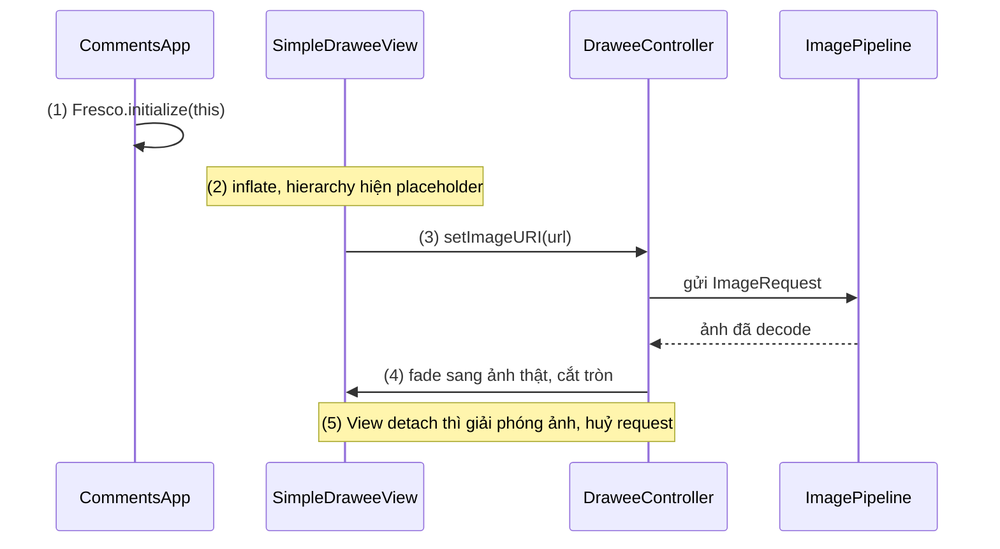
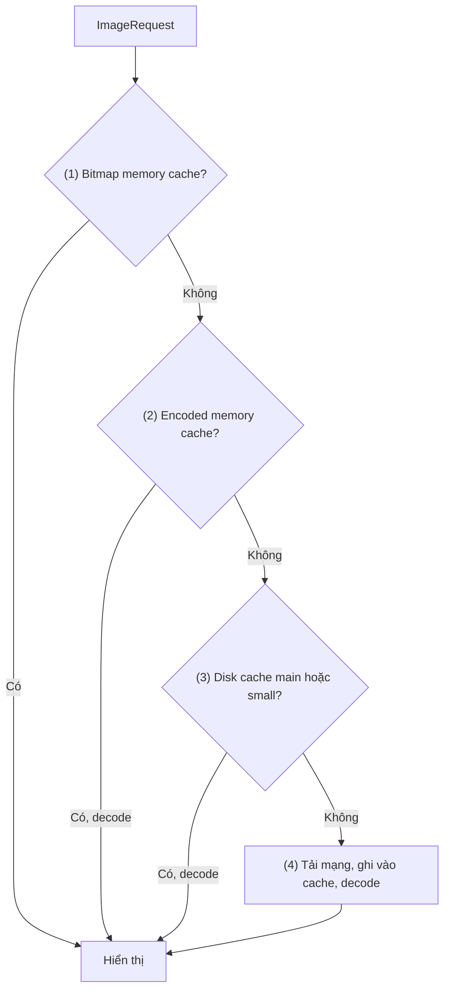
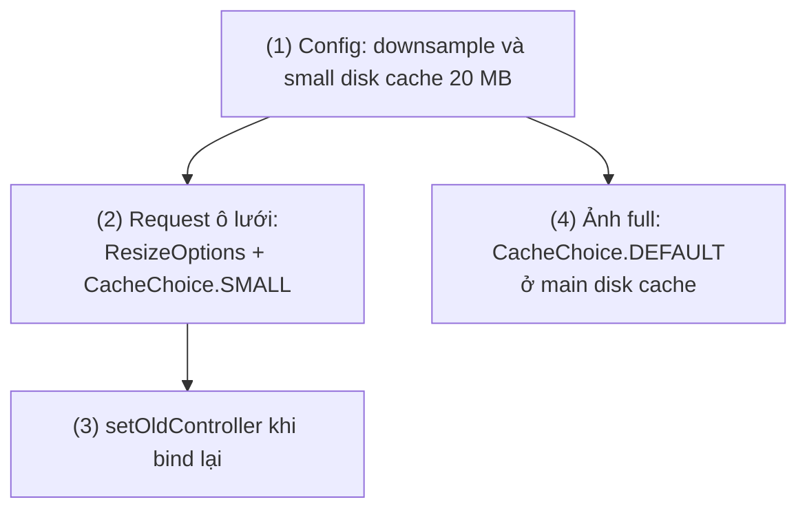
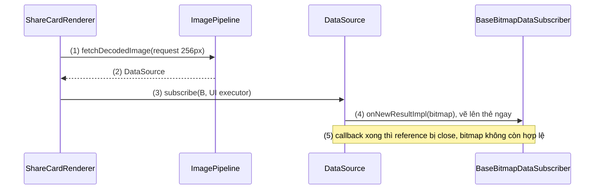
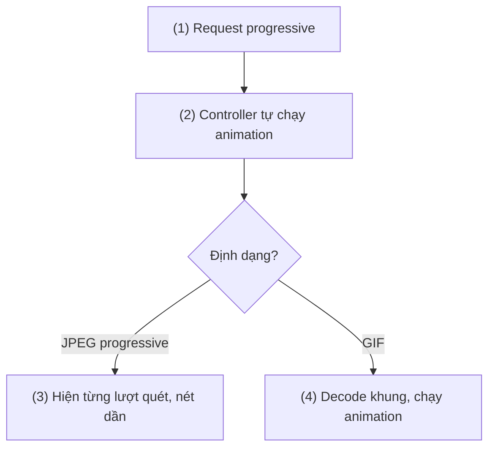
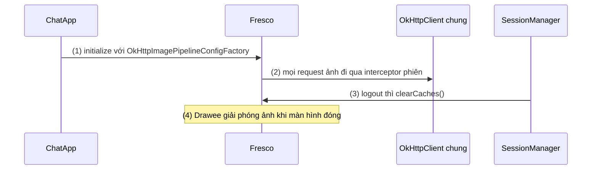

# Fresco

## Vấn đề cần giải quyết

Bài toán chung của image loading (bộ nhớ của Bitmap, downsample, cache, tái sử dụng View) đã được giải thích ở [Glide](glide.md), mục "Bài toán chung: decode đúng cỡ, ngoài main thread, có cache". Fresco ra đời từ một phiên bản **khắc nghiệt hơn** của bài toán đó.

Năm 2014, app Facebook hiển thị feed vô tận đầy ảnh trên những máy Android 4.x RAM thấp. Khi đó pixel của `Bitmap` nằm trên Java heap (từ Android 3.0 đến 7.1). Mỗi ảnh decode là vài MB trên heap, và heap đầy thì garbage collector dừng các thread của app để dọn: feed giật khi cuộn, rồi `OutOfMemoryError`. Bên cạnh đó còn ba nhu cầu mà các thư viện cùng thời chưa giải quyết tốt:

- **Mạng chậm:** người dùng ở mạng 2G/3G phải nhìn ô trống tới khi ảnh tải xong hoàn toàn.
- **Ảnh động:** GIF và WebP động tốn bộ nhớ theo số khung hình.
- **Hiển thị:** placeholder, ảnh lỗi, thanh tiến trình, bo tròn, fade-in là việc lặp lại ở mọi màn hình.

Vấn đề Fresco giải quyết: **hiển thị số lượng lớn ảnh với áp lực GC thấp nhất, cho ảnh hiện dần khi đang tải, và gom toàn bộ logic hiển thị vào một View chuẩn.**

## Sau khi học xong

- Giải thích được vai trò của Image Pipeline và Drawee trong Fresco, và thứ tự ba tầng cache bitmap, encoded memory và disk.
- Giải thích được vì sao Fresco từng đặt Bitmap trong ashmem trên Android 4.x và vì sao nó quản lý bộ nhớ bằng CloseableReference.
- Triển khai được SimpleDraweeView với placeholder, bo tròn, ResizeOptions, progressive JPEG và ảnh động.
- Xử lý được việc lấy Bitmap trực tiếp từ Image Pipeline mà không giữ bộ nhớ quá phạm vi hợp lệ.
- Nhận diện được các lỗi đặc trưng của Fresco như DraweeView wrap_content, quên Fresco.initialize và giữ Bitmap ngoài onNewResultImpl.

## Fresco là gì?

**Fresco** là thư viện ảnh mã nguồn mở của Meta (Facebook) cho Android, gồm hai phần tách biệt: **Image Pipeline** tải, decode và cache ảnh qua ba tầng, giữ mọi ảnh trong bộ nhớ bằng tham chiếu có đếm (`CloseableReference`); **Drawee** là lớp hiển thị, gồm `DraweeView` cùng một "hierarchy" Drawable lo placeholder, ảnh lỗi, bo tròn, fade-in.

Mental model: Fresco là **nhà máy và cửa hàng**. Image Pipeline là nhà máy: nhận đơn, lấy nguyên liệu từ kho, chế biến, và theo dõi từng lô hàng đang được ai giữ. Drawee là cửa hàng: tủ trưng bày có sẵn khung, nhãn "đang về hàng" và "hết hàng"; cửa hàng đặt đơn với nhà máy và trả hàng lại khi tủ không còn hiện trên màn hình.

## Cách hoạt động

### Khởi tạo và Drawee: View lo toàn bộ phần hiển thị

Fresco phải được khởi tạo **một lần** trước khi inflate bất kỳ `DraweeView` nào, thường trong `Application.onCreate()`. Hiển thị ảnh dùng `SimpleDraweeView` thay cho `ImageView`. Bên trong nó có ba thành phần:

- **`DraweeHierarchy`:** chồng các lớp Drawable: placeholder, ảnh thật, ảnh lỗi, nút retry, thanh tiến trình, overlay. Cấu hình bằng thuộc tính XML (`fresco:placeholderImage`, `fresco:roundAsCircle`…) hoặc `GenericDraweeHierarchyBuilder`.
- **`DraweeController`:** gửi request tới Image Pipeline, nhận kết quả và quyết định lớp nào đang hiện.
- **`DraweeView`:** khi View detach khỏi window (cuộn ra ngoài, màn hình đóng), controller giải phóng ảnh và huỷ request đang chờ; attach lại thì lấy lại từ cache.

Một ràng buộc riêng của Drawee: `layout_width` và `layout_height` **không được là `wrap_content`**. Ảnh chưa tải thì View không biết kích thước của mình, nên phải cho kích thước cụ thể, `match_parent`, hoặc một chiều cố định cộng `fresco:viewAspectRatio`.

```kotlin
// app/build.gradle.kts
dependencies {
    implementation("com.facebook.fresco:fresco:3.9.0")   // bản mới nhất tại thời điểm viết
}
```

#### Ví dụ: avatar tròn trong danh sách bình luận

**Bài toán:** mỗi bình luận có avatar 40dp tròn. Cần placeholder khi chờ, ảnh mặc định khi lỗi, và fade-in ngắn khi ảnh về, ở hàng trăm dòng.

**Luồng chạy:**

1. `Application.onCreate()` gọi `Fresco.initialize(this)`.
2. Inflate layout: `SimpleDraweeView` dựng hierarchy từ thuộc tính XML, hiện placeholder ngay.
3. `setImageURI(url)` tạo controller và gửi request vào Image Pipeline.
4. Ảnh về: hierarchy fade từ placeholder sang ảnh thật, cắt tròn lúc vẽ.
5. Dòng bình luận cuộn ra ngoài và View detach: controller giải phóng ảnh và huỷ request còn chờ.



```kotlin
// CommentsApp.kt
class CommentsApp : Application() {
    override fun onCreate() {
        super.onCreate()
        Fresco.initialize(this)                             // (1) trước mọi lần inflate DraweeView
    }
}
```

```xml
<!-- res/layout/item_comment.xml (rút gọn) -->
<com.facebook.drawee.view.SimpleDraweeView
    xmlns:fresco="http://schemas.android.com/apk/res-auto"
    android:id="@+id/author_avatar"
    android:layout_width="40dp"
    android:layout_height="40dp"
    fresco:placeholderImage="@drawable/avatar_placeholder"
    fresco:failureImage="@drawable/avatar_placeholder"
    fresco:roundAsCircle="true"
    fresco:actualImageScaleType="centerCrop"
    fresco:fadeDuration="200" />
```

```kotlin
// CommentAdapter.kt (trong onBindViewHolder)
holder.binding.authorAvatar.setImageURI(comment.authorAvatarUrl)   // (3) → (4)
```

**Kết quả:** avatar hiện tròn với fade 200ms; URL hỏng thì hiện `avatar_placeholder` theo `failureImage`. Không cần code bo tròn hay xử lý lỗi nào trong Adapter. Ở đây Fresco không phải tự huỷ request theo Fragment: vòng đời gắn với chính View (attach/detach), khác `Glide.with(fragment)`.

### Image Pipeline và ba tầng cache

Một request vào Image Pipeline được xử lý bởi một chuỗi **producer**, mỗi producer làm một bước (tra cache, tải mạng, decode, resize) và chuyển kết quả cho bước kế tiếp. Ba tầng cache, theo thứ tự hỏi:

1. **Bitmap memory cache:** ảnh đã decode, sẵn sàng vẽ. Có thì trả ngay.
2. **Encoded memory cache:** ảnh **còn nén** (byte JPEG/PNG/WebP) trong RAM. Có thì chỉ cần decode, không cần đọc đĩa. Tầng này không có ở Glide; nó tốn ít RAM hơn ảnh đã decode nhiều lần.
3. **Disk cache:** ảnh nén trên đĩa, còn lại sau khi app tắt. Fresco cho cấu hình **hai** disk cache: main và small, để thumbnail nhỏ không bị ảnh lớn đẩy ra khỏi cache. Request chọn cache bằng `CacheChoice`.
4. Không tầng nào có thì tải từ mạng hoặc đọc file.

**Downsample** trong Fresco không tự động theo kích thước View như Glide; request phải mang `ResizeOptions(width, height)`. Mặc định resize lúc decode chỉ áp dụng cho JPEG; bật `setDownsampleEnabled(true)` trong `ImagePipelineConfig` để downsample cả PNG và WebP.



#### Ví dụ: lưới thumbnail dùng cache nhỏ riêng

**Bài toán:** màn album hiển thị lưới thumbnail 120dp; bấm vào thì mở ảnh full. Ảnh full vài MB mỗi tấm dễ đẩy hết thumbnail ra khỏi disk cache, khiến quay lại album phải tải lại cả lưới.

**Luồng chạy:**

1. Khi khởi tạo, `ImagePipelineConfig` bật downsample và khai báo một small disk cache 20 MB riêng.
2. Mỗi ô lưới tạo `ImageRequest` có `ResizeOptions` bằng kích thước ô và `CacheChoice.SMALL`.
3. Controller được dựng với `setOldController` để dùng lại controller cũ khi ViewHolder được tái sử dụng.
4. Ảnh full dùng request mặc định (`CacheChoice.DEFAULT`), nằm ở main disk cache, không đụng tới cache của thumbnail.



```kotlin
// AlbumApp.kt
class AlbumApp : Application() {
    override fun onCreate() {
        super.onCreate()
        val smallCache = DiskCacheConfig.newBuilder(this)
            .setBaseDirectoryPath(cacheDir)
            .setBaseDirectoryName("album_thumbnails")
            .setMaxCacheSize(20L * 1024 * 1024)
            .build()
        val config = ImagePipelineConfig.newBuilder(this)
            .setDownsampleEnabled(true)                    // (1) resize lúc decode cho mọi định dạng
            .setSmallImageDiskCacheConfig(smallCache)      // (1) cache riêng cho thumbnail
            .build()
        Fresco.initialize(this, config)
    }
}
```

```kotlin
// AlbumAdapter.kt (trong onBindViewHolder)
val thumbnailView = holder.binding.thumbnail
val sizePx = thumbnailView.resources.getDimensionPixelSize(R.dimen.album_cell_size)

val request = ImageRequestBuilder.newBuilderWithSource(Uri.parse(photo.thumbnailUrl))
    .setResizeOptions(ResizeOptions(sizePx, sizePx))       // (2) decode đúng cỡ ô
    .setCacheChoice(ImageRequest.CacheChoice.SMALL)        // (2) vào small disk cache
    .build()

thumbnailView.controller = Fresco.newDraweeControllerBuilder()
    .setImageRequest(request)
    .setOldController(thumbnailView.controller)            // (3) dùng lại controller cũ
    .build()
```

**Kết quả:** mở và lướt nhiều ảnh full, quay lại album: thumbnail hiện ngay từ small disk cache, không tải lại. Memory Profiler cho thấy mỗi thumbnail chỉ chiếm vài chục KB thay vì cỡ ảnh gốc. Trong `cacheDir` có thư mục `album_thumbnails` tách khỏi cache chính.

### Bộ nhớ: lịch sử ashmem và CloseableReference

**Android 4.x trở xuống.** Bài viết giới thiệu Fresco (03/2015) giải thích cách nó tránh Java heap: Android có vùng **ashmem** (anonymous shared memory), không do GC quản lý. "Purgeable bitmap" đặt pixel trong ashmem, nhưng hệ thống có thể xoá chúng và buộc decode lại trên UI thread. Fresco dùng một đoạn native code (`AndroidBitmap_lockPixels` của NDK) để "ghim" vùng nhớ đó, nên Bitmap vừa nằm ngoài Java heap vừa không bị hệ thống xoá bất ngờ. Kết quả là GC gần như không phải dọn ảnh, feed bớt giật.

**Android 5.0 trở lên.** Docs của Fresco ghi: từ 5.0 quản lý bộ nhớ đủ tốt nên giữ bitmap cache trên Java heap là an toàn; Fresco dùng pool để tái sử dụng bộ nhớ. Từ Android 8.0, pixel Bitmap vốn đã nằm ở native heap. Mẹo ashmem vì thế chỉ còn là lịch sử: Fresco 3.7.0 (06/2026) xoá hẳn decoder purgeable cho Gingerbread và KitKat khi nâng minSdk.

**`CloseableReference`** vẫn là cốt lõi đến nay. Mỗi ảnh trong pipeline được bọc trong một tham chiếu có đếm; bộ nhớ chỉ được trả về pool khi số đếm về 0. Quy tắc của docs:

- Bên **sở hữu** reference phải `close()` nó trước khi ra khỏi phạm vi, thường trong `finally`.
- Hàm chỉ **mượn** reference (nhận qua tham số) không được close nó.
- Muốn giữ lâu hơn phạm vi được trao thì `clone()` rồi tự close bản clone.
- Không bao giờ close chính giá trị bên trong, vì nó làm hỏng mọi reference khác cùng trỏ tới.

Dùng `DraweeView` thì Drawee tự lo các quy tắc này. Chỉ khi gọi Image Pipeline trực tiếp, bạn mới phải tuân theo.

#### Ví dụ: lấy avatar làm Bitmap để ghép thẻ chia sẻ

**Bài toán:** nút "Chia sẻ hồ sơ" tạo một ảnh thẻ (nền, tên, avatar) để gửi qua app khác. Cần Bitmap của avatar, không phải hiển thị nó trong View, nên phải gọi Image Pipeline trực tiếp.

**Luồng chạy:**

1. Tạo `ImageRequest` có `ResizeOptions` đúng cỡ avatar trên thẻ (256px).
2. `fetchDecodedImage` trả về một `DataSource`, đại diện cho kết quả sẽ có.
3. Đăng ký `BaseBitmapDataSubscriber`. Nó lo close reference: Bitmap chỉ hợp lệ **bên trong** `onNewResultImpl`.
4. Trong `onNewResultImpl`, vẽ ngay avatar lên Bitmap của thẻ (hoặc `copy()` nếu cần giữ lại).
5. Callback trả về, subscriber đóng reference, bộ nhớ avatar trả về pool.



```kotlin
// ShareCardRenderer.kt
class ShareCardRenderer(private val context: Context) {

    fun render(profile: UserProfile, onReady: (Bitmap) -> Unit, onError: (Throwable?) -> Unit) {
        val request = ImageRequestBuilder.newBuilderWithSource(Uri.parse(profile.avatarUrl))
            .setResizeOptions(ResizeOptions(AVATAR_PX, AVATAR_PX))           // (1)
            .build()
        val dataSource = Fresco.getImagePipeline()
            .fetchDecodedImage(request, "share_card")                        // (2)

        dataSource.subscribe(object : BaseBitmapDataSubscriber() {           // (3)
            override fun onNewResultImpl(bitmap: Bitmap?) {
                if (bitmap == null) return onError(null)
                val card = Bitmap.createBitmap(CARD_W, CARD_H, Bitmap.Config.ARGB_8888)
                Canvas(card).apply {
                    drawColor(ContextCompat.getColor(context, R.color.share_card_background))
                    drawBitmap(bitmap, PADDING, PADDING, null)                 // (4) dùng ngay trong callback
                }
                onReady(card)                                                // card là Bitmap của mình
            }                                                                // (5) sau đây bitmap bị trả về pool

            override fun onFailureImpl(dataSource: DataSource<CloseableReference<CloseableImage>>) {
                onError(dataSource.failureCause)
            }
        }, UiThreadImmediateExecutorService.getInstance())
    }

    private companion object {
        const val AVATAR_PX = 256
        const val CARD_W = 1080
        const val CARD_H = 600
        const val PADDING = 48f
    }
}
```

**Kết quả:** bấm "Chia sẻ hồ sơ" tạo ra thẻ có avatar sắc nét. Thử giữ `bitmap` vào một field rồi vẽ lại ở lần sau: có lúc gặp lỗi `trying to use a recycled bitmap` hoặc ảnh lẫn nội dung lạ, vì vùng nhớ đã được pool dùng cho ảnh khác.

### Progressive JPEG và ảnh động

**Progressive JPEG** là JPEG được mã hoá thành nhiều lượt quét, từ mờ đến nét. Fresco có thể decode và hiển thị từng lượt khi dữ liệu còn đang tải, nên người dùng mạng chậm thấy ảnh mờ gần như ngay lập tức. Docs ghi ba giới hạn: phải bật tường minh khi tạo request (`setProgressiveRenderingEnabled(true)`), chỉ áp dụng cho ảnh từ **mạng**, và chỉ với JPEG thực sự được mã hoá progressive. Cách khác cho mọi định dạng là `setLowResImageRequest()`: tải bản nhỏ trước, rồi thay bằng bản lớn.

**Ảnh động** (GIF, WebP động) cần thêm module: `animated-gif`, `animated-webp` cùng `webpsupport`. Fresco giải mã khung hình bằng backend native, cache khung khi đủ nhỏ, và decode theo nhu cầu khi ảnh lớn. Controller cần `setAutoPlayAnimations(true)` để tự chạy.

#### Ví dụ: ảnh bài đăng trên mạng chậm, có cả GIF

**Bài toán:** màn chi tiết bài đăng hiển thị một ảnh lớn (JPEG progressive từ CDN) hoặc một GIF động. Người dùng mạng yếu không nên nhìn ô trống vài giây.

**Luồng chạy:**

1. Tạo request với `setProgressiveRenderingEnabled(true)`.
2. Controller bật `setAutoPlayAnimations(true)`, để nếu nội dung là GIF thì chạy luôn.
3. Dữ liệu JPEG về từng phần: mỗi lượt quét đủ dữ liệu được decode và hiển thị, ảnh nét dần.
4. Nếu là GIF, module `animated-gif` decode khung và controller bắt đầu chạy animation.



```kotlin
// app/build.gradle.kts (thêm)
implementation("com.facebook.fresco:animated-gif:3.9.0")
```

```kotlin
// PostDetailFragment.kt (rút gọn)
val request = ImageRequestBuilder.newBuilderWithSource(Uri.parse(post.mediaUrl))
    .setProgressiveRenderingEnabled(true)                  // (1) (3)
    .build()

binding.postImage.controller = Fresco.newDraweeControllerBuilder()
    .setImageRequest(request)
    .setAutoPlayAnimations(true)                           // (2) (4)
    .setOldController(binding.postImage.controller)
    .build()
```

**Kết quả:** dùng Network Inspector giả lập mạng chậm: ảnh JPEG progressive hiện mờ rồi nét dần thay vì trống; JPEG thường (baseline) vẫn chỉ hiện khi tải xong. URL GIF tự chạy animation.

## Ví dụ thực tế

Ba bài toán hay gặp với Fresco:

1. **Dùng chung `OkHttpClient` và xoá cache ảnh khi đăng xuất:** bài toán chính, code đầy đủ bên dưới.
2. **Ảnh có viền, overlay, nút retry:** `GenericDraweeHierarchyBuilder` với `setRoundingParams(RoundingParams.asCircle().setBorder(color, width))`, `setRetryImage(...)`, `setOverlay(...)`; controller cần `setTapToRetryEnabled(true)` để bấm vào ảnh lỗi thì tải lại.
3. **Ứng dụng Java-only:** từ Fresco 2.1.0 có thể loại các artifact native và cấu hình pipeline không dùng native code, đổi lại mất một phần tối ưu.

### Dùng chung `OkHttpClient`, xoá cache khi đăng xuất

**Bài toán:** ảnh trong app nhắn tin nằm sau API cần cookie phiên đăng nhập, nên Fresco phải tải qua đúng `OkHttpClient` của app (có interceptor gắn phiên). Khi người dùng đăng xuất, ảnh của tài khoản cũ không được còn trong cache.

**Luồng chạy:**

1. Khi khởi tạo, `OkHttpImagePipelineConfigFactory` dựng `ImagePipelineConfig` dùng `OkHttpClient` chung.
2. Mọi request ảnh đi qua interceptor của app, nên có phiên đăng nhập hiện tại.
3. Đăng xuất: `clearCaches()` xoá cả memory cache và disk cache của Fresco.
4. Ảnh còn đang hiển thị trên màn hình cũ được Drawee giải phóng khi màn hình đóng.



```kotlin
// app/build.gradle.kts (thêm)
implementation("com.facebook.fresco:imagepipeline-okhttp3:3.9.0")
```

```kotlin
// ChatApp.kt
class ChatApp : Application() {

    val httpClient: OkHttpClient by lazy {
        OkHttpClient.Builder()
            .addInterceptor(SessionCookieInterceptor(sessionStore))   // gắn phiên đăng nhập
            .build()
    }

    val sessionStore by lazy { SessionStore(this) }

    override fun onCreate() {
        super.onCreate()
        val config = OkHttpImagePipelineConfigFactory
            .newBuilder(this, httpClient)                             // (1) Fresco tải qua client chung
            .setDownsampleEnabled(true)
            .build()
        Fresco.initialize(this, config)
    }
}
```

```kotlin
// SessionManager.kt
class SessionManager(private val sessionStore: SessionStore) {

    fun logout() {
        sessionStore.clear()
        Fresco.getImagePipeline().clearCaches()                       // (3) memory + disk cache
    }
}
```

`SessionCookieInterceptor` là một OkHttp interceptor, cách viết ở [OkHttp](../networks/okhttp.md). Muốn xoá một ảnh cụ thể (ví dụ avatar vừa đổi) thì dùng `Fresco.getImagePipeline().evictFromCache(uri)` thay vì xoá toàn bộ.

**Kết quả:** đăng nhập, xem vài cuộc trò chuyện có ảnh, đăng xuất rồi đăng nhập tài khoản khác: không ảnh nào của tài khoản cũ hiện từ cache; kiểm tra thư mục cache của Fresco trong Device Explorer thấy đã trống.

## So sánh với các cách tiếp cận khác

| | Fresco | [Glide](glide.md) | [Coil](coil.md) |
|---|---|---|---|
| Hiển thị | `DraweeView` riêng, hierarchy dựng sẵn | `ImageView` bất kỳ | `ImageView` hoặc `AsyncImage` (Compose) |
| Cache | Bitmap memory + **encoded memory** + 2 disk cache | Active + memory + 2 tầng disk | Memory + disk |
| Downsample | Qua `ResizeOptions` | Tự động theo target | Tự động theo View/constraints |
| Progressive JPEG | Có, hiện từng lượt quét | Không hiển thị từng lượt | Không hiển thị từng lượt |
| Quản lý bộ nhớ khi dùng trực tiếp | `CloseableReference`, phải close | Tự động | Tự động |
| Kích thước | Có native library, nặng nhất | Trung bình | Nhẹ |

Fresco mạnh ở feed ảnh khổng lồ, progressive JPEG và ảnh động, đổi lại bằng View riêng, API dài hơn và kích thước app lớn hơn.

## Khi nào nên và không nên dùng

- **Nên dùng** khi app là feed ảnh rất lớn, nhiều GIF/WebP động, hoặc cần progressive JPEG cho người dùng mạng chậm.
- **Nên dùng** khi muốn gom placeholder, ảnh lỗi, retry, bo tròn, overlay vào một View chuẩn cho cả app.
- **Không hợp** cho app nhỏ cần vài ảnh avatar: native library làm tăng kích thước app, và mọi chỗ hiển thị phải đổi sang `DraweeView`.
- **Không hợp** với UI Compose: Fresco không có API Compose chính thức được tài liệu hoá như `AsyncImage` của [Coil](coil.md). Meta có phát triển **Fresco Vito**, một API hiển thị mới hơn (artifact `vito-*`), nhưng tài liệu công khai còn ít; bài này dùng Drawee vì là API được tài liệu hoá đầy đủ.

## Sai lầm thường gặp

### 1. `DraweeView` với `wrap_content`

```xml
<!-- Sai -->
<com.facebook.drawee.view.SimpleDraweeView
    android:layout_width="match_parent"
    android:layout_height="wrap_content" />
```

**Lỗi lộ ra thế nào:** ảnh không hiện, hoặc View cao 0; không có lỗi trong Logcat.

**Cách sửa:** cho kích thước cụ thể, hoặc giữ `match_parent` một chiều và đặt `fresco:viewAspectRatio="1.33"` (hay `setAspectRatio()`) để Drawee tự tính chiều còn lại.

### 2. Quên `Fresco.initialize`

**Lỗi lộ ra thế nào:** crash `NullPointerException: SimpleDraweeView was not initialized!` ngay khi inflate layout.

**Cách sửa:** gọi `Fresco.initialize()` trong `Application.onCreate()` và khai báo class `Application` đó trong `AndroidManifest.xml`.

### 3. Giữ Bitmap ngoài `onNewResultImpl`

**Lỗi lộ ra thế nào:** lỗi `trying to use a recycled bitmap`, hoặc ảnh hiển thị lẫn nội dung của ảnh khác, ngẫu nhiên và khó tái hiện.

**Cách sửa:** chỉ dùng Bitmap trong callback; cần giữ thì `bitmap.copy(...)`, hoặc dùng API làm việc với `CloseableReference` và tự `clone()`/`close()` theo đúng quy tắc.

### 4. Không dùng `ResizeOptions` cho ảnh lớn trong danh sách

**Lỗi lộ ra thế nào:** feed ảnh chụp từ điện thoại vẫn tốn RAM cao dù dùng Fresco; tưởng Fresco tự lo hết.

**Cách sửa:** truyền `ResizeOptions` bằng kích thước ô hiển thị, và bật `setDownsampleEnabled(true)` để áp dụng cho cả PNG, WebP.

### 5. Gọi `setImageURI` trên `ImageView` thường

**Lỗi lộ ra thế nào:** layout lỡ khai báo `ImageView` thay vì `SimpleDraweeView`; code `setImageURI(uri)` vẫn compile, nhưng đó là hàm của framework, đọc và decode ảnh trên UI thread, không cache, không tải được URL mạng.

**Cách sửa:** đảm bảo View là `SimpleDraweeView`; với View Binding, kiểu field (`SimpleDraweeView`) cho thấy ngay nếu khai báo sai.

## Lịch sử phát triển

- **03/2015:** Facebook mở mã nguồn Fresco (0.1.0), kèm bài viết giải thích ashmem, purgeable bitmap được ghim bằng native code, Drawee và pipeline dạng producer.
- **Android 5.0 (2014) trở đi:** docs Fresco coi việc giữ bitmap cache trên Java heap là an toàn; mẹo ashmem chỉ còn cần cho Android 4.x.
- **Fresco 1.0 (12/2016), 2.0 (06/2019):** API Drawee và Image Pipeline ổn định; từ 2.1.0 có thể build Java-only, không dùng native code.
- **Fresco 3.0 (03/2023):** bắt đầu dòng 3.x, các bản sau chuyển dần mã nguồn sang Kotlin và phát triển Vito.
- **Fresco 3.4.0 (10/2024):** hỗ trợ thiết bị dùng page size 16 KB.
- **Fresco 3.7.0 (06/2026):** xoá decoder purgeable cho Gingerbread và KitKat khi nâng minSdk, thêm hỗ trợ AVIF.
- **Fresco 3.9.0 (09/2026):** bản mới nhất tại thời điểm viết (11/2026); repo chuyển về `github.com/meta/fresco`.

## Kết nối hệ thống

- **Tiên quyết:**
  - [Glide](glide.md): bài toán chung của image loading, cache, downsample, tái sử dụng View.
- **Liên quan:**
  - [Coil](coil.md), [Picasso](picasso.md): các thư viện cùng giải bài toán, khác cách quản lý bộ nhớ và hiển thị.
  - [OkHttp](../networks/okhttp.md): interceptor và client dùng chung với Fresco qua `imagepipeline-okhttp3`.
  - [Working with Thread](../../session_05/working_with_thread.md): vì sao GC và decode trên UI thread làm giật khung hình.
- **Học tiếp:**
  - [8.5.1 Layouts](../view_layout/layouts.md): `RecyclerView` cho danh sách bình luận và lưới album.
  - [8.5.2 View Custom](../view_layout/views.md): `Canvas` dùng để ghép thẻ chia sẻ.

## Tham khảo

- [Fresco - GitHub (meta/fresco)](https://github.com/meta/fresco) và [Releases](https://github.com/meta/fresco/releases)
- [Fresco - Getting started](https://frescolib.org/docs/)
- [Fresco - Caching](https://frescolib.org/docs/caching.html)
- [Fresco - Closeable References](https://frescolib.org/docs/closeable-references.html)
- [Fresco - Progressive JPEGs](https://frescolib.org/docs/progressive-jpegs.html)
- [Introducing Fresco: A new image library for Android - Engineering at Meta (03/2015)](https://engineering.fb.com/2015/03/26/android/introducing-fresco-a-new-image-library-for-android/)
- [Managing bitmap memory - Android Developers](https://developer.android.com/topic/performance/graphics/manage-memory)
- [Maven Central: com.facebook.fresco:fresco](https://central.sonatype.com/artifact/com.facebook.fresco/fresco)
