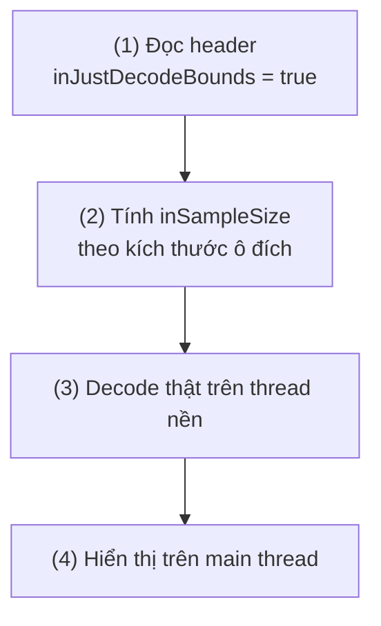
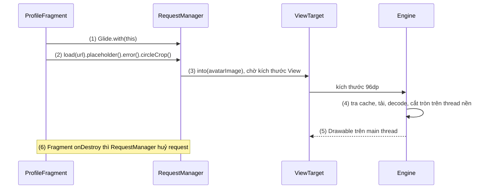
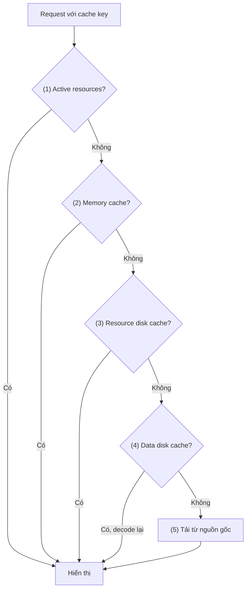
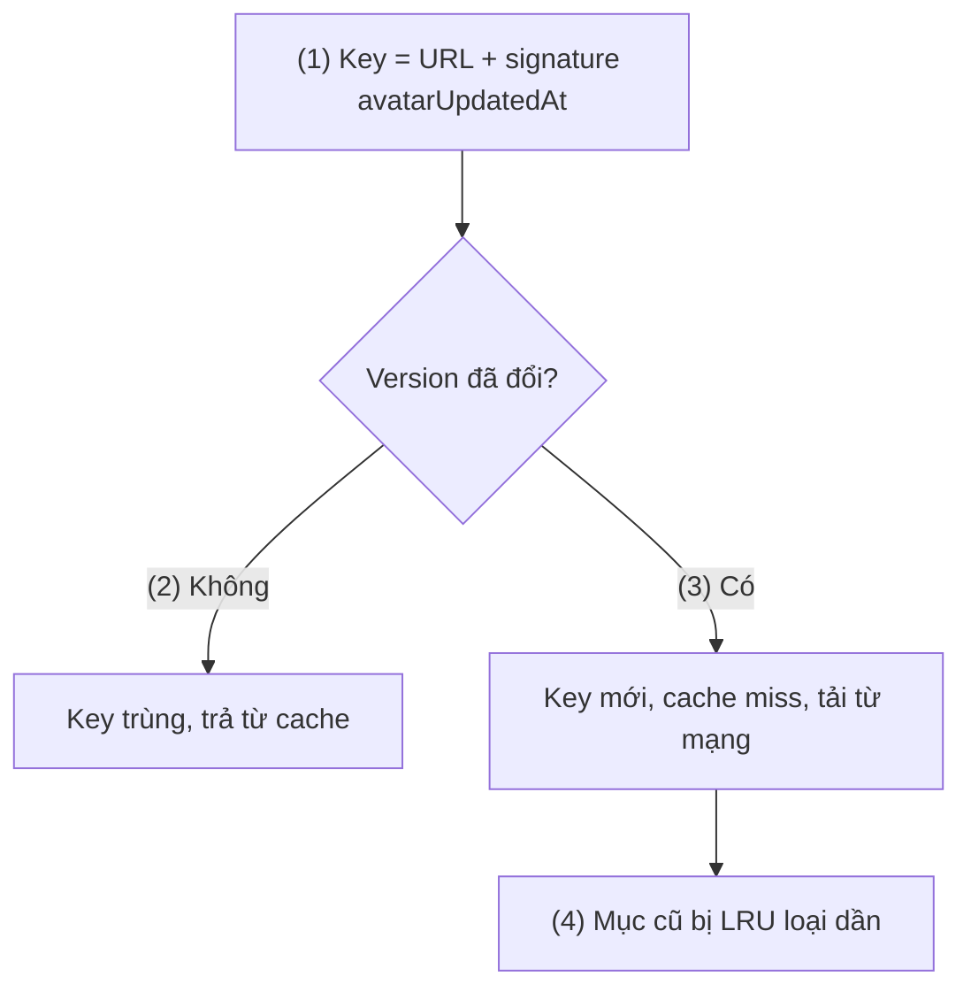
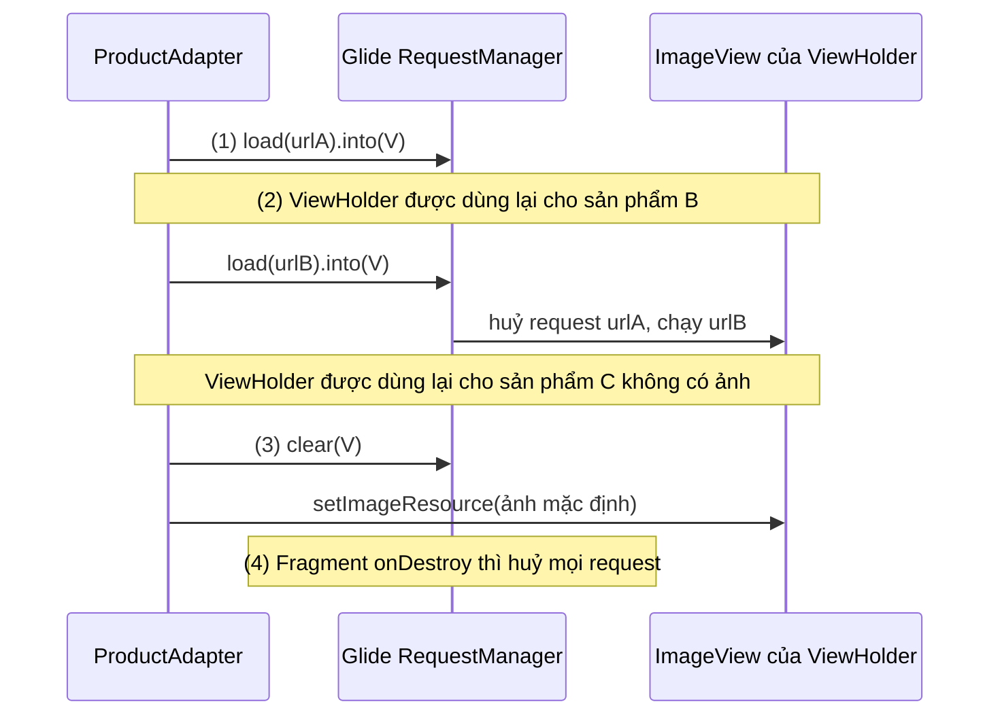
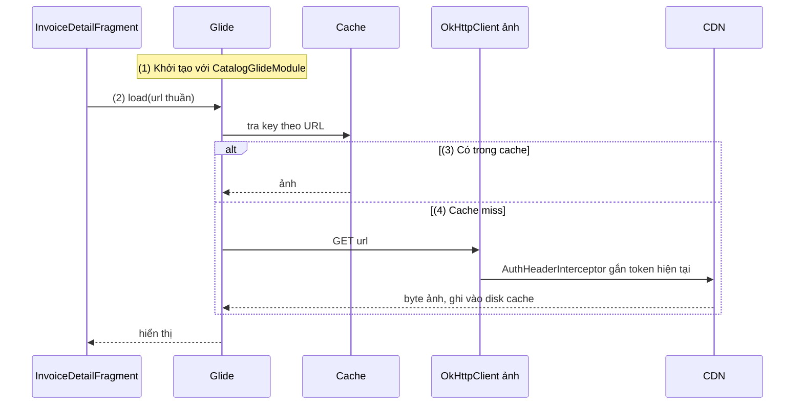

# Glide

## Vấn đề cần giải quyết

Hiển thị một ảnh từ mạng trông đơn giản: tải byte về, decode thành `Bitmap`, gán vào `ImageView`. Viết thẳng ra thì như sau:

```kotlin
// Sai: đặt trong onBindViewHolder của một danh sách sản phẩm
val bytes = URL(product.imageUrl).readBytes()               // mạng trên main thread
val bitmap = BitmapFactory.decodeByteArray(bytes, 0, bytes.size) // decode full-size
holder.productImage.setImageBitmap(bitmap)
```

Đoạn code này gặp năm vấn đề, và chúng là bài toán chung của **mọi** thư viện tải ảnh:

- **Bộ nhớ:** `Bitmap` tốn `rộng × cao × số byte mỗi pixel`. Ảnh chụp 4048×3036 ở cấu hình `ARGB_8888` (4 byte/pixel) chiếm khoảng 48 MB, trong khi ô ảnh trên màn hình chỉ 300×300 pixel. Vài ảnh như vậy là `OutOfMemoryError`.
- **Thread:** tải mạng trên main thread bị chặn bằng `NetworkOnMainThreadException`; decode ảnh lớn trên main thread làm giật khung hình hoặc ANR ([Working with Thread](../../session_05/working_with_thread.md)).
- **Lặp việc:** cuộn lên cuộn xuống là tải và decode lại cùng một ảnh. Cần cache cả byte gốc (trên đĩa) lẫn ảnh đã decode (trong RAM).
- **Tái sử dụng View:** `RecyclerView` dùng lại ViewHolder. Ảnh của item cũ tải xong muộn có thể được gán vào ô đang hiển thị item mới.
- **Vòng đời:** người dùng rời màn hình khi ảnh còn đang tải. Request phải bị huỷ, nếu không nó vẫn tốn mạng, CPU và giữ tham chiếu tới View đã bị huỷ.

Vấn đề cần giải quyết là: **đưa ảnh từ một nguồn bất kỳ lên View với kích thước vừa đủ, không chặn main thread, không tải lặp, và tự dừng khi View hay màn hình không còn cần ảnh đó.** Bài này giải thích bài toán chung đó (dùng lại cho [Picasso](picasso.md), [Fresco](fresco.md), [Coil](coil.md)) và cách Glide giải quyết.

## Sau khi học xong

- Giải thích được vì sao hiển thị ảnh cần một thư viện, qua chi phí bộ nhớ của Bitmap, decode ngoài main thread, downsample theo kích thước View đích và cache nhiều tầng.
- Giải thích được một request Glide đi qua active resources, memory cache, hai tầng disk cache rồi mới tới nguồn gốc, và cache key được ghép từ những gì.
- Triển khai được Glide trong Fragment và RecyclerView với placeholder, error, transformation và vòng đời đúng.
- Xử lý được bài toán ảnh đổi nội dung nhưng giữ nguyên URL bằng signature, và chọn DiskCacheStrategy phù hợp.
- Nhận diện được các lỗi thường gặp như dùng applicationContext, quên clear khi item không có ảnh, và View wrap_content làm ảnh decode quá lớn.

## Glide là gì?

**Glide** là thư viện image loading mã nguồn mở cho Android: nó nhận một **model** (URL, `Uri`, `File`, resource id…), tải dữ liệu, decode và downsample ảnh theo kích thước **target** (thường là một `ImageView`) trên thread nền, lưu kết quả qua nhiều tầng cache, rồi hiển thị lên target và tự huỷ request theo vòng đời của màn hình chứa nó.

Mental model: Glide là **một chuỗi kho hàng xếp từ gần đến xa**. Mỗi request hỏi kho gần nhất trước (ảnh đang hiển thị ở chỗ khác, rồi RAM), không có mới hỏi kho xa hơn (đĩa), và chỉ khi mọi kho đều trống mới đi "nhập hàng" từ nguồn gốc. Hàng nhập về được cắt đúng cỡ của kệ (target) trước khi bày, và đơn hàng bị huỷ khi cửa hàng (màn hình) đóng cửa.

## Cách hoạt động

### Bài toán chung: decode đúng cỡ, ngoài main thread, có cache

Phần này là kiến thức nền của cả 8.2, không riêng Glide.

**Bộ nhớ của Bitmap.** Kích thước file (JPEG 2 MB) không phải là bộ nhớ của ảnh. Khi decode, mỗi pixel được bung ra theo `Bitmap.Config`: `ARGB_8888` 4 byte, `RGB_565` 2 byte. Nơi chứa pixel thay đổi theo version Android: từ Android 3.0 đến 7.1, pixel nằm trên Java heap cùng đối tượng `Bitmap`; từ Android 8.0 (API 26), pixel nằm ở native heap. Dù ở đâu, bộ nhớ đó vẫn tính vào app, và app tải nhiều ảnh lớn vẫn bị hệ thống thu hồi hoặc OOM.

**Downsample theo kích thước target.** Không cần decode 4048×3036 pixel để vẽ vào ô 300×300. `BitmapFactory.Options` cho phép:

- `inJustDecodeBounds = true`: chỉ đọc header để biết kích thước gốc, không cấp phát pixel.
- `inSampleSize = n`: decoder bỏ bớt pixel ngay khi decode, ảnh ra nhỏ hơn `n` lần mỗi chiều (decoder làm tròn `n` về luỹ thừa của 2).

**Cache hai loại dữ liệu.** Byte gốc (đã tải) đáng lưu trên **đĩa**, vì tải lại tốn mạng; ảnh đã decode và cắt đúng cỡ đáng lưu trong **RAM**, vì decode lại tốn CPU. Hai cache này có kích thước giới hạn và loại bỏ phần ít dùng nhất (LRU, Least Recently Used).

**Tái sử dụng bộ nhớ Bitmap.** Từ Android 3.0, `BitmapFactory.Options.inBitmap` cho decoder ghi đè vào một `Bitmap` cũ không còn dùng thay vì cấp phát mới (từ Android 4.4 chỉ cần Bitmap cũ đủ lớn). Thư viện gom các Bitmap rảnh vào một **bitmap pool** để giảm cấp phát và áp lực GC khi cuộn danh sách.

**Huỷ theo vòng đời và theo View.** Mỗi request phải biết nó phục vụ View nào và màn hình nào, để huỷ khi View được gán ảnh khác hoặc màn hình bị huỷ.

#### Ví dụ: tự decode ảnh chụp thành thumbnail

**Bài toán:** màn chọn ảnh hồ sơ hiển thị ảnh người dùng vừa chụp (4000×3000) trong ô xem trước 200×150. Tự làm downsample bằng `BitmapFactory` cho thấy chính xác việc mà mọi thư viện tải ảnh làm thay bạn.

**Luồng chạy:**

1. Đọc header với `inJustDecodeBounds = true` để lấy kích thước gốc, không tốn bộ nhớ pixel.
2. Tính `inSampleSize` lớn nhất (luỹ thừa của 2) mà ảnh ra vẫn không nhỏ hơn ô đích.
3. Decode thật với `inSampleSize` đó, trên thread nền.
4. Đưa Bitmap đã thu nhỏ về main thread để hiển thị.



```kotlin
// ThumbnailDecoder.kt
object ThumbnailDecoder {

    fun decode(file: File, reqWidth: Int, reqHeight: Int): Bitmap? {
        val options = BitmapFactory.Options().apply { inJustDecodeBounds = true }
        BitmapFactory.decodeFile(file.path, options)               // (1) chỉ đọc kích thước

        options.inSampleSize = calculateInSampleSize(              // (2)
            options.outWidth, options.outHeight, reqWidth, reqHeight
        )
        options.inJustDecodeBounds = false
        return BitmapFactory.decodeFile(file.path, options)        // (3) gọi từ thread nền
    }

    private fun calculateInSampleSize(width: Int, height: Int, reqWidth: Int, reqHeight: Int): Int {
        var sampleSize = 1
        if (height > reqHeight || width > reqWidth) {
            val halfHeight = height / 2
            val halfWidth = width / 2
            while (halfHeight / sampleSize >= reqHeight && halfWidth / sampleSize >= reqWidth) {
                sampleSize *= 2
            }
        }
        return sampleSize
    }
}
```

```kotlin
// ProfilePhotoFragment.kt (rút gọn)
viewLifecycleOwner.lifecycleScope.launch {
    val bitmap = withContext(Dispatchers.IO) {                     // (3) decode ngoài main thread
        ThumbnailDecoder.decode(photoFile, reqWidth = 200, reqHeight = 150)
    }
    binding.previewImage.setImageBitmap(bitmap)                    // (4) về main thread
}
```

`lifecycleScope.launch` và `withContext(Dispatchers.IO)` là coroutine: chạy khối code trên thread nền rồi quay về main thread, được học ở [8.4.3 Coroutines](../async_threads/coroutines.md).

**Kết quả:** với ảnh 4000×3000 và ô 200×150, `inSampleSize` ra 16, Bitmap còn 250×188 pixel, khoảng 188 KB thay vì 48 MB. Đoạn code này vẫn **chưa** có cache, chưa huỷ khi rời màn hình, chưa xử lý xoay ảnh theo EXIF hay tái sử dụng Bitmap. Đó là phần Glide làm thêm.

### Một request Glide: `with` → `load` → `into`

Mọi request Glide có ba bước:

- **`Glide.with(...)`** trả về một `RequestManager` gắn với vòng đời của đối số: `Fragment`, `FragmentActivity`, `View` (Glide tìm Fragment hoặc Activity chứa View đó) hay `Context`.
- **`.load(model)`** tạo một `RequestBuilder`. Các tuỳ chọn như `placeholder()`, `error()`, `circleCrop()`, `override()` được nối tiếp vào builder.
- **`.into(target)`** khởi chạy request. Với `ImageView`, Glide bọc nó trong một `ViewTarget`, chờ View được layout để biết kích thước, rồi đưa request cho `Engine`.

Kích thước target quyết định ảnh được decode lớn cỡ nào. Glide lấy kích thước từ `ImageView` sau khi layout; nếu View là `wrap_content`, Glide không biết cỡ đích và dùng kích thước màn hình. `override(width, height)` đặt kích thước tường minh. Khi target là `ImageView` có `scaleType` là `centerCrop` hoặc `fitCenter`, Glide tự áp transformation tương ứng.

`Engine` chạy tra cache và tải dữ liệu trên các thread pool riêng của Glide (một pool cho disk cache, một pool cho nguồn gốc). Kết quả được đưa về main thread rồi mới gán vào target.

Khai báo dependency (Glide 5.0.9 là bản mới nhất trên Maven Central tại thời điểm viết):

```kotlin
// app/build.gradle.kts
dependencies {
    implementation("com.github.bumptech.glide:glide:5.0.9")
}
```

Glide không cần annotation processor cho cách dùng cơ bản. Chỉ khi app khai báo `AppGlideModule` (cấu hình toàn cục, phần "Ví dụ thực tế") mới cần thêm `ksp("com.github.bumptech.glide:ksp:5.0.9")` cùng plugin KSP.

#### Ví dụ: ảnh đại diện trong màn hồ sơ

**Bài toán:** Fragment hồ sơ hiển thị avatar tròn từ URL; trong lúc tải hiện ảnh mặc định, lỗi thì hiện biểu tượng lỗi. Người dùng có thể rời màn hình trước khi ảnh tải xong.

**Luồng chạy:**

1. `Glide.with(this)` lấy `RequestManager` gắn với Fragment.
2. `load(url)` cùng `placeholder`, `error`, `circleCrop` tạo request; placeholder được gán ngay.
3. `into(avatarImage)`: `ViewTarget` chờ ImageView có kích thước (ví dụ 96dp).
4. `Engine` tra cache rồi tải và decode ảnh ở cỡ 96dp trên thread nền, cắt tròn.
5. Kết quả về main thread và được gán vào ImageView, có hiệu ứng cross-fade.
6. Nếu Fragment bị huỷ trước bước 5, `RequestManager` huỷ request; ảnh không bao giờ được gán vào View cũ.



```kotlin
// ProfileFragment.kt
class ProfileFragment : Fragment(R.layout.fragment_profile) {

    override fun onViewCreated(view: View, savedInstanceState: Bundle?) {
        super.onViewCreated(view, savedInstanceState)
        val binding = FragmentProfileBinding.bind(view)
        val avatarUrl = requireArguments().getString(ARG_AVATAR_URL)

        Glide.with(this)                                          // (1) gắn với vòng đời Fragment
            .load(avatarUrl)                                      // (2)
            .placeholder(R.drawable.avatar_placeholder)
            .error(R.drawable.avatar_error)
            .circleCrop()
            .transition(DrawableTransitionOptions.withCrossFade())
            .into(binding.avatarImage)                            // (3) → (4) → (5)
    }

    companion object {
        private const val ARG_AVATAR_URL = "arg_avatar_url"
    }
}
```

`FragmentProfileBinding.bind(view)` là View Binding ([View Binding](../../session_06/view_binding.md)).

**Kết quả:** mạng chậm thì thấy placeholder rồi avatar tròn hiện dần; URL hỏng thì thấy `avatar_error`. Bật Network Inspector, mở màn hồ sơ rồi bấm Back ngay: request ảnh bị huỷ, không có lỗi gán ảnh vào View đã huỷ.

### Cache nhiều tầng và cache key

Khi một request bắt đầu, Glide hỏi lần lượt bốn tầng, đúng thứ tự của mental model "kho từ gần đến xa":

1. **Active resources:** ảnh này có đang hiển thị ở View khác không? Glide giữ ảnh đang dùng bằng reference counting, nên hai View cùng hiện một avatar dùng chung một Bitmap.
2. **Memory cache:** ảnh đã decode gần đây còn trong RAM không? Mặc định là `LruResourceCache`, kích thước do `MemorySizeCalculator` tính theo memory class của thiết bị, máy RAM thấp hay không, và độ phân giải màn hình.
3. **Resource disk cache:** ảnh **đã decode và transform** (đúng cỡ, đã cắt tròn) có được ghi ra đĩa không?
4. **Data disk cache:** **byte gốc** của ảnh có trên đĩa không?
5. **Nguồn gốc:** không tầng nào có thì mới tải từ mạng hoặc đọc file.

Tầng 1–2 trả kết quả ngay trên main thread; tầng 3–4 đọc đĩa trên thread nền. Disk cache mặc định là `DiskLruCacheWrapper`, tối đa 250 MB, nằm trong một thư mục riêng của `cacheDir`. Hệ thống có thể xoá `cacheDir` khi thiếu dung lượng, nên đây đúng là chỗ cho dữ liệu tạo lại được ([Local Storage](../local_storage.md)). Bitmap pool mặc định là `LruBitmapPool`.



**Cache key** quyết định hai request có "cùng một ảnh" không. Mọi key đều chứa **model** (URL, `Uri`, `File`) và **signature** tuỳ chọn. Key của tầng 1–3 còn chứa thêm **kích thước**, **transformation**, các option và kiểu dữ liệu yêu cầu. Vì vậy cùng một URL hiển thị ở ô 96dp tròn và ở màn xem ảnh full là hai mục khác nhau trong memory cache, nhưng dùng chung một bản byte gốc trên đĩa.

`DiskCacheStrategy` chọn ghi tầng nào:

| Giá trị | Ghi gì ra đĩa | Hợp khi |
|---|---|---|
| `AUTOMATIC` (mặc định) | Ảnh từ mạng: byte gốc. Ảnh local: bản đã transform | Hầu hết trường hợp |
| `DATA` | Chỉ byte gốc | Cùng ảnh hiển thị ở nhiều cỡ |
| `RESOURCE` | Chỉ bản đã decode và transform | Ảnh gốc lớn, chỉ hiển thị một cỡ |
| `ALL` | Cả hai | Ảnh mạng hiển thị một cỡ lặp lại nhiều lần |
| `NONE` | Không ghi | Ảnh dùng một lần, dữ liệu nhạy cảm |

`skipMemoryCache(true)` chỉ bỏ qua tầng memory cache, disk cache vẫn dùng. Docs khuyên tránh bỏ qua cache, vì đọc cache nhanh hơn nhiều so với tải và decode lại.

#### Ví dụ: avatar đổi nội dung nhưng URL giữ nguyên

**Bài toán:** server lưu avatar ở URL cố định `https://cdn.example.com/users/42/avatar.jpg`. Khi người dùng đổi avatar, URL không đổi, nên Glide vẫn trả ảnh cũ từ cache. API hồ sơ có trường `avatarUpdatedAt`, thay đổi mỗi lần đổi avatar.

**Luồng chạy:**

1. Request trộn `avatarUpdatedAt` vào cache key qua `signature(ObjectKey(...))`.
2. Version chưa đổi: key trùng, Glide trả ảnh từ memory hoặc disk cache như bình thường.
3. Người dùng đổi avatar: API trả `avatarUpdatedAt` mới, key mới không khớp mục nào, Glide tải lại từ mạng.
4. Mục cũ không bị xoá ngay; nó không còn được dùng và bị LRU loại dần.



```kotlin
// UserAvatarLoader.kt
fun ImageView.loadUserAvatar(user: UserProfile) {
    Glide.with(this)
        .load(user.avatarUrl)
        .signature(ObjectKey(user.avatarUpdatedAt))   // (1) version là một phần của key
        .placeholder(R.drawable.avatar_placeholder)
        .circleCrop()
        .into(this)                                   // (2) hoặc (3) tuỳ key có khớp không
}
```

**Kết quả:** đổi avatar xong quay lại màn hồ sơ thấy ngay ảnh mới, trong khi các avatar khác vẫn lấy từ cache. Cách sai thường gặp là `skipMemoryCache(true)` cộng `DiskCacheStrategy.NONE`: ảnh "luôn mới" nhưng mỗi lần mở màn là một lần tải lại.

### Vòng đời và RecyclerView

**Vòng đời.** `RequestManager` lắng nghe vòng đời của Fragment hoặc Activity được truyền vào `with()`: `onStop` thì tạm dừng request, `onStart` thì chạy lại, `onDestroy` thì huỷ và giải phóng tài nguyên. `Glide.with(applicationContext)` gắn với vòng đời của cả ứng dụng, nên request **không** bị huỷ khi rời màn hình; chỉ dùng nó cho việc không thuộc màn hình nào (ví dụ tải trước ảnh trong một job nền).

**Tái sử dụng View.** Glide lưu request hiện tại của một `ImageView` ngay trên View đó. Gọi `into()` lên một View đang có request thì Glide huỷ request cũ trước khi chạy request mới. Nhờ vậy trong `RecyclerView`, ViewHolder được dùng lại không bị ảnh cũ ghi đè. Điều kiện là **mỗi lần bind phải gọi `into()` hoặc `clear()`**: item không có ảnh mà bạn không gọi gì thì request cũ vẫn chạy và gán ảnh của item trước vào ô này.

`RecyclerView` và Adapter được học ở [8.5.1 Layouts](../view_layout/layouts.md); ở đây chỉ cần biết `onBindViewHolder` được gọi mỗi khi một ViewHolder được gán dữ liệu mới.

#### Ví dụ: danh sách sản phẩm có item không có ảnh

**Bài toán:** danh sách sản phẩm cuộn nhanh, có sản phẩm chưa có ảnh (`imageUrl == null`). Ô của sản phẩm đó phải hiện ảnh mặc định, không được hiện ảnh của sản phẩm đã dùng ViewHolder này trước đó.

**Luồng chạy:**

1. `onBindViewHolder` với sản phẩm có ảnh: `Glide.with(itemView).load(url).into(image)`. Request cũ trên ImageView (nếu có) bị huỷ.
2. Cuộn nhanh: ViewHolder được bind cho sản phẩm khác trước khi ảnh cũ tải xong; bước 1 lặp lại, request cũ bị huỷ, không ghi đè.
3. Sản phẩm không có ảnh: `clear(image)` huỷ request đang chạy, rồi gán ảnh mặc định.
4. Fragment chứa danh sách bị huỷ: `RequestManager` huỷ mọi request còn lại.



```kotlin
// ProductAdapter.kt
class ProductAdapter : ListAdapter<Product, ProductAdapter.ProductViewHolder>(ProductDiff) {

    class ProductViewHolder(val binding: ItemProductBinding) : RecyclerView.ViewHolder(binding.root)

    override fun onCreateViewHolder(parent: ViewGroup, viewType: Int) = ProductViewHolder(
        ItemProductBinding.inflate(LayoutInflater.from(parent.context), parent, false)
    )

    override fun onBindViewHolder(holder: ProductViewHolder, position: Int) {
        val product = getItem(position)
        val image = holder.binding.productImage
        holder.binding.productName.text = product.name

        val requestManager = Glide.with(image)          // tìm Fragment/Activity chứa View
        if (product.imageUrl != null) {
            requestManager
                .load(product.imageUrl)                 // (1), (2) into() huỷ request cũ
                .placeholder(R.drawable.product_placeholder)
                .centerCrop()
                .into(image)
        } else {
            requestManager.clear(image)                 // (3) huỷ request cũ trước
            image.setImageResource(R.drawable.product_no_image)
        }
    }

    private object ProductDiff : DiffUtil.ItemCallback<Product>() {
        override fun areItemsTheSame(old: Product, new: Product) = old.id == new.id
        override fun areContentsTheSame(old: Product, new: Product) = old == new
    }
}
```

**Kết quả:** cuộn thật nhanh qua danh sách có xen sản phẩm không ảnh: mọi ô không ảnh đều hiện `product_no_image`, không bao giờ "nháy" ảnh của sản phẩm khác. Xoá dòng `clear(image)` rồi thử lại trên mạng chậm: thỉnh thoảng ô không ảnh hiện ảnh của sản phẩm trước đó.

## Ví dụ thực tế

Ba bài toán hay gặp với Glide:

1. **Ảnh từ CDN riêng cần token, cấu hình cache toàn app:** dùng `AppGlideModule` để chỉnh disk cache và cho Glide tải qua `OkHttpClient` có interceptor gắn token. Đây là bài toán chính, code đầy đủ bên dưới.
2. **Ảnh full-size có thumbnail chờ:** màn xem ảnh tải bản nhỏ trước rồi thay bằng bản lớn: `Glide.with(this).load(fullUrl).thumbnail(Glide.with(this).load(thumbUrl)).into(photoView)`. Hai request chạy song song; bản nhỏ hiện trước nếu về trước.
3. **Compose:** artifact `com.github.bumptech.glide:compose` có composable `GlideImage`, cần `@OptIn(ExperimentalGlideComposeApi::class)`; tại thời điểm viết, artifact này vẫn ở bản beta (1.0.0-beta10). Dự án Compose thường chọn [Coil](coil.md) vì `AsyncImage` đã ổn định. Compose được học ở [Jetpack Compose Overview](../../jetpack_compose_ui/overview.md).

### Ảnh từ CDN riêng cần token

**Bài toán:** ảnh hoá đơn và ảnh sản phẩm nội bộ nằm trên CDN yêu cầu header `Authorization: Bearer <token>`. Token đổi mỗi giờ, nhưng ảnh thì không đổi, nên cache key không được chứa token. App cũng muốn disk cache ảnh lớn hơn mặc định vì người dùng xem lại ảnh nhiều.

**Luồng chạy:**

1. `CatalogGlideModule` (một `AppGlideModule`) đặt disk cache 500 MB và thay tầng tải mạng mặc định của Glide bằng `OkHttpUrlLoader` dùng `OkHttpClient` riêng cho ảnh. Glide đọc cấu hình này một lần khi khởi tạo.
2. Màn hình load **URL thuần**; cache key chỉ là URL, không có token.
3. Có trong cache (RAM hoặc đĩa) thì hiển thị luôn, không có request mạng.
4. Cache miss thì Glide gọi qua OkHttp; `AuthHeaderInterceptor` gắn token **hiện tại** vào header, chỉ cho host của CDN.



```kotlin
// app/build.gradle.kts
plugins {
    id("com.google.devtools.ksp")
}

dependencies {
    implementation("com.github.bumptech.glide:glide:5.0.9")
    implementation("com.github.bumptech.glide:okhttp3-integration:5.0.9")
    ksp("com.github.bumptech.glide:ksp:5.0.9")   // cần vì app có AppGlideModule
}
```

```kotlin
// AuthHeaderInterceptor.kt
class AuthHeaderInterceptor(
    private val tokenStore: TokenStore,
    private val cdnHost: String
) : Interceptor {

    override fun intercept(chain: Interceptor.Chain): Response {
        val request = chain.request()
        if (request.url.host != cdnHost) return chain.proceed(request) // không lộ token cho host khác
        return chain.proceed(
            request.newBuilder()
                .header("Authorization", "Bearer ${tokenStore.currentAccessToken()}") // (4)
                .build()
        )
    }
}
```

```kotlin
// CatalogGlideModule.kt
@GlideModule
class CatalogGlideModule : AppGlideModule() {

    override fun applyOptions(context: Context, builder: GlideBuilder) {
        // (1) disk cache 500 MB trong cacheDir/catalog_images
        builder.setDiskCache(
            InternalCacheDiskCacheFactory(context, "catalog_images", 500L * 1024 * 1024)
        )
    }

    override fun registerComponents(context: Context, glide: Glide, registry: Registry) {
        val app = context.applicationContext as CatalogApp
        // (1) mọi URL ảnh đi qua OkHttpClient có AuthHeaderInterceptor
        registry.replace(
            GlideUrl::class.java,
            InputStream::class.java,
            OkHttpUrlLoader.Factory(app.imageHttpClient)
        )
    }

    // Tắt việc dò GlideModule kiểu Glide 3 trong AndroidManifest, khởi tạo nhanh hơn
    override fun isManifestParsingEnabled(): Boolean = false
}
```

```kotlin
// CatalogApp.kt
class CatalogApp : Application() {
    val tokenStore by lazy { TokenStore(this) }

    val imageHttpClient: OkHttpClient by lazy {
        OkHttpClient.Builder()
            .addInterceptor(AuthHeaderInterceptor(tokenStore, cdnHost = "cdn.catalog.example.com"))
            .build()
    }
}
```

```kotlin
// InvoiceDetailFragment.kt (rút gọn)
Glide.with(this)
    .load(invoice.scanUrl)                       // (2) URL thuần, key không có token
    .diskCacheStrategy(DiskCacheStrategy.DATA)   // giữ byte gốc, hiển thị được nhiều cỡ
    .placeholder(R.drawable.invoice_placeholder)
    .into(binding.invoiceImage)                  // (3) hoặc (4)
```

`TokenStore` là nơi app giữ access token hiện tại; interceptor và cách refresh token khi nhận 401 thuộc [OkHttp](../networks/okhttp.md). Thực tế `imageHttpClient` thường được tạo bằng `newBuilder()` từ `OkHttpClient` chung của app để dùng chung connection pool.

**Kết quả:** xem ảnh hoá đơn, đợi token được refresh, mở lại ảnh: ảnh hiện từ cache, không có request mạng. Xoá cache của app trong Settings rồi mở lại: request mới mang token hiện tại. Nếu nhét token vào **query string** của URL thay vì header thì mỗi lần đổi token là một cache key mới, cache vô dụng, và token còn có thể bị ghi vào log của CDN.

## So sánh với các cách tiếp cận khác

| | Tự làm (`BitmapFactory`) | Glide | [Picasso](picasso.md) | [Fresco](fresco.md) | [Coil](coil.md) |
|---|---|---|---|---|---|
| Downsample theo target | Tự viết | Tự động theo View | Chỉ khi gọi `resize`/`fit` | Qua `ResizeOptions` | Tự động theo View/constraints |
| Cache | Tự viết | Active + memory + 2 tầng disk | Memory + HTTP cache của OkHttp | Bitmap + encoded memory + disk | Memory + disk |
| Vòng đời | Tự xử lý | `RequestManager` theo Fragment/Activity | Không tự biết, dùng tag | Theo `DraweeView` attach/detach | Coroutine theo View/Lifecycle |
| API chính | Java framework | Java, dùng tốt từ Kotlin | Java | `DraweeView` riêng | Kotlin, coroutine, Compose |
| Trạng thái | — | Đang phát triển (5.0.x) | Deprecated từ 11/2024 | Đang phát triển (3.x) | Đang phát triển (3.x) |

Glide là lựa chọn mặc định an toàn cho app viết bằng View; trang "Loading images" của Android Developers khuyên dùng Glide cho hầu hết trường hợp. Với app Compose hoặc Kotlin Multiplatform, Coil thường hợp hơn.

## Khi nào nên và không nên dùng

- **Nên dùng** cho mọi ảnh hiển thị trong UI dựng bằng View: avatar, ảnh sản phẩm, feed, gallery. Glide xử lý sẵn downsample, cache, vòng đời và RecyclerView.
- **Nên dùng** khi cần GIF động, thumbnail chờ, transformation (bo góc, cắt tròn) mà không tự viết decoder.
- **Không cần** cho icon và ảnh vector trong resource: `setImageResource` hoặc `VectorDrawable` đã đủ nhanh, không cần cache.
- **Không hợp** khi UI chính là Compose hoặc code chia sẻ Kotlin Multiplatform: dùng [Coil](coil.md).
- **Không phải công cụ** cho xử lý ảnh thuần (nén ảnh trước khi upload, đọc pixel để nhận dạng): đó là việc của `Bitmap`/`ImageDecoder` hoặc thư viện xử lý ảnh, trên thread nền.

## Sai lầm thường gặp

### 1. Dùng `applicationContext` trong Fragment hoặc Adapter

```kotlin
// Sai
Glide.with(requireContext().applicationContext).load(bannerUrl).into(binding.bannerImage)
```

**Lỗi lộ ra thế nào:** rời màn hình khi ảnh đang tải, request vẫn chạy tới cùng: tốn mạng, giữ tham chiếu tới ImageView của màn hình đã đóng. LeakCanary có thể báo View bị giữ trong lúc request còn chạy.

**Cách sửa:** truyền thứ có vòng đời gần nhất với View: `Glide.with(this)` trong Fragment, `Glide.with(imageView)` trong Adapter.

### 2. Không gọi `clear()` khi item không có ảnh

**Lỗi lộ ra thế nào:** ô của sản phẩm không có ảnh thỉnh thoảng hiện ảnh của sản phẩm khác, chỉ trên mạng chậm và khi cuộn nhanh, nên khó tái hiện.

**Cách sửa:** mỗi nhánh của `onBindViewHolder` phải gọi `into()` hoặc `clear()` lên ImageView, như ví dụ danh sách sản phẩm.

### 3. ImageView `wrap_content` hoặc `override(Target.SIZE_ORIGINAL)` cho ảnh lớn

```xml
<!-- Sai: Glide không biết cỡ đích, phải dùng kích thước màn hình -->
<ImageView
    android:id="@+id/banner_image"
    android:layout_width="wrap_content"
    android:layout_height="wrap_content" />
```

**Lỗi lộ ra thế nào:** mỗi ảnh được decode ở cỡ màn hình (hoặc cỡ gốc với `SIZE_ORIGINAL`); danh sách nhiều ảnh dùng RAM gấp nhiều lần cần thiết, memory cache chứa được ít ảnh hơn, cuộn bị giật, máy yếu OOM.

**Cách sửa:** cho ImageView kích thước cụ thể, `match_parent`, hoặc `0dp` theo constraint; nếu không thể thì `override(width, height)` với cỡ thật cần hiển thị.

### 4. Bắt đầu load sau khi Activity đã bị huỷ

```kotlin
// Sai: callback mạng trả về sau khi Activity đã finish()
repository.fetchBanner { banner ->
    Glide.with(this@HomeActivity).load(banner.imageUrl).into(bannerImage)
}
```

**Lỗi lộ ra thế nào:** crash `IllegalArgumentException: You cannot start a load for a destroyed activity`.

**Cách sửa:** chỉ bắt đầu load trong khoảng UI còn sống; với coroutine, thu dữ liệu trong `lifecycleScope`/`repeatOnLifecycle` ([8.4.3 Coroutines](../async_threads/coroutines.md)) để callback tự dừng khi màn hình bị huỷ.

### 5. Tắt cache để "làm mới" ảnh

**Lỗi lộ ra thế nào:** dùng `skipMemoryCache(true).diskCacheStrategy(DiskCacheStrategy.NONE)` cho mọi avatar để chắc chắn thấy ảnh mới; app tải lại mọi ảnh mỗi lần mở màn, tốn data, cuộn chậm.

**Cách sửa:** đưa version của ảnh vào cache key bằng `signature()` (ví dụ avatar ở trên), hoặc để server đổi URL khi nội dung đổi.

## Lịch sử phát triển

- **Android 3.0 (API 11):** thêm `BitmapFactory.Options.inBitmap`, nền tảng của bitmap pool; pixel Bitmap chuyển lên Java heap (trước đó nằm ở native memory, giải phóng khó dự đoán).
- **Android 4.4 (API 19):** `inBitmap` dùng lại được Bitmap có kích thước khác, miễn đủ dung lượng.
- **Glide 3 (2014):** thư viện do Sam Judd viết ở Bump Technologies, công ty được Google mua năm 2013; Glide được dùng trong app Google I/O 2014 và phổ biến từ đó.
- **Android 8.0 (API 26, 2017):** pixel Bitmap chuyển sang native heap; thêm `Bitmap.Config.HARDWARE` (ảnh chỉ nằm trên GPU). Glide hỗ trợ hardware bitmap qua tuỳ chọn, nhưng nó không vẽ được lên `Canvas` phần mềm.
- **Glide 4.0 (08/2017):** API mới với `RequestOptions`, `TransitionOptions`, `AppGlideModule` và generated API qua annotation processor.
- **Glide 4.9 (2019):** `AppGlideModule` và generated API trở thành tuỳ chọn cho cách dùng cơ bản.
- **Android 9 (API 28, 2018):** thêm `ImageDecoder` thay cho `BitmapFactory` cho ảnh động, HEIF.
- **Glide 4.14 (09/2022):** hỗ trợ KSP thay cho kapt; artifact Compose `GlideImage` ra bản alpha đầu tiên (10/2022).
- **Glide 5.0 (rc 09/2023, ổn định 08/2025):** giữ gần như nguyên API của 4.16, chủ yếu chuyển build sang Java 8 và Kotlin.
- **Glide 5.0.8–5.0.9 (07/2026):** nâng minSdk lên 23, cho bật decode bằng `ImageDecoder` qua `AppGlideModule`, Compose integration lên 1.0.0-beta10. Đây là bản mới nhất tại thời điểm viết (11/2026).

## Kết nối hệ thống

- **Tiên quyết:**
  - [Fragment Lifecycle](../../session_04/components/fragment/lifecycle.md): vì sao `Glide.with(fragment)` huỷ request đúng lúc.
  - [Working with Thread](../../session_05/working_with_thread.md): main thread, vì sao decode và tải mạng phải ở thread nền.
- **Liên quan:**
  - [Picasso](picasso.md), [Fresco](fresco.md), [Coil](coil.md): các thư viện cùng giải bài toán này, mỗi bài chỉ nói điểm khác.
  - [OkHttp](../networks/okhttp.md): HTTP client có thể dùng chung với Glide qua `okhttp3-integration`.
  - [Local Storage](../local_storage.md): `cacheDir` và vì sao disk cache ảnh nằm ở đó.
  - [5.3 Networking](../../session_05/networking.md): nền tảng tải dữ liệu qua mạng.
- **Học tiếp:**
  - [8.5.1 Layouts](../view_layout/layouts.md): `RecyclerView`, `ListAdapter`, kích thước View ảnh hưởng tới downsample.
  - [8.4.3 Coroutines](../async_threads/coroutines.md): `lifecycleScope`, `withContext` dùng trong ví dụ.
  - [7.1.2 ViewHolder Pattern](../../session_07/design_pattern/viewholder_pattern.md): vì sao View được tái sử dụng trong danh sách.

## Tham khảo

- [Glide - GitHub (bumptech/glide)](https://github.com/bumptech/glide) và [Releases](https://github.com/bumptech/glide/releases)
- [Glide - Caching](https://bumptech.github.io/glide/doc/caching.html)
- [Glide - Configuration](https://bumptech.github.io/glide/doc/configuration.html)
- [Glide - Hardware Bitmaps](https://bumptech.github.io/glide/doc/hardwarebitmaps.html)
- [Loading images (khuyên dùng Glide) - Android Developers](https://developer.android.com/topic/performance/graphics)
- [Loading large bitmaps efficiently - Android Developers](https://developer.android.com/topic/performance/graphics/load-bitmap)
- [Managing bitmap memory - Android Developers](https://developer.android.com/topic/performance/graphics/manage-memory)
- [Maven Central: com.github.bumptech.glide:glide](https://central.sonatype.com/artifact/com.github.bumptech.glide/glide)
