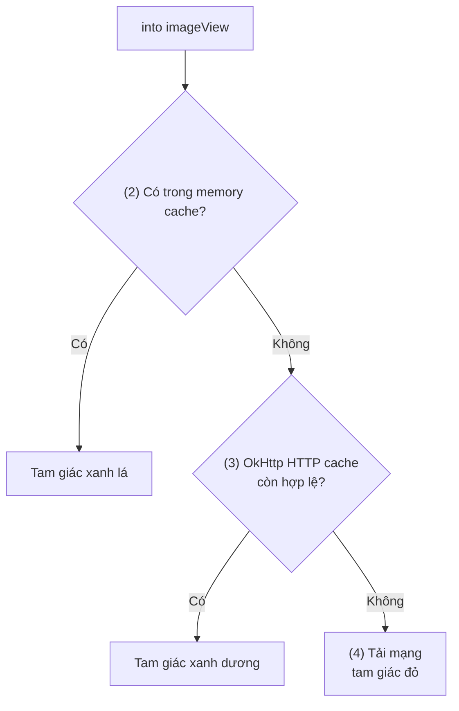
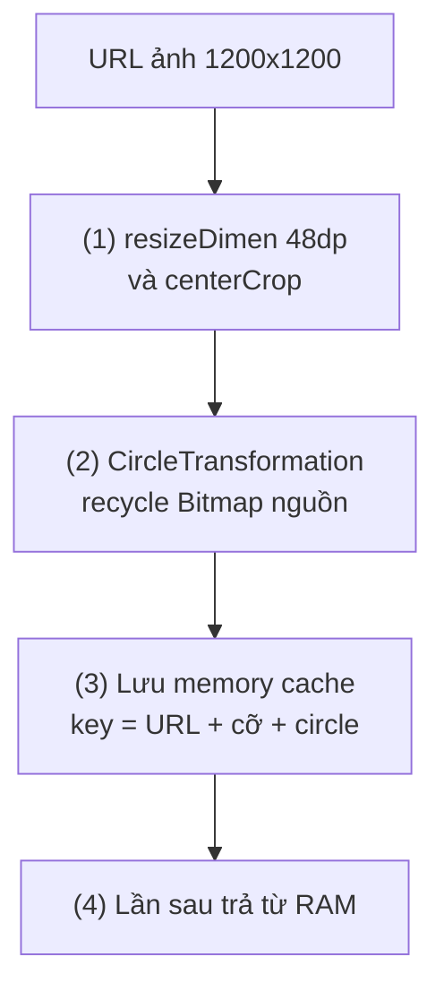
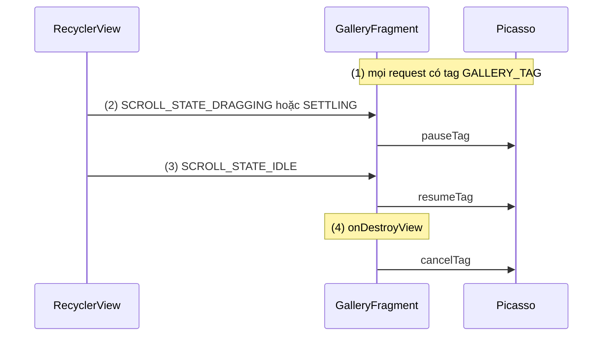
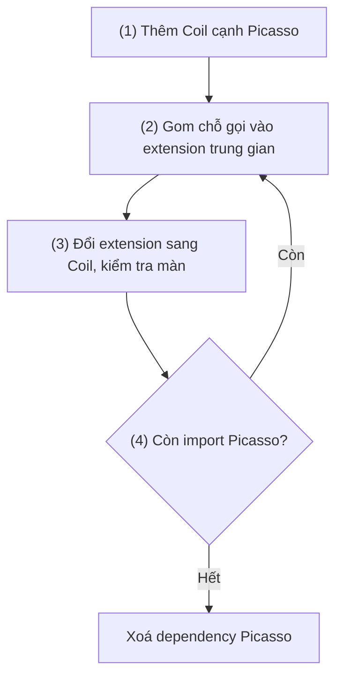

# Picasso

## Vấn đề cần giải quyết

Bài toán chung của image loading (bộ nhớ của Bitmap, decode ngoài main thread, downsample, cache, tái sử dụng View) đã được giải thích ở [Glide](glide.md), mục "Bài toán chung: decode đúng cỡ, ngoài main thread, có cache". Bài này không lặp lại phần đó.

Picasso đặt ra một bài toán hẹp hơn: **cho developer tải ảnh vào `ImageView` bằng một dòng code, với ít khái niệm nhất có thể.** Năm 2013, khi phần lớn app tự viết `AsyncTask` + `LruCache` để tải ảnh, cách tiếp cận này rất có giá trị:

```kotlin
Picasso.get().load(book.coverUrl).into(binding.coverImage)
```

Ngày nay, câu hỏi thực tế với Picasso là khác:

- Dự án cũ đang dùng Picasso ở hàng trăm chỗ: nó chạy thế nào, lỗi đặc trưng là gì, chỗ nào tốn bộ nhớ?
- Thư viện đã ngừng phát triển: khi nào nên chuyển, và chuyển thế nào cho an toàn?

## Sau khi học xong

- Giải thích được một request Picasso đi qua Dispatcher, memory cache và HTTP cache của OkHttp, và vì sao Picasso chỉ downsample khi được yêu cầu.
- Triển khai được Picasso trong danh sách với resize, centerCrop, Transformation và tag để tạm dừng hoặc huỷ request.
- Nhận diện được các lỗi đặc trưng của Picasso như Target bị garbage collect, gọi get() trên main thread và fit() với wrap_content.
- Biết khi nào giữ Picasso trong dự án cũ và chuyển một màn hình từ Picasso sang Coil theo từng bước.

## Picasso là gì?

**Picasso** là thư viện image loading của Square cho Android: một singleton nhận request dạng fluent (`load` → tuỳ chọn → `into`), tải và decode ảnh trên thread nền, giữ ảnh đã decode trong một memory cache LRU, và **giao phần disk cache cho HTTP cache của OkHttp** thay vì tự quản lý.

Mental model: Picasso là **một quầy giao hàng một cửa**. Bạn đưa địa chỉ và yêu cầu đóng gói (`resize`, `centerCrop`), quầy tự lo phần còn lại; quầy chỉ có một kệ hàng riêng (RAM), còn kho hàng (đĩa) là kho chung của dịch vụ vận chuyển (OkHttp), hoạt động theo luật của bên vận chuyển (HTTP cache header).

> [!WARNING]
> README của Picasso ghi rõ thư viện đã **deprecated** (từ 11/2024): khuyên dùng thư viện khác như Coil cho dự án mới và lên kế hoạch chuyển dự án cũ, nhất là khi dùng Compose. Các version hiện có vẫn chạy, nhưng sẽ không có bản phát hành công khai mới lên Maven Central. Bản ổn định cuối là **2.8** (08/2020); nhánh 3.0 dừng ở **3.0.0-alpha06** (08/2024).

## Cách hoạt động

### Một request đi qua Dispatcher, memory cache và OkHttp

Phiên bản ổn định dùng trong thực tế là 2.x (bài dùng 2.8):

```kotlin
// app/build.gradle.kts (dự án cũ)
dependencies {
    implementation("com.squareup.picasso:picasso:2.8")
}
```

Một lệnh `Picasso.get().load(url).into(imageView)` đi qua các bước:

- **`Picasso.get()`** trả về singleton. Từ 2.71828, Picasso lấy `Context` qua một `ContentProvider` tự khai báo trong manifest của thư viện, nên không cần truyền `Context` như `Picasso.with(context)` của bản cũ.
- **`load(url)`** tạo một `RequestCreator`, nơi nối các tuỳ chọn.
- **`into(imageView)`** tính **key** từ URL và các tuỳ chọn biến đổi ảnh, rồi hỏi **memory cache** ngay trên main thread. Có thì gán luôn.
- Không có, Picasso gán placeholder, tạo một `Action` giữ `ImageView` bằng **weak reference**, và đưa cho `Dispatcher`. Dispatcher chạy một "hunter" trên thread pool nền: tải qua `OkHttp3Downloader` (OkHttp tự trả từ HTTP cache trên đĩa nếu response còn hợp lệ), decode, áp các biến đổi, rồi đưa Bitmap về main thread.
- Nếu `ImageView` được gán một request mới trước khi request cũ xong (View được tái sử dụng trong Adapter), Picasso huỷ request cũ. README liệt kê tính năng này là "xử lý tái sử dụng ImageView và huỷ tải trong adapter".

Điểm khác Glide quan trọng nhất ở tầng đĩa: Picasso **không** có disk cache riêng. Nó dùng `Cache` của OkHttp đặt trong `cacheDir`, kích thước khoảng 2% dung lượng, trong khoảng 5–50 MB. HTTP cache tuân theo header của server: server trả `Cache-Control: no-store` hoặc `max-age=0` thì ảnh **không** được giữ trên đĩa, và mỗi lần mở app là một lần tải lại. Memory cache mặc định là `LruCache` khoảng 15% heap của app (`memoryClass / 7`).

#### Ví dụ: kiểm tra ảnh đến từ đâu bằng debug indicator

**Bài toán:** màn danh sách sách dùng Picasso bị phàn nàn là tốn data. Cần biết mỗi ảnh đang lấy từ RAM, từ đĩa hay từ mạng, để xác định lỗi nằm ở cache phía app hay header phía server.

**Luồng chạy:**

1. Bản debug cấu hình singleton bằng `Picasso.Builder` với `indicatorsEnabled(true)` và `loggingEnabled(true)`, đặt một lần trong `Application`.
2. Request tìm thấy ảnh trong memory cache: góc ảnh có tam giác **xanh lá**.
3. Không có trong RAM nhưng OkHttp trả từ HTTP cache: tam giác **xanh dương**.
4. Phải tải từ mạng: tam giác **đỏ**.



```kotlin
// BookstoreApp.kt
class BookstoreApp : Application() {
    override fun onCreate() {
        super.onCreate()
        if (BuildConfig.DEBUG) {
            val picasso = Picasso.Builder(this)
                .indicatorsEnabled(true)   // (1) vẽ tam giác màu ở góc ảnh
                .loggingEnabled(true)      // log từng bước của request ra Logcat
                .build()
            Picasso.setSingletonInstance(picasso) // chỉ gọi được trước lần Picasso.get() đầu tiên
        }
    }
}
```

**Kết quả:** cuộn danh sách, quay lại: ảnh vừa xem có tam giác xanh lá. Đóng app, mở lại: nếu thấy xanh dương thì HTTP cache hoạt động; nếu vẫn đỏ, kiểm tra response của CDN trong Network Inspector, nhiều khả năng server trả `Cache-Control: no-cache`/`no-store`. Sửa ở phía CDN, không phải ở Picasso.

### Resize, centerCrop và Transformation

Khác Glide, Picasso **không** tự downsample theo kích thước `ImageView`. Không gọi gì thì ảnh được decode ở kích thước gốc. Có ba cách yêu cầu thu nhỏ:

- **`resize(width, height)`**: đặt kích thước đích bằng pixel. Picasso dùng `inSampleSize` khi decode rồi scale chính xác về cỡ đó. Phải đi kèm `centerCrop()` hoặc `centerInside()` nếu tỉ lệ ảnh khác tỉ lệ đích.
- **`resizeDimen(widthRes, heightRes)`**: như trên nhưng lấy kích thước từ dimension resource.
- **`fit()`**: hoãn request tới khi `ImageView` đã được đo, rồi resize theo kích thước của nó. Chỉ dùng được khi View có kích thước xác định.

**`Transformation`** là interface để biến đổi Bitmap tuỳ ý: `transform(source: Bitmap): Bitmap` và `key(): String`. `key()` được đưa vào memory cache key, nên hai transformation khác nhau phải có key khác nhau. Hợp đồng của `transform()`: nếu tạo Bitmap mới thì phải `recycle()` Bitmap nguồn; nếu trả lại chính nó thì không recycle.

#### Ví dụ: avatar tròn trong danh bạ

**Bài toán:** danh bạ nhân viên hiển thị avatar 48dp tròn. Ảnh gốc trên server là ảnh chụp 1200×1200, nên phải resize trước khi cắt tròn.

**Luồng chạy:**

1. `resizeDimen` đưa ảnh về 48dp (theo pixel của máy), `centerCrop` giữ phần giữa.
2. `CircleTransformation` cắt Bitmap đã resize thành hình tròn, recycle Bitmap nguồn.
3. Kết quả lưu vào memory cache với key gồm URL, kích thước và `key()` của transformation.
4. Lần sau cùng URL, cùng cỡ, cùng transformation: trả thẳng từ RAM.



```kotlin
// CircleTransformation.kt
class CircleTransformation : Transformation {

    override fun transform(source: Bitmap): Bitmap {
        val size = minOf(source.width, source.height)
        val output = Bitmap.createBitmap(size, size, Bitmap.Config.ARGB_8888)
        val paint = Paint(Paint.ANTI_ALIAS_FLAG).apply {
            shader = BitmapShader(source, Shader.TileMode.CLAMP, Shader.TileMode.CLAMP)
        }
        val radius = size / 2f
        Canvas(output).drawCircle(radius, radius, radius, paint)   // (2) vẽ hình tròn
        source.recycle()                                           // hợp đồng: tạo mới thì recycle nguồn
        return output
    }

    override fun key(): String = "circle"                          // (3) thành một phần của cache key
}
```

```kotlin
// EmployeeAdapter.kt (trong onBindViewHolder)
Picasso.get()
    .load(employee.avatarUrl)
    .resizeDimen(R.dimen.avatar_size, R.dimen.avatar_size)   // (1)
    .centerCrop()
    .transform(CircleTransformation())                       // (2)
    .placeholder(R.drawable.avatar_placeholder)
    .error(R.drawable.avatar_placeholder)
    .into(holder.binding.avatarImage)                        // (3), (4)
```

`Canvas`, `Paint` và `BitmapShader` được học ở [8.5.2 View Custom](../view_layout/views.md); ở đây chỉ cần biết chúng vẽ Bitmap nguồn vào một hình tròn.

**Kết quả:** avatar hiện tròn, sắc nét ở cỡ 48dp. Dùng Memory Profiler so sánh trước và sau khi thêm `resizeDimen`: mỗi avatar giảm từ khoảng 5,5 MB (1200×1200×4 byte) xuống vài chục KB.

### Không biết vòng đời: dùng tag để tạm dừng và huỷ

Picasso **không** gắn với vòng đời Activity hay Fragment như `Glide.with(fragment)`. `ImageView` được giữ bằng weak reference, nên request không giữ View sống; nhưng request vẫn chạy tiếp sau khi rời màn hình, cho tới khi xong hoặc bị huỷ tường minh. Picasso cho ba công cụ:

- `cancelRequest(imageView)`: huỷ request của một View.
- `tag(any)`: gắn tag cho request; `pauseTag(tag)`, `resumeTag(tag)`, `cancelTag(tag)` thao tác trên mọi request có tag đó.
- Tag được giữ bằng tham chiếu mạnh tới khi request xong, nên dùng tag là một giá trị đơn giản (chuỗi, hằng số) hoặc đối tượng có vòng đời phù hợp.

#### Ví dụ: tạm dừng tải khi cuộn nhanh và huỷ khi rời màn hình

**Bài toán:** gallery sản phẩm có hàng trăm ảnh. Khi người dùng vuốt mạnh (fling), không cần tải ảnh của những ô chỉ lướt qua; khi rời màn hình, mọi request còn lại phải dừng.

**Luồng chạy:**

1. Mọi request trong gallery được gắn tag `GALLERY_TAG`.
2. RecyclerView bắt đầu cuộn: `pauseTag` tạm dừng các request đang chờ.
3. RecyclerView dừng cuộn: `resumeTag` chạy lại, chỉ các ô đang hiển thị còn request hợp lệ.
4. `onDestroyView`: `cancelTag` huỷ mọi request còn lại của gallery.



```kotlin
// GalleryFragment.kt
class GalleryFragment : Fragment(R.layout.fragment_gallery) {

    private val scrollListener = object : RecyclerView.OnScrollListener() {
        override fun onScrollStateChanged(recyclerView: RecyclerView, newState: Int) {
            val picasso = Picasso.get()
            if (newState == RecyclerView.SCROLL_STATE_IDLE) {
                picasso.resumeTag(GALLERY_TAG)                // (3)
            } else {
                picasso.pauseTag(GALLERY_TAG)                 // (2)
            }
        }
    }

    override fun onViewCreated(view: View, savedInstanceState: Bundle?) {
        super.onViewCreated(view, savedInstanceState)
        val binding = FragmentGalleryBinding.bind(view)
        binding.galleryList.adapter = GalleryAdapter(tag = GALLERY_TAG) // (1) adapter gọi .tag(tag)
        binding.galleryList.addOnScrollListener(scrollListener)
    }

    override fun onDestroyView() {
        super.onDestroyView()
        Picasso.get().cancelTag(GALLERY_TAG)                  // (4)
    }

    companion object {
        private const val GALLERY_TAG = "gallery"
    }
}
```

```kotlin
// GalleryAdapter.kt (trong onBindViewHolder)
Picasso.get()
    .load(item.thumbnailUrl)
    .fit()                         // ô ảnh có kích thước cố định nên fit() dùng được
    .centerCrop()
    .tag(tag)                      // (1)
    .into(holder.binding.thumbnailImage)
```

**Kết quả:** bật logging của Picasso, fling danh sách: log cho thấy request bị tạm dừng trong lúc cuộn và chỉ ảnh của các ô đang hiển thị được tải khi dừng. Rời màn hình: không còn request gallery nào chạy.

## Ví dụ thực tế

Ba bài toán hay gặp với Picasso trong dự án cũ:

1. **Chuyển dần một màn hình từ Picasso sang Coil:** bài toán chính, code đầy đủ bên dưới.
2. **Lấy Bitmap cho thông báo:** `Picasso.get().load(url).get()` chạy **đồng bộ** và chỉ được gọi từ thread nền (gọi trên main thread ném `IllegalStateException`); hợp với `Worker` dựng notification. Notification được học ở [8.5.5 Message](../view_layout/message.md).
3. **Dùng chung `OkHttpClient` của app:** `Picasso.Builder(context).downloader(OkHttp3Downloader(okHttpClient)).build()`, để ảnh đi qua cùng interceptor và cache với API ([OkHttp](../networks/okhttp.md)). Khi đó cần tự cấu hình `Cache` cho client đó, nếu không ảnh không có disk cache.

### Chuyển một màn hình từ Picasso sang Coil

**Bài toán:** app cũ dùng Picasso ở nhiều màn; team bắt đầu viết màn mới bằng Compose và muốn bỏ Picasso dần, không đổi một lần cả app. Hai thư viện chạy song song được vì khác package và có cache riêng.

**Luồng chạy:**

1. Thêm Coil (và artifact network của Coil 3) bên cạnh Picasso; chưa xoá Picasso.
2. Viết một extension trung gian `ImageView.loadThumbnail(url)` cho màn đang chuyển, để chỗ gọi không phụ thuộc thư viện nào.
3. Đổi nội dung extension từ Picasso sang Coil theo bảng ánh xạ API; chạy lại màn để kiểm tra.
4. Lặp lại cho các màn khác; khi không còn import `com.squareup.picasso` nào, xoá dependency Picasso.



| Picasso 2.x | Coil 3 (View) |
|---|---|
| `Picasso.get().load(url).into(imageView)` | `imageView.load(url)` |
| `.placeholder(res)`, `.error(res)` | `placeholder(res)`, `error(res)` trong lambda |
| `.resize(w, h)`, `.fit()` | Không cần: Coil tự lấy kích thước View; `size(w, h)` khi cần |
| `.centerCrop()` | Theo `scaleType` của ImageView |
| `.transform(CircleTransformation())` | `transformations(CircleCropTransformation())` |
| `.tag()`, `cancelRequest(view)` | Request tự huỷ khi View detach; `imageView.dispose()` |
| `.get()` trên thread nền | `imageLoader.execute(request)` trong coroutine |

```kotlin
// app/build.gradle.kts
dependencies {
    implementation("com.squareup.picasso:picasso:2.8")             // (1) giữ tới khi chuyển xong
    implementation("io.coil-kt.coil3:coil:3.6.3")
    implementation("io.coil-kt.coil3:coil-network-okhttp:3.6.3")
}
```

```kotlin
// ThumbnailLoading.kt
// (2) Trước: extension trung gian vẫn dùng Picasso
// fun ImageView.loadThumbnail(url: String?) {
//     Picasso.get().load(url).fit().centerCrop()
//         .transform(CircleTransformation())
//         .placeholder(R.drawable.thumb_placeholder)
//         .into(this)
// }

// (3) Sau: cùng chữ ký, nội dung dùng Coil
fun ImageView.loadThumbnail(url: String?) {
    load(url) {
        placeholder(R.drawable.thumb_placeholder)
        error(R.drawable.thumb_placeholder)
        transformations(CircleCropTransformation())
    }
}
```

`load`, `placeholder`, `error`, `transformations` ở đây là API của Coil 3 (`coil3.load`, `coil3.request.*`, `coil3.transform.CircleCropTransformation`), được giải thích ở [Coil](coil.md).

**Kết quả:** màn đã chuyển hiển thị giống trước; chỗ gọi `binding.thumbnail.loadThumbnail(item.url)` không đổi một dòng. Trong lúc chuyển, app có hai memory cache song song, nên RAM dành cho ảnh tăng tạm thời; đây là lý do nên chuyển dứt điểm thay vì để hai thư viện sống chung lâu dài.

## So sánh với các cách tiếp cận khác

| | Picasso 2.x | [Glide](glide.md) | [Coil](coil.md) |
|---|---|---|---|
| Downsample | Chỉ khi gọi `resize`/`fit` | Tự động theo target | Tự động theo View/constraints |
| Disk cache | HTTP cache của OkHttp, theo header server | Riêng, 2 tầng (gốc và đã transform) | Riêng; Coil 3 mặc định không theo `Cache-Control` |
| Vòng đời | Không, dùng tag | `RequestManager` theo Fragment/Activity | Coroutine theo View/Lifecycle |
| Compose | Chỉ có trong 3.0 alpha | Artifact beta | `AsyncImage` ổn định |
| Trạng thái | Deprecated (11/2024) | Đang phát triển | Đang phát triển |

Picasso từng thắng nhờ API gọn và kích thước nhỏ. Phần lớn ưu điểm đó nay Coil cũng có, kèm downsample tự động, coroutine và Compose.

## Khi nào nên và không nên dùng

- **Giữ** trong dự án cũ đang chạy ổn, ít thay đổi UI: Picasso 2.8 vẫn hoạt động, chưa cần chuyển gấp chỉ vì deprecated.
- **Nên lên kế hoạch chuyển** khi viết màn mới bằng Compose, khi phần hiển thị ảnh cần thay đổi lớn, hoặc khi cần tính năng Picasso không có (GIF động, SVG, video frame).
- **Không dùng** cho dự án mới: chọn [Coil](coil.md) hoặc [Glide](glide.md).
- **Không dùng** bản 3.0.0-alpha cho production: API chưa ổn định và sẽ không được phát hành tiếp.

## Sai lầm thường gặp

### 1. `Target` là biến cục bộ hoặc lambda vô danh

```kotlin
// Sai: Target chỉ được Picasso giữ bằng weak reference
Picasso.get().load(bannerUrl).into(object : Target {
    override fun onBitmapLoaded(bitmap: Bitmap, from: Picasso.LoadedFrom) {
        binding.banner.background = BitmapDrawable(resources, bitmap)
    }
    override fun onBitmapFailed(e: Exception, errorDrawable: Drawable?) {}
    override fun onPrepareLoad(placeHolderDrawable: Drawable?) {}
})
```

**Lỗi lộ ra thế nào:** thỉnh thoảng `onBitmapLoaded` không bao giờ được gọi. Không ai giữ tham chiếu mạnh tới `Target`, GC thu hồi nó trước khi ảnh tải xong, và Picasso lặng lẽ bỏ request.

**Cách sửa:** giữ `Target` trong một field của màn hình (và `cancelRequest(target)` khi rời màn), hoặc tốt hơn, dùng `into(imageView)` khi đích là một View.

### 2. Gọi `get()` trên main thread

**Lỗi lộ ra thế nào:** crash `IllegalStateException: Method call should not happen from the main thread.`

**Cách sửa:** `get()` là lời gọi đồng bộ, chỉ dùng trên thread nền (trong `Worker`, trong `withContext(Dispatchers.IO)`).

### 3. `fit()` với `wrap_content`

**Lỗi lộ ra thế nào:** ảnh không bao giờ hiện, không có lỗi. `fit()` chờ View có kích thước khác 0; View `wrap_content` không có ảnh thì kích thước là 0, nên request chờ mãi.

**Cách sửa:** cho View kích thước xác định, hoặc dùng `resize()` với kích thước cụ thể.

### 4. Không resize ảnh lớn

**Lỗi lộ ra thế nào:** feed ảnh chụp từ điện thoại dùng RAM rất cao, memory cache chỉ chứa được vài ảnh, cuộn giật và OOM trên máy yếu. Code nhìn giống hệt Glide nên dễ tưởng Picasso cũng tự downsample.

**Cách sửa:** luôn `fit()` hoặc `resize()` cho ảnh có thể lớn hơn ô hiển thị.

### 5. Nghĩ rằng Picasso luôn cache ảnh trên đĩa

**Lỗi lộ ra thế nào:** offline thì ảnh không hiện dù vừa xem lúc online; app tốn data hơn dự kiến.

**Cách sửa:** kiểm tra header `Cache-Control` của CDN (debug indicator ở trên). Nếu không sửa được phía server, thêm network interceptor cho `OkHttpClient` của Picasso để ghi đè header cache cho host ảnh, hoặc chuyển sang thư viện có disk cache riêng.

## Lịch sử phát triển

- **Picasso 1.0 (05/2013):** Square phát hành, nổi tiếng nhờ API một dòng và tự huỷ request khi `ImageView` được tái sử dụng trong Adapter.
- **Picasso 2.x (2013–2015):** API fluent với `Transformation`, `Target`, debug indicator được dùng rộng rãi; 2.5.2 (03/2015) là bản được dùng rất lâu.
- **Picasso 2.71828 (03/2018):** tên version là các chữ số của hằng số e; `Picasso.with(context)` đổi thành `Picasso.get()`, dùng OkHttp 3 qua `OkHttp3Downloader`.
- **Picasso 2.8 (08/2020):** bản ổn định cuối cùng.
- **Picasso 3.0.0-alpha01 (06/2022) đến alpha06 (08/2024):** viết lại theo package `com.squareup.picasso3`, bỏ singleton, thêm hỗ trợ Compose; chưa bao giờ ra bản ổn định.
- **11/2024:** README được cập nhật: thư viện deprecated, khuyên dùng Coil, sẽ không phát hành công khai thêm.

## Kết nối hệ thống

- **Tiên quyết:**
  - [Glide](glide.md): bài toán chung của image loading, cache nhiều tầng, tái sử dụng View.
- **Liên quan:**
  - [Coil](coil.md): đích chuyển đổi được Picasso khuyên dùng.
  - [Fresco](fresco.md): thư viện cùng thời với Picasso nhưng giải quyết bộ nhớ theo cách khác.
  - [OkHttp](../networks/okhttp.md): HTTP cache mà Picasso dùng làm disk cache.
- **Học tiếp:**
  - [8.5.1 Layouts](../view_layout/layouts.md): `RecyclerView` và trạng thái cuộn dùng trong ví dụ gallery.
  - [8.5.2 View Custom](../view_layout/views.md): `Canvas`, `Paint`, `BitmapShader` dùng trong `CircleTransformation`.

## Tham khảo

- [Picasso - GitHub (README ghi deprecated)](https://github.com/square/picasso)
- [Picasso - trang chính thức](https://square.github.io/picasso/)
- [Picasso 2.8 source: Utils.java (kích thước cache mặc định)](https://github.com/square/picasso/blob/2.8/picasso/src/main/java/com/squareup/picasso/Utils.java)
- [Maven Central: com.squareup.picasso:picasso](https://central.sonatype.com/artifact/com.squareup.picasso/picasso)
- [Maven Central: com.squareup.picasso3:picasso](https://central.sonatype.com/artifact/com.squareup.picasso3/picasso)
- [Coil - Getting started](https://coil-kt.github.io/coil/getting_started/)
