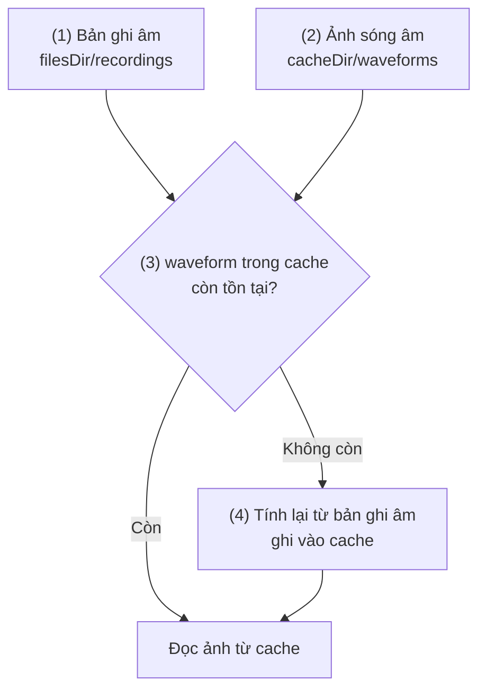
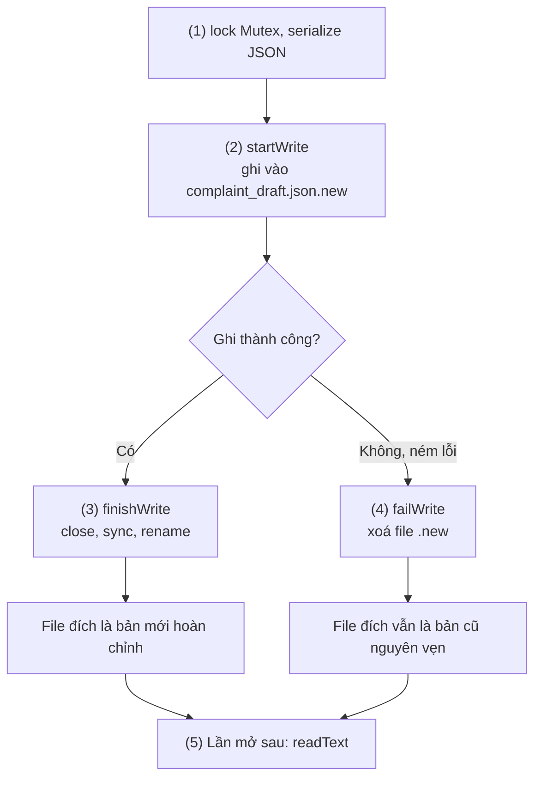
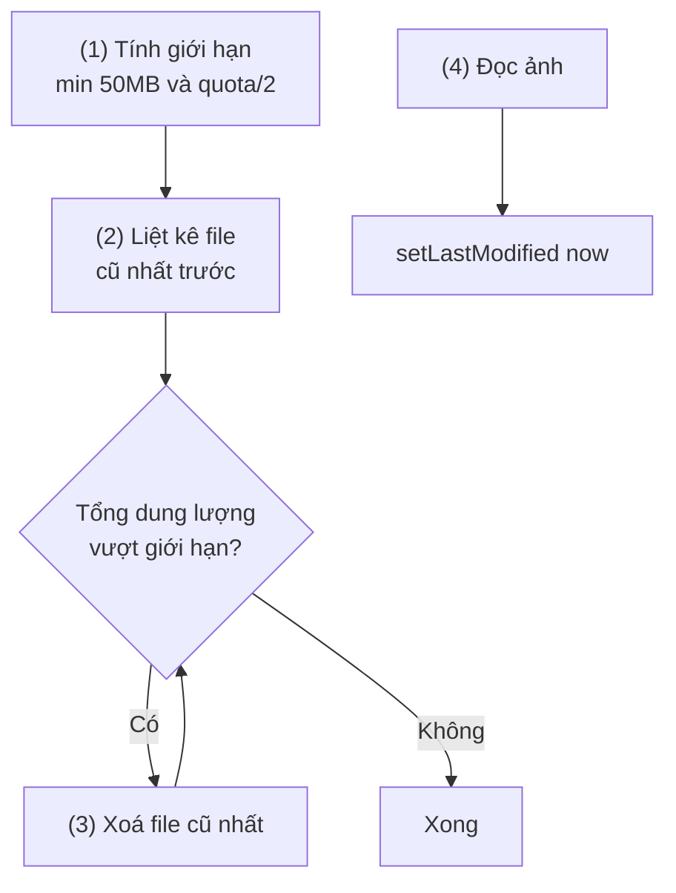
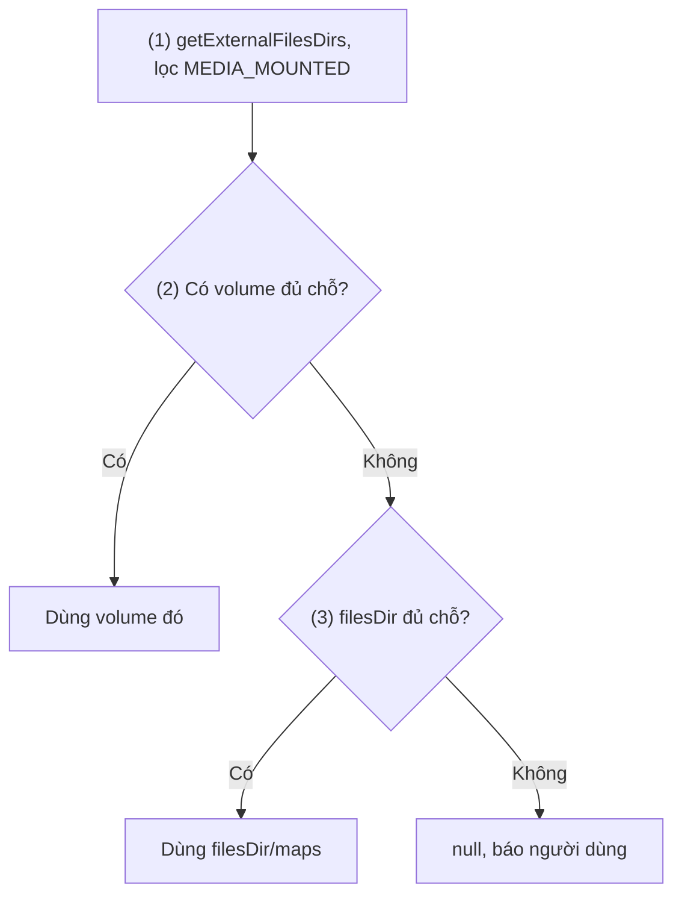
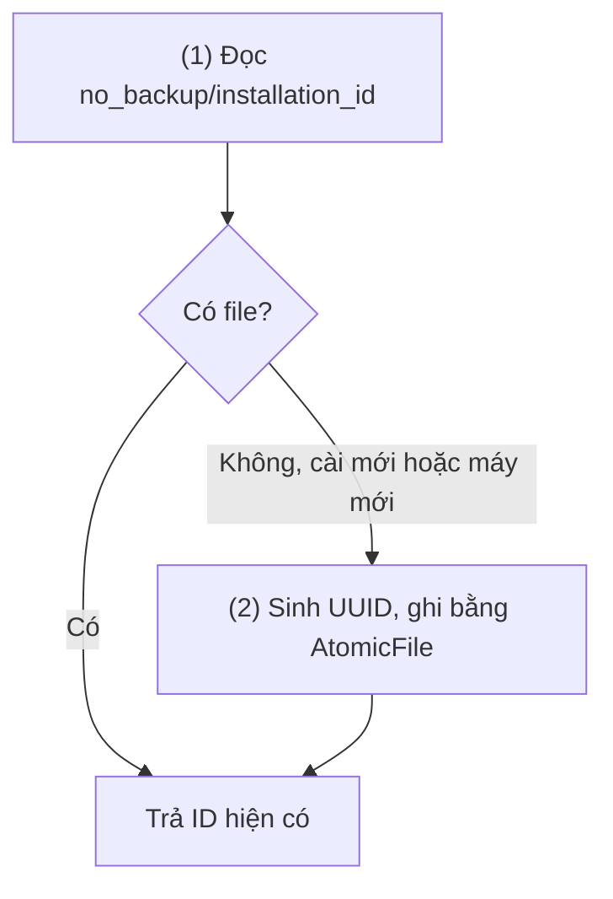
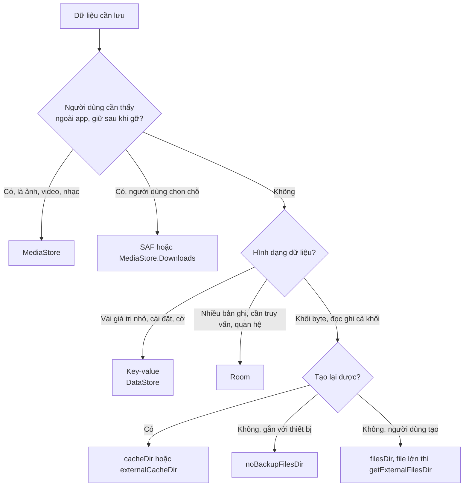
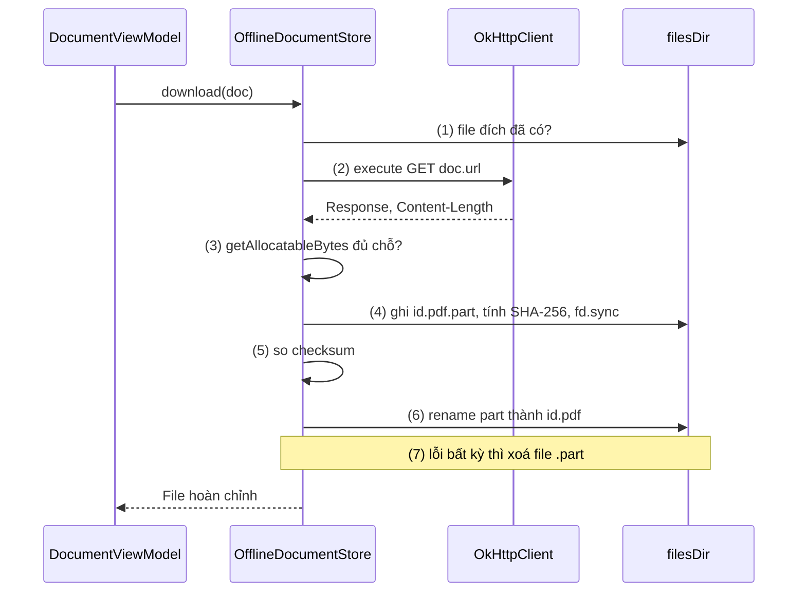

# Local Storage

## Vấn đề cần giải quyết

Nhiều dữ liệu của app là một khối byte đọc ghi cả khối: bản ghi âm, bản nháp dài, tài liệu đọc offline, ảnh xem trước, file log. Chỗ hợp với chúng là file, không phải key-value hay database. Đọc ghi file thì ai cũng viết được; cái khó là những câu hỏi code không tự trả lời:

- **Lưu ở thư mục nào?** Mỗi app có vài thư mục riêng, khác nhau ở chỗ có được backup không, có bị hệ thống xoá khi máy thiếu chỗ không, có luôn tồn tại không.
- **Ghi thế nào cho an toàn?** `FileOutputStream(file)` xoá nội dung cũ ngay khi mở; app bị giết giữa lúc ghi thì file chỉ còn một nửa.
- **Còn đủ chỗ không, ai dọn rác?** Cache không ai dọn thì app phình dần; tải file lớn mà không kiểm tra dung lượng thì hỏng giữa chừng.

```kotlin
// Ba lỗi trong ba dòng
val draftFile = File(context.cacheDir, "draft.json")   // cache có thể bị hệ thống xoá
draftFile.writeText(json)                              // app bị giết lúc này → file cụt
val draft = parseDraft(draftFile.readText())           // lần sau: crash khi parse
```

Vấn đề cần giải quyết là: **chọn đúng thư mục theo vòng đời của dữ liệu, và ghi file sao cho trên đĩa chỉ có bản cũ nguyên vẹn hoặc bản mới hoàn chỉnh.** Permission, Scoped Storage, DataStore và Room không được dạy lại ở đây; bài trỏ sang 2.1, 5.1.1 và 5.1.2 khi cần.

## Sau khi học xong

- Giải thích được hợp đồng của từng thư mục app-specific (filesDir, cacheDir, noBackupFilesDir, getExternalFilesDir) về quyền, thời gian sống, việc hệ thống dọn và backup.
- Triển khai được ghi file an toàn bằng file tạm rồi rename hoặc AtomicFile để app bị giết giữa chừng không để lại file hỏng.
- Xử lý được cache bị hệ thống xoá, quota cache và dung lượng trống trước khi ghi file lớn.
- Áp dụng được backup rules và noBackupFilesDir để dữ liệu gắn với thiết bị không bị khôi phục sang máy khác.
- Biết khi nào chọn file, key-value, Room, MediaStore hay SAF cho từng loại dữ liệu.

## Local Storage là gì?

**Local Storage**, trong phạm vi bài này, là lưu dữ liệu dạng file trong các **thư mục riêng của app (app-specific storage)** mà hệ thống cấp cho từng app: app đọc ghi không cần xin quyền, app khác không truy cập được, và tất cả bị xoá khi gỡ app. Mỗi thư mục có một **hợp đồng** riêng: dữ liệu sống bao lâu, có được backup không, hệ thống có được tự xoá không.

Mental model: thư mục riêng của app là **một căn hộ nhiều phòng, mỗi phòng một nội quy**. `files/` là phòng ở chính: đồ để lâu, được mang theo khi chuyển sang máy mới (backup). `cache/` là bàn để đồ tạm: chủ nhà (hệ thống) được dọn khi toà nhà chật. `no_backup/` là ngăn kéo gắn chết vào căn hộ: giữ lâu nhưng không mang sang nhà mới. External app-specific là kho thuê bên ngoài: rộng hơn nhưng có lúc không mở được. Chọn thư mục là chọn nội quy hợp với món đồ.

## Cách hoạt động

### Các thư mục app-specific và hợp đồng của chúng

Mọi thư mục lấy qua `Context`, không ghép đường dẫn cứng: đường dẫn thật khác nhau theo user (work profile) và thiết bị.

| Thư mục | API lấy | Có từ | Hệ thống tự xoá? | Auto Backup? | Dùng cho |
|---|---|---|---|---|---|
| Internal files | `filesDir` | API 1 | Không | Có | Dữ liệu người dùng tạo, không tải lại được |
| Internal cache | `cacheDir` | API 1 | Có, khi máy thiếu chỗ | Không | Dữ liệu tạo lại được: ảnh xem trước, file tạm |
| No-backup | `noBackupFilesDir` | API 21 | Không | Không | Dữ liệu gắn với thiết bị: ID cài đặt, token đăng ký push |
| External app-specific files | `getExternalFilesDir(type)` | API 8 | Không | Có | File lớn chỉ app dùng: bản đồ offline, video đang biên tập |
| External app-specific cache | `externalCacheDir` | API 8 | Có | Không | Cache lớn |

Các điểm chung của hợp đồng (theo docs "Access app-specific files"):

- **Không cần quyền.** Internal chưa bao giờ cần; app-specific trên external không cần từ Android 4.4 (API 19).
- **Bị xoá khi gỡ app.** Thứ người dùng muốn giữ sau khi gỡ app (ảnh chụp, file export) phải đi qua MediaStore hoặc SAF.
- **Internal được bảo vệ hơn.** App khác không đọc được (sandbox theo UID, [File Permissions](../session_02/file_permissions.md), mục "Android sandbox"), và docs ghi từ Android 10 các thư mục này được mã hoá. External app-specific chỉ được cô lập từ Android 10 (Scoped Storage).
- **Internal thường nhỏ hơn**, nên file lớn cân nhắc external app-specific.

`File(context.filesDir, name)` và `context.openFileOutput(name, Context.MODE_PRIVATE)` cùng ghi vào `filesDir`; `getDir(name, MODE_PRIVATE)` tạo thư mục `app_<name>` cạnh `files/` trong data dir. Từ Android 7.0 (API 24), mode khác `MODE_PRIVATE` gây `SecurityException`; muốn cho app khác đọc file thì dùng `FileProvider` (2.1).

Đọc ghi file là Disk I/O, phải chạy ngoài Main Thread ([Working with Thread](../session_05/working_with_thread.md)). Các ví dụ dùng `withContext(Dispatchers.IO)` để chuyển sang thread I/O; đây là kiến thức dùng trước, coroutine được học ở [8.4.3 Coroutines](async_threads/coroutines.md).

#### Ví dụ: ghi âm giọng nói và ảnh sóng âm

**Bài toán:** app ghi chú giọng nói lưu bản ghi âm và một ảnh sóng âm (waveform) vẽ từ bản ghi để hiện trong danh sách. Bản ghi âm không tạo lại được, ảnh sóng âm thì tính lại được bất cứ lúc nào: hai thứ cần hai nội quy khác nhau.

**Luồng chạy:**

1. Bản ghi âm lưu ở `filesDir/recordings/`, vì mất là mất hẳn và nên đi theo backup.
2. Ảnh sóng âm lưu ở `cacheDir/waveforms/`, vì hệ thống được phép xoá nó khi cần chỗ.
3. Khi hiển thị, kiểm tra file cache còn không trước khi đọc.
4. Không còn (bị dọn hoặc chưa từng tạo) thì tính lại từ bản ghi âm, ghi vào cache và trả về.



```kotlin
// VoiceMemoStorage.kt
class VoiceMemoStorage(private val context: Context) {

    // (1) dữ liệu người dùng tạo: phòng ở chính
    fun recordingFile(memoId: String): File =
        File(context.filesDir, "recordings").apply { mkdirs() }
            .resolve("$memoId.m4a")

    // (2) dữ liệu tạo lại được: bàn để đồ tạm
    private fun waveformFile(memoId: String): File =
        File(context.cacheDir, "waveforms").apply { mkdirs() }
            .resolve("$memoId.png")

    suspend fun loadWaveform(memoId: String): Bitmap? = withContext(Dispatchers.IO) {
        val cached = waveformFile(memoId)
        if (cached.exists()) {                                   // (3) cache có thể đã bị dọn
            BitmapFactory.decodeFile(cached.path)?.let { return@withContext it }
        }
        val recording = recordingFile(memoId)
        if (!recording.exists()) return@withContext null
        val waveform = WaveformRenderer.render(recording)        // (4) tính lại từ nguồn gốc
        cached.outputStream().use { waveform.compress(Bitmap.CompressFormat.PNG, 100, it) }
        waveform
    }
}
```

`WaveformRenderer` là phần vẽ ảnh của app. Ghi cache bằng `outputStream()` chưa an toàn khi app bị giết giữa chừng, nhưng với cache thì chấp nhận được: file hỏng làm `decodeFile` trả `null` và ảnh được tính lại. Dữ liệu không tạo lại được phải ghi theo cách ở phần tiếp theo.

**Kết quả:** trong Device Explorer của Android Studio, xoá file `.png` trong `cache/waveforms/`: danh sách vẫn hiện sóng âm vì nó được tính lại. Xoá file trong `files/recordings/` thì bản ghi mất hẳn.

### Ghi an toàn: file tạm rồi rename

`file.writeText()` hay `FileOutputStream(file)` mở file ở chế độ truncate: nội dung cũ bị xoá **trước** khi nội dung mới ghi xong. Process bị giết ở giữa (hệ thống thu hồi bộ nhớ, người dùng vuốt tắt app, hết pin) thì trên đĩa chỉ còn file cụt: mất cả bản cũ lẫn bản mới.

Cách sửa dựa vào một đảm bảo của hệ điều hành: `rename` trên **cùng một filesystem** là nguyên tử (atomic), người đọc chỉ thấy nội dung cũ hoặc nội dung mới. Quy trình chuẩn:

1. Ghi toàn bộ nội dung mới vào **file tạm** cạnh file đích (cùng thư mục nên chắc chắn cùng filesystem).
2. Gọi `fsync` (`FileOutputStream.fd.sync()`) để đẩy dữ liệu từ bộ đệm kernel xuống thiết bị. Thiếu bước này, rename có thể xuống đĩa trước nội dung, và mất điện lúc đó vẫn để lại file rỗng.
3. Rename file tạm thành file đích.
4. Lỗi ở bất kỳ bước nào thì xoá file tạm; file đích vẫn là bản cũ.

DataStore dùng đúng cơ chế này ([Key-Value Storage](../session_05/data_store/key_value.md), mục "Cơ chế hoạt động bên trong").

**`AtomicFile`** (`androidx.core.util`, từ core 1.1.0; bản framework `android.util.AtomicFile` từ API 17) đóng gói quy trình trên: `startWrite()` trả stream ghi vào `<tên>.new`, `finishWrite()` đóng, sync rồi rename vào chỗ file gốc, `failWrite()` đóng và xoá file mới. `core-ktx` thêm extension `tryWrite {}`, `writeText()`, `writeBytes()`, `readText()`, `readBytes()`.

> [!IMPORTANT]
> `AtomicFile` không khoá file. Docs cảnh báo hai thread cùng ghi thì lần ghi này đè lần ghi kia. Người gọi phải tự đảm bảo chỉ một nơi ghi tại một thời điểm, ví dụ qua một `Mutex` hoặc một thread duy nhất ([8.4.2 Thread and Multi-Thread](async_threads/thread_multithread.md)).

#### Ví dụ: tự lưu bản nháp đơn khiếu nại

**Bài toán:** form khiếu nại có nhiều trường văn bản dài; app tự lưu nháp vài giây một lần. Bản nháp không tạo lại được, nên một lần ghi hỏng là mất hết.

**Luồng chạy:**

1. Bản nháp được chuyển thành JSON; mọi lần ghi đi qua một `Mutex` để không có hai lần ghi chồng nhau.
2. `startWrite()` mở stream ghi vào `complaint_draft.json.new`.
3. Ghi xong thì `finishWrite()`: đóng stream, sync xuống đĩa, rename thành `complaint_draft.json`.
4. Có lỗi thì `failWrite()`: xoá file `.new`, file nháp cũ còn nguyên.
5. Khi mở lại form, `readText()` đọc file đích; file không tồn tại nghĩa là chưa có nháp.



```kotlin
// ComplaintDraftStore.kt
class ComplaintDraftStore(context: Context) {

    private val draftFile = AtomicFile(File(context.filesDir, "complaint_draft.json"))
    private val writeMutex = Mutex()

    suspend fun save(draft: ComplaintDraft) = withContext(Dispatchers.IO) {
        writeMutex.withLock {                                       // (1) một người ghi tại một thời điểm
            val json = draft.toJson()
            val out = draftFile.startWrite()                        // (2) ghi vào file .new
            try {
                out.write(json.toByteArray(Charsets.UTF_8))
                draftFile.finishWrite(out)                          // (3) close + sync + rename
            } catch (e: IOException) {
                draftFile.failWrite(out)                            // (4) bỏ file .new
                throw e
            }
        }
    }

    suspend fun load(): ComplaintDraft? = withContext(Dispatchers.IO) {
        try {
            ComplaintDraft.fromJson(draftFile.readText())           // (5) luôn là bản hoàn chỉnh
        } catch (e: FileNotFoundException) {
            null                                                    // chưa có nháp
        }
    }
}
```

`Mutex` của kotlinx.coroutines (học ở 8.4.3) cho một coroutine vào `withLock` tại một thời điểm. `toJson()`/`fromJson()` là phần chuyển JSON của app ([8.1.2 Gson](networks/gson.md)). Viết gọn hơn: `draftFile.writeText(json)` của `core-ktx` làm đúng bước 2 đến 4.

**Kết quả:** chèn `Thread.sleep(5_000)` trước `finishWrite`, bấm lưu rồi Stop app trong lúc chờ: mở lại thấy bản nháp lần trước, không crash. Cùng thử nghiệm với `File.writeText()` có thể cho file rỗng hoặc cụt.

### Cache: hệ thống dọn, nhưng app vẫn phải tự quản lý

`cacheDir` có hai đặc điểm, cả hai đều phải tôn trọng:

- **Hệ thống được xoá file cache khi máy thiếu chỗ**, không báo trước. Code phải kiểm tra file còn tồn tại trước khi đọc, và mọi thứ trong cache phải tạo lại được.
- **Không được dựa vào hệ thống để dọn.** Docs yêu cầu app tự giữ cache trong giới hạn; hệ thống chỉ dọn khi chính nó cần chỗ, lúc người dùng đã thấy máy đầy.

Từ Android 8.0 (API 26), `StorageManager` có `getCacheQuotaBytes(uuid)`: hạn mức cache dành cho app, thay đổi theo mức độ dùng app và dung lượng trống. App **vượt** hạn mức thì cache của nó nằm trong nhóm bị xoá đầu tiên; **dưới** hạn mức thì nằm trong nhóm bị xoá cuối cùng. Cùng API level còn có `getCacheSizeBytes()` (tổng cache hiện tại), `setCacheBehaviorGroup()` (xoá cả thư mục cùng lúc, cho file phụ thuộc nhau như video và phụ đề) và `setCacheBehaviorTombstone()` (cắt file về 0 byte thay vì xoá). Các hàm này có thể mất vài giây, phải gọi trên worker thread.

#### Ví dụ: cache ảnh xem trước của tài liệu có giới hạn dung lượng

**Bài toán:** app tài liệu render trang đầu mỗi PDF thành ảnh cho lưới hiển thị; với hàng nghìn tài liệu, cache không giới hạn sẽ phình tới hàng trăm MB.

**Luồng chạy:**

1. Tính giới hạn: mặc định 50 MB; trên API 26+ lấy thêm một nửa hạn mức của hệ thống, chọn số nhỏ hơn để luôn nằm dưới quota.
2. Liệt kê file trong `cacheDir/previews/`, sắp xếp theo `lastModified` tăng dần (cũ nhất trước).
3. Xoá dần từ file cũ nhất cho tới khi tổng dung lượng dưới giới hạn.
4. Mỗi lần đọc một ảnh, cập nhật `lastModified` để ảnh hay xem được giữ lâu hơn (gần giống LRU).



```kotlin
// PreviewCache.kt
class PreviewCache(context: Context) {

    private val dir = File(context.cacheDir, "previews").apply { mkdirs() }
    private val storageManager = context.getSystemService(StorageManager::class.java)

    // Gọi trên worker thread: getCacheQuotaBytes có thể mất vài giây
    private fun limitBytes(): Long {                                    // (1)
        val defaultLimit = 50L * 1024 * 1024
        if (Build.VERSION.SDK_INT < Build.VERSION_CODES.O) return defaultLimit
        val quota = runCatching {
            storageManager.getCacheQuotaBytes(storageManager.getUuidForPath(dir))
        }.getOrNull() ?: return defaultLimit
        return minOf(defaultLimit, quota / 2)
    }

    suspend fun trim() = withContext(Dispatchers.IO) {
        val files = dir.listFiles()?.sortedBy { it.lastModified() } ?: return@withContext  // (2)
        var total = files.sumOf { it.length() }
        val limit = limitBytes()
        for (file in files) {
            if (total <= limit) break
            val size = file.length()
            if (file.delete()) total -= size                            // (3)
        }
    }

    suspend fun get(documentId: String): File? = withContext(Dispatchers.IO) {
        File(dir, "$documentId.webp").takeIf { it.exists() }
            ?.also { it.setLastModified(System.currentTimeMillis()) }   // (4)
    }
}
```

50 MB và "một nửa quota" là lựa chọn của app, không phải con số của docs; điều cần giữ là giới hạn do app đặt và nhỏ hơn quota. Gọi `trim()` khi app vào background hoặc trong tác vụ định kỳ của WorkManager ([Android Service](../session_04/components/services/android_service.md)).

**Kết quả:** sau `trim()`, `adb shell du -sh` trên thư mục `cache/previews` cho số dưới giới hạn, các ảnh vừa xem vẫn còn. Nút "Clear cache" trong Settings xoá sạch mà app vẫn chạy bình thường.

### Thư mục app-specific trên external storage

"External storage" là vùng lưu trữ dùng chung (thường là phân vùng giả lập trong bộ nhớ trong, đôi khi là thẻ SD). Mỗi app có thư mục riêng `Android/data/<package>/files/` và `.../cache/` trong đó, lấy bằng `getExternalFilesDir(type)` và `externalCacheDir`. Đây là "kho thuê bên ngoài":

- **Có thể vắng mặt.** Thẻ SD bị rút, volume không đọc được: kiểm tra `Environment.getExternalStorageState(dir) == MEDIA_MOUNTED`; `getExternalFilesDir()` có thể trả `null`.
- **Có thể có nhiều volume.** `ContextCompat.getExternalFilesDirs(context, type)` trả mảng, phần tử đầu là volume chính, phần tử có thể `null` khi volume đó không dùng được.
- **Không cho dữ liệu bắt buộc.** Docs khuyên tính năng nào phụ thuộc vào file thì lưu ở internal; external hợp với file lớn tải lại được. `type` nên là hằng số như `Environment.DIRECTORY_PICTURES`, `null` cho thư mục gốc.

#### Ví dụ: chọn nơi lưu gói bản đồ offline 800 MB

**Bài toán:** app dẫn đường cho tải gói bản đồ khoảng 800 MB mỗi vùng. Gói tải lại được, nên hợp với external app-specific, nhưng phải chọn volume còn đủ chỗ.

**Luồng chạy:**

1. Lấy thư mục `maps` trên mọi volume, bỏ phần tử `null`, chỉ giữ volume `MEDIA_MOUNTED`.
2. Chọn volume đầu tiên đủ chỗ (volume chính đứng đầu nên được ưu tiên).
3. Không volume nào đủ thì thử `filesDir`; vẫn không đủ thì trả `null` để UI báo người dùng.



```kotlin
// MapPackageLocator.kt
fun chooseMapDirectory(context: Context, requiredBytes: Long): File? {
    val externalDirs = ContextCompat.getExternalFilesDirs(context, "maps")
        .filterNotNull()
        .filter { Environment.getExternalStorageState(it) == Environment.MEDIA_MOUNTED }  // (1)

    externalDirs.firstOrNull { it.usableSpace >= requiredBytes }?.let { return it }       // (2)

    return if (context.filesDir.usableSpace >= requiredBytes) {                           // (3)
        File(context.filesDir, "maps").apply { mkdirs() }
    } else {
        null
    }
}
```

`usableSpace` chỉ là chỗ trống hiện tại; trên API 26+, `StorageManager.getAllocatableBytes()` thường lớn hơn vì hệ thống sẵn sàng xoá cache của app khác để nhường chỗ (dùng ở phần "Ví dụ thực tế").

**Kết quả:** trên emulator, `adb shell sm set-virtual-disk true` giả lập một volume tháo rời: `getExternalFilesDirs` trả hai phần tử, và gói bản đồ đi vào volume còn đủ chỗ khi volume chính đầy.

### Backup và dữ liệu gắn với thiết bị

Từ Android 6.0 (API 23), app target 23+ tự động tham gia **Auto Backup**: hệ thống sao lưu dữ liệu app lên Google Drive (tối đa 25 MB mỗi app, mã hoá đầu cuối từ Android 9 khi máy có khoá màn hình) và khôi phục khi cài lại app hoặc sang máy mới. Mặc định **được backup**: SharedPreferences, `filesDir`, `getDir()`, database, `getExternalFilesDir()`. **Không bao giờ backup**, kể cả khi khai báo include: `cacheDir`, `codeCacheDir`, `noBackupFilesDir`. Backup chạy khi máy rảnh, có Wi-Fi, cách lần trước ít nhất 24 giờ; vượt 25 MB thì không backup lên cloud.

Hai hệ quả cho việc chọn thư mục:

- **Dữ liệu gắn với thiết bị phải ở `noBackupFilesDir`** (hoặc bị exclude): ID cài đặt tự sinh, token đăng ký push (docs lấy ví dụ FCM registration token). Mang chúng sang máy khác là tạo ra hai thiết bị cùng một danh tính.
- **File lớn tải lại được nên exclude khỏi cloud backup** để không vượt 25 MB rồi mất luôn phần backup quan trọng.

Cấu hình trong manifest: `android:allowBackup` (mặc định `true`; với app target 31+, docs ghi trên một số thiết bị `false` chỉ tắt cloud backup, không tắt chuyển trực tiếp giữa hai máy), `android:fullBackupContent` (rule `<full-backup-content>` cho máy Android 11 trở xuống) và `android:dataExtractionRules` (rule `<data-extraction-rules>` cho máy Android 12+ khi app target 31+, tách `<cloud-backup>` và `<device-transfer>`). App target 31+ vẫn cần cả hai file để hỗ trợ máy cũ.

#### Ví dụ: ID cài đặt không được đi theo backup

**Bài toán:** app sinh một ID ngẫu nhiên cho mỗi lần cài để server phân biệt thiết bị (gửi push, giới hạn số máy đăng nhập). Nếu ID đi theo backup sang máy mới, server tưởng hai máy là một. Đồng thời thư mục tài liệu offline lớn cần loại khỏi cloud backup.

**Luồng chạy:**

1. Đọc ID từ `noBackupFilesDir/installation_id` qua `AtomicFile`.
2. Chưa có (lần cài đầu, hoặc vừa khôi phục sang máy mới) thì sinh UUID mới và ghi nguyên tử.
3. Backup rules loại `offline_documents/` khỏi cloud backup, vẫn cho chuyển khi device-to-device.



```kotlin
// InstallationIdStore.kt
class InstallationIdStore(context: Context) {

    // no_backup: giữ lâu, không bao giờ được Auto Backup mang sang máy khác
    private val idFile = AtomicFile(File(context.noBackupFilesDir, "installation_id"))

    @Volatile private var cachedId: String? = null

    // Gọi trên worker thread
    @Synchronized
    fun get(): String {
        cachedId?.let { return it }
        val id = try {
            idFile.readText()                                 // (1)
        } catch (e: FileNotFoundException) {
            UUID.randomUUID().toString().also { idFile.writeText(it) }  // (2)
        }
        cachedId = id
        return id
    }
}
```

`@Synchronized` và `@Volatile` giữ cho hai thread gọi `get()` cùng lúc không sinh hai ID ([8.4.2 Thread and Multi-Thread](async_threads/thread_multithread.md)).

```xml
<!-- res/xml/data_extraction_rules.xml (máy Android 12+, app target 31+) -->
<data-extraction-rules>
    <cloud-backup>
        <!-- (3) tài liệu tải lại được: không chiếm 25 MB backup -->
        <exclude domain="file" path="offline_documents" />
    </cloud-backup>
    <device-transfer>
        <!-- không khai báo rule: chuyển toàn bộ trừ cache và no_backup -->
    </device-transfer>
</data-extraction-rules>

<!-- res/xml/backup_rules.xml (máy Android 11 trở xuống) -->
<full-backup-content>
    <exclude domain="file" path="offline_documents" />
</full-backup-content>
```

```xml
<!-- AndroidManifest.xml -->
<application
    android:allowBackup="true"
    android:dataExtractionRules="@xml/data_extraction_rules"
    android:fullBackupContent="@xml/backup_rules">
</application>
```

**Kết quả:** chạy `adb shell bmgr backupnow <package>`, gỡ rồi cài lại app: `files/` được khôi phục nhưng `installation_id` được sinh mới, và không có `offline_documents/`. Quy trình kiểm thử ở trang "Test backup and restore" trong Tham khảo.

### Bản đồ chọn nơi lưu

File app-specific chỉ là một trong năm nơi lưu cục bộ. Câu hỏi đầu tiên là **dữ liệu có hình dạng gì và ai cần thấy nó**, không phải "API nào tiện":



Key-value được học ở [5.1.1 Key-Value Storage](../session_05/data_store/key_value.md), Room ở [5.1.2 Relational Database](../session_05/data_store/room_architecture.md), MediaStore và SAF ở [2.1 File Permissions](../session_02/file_permissions.md). Dấu hiệu chọn sai: lưu danh sách đơn hàng thành một file JSON rồi đọc cả file để tìm một đơn (việc của Room), hoặc lưu ảnh đại diện dạng Base64 trong DataStore (việc của file). File vẫn hợp cho JSON snapshot đọc nguyên khối, như cấu hình từ server cần dùng ngay khi mở app offline.

## Ví dụ thực tế

Ba bài toán hay gặp với file app-specific:

1. **Tải tài liệu để đọc offline:** kết hợp kiểm tra dung lượng, ghi vào file `.part`, kiểm tra checksum, rename nguyên tử. Đây là bài toán chính, code đầy đủ bên dưới.
2. **File log gửi kèm báo lỗi:** log xoay vòng theo kích thước trong `noBackupFilesDir/logs/` (log của máy này vô nghĩa ở máy khác), giữ vài file; khi gửi báo lỗi thì chia sẻ qua `FileProvider` ([File Permissions](../session_02/file_permissions.md), mục "Share file").
3. **JSON snapshot cấu hình từ server:** ghi bằng `AtomicFile` sau mỗi lần tải thành công, đọc khi mở app để có cấu hình cả lúc offline; parse lỗi thì xoá file và dùng mặc định.

### Tải tài liệu để đọc offline

**Bài toán:** app tài liệu nội bộ cho "Lưu offline" file PDF hàng chục tới hàng trăm MB. File phải hoàn chỉnh và đúng nội dung, không để lại file dở khi mất mạng hay app bị giết, không làm đầy máy. Tài liệu nằm trong `filesDir/offline_documents/`, đã exclude khỏi cloud backup ở phần trước.

**Luồng chạy:**

1. Nếu file đích đã tồn tại thì trả về luôn (file đích chỉ xuất hiện sau rename, nên tồn tại nghĩa là hoàn chỉnh).
2. Gửi request bằng OkHttp `execute()` (gọi đồng bộ, đang ở thread I/O). OkHttp được học ở [8.1.3 OkHttp](networks/okhttp.md).
3. Đọc `Content-Length`, kiểm tra dung lượng có thể cấp phát; thiếu thì ném `InsufficientStorageException` để UI đề nghị người dùng giải phóng bộ nhớ.
4. Stream body vào `<id>.pdf.part` cùng thư mục, vừa ghi vừa tính SHA-256, rồi `fd.sync()`.
5. So checksum với giá trị server trả về; không khớp thì coi như lỗi.
6. Rename `.part` thành `.pdf`: từ đây file đích mới tồn tại.
7. Mọi lỗi ở bước 4 đến 6 đều xoá file `.part`. Lúc khởi động, dọn các `.part` mồ côi từ lần chạy bị giết.



```kotlin
// OfflineDocumentStore.kt
class InsufficientStorageException(val requiredBytes: Long) :
    IOException("Cần thêm $requiredBytes byte để lưu tài liệu")

data class RemoteDocument(val id: String, val url: String, val sha256: String)

class OfflineDocumentStore(
    private val context: Context,
    private val httpClient: OkHttpClient,
) {
    private val documentsDir = File(context.filesDir, "offline_documents")

    suspend fun download(doc: RemoteDocument): File = withContext(Dispatchers.IO) {
        documentsDir.mkdirs()
        val target = File(documentsDir, "${doc.id}.pdf")
        if (target.exists()) return@withContext target                       // (1)
        val partFile = File(documentsDir, "${doc.id}.pdf.part")

        val request = Request.Builder().url(doc.url).build()
        httpClient.newCall(request).execute().use { response ->               // (2)
            if (!response.isSuccessful) throw IOException("HTTP ${response.code}")
            val body = checkNotNull(response.body)
            ensureSpace(body.contentLength())                                 // (3)
            try {
                val digest = MessageDigest.getInstance("SHA-256")
                FileOutputStream(partFile).use { out ->                       // (4)
                    body.byteStream().use { input ->
                        val buffer = ByteArray(DEFAULT_BUFFER_SIZE)
                        while (true) {
                            val read = input.read(buffer)
                            if (read == -1) break
                            digest.update(buffer, 0, read)
                            out.write(buffer, 0, read)
                        }
                    }
                    out.fd.sync()
                }
                val actual = digest.digest().joinToString("") { "%02x".format(it) }
                if (!actual.equals(doc.sha256, ignoreCase = true)) {          // (5)
                    throw IOException("Checksum không khớp cho ${doc.id}")
                }
                if (!partFile.renameTo(target)) {                             // (6)
                    throw IOException("Không đổi tên được ${partFile.name}")
                }
            } catch (e: Exception) {
                partFile.delete()                                             // (7)
                throw e
            }
        }
        target
    }

    // (7) gọi một lần khi khởi động: dọn file dở của lần chạy bị giết
    suspend fun cleanUpPartialFiles() = withContext(Dispatchers.IO) {
        documentsDir.listFiles { file -> file.name.endsWith(".part") }
            ?.forEach { it.delete() }
    }

    private fun ensureSpace(bytes: Long) {
        if (bytes <= 0) return       // không biết trước kích thước: cứ ghi, đĩa đầy sẽ ném IOException
        val needed = bytes + SAFETY_MARGIN_BYTES
        val available = if (Build.VERSION.SDK_INT >= Build.VERSION_CODES.O) {
            val storageManager = context.getSystemService(StorageManager::class.java)
            storageManager.getAllocatableBytes(storageManager.getUuidForPath(documentsDir))
        } else {
            documentsDir.usableSpace
        }
        if (available < needed) throw InsufficientStorageException(needed - available)
    }

    private companion object {
        const val SAFETY_MARGIN_BYTES = 20L * 1024 * 1024
    }
}
```

Vài điểm thiết kế:

- File `.part` nằm **cùng thư mục** với file đích để rename chắc chắn nguyên tử. Đặt file tạm ở `cacheDir` thì nó có thể bị hệ thống dọn giữa chừng, và không có gì đảm bảo hai thư mục cùng filesystem.
- Thiếu chỗ thì ViewModel có thể mở `Intent(StorageManager.ACTION_MANAGE_STORAGE)` (API 25+), kèm `EXTRA_REQUESTED_BYTES` (API 26+) để hệ thống hướng dẫn người dùng giải phóng đúng lượng cần.
- Vòng lặp đọc ghi không tự kiểm tra huỷ; file rất lớn nên gọi `coroutineContext.ensureActive()` trong vòng lặp (8.4.3) hoặc chuyển việc tải sang WorkManager. Okio cho cách viết gọn hơn ([8.1.4 Okio](networks/okio.md)).

**Kết quả:** tắt mạng giữa lúc tải: `download()` ném lỗi, không còn `.part`. Sửa `sha256` cho sai: không có file đích nào được tạo. Tải thành công thì lần gọi sau trả file ngay, không gọi mạng.

## Khi nào nên và không nên dùng

- **Nên dùng file app-specific** cho dữ liệu dạng khối chỉ app cần: bản ghi người dùng tạo, tài liệu offline, snapshot JSON, log; `cacheDir` cho thứ tạo lại được, `noBackupFilesDir` cho thứ chỉ đúng trên máy này.
- **Không dùng file** cho vài giá trị cài đặt (DataStore) hay dữ liệu cần truy vấn từng phần (Room).
- **Không dùng thư mục app-specific** cho thứ người dùng muốn giữ sau khi gỡ app hoặc mở bằng app khác: dùng MediaStore hoặc SAF.
- **Không dùng external app-specific** cho dữ liệu tính năng bắt buộc phải có: volume có thể vắng mặt.
- **Không lưu bí mật dạng plaintext** chỉ vì internal được sandbox ([Key-Value Storage](../session_05/data_store/key_value.md), mục "Security").

## Sai lầm thường gặp

### 1. Ghép đường dẫn cứng

```kotlin
// Sai
val file = File("/data/data/com.example.notes/files/notes.json")
```

**Lỗi lộ ra thế nào:** chạy đúng trên máy dev, rồi `FileNotFoundException` ở user thứ hai hoặc work profile (đường dẫn thật là `/data/user/<userId>/...`).

**Cách sửa:** luôn lấy thư mục từ `Context`: `context.filesDir`, `context.getExternalFilesDir(null)`.

### 2. Ghi đè trực tiếp file quan trọng

```kotlin
// Sai: truncate trước, ghi sau
File(context.filesDir, "settings_snapshot.json").writeText(json)
```

**Lỗi lộ ra thế nào:** crash lẻ tẻ `JsonSyntaxException`/`EOFException` lúc mở app, không tái hiện được trên máy dev: đó là những lần app bị giết đúng lúc đang ghi.

**Cách sửa:** `AtomicFile(file).writeText(json)` hoặc tự làm file tạm, `fd.sync()`, rename như mục "Ghi an toàn".

### 3. Lưu dữ liệu không tạo lại được trong cache

**Lỗi lộ ra thế nào:** người dùng mất bản nháp hoặc file "lưu offline" sau khi máy đầy bộ nhớ, hoặc sau khi bấm "Clear cache" trong Settings.

**Cách sửa:** hỏi "mất thì tạo lại được không?"; không được thì đưa về `filesDir` hoặc `noBackupFilesDir`.

### 4. Không ai dọn cache và file tạm

```kotlin
// Sai: mỗi lần chia sẻ ảnh tạo một file mới, không bao giờ xoá
val shareFile = File(context.cacheDir, "share_${System.currentTimeMillis()}.jpg")
```

**Lỗi lộ ra thế nào:** phần "Cache" của app trong Settings lên hàng GB; app vượt quota nên bị xoá cache đầu tiên, kéo theo cả ảnh xem trước đáng giữ.

**Cách sửa:** đặt tên file theo nội dung để ghi đè thay vì tạo mới, giới hạn dung lượng như `PreviewCache.trim()`, dọn file tạm khi xong việc hoặc khi khởi động.

### 5. Để dữ liệu gắn với thiết bị đi theo backup

**Lỗi lộ ra thế nào:** sau khi người dùng chuyển máy, server thấy hai thiết bị cùng một installation ID; push gửi nhầm máy; giới hạn số thiết bị tính sai.

**Cách sửa:** lưu ID, token đăng ký push trong `noBackupFilesDir`, hoặc exclude trong cả `full-backup-content` và `data-extraction-rules`. Với credential, docs gợi ý Block Store API thay vì file.

### 6. Đọc ghi file trên Main Thread

**Lỗi lộ ra thế nào:** StrictMode báo `DiskReadViolation`/`DiskWriteViolation`; trên máy chậm, ghi file lớn gây giật hoặc ANR.

**Cách sửa:** mọi hàm đọc ghi file đi qua `withContext(Dispatchers.IO)` hoặc một executor I/O ([Working with Thread](../session_05/working_with_thread.md), mục StrictMode).

## Lịch sử phát triển

- **Android 1.0 (API 1, 2008):** `getFilesDir()`, `getCacheDir()`, `openFileOutput()` với các mode `MODE_PRIVATE`, `MODE_WORLD_READABLE`, `MODE_WORLD_WRITEABLE`.
- **Android 2.2 (API 8):** `getExternalFilesDir()`, `getExternalCacheDir()`.
- **Android 4.2 (API 17):** `android.util.AtomicFile` vào SDK; `MODE_WORLD_*` bị deprecated vì dễ tạo lỗ hổng.
- **Android 4.4 (API 19):** thư mục app-specific trên external không còn cần quyền; thêm `getExternalFilesDirs()` cho nhiều volume.
- **Android 5.0 (API 21):** `getNoBackupFilesDir()` và `getCodeCacheDir()`.
- **Android 6.0 (API 23):** Auto Backup cho app target 23+, giới hạn 25 MB, cấu hình bằng `android:fullBackupContent`.
- **Android 7.0 (API 24):** `openFileOutput()` với mode khác `MODE_PRIVATE` ném `SecurityException`; thêm `getDataDir()` và device-protected storage (`createDeviceProtectedStorageContext()`) cho Direct Boot.
- **Android 8.0 (API 26):** `StorageManager` thêm cache quota (`getCacheQuotaBytes`, `getCacheSizeBytes`), `getAllocatableBytes`/`allocateBytes`, cache behavior group và tombstone.
- **androidx.core 1.1.0 (2019):** `androidx.core.util.AtomicFile` cho mọi API level. Docs ghi bản hiện tại ghi vào file `.new` rồi rename, vì cách cũ (đổi tên file gốc thành backup trước khi ghi) không xử lý được lần tạo file đầu tiên.
- **Android 10 (API 29):** Scoped Storage cô lập thư mục app-specific trên external giữa các app ([File Permissions](../session_02/file_permissions.md)).
- **Android 12 (API 31):** `android:dataExtractionRules` tách rule cho cloud backup và device-to-device transfer; Android 16 QPR2 thêm `<cross-platform-transfer>` sang iOS.

## Kết nối hệ thống

- **Tiên quyết:** [File Permissions](../session_02/file_permissions.md) (sandbox, Scoped Storage, MediaStore, SAF, FileProvider), [Working with Thread](../session_05/working_with_thread.md) (Disk I/O ngoài Main Thread).
- **Liên quan:** [Key-Value Storage](../session_05/data_store/key_value.md) (DataStore ghi file tạm rồi rename), [Relational Database](../session_05/data_store/room_architecture.md) (file `.db` trong `getDatabasePath()`), [8.1.3 OkHttp](networks/okhttp.md) và [8.1.4 Okio](networks/okio.md) (tải và stream byte vào file), [Android Service](../session_04/components/services/android_service.md) (WorkManager cho việc tải, dọn dẹp nền).
- **Học tiếp:** [8.4.2 Thread and Multi-Thread](async_threads/thread_multithread.md) (loại trừ tương hỗ khi nhiều nơi cùng ghi), [8.4.3 Coroutines](async_threads/coroutines.md) (`withContext`, `Mutex`, huỷ việc dài), 7.2.5 Clean Architecture (chưa có bài) cho vị trí các lớp `*Store` ở Data Layer.

## Tham khảo

- [Access app-specific files - Android Developers](https://developer.android.com/training/data-storage/app-specific)
- [Data and file storage overview - Android Developers](https://developer.android.com/training/data-storage)
- [AtomicFile (androidx.core.util) - Android Developers](https://developer.android.com/reference/androidx/core/util/AtomicFile)
- [androidx.core.util Kotlin extensions (AtomicFile.writeText, tryWrite) - Android Developers](https://developer.android.com/reference/kotlin/androidx/core/util/package-summary)
- [StorageManager (getCacheQuotaBytes, getAllocatableBytes) - Android Developers](https://developer.android.com/reference/android/os/storage/StorageManager)
- [Back up user data with Auto Backup - Android Developers](https://developer.android.com/identity/data/autobackup)
- [Behavior changes: backup and restore in Android 12 - Android Developers](https://developer.android.com/about/versions/12/backup-restore)
- [Test backup and restore - Android Developers](https://developer.android.com/guide/topics/data/testingbackup)
- [Context (getFilesDir, getNoBackupFilesDir, openFileOutput) - Android Developers](https://developer.android.com/reference/android/content/Context)
