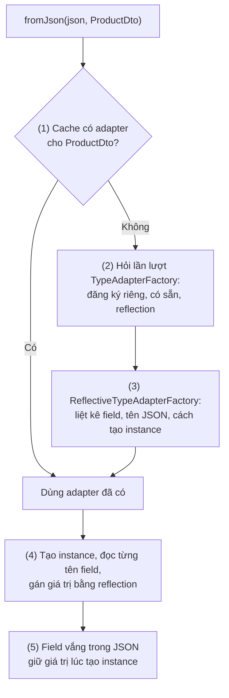
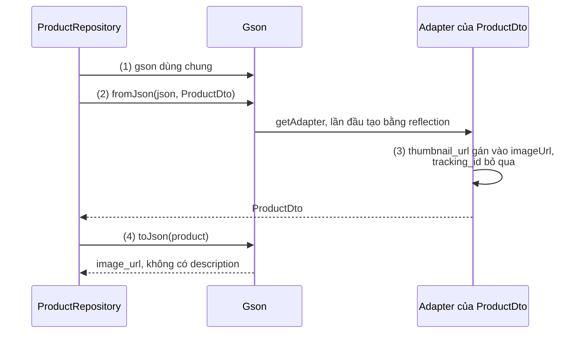
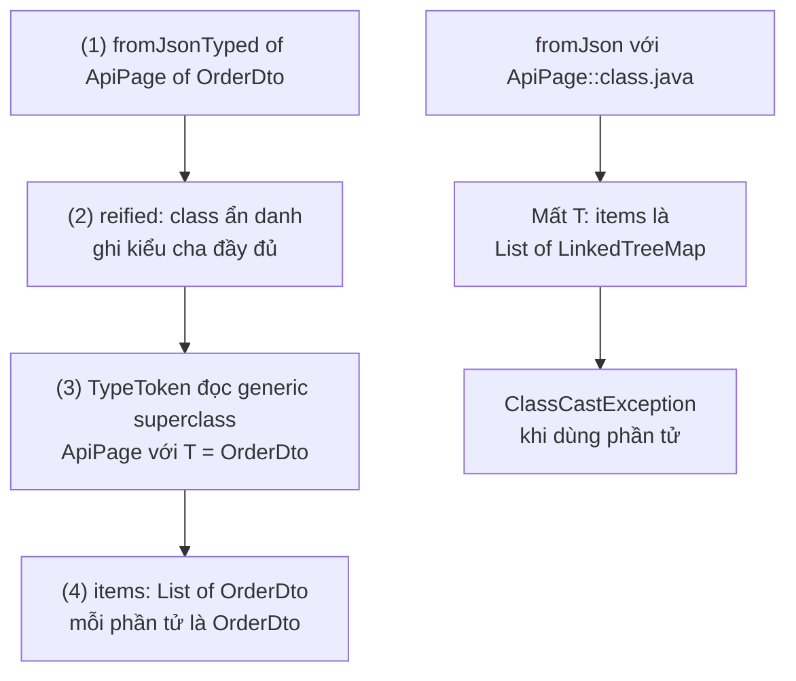
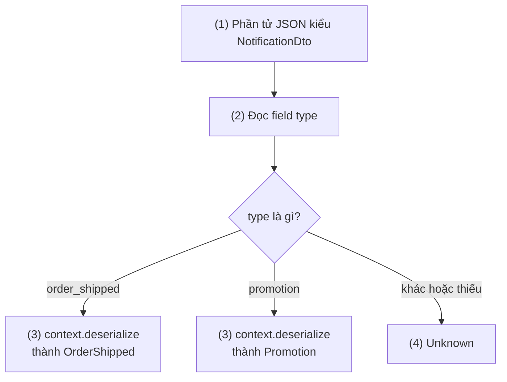
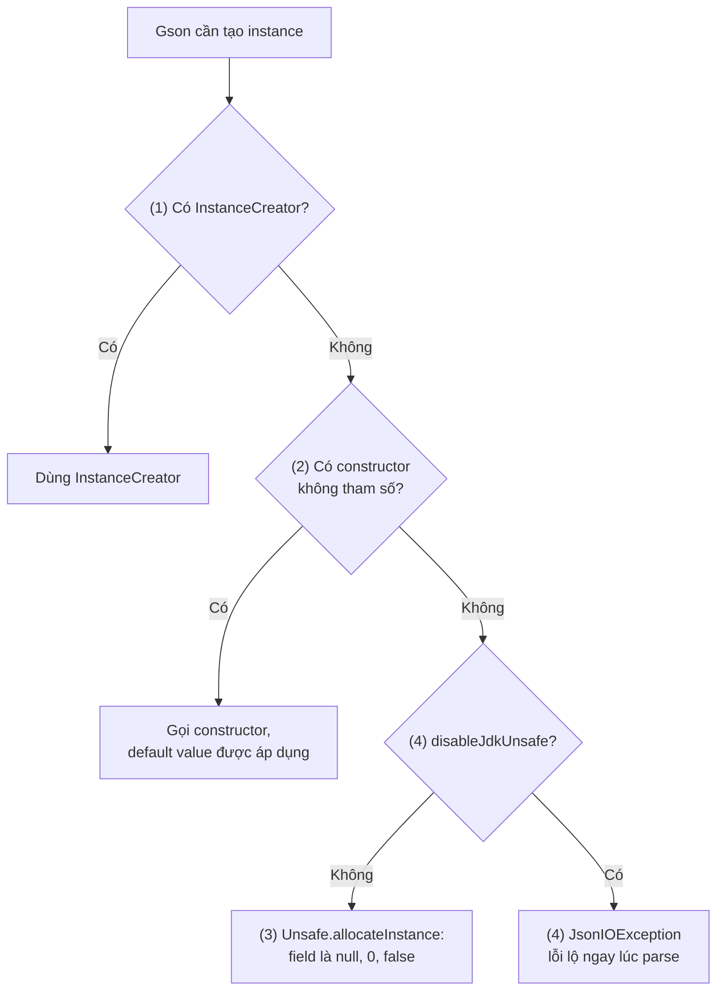
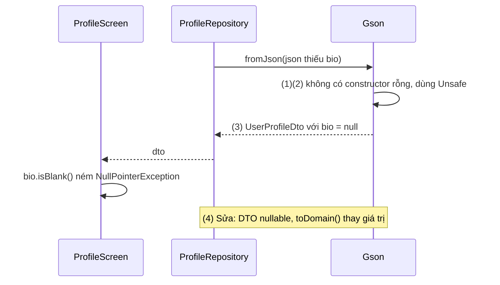
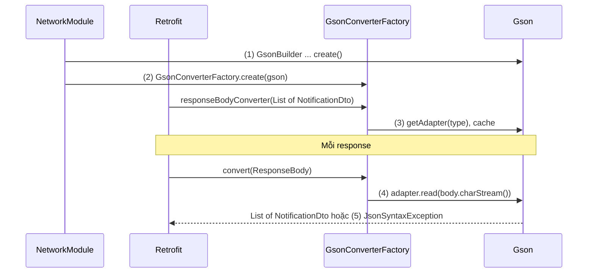

# Gson

## Vấn đề cần giải quyết

Server và app trao đổi dữ liệu dạng JSON, tức là **văn bản**. Code Kotlin lại làm việc với **object có kiểu**. Mỗi lần nhận hay gửi dữ liệu, phải có một bước chuyển giữa hai dạng này: deserialization (JSON → object) và serialization (object → JSON).

Viết tay bằng `org.json` có sẵn trong Android:

```kotlin
// Parse tay: mỗi field một dòng, mỗi class một hàm
val obj = JSONObject(json)
val product = ProductDto(
    id = obj.getLong("id"),
    name = obj.getString("name"),
    price = obj.getDouble("price"),
    imageUrl = obj.optString("image_url", "")
)
```

Cách này chạy được, nhưng app có 50 class DTO (Data Transfer Object, class chỉ mang dữ liệu theo đúng hình dạng của API) thì có 50 hàm parse và 50 hàm ghi viết tay, mỗi hàm lặp lại tên key bằng chuỗi. Gõ sai một key là lỗi lúc chạy; server thêm một field là phải sửa tay; danh sách lồng nhau, kiểu đa hình (một mảng chứa nhiều loại object) làm code dài thêm nhiều lần.

Vấn đề cần giải quyết là: **chuyển tự động giữa JSON và class, dựa trên chính khai báo của class**, và vẫn cho tuỳ biến những chỗ JSON không khớp tự nhiên với class.

## Sau khi học xong

- Giải thích được cách Gson ánh xạ JSON vào field của class bằng reflection và chuỗi TypeAdapterFactory.
- Áp dụng được TypeToken để đọc kiểu generic như danh sách và wrapper có tham số kiểu.
- Triển khai được TypeAdapter và JsonDeserializer cho định dạng đặc biệt và JSON đa hình.
- Nhận diện được các bẫy khi dùng Gson với Kotlin và R8 như non-null nhận null, default value bị bỏ qua do Unsafe allocation và field bị đổi tên.
- Phân biệt được Gson với Moshi và kotlinx.serialization để chọn thư viện JSON cho dự án.

## Gson là gì?

**Gson** là thư viện của Google chuyển đổi giữa JSON và object Java bằng **reflection** lúc runtime: nó đọc danh sách field của class trong bytecode, rồi đọc và ghi giá trị thẳng vào từng field, mà không đi qua constructor hay dùng thông tin nullability của Kotlin.

Mental model: **Gson nhìn mọi object như một túi field.** Nó chỉ thấy field (tên, kiểu) trên bytecode. Nó không thấy constructor, không thấy default value của tham số Kotlin, không biết `String` khác `String?`. Hầu hết hành vi "lạ" của Gson trong Kotlin đều giải thích được bằng câu này.

## Cách hoạt động

### Reflection và chuỗi TypeAdapterFactory

Mọi việc đọc/ghi của Gson đều qua một **`TypeAdapter<T>`**: object biết đọc `T` từ `JsonReader` và ghi `T` ra `JsonWriter`. Hai class này đọc/ghi JSON theo từng token (`{`, tên field, giá trị, `}`), không cần nạp cả cây JSON vào bộ nhớ.

Khi gặp một kiểu, Gson tìm adapter cho kiểu đó như sau:

1. `gson.getAdapter(type)` tra cache của instance `Gson`. Mỗi kiểu chỉ tạo adapter một lần cho mỗi instance, nên **một instance `Gson` dùng chung cho cả app**. Docs ghi rõ `Gson` thread-safe.
2. Chưa có thì hỏi lần lượt các `TypeAdapterFactory`: trước là adapter bạn đăng ký, sau là adapter có sẵn (`String`, số, `Boolean`, enum, `List`, `Map`…), **cuối cùng** là `ReflectiveTypeAdapterFactory` cho mọi class còn lại. Factory đầu tiên trả adapter khác `null` thắng.
3. Adapter reflection duyệt mọi field của class và class cha, bỏ field `static` và `transient`. Tên JSON của field là giá trị `@SerializedName`, nếu không có thì theo `FieldNamingPolicy` (mặc định giữ nguyên tên field). Nó cũng chọn cách **tạo instance**: `InstanceCreator` đăng ký riêng, hoặc constructor không tham số, hoặc nếu không có thì JDK `Unsafe` (phần "Gson với Kotlin").
4. Khi đọc: tạo instance trước, rồi với mỗi tên field trong JSON, tìm field tương ứng, đọc giá trị bằng adapter của kiểu field, và gán thẳng vào field bằng reflection. Tên không khớp field nào thì bị bỏ qua.
5. Field có trong class nhưng vắng trong JSON thì giữ giá trị lúc tạo instance.

Chiều ghi ngược lại: duyệt field, ghi tên và giá trị; field `null` bị **bỏ qua** trừ khi bật `serializeNulls()`.



#### Ví dụ: đọc sản phẩm từ API đổi tên field

**Bài toán:** API sản phẩm trả key dạng snake_case (`image_url`). Ở phiên bản API mới, server đổi `image_url` thành `thumbnail_url`, nhưng app phải đọc được cả response cũ (cache) lẫn mới. Đây là đúng chỗ của `@SerializedName`: tên JSON tách khỏi tên property, có cả tên thay thế khi đọc.

**Luồng chạy:**

1. Tạo một `Gson` dùng chung.
2. `fromJson` tìm adapter cho `ProductDto`; reflection thấy field `imageUrl` mang `@SerializedName("image_url", alternate = ["thumbnail_url"])`.
3. Đọc JSON: `thumbnail_url` khớp tên thay thế nên gán vào `imageUrl`; key `tracking_id` không có field nào nên bị bỏ qua.
4. `toJson` ghi lại bằng tên chính `image_url`; `description` là `null` nên không xuất hiện.



```kotlin
// app/build.gradle.kts
dependencies {
    implementation("com.google.code.gson:gson:2.14.0") // 2.15.0+ yêu cầu minSdk 24
}
```

```kotlin
// ProductDto.kt
// Mọi tham số đều có default value: lý do ở phần "Gson với Kotlin"
data class ProductDto(
    @SerializedName("id") val id: Long = 0,
    @SerializedName("name") val name: String = "",
    @SerializedName("price") val price: Double = 0.0,
    @SerializedName(value = "image_url", alternate = ["thumbnail_url"]) // (2) tên chính + tên thay thế
    val imageUrl: String = "",
    @SerializedName("description") val description: String? = null
)

// ProductParsing.kt
val gson: Gson = Gson()                                                    // (1) một instance cho cả app

fun parseProduct(json: String): ProductDto =
    gson.fromJson(json, ProductDto::class.java)                            // (2)(3)

// Kết quả kiểm chứng
val product = parseProduct(
    """{"id": 7, "name": "Tai nghe", "price": 590000, "thumbnail_url": "https://cdn.example.com/7.jpg", "tracking_id": "x1"}"""
)
val json = gson.toJson(product)                                            // (4)
```

**Kết quả:** `product.imageUrl` là `https://cdn.example.com/7.jpg` dù key là `thumbnail_url`; `json` là `{"id":7,"name":"Tai nghe","price":590000.0,"image_url":"https://cdn.example.com/7.jpg"}`, không có `description` và `tracking_id`. Muốn mọi field tự đổi camelCase sang snake_case thay vì ghi `@SerializedName` từng field có `GsonBuilder().setFieldNamingPolicy(FieldNamingPolicy.LOWER_CASE_WITH_UNDERSCORES)`, nhưng phần R8 bên dưới cho thấy vì sao `@SerializedName` vẫn an toàn hơn.

### Kiểu generic và TypeToken

JVM xoá tham số kiểu khi chạy (type erasure): lúc runtime, `List<OrderDto>` và `List<String>` đều chỉ là `List`. `List<OrderDto>::class.java` không viết được, và `gson.fromJson(json, List::class.java)` không biết phần tử là gì. Khi đó Gson đọc mỗi phần tử object thành `LinkedTreeMap` (một `Map` của Gson), và code crash `ClassCastException` lúc lấy phần tử ra dùng như `OrderDto`.

Kiểu generic chỉ còn giữ lại ở một chỗ: **chữ ký của class trong bytecode**. Nếu tạo một class con ẩn danh `object : TypeToken<List<OrderDto>>() {}`, trình biên dịch ghi kiểu cha `TypeToken<List<OrderDto>>` vào class đó, và `TypeToken` đọc lại được bằng `getGenericSuperclass()`. Đó là toàn bộ "phép màu" của TypeToken.

Ba cách dùng, theo thứ tự nên chọn:

- Kiểu biết lúc viết code: `gson.fromJson(json, object : TypeToken<ApiPage<OrderDto>>() {})` (overload nhận `TypeToken` có từ Gson 2.10, trả đúng kiểu, không cần ép).
- Viết hàm tiện ích dùng chung: `inline fun <reified T>`, vì `reified` cho trình biên dịch thay `T` bằng kiểu thật ở mỗi chỗ gọi.
- Kiểu chỉ biết lúc chạy: `TypeToken.getParameterized(ApiPage::class.java, elementClass)`.

Hàm generic **không** `reified` mà viết `object : TypeToken<List<T>>() {}` thì class ẩn danh chỉ ghi được `List<T>`, không phải kiểu thật. Từ Gson 2.11 việc này ném `IllegalArgumentException: TypeToken type argument must not contain a type variable`; bản cũ hơn im lặng trả `LinkedTreeMap`.

#### Ví dụ: đọc một trang đơn hàng có wrapper generic

**Bài toán:** mọi API danh sách của backend trả cùng một dạng `{"page": 1, "has_next": true, "items": [...]}`. App khai báo một wrapper `ApiPage<T>` dùng chung cho đơn hàng, sản phẩm, thông báo, và cần đọc đúng `ApiPage<OrderDto>` từ JSON đã lưu trong file cache.

**Luồng chạy:**

1. Gọi hàm tiện ích `gson.fromJsonTyped<ApiPage<OrderDto>>(json)`.
2. Vì `T` là `reified`, trình biên dịch sinh class ẩn danh với kiểu cha `TypeToken<ApiPage<OrderDto>>`.
3. `TypeToken` đọc kiểu generic đó; Gson tạo adapter cho `ApiPage` với `T = OrderDto`, và adapter của `items` là adapter danh sách `OrderDto`.
4. Mỗi phần tử của `items` được đọc thành `OrderDto`, không phải `LinkedTreeMap`.



```kotlin
// ApiPage.kt
data class ApiPage<T>(
    @SerializedName("page") val page: Int = 0,
    @SerializedName("has_next") val hasNext: Boolean = false,
    @SerializedName("items") val items: List<T> = emptyList()
)

data class OrderDto(
    @SerializedName("id") val id: String = "",
    @SerializedName("total") val total: Long = 0,
    @SerializedName("status") val status: String = ""
)

// GsonExt.kt
inline fun <reified T> Gson.fromJsonTyped(json: String): T =
    fromJson(json, object : TypeToken<T>() {})                             // (2) T đã được thay bằng kiểu thật

// OrderCache.kt
class OrderCache(private val gson: Gson, private val cacheFile: File) {

    fun readFirstPage(): ApiPage<OrderDto>? {
        if (!cacheFile.exists()) return null
        val json = cacheFile.readText()
        return gson.fromJsonTyped<ApiPage<OrderDto>>(json)                 // (1)(3)(4)
    }
}
```

`File` và `readText()` ở đây chỉ để có chuỗi JSON; nơi lưu file trong app và cách ghi an toàn học ở [8.3 Local Storage](../local_storage.md).

**Kết quả:** `readFirstPage()!!.items.first().total` trả đúng số. Đổi dòng (1) thành `gson.fromJson(json, ApiPage::class.java)` thì code vẫn build (kiểu trả về thành `ApiPage<*>`, cần ép), nhưng khi lấy phần tử ra làm `OrderDto` thì crash `ClassCastException: LinkedTreeMap cannot be cast to OrderDto`.

### TypeAdapter và JsonDeserializer tuỳ biến

Khi JSON không khớp tự nhiên với class, bạn tự cung cấp adapter cho kiểu đó. Gson có hai cách, khác nhau ở **mô hình dữ liệu**:

| | `TypeAdapter<T>` | `JsonDeserializer<T>` / `JsonSerializer<T>` |
|---|---|---|
| Làm việc với | Stream token (`JsonReader`, `JsonWriter`) | Cây `JsonElement` đã dựng sẵn trong bộ nhớ |
| Chiều | Cả đọc và ghi trong một class | Mỗi interface một chiều |
| Chi phí | Thấp, không dựng cây | Dựng cây cho phần JSON đó trước |
| Hợp với | Kiểu giá trị nhỏ, định dạng đặc biệt | Cần nhìn nhiều field mới quyết định được (đa hình) |

Cách gắn adapter:

- `GsonBuilder.registerTypeAdapter(Type, adapter)`: chỉ cho **đúng** kiểu đó, không áp dụng cho class con.
- `registerTypeHierarchyAdapter(Class, adapter)`: cho kiểu đó và mọi class con.
- `@JsonAdapter(MyAdapter::class)` trên field hoặc class: gắn cục bộ, không ảnh hưởng chỗ khác.
- `TypeAdapterFactory`: tạo adapter cho cả một họ kiểu (ví dụ mọi enum của app).

#### Ví dụ: danh sách thông báo nhiều loại

**Bài toán:** API thông báo trả một mảng, mỗi phần tử có field `type` quyết định phần còn lại: `order_shipped` có `order_id`, `carrier`; `promotion` có `title`, `discount_percent`. Server có thể thêm loại mới bất kỳ lúc nào, và app cũ không được crash. Gson không thể tự chọn class con của một sealed class, nên cần một `JsonDeserializer` nhìn `type` trước rồi mới chọn.

**Luồng chạy:**

1. Gson gặp phần tử kiểu `NotificationDto`, gọi `NotificationDeserializer` đã đăng ký cho đúng kiểu này; phần tử đã được dựng thành `JsonObject`.
2. Đọc field `type`.
3. Loại đã biết: giao lại cho Gson đọc cả object thành class con tương ứng qua `context.deserialize`. Class con không có adapter riêng nên Gson dùng adapter reflection, không quay lại deserializer.
4. Loại chưa biết hoặc thiếu `type`: trả `Unknown`, UI bỏ qua phần tử này.



```kotlin
// NotificationDto.kt
sealed class NotificationDto {
    data class OrderShipped(
        @SerializedName("order_id") val orderId: String = "",
        @SerializedName("carrier") val carrier: String = ""
    ) : NotificationDto()

    data class Promotion(
        @SerializedName("title") val title: String = "",
        @SerializedName("discount_percent") val discountPercent: Int = 0
    ) : NotificationDto()

    data object Unknown : NotificationDto()
}

// NotificationDeserializer.kt
class NotificationDeserializer : JsonDeserializer<NotificationDto> {
    override fun deserialize(
        json: JsonElement,
        typeOfT: Type,
        context: JsonDeserializationContext
    ): NotificationDto {
        val obj = json.asJsonObject                                        // (1) đã là cây JsonObject
        val type = obj.get("type")?.takeIf { it.isJsonPrimitive }?.asString // (2)
        return when (type) {
            "order_shipped" -> context.deserialize<NotificationDto.OrderShipped>(
                obj, NotificationDto.OrderShipped::class.java                  // (3) class con: adapter reflection
            )
            "promotion" -> context.deserialize<NotificationDto.Promotion>(
                obj, NotificationDto.Promotion::class.java
            )
            else -> NotificationDto.Unknown                                    // (4) loại mới, app cũ không crash
        }
    }
}

// GsonProvider.kt
val gson: Gson = GsonBuilder()
    .registerTypeAdapter(NotificationDto::class.java, NotificationDeserializer()) // (1) đúng kiểu cha
    .create()
```

**Kết quả:** đọc `[{"type":"order_shipped","order_id":"A12","carrier":"GHN"},{"type":"live_stream","url":"..."}]` bằng `object : TypeToken<List<NotificationDto>>() {}` ra `[OrderShipped("A12", "GHN"), Unknown]`. Nếu đổi `registerTypeAdapter` thành `registerTypeHierarchyAdapter`, deserializer áp dụng cả cho class con, `context.deserialize` gọi lại chính nó và app crash `StackOverflowError`.

Với giá trị nhỏ có định dạng riêng, `TypeAdapter` gắn bằng `@JsonAdapter` gọn hơn. Ví dụ một API cũ trả trạng thái mở cửa của cửa hàng là `0`/`1` thay vì `true`/`false`:

```kotlin
// IntAsBooleanAdapter.kt
class IntAsBooleanAdapter : TypeAdapter<Boolean>() {
    override fun write(out: JsonWriter, value: Boolean?) {
        if (value == null) out.nullValue() else out.value(if (value) 1L else 0L)
    }

    override fun read(reader: JsonReader): Boolean? = when (reader.peek()) {
        JsonToken.NULL -> { reader.nextNull(); null }
        JsonToken.BOOLEAN -> reader.nextBoolean()   // chịu được cả server đã sửa
        else -> reader.nextInt() != 0
    }
}

// StoreDto.kt
data class StoreDto(
    @SerializedName("name") val name: String = "",
    @JsonAdapter(IntAsBooleanAdapter::class)
    @SerializedName("is_open") val isOpen: Boolean = false
)
```

### Gson với Kotlin: null safety và default value

Quay lại mental model "túi field": Gson không đọc thông tin Kotlin, nên có hai hệ quả.

**Non-null nhận null.** `val bio: String` trong Kotlin là field `String` bình thường trên bytecode. JSON có `"bio": null` thì Gson gán `null` vào field đó. Kotlin không kiểm tra lại, nên lỗi không lộ ở chỗ parse mà ở chỗ dùng: `profile.bio.length` ném `NullPointerException`, có khi nhiều màn hình sau.

**Default value bị bỏ qua.** Default value của tham số Kotlin chỉ chạy khi **constructor** được gọi. Gson tạo instance theo thứ tự:

1. Có `InstanceCreator` đăng ký cho kiểu này: dùng nó.
2. Class có constructor không tham số: gọi nó, default value được áp dụng, field nào vắng trong JSON giữ default.
3. Không có: dùng JDK `Unsafe.allocateInstance`, cấp phát object **không chạy constructor nào**. Mọi field là giá trị mặc định của JVM: `null`, `0`, `false`, bất kể default value Kotlin hay kiểu non-null.
4. Nếu đã gọi `GsonBuilder.disableJdkUnsafe()` (từ Gson 2.9.0), bước 3 bị thay bằng một `JsonIOException` báo không tạo được instance, nên lỗi lộ ngay lúc parse.

Trên JVM, Kotlin sinh thêm một constructor không tham số khi **mọi** tham số của primary constructor đều có default value. Chỉ cần một tham số không có default là class rơi xuống bước 3. Đó là lý do các DTO ở trên đều đặt default cho mọi tham số. Nhưng kể cả khi có constructor, một `"name": null` tường minh trong JSON vẫn ghi đè default bằng `null`.



#### Ví dụ: hồ sơ người dùng thiếu field bio

**Bài toán:** API hồ sơ không trả `bio` với người dùng chưa viết giới thiệu. DTO khai báo `bio: String = ""` với ý định "thiếu thì là chuỗi rỗng", nhưng màn hồ sơ crash với một số tài khoản.

**Luồng chạy:**

1. `UserProfileDto` có `id` và `displayName` không default, nên Kotlin không sinh constructor không tham số.
2. Gson rơi xuống `Unsafe`: object được tạo không qua constructor, `bio` là `null`.
3. JSON không có `bio`, field giữ `null`; màn hình gọi `bio.isBlank()` và crash.
4. Cách sửa: DTO khai báo đúng sự thật của API (nullable), rồi map sang model của app tại một chỗ, nơi quyết định giá trị thay thế. `disableJdkUnsafe()` giúp lần sau lỗi lộ ngay lúc parse.



```kotlin
// Sai: UserProfileDto.kt
data class UserProfileDto(
    @SerializedName("id") val id: String,                    // (1) không default
    @SerializedName("display_name") val displayName: String,
    @SerializedName("bio") val bio: String = ""              // (2)(3) default không bao giờ chạy
)

// Đúng: UserProfileDto.kt
data class UserProfileDto(
    @SerializedName("id") val id: String? = null,            // (4) đúng với những gì API có thể trả
    @SerializedName("display_name") val displayName: String? = null,
    @SerializedName("bio") val bio: String? = null
)

// UserProfile.kt: model của app, non-null thật sự
data class UserProfile(val id: String, val displayName: String, val bio: String)

fun UserProfileDto.toDomain(): UserProfile? {
    val id = id ?: return null                               // (4) thiếu id: dữ liệu hỏng, bỏ
    return UserProfile(id = id, displayName = displayName.orEmpty(), bio = bio.orEmpty())
}

// GsonProvider.kt
val gson: Gson = GsonBuilder()
    .disableJdkUnsafe()                                      // (4) class thiếu constructor rỗng: lỗi ngay
    .create()
```

**Kết quả:** với bản sai, unit test `gson.fromJson("""{"id":"u_42","display_name":"Lan"}""", UserProfileDto::class.java).bio` trả `null` dù kiểu là `String`. Với bản đúng, `toDomain()` cho `bio = ""` và mọi chỗ dùng `UserProfile` an toàn. Bật `disableJdkUnsafe()` với bản sai thì test fail ngay ở `fromJson` bằng `JsonIOException`.

### Gson và R8

Bản release thường bật R8 để thu nhỏ và làm rối code (cấu hình ở [Build Types](../../session_04/android_manifest/package_build_gradle/build_types.md)). R8 phân tích code **tĩnh**, trong khi Gson truy cập field **bằng reflection**, nên R8 không thấy ai dùng các field đó:

- **Đổi tên field** (`imageUrl` thành `a`): field không có `@SerializedName` thì Gson dùng tên field làm key, nên đọc không khớp key nào (mọi field giữ default hoặc `null`) và ghi ra `{"a": ...}`.
- **Xoá field hoặc constructor** mà code không gọi trực tiếp: mất dữ liệu, hoặc lỗi `JsonIOException: Abstract classes can't be instantiated!` khi R8 đã biến class thành abstract.

Từ Gson 2.11.0, thư viện kèm sẵn rule cho R8. Release notes ghi: nhiều dự án không cần cấu hình thêm nếu class có constructor không tham số và **mọi field có `@SerializedName`**. DTO nào không theo quy ước đó thì giữ bằng rule riêng:

```proguard
# proguard-rules.pro — chỉ cần cho DTO không đặt @SerializedName ở mọi field
-keep class com.example.store.data.remote.dto.** {
    <fields>;
    <init>();
}
```

Cách kiểm chứng duy nhất đáng tin là chạy bản release đã minify và đi qua các màn hình có parse JSON; bản debug không bật R8 nên không bao giờ lộ lỗi này.

## Ví dụ thực tế

### Dùng Gson làm converter cho Retrofit

**Bài toán:** app đang dùng Gson muốn mọi endpoint Retrofit parse bằng cùng một cấu hình: deserializer thông báo, số trong `Map` không thành `Double`, và lỗi thiếu constructor lộ sớm. Retrofit và các kiến thức về converter ở [8.1.1 Retrofit](retrofit.md), mục "Converter.Factory".

**Luồng chạy:**

1. Tạo **một** `Gson` có toàn bộ cấu hình của app.
2. Đưa nó vào `GsonConverterFactory.create(gson)`. Khi phân tích một hàm, Retrofit truyền **kiểu trả về đầy đủ** (ví dụ `List<NotificationDto>`, lấy từ chữ ký hàm) cho factory, nên không cần TypeToken.
3. Factory gọi `gson.getAdapter(TypeToken.get(type))`, adapter được cache trong `gson`.
4. Mỗi response: adapter đọc thẳng từ stream của body, không đọc cả body thành `String` trước.
5. JSON sai kiểu ném `JsonSyntaxException`; trong `safeApiCall` của [5.3 Networking](../../session_05/networking.md) lỗi này rơi vào nhánh `Unknown`, hoặc tách thành `Serialization` nếu muốn.



```kotlin
// app/build.gradle.kts
dependencies {
    implementation("com.squareup.retrofit2:retrofit:3.0.0")
    implementation("com.squareup.retrofit2:converter-gson:3.0.0")
}
```

```kotlin
// NotificationApi.kt
interface NotificationApi {
    @GET("v1/notifications")
    suspend fun getNotifications(): List<NotificationDto>                    // (2) Retrofit biết đủ kiểu generic
}

// NetworkModule.kt
object NetworkModule {

    val gson: Gson = GsonBuilder()                                           // (1) một cấu hình cho cả app
        .registerTypeAdapter(NotificationDto::class.java, NotificationDeserializer())
        .setObjectToNumberStrategy(ToNumberPolicy.LONG_OR_DOUBLE)            // Map<String, Any>: 3 là Long, không phải 3.0
        .disableJdkUnsafe()
        .create()

    val notificationApi: NotificationApi = Retrofit.Builder()
        .baseUrl("https://api.example.com/")
        .client(okHttpClient)
        .addConverterFactory(GsonConverterFactory.create(gson))             // (2)(3)(4)
        .build()
        .create(NotificationApi::class.java)
}
```

**Kết quả:** `notificationApi.getNotifications()` trả `List<NotificationDto>` với đúng class con cho từng loại. Test bằng MockWebServer ([10.2 Unit Testing](../../coding_analyst_and_testing/unit_testing.md)) trả một body có `type` lạ và một body sai kiểu (`"discount_percent": "mười"`): lần đầu ra `Unknown`, lần sau ném `JsonSyntaxException`.

### Các bài toán khác

- **Lưu một object cấu hình nhỏ dạng JSON:** `gson.toJson(settings)` rồi ghi vào file. Object lớn hoặc cần truy vấn thì không nên nhét JSON vào key-value store, xem [Key-value](../../session_05/data_store/key_value.md), sai lầm 4.
- **Room `@TypeConverter`:** chuyển một `List<String>` nhỏ thành cột `TEXT`. Dữ liệu có quan hệ thì dùng bảng riêng thay vì JSON, xem [Room Architecture](../../session_05/data_store/room_architecture.md).

## So sánh với các cách tiếp cận khác

| Tiêu chí | Gson | Moshi | kotlinx.serialization |
|---|---|---|---|
| Tác giả, năm 1.0 | Google, 2008 | Square, 09/2015 | JetBrains, 10/2020 |
| Cơ chế | Reflection lúc runtime | Codegen (KSP) hoặc reflection qua `kotlin-reflect` | Compiler plugin sinh serializer lúc build |
| Kotlin non-null nhận `null` | Gán `null`, crash về sau | `JsonDataException` ngay lúc parse | `SerializationException` ngay lúc parse |
| Default value khi thiếu key | Chỉ khi có constructor rỗng | Được áp dụng | Được áp dụng |
| Key lạ trong JSON | Bỏ qua | Bỏ qua | Mặc định ném lỗi, bật `ignoreUnknownKeys` để bỏ qua |
| R8 | Cần `@SerializedName` hoặc keep rule | Codegen không cần reflection trên field | Không cần reflection |
| Nền tảng | JVM | JVM | Kotlin Multiplatform |
| Trạng thái | Maintenance mode | Đang phát triển | Đang phát triển |

Vì sao dự án Kotlin mới thường không chọn Gson: README của Gson tự ghi thư viện đang ở **maintenance mode** (sửa lỗi, không thêm tính năng lớn), không hỗ trợ các đặc điểm riêng của Kotlin như non-null type, và nói rõ Gson **không phải lựa chọn được khuyến nghị cho JSON trên Android** vì reflection xung đột với việc thu nhỏ code; README gợi ý cân nhắc Kotlin Serialization. Moshi và kotlinx.serialization sinh code lúc build, hiểu nullability và default value, nên lỗi dữ liệu lộ ngay tại chỗ parse thay vì vài màn hình sau. kotlinx.serialization còn chạy được trên Kotlin Multiplatform, phù hợp khi tầng mạng dùng Ktor Client ([8.1.5 Ktor and Apollo Android](ktor_apollo.md)).

## Khi nào nên và không nên dùng

**Nên dùng khi:**

- Codebase đã dùng Gson rộng rãi, đặc biệt code Java; chuyển sang thư viện khác tốn công hơn lợi ích.
- Cần parse JSON có hình dạng không biết trước dưới dạng cây (`JsonParser.parseString(...)` ra `JsonElement`) trong code JVM.
- Thư viện bên thứ ba bạn dùng trả hoặc nhận `Gson`/`JsonElement`.

**Không nên dùng khi:**

- Dự án Kotlin mới: chọn kotlinx.serialization (hoặc Moshi) để có null safety và default value đúng.
- Code dùng chung qua Kotlin Multiplatform: Gson chỉ chạy trên JVM.
- Không kiểm soát được R8 rule cho các DTO (nhiều module, nhiều người viết DTO): rủi ro lỗi chỉ lộ ở bản release.

## Sai lầm thường gặp

### 1. Tạo `Gson()` mới ở mỗi lần parse

```kotlin
// Sai
fun parseOrder(json: String) = Gson().fromJson(json, OrderDto::class.java)
```

**Lỗi lộ ra thế nào:** không sai kết quả, nhưng mỗi instance mới có cache adapter rỗng, nên lần parse nào cũng phải dựng lại adapter bằng reflection. Trong danh sách dài hay vòng lặp, profiler thấy thời gian nằm ở `ReflectiveTypeAdapterFactory`. Cấu hình (`registerTypeAdapter`) cũng dễ bị quên ở một vài chỗ.

**Cách sửa:** một instance `Gson` cấu hình đầy đủ, dùng chung cho cả app (Gson thread-safe).

### 2. Đọc danh sách không có TypeToken

```kotlin
// Sai
val orders = gson.fromJson(json, List::class.java) as List<OrderDto>
orders.first().total   // ClassCastException
```

**Lỗi lộ ra thế nào:** ép kiểu `List<OrderDto>` chỉ là cảnh báo unchecked lúc build; lúc chạy phần tử là `LinkedTreeMap`, crash ở chỗ đầu tiên dùng phần tử như `OrderDto`.

**Cách sửa:** `gson.fromJson(json, object : TypeToken<List<OrderDto>>() {})` hoặc hàm `reified` như phần TypeToken.

### 3. Số trong `Map<String, Any>` thành `Double`

```kotlin
// Sai
val payload: Map<String, Any> = gson.fromJson(json, object : TypeToken<Map<String, Any>>() {})
val quantity = payload["quantity"] as Int   // ClassCastException: Double
```

**Lỗi lộ ra thế nào:** với kiểu `Any`/`Object`, Gson mặc định đọc mọi số JSON thành `Double`, nên `{"quantity": 3}` cho `3.0`. Ép sang `Int` crash; đưa thẳng vào chuỗi hiển thị thì ra "3.0 sản phẩm".

**Cách sửa:** khai báo DTO có kiểu thay vì `Map<String, Any>`; nếu buộc phải dùng `Map`, cấu hình `setObjectToNumberStrategy(ToNumberPolicy.LONG_OR_DOUBLE)`.

### 4. Field non-null với DTO thiếu constructor rỗng

```kotlin
// Sai: tin vào kiểu non-null và default value
data class CartItemDto(
    @SerializedName("sku") val sku: String,
    @SerializedName("note") val note: String = ""
)
```

**Lỗi lộ ra thế nào:** như ví dụ hồ sơ người dùng: Gson dùng `Unsafe`, `note` là `null` khi JSON thiếu, `NullPointerException` xuất hiện ở UI hoặc khi tính toán, cách xa chỗ parse.

**Cách sửa:** DTO nullable (hoặc default cho mọi tham số) và map sang model của app; bật `disableJdkUnsafe()` để lỗi lộ ngay lúc parse.

## Lịch sử phát triển

- **2008:** Gson được Google phát triển cho nhu cầu nội bộ rồi mở mã nguồn; bản 1.0.1 trong CHANGELOG ghi ngày 17/06/2008.
- **2.0 (11/2011):** mở đầu nhánh 2.x, nhánh vẫn được duy trì tới nay; cơ chế cốt lõi vẫn là reflection trên field.
- **2.9.0 (02/2022):** thêm `GsonBuilder.disableJdkUnsafe()`, adapter mặc định chặt chẽ hơn.
- **2.10 (10/2022):** hỗ trợ Java record, overload `fromJson(..., TypeToken<T>)` trả đúng kiểu.
- **2.11.0 (05/2024):** thêm API `Strictness`, kèm sẵn rule R8/ProGuard, `TypeToken` không còn cho bắt type variable, yêu cầu Android API 21+.
- **2.12.0 (01/2025):** bỏ hỗ trợ Java 7.
- **2.14.0 (04/2026):** thêm adapter cho các class `java.time` như `Instant`, `Duration`.
- **2.15.0 (10/2026):** bản mới nhất tại thời điểm viết theo README, yêu cầu Android API 24+. README ghi Gson ở maintenance mode và không khuyến nghị cho JSON trên Android.

Song song, Square ra Moshi 1.0 (09/2015) để sửa các hạn chế của Gson với Kotlin, và JetBrains ra kotlinx.serialization 1.0 (10/2020) cho Kotlin Multiplatform.

## Kết nối hệ thống

- **Tiên quyết:**
  - [Kotlin](../../session_01/languages/kotlin.md): `data class`, nullable type, default value, `reified`.
- **Liên quan:**
  - [8.1.1 Retrofit](retrofit.md): `Converter.Factory` và thứ tự converter; Gson là một converter.
  - [5.3 Networking](../../session_05/networking.md): nhánh lỗi parse trong `safeApiCall`.
  - [Key-value](../../session_05/data_store/key_value.md) và [Room Architecture](../../session_05/data_store/room_architecture.md): khi nào lưu JSON và khi nào không.
  - [Build Types](../../session_04/android_manifest/package_build_gradle/build_types.md): bật R8 và thêm rule cho bản release.
- **Học tiếp:**
  - [8.1.5 Ktor and Apollo Android](ktor_apollo.md): kotlinx.serialization trong Ktor Client.
  - [8.3 Local Storage](../local_storage.md): lưu file JSON trong app an toàn.
  - [10.2 Unit Testing](../../coding_analyst_and_testing/unit_testing.md): kiểm tra parse bằng MockWebServer.

## Tham khảo

- [Gson README (maintenance mode, Kotlin, Android, yêu cầu tối thiểu) - GitHub](https://github.com/google/gson)
- [Gson User Guide - GitHub](https://github.com/google/gson/blob/main/UserGuide.md)
- [Gson Troubleshooting Guide (Unsafe, R8, TypeToken, Double) - GitHub](https://github.com/google/gson/blob/main/Troubleshooting.md)
- [Gson CHANGELOG và Releases (2.9.0 → 2.15.0) - GitHub](https://github.com/google/gson/releases)
- [Classes: constructor không tham số khi mọi tham số có default - Kotlin](https://kotlinlang.org/docs/classes.html)
- [Moshi - GitHub](https://github.com/square/moshi)
- [Kotlin serialization - Kotlin](https://kotlinlang.org/docs/serialization.html)
- [Shrink, obfuscate, and optimize your app - Android Developers](https://developer.android.com/build/shrink-code)
