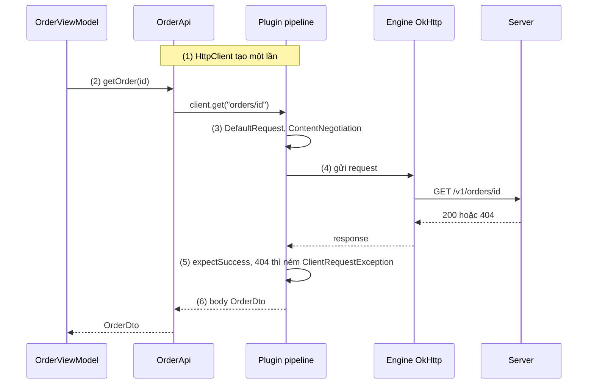
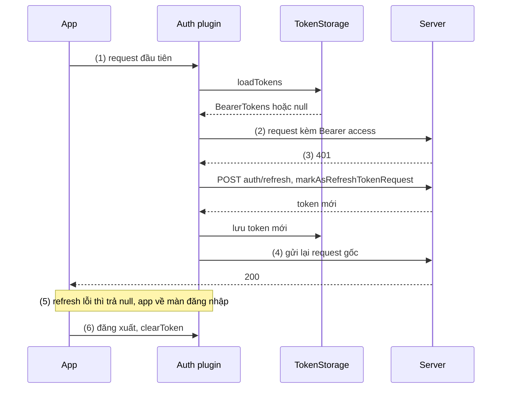
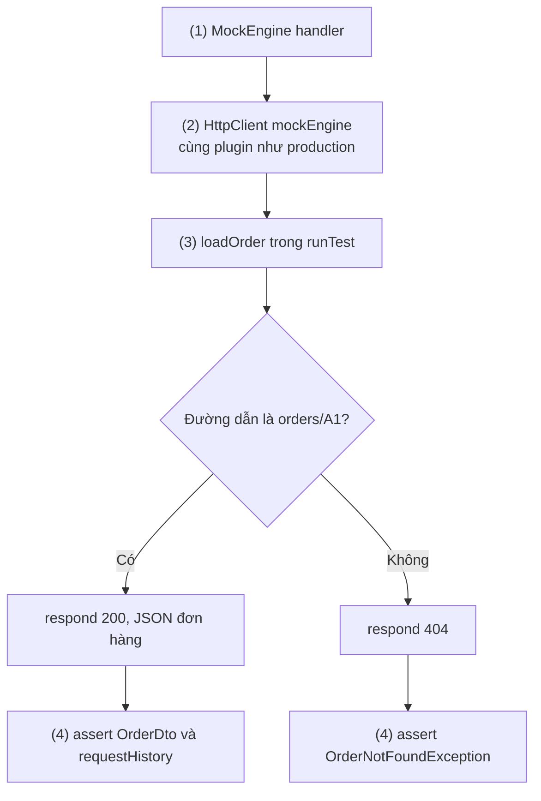
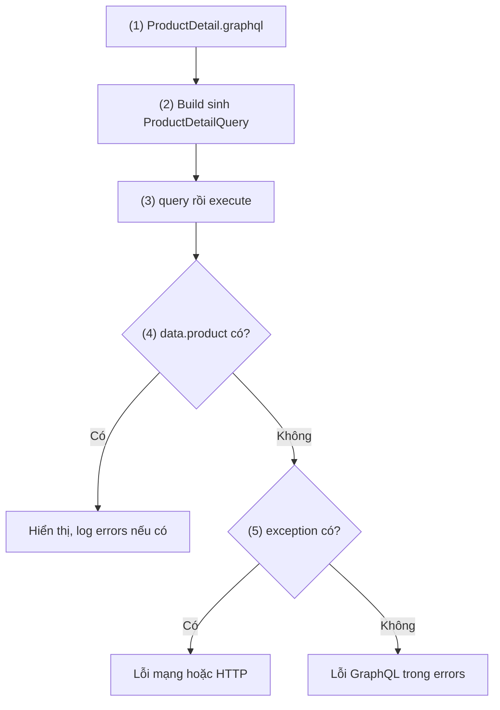
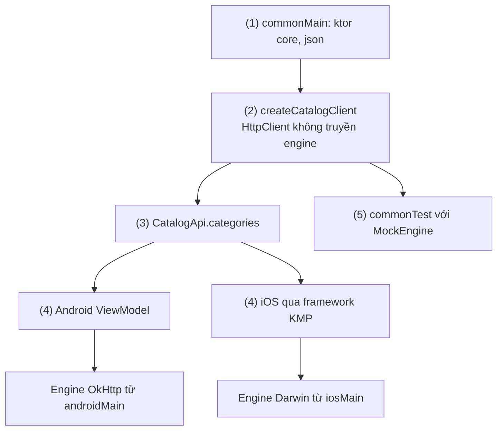

# Ktor and Apollo Android

## Vấn đề cần giải quyết

Retrofit và OkHttp ([Retrofit](retrofit.md), [OkHttp](okhttp.md)) là lựa chọn mặc định cho app Android gọi REST API. Có hai tình huống mà bộ đôi này không còn vừa:

- **Code mạng dùng chung nhiều nền tảng.** App có cả bản iOS (hoặc desktop, web) dùng chung logic nghiệp vụ bằng Kotlin Multiplatform (KMP). Retrofit dựa vào dynamic proxy và reflection của JVM, OkHttp chạy trên JVM/Android, nên phần gọi API trong module dùng chung không viết bằng chúng được. Không có HTTP client đa nền tảng thì mỗi nền tảng tự viết lại tầng mạng, và DTO, xử lý lỗi, refresh token sẽ lệch nhau.
- **API là GraphQL.** Server chỉ có một endpoint, client gửi một "câu hỏi" nêu đúng các field cần lấy. Mỗi màn hình hỏi một tập field khác nhau, nên DTO viết tay theo kiểu REST vừa thừa vừa dễ sai; response còn có thể trả HTTP `200` kèm `data` một phần và danh sách `errors`, khác hẳn quy ước "2xx là thành công" của REST.

Vấn đề cần giải quyết là: **một client mạng viết bằng Kotlin, chạy được ở mọi nền tảng KMP, và với GraphQL thì sinh sẵn model có kiểu đúng theo từng câu query.**

## Sau khi học xong

- Giải thích được kiến trúc lõi chung, engine theo nền tảng và plugin của Ktor Client, và vì sao nó dùng được cho Kotlin Multiplatform.
- Áp dụng được Ktor Client với ContentNegotiation, Auth bearer, HttpTimeout và MockEngine để gọi và test API.
- Giải thích được cách Apollo Kotlin sinh model có kiểu từ schema và operation GraphQL, và cách đọc data, errors, exception trong ApolloResponse.
- Phân biệt được Retrofit với OkHttp, Ktor Client và Apollo Kotlin theo nền tảng, kiểu API và cách tạo request.
- Nhận diện được các lỗi thường gặp như tạo HttpClient cho mỗi request, quên expectSuccess, không xoá token đã cache khi đăng xuất và bỏ qua errors của GraphQL.

## Ktor Client và Apollo Android là gì?

**Ktor Client** và **Apollo Kotlin** (đến bản 2.x tên là Apollo Android) là hai client mạng viết cho Kotlin và coroutine, chạy được trên Kotlin Multiplatform, cùng tách **phần lõi Kotlin dùng chung** khỏi **engine HTTP của từng nền tảng**. Ktor Client là HTTP client tổng quát, mở rộng tính năng bằng **plugin**; Apollo Kotlin là GraphQL client, **sinh model có kiểu** từ schema và các operation GraphQL lúc build.

Mental model: **một lõi chung cắm được nhiều động cơ**. Code gọi API, plugin, model sinh ra là lõi, giống hệt nhau trên Android và iOS; chỉ động cơ gửi byte lên mạng đổi theo nền tảng (OkHttp trên Android, `NSURLSession` trên iOS). Trên Android, động cơ thường chính là OkHttp, nên mọi hiểu biết ở bài OkHttp vẫn áp dụng.

## Cách hoạt động

Coroutine (`suspend`, `runTest`) được học ở [8.4.3 Coroutines](../async_threads/coroutines.md); JSON với kotlinx.serialization được so sánh với Gson ở [Gson](gson.md). Bài này chỉ dùng chúng ở mức tối thiểu.

### Ktor Client: lõi, engine và plugin

Một `HttpClient` của Ktor gồm ba phần:

| Phần | Vai trò | Ví dụ |
|---|---|---|
| Lõi (`ktor-client-core`) | API gọi request (`get`, `post`, `request`), pipeline xử lý request/response, viết bằng Kotlin thuần, chạy trên mọi target KMP | `client.get("orders/42")` |
| Engine | Gửi request thật trên nền tảng | `OkHttp`, `Android` (dựa trên `HttpURLConnection`), `CIO` (viết bằng coroutine), `Darwin` (iOS, macOS, dựa trên `NSURLSession`), `Java` (HttpClient của JDK 11+), `Js` |
| Plugin | Tính năng cắt ngang, cài bằng `install(...)` | `ContentNegotiation`, `Auth`, `Logging`, `HttpTimeout`, `HttpRequestRetry`, `DefaultRequest`, `HttpCache`, `WebSockets`, `SSE` |

Mỗi request đi qua pipeline của lõi: các plugin lần lượt chỉnh request (đặt URL gốc, header, serialize body), engine gửi đi, rồi response đi qua pipeline nhận (kiểm tra status, xác thực lại, deserialize). Vai trò này tương tự interceptor chain của OkHttp, nhưng nằm trong lõi Kotlin nên chạy được cả trên iOS.

Vài điểm cần nắm trước khi viết code:

- Mọi hàm gọi request là `suspend`; huỷ coroutine thì request bị huỷ.
- Gọi `HttpClient()` **không truyền engine** thì Ktor tự chọn engine từ dependency có trong từng nền tảng; nhờ vậy module KMP chỉ cần khai báo engine ở source set của nền tảng.
- `HttpClient` giữ engine, connection pool và thread của engine: tạo một lần, dùng chung, `close()` khi không cần nữa.
- Mặc định `expectSuccess = false`: response `4xx`, `5xx` **không** ném exception. Bật `expectSuccess = true` thì Ktor ném `ClientRequestException` (4xx), `ServerResponseException` (5xx), `RedirectResponseException` (3xx chưa được đi theo).

#### Ví dụ: lấy chi tiết đơn hàng bằng Ktor Client

**Bài toán:** màn chi tiết đơn hàng gọi `GET /v1/orders/{id}`, nhận JSON và chuyển thành `OrderDto`. Đơn không tồn tại thì server trả `404`, app phải nhận được lỗi rõ ràng chứ không phải exception parse JSON.

**Luồng chạy:**

1. Tạo `HttpClient(OkHttp)` một lần: cài `ContentNegotiation` với kotlinx.serialization, `DefaultRequest` với URL gốc, `HttpTimeout`, bật `expectSuccess`.
2. `OrderApi.getOrder(id)` gọi `client.get("orders/$id")` (hàm `suspend`).
3. Plugin chỉnh request: `DefaultRequest` ghép URL gốc, `ContentNegotiation` thêm `Accept: application/json`.
4. Engine OkHttp gửi request và nhận response.
5. `expectSuccess` kiểm tra status: `404` thì ném `ClientRequestException`, không đi tiếp.
6. Status 2xx: `body<OrderDto>()` deserialize JSON thành object.



```kotlin
// OrderApi.kt
@Serializable
data class OrderDto(val id: String, val status: String, val totalAmount: Long, val currency: String)

fun createHttpClient(): HttpClient = HttpClient(OkHttp) {               // (1) một lần cho cả app
    expectSuccess = true                                                // (5) 4xx, 5xx thành exception
    install(ContentNegotiation) {
        json(Json { ignoreUnknownKeys = true })                         // server thêm field không làm app crash
    }
    install(HttpTimeout) {
        requestTimeoutMillis = 15_000
        connectTimeoutMillis = 10_000
    }
    defaultRequest {
        url("https://api.example.com/v1/")                              // (3) URL gốc
    }
}

class OrderApi(private val client: HttpClient) {
    suspend fun getOrder(id: String): OrderDto =
        client.get("orders/$id")                                        // (2)(3)(4)
            .body()                                                     // (6) deserialize thành OrderDto
}

// OrderRepository.kt — chuyển exception thành lỗi của app (phân loại lỗi ở 5.3)
suspend fun loadOrder(api: OrderApi, id: String): Result<OrderDto> = try {
    Result.success(api.getOrder(id))
} catch (e: ClientRequestException) {
    if (e.response.status == HttpStatusCode.NotFound) Result.failure(OrderNotFoundException(id))
    else Result.failure(e)
}
```

`catch` ở đây chỉ bắt lỗi HTTP; lỗi mạng (`IOException`), timeout (`HttpRequestTimeoutException`) và quy tắc không nuốt `CancellationException` theo [5.3 Networking](../../session_05/networking.md), mục "Chuẩn hóa Error Handling & Result Pattern trong Clean Architecture".

**Kết quả:** đơn tồn tại thì nhận `OrderDto`; đơn không tồn tại thì nhận `OrderNotFoundException`. Bỏ dòng `expectSuccess = true` thì response `404` đi thẳng tới `body()`, và app nhận lỗi deserialize (body lỗi của server không khớp `OrderDto`) thay vì lỗi "không tìm thấy" (Sai lầm 2).

### Plugin Auth: bearer token và refresh một lần

Plugin `Auth` với provider `bearer` làm việc mà ở OkHttp cần interceptor gắn token cộng `Authenticator` ([OkHttp](okhttp.md), mục "Nhiều request cùng nhận 401: Authenticator và double-check token"):

- **`loadTokens { }`**: trả `BearerTokens(access, refresh)` ban đầu, thường đọc từ bộ nhớ lưu bền; trả `null` khi chưa đăng nhập, lúc đó không có header `Authorization`.
- **Gửi token**: với provider bearer, mặc định token được gắn ngay từ request đầu (`sendWithoutRequest` mặc định trả `true`); có thể giới hạn theo host bằng `sendWithoutRequest { request -> ... }`.
- **`refreshTokens { }`**: chạy khi response là `401`; nhận `oldTokens` và `client`, gọi API refresh rồi trả `BearerTokens` mới; Ktor gửi lại request gốc với token mới. Request refresh phải gọi `markAsRefreshTokenRequest()` để không bị đưa vào vòng xác thực lại.
- **Nhiều request cùng `401`**: docs của Ktor ghi rõ chỉ request đầu tiên chạy `refreshTokens`, các request khác chờ rồi gửi lại với token mới. Đây chính là phần lock và double-check phải tự viết ở OkHttp.
- **Cache token**: mặc định `cacheTokens = true`, token từ `loadTokens` được giữ trong bộ nhớ của provider. Khi đăng xuất phải gọi `client.authProvider<BearerAuthProvider>()?.clearToken()`, nếu không request sau vẫn dùng token cũ.

Khi chỉ cài một provider, Ktor thử provider đó cho mọi response `401`, kể cả khi server không gửi header `WWW-Authenticate`; cài nhiều provider thì Ktor dựa vào header này để chọn.

#### Ví dụ: đăng nhập, tự refresh và đăng xuất

**Bài toán:** app thương mại có access token sống 15 phút và refresh token sống 30 ngày, lưu trong DataStore ([Key-Value Storage](../../session_05/data_store/key_value.md)). Token hết hạn giữa phiên phải được refresh trong im lặng; đăng xuất xong, đăng nhập tài khoản khác không được dùng lại token cũ.

**Luồng chạy:**

1. Request đầu tiên: `loadTokens` đọc token từ `TokenStorage`; chưa đăng nhập thì trả `null`, request đi không có token.
2. Đã đăng nhập: Ktor gắn `Authorization: Bearer <access>` và cache token trong provider.
3. Access token hết hạn, server trả `401`: `refreshTokens` gọi `POST auth/refresh` (đánh dấu `markAsRefreshTokenRequest`), lưu token mới, trả `BearerTokens` mới.
4. Ktor gửi lại request gốc với token mới; các request khác cùng nhận `401` chờ bước 3 xong rồi gửi lại.
5. Refresh thất bại: `refreshTokens` trả `null`, request gốc kết thúc với `401` (với `expectSuccess` thì thành `ClientRequestException`), app về màn đăng nhập.
6. Đăng xuất: xoá `TokenStorage` và gọi `clearToken()` để provider bỏ token đang cache.



```kotlin
// TokenStorage.kt — hiện thực bằng DataStore
interface TokenStorage {
    suspend fun read(): BearerTokens?
    suspend fun save(tokens: BearerTokens)
    suspend fun clear()
}

@Serializable
data class RefreshRequest(val refreshToken: String)

@Serializable
data class RefreshResponse(val accessToken: String, val refreshToken: String)

// AuthenticatedClient.kt
fun createAuthenticatedClient(tokenStorage: TokenStorage): HttpClient = HttpClient(OkHttp) {
    expectSuccess = true
    install(ContentNegotiation) { json(Json { ignoreUnknownKeys = true }) }
    defaultRequest { url("https://api.example.com/v1/") }

    install(Auth) {
        bearer {
            loadTokens { tokenStorage.read() }                                  // (1)(2) null nếu chưa đăng nhập

            refreshTokens {                                                     // (3) chỉ một request chạy khối này
                val refreshToken = oldTokens?.refreshToken ?: return@refreshTokens null
                val newTokens = runCatching {
                    client.post("auth/refresh") {
                        markAsRefreshTokenRequest()                             // không xác thực lại request này
                        contentType(ContentType.Application.Json)
                        setBody(RefreshRequest(refreshToken))
                    }.body<RefreshResponse>()
                }.getOrNull() ?: return@refreshTokens null                      // (5) refresh lỗi

                BearerTokens(newTokens.accessToken, newTokens.refreshToken)
                    .also { tokenStorage.save(it) }                             // (4) Ktor gửi lại request gốc
            }
        }
    }
}

// SessionManager.kt
class SessionManager(private val client: HttpClient, private val tokenStorage: TokenStorage) {
    suspend fun logout() {
        tokenStorage.clear()
        client.authProvider<BearerAuthProvider>()?.clearToken()                 // (6) bỏ token đang cache
    }
}
```

`runCatching` ở đây gọn nhưng cũng bắt cả `CancellationException`; code production nên bắt riêng `ResponseException` và `IOException` theo quy tắc ở 5.3.

**Kết quả:** đặt access token sống 10 giây trên server test, mở màn có ba API song song sau khi token hết hạn: log server có đúng một `POST auth/refresh`, cả ba API trả `200`. Bỏ dòng `clearToken()`, đăng xuất rồi đăng nhập tài khoản B: request đầu tiên vẫn mang token của tài khoản A (Sai lầm 3).

### Thay engine để test: MockEngine

Vì engine là phần cắm được, test có thể thay engine thật bằng **`MockEngine`** (artifact `ktor-client-mock`): một engine không mở socket, nhận request và trả response do test định nghĩa. Toàn bộ plugin (serialization, `expectSuccess`, auth) vẫn chạy thật, chỉ có mạng là giả. Đây là cách test tầng mạng của Ktor chạy được trong `commonTest` của module KMP; với OkHttp, cách tương ứng là MockWebServer ([10.2 Unit Testing](../../coding_analyst_and_testing/unit_testing.md)).

#### Ví dụ: test OrderApi với response 200 và 404

**Bài toán:** kiểm tra `loadOrder` trả `OrderDto` khi server trả `200`, trả `OrderNotFoundException` khi server trả `404`, và request gửi đúng đường dẫn.

**Luồng chạy:**

1. Tạo `MockEngine` với handler: kiểm tra `request.url`, trả JSON `200` cho đơn `A1`, trả `404` cho đơn khác.
2. Tạo `HttpClient(mockEngine)` với **cùng cấu hình** như production (`expectSuccess`, `ContentNegotiation`, `defaultRequest`).
3. Gọi `loadOrder` trong `runTest`.
4. Kiểm tra kết quả và request mà engine đã nhận (`mockEngine.requestHistory`).



```kotlin
// OrderApiTest.kt
class OrderApiTest {
    private val mockEngine = MockEngine { request ->                              // (1)
        if (request.url.encodedPath == "/v1/orders/A1") {
            respond(
                content = """{"id":"A1","status":"SHIPPED","totalAmount":259000,"currency":"VND"}""",
                status = HttpStatusCode.OK,
                headers = headersOf(HttpHeaders.ContentType, "application/json")
            )
        } else {
            respond(content = """{"error":"not_found"}""", status = HttpStatusCode.NotFound)
        }
    }

    private val client = HttpClient(mockEngine) {                                 // (2)
        expectSuccess = true
        install(ContentNegotiation) { json(Json { ignoreUnknownKeys = true }) }
        defaultRequest { url("https://api.example.com/v1/") }
    }

    @Test fun existingOrderIsParsed() = runTest {                                 // (3)
        val result = loadOrder(OrderApi(client), "A1")
        assertEquals("SHIPPED", result.getOrThrow().status)                        // (4)
        assertEquals("/v1/orders/A1", mockEngine.requestHistory.single().url.encodedPath)
    }

    @Test fun missingOrderBecomesNotFound() = runTest {
        val result = loadOrder(OrderApi(client), "Z9")
        assertTrue(result.exceptionOrNull() is OrderNotFoundException)            // (4)
    }
}
```

Trong dự án thật, đưa phần cấu hình chung thành một hàm `HttpClientConfig<*>.installCommon()` để production và test gọi cùng một chỗ, tránh test chạy cấu hình khác production.

**Kết quả:** hai test chạy trong vài millisecond, không cần mạng hay thiết bị. Xoá `expectSuccess = true` khỏi cấu hình chung thì test `missingOrderBecomesNotFound` thất bại, vì `body()` ném lỗi deserialize thay vì `ClientRequestException`.

### Apollo Kotlin: GraphQL client sinh code

**GraphQL** là ngôn ngữ truy vấn cho API: server công bố một **schema** mô tả các kiểu và field; client gửi một **operation** (`query` để đọc, `mutation` để ghi, `subscription` để nhận sự kiện) liệt kê đúng các field cần lấy, thường qua `POST` tới một endpoint duy nhất. Response là JSON có `data` (đúng hình dạng của operation, có thể chỉ một phần) và `errors` (danh sách lỗi), và thường vẫn là HTTP `200` dù có lỗi.

**Apollo Kotlin** gồm hai nửa:

- **Gradle plugin** (`com.apollographql.apollo`): đọc schema (`.graphqls` hoặc `.json`) và các operation (`.graphql`) trong `src/main/graphql` (hoặc `src/commonMain/graphql` với KMP), **kiểm tra operation khớp schema lúc build**, rồi sinh cho mỗi operation một class (ví dụ `ProductDetailQuery`) cùng các kiểu `Data` lồng nhau chỉ chứa đúng field đã chọn. Field không được hỏi thì không có property để truy cập.
- **Runtime** (`apollo-runtime`): `ApolloClient` gửi operation, parse JSON thẳng vào model sinh sẵn (không reflection), trả `ApolloResponse`. Trên Android/JVM, HTTP mặc định chạy trên OkHttp; có thể truyền `OkHttpClient` của app vào bằng `ApolloClient.Builder().okHttpClient(...)` để dùng chung pool và interceptor.

Đọc `ApolloResponse` (từ Apollo Kotlin 4, lỗi fetch không ném exception mà nằm trong response):

| Field | Ý nghĩa |
|---|---|
| `data` | Dữ liệu trả về, **có thể chỉ một phần** nếu server xử lý được một phần operation |
| `errors` | Lỗi GraphQL do server trả (field không được phép, không tìm thấy...) |
| `exception` | Lỗi fetch: mất mạng, HTTP lỗi, JSON hỏng (`ApolloException`) |

Thứ tự kiểm tra docs gợi ý: có `data` thì dùng (kèm cảnh báo nếu có `errors`); không có `data` thì xem `exception` (lỗi fetch) rồi tới `errors` (lỗi GraphQL). Muốn kiểu "ném nếu lỗi" thì dùng `dataOrThrow()`.

Ngoài ra Apollo có **normalized cache**: tách response thành các bản ghi theo id của object, nên hai query cùng trả `Product:42` chia sẻ một bản ghi, và `watch()` trả `Flow` phát lại khi bản ghi đổi. Từ Apollo Kotlin 5, normalized cache chuyển sang repository và artifact riêng (`apollo-kotlin-normalized-cache`, có TTL, garbage collection, pagination); xem docs của bản đang dùng trước khi cấu hình.

#### Ví dụ: màn chi tiết sản phẩm từ GraphQL

**Bài toán:** màn chi tiết sản phẩm cần tên, giá và 3 đánh giá mới nhất. API REST cũ phải gọi hai endpoint và nhận nhiều field thừa; API GraphQL cho phép lấy đúng các field này trong một request.

**Luồng chạy:**

1. Viết operation `ProductDetail` trong file `.graphql`, chọn đúng các field cần.
2. Build: plugin kiểm tra operation với schema và sinh `ProductDetailQuery` cùng kiểu `Data`.
3. `apolloClient.query(ProductDetailQuery(id)).execute()` gửi request và parse response.
4. Có `data?.product`: hiển thị; nếu kèm `errors` thì vẫn hiển thị phần có được và log lỗi.
5. Không có `data`: có `exception` thì là lỗi mạng hoặc HTTP; còn lại là lỗi GraphQL trong `errors`.



```kotlin
// app/build.gradle.kts — cấu hình, không cần sơ đồ
plugins {
    id("com.apollographql.apollo") version "5.2.0"
}
dependencies {
    implementation("com.apollographql.apollo:apollo-runtime:5.2.0")
}
apollo {
    service("shop") {
        packageName.set("com.example.shop.graphql")
    }
}
```

```graphql
# src/main/graphql/ProductDetail.graphql — (1) chỉ hỏi field màn hình cần
query ProductDetail($id: ID!) {
  product(id: $id) {
    id
    name
    price { amount currency }
    reviews(first: 3) { rating comment }
  }
}
```

```kotlin
// ProductRepository.kt
sealed interface ProductResult {
    data class Success(val product: ProductDetailQuery.Product, val partial: Boolean) : ProductResult
    data class NetworkError(val cause: Throwable) : ProductResult
    data class GraphQlError(val messages: List<String>) : ProductResult
}

class ProductRepository(private val apolloClient: ApolloClient) {
    suspend fun productDetail(id: String): ProductResult {
        val response = apolloClient.query(ProductDetailQuery(id = id)).execute()   // (2)(3)
        val product = response.data?.product
        return when {
            product != null ->                                                     // (4)
                ProductResult.Success(product, partial = !response.errors.isNullOrEmpty())
            response.exception != null ->                                          // (5) lỗi fetch
                ProductResult.NetworkError(response.exception!!)
            else ->                                                                // (5) lỗi GraphQL
                ProductResult.GraphQlError(response.errors.orEmpty().map { it.message })
        }
    }
}

// Tạo client: dùng chung OkHttpClient của app (interceptor, pool) — xem 8.1.3
val apolloClient = ApolloClient.Builder()
    .serverUrl("https://api.example.com/graphql")
    .okHttpClient(okHttpClient)
    .build()
```

**Kết quả:** đổi `reviews(first: 3)` thành một field không có trong schema rồi build: plugin báo lỗi ngay khi build. Truy cập `product.description` (field không được hỏi) cũng lỗi compile, vì `ProductDetailQuery.Product` không có property đó. Tắt mạng thì nhận `NetworkError`; hỏi một `id` không tồn tại thì tuỳ server, thường là `GraphQlError` với HTTP `200`.

## Ví dụ thực tế

Ba bài toán hay gặp:

1. **Tầng mạng dùng chung cho Android và iOS bằng Ktor trong module KMP**: bài toán chính, code đầy đủ bên dưới.
2. **Ktor trên Android dùng chung `OkHttpClient` của app**: `HttpClient(OkHttp) { engine { preconfigured = okHttpClient } }`, nhờ vậy Ktor đi chung connection pool, cache và interceptor với Retrofit, Coil. Interceptor gắn token thì chỉ đặt ở một nơi (OkHttp hoặc plugin `Auth`), không cả hai.
3. **Apollo cho phần GraphQL, Retrofit cho phần REST**: hai client cùng chạy trên một `OkHttpClient`; chọn theo kiểu API của từng backend, không cần thống nhất một thư viện cho cả app.

### Catalog API trong module shared dùng cho Android và iOS

**Bài toán:** app bán hàng có bản Android và iOS dùng chung module `shared` viết bằng Kotlin Multiplatform. Danh sách danh mục sản phẩm phải được gọi, parse và xử lý lỗi **một lần** trong `commonMain`; Android chạy trên OkHttp, iOS chạy trên `NSURLSession`.

**Luồng chạy:**

1. `commonMain` khai báo `ktor-client-core`, `ktor-client-content-negotiation`, `ktor-serialization-kotlinx-json`; mỗi nền tảng chỉ khai báo engine của mình (`ktor-client-okhttp` cho Android, `ktor-client-darwin` cho iOS).
2. `createCatalogClient()` trong `commonMain` gọi `HttpClient { }` không truyền engine: Ktor chọn engine theo dependency của nền tảng đang chạy.
3. `CatalogApi.categories()` gọi API và trả `List<CategoryDto>`, cùng một code cho cả hai nền tảng.
4. App Android gọi `CatalogApi` từ ViewModel; app iOS gọi cùng class đó từ Swift qua framework sinh ra bởi KMP.
5. Test trong `commonTest` thay engine bằng `MockEngine`, chạy được cho cả hai target.



```kotlin
// shared/build.gradle.kts — (1) mỗi nền tảng chỉ thêm engine
kotlin {
    sourceSets {
        commonMain.dependencies {
            implementation(libs.ktor.client.core)
            implementation(libs.ktor.client.content.negotiation)
            implementation(libs.ktor.serialization.kotlinx.json)
        }
        androidMain.dependencies {
            implementation(libs.ktor.client.okhttp)
        }
        iosMain.dependencies {
            implementation(libs.ktor.client.darwin)
        }
        commonTest.dependencies {
            implementation(libs.ktor.client.mock)
        }
    }
}
```

```kotlin
// shared/src/commonMain/kotlin/catalog/CatalogApi.kt
@Serializable
data class CategoryDto(val id: String, val name: String, val productCount: Int)

fun createCatalogClient(): HttpClient = HttpClient {                     // (2) engine theo nền tảng
    expectSuccess = true
    install(ContentNegotiation) { json(Json { ignoreUnknownKeys = true }) }
    install(HttpTimeout) { requestTimeoutMillis = 15_000 }
    defaultRequest { url("https://api.example.com/v1/") }
}

class CatalogApi(private val client: HttpClient) {
    suspend fun categories(): List<CategoryDto> =                        // (3) một code cho hai nền tảng
        client.get("catalog/categories").body()
}

// androidApp/src/main/kotlin/catalog/CatalogViewModel.kt
class CatalogViewModel(private val catalogApi: CatalogApi) : ViewModel() {
    private val _categories = MutableStateFlow<List<CategoryDto>>(emptyList())
    val categories: StateFlow<List<CategoryDto>> = _categories

    fun load() {
        viewModelScope.launch {                                          // (4) Android
            runCatching { catalogApi.categories() }
                .onSuccess { _categories.value = it }
        }
    }
}
```

Code iOS gọi `CatalogApi` qua Swift; cách KMP xuất hàm `suspend` sang Swift nằm ngoài phạm vi bài này. `viewModelScope` ở [ViewModel](../../session_06/viewmodel.md), `StateFlow` ở 7.1.4.2 Flow (chưa có bài). `runCatching` chỉ để ví dụ ngắn; xử lý lỗi đầy đủ theo [5.3 Networking](../../session_05/networking.md).

**Kết quả:** Android và iOS hiện cùng danh sách danh mục từ một hàm `categories()`. Thêm field mới vào `CategoryDto` hoặc đổi cách xử lý lỗi chỉ sửa ở `commonMain`. Gỡ `ktor-client-darwin` khỏi `iosMain` thì app iOS báo không tìm thấy engine khi tạo `HttpClient`, vì lõi không tự mang engine nào.

## So sánh với các cách tiếp cận khác

| Tiêu chí | Retrofit + OkHttp | Ktor Client | Apollo Kotlin |
|---|---|---|---|
| Kiểu API phục vụ | REST/HTTP | Mọi HTTP, WebSocket, SSE | GraphQL |
| Nền tảng | JVM, Android | Kotlin Multiplatform | Kotlin Multiplatform |
| Cách tạo request | Interface + annotation, Retrofit tạo implementation lúc chạy bằng dynamic proxy ([Retrofit](retrofit.md)) | Gọi hàm Kotlin `client.get(...)`, không dynamic proxy | Model sinh từ schema và operation lúc build |
| JSON | Converter (Gson, Moshi, kotlinx.serialization) | Plugin `ContentNegotiation`, thường kotlinx.serialization | Parser sinh sẵn, không reflection |
| Middleware | Interceptor, `Authenticator` của OkHttp | Plugin (`Auth`, `Logging`, `HttpRequestRetry`...) | Interceptor của Apollo, cộng interceptor OkHttp trên Android |
| Test | MockWebServer | `MockEngine` (chạy cả trong `commonTest`) | MockWebServer, fake model của Apollo |
| Mức trưởng thành trên Android | Mặc định của hệ sinh thái, nhiều tài liệu | Ổn định, phổ biến trong KMP | Chuẩn phổ biến cho GraphQL trên Android |

## Khi nào nên và không nên dùng

- **Nên dùng Ktor Client** khi tầng mạng nằm trong module KMP dùng chung cho nhiều nền tảng, hoặc khi muốn API mạng thuần Kotlin, coroutine từ đầu đến cuối và cần WebSocket, SSE trong cùng client.
- **Nên dùng Apollo Kotlin** khi backend là GraphQL: kiểm tra operation lúc build, model có kiểu theo từng query, normalized cache và subscription là những thứ tự làm với Retrofit sẽ rất tốn công.
- **Giữ Retrofit + OkHttp** khi app chỉ có Android, đã có hạ tầng interceptor, `Authenticator`, test MockWebServer ổn định; chuyển sang Ktor chỉ để "mới hơn" không mang lại lợi ích tương xứng.
- **Không nên** dùng Retrofit gửi GraphQL bằng tay (một hàm `@POST` nhận chuỗi query) cho API GraphQL lớn: mất kiểm tra lúc build và phải tự viết DTO cho từng query.
- **Không nên** cài cùng lúc plugin `Auth` của Ktor và `Authenticator` của OkHttp trên cùng engine: hai nơi cùng refresh token sẽ lặp lại đúng lỗi mà mỗi cơ chế muốn tránh.

## Sai lầm thường gặp

### 1. Tạo HttpClient mới cho mỗi request

```kotlin
// Sai: mỗi lần gọi một client, một engine, một connection pool
suspend fun getOrder(id: String): OrderDto =
    HttpClient(OkHttp) { install(ContentNegotiation) { json() } }.get("https://api.example.com/v1/orders/$id").body()
```

**Lỗi lộ ra thế nào:** mỗi request handshake lại từ đầu, chậm thấy rõ; engine và thread không được giải phóng vì client không bao giờ được `close()`, bộ nhớ tăng dần.

**Cách sửa:** tạo một `HttpClient` (theo phạm vi app hoặc module), truyền vào các API class; `close()` khi phạm vi đó kết thúc.

### 2. Gọi `body()` trên response lỗi vì để `expectSuccess` mặc định

**Lỗi lộ ra thế nào:** server trả `404` hoặc `500` với body lỗi, `body<OrderDto>()` ném lỗi deserialize (ví dụ `JsonConvertException`) hoặc `NoTransformationFoundException` khi body không phải JSON. Log chỉ thấy lỗi parse, không thấy status thật.

**Cách sửa:** bật `expectSuccess = true` để nhận `ClientRequestException`/`ServerResponseException`, hoặc kiểm tra `response.status.isSuccess()` trước khi gọi `body()`.

### 3. Không xoá token đã cache khi đăng xuất

**Lỗi lộ ra thế nào:** đăng xuất tài khoản A, đăng nhập tài khoản B, nhưng request đầu tiên vẫn mang token của A (thậm chí hiện dữ liệu của A), vì provider bearer đang cache token và không gọi lại `loadTokens`.

**Cách sửa:** khi đăng xuất, xoá nơi lưu token và gọi `client.authProvider<BearerAuthProvider>()?.clearToken()`; hoặc tạo lại `HttpClient` theo phiên đăng nhập.

### 4. `loadTokens` trả token rỗng thay vì `null`

**Lỗi lộ ra thế nào:** khi chưa đăng nhập, server nhận `Authorization: Bearer ` rỗng và trả `401`; Ktor lại gọi `refreshTokens` với refresh token rỗng, sinh thêm một request vô ích.

**Cách sửa:** chưa có token thì trả `null` như `tokenStorage.read()` ở ví dụ.

### 5. Request refresh không gọi `markAsRefreshTokenRequest()`

**Lỗi lộ ra thế nào:** refresh token hết hạn làm endpoint refresh trả `401`; nếu request refresh không được đánh dấu, nó bị đưa vào vòng xác thực lại, có thể gọi `refreshTokens` lồng nhau hoặc treo.

**Cách sửa:** luôn gọi `markAsRefreshTokenRequest()` trong builder của request refresh; refresh thất bại thì trả `null`.

### 6. Coi response GraphQL HTTP 200 là thành công

```kotlin
// Sai: chỉ kiểm tra exception
val response = apolloClient.query(ProductDetailQuery(id)).execute()
if (response.exception == null) showProduct(response.data!!.product!!)
```

**Lỗi lộ ra thế nào:** id không tồn tại hoặc user không có quyền: server trả HTTP `200`, `exception` là `null`, nhưng `data.product` là `null` và lỗi nằm trong `errors`; `!!` làm app crash `NullPointerException`.

**Cách sửa:** kiểm tra `data` trước, rồi `exception`, rồi `errors` như `ProductRepository`; hoặc dùng `dataOrThrow()` và bắt exception ở một chỗ.

## Lịch sử phát triển

- **11/2018, Ktor 1.0:** JetBrains phát hành Ktor gồm server framework chạy trên JVM và HTTP client đa nền tảng; tính năng cài bằng "feature".
- **15/12/2021, Apollo Kotlin 3.0.0:** bản viết lại Kotlin-first của Apollo Android, có API coroutine và hỗ trợ Kotlin Multiplatform; từ đây thư viện đổi tên thành Apollo Kotlin. Bản này cũng nâng lên OkHttp 4, kéo theo yêu cầu Android API 21+.
- **11/04/2022, Ktor 2.0.0:** "feature" đổi tên thành "plugin"; client chuyển sang plugin `ContentNegotiation` thay cho `JsonFeature` cũ.
- **29/07/2024, Apollo Kotlin 4.0.0:** đổi package từ `com.apollographql.apollo3` sang `com.apollographql.apollo`; lỗi fetch không còn ném exception mà nằm trong `ApolloResponse.exception`; thêm hỗ trợ WasmJs.
- **09/10/2024, Ktor 3.0.0:** chuyển tầng I/O sang kotlinx-io (dựa trên Okio, xem [Okio](okio.md)), thêm Server-Sent Events, client cho Kotlin/Wasm.
- **12/05/2026, Apollo Kotlin 5.0.0:** WebSocket API mới thành stable, normalized cache chuyển sang repository riêng, HTTP cache dựa trên cache của OkHttp; phần lớn API tương thích với bản 4.
- **Tại thời điểm viết (11/2026):** Ktor mới nhất là 3.6.1 (30/10/2026); Apollo Kotlin mới nhất trên docs là 5.2.0.

## Kết nối hệ thống

- **Tiên quyết:**
  - [5.3 Networking](../../session_05/networking.md): phân loại lỗi, retry, theo dõi kết nối, áp dụng như nhau cho Retrofit, Ktor và Apollo.
  - [OkHttp](okhttp.md): engine `OkHttp` của Ktor và tầng HTTP của Apollo trên Android; plugin `Auth` giải cùng bài toán với `Authenticator`.
- **Liên quan:**
  - [Retrofit](retrofit.md): lựa chọn mặc định cho REST khi app chỉ có Android.
  - [Gson](gson.md): so sánh Gson với kotlinx.serialization, thư viện JSON của Ktor trong ví dụ.
  - [Okio](okio.md): kotlinx-io của Ktor 3 dựa trên Okio; Apollo Kotlin đọc JSON qua Okio.
  - [10.2 Unit Testing](../../coding_analyst_and_testing/unit_testing.md): MockWebServer, đối chiếu với `MockEngine`.
- **Học tiếp:**
  - [8.4.3 Coroutines](../async_threads/coroutines.md): `suspend`, cancellation, `runTest` dùng trong mọi ví dụ của bài.
  - 7.1.4.2 Flow (chưa có bài): `watch()` và `subscription(...).toFlow()` của Apollo trả `Flow`.
  - 7.2.5 Clean Architecture (chưa có bài): đặt `CatalogApi`, `ProductRepository` vào tầng data.

## Tham khảo

- [Ktor Client - Creating and configuring a client, Engines, Plugins](https://ktor.io/docs/client-create-and-configure.html)
- [Ktor Client - Bearer authentication (loadTokens, refreshTokens, markAsRefreshTokenRequest, refresh một lần cho nhiều 401)](https://ktor.io/docs/client-bearer-auth.html)
- [Ktor source: BearerAuthProvider (sendWithoutRequest mặc định true, cacheTokens, clearToken)](https://github.com/ktorio/ktor/blob/main/ktor-client/ktor-client-plugins/ktor-client-auth/common/src/io/ktor/client/plugins/auth/providers/BearerAuthProvider.kt)
- [Ktor Client - Testing với MockEngine](https://ktor.io/docs/client-testing.html)
- [Ktor Releases](https://ktor.io/docs/releases.html)
- [Ktor 1.0 Released - JetBrains Blog](https://blog.jetbrains.com/kotlin/2018/11/ktor-1-0/)
- [Ktor 3.0 is now available - JetBrains Blog](https://blog.jetbrains.com/kotlin/2024/10/ktor-3-0/)
- [Apollo Kotlin - Introduction và Getting started](https://www.apollographql.com/docs/kotlin)
- [Apollo Kotlin - Handling errors (data, errors, exception)](https://www.apollographql.com/docs/kotlin/essentials/errors)
- [Apollo Kotlin CHANGELOG (3.0.0, 4.0.0, 5.0.0)](https://github.com/apollographql/apollo-kotlin/blob/main/CHANGELOG.md)
- [GraphQL - Learn (schema, query, mutation, subscription)](https://graphql.org/learn/)
