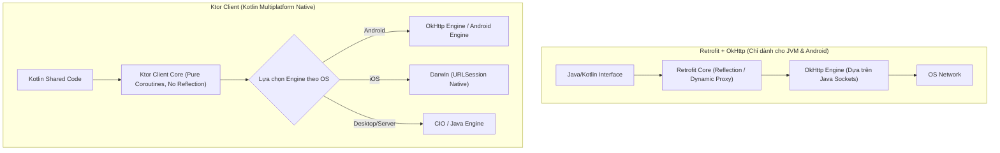

# Ktor and Apollo Android

> [!NOTE]
> Bản nháp: phần dưới đây là kiến thức chuyển từ [5.3 Networking](../../session_05/networking.md), nơi nó từng được dạy trước. Phần còn thiếu của Topic (Apollo Android cho GraphQL, engine và plugin của Ktor chi tiết hơn) sẽ viết khi làm Session 08.

## Vấn đề cần giải quyết

Retrofit và OkHttp chạy trên JVM, nên code mạng viết bằng chúng chỉ dùng được cho Android. Khi app có cả bản iOS hoặc desktop dùng chung logic bằng Kotlin Multiplatform (KMP), tầng mạng phải viết lại cho từng nền tảng, trừ khi dùng một HTTP client chạy được ở mọi nơi.

## Sau khi học xong

- Giải thích được kiến trúc engine và plugin của Ktor Client và vì sao nó dùng được cho Kotlin Multiplatform.
- Phân biệt được Retrofit + OkHttp với Ktor Client theo nền tảng, cách tạo API, coroutine và middleware.
- Áp dụng được Ktor Client với ContentNegotiation, Logging và Auth bearer tự refresh token.
- Biết khi nào chọn Ktor Client thay cho Retrofit.

## Ktor Client là gì?

**Ktor Client** là HTTP client của JetBrains viết hoàn toàn bằng Kotlin và coroutine: code gọi API viết một lần, còn việc gửi request thật do một **engine** của từng nền tảng đảm nhận (OkHttp trên Android, URLSession trên iOS), tính năng thêm vào bằng **plugin**.

Mental model: Ktor Client là **phần lõi chung cắm được nhiều động cơ**. Lõi và plugin giống nhau trên mọi nền tảng, chỉ động cơ đổi theo OS.

## Cách hoạt động

Retrofit đã thống trị hệ sinh thái Android trong hơn 10 năm qua. Tuy nhiên, với làn sóng **Kotlin Multiplatform (KMP)**, **Ktor Client** (được chính JetBrains phát triển) đang nổi lên như một đối thủ mạnh mẽ.



### So sánh Retrofit và Ktor Client

| Tiêu chí | Retrofit 2 + OkHttp | Ktor Client |
| :--- | :--- | :--- |
| **Khả năng đa nền tảng** | **Chỉ JVM/Android**: Không thể chia sẻ code mạng sang iOS hoặc Desktop. | **Full KMP**: Chạy tốt trên Android, iOS, Desktop (JVM), Web (Wasm/JS). |
| **Cơ chế khởi tạo API** | Dùng Java Dynamic Proxy & Runtime Reflection (`retrofit.create()`). | Hoàn toàn là hàm Kotlin thuần, không Reflection, compile cực nhanh. |
| **Hỗ trợ Coroutines** | Tích hợp qua adapter ngoài hoặc `suspend fun`. | **Native Coroutines 100%**: Mọi pipeline xử lý đều là Coroutine Channel/Job. |
| **Hỗ trợ Streaming & Socket** | Khá phức tạp khi làm việc với WebSockets hay Server-Sent Events (SSE). | Hỗ trợ WebSockets và HTTP Streaming cực kỳ thanh thoát và tự nhiên. |
| **Cấu hình Middleware** | Dựa trên danh sách các Interceptors của OkHttp. | Dựa trên hệ thống **Plugins** linh hoạt (Auth, Logging, ContentNegotiation). |

## Ví dụ thực tế: Ktor Client với serialization, logging và bearer auth

```kotlin
import io.ktor.client.HttpClient
import io.ktor.client.call.body
import io.ktor.client.engine.okhttp.OkHttp
import io.ktor.client.plugins.auth.Auth
import io.ktor.client.plugins.auth.providers.BearerTokens
import io.ktor.client.plugins.auth.providers.bearer
import io.ktor.client.plugins.contentnegotiation.ContentNegotiation
import io.ktor.client.plugins.logging.LogLevel
import io.ktor.client.plugins.logging.Logging
import io.ktor.client.request.get
import io.ktor.client.request.post
import io.ktor.client.request.setBody
import io.ktor.http.ContentType
import io.ktor.http.contentType
import io.ktor.serialization.kotlinx.json.json
import kotlinx.serialization.Serializable
import kotlinx.serialization.json.Json

@Serializable
data class UserDto(val id: Long, val name: String, val email: String)

@Serializable
data class CreateUserRequest(val name: String, val email: String)

class KtorApiClient(
    private val tokenStorage: TokenStorage
) {
    val client = HttpClient(OkHttp) {
        // Plugin 1: Tự động chuyển đổi JSON qua kotlinx.serialization
        install(ContentNegotiation) {
            json(Json {
                ignoreUnknownKeys = true
                isLenient = true
                prettyPrint = false
            })
        }

        // Plugin 2: Ghi log
        install(Logging) {
            level = LogLevel.INFO
        }

        // Plugin 3: Xử lý Bearer Token và Auto-Refresh tích hợp sẵn của Ktor
        install(Auth) {
            bearer {
                loadTokens {
                    // Chưa đăng nhập thì trả null: Ktor không gắn header Authorization
                    val access = tokenStorage.getAccessToken()
                    val refresh = tokenStorage.getRefreshToken()
                    if (access != null && refresh != null) BearerTokens(access, refresh) else null
                }
                refreshTokens {
                    // Nhiều request cùng nhận 401 thì Ktor chỉ gọi refreshTokens một lần, các request khác chờ
                    val newTokens = callRefreshTokenApi(oldTokens?.refreshToken)
                    tokenStorage.saveTokens(newTokens.accessToken, newTokens.refreshToken)
                    BearerTokens(newTokens.accessToken, newTokens.refreshToken)
                }
            }
        }
    }

    suspend fun getUserProfile(userId: Long): UserDto {
        return client.get("https://api.example.com/users/$userId").body()
    }

    suspend fun createUser(request: CreateUserRequest): UserDto {
        return client.post("https://api.example.com/users") {
            contentType(ContentType.Application.Json)
            setBody(request)
        }.body()
    }

    private suspend fun callRefreshTokenApi(refreshToken: String?): BearerTokens {
        // Giả lập gọi API refresh token
        return BearerTokens("new_access_token", "new_refresh_token")
    }
}

interface TokenStorage {
    fun getAccessToken(): String?
    fun getRefreshToken(): String?
    fun saveTokens(access: String, refresh: String)
}
```

## Khi nào nên và không nên dùng

- **Nên dùng Ktor Client** khi tầng mạng nằm trong module KMP dùng chung cho Android và iOS, hoặc cần WebSocket, streaming tự nhiên trên coroutine.
- **Giữ Retrofit + OkHttp** khi app chỉ có Android, codebase đã dựa trên interceptor của OkHttp và không có nhu cầu chia sẻ code.

## Sai lầm thường gặp

### 1. Tạo HttpClient mới cho mỗi request

**Triệu chứng:**
- Request chậm, tốn tài nguyên.

**Nguyên nhân:**
- Mỗi `HttpClient` có engine và connection pool riêng; tạo mới thì không dùng lại được kết nối.

**Giải pháp:**
- Tạo một `HttpClient` và dùng chung, gọi `close()` khi không cần nữa.

### 2. Gắn token rỗng khi chưa đăng nhập

**Triệu chứng:**
- Server nhận header `Authorization: Bearer ` rỗng và trả lỗi.

**Nguyên nhân:**
- `loadTokens` trả `BearerTokens("", "")` thay vì `null`.

**Giải pháp:**
- Trả `null` khi chưa có token, như ví dụ ở trên.

## Lịch sử phát triển

- **11/04/2022:** Ktor 2.0.0, bản major với API docs mới và nhiều tính năng mới.
- **09/10/2024:** Ktor 3.0.0, thêm hỗ trợ target Android Native.
- Ktor Client là một phần của framework Ktor do JetBrains phát triển; release notes ở trang Releases.

## Kết nối hệ thống

- **8.1.3 OkHttp:** engine `OkHttp` của Ktor dùng chính OkHttp bên dưới; plugin `Auth` của Ktor làm việc tương tự `Authenticator` của OkHttp. Xem [OkHttp](okhttp.md).
- **5.3 Networking:** phân loại lỗi, retry và theo dõi kết nối ở bài đó áp dụng như nhau cho Retrofit và Ktor. Xem [5.3 Networking](../../session_05/networking.md).
- **8.1.1 Retrofit:** lựa chọn còn lại cho app chỉ có Android. Mục 8.1.1 Retrofit (chưa có bài).

## Nguồn tham khảo

- [Ktor Client](https://ktor.io/docs/client-create-new-application.html)
- [Ktor Bearer authentication](https://ktor.io/docs/client-bearer-auth.html)
- [Ktor Releases](https://ktor.io/docs/releases.html)
