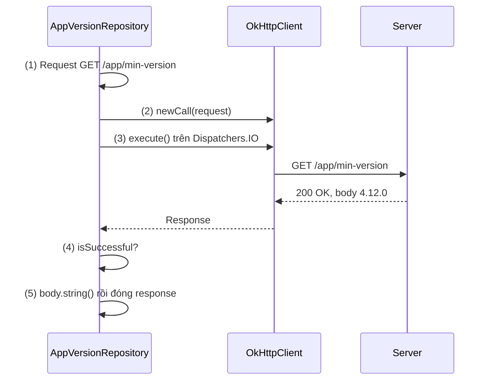
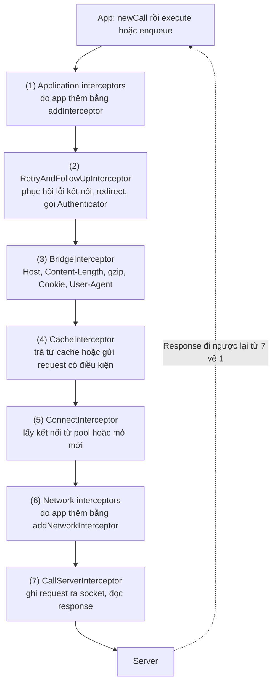
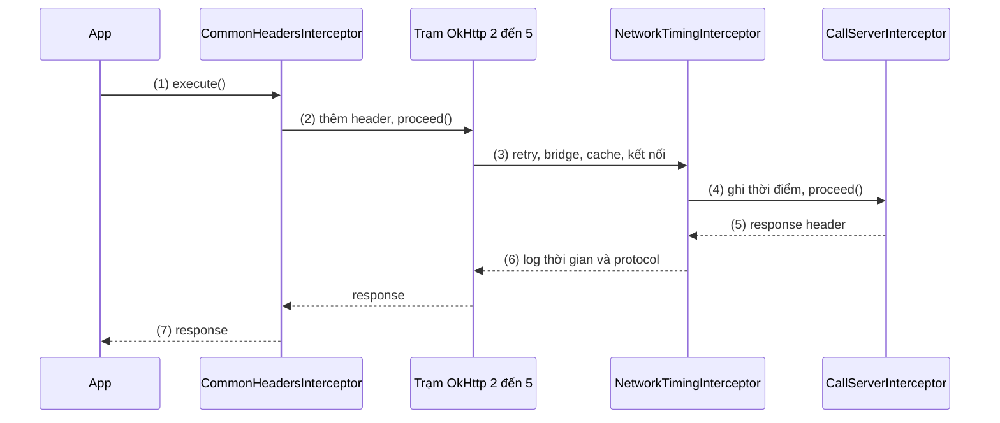
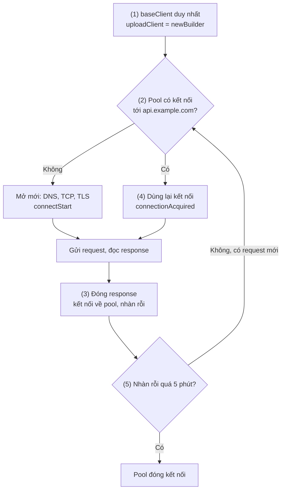
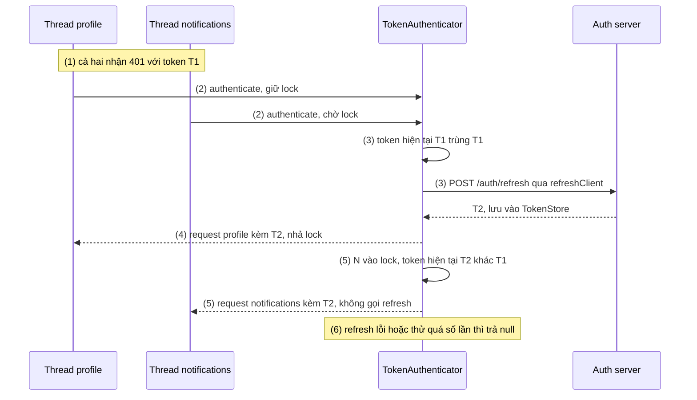
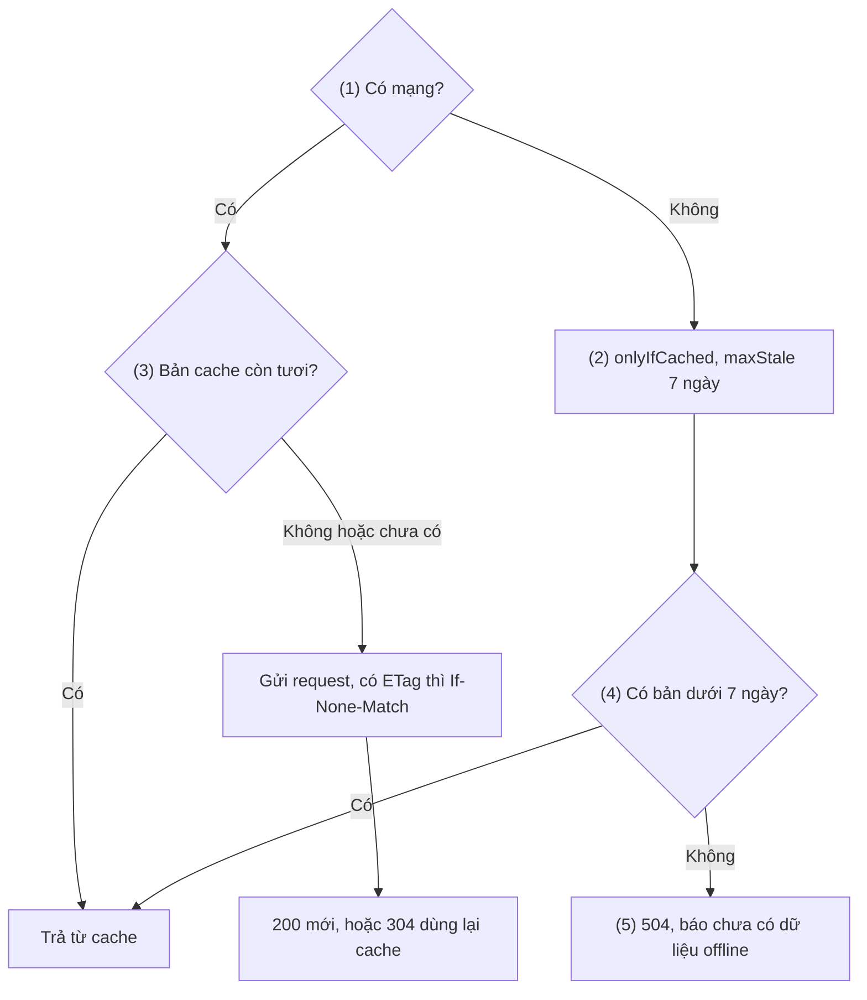
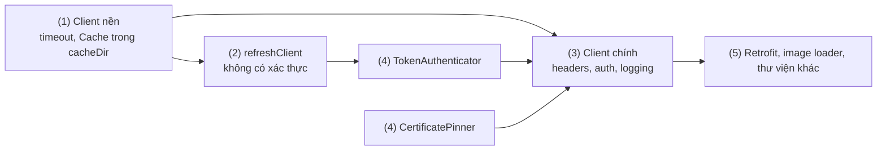

# OkHttp

## Vấn đề cần giải quyết

Gửi một request HTTP chỉ là phần nhỏ của việc gọi mạng. Mỗi kết nối HTTPS mới tốn DNS lookup, TCP handshake và TLS handshake, có thể tới vài trăm millisecond trước khi byte đầu tiên được gửi (xem [5.3 Networking](../../session_05/networking.md), mục "Chi phí thiết lập kết nối (Connection Overhead)"). Ngoài ra, một app thật còn cần:

- **Tái sử dụng kết nối** thay vì handshake lại cho mỗi request.
- **Gắn header chung** (phiên bản app, request ID, token) cho mọi request mà không lặp code.
- **Log khi debug** mà không làm lộ mật khẩu, token.
- **Refresh token đúng một lần** khi nhiều request cùng nhận `401 Unauthorized`.
- **Dùng lại response đã cache**, kể cả lúc mất mạng, và **giới hạn thời gian** để request không treo vô hạn.

Nếu mỗi chỗ gọi API tự làm những việc này, code mạng lặp lại, mỗi nơi xử lý một kiểu. Vấn đề cần giải quyết là: **một tầng HTTP dùng chung, nơi các việc cắt ngang (header, log, xác thực, cache) được khai báo một lần và áp dụng cho mọi request.**

## Sau khi học xong

- Giải thích được cách một Call đi qua Interceptor Chain của OkHttp và vai trò của từng interceptor cốt lõi.
- Phân biệt được execute với enqueue, application interceptor với network interceptor, và các loại timeout của OkHttp.
- Giải thích được vì sao Connection Pool và HTTP/2 giảm độ trễ, và vì sao app chỉ nên có một OkHttpClient.
- Xử lý được bài toán nhiều request cùng nhận 401 bằng Authenticator và double-check token.
- Áp dụng được interceptor tuỳ biến, CertificatePinner và HTTP Cache của OkHttp đúng chỗ.

## OkHttp là gì?

**OkHttp** là HTTP client của Square cho JVM và Android: mỗi `Call` đưa một `Request` qua một chuỗi **interceptor**, chuỗi này lấy kết nối từ **connection pool** để gửi request, rồi `Response` đi ngược lại qua đúng chuỗi đó về tay app.

Mental model: một **dây chuyền**. Request đi xuôi qua từng trạm tới socket, response đi ngược lại qua đúng các trạm đó; mỗi trạm có thể sửa, chặn, thử lại hoặc ghi lại thứ đi qua nó. Một số trạm do OkHttp đặt sẵn (redirect, gzip, cache, kết nối), một số do app gắn thêm (header, log).

Retrofit, Coil, Apollo Kotlin và engine OkHttp của Ktor đều gửi request qua dây chuyền này; cách Retrofit biến interface thành `Call` nằm ở [Retrofit](retrofit.md).

## Cách hoạt động

### OkHttpClient, Request, Call: execute() và enqueue()

Ba đối tượng cơ bản, mỗi đối tượng một vai:

| Đối tượng | Vai trò | Vòng đời |
|---|---|---|
| `OkHttpClient` | Giữ cấu hình (timeout, interceptor, cache, pinner) và tài nguyên dùng chung: connection pool, `Dispatcher` (thread pool cho request bất đồng bộ), cache | Một instance cho cả app |
| `Request` | Mô tả bất biến của một request: URL, method, header, body | Tạo cho mỗi lần gọi |
| `Call` | Một lần thực thi `Request` trên client; huỷ được bằng `cancel()` | Chỉ thực thi **một lần**; muốn gửi lại thì `call.clone()` |

Có hai cách chạy một `Call`:

- **`execute()`**: chặn (block) thread đang gọi cho tới khi có response header. Gọi trên Main Thread sẽ ném `NetworkOnMainThreadException` (lý do ở [5.3 Networking](../../session_05/networking.md), mục "Vấn đề NetworkOnMainThreadException"), nên phải gọi trên background thread.
- **`enqueue(callback)`**: đưa `Call` vào `Dispatcher` rồi trả về ngay; call chạy trên thread pool của OkHttp. Mặc định `Dispatcher` cho tối đa 64 request bất đồng bộ cùng lúc và 5 request mỗi host; request vượt giới hạn phải xếp hàng. Callback chạy trên **thread của OkHttp**, không phải Main Thread.

```kotlin
// enqueue: hàm trả về ngay, kết quả đến sau qua callback trên thread của OkHttp
client.newCall(request).enqueue(object : Callback {
    override fun onFailure(call: Call, e: IOException) { /* lỗi mạng, timeout, huỷ */ }
    override fun onResponse(call: Call, response: Response) {
        response.use { /* đọc body; muốn đụng UI thì chuyển về Main Thread */ }
    }
})
```

Artifact `okhttp-coroutines` có thêm `suspend fun Call.executeAsync()`, huỷ coroutine thì huỷ luôn `Call`. Coroutine (`suspend`, `withContext`, `Dispatchers.IO`) được học ở [8.4.3 Coroutines](../async_threads/coroutines.md); bài này chỉ dùng mức tối thiểu.

Từ OkHttp 5, `response.body` không còn nullable. Body là stream đọc từ socket, nên chỉ đọc được **một lần** và **phải được đóng** (`response.use { }`, hoặc `body.string()` vốn tự đóng). Không đóng thì kết nối không được trả về pool.

OkHttp có bốn loại timeout:

| Timeout | Đo gì | Mặc định |
|---|---|---|
| `connectTimeout` | Mở TCP và TLS handshake | 10 giây |
| `readTimeout` | Khoảng chờ tối đa giữa hai lần đọc được dữ liệu từ socket | 10 giây |
| `writeTimeout` | Khoảng chờ tối đa giữa hai lần ghi được dữ liệu ra socket | 10 giây |
| `callTimeout` | Toàn bộ `Call`: DNS, kết nối, redirect, retry, gửi body, đọc body | 0 (không giới hạn) |

`readTimeout` không chặn tổng thời gian: server gửi nhỏ giọt mỗi 9 giây một byte thì request vẫn chạy mãi; muốn chặn tổng thì đặt `callTimeout`.

#### Ví dụ: kiểm tra phiên bản tối thiểu của app

**Bài toán:** khi mở app, gọi `GET /app/min-version`, server trả về text như `4.12.0`; phiên bản đang chạy thấp hơn thì hiện màn hình bắt cập nhật. Response là text thuần nên không cần thư viện JSON (thuộc [Gson](gson.md)).

**Luồng chạy:**

1. Tạo `Request` GET tới URL, gắn header `Accept: text/plain`.
2. `client.newCall(request)` tạo một `Call`.
3. Chuyển sang `Dispatchers.IO` rồi gọi `execute()`: thread IO bị chặn tới khi có response header.
4. Kiểm tra `response.isSuccessful` (mã 2xx); mã khác thì ném lỗi để tầng trên xử lý theo phân loại lỗi ở 5.3.
5. Đọc body bằng `body.string()` trong khối `use`, để response luôn được đóng kể cả khi bước 4 ném lỗi.



```kotlin
// AppVersionRepository.kt
class AppVersionRepository(
    private val client: OkHttpClient,          // client dùng chung của app
    private val baseUrl: HttpUrl
) {
    suspend fun fetchMinVersion(): String = withContext(Dispatchers.IO) {
        val request = Request.Builder()        // (1)
            .url(baseUrl.resolve("app/min-version")!!)
            .header("Accept", "text/plain")
            .build()

        client.newCall(request)                // (2)
            .execute()                         // (3) chặn thread IO, không chặn Main
            .use { response ->                 // (5) luôn đóng response
                if (!response.isSuccessful) {  // (4)
                    throw IOException("HTTP ${response.code} khi lấy min-version")
                }
                response.body.string().trim()  // (5) đọc body một lần
            }
    }
}
```

**Kết quả:** `fetchMinVersion()` trả về `"4.12.0"`. Bỏ `withContext` để gọi `execute()` trên Main Thread thì crash `NetworkOnMainThreadException`; gọi `body.string()` hai lần thì lần sau ném `IllegalStateException: closed`.

### Interceptor Chain

**Interceptor** là một trạm trên dây chuyền: nó đọc hoặc sửa `chain.request()`, gọi `chain.proceed(request)` để chuyển cho trạm sau, rồi nhận và có thể sửa `Response` trả về. Đây là mẫu **Chain of Responsibility (Chuỗi trách nhiệm)**: mỗi trạm chỉ biết trạm kế tiếp qua `proceed()`.

Khi một `Call` chạy, OkHttp dựng chuỗi theo đúng thứ tự trong source (`RealCall.getResponseWithInterceptorChain()`):



Trách nhiệm của từng trạm OkHttp đặt sẵn:

- **(2) `RetryAndFollowUpInterceptor`**: thử lại khi lỗi kết nối còn phục hồi được, đi theo redirect `3xx`, gặp `401`/`407` thì hỏi `Authenticator` (phần sau). Một call đi tiếp tối đa 20 lần để tránh vòng lặp redirect.
- **(3) `BridgeInterceptor`**: thêm `Host`, `Content-Length`, `Connection: Keep-Alive`, `User-Agent`, cookie từ `CookieJar`, và `Accept-Encoding: gzip` nếu app chưa đặt; khi chính nó thêm gzip thì nó cũng tự giải nén response.
- **(4) `CacheInterceptor`**: response còn "tươi" theo `Cache-Control` thì trả luôn từ đĩa; bản cũ có `ETag`/`Last-Modified` thì gửi request có điều kiện, server trả `304 Not Modified` thì dùng lại body trong cache.
- **(5) `ConnectInterceptor`**: lấy kết nối trong connection pool, hoặc mở mới (DNS, TCP, TLS).
- **(7) `CallServerInterceptor`**: ghi request ra socket (HTTP/1.1) hoặc thành frame (HTTP/2) rồi đọc response, qua `BufferedSink`/`BufferedSource` của [Okio](okio.md).

Vị trí (1) và (6) là chỗ app gắn trạm của mình. Hai vị trí này nhìn thấy những thứ khác nhau:

| | Application interceptor (`addInterceptor`) | Network interceptor (`addNetworkInterceptor`) |
|---|---|---|
| Số lần chạy | Đúng một lần mỗi call, kể cả khi response lấy từ cache | Mỗi lần thực sự gửi lên mạng (redirect, retry tính riêng); không chạy khi cache trả luôn |
| Request nhìn thấy | Request gốc của app, chưa có header OkHttp thêm | Request đúng như sẽ gửi lên mạng (có `Host`, `Accept-Encoding`, `If-None-Match`...) |
| `chain.connection()` | `null` | Kết nối thật (biết protocol, route) |
| Được làm | Trả response tự tạo (không gọi `proceed`), gọi `proceed` nhiều lần | Quan sát dữ liệu thật trên dây |

Quy tắc chung: interceptor phải gọi `proceed()` để request đi tiếp (application interceptor có thể cố ý không gọi để trả response tự tạo); nếu gọi `proceed()` nhiều lần thì phải đóng body của response trước đó. Network interceptor phải gọi `proceed()` đúng một lần.

#### Ví dụ: gắn header chung và đo thời gian mạng thật

**Bài toán:** mọi request phải mang `X-App-Version`, `Accept-Language` và `X-Request-ID` để truy vết log giữa app và server; khi debug, cần biết mỗi lần gửi thật lên mạng mất bao lâu, trên HTTP/1.1 hay HTTP/2. Header chung thuộc application interceptor (chạy một lần, request ID giữ nguyên qua redirect); đo thời gian thuộc network interceptor (chạy cho từng lần gửi, có `connection()`).

**Luồng chạy:**

1. App gọi `newCall(request).execute()`.
2. `CommonHeadersInterceptor` (application) thêm ba header rồi `proceed()`.
3. Các trạm của OkHttp chạy: retry/redirect, bridge, cache, lấy kết nối.
4. `NetworkTimingInterceptor` (network) ghi thời điểm bắt đầu rồi `proceed()`.
5. `CallServerInterceptor` gửi request và đọc response header.
6. `NetworkTimingInterceptor` tính thời gian, log kèm `connection.protocol()`. Nếu server redirect, bước 4 đến 6 lặp lại cho lần gửi mới, còn bước 2 thì không.
7. Response đi ngược qua `CommonHeadersInterceptor` về app.



```kotlin
// CommonHeadersInterceptor.kt — application interceptor
class CommonHeadersInterceptor(
    private val appVersion: String,
    private val localeProvider: () -> Locale
) : Interceptor {
    override fun intercept(chain: Interceptor.Chain): Response {
        val request = chain.request().newBuilder()                   // (2) Request bất biến: tạo bản mới
            .header("X-App-Version", appVersion)
            .header("Accept-Language", localeProvider().toLanguageTag())
            .header("X-Request-ID", UUID.randomUUID().toString())    // một ID cho cả call
            .build()
        return chain.proceed(request)                                // (2) chuyển cho trạm sau
    }
}

// NetworkTimingInterceptor.kt — network interceptor
class NetworkTimingInterceptor : Interceptor {
    override fun intercept(chain: Interceptor.Chain): Response {
        val request = chain.request()
        val startNs = System.nanoTime()                              // (4)
        val response = chain.proceed(request)                        // (5) gửi thật lên mạng
        val tookMs = TimeUnit.NANOSECONDS.toMillis(System.nanoTime() - startNs)
        val protocol = chain.connection()?.protocol()                // chỉ network interceptor mới có
        Log.d("Network", "${request.method} ${request.url.encodedPath} -> ${response.code} " +
            "in ${tookMs}ms over $protocol")                          // (6)
        return response
    }
}

// Gắn vào client: addInterceptor(CommonHeadersInterceptor(...)), addNetworkInterceptor(NetworkTimingInterceptor())
```

**Kết quả:** gọi endpoint bị redirect `301` thì Logcat có **hai** dòng `Network`, server thấy cả hai lần gửi cùng một `X-Request-ID`. Khi response lấy thẳng từ cache (phần HTTP Cache) thì không có dòng `Network` nào, vì network interceptor không chạy.

### Connection Pool, HTTP/2 và một OkHttpClient cho cả app

Response được đọc xong và đóng thì OkHttp trả kết nối về **`ConnectionPool`** thay vì đóng socket. Request sau tới cùng địa chỉ (host, port, cấu hình TLS, proxy) lấy lại kết nối đó, bỏ qua DNS, TCP, TLS handshake.

- Mặc định pool giữ tối đa **5 kết nối nhàn rỗi**; kết nối nhàn rỗi quá **5 phút** thì bị đóng.
- **HTTP/1.1**: một kết nối chạy một request tại một thời điểm; request song song cần nhiều kết nối.
- **HTTP/2** (thoả thuận qua ALPN lúc TLS handshake): nhiều request chạy song song trên **cùng một kết nối** dưới dạng stream xen kẽ (multiplexing), request chậm không chặn request sau ở mức HTTP. Nghẽn ở mức TCP vẫn còn: một gói tin bị mất làm mọi stream trên kết nối chờ gửi lại.

Pool, `Dispatcher` và cache thuộc về **một** `OkHttpClient`; tạo client mới là tạo pool mới, rỗng. Vì vậy app chỉ nên có một client; nhóm request cần cấu hình riêng thì dùng `client.newBuilder()`: client mới chia sẻ connection pool, dispatcher và cấu hình của client gốc, chỉ khác phần được ghi đè.

**`EventListener`** nhận callback cho từng giai đoạn của call (`callStart`, `dnsStart`, `connectStart`, `connectionAcquired`, `callEnd`...). Call dùng lại kết nối từ pool có `connectionAcquired` mà không có `connectStart`.

#### Ví dụ: client upload dùng chung pool với client chính

**Bài toán:** API thường dùng timeout 10 giây, còn upload ảnh hoá đơn cần `writeTimeout` 60 giây, cùng host `api.example.com`. Cần chứng minh hai nhóm request dùng chung kết nối.

**Luồng chạy:**

1. `NetworkModule` tạo một `baseClient` duy nhất, gắn `EventListener` đếm số lần mở kết nối; `uploadClient` tạo từ `baseClient.newBuilder()`.
2. Request đầu tiên tới host: pool chưa có kết nối, OkHttp mở mới (`connectStart`).
3. Đọc xong và đóng response: kết nối về pool, trạng thái nhàn rỗi.
4. Request upload qua `uploadClient`: cùng pool, nên lấy lại kết nối (`connectionAcquired`, không có `connectStart`).
5. Không có request nào trong hơn 5 phút: pool đóng kết nối nhàn rỗi; request tiếp theo lại phải mở mới.



```kotlin
// ConnectionCountingListener.kt
class ConnectionCountingListener : EventListener() {
    val newConnections = AtomicInteger(0)

    override fun connectStart(call: Call, inetSocketAddress: InetSocketAddress, proxy: Proxy) {
        newConnections.incrementAndGet()                              // (2) chỉ chạy khi mở kết nối mới
    }
}

// NetworkModule.kt
object NetworkModule {
    val connectionListener = ConnectionCountingListener()

    val baseClient: OkHttpClient = OkHttpClient.Builder()            // (1) một client cho cả app
        .connectTimeout(10, TimeUnit.SECONDS)
        .readTimeout(10, TimeUnit.SECONDS)
        .callTimeout(30, TimeUnit.SECONDS)
        .eventListener(connectionListener)
        .build()

    val uploadClient: OkHttpClient = baseClient.newBuilder()         // (4) chia sẻ pool và dispatcher
        .writeTimeout(60, TimeUnit.SECONDS)
        .callTimeout(120, TimeUnit.SECONDS)
        .build()
}
```

App thật thường cung cấp client singleton qua dependency injection ([7.1.5.3 Hilt](../../session_07/design_pattern/di/hilt.md)); `object` ở đây cho gọn.

**Kết quả:** gọi API qua `baseClient` rồi upload qua `uploadClient` trong vài giây, `newConnections` bằng 1. Tạo `uploadClient` bằng `OkHttpClient.Builder()` mới hoàn toàn thì `newConnections` bằng 2: thêm một lần handshake cho cùng host.

### Nhiều request cùng nhận 401: Authenticator và double-check token

Gắn token là việc của application interceptor; xử lý token **hết hạn** thì OkHttp có chỗ riêng: **`okhttp3.Authenticator`**. Khi response là `401`, `RetryAndFollowUpInterceptor` gọi `authenticate(route, response)`: trả về `Request` mới (kèm token mới) thì OkHttp gửi lại, trả `null` thì OkHttp trả `401` cho app.

`authenticate()` là hàm đồng bộ, chạy trên thread đang thực thi call, nên refresh bên trong cũng phải đồng bộ. Docs của OkHttp khuyên ngừng thử lại khi đã thử đúng thông tin xác thực đó, hoặc khi vượt số lần do app đặt ra (đếm chuỗi `response.priorResponse`).

Cái khó là **nhiều request cùng hết hạn một lúc**. Nếu mỗi request tự refresh, request đầu gửi refresh token R1 và nhận R2, server **thu hồi R1** (refresh token rotation); các request sau gửi R1 đã bị thu hồi, nhận `invalid_grant`, và app đẩy user về màn đăng nhập dù chỉ cần một lần refresh.

Cách sửa: refresh trong một vùng khoá (lock) và **double-check** trong khoá: nếu token hiện tại đã khác token mà request thất bại đã dùng, một thread khác vừa refresh xong, chỉ cần dùng lại token mới.

#### Ví dụ: ba API của màn tổng quan cùng nhận 401

**Bài toán:** màn tổng quan gọi song song `/profile`, `/notifications`, `/cart` với access token T1 vừa hết hạn. Chỉ được refresh một lần; cả ba request tự gửi lại với token mới mà màn hình không cần biết.

**Luồng chạy:**

1. `AuthInterceptor` gắn `Authorization: Bearer T1` cho cả ba request; server trả `401` cho cả ba.
2. Thread của `/profile` vào `TokenAuthenticator` trước và giữ lock; hai thread kia chờ ở lock.
3. Trong lock, token hiện tại vẫn là T1 (trùng token request đã dùng), nên gọi refresh **bằng client riêng không có authenticator**, nhận T2, lưu lại.
4. Trả request `/profile` kèm T2; OkHttp gửi lại và thành công. Lock được nhả.
5. Thread `/notifications` vào lock: token hiện tại là T2, khác T1, nên **không refresh**, trả ngay request kèm T2. `/cart` cũng vậy.
6. Refresh thất bại hoặc đã thử quá số lần cho phép thì trả `null`: app nhận `401` và chuyển về màn đăng nhập.



```kotlin
// TokenStore.kt — giữ token trong bộ nhớ, lưu bền ở DataStore (xem 5.1.1)
interface TokenStore {
    val accessToken: String?
    val refreshToken: String?
    fun save(access: String, refresh: String)
    fun clear()
}

data class TokenPair(val accessToken: String, val refreshToken: String)

// AuthInterceptor.kt — application interceptor: chỉ gắn token
class AuthInterceptor(private val tokenStore: TokenStore) : Interceptor {
    override fun intercept(chain: Interceptor.Chain): Response {
        val token = tokenStore.accessToken ?: return chain.proceed(chain.request())
        return chain.proceed(
            chain.request().newBuilder().header("Authorization", "Bearer $token").build() // (1)
        )
    }
}

// TokenAuthenticator.kt
class TokenAuthenticator(
    private val tokenStore: TokenStore,
    private val refreshTokens: (refreshToken: String) -> TokenPair? // gọi đồng bộ qua refreshClient
) : Authenticator {

    private val lock = Any()

    override fun authenticate(route: Route?, response: Response): Request? {
        if (responseCount(response) >= MAX_ATTEMPTS) return null        // (6) chặn vòng lặp 401

        val failedToken = response.request.header("Authorization")
            ?.removePrefix("Bearer ")
            ?: return null                                               // request không mang token

        val newToken = synchronized(lock) {                              // (2) một thread tại một thời điểm
            val current = tokenStore.accessToken
            if (current != null && current != failedToken) {
                current                                                  // (5) thread khác đã refresh xong
            } else {
                val refresh = tokenStore.refreshToken ?: return null
                val pair = refreshTokens(refresh)                        // (3) chỉ một lần
                if (pair == null) {
                    tokenStore.clear()
                    return null                                          // (6) phiên hết hạn thật
                }
                tokenStore.save(pair.accessToken, pair.refreshToken)
                pair.accessToken
            }
        }

        return response.request.newBuilder()                             // (4) OkHttp gửi lại request này
            .header("Authorization", "Bearer $newToken")
            .build()
    }

    private fun responseCount(response: Response): Int =
        generateSequence(response) { it.priorResponse }.count()           // số lần đã nhận 401 trong call

    private companion object {
        const val MAX_ATTEMPTS = 3
    }
}
```

`refreshTokens` phải dùng một client **không có** `TokenAuthenticator` và `AuthInterceptor` (`refreshClient` ở phần Ví dụ thực tế); lý do ở Sai lầm 4.

**Kết quả:** đặt access token đã hết hạn rồi mở màn tổng quan: log server chỉ có **một** `POST /auth/refresh`, cả ba API trả `200`. Bỏ khối `synchronized` và double-check thì log có ba lần refresh, hai lần sau lỗi `invalid_grant`, và user bị đăng xuất.

### CertificatePinner

Khái niệm Certificate Pinning, backup pin và cách ghim bằng Network Security Config nằm ở [5.3 Networking](../../session_05/networking.md), mục "Bảo mật cao cấp: SSL / Certificate Pinning & Phòng thủ MITM". `CertificatePinner` là cách ghim bằng code của OkHttp: sau khi chuỗi chứng chỉ đã hợp lệ như bình thường, OkHttp kiểm tra thêm có ít nhất một chứng chỉ trong chuỗi có SHA-256 của public key (SPKI) nằm trong danh sách ghim của host; không khớp thì ném `SSLPeerUnverifiedException`.

```kotlin
// Cấu hình, không có luồng nên không cần sơ đồ
val certificatePinner = CertificatePinner.Builder()
    .add("api.example.com", "sha256/AAAAAAAAAAAAAAAAAAAAAAAAAAAAAAAAAAAAAAAAAAA=") // key đang dùng
    .add("api.example.com", "sha256/BBBBBBBBBBBBBBBBBBBBBBBBBBBBBBBBBBBBBBBBBBB=") // backup pin bắt buộc
    .add("*.cdn.example.com", "sha256/CCCCCCCCCCCCCCCCCCCCCCCCCCCCCCCCCCCCCCCCCCC=") // * khớp đúng một cấp subdomain
    .build()
```

Khi phát triển, tạm ghim một giá trị sai rồi đọc message của `SSLPeerUnverifiedException` để thấy pin của từng chứng chỉ server trả về. Trên Android, Network Security Config thường là lựa chọn đầu tiên (XML, có `expiration`, áp dụng cho mọi thư viện mạng); `CertificatePinner` hợp khi code mạng dùng chung với JVM hoặc cần dựng pin lúc chạy.

### HTTP Cache

Khi nào dùng HTTP Cache, khi nào dùng Room: xem bảng so sánh ở [5.3 Networking](../../session_05/networking.md), mục "Chiến lược Caching: HTTP Cache (OkHttp) vs Local Database (Room)". Ở đây là cách OkHttp làm.

`Cache(directory, maxSize)` lưu response trên đĩa; `CacheInterceptor` quyết định dùng cache theo header HTTP:

- Mặc định chỉ cache response của `GET`, và chỉ khi header cho phép (`Cache-Control: max-age`, `ETag`, `Last-Modified`...); server không gửi header cache thì OkHttp không tự cache.
- `CacheControl.FORCE_NETWORK` bỏ qua cache, `CacheControl.FORCE_CACHE` chỉ đọc cache; ép cache mà không có bản phù hợp thì OkHttp trả `504 Unsatisfiable Request`, không ném exception.
- `response.cacheResponse` khác `null` là có dùng cache, `response.networkResponse` khác `null` là có đi mạng (cả hai cùng có khi server trả `304`).
- Mỗi thư mục cache chỉ được một `Cache` mở cùng lúc; thêm một lý do để chỉ có một client.

#### Ví dụ: danh mục sản phẩm xem được khi mất mạng

**Bài toán:** `GET /catalog/categories` có `Cache-Control: max-age=300`. Có mạng thì dùng cache theo header; mất mạng thì hiện bản cũ tối đa 7 ngày thay vì màn lỗi.

**Luồng chạy:**

1. `OfflineCacheInterceptor` (application) hỏi trạng thái mạng. Có mạng thì giữ nguyên request.
2. Mất mạng: thay `CacheControl` của request bằng `onlyIfCached` và `maxStale` 7 ngày.
3. Có mạng: `CacheInterceptor` trả luôn bản còn tươi (dưới 300 giây); bản cũ hơn hoặc chưa có thì gửi request (có `If-None-Match` nếu có `ETag`), nhận `200` mới hoặc `304`.
4. Mất mạng mà có bản cũ dưới 7 ngày: trả bản đó, không chạm mạng.
5. Mất mạng và không có bản phù hợp: OkHttp trả `504`; data source chuyển nó thành lỗi "chưa có dữ liệu offline".



```kotlin
// OfflineCacheInterceptor.kt
class OfflineCacheInterceptor(
    private val isOnline: () -> Boolean     // đọc từ NetworkMonitor ở 5.3
) : Interceptor {
    override fun intercept(chain: Interceptor.Chain): Response {
        if (isOnline()) return chain.proceed(chain.request())       // (1) (3) theo header của server
        val offline = CacheControl.Builder()                         // (2)
            .onlyIfCached()
            .maxStale(7, TimeUnit.DAYS)
            .build()
        return chain.proceed(chain.request().newBuilder().cacheControl(offline).build()) // (4)
    }
}

// CatalogRemoteDataSource.kt — client đã có Cache(File(cacheDir, "http_cache"), 20 MB)
fun fetchCategories(client: OkHttpClient): String = client.newCall(
    Request.Builder().url("https://api.example.com/catalog/categories").build()
).execute().use { response ->
    if (response.code == 504 && response.networkResponse == null) {      // (5)
        throw NoOfflineDataException()
    }
    if (!response.isSuccessful) throw IOException("HTTP ${response.code}")
    Log.d("Cache", "cache=${response.cacheResponse != null}, network=${response.networkResponse != null}")
    response.body.string()
}
```

`isOnline` lấy từ `NetworkMonitor` ở [5.3 Networking](../../session_05/networking.md), mục "Ví dụ: NetworkMonitor phát trạng thái mạng bằng `callbackFlow`". Thư mục cache nằm trong `cacheDir`, nơi hệ thống có thể xoá khi máy thiếu dung lượng (xem [8.3 Local Storage](../local_storage.md)). Cách gắn `Cache` vào client dùng chung ở phần Ví dụ thực tế.

**Kết quả:** mở danh mục khi có mạng, rồi bật chế độ máy bay và mở lại: danh mục vẫn hiện, log `cache=true, network=false`. Xoá dữ liệu app rồi mở khi mất mạng: nhận `NoOfflineDataException` thay vì crash hay treo.

## Ví dụ thực tế

Ba bài toán hay gặp với OkHttp:

1. **Dựng client production cho cả app**: bài toán chính, code đầy đủ bên dưới.
2. **Test tầng mạng** bằng MockWebServer (module của OkHttp, server HTTP thật trên localhost): xem [10.2 Unit Testing](../../coding_analyst_and_testing/unit_testing.md).
3. **Upload file lớn có tiến độ**: đếm byte qua sink của Okio, xem [Okio](okio.md).

### Client production dùng chung cho Retrofit và các thư viện khác

**Bài toán:** app thương mại điện tử cần một client duy nhất cho mọi API: header chung, token tự refresh, log chỉ ở debug, cache, pin. Retrofit và thư viện tải ảnh dùng lại chính client này để chung pool.

**Luồng chạy:**

1. Tạo `Cache` trong `cacheDir` và một client nền chỉ có timeout và cache.
2. Tạo `refreshClient` từ client nền, **chưa** có xác thực; dùng nó cho API refresh.
3. Tạo client chính từ client nền: interceptor theo thứ tự header chung, gắn token, log (đặt cuối để thấy request đã đủ header).
4. Gắn `TokenAuthenticator` (gọi refresh qua `refreshClient`) và `CertificatePinner`.
5. Đưa client chính cho Retrofit và các thư viện cần HTTP; mọi request đi chung một dây chuyền và một pool.



```kotlin
// HttpClientFactory.kt
object HttpClientFactory {

    fun create(
        context: Context,
        tokenStore: TokenStore,
        certificatePinner: CertificatePinner,
        isDebug: Boolean
    ): OkHttpClient {
        val baseClient = OkHttpClient.Builder()                                       // (1)
            .connectTimeout(10, TimeUnit.SECONDS)
            .readTimeout(15, TimeUnit.SECONDS)
            .callTimeout(30, TimeUnit.SECONDS)
            .cache(Cache(File(context.cacheDir, "http_cache"), 20L * 1024 * 1024))
            .build()

        val headers = CommonHeadersInterceptor(BuildConfig.VERSION_NAME) { Locale.getDefault() }

        val refreshClient = baseClient.newBuilder()                                   // (2) không auth
            .addInterceptor(headers)
            .build()
        val authApi = AuthRefreshApi(refreshClient)

        val logging = HttpLoggingInterceptor { message -> Log.d("OkHttp", message) }.apply {
            level = if (isDebug) HttpLoggingInterceptor.Level.BODY else HttpLoggingInterceptor.Level.NONE
            redactHeader("Authorization")                                             // che header nhạy cảm
            redactHeader("Cookie")
            redactHeader("Set-Cookie")
        }

        return baseClient.newBuilder()                                                // (3) chung pool và cache
            .addInterceptor(headers)
            .addInterceptor(AuthInterceptor(tokenStore))
            .addInterceptor(logging)
            .authenticator(TokenAuthenticator(tokenStore, authApi::refreshBlocking))  // (4)
            .certificatePinner(certificatePinner)                                     // (4) như phần CertificatePinner
            .build()
    }
}

// AuthRefreshApi.kt — gọi đồng bộ vì Authenticator là API đồng bộ
class AuthRefreshApi(private val client: OkHttpClient) {
    fun refreshBlocking(refreshToken: String): TokenPair? {
        val request = Request.Builder()
            .url("https://api.example.com/auth/refresh")
            .post(FormBody.Builder().add("refresh_token", refreshToken).build())
            .build()
        return client.newCall(request).execute().use { response ->
            if (!response.isSuccessful) return null
            parseTokenPair(response.body.string())   // parse JSON: xem 8.1.2 Gson
        }
    }
}

// Application hoặc module DI: dùng cho Retrofit (cách Retrofit tạo Call: xem 8.1.1)
val okHttpClient = HttpClientFactory.create(appContext, tokenStore, certificatePinner, BuildConfig.DEBUG)       // (5)
val retrofit = Retrofit.Builder()
    .baseUrl("https://api.example.com/")
    .client(okHttpClient)
    .build()
```

`HttpLoggingInterceptor` nằm ở artifact riêng `com.squareup.okhttp3:logging-interceptor`. `redactHeader` chỉ che header, không che trường trong body, nên endpoint nhận mật khẩu hay số thẻ không nên log body kể cả ở debug.

**Kết quả:** mọi API Retrofit đều mang header chung và token; token hết hạn được refresh một lần mà ViewModel không biết; Logcat bản debug hiện `Authorization: ██`, bản release không có dòng `OkHttp` nào. `EventListener` cho thấy Retrofit và image loader dùng chung kết nối tới cùng host.

## Khi nào nên và không nên dùng

- **Nên dùng** làm tầng HTTP cho app Android, trực tiếp hoặc qua Retrofit; dùng trực tiếp khi request không có dạng API cố định (tải file theo URL động, WebSocket qua `client.newWebSocket`, endpoint text đơn giản).
- **Nên dùng** interceptor cho việc cắt ngang mọi request, Authenticator cho `401`, Cache khi server đã gửi header cache đúng.
- **Không nên** dùng HTTP Cache thay database khi dữ liệu cần truy vấn, sửa offline hay phát lại cho UI: đó là việc của Room (bảng ở 5.3).
- **Không nên** chọn OkHttp làm API chung khi tầng mạng nằm trong module Kotlin Multiplatform dùng cho cả iOS: OkHttp chỉ chạy trên JVM và Android; dùng Ktor Client (vẫn có thể chạy trên engine OkHttp ở phía Android, xem [Ktor and Apollo Android](ktor_apollo.md)).
- **Cân nhắc Cronet** (network stack của Chromium dạng thư viện) khi app cần QUIC/HTTP/3; `HttpURLConnection` của nền tảng chỉ hợp với code rất nhỏ không muốn thêm dependency.

## Sai lầm thường gặp

### 1. Tạo `OkHttpClient` mới ở mỗi repository

**Lỗi lộ ra thế nào:** `private val client = OkHttpClient()` trong từng repository làm request nào cũng handshake lại; `EventListener` cho thấy `connectStart` ở gần như mọi call. Nếu nhiều client cùng mở một thư mục `Cache`, cache bị hỏng.

**Cách sửa:** một client cho cả app, phần cấu hình riêng dùng `client.newBuilder()`.

### 2. Không đóng response body

```kotlin
// Sai: chỉ đọc code, không đóng response
val response = client.newCall(request).execute()
if (response.code == 204) return
```

**Lỗi lộ ra thế nào:** kết nối không được trả về pool; sau một lúc Logcat có cảnh báo `A connection to https://api.example.com/ was leaked. Did you forget to close a response body?`, và request mới phải mở kết nối mới.

**Cách sửa:** luôn bọc bằng `execute().use { }`, kể cả khi không cần body.

### 3. Đọc body trong interceptor làm mất body của app

```kotlin
// Sai: string() đọc hết và đóng body
val response = chain.proceed(request)
Log.d("Api", response.body.string())
return response
```

**Lỗi lộ ra thế nào:** Retrofit hoặc code gọi nhận lỗi `closed` hay body rỗng, vì body là stream chỉ đọc được một lần.

**Cách sửa:** dùng `response.peekBody(maxBytes)` để đọc một bản sao có giới hạn, hoặc dùng `HttpLoggingInterceptor`, vốn đọc qua buffer mà không làm mất body.

### 4. Refresh token bằng chính client có `Authenticator`

**Lỗi lộ ra thế nào:** endpoint refresh trả `401` làm `authenticate()` bị gọi lồng trên cùng thread và lại refresh, thành vòng lặp.

**Cách sửa:** refresh bằng client không có xác thực (`refreshClient` ở ví dụ thực tế), và luôn có điều kiện dừng (đếm `priorResponse`, refresh trả `null`).

### 5. Log body ở bản release, hoặc chỉ ghim một pin

**Lỗi lộ ra thế nào:** `Level.BODY` ở release đưa mật khẩu, token vào Logcat. Chỉ một pin thì khi server đổi khoá, mọi bản app đã phát hành không gọi được API.

**Cách sửa:** `Level.NONE` ở release và `redactHeader` cho `Authorization`, cookie; luôn có backup pin, theo cảnh báo ở [5.3 Networking](../../session_05/networking.md), mục "Triển khai qua Network Security Config (Chuẩn Declarative của Android)".

## Lịch sử phát triển

- **06/05/2013, OkHttp 1.0.0:** Square công bố OkHttp, ban đầu dựa trên mã `HttpURLConnection` của Android; phần I/O sau này tách ra thành [Okio](okio.md).
- **Android 4.4 (2013):** `HttpURLConnection` của nền tảng chuyển sang chạy trên một bản OkHttp nằm trong OS, cố định theo phiên bản Android; app vẫn đóng gói OkHttp riêng để có version mới.
- **13/01/2016, OkHttp 3.0.0:** đổi package từ `com.squareup.okhttp` sang `okhttp3` và group Maven thành `com.squareup.okhttp3`, để chạy song song được với bản 2.x.
- **16/11/2018, OkHttp 3.12.0:** hỗ trợ TLS 1.3, thêm `callTimeout`. **04/02/2019, 3.13.0:** yêu cầu tối thiểu Android 5.0 (API 21) và Java 8.
- **26/06/2019, OkHttp 4.0.0:** chuyển mã nguồn sang Kotlin; API Kotlin dùng property (`response.body`, `request.url`) và extension (`toRequestBody`, `asRequestBody`).
- **26/04/2022, OkHttp 5.0.0-alpha.7:** `Response.body` thành non-null.
- **02/07/2025, OkHttp 5.0.0:** bản stable đầu tiên của dòng 5.x; đóng gói thành artifact riêng cho JVM và Android (Gradle tự chọn qua module metadata); MockWebServer có coordinate và package mới `mockwebserver3`, không phụ thuộc JUnit 4.
- **Tại thời điểm viết (11/2026):** bản mới nhất là 5.5.1 (22/10/2026); README ghi OkHttp chạy trên Android 5.0+ (API 21+) và Java 8+.

## Kết nối hệ thống

- **Tiên quyết:**
  - [5.3 Networking](../../session_05/networking.md): chi phí kết nối, phân loại lỗi mạng, retry, Network Security Config, theo dõi trạng thái mạng.
  - [5.2 Working with Thread](../../session_05/working_with_thread.md): vì sao `execute()` phải chạy ngoài Main Thread.
- **Liên quan:**
  - [Retrofit](retrofit.md): Retrofit tạo `Call` của OkHttp từ interface, nên mọi interceptor ở đây áp dụng cho lời gọi Retrofit.
  - [Okio](okio.md): `CallServerInterceptor` và `RequestBody.writeTo()` ghi, đọc qua `BufferedSink`/`BufferedSource` của Okio; học tiếp để stream file lớn và báo tiến độ upload.
  - [Ktor and Apollo Android](ktor_apollo.md): Ktor có engine OkHttp; Apollo Kotlin chạy trên OkHttp ở Android và nhận được client của app.
  - [10.2 Unit Testing](../../coding_analyst_and_testing/unit_testing.md): test tầng mạng bằng MockWebServer.
- **Học tiếp:**
  - [8.4.3 Coroutines](../async_threads/coroutines.md): `withContext`, cancellation, nền của `executeAsync()`.
  - [7.1.5.3 Hilt](../../session_07/design_pattern/di/hilt.md): cung cấp `OkHttpClient` dạng singleton.

## Tham khảo

- [OkHttp - Square (Overview, Calls, Interceptors, Caching, Recipes)](https://square.github.io/okhttp/)
- [OkHttp README: yêu cầu Android 5.0+ và Java 8+](https://github.com/square/okhttp/blob/master/README.md)
- [OkHttp CHANGELOG (5.x) và changelog các dòng 1.x, 3.x, 4.x trong docs/changelogs](https://github.com/square/okhttp/blob/master/CHANGELOG.md)
- [OkHttp docs: Interceptors (application và network interceptor)](https://github.com/square/okhttp/blob/master/docs/features/interceptors.md)
- [OkHttp docs: Recipes (Handling authentication, Response caching, Per-call configuration)](https://github.com/square/okhttp/blob/master/docs/recipes.md)
- [OkHttp source: RealCall, RetryAndFollowUpInterceptor, ConnectionPool, Dispatcher, OkHttpClient](https://github.com/square/okhttp/tree/master/okhttp/src/commonJvmAndroid/kotlin/okhttp3)
- [OkHttp Coroutines (`executeAsync`)](https://github.com/square/okhttp/tree/master/okhttp-coroutines)
- [Announcing OkHttp - Square Engineering Blog](https://developer.squareup.com/blog/announcing-okhttp/)
- [Network security configuration - Android Developers](https://developer.android.com/privacy-and-security/security-config)
