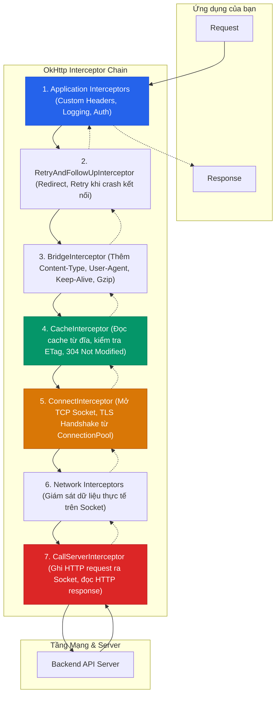
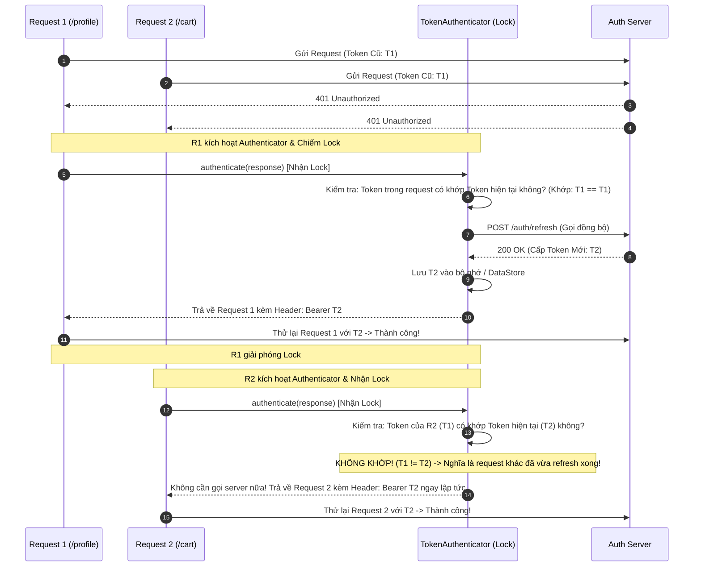

# OkHttp

> [!NOTE]
> Bản nháp: phần dưới đây là kiến thức chuyển từ [5.3 Networking](../../session_05/networking.md), nơi nó từng được dạy trước. Phần còn thiếu của Topic (tạo `OkHttpClient`, `Request`/`Call`, `execute()` và `enqueue()`, timeout) sẽ viết khi làm Session 08.

## Vấn đề cần giải quyết

Mỗi kết nối HTTPS mới tốn DNS lookup, TCP handshake và TLS handshake, cộng lại có thể tới vài trăm millisecond trước khi byte đầu tiên được gửi (xem [5.3 Networking](../../session_05/networking.md), mục 1.2). Ngoài việc gửi request, một app thật còn cần:

- Tái sử dụng kết nối thay vì handshake lại cho mỗi request.
- Gắn header chung (token, request ID, phiên bản app) cho mọi request mà không lặp code.
- Log request khi debug nhưng không làm lộ mật khẩu, số thẻ.
- Refresh token đúng một lần khi nhiều request cùng nhận `401`.
- Dùng lại response đã có khi server cho phép cache.

## Sau khi học xong

- Giải thích được cách request và response đi qua Interceptor Chain của OkHttp và vai trò của từng interceptor cốt lõi.
- Giải thích được vì sao Connection Pool và HTTP/2 multiplexing giảm độ trễ, và vì sao app chỉ nên có một OkHttpClient.
- Áp dụng được interceptor tuỳ biến để gắn header chung và log an toàn, không lộ PII.
- Xử lý được bài toán nhiều request cùng nhận 401 bằng okhttp3.Authenticator và double-check token.
- Áp dụng được CertificatePinner và HTTP Cache của OkHttp đúng chỗ.

## OkHttp là gì?

**OkHttp** là HTTP client của Square cho JVM và Android: nhận một `Request`, đưa nó qua chuỗi interceptor, tái sử dụng kết nối trong connection pool và trả về `Response`.

Mental model: một **dây chuyền**. Request đi xuôi qua từng trạm interceptor tới socket, response đi ngược lại qua đúng các trạm đó; mỗi trạm có thể sửa, chặn hoặc ghi lại thứ đi qua nó.

OkHttp (được phát triển bởi Square) là thư viện mạng tiêu chuẩn nền tảng trong Android. Kể cả Google cũng sử dụng mã nguồn OkHttp bên dưới lớp hiện thực `HttpURLConnection` của Android OS.

## Cách hoạt động

### Mẫu thiết kế Chain of Responsibility (Interceptor Chain)
Sức mạnh lớn nhất của OkHttp nằm ở chuỗi **Interceptor Chain**. Mọi request gửi đi và response trả về đều phải đi qua một chuỗi các Interceptor nối tiếp nhau theo mẫu thiết kế **Chain of Responsibility**:



### Trách nhiệm từng Interceptor cốt lõi
1. **Application Interceptors:** Nơi lập trình viên gắn các logic riêng: gắn Bearer Token, chèn Request ID, mã hóa body, v.v.
2. **RetryAndFollowUpInterceptor:** Tự động phục hồi kết nối khi đường truyền bị đứt gãy hoặc xử lý các mã chuyển hướng (301 Moved Permanently, 307 Temporary Redirect).
3. **BridgeInterceptor:** Cầu nối giữa mã nguồn ứng dụng và giao thức HTTP chuẩn. Nó tự động gắn các header bắt buộc như `Host`, `Keep-Alive`, `Accept-Encoding: gzip` và tự động giải nén dữ liệu gzip trả về.
4. **CacheInterceptor:** Kiểm tra xem request có thể phục vụ từ bộ nhớ đệm (Disk Cache) không. Nếu bản cache đã cũ nhưng có `ETag` hoặc `Last-Modified`, nó gửi request có điều kiện kèm header `If-None-Match` / `If-Modified-Since`. Nếu server trả về `304 Not Modified`, nó sẽ lấy dữ liệu từ cache mà không cần tải lại toàn bộ body.
5. **ConnectInterceptor:** Tìm kiếm một kết nối Socket sẵn có trong `ConnectionPool`. Nếu chưa có, nó khởi tạo TCP Socket và TLS Handshake.
6. **CallServerInterceptor:** Bước cuối cùng của chuỗi. Nó trực tiếp ghi các dòng text HTTP/1.1 hoặc các frame HTTP/2 vào `BufferedSink` của Socket, sau đó đọc kết quả từ `BufferedSource`.

### Cơ chế Connection Pool (Tái sử dụng kết nối)
Thay vì đóng Socket ngay khi nhận xong response (khiến lần gọi sau phải handshake lại từ đầu), OkHttp duy trì một **ConnectionPool**:
- Mặc định giữ tối đa **5 kết nối nhàn rỗi (idle connections)** trong vòng **5 phút**.
- Với HTTP/2, nhiều request độc lập có thể chạy song song trên **cùng một kết nối TCP duy nhất** (Multiplexing), loại bỏ hoàn toàn hiện tượng nghẽn đầu hàng (Head-of-Line Blocking) ở tầng ứng dụng.

## Ví dụ thực tế

### Interceptor tuỳ biến cho production

Trong một dự án thực tế, bạn sẽ cần tạo các Interceptor riêng để giải quyết các bài toán hạ tầng: gắn header thiết bị, truy vết request và logging an toàn.

#### Dynamic Header & Tracing Interceptor
Interceptor này tự động bổ sung các header quan trọng phục vụ tracing hệ thống và xác thực định danh:

```kotlin
import okhttp3.Interceptor
import okhttp3.Response
import java.util.UUID

class HeaderInterceptor(
    private val tokenProvider: () -> String?,
    private val appVersion: String
) : Interceptor {

    override fun intercept(chain: Interceptor.Chain): Response {
        val originalRequest = chain.request()
        
        val requestBuilder = originalRequest.newBuilder()
            .header("X-App-Version", appVersion)
            .header("X-Platform", "Android")
            .header("X-Request-ID", UUID.randomUUID().toString()) // Phục vụ truy vết log phân tán
            .header("Accept", "application/json")

        // Tự động gắn Token nếu có và request chưa có header Authorization
        val token = tokenProvider()
        if (!token.isNullOrBlank() && originalRequest.header("Authorization") == null) {
            requestBuilder.header("Authorization", "Bearer $token")
        }

        return chain.proceed(requestBuilder.build())
    }
}
```

#### Sanitized Logging Interceptor (Bảo mật PII & Credentials)
Thư viện `HttpLoggingInterceptor` mặc định sẽ in toàn bộ dữ liệu ra Logcat. Trong môi trường ngân hàng hoặc thương mại điện tử, việc in thẻ tín dụng (CVV), mật khẩu hoặc mã OTP ra Logcat là hành vi vi phạm chuẩn bảo mật nghiêm trọng (OWASP Mobile Top 10, GDPR).

```kotlin
import okhttp3.logging.HttpLoggingInterceptor
import android.util.Log

object SafeLoggingInterceptorFactory {
    fun create(isDebug: Boolean): HttpLoggingInterceptor {
        val logging = HttpLoggingInterceptor { message ->
            // Che giấu dữ liệu nhạy cảm trước khi in ra Logcat
            val sanitized = message
                .replace(Regex("\"password\"\\s*:\\s*\"[^\"]+\""), "\"password\":\"***\"")
                .replace(Regex("\"cardNumber\"\\s*:\\s*\"[^\"]+\""), "\"cardNumber\":\"***\"")
                .replace(Regex("\"cvv\"\\s*:\\s*\"[^\"]+\""), "\"cvv\":\"***\"")
            
            Log.d("OkHttp", sanitized)
        }
        
        // Môi trường Release tuyệt đối KHÔNG in Body ra Logcat
        logging.level = if (isDebug) {
            HttpLoggingInterceptor.Level.BODY
        } else {
            HttpLoggingInterceptor.Level.NONE
        }
        
        // Che giấu header Authorization
        logging.redactHeader("Authorization")
        logging.redactHeader("Cookie")
        
        return logging
    }
}
```

### Nhiều request cùng nhận 401: tự động refresh token

Một trong những bài toán hóc búa nhất khi xây dựng ứng dụng di động là: **Xử lý Refresh Token khi nhiều API đồng thời nhận mã lỗi 401 Unauthorized**.

#### Thảm họa Token Desynchronization (Khi không đồng bộ)
Giả sử người dùng mở màn hình Dashboard, app đồng thời bắn 3 request:
1. `GET /api/user/profile`
2. `GET /api/notifications`
3. `GET /api/cart`

Access Token vừa hết hạn, cả 3 request đồng thời nhận về mã lỗi `401`. Nếu xử lý ngây thơ:
- Cả 3 request cùng lúc gọi `POST /api/auth/refresh-token`.
- Server nhận được request refresh đầu tiên -> Cấp Access Token mới A và Refresh Token mới B, đồng thời **thu hồi (revoke) Refresh Token cũ**.
- Hai request refresh tiếp theo gửi Refresh Token cũ lên server -> Server báo lỗi `Invalid Refresh Token`!
- **Hệ quả:** App xóa session và người dùng bị đá văng ra màn hình đăng nhập một cách oan uổng.

#### Giải pháp chuẩn Senior: okhttp3.Authenticator
OkHttp cung cấp sẵn interface `okhttp3.Authenticator` được thiết kế đặc thù cho việc xử lý mã `401`. Khi kết hợp với khối khóa đồng bộ (`synchronized`), chúng ta đạt được giải pháp tối ưu:



#### Mã nguồn triển khai chi tiết

```kotlin
import okhttp3.Authenticator
import okhttp3.Request
import okhttp3.Response
import okhttp3.Route

class TokenManager(
    private var accessToken: String?,
    private var refreshToken: String?,
    private val refreshApiCall: (String) -> Pair<String, String>? // Trả về Pair(newAccess, newRefresh)
) {
    @Synchronized
    fun getAccessToken(): String? = accessToken

    @Synchronized
    fun refreshTokens(failedToken: String): String? {
        // Double-check: Nếu token hiện tại đã khác failedToken, 
        // nghĩa là một luồng khác đã vừa refresh thành công!
        if (accessToken != null && accessToken != failedToken) {
            return accessToken
        }

        val currentRefresh = refreshToken ?: return null
        val newTokens = refreshApiCall(currentRefresh) ?: return null

        accessToken = newTokens.first
        refreshToken = newTokens.second
        return accessToken
    }

    @Synchronized
    fun clearTokens() {
        accessToken = null
        refreshToken = null
    }
}

class TokenAuthenticator(
    private val tokenManager: TokenManager
) : Authenticator {

    override fun authenticate(route: Route?, response: Response): Request? {
        // Đề phòng vòng lặp vô tận: Nếu đã thử lại 3 lần mà vẫn bị 401 thì từ bỏ
        if (responseCount(response) >= 3) {
            tokenManager.clearTokens()
            return null // Đăng xuất người dùng
        }

        // Lấy token đã dùng trong request bị lỗi 401
        val failedToken = response.request.header("Authorization")
            ?.removePrefix("Bearer ")
            ?.trim() ?: ""

        // Thực hiện refresh đồng bộ an toàn qua TokenManager
        val newAccessToken = tokenManager.refreshTokens(failedToken) ?: run {
            tokenManager.clearTokens()
            return null // Refresh thất bại (Refresh Token hết hạn) -> Buộc đăng nhập lại
        }

        // Tạo request mới với token mới để OkHttp tự động thử lại
        return response.request.newBuilder()
            .header("Authorization", "Bearer $newAccessToken")
            .build()
    }

    private fun responseCount(response: Response): Int {
        var count = 1
        var prior = response.priorResponse
        while (prior != null) {
            count++
            prior = prior.priorResponse
        }
        return count
    }
}
```

### Ghim chứng chỉ bằng CertificatePinner

Khái niệm Certificate Pinning, các mặc định bảo mật của Android và cách ghim bằng Network Security Config nằm ở [5.3 Networking](../../session_05/networking.md), mục 5. Đây là cách ghim bằng code của OkHttp:

```kotlin
import okhttp3.CertificatePinner
import okhttp3.OkHttpClient

fun createSecureOkHttpClient(): OkHttpClient {
    val certificatePinner = CertificatePinner.Builder()
        // Ghim Public Key SHA-256 của domain chính
        .add("api.example.com", "sha256/AAAAAAAAAAAAAAAAAAAAAAAAAAAAAAAAAAAAAAAAAAA=")
        // BẮT BUỘC: Luôn luôn phải có ít nhất 1 mã Pin dự phòng (Backup Pin)!
        // Dùng khi chứng chỉ chính hết hạn hoặc bị lộ khóa bí mật.
        .add("api.example.com", "sha256/BBBBBBBBBBBBBBBBBBBBBBBBBBBBBBBBBBBBBBBBBBB=")
        .build()

    return OkHttpClient.Builder()
        .certificatePinner(certificatePinner)
        .build()
}
```

### HTTP Cache và OfflineCacheInterceptor

Khi nào dùng HTTP Cache, khi nào dùng Room: xem bảng so sánh ở [5.3 Networking](../../session_05/networking.md), mục 7.

Nếu backend hỗ trợ các header `Cache-Control`, OkHttp có thể tự động trả về dữ liệu mà không cần gọi mạng:

```kotlin
import okhttp3.Cache
import okhttp3.Interceptor
import okhttp3.OkHttpClient
import java.io.File
import java.util.concurrent.TimeUnit

fun createCachedOkHttpClient(cacheDir: File, isNetworkConnected: () -> Boolean): OkHttpClient {
    // Cấp phát 10MB dung lượng cache trên bộ nhớ trong
    val cache = Cache(File(cacheDir, "http_cache"), 10L * 1024 * 1024)

    val offlineCacheInterceptor = Interceptor { chain ->
        var request = chain.request()
        if (!isNetworkConnected()) {
            // Khi không có mạng, buộc OkHttp đọc từ cache dù cache đã hết hạn (tối đa 7 ngày)
            request = request.newBuilder()
                .header("Cache-Control", "public, only-if-cached, max-stale=" + 60 * 60 * 24 * 7)
                .build()
        }
        chain.proceed(request)
    }

    return OkHttpClient.Builder()
        .cache(cache)
        .addInterceptor(offlineCacheInterceptor)
        .build()
}
```

## Sai lầm thường gặp

### 1. Tạo OkHttpClient mới trong mỗi repository

**Triệu chứng:**
- Mỗi request đều handshake lại; app chậm, tốn pin; có thể cạn file descriptor.

**Nguyên nhân:**
- Mỗi `OkHttpClient` có connection pool và cache riêng, nên client mới không dùng lại được kết nối của client cũ.

**Giải pháp:**
- Chỉ tạo một `OkHttpClient` cho cả app. Endpoint cần cấu hình riêng thì dùng `okHttpClient.newBuilder()`, vẫn chia sẻ pool và cache.

### 2. Log body ở bản release

**Triệu chứng:**
- Mật khẩu, OTP, token xuất hiện trong Logcat.

**Nguyên nhân:**
- `HttpLoggingInterceptor` ở `Level.BODY` in toàn bộ request và response.

**Giải pháp:**
- Release dùng `Level.NONE`; debug thì che trường nhạy cảm và `redactHeader("Authorization")`, như `SafeLoggingInterceptorFactory` ở trên.

### 3. Refresh token không đồng bộ

**Triệu chứng:**
- User bị đăng xuất khi mở màn hình gọi nhiều API cùng lúc.

**Nguyên nhân:**
- Mỗi request nhận `401` tự gọi refresh; server thu hồi refresh token cũ sau lần đầu, các lần sau thất bại.

**Giải pháp:**
- Refresh trong `Authenticator`, khoá bằng `@Synchronized` và double-check token như `TokenManager` ở trên.

### 4. Chỉ ghim một pin

**Triệu chứng:**
- Server đổi chứng chỉ, toàn bộ user không gọi được API cho tới khi cập nhật app.

**Giải pháp:**
- Luôn có pin dự phòng (backup pin), như cảnh báo ở [5.3 Networking](../../session_05/networking.md), mục 5.

## Lịch sử phát triển

- OkHttp do Square phát triển; Android cũng dùng mã OkHttp bên dưới `HttpURLConnection` của hệ điều hành.
- **26/06/2019:** OkHttp 4.0.0 chuyển code sang Kotlin.
- **02/07/2025:** OkHttp 5.0.0, bản stable đầu tiên của dòng 5.x; MockWebServer có module mới `mockwebserver3` (xem [10.2 Unit Testing](../../coding_analyst_and_testing/unit_testing.md)).

## Kết nối hệ thống

- **5.3 Networking:** bối cảnh của bài này (vì sao cần tái dùng kết nối, phân loại lỗi mạng, retry, bảo mật). Xem [5.3 Networking](../../session_05/networking.md).
- **8.1.4 Okio:** `CallServerInterceptor` ghi request vào `BufferedSink` và đọc response từ `BufferedSource` của Okio. Xem [Okio](okio.md).
- **8.1.1 Retrofit:** Retrofit tạo request rồi giao cho OkHttp gửi, nên mọi interceptor ở đây áp dụng cho cả lời gọi Retrofit. Mục 8.1.1 Retrofit (chưa có bài).
- **8.1.5 Ktor:** Ktor Client có thể dùng OkHttp làm engine trên Android. Xem [Ktor and Apollo Android](ktor_apollo.md).
- **10.2 Unit Testing:** MockWebServer (một module của OkHttp) dựng server HTTP thật trên localhost để test tầng mạng. Xem [Unit Testing](../../coding_analyst_and_testing/unit_testing.md).

## Nguồn tham khảo

- [OkHttp (GitHub)](https://github.com/square/okhttp)
- [OkHttp CHANGELOG](https://github.com/square/okhttp/blob/master/CHANGELOG.md)
- [OkHttp ConnectionPool (mặc định 5 kết nối nhàn rỗi, 5 phút)](https://github.com/square/okhttp/blob/master/okhttp/src/commonJvmAndroid/kotlin/okhttp3/ConnectionPool.kt)
