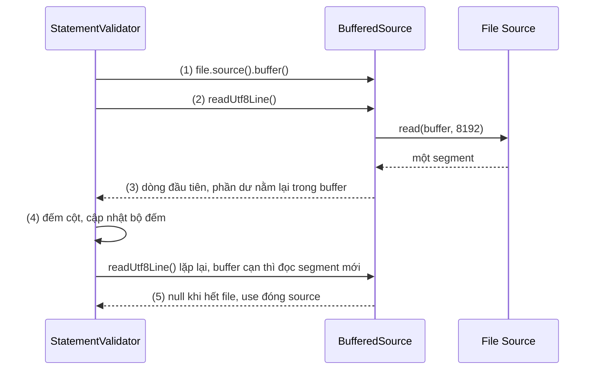
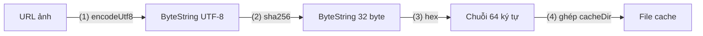
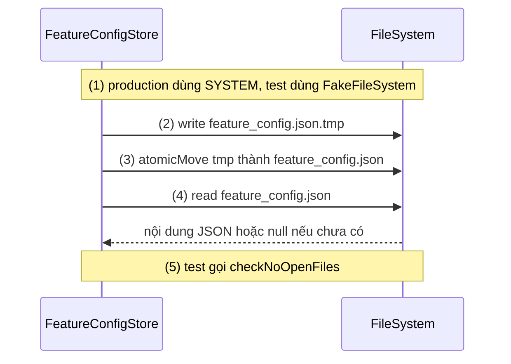
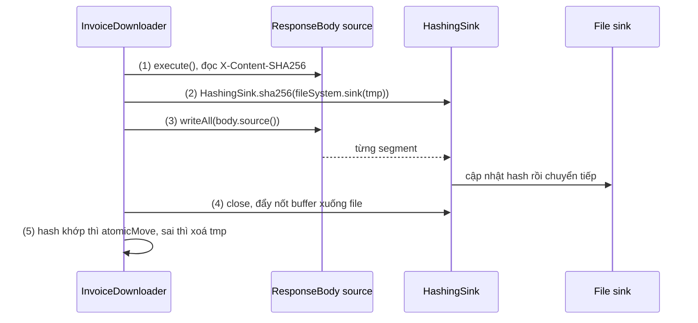
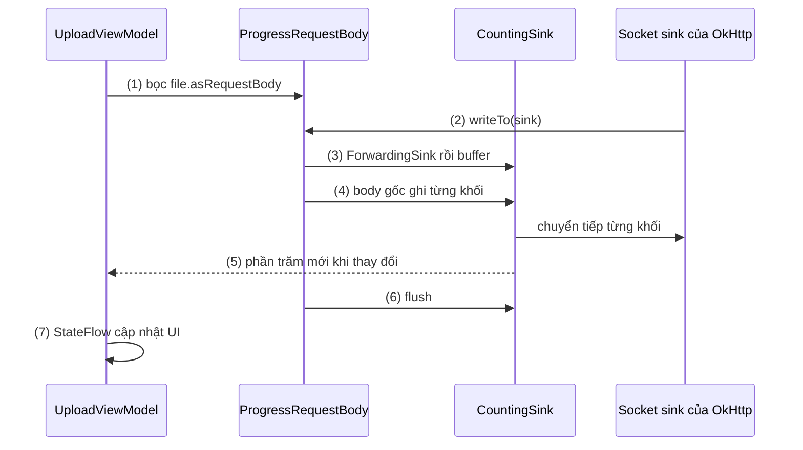

# Okio

## Vấn đề cần giải quyết

App thường xuyên đụng tới dữ liệu lớn hơn nhiều so với vài KB JSON: ảnh chụp 8 MB, video 200 MB, file PDF hoá đơn, file CSV xuất từ hệ thống. Cách viết ngắn nhất là nạp cả vào bộ nhớ:

```kotlin
// Nạp cả file 200 MB vào heap rồi mới gửi
val bytes = videoFile.readBytes()
val body = bytes.toRequestBody("video/mp4".toMediaType())
```

Heap của một app Android có giới hạn (thường vài trăm MB, ít hơn nhiều trên máy RAM thấp), nên đoạn code trên ném `OutOfMemoryError` với file đủ lớn. Muốn xử lý từng đoạn thì `java.io` có `InputStream`/`OutputStream`, nhưng chúng có những điểm khó dùng:

- Mỗi lớp bọc (`BufferedInputStream`, `GZIPInputStream`, `DigestInputStream`) giữ một mảng đệm riêng và **sao chép** byte từ mảng này sang mảng khác ở mỗi tầng.
- API đọc nghèo nàn: đọc một dòng UTF-8, một số nguyên big-endian hay "nhìn trước" dữ liệu mà không tiêu thụ đều phải tự viết hoặc ghép thêm lớp.
- Không có khái niệm timeout chung cho stream; socket có `soTimeout` nhưng file, pipe, stream tự viết thì không.

Ngoài ra, màn hình upload thường cần hiện phần trăm đã gửi, nghĩa là app phải "chen" vào giữa đường đi của byte để đếm. Vấn đề cần giải quyết là: **một mô hình I/O xử lý dữ liệu theo từng đoạn, ít sao chép, API đọc ghi đầy đủ, và dễ lắp thêm các khâu đếm, băm, nén vào giữa.**

## Sau khi học xong

- Giải thích được mô hình Source, Sink và Buffer của Okio và vì sao Buffer chuyển segment thay vì sao chép byte.
- Phân biệt được Buffer, ByteString, BufferedSource và BufferedSink với stream của java.io.
- Áp dụng được FileSystem và các sink bọc như ForwardingSink, HashingSink để đọc ghi, đếm byte và tính checksum theo từng đoạn.
- Triển khai được upload và download file lớn có báo tiến độ mà không gây OutOfMemoryError.
- Nhận diện được các lỗi thường gặp như đọc cả file vào RAM, quên close BufferedSink, writeTo bị gọi nhiều lần.

## Okio là gì?

**Okio** là thư viện I/O của Square, nền của OkHttp: dữ liệu đi từ **`Source`** (nơi đọc ra) sang **`Sink`** (nơi ghi vào) qua **`Buffer`**, một hàng đợi các **segment** (mảng byte 8 KiB) mà Okio chuyển nguyên segment giữa các buffer thay vì sao chép từng byte.

Mental model: một **đường ống chở thùng**. Dữ liệu không được rót từ thùng này sang thùng khác ở mỗi khúc ống; cả thùng (segment) được đẩy đi nguyên vẹn. Muốn đếm, băm hay nén thứ chảy qua thì lắp thêm một khúc ống (sink hoặc source bọc) vào giữa, các khúc khác không cần biết.

## Cách hoạt động

### Source, Sink và Buffer

Hai interface cốt lõi rất nhỏ:

| Interface | Hàm chính | Ý nghĩa |
|---|---|---|
| `Source` | `read(sink: Buffer, byteCount: Long): Long` | Đọc **tối đa** `byteCount` byte, nối vào `sink`; trả số byte đã đọc, `-1` khi hết dữ liệu |
| `Sink` | `write(source: Buffer, byteCount: Long)` | Lấy đúng `byteCount` byte từ đầu `source` và ghi đi |
| Cả hai | `timeout()`, `close()`; `Sink` có thêm `flush()` | Giới hạn thời gian, giải phóng tài nguyên, đẩy dữ liệu đang giữ |

`Source` tương ứng `InputStream`, `Sink` tương ứng `OutputStream`, nhưng tham số là `Buffer` chứ không phải `ByteArray`. **`Buffer`** vừa là `BufferedSource` vừa là `BufferedSink`: ghi vào cuối, đọc ra từ đầu, như một hàng đợi byte.

Bên trong, `Buffer` là một danh sách liên kết vòng các **segment**, mỗi segment là một `ByteArray` 8192 byte kèm vị trí đầu, cuối. Hai đặc điểm tạo nên hiệu năng:

- **Chuyển thay vì sao chép:** khi `sink.write(buffer, n)` lấy dữ liệu từ buffer này sang buffer khác, segment đầy được tháo khỏi danh sách nguồn và gắn vào danh sách đích; chỉ phần lẻ nhỏ mới bị sao chép. Một khúc ống bọc thêm vì thế gần như không tốn chi phí sao chép.
- **Tái sử dụng segment:** segment rỗng được trả về `SegmentPool` để buffer sau dùng lại, giảm việc cấp phát mảng và áp lực lên Garbage Collector.

`Source`/`Sink` "thô" chỉ đọc ghi theo khối. Gọi `.buffer()` để có **`BufferedSource`**/**`BufferedSink`**: một lớp có `Buffer` bên trong và API đầy đủ (`readUtf8Line()`, `readInt()`, `readByteString(n)`, `exhausted()`, `indexOf()`, `peek()`; `writeUtf8()`, `writeInt()`, `writeAll(source)`, `emit()`, `flush()`). Lớp buffered tự kéo thêm segment từ source khi buffer bên trong cạn, và chỉ đẩy xuống sink khi đủ segment hoặc khi `flush()`/`close()`.

#### Ví dụ: kiểm tra file CSV giao dịch trước khi import

**Bài toán:** người dùng chọn một file CSV sao kê 150 MB để import. Trước khi import, app đếm số dòng và số dòng sai định dạng (không đủ 4 cột) để báo cho người dùng. File quá lớn để nạp bằng `readText()`.

**Luồng chạy:**

1. Mở file thành `Source` bằng `file.source()`, bọc thành `BufferedSource` bằng `.buffer()`.
2. Gọi `readUtf8Line()`: buffer bên trong rỗng, nên nó gọi `source.read(buffer, 8192)` để kéo một segment từ file.
3. Tìm ký tự xuống dòng trong buffer, trả về dòng đầu tiên; phần còn lại ở trong buffer cho lần gọi sau. Hết dữ liệu trong buffer thì quay lại bước 2.
4. Đếm cột của dòng, cập nhật bộ đếm.
5. `readUtf8Line()` trả `null` khi file hết; khối `use` đóng source và file.



```kotlin
// StatementValidator.kt
data class CsvReport(val totalRows: Int, val invalidRows: Int)

class StatementValidator {
    fun validate(file: File): CsvReport =
        file.source().buffer().use { source ->                  // (1) và (5) use tự đóng
            var total = 0
            var invalid = 0
            while (true) {
                val line = source.readUtf8Line() ?: break        // (2)(3) kéo segment khi cần
                if (total > 0 && line.split(',').size != 4) {    // (4) bỏ qua dòng tiêu đề
                    invalid++
                }
                total++
            }
            CsvReport(totalRows = total - 1, invalidRows = invalid)
        }
}
```

Hàm này đọc file nên phải chạy ngoài Main Thread, ví dụ trong `withContext(Dispatchers.IO)` ([8.4.3 Coroutines](../async_threads/coroutines.md)).

**Kết quả:** với file 150 MB, Memory Profiler của Android Studio cho thấy heap gần như không đổi trong lúc chạy, vì tại mỗi thời điểm chỉ có vài segment 8 KiB và một dòng nằm trong bộ nhớ. Thay bằng `file.readText().lines()` thì heap tăng vài trăm MB và máy RAM thấp ném `OutOfMemoryError`.

### ByteString và Buffer: bất biến và khả biến

Okio có hai kiểu chứa byte, khác nhau ở tính bất biến:

| | `ByteString` | `Buffer` |
|---|---|---|
| Bản chất | Dãy byte **bất biến**, như `String` nhưng cho byte | Hàng đợi byte **khả biến** |
| Dùng khi | Giá trị cố định: hash, key, chữ ký, magic number, token nhị phân | Dữ liệu đang chảy: đọc dần, ghi dần, ghép payload |
| API tiêu biểu | `encodeUtf8()`, `decodeHex()`, `decodeBase64()`, `utf8()`, `hex()`, `base64()`, `md5()`, `sha256()`, `hmacSha256(key)`, `toByteString()` | `writeUtf8()`, `writeInt()`, `readUtf8Line()`, `readByteString()`, `copyTo()`, `snapshot()` |
| Dùng làm key của `Map` | Được (có `equals`/`hashCode` theo nội dung) | Không nên (nội dung đổi liên tục) |

`ByteString` thay cho các đoạn code chuyển đổi rải rác bằng `MessageDigest`, `Base64`, vòng lặp tự in hex. Chính OkHttp dùng nó để đặt tên file trong HTTP Cache: key của một URL là `url.toString().encodeUtf8().md5().hex()`.

#### Ví dụ: đặt tên file cache cho ảnh tải theo URL

**Bài toán:** app lưu ảnh đại diện đã tải vào `cacheDir`. URL có ký tự không hợp lệ cho tên file (`/`, `?`, `&`) và có thể rất dài, nên cần một tên file ngắn, cố định cho mỗi URL.

**Luồng chạy:**

1. Mã hoá URL thành `ByteString` UTF-8 bằng `encodeUtf8()`.
2. Băm bằng `sha256()`, được một `ByteString` 32 byte.
3. Chuyển sang chuỗi hex 64 ký tự bằng `hex()`.
4. Ghép với `cacheDir` thành đường dẫn file.



```kotlin
// AvatarCacheKey.kt
fun avatarCacheFile(cacheDir: File, avatarUrl: String): File {
    val key = avatarUrl
        .encodeUtf8()      // (1)
        .sha256()          // (2)
        .hex()             // (3)
    return File(cacheDir, "avatars/$key.jpg") // (4)
}
```

**Kết quả:** cùng một URL luôn ra cùng một tên file; URL khác nhau một ký tự ra tên khác hoàn toàn. Không có `MessageDigest.getInstance(...)`, không có vòng lặp in hex. Thư viện tải ảnh thật như Glide hay Coil đã tự làm việc này, xem [Glide](../loading_image/glide.md).

### FileSystem: đọc ghi file qua một interface

Từ Okio 3, **`FileSystem`** gom các thao tác file vào một lớp trừu tượng: `read(path) { }`, `write(path) { }`, `appendingSink(path)`, `metadataOrNull(path)`, `list(dir)`, `createDirectories(dir)`, `atomicMove(source, target)`, `delete(path)`. Đường dẫn là `okio.Path` (`"…".toPath()`, hoặc `File.toOkioPath()` trên JVM/Android).

Điểm mạnh nằm ở chỗ `FileSystem` là **dependency truyền vào được**:

- Code production dùng `FileSystem.SYSTEM`.
- Unit test dùng `FakeFileSystem` (artifact `okio-fakefilesystem`): hệ thống file trong bộ nhớ, chạy trên JVM không cần thiết bị, và `checkNoOpenFiles()` báo lỗi nếu code quên đóng file.
- Cùng API chạy trên Kotlin Multiplatform, nên code lưu file trong module dùng chung với iOS không phải viết lại.

Okio chỉ cung cấp API. **Lưu file ở đâu** (`filesDir`, `cacheDir`, `noBackupFilesDir`) và **vì sao phải ghi file tạm rồi đổi tên** để không để lại file hỏng khi app bị tắt giữa chừng được học ở [8.3 Local Storage](../local_storage.md); ví dụ dưới chỉ dùng lại cách đó bằng API của Okio.

#### Ví dụ: lưu cấu hình tải về và test bằng FakeFileSystem

**Bài toán:** app tải file cấu hình tính năng (feature flags) dạng JSON từ server, lưu vào `filesDir` để lần mở sau dùng ngay khi chưa có mạng. Cần ghi không làm hỏng bản cũ nếu app bị tắt giữa chừng, và cần unit test được mà không đụng tới đĩa thật.

**Luồng chạy:**

1. `FeatureConfigStore` nhận `FileSystem` và thư mục qua constructor.
2. `save()` ghi nội dung vào file tạm `feature_config.json.tmp` bằng `fileSystem.write`.
3. `atomicMove` thay file chính bằng file tạm; người đọc chỉ thấy bản cũ hoặc bản mới đầy đủ.
4. `load()` đọc file chính bằng `fileSystem.read`; chưa có file thì trả `null`.
5. Trong test, truyền `FakeFileSystem` thay cho `FileSystem.SYSTEM`, chạy cùng code, rồi kiểm tra không còn file mở.



```kotlin
// FeatureConfigStore.kt
class FeatureConfigStore(
    private val fileSystem: FileSystem,          // (1) FileSystem.SYSTEM hoặc FakeFileSystem
    private val directory: Path                  // context.filesDir.toOkioPath()
) {
    private val target = directory / "feature_config.json"
    private val temp = directory / "feature_config.json.tmp"

    fun save(json: String) {
        fileSystem.createDirectories(directory)
        fileSystem.write(temp) { writeUtf8(json) }   // (2) write tự close BufferedSink
        fileSystem.atomicMove(temp, target)          // (3)
    }

    fun load(): String? =
        if (fileSystem.exists(target)) fileSystem.read(target) { readUtf8() } else null // (4)
}

// FeatureConfigStoreTest.kt — chạy trên JVM, không cần thiết bị
class FeatureConfigStoreTest {
    private val fileSystem = FakeFileSystem()                                // (5)
    private val store = FeatureConfigStore(fileSystem, "/data/files".toPath())

    @After fun tearDown() = fileSystem.checkNoOpenFiles()

    @Test fun savedConfigIsLoadedBack() {
        store.save("""{"newCheckout":true}""")
        assertEquals("""{"newCheckout":true}""", store.load())
        assertFalse(fileSystem.exists("/data/files/feature_config.json.tmp".toPath()))
    }
}
```

**Kết quả:** test chạy trong vài millisecond trên JVM; sau `save()` chỉ còn file chính, không còn file tạm. Xoá khối `write { }` và tự mở `fileSystem.sink(temp).buffer()` mà quên `close()` thì `checkNoOpenFiles()` làm test thất bại và chỉ ra file còn mở. Unit test trên JVM được học ở [10.2 Unit Testing](../../coding_analyst_and_testing/unit_testing.md).

### Sink và Source bọc: lắp thêm khúc ống

Vì `Sink` và `Source` chỉ có vài hàm, bọc chúng rất dễ: một lớp nhận `Sink` gốc, làm thêm việc trong `write()`, rồi chuyển tiếp xuống sink gốc. Đây là mẫu **Decorator** quen thuộc của `java.io`, nhưng nhờ segment được chuyển chứ không chép, mỗi khúc bọc gần như không tốn thêm bộ nhớ. Các khúc có sẵn:

| Khúc ống | Việc làm thêm |
|---|---|
| `ForwardingSink`, `ForwardingSource` | Lớp cơ sở để tự bọc: override `write()`/`read()` để đếm, log, giới hạn |
| `HashingSink`, `HashingSource` | Tính MD5, SHA-1, SHA-256, SHA-512 hoặc HMAC của mọi byte đi qua; đọc kết quả bằng `.hash` |
| `GzipSink`, `GzipSource` | Nén, giải nén gzip; `BridgeInterceptor` của OkHttp dùng `GzipSource` để giải nén response |
| `InflaterSource`, `DeflaterSink` | Nén deflate thô |
| `blackholeSink()` | Sink nuốt mọi byte; ghép với `HashingSink` để chỉ tính hash |

Thứ tự lắp quan trọng: `HashingSink.sha256(GzipSink(fileSink))` băm dữ liệu **trước** khi nén, còn `GzipSink(HashingSink.sha256(fileSink))` băm dữ liệu **sau** khi nén.

#### Ví dụ: tải file PDF hoá đơn và kiểm tra SHA-256 trong lúc tải

**Bài toán:** API trả file PDF hoá đơn (có thể vài chục MB) kèm header `X-Content-SHA256` là hash mong đợi. App phải lưu file vào `filesDir` và chỉ giữ lại nếu hash khớp, không đọc lại file lần hai để băm.

**Luồng chạy:**

1. Gọi OkHttp lấy response; đọc hash mong đợi từ header.
2. Mở sink tới file tạm bằng `FileSystem`, bọc bằng `HashingSink.sha256(...)`, rồi `.buffer()`.
3. `writeAll(response.body.source())`: từng segment đi từ socket qua `HashingSink` (cập nhật hash) xuống file.
4. Đóng sink (khối `use`): dữ liệu còn trong buffer được đẩy xuống file, hash hoàn tất.
5. So sánh `hashingSink.hash.hex()` với hash mong đợi: khớp thì `atomicMove` sang file chính; không khớp thì xoá file tạm và báo lỗi.



```kotlin
// InvoiceDownloader.kt
class InvoiceDownloader(
    private val client: OkHttpClient,
    private val fileSystem: FileSystem,
    private val invoicesDir: Path
) {
    fun download(invoiceId: String): Path {
        val request = Request.Builder().url("https://api.example.com/invoices/$invoiceId.pdf").build()
        client.newCall(request).execute().use { response ->                   // (1)
            if (!response.isSuccessful) throw IOException("HTTP ${response.code}")
            val expected = response.header("X-Content-SHA256")
                ?: throw IOException("Thiếu hash của hoá đơn")

            val temp = invoicesDir / "$invoiceId.pdf.tmp"
            val target = invoicesDir / "$invoiceId.pdf"
            val hashingSink = HashingSink.sha256(fileSystem.sink(temp))       // (2)

            hashingSink.buffer().use { sink ->
                sink.writeAll(response.body.source())                         // (3) stream từng segment
            }                                                                 // (4) close đẩy nốt dữ liệu

            if (!hashingSink.hash.hex().equals(expected, ignoreCase = true)) { // (5)
                fileSystem.delete(temp)
                throw IOException("Hoá đơn $invoiceId bị hỏng khi tải")
            }
            fileSystem.atomicMove(temp, target)
            return target
        }
    }
}
```

**Kết quả:** tải một file 40 MB, heap tăng không đáng kể và file chỉ được đọc qua mạng một lần. Sửa một byte trong response giả lập (MockWebServer, xem [10.2 Unit Testing](../../coding_analyst_and_testing/unit_testing.md)) thì hàm ném `IOException` và trong thư mục không còn file `.pdf` nào.

## Deep Dive: Timeout và Okio bên dưới OkHttp

Mỗi `Source`/`Sink` có một **`Timeout`**: `timeout(duration, unit)` giới hạn thời gian chờ của một thao tác, `deadline(...)` giới hạn tổng thời gian. Với stream không tự hỗ trợ ngắt (socket), Okio có **`AsyncTimeout`**: một thread canh (watchdog) theo dõi các thao tác đang chờ và gọi `timedOut()` khi quá hạn, để bên dùng đóng socket hoặc huỷ việc đang làm.

OkHttp dựa vào những cơ chế này ở nhiều chỗ:

- `RealCall` dùng một `AsyncTimeout` cho `callTimeout`: quá hạn thì `timedOut()` huỷ call.
- Socket được bọc thành `Source`/`Sink` của Okio có timeout, là nơi `readTimeout`, `writeTimeout` có hiệu lực.
- `RequestBody.writeTo(sink: BufferedSink)` là chỗ app ghi body; `ResponseBody.source()` là chỗ app đọc body.
- `CallServerInterceptor` ghi request và đọc response qua `BufferedSink`/`BufferedSource`; `BridgeInterceptor` giải nén bằng `GzipSource`; `Cache` dùng `FileSystem` và đặt tên file bằng `ByteString`.

Ngoài OkHttp, Moshi đọc JSON trực tiếp từ `BufferedSource`, nên Retrofit với Moshi parse JSON từ socket mà không tạo một `String` lớn ở giữa (Gson thì đọc qua `Reader`, xem [Gson](gson.md)). JetBrains phát triển **kotlinx-io** dựa trên Okio (README ghi rõ không giữ tương thích ngược với Okio), và Ktor 3 chuyển sang kotlinx-io; vì vậy mô hình Source, Sink, Buffer trong bài cũng là mô hình của tầng I/O trong Ktor ([Ktor and Apollo Android](ktor_apollo.md)).

## Ví dụ thực tế

Ba bài toán hay gặp với Okio:

1. **Upload file lớn có báo tiến độ**: bọc `Sink` của OkHttp bằng `ForwardingSink` để đếm byte. Đây là bài toán chính, code đầy đủ bên dưới.
2. **Download có báo tiến độ**: đối xứng với upload, bọc `response.body.source()` bằng một `ForwardingSource` đếm byte trong `read()`, chia cho `response.body.contentLength()` (có thể là `-1` khi server không gửi `Content-Length`, lúc đó chỉ hiện số MB đã tải).
3. **Ghi log chẩn đoán ra file**: `fileSystem.appendingSink(path).buffer()` ghi thêm vào cuối file; mỗi lần ghi gọi `flush()` (hoặc đóng sink) để log không mất khi app crash, và xoay file khi vượt dung lượng.

### Upload video có thanh tiến độ

**Bài toán:** người dùng upload video 200 MB lên bài đăng. Màn hình hiện phần trăm đã gửi; app không được nạp cả video vào RAM.

Trước hết, phần "không nạp cả file" đã có sẵn: `file.asRequestBody(mediaType)` của OkHttp stream file theo từng segment. Thứ cần thêm chỉ là **đếm byte**, nên ta bọc một `RequestBody` bất kỳ thay vì tự đọc file.

**Luồng chạy:**

1. Tạo body gốc bằng `videoFile.asRequestBody("video/mp4".toMediaType())`, bọc bằng `ProgressRequestBody`.
2. OkHttp gọi `writeTo(sink)` với `BufferedSink` của socket.
3. `ProgressRequestBody` bọc `sink` bằng `ForwardingSink` đếm byte, rồi `.buffer()`.
4. Body gốc ghi file vào sink đã bọc; mỗi lần một khối byte đi qua, `write()` cộng dồn và tính phần trăm.
5. Chỉ báo tiến độ khi phần trăm thay đổi, để không cập nhật UI hàng nghìn lần.
6. `flush()` sink đã bọc ở cuối `writeTo()` để byte cuối cùng xuống tới socket.
7. ViewModel nhận phần trăm qua `StateFlow`, UI hiển thị; callback chạy trên thread của OkHttp, còn `StateFlow.value` an toàn khi gán từ thread bất kỳ.



```kotlin
// ProgressRequestBody.kt
class ProgressRequestBody(
    private val delegate: RequestBody,
    private val onProgress: (percent: Int) -> Unit
) : RequestBody() {

    override fun contentType(): MediaType? = delegate.contentType()
    override fun contentLength(): Long = delegate.contentLength()
    override fun isOneShot(): Boolean = delegate.isOneShot()

    override fun writeTo(sink: BufferedSink) {                         // (2)
        val total = contentLength()
        var written = 0L                                               // đếm lại từ 0 mỗi lần writeTo
        var lastPercent = -1

        val countingSink = object : ForwardingSink(sink) {             // (3)
            override fun write(source: Buffer, byteCount: Long) {
                super.write(source, byteCount)                         // (4) chuyển xuống socket
                written += byteCount
                if (total > 0) {
                    val percent = (written * 100 / total).toInt()
                    if (percent != lastPercent) {                      // (5) chỉ báo khi đổi
                        lastPercent = percent
                        onProgress(percent)
                    }
                }
            }
        }

        val bufferedSink = countingSink.buffer()
        delegate.writeTo(bufferedSink)                                 // (4) file stream theo segment
        bufferedSink.flush()                                           // (6) không close: OkHttp sở hữu sink
    }
}

// UploadViewModel.kt
class UploadViewModel(
    private val client: OkHttpClient    // client upload có writeTimeout dài, xem 8.1.3
) : ViewModel() {

    private val _progress = MutableStateFlow(0)
    val progress: StateFlow<Int> = _progress                          // (7)

    fun upload(videoFile: File) {
        viewModelScope.launch(Dispatchers.IO) {
            val body = MultipartBody.Builder()
                .setType(MultipartBody.FORM)
                .addFormDataPart(
                    "video", videoFile.name,
                    ProgressRequestBody(videoFile.asRequestBody("video/mp4".toMediaType())) { percent ->
                        _progress.value = percent                      // (7) gọi từ thread OkHttp
                    }                                                  // (1)
                )
                .build()
            val request = Request.Builder().url("https://api.example.com/posts/videos").post(body).build()
            client.newCall(request).execute().use { response ->
                if (!response.isSuccessful) throw IOException("Upload lỗi HTTP ${response.code}")
            }
        }
    }
}
```

Ví dụ dùng `viewModelScope` và `StateFlow` ở mức tối thiểu: `viewModelScope` ở [ViewModel](../../session_06/viewmodel.md), coroutine ở [8.4.3 Coroutines](../async_threads/coroutines.md), StateFlow ở 7.1.4.2 Flow (chưa có bài). Xử lý lỗi mạng và retry theo [5.3 Networking](../../session_05/networking.md).

Phần trăm ở đây là **số byte đã giao cho socket**, không phải số byte server đã nhận: thanh tiến độ có thể tới 100% trong khi app vẫn chờ server xử lý và trả response. Màn hình nên đổi sang trạng thái "Đang xử lý" sau 100% cho tới khi `execute()` trả về.

**Kết quả:** upload video 200 MB trên máy RAM thấp không `OutOfMemoryError`; thanh tiến độ tăng đều từ 0 tới 100, mỗi giá trị một lần. Bật `HttpLoggingInterceptor` ở `Level.BODY` thì sẽ thấy thanh tiến độ chạy hai lần, lý do ở Sai lầm 3.

## So sánh với các cách tiếp cận khác

| | `java.io` / `java.nio` | Okio | kotlinx-io |
|---|---|---|---|
| Mô hình | `InputStream`/`OutputStream`, `ByteBuffer`, `Channel` | `Source`/`Sink`/`Buffer` theo segment | `RawSource`/`RawSink`/`Buffer`, thiết kế dựa trên Okio |
| Sao chép giữa các tầng bọc | Mỗi tầng một mảng đệm, có sao chép | Chuyển segment, ít sao chép | Như Okio |
| Nền tảng | JVM, Android | JVM, Android, Kotlin Multiplatform | Kotlin Multiplatform |
| Dùng trong | Mọi thư viện Java | OkHttp, Retrofit, Moshi, Coil, Wire | Ktor 3, thư viện mới của JetBrains |

Hai thư viện Okio và kotlinx-io không tương thích trực tiếp; artifact `kotlinx-io-okio` cung cấp lớp chuyển đổi giữa `okio.Source` và `kotlinx.io.RawSource`.

## Khi nào nên và không nên dùng

- **Nên dùng** khi app đã có OkHttp (gần như luôn có Okio đi kèm) và cần đọc ghi dữ liệu lớn theo từng đoạn: upload, download, đọc file lớn, ghép payload nhị phân.
- **Nên dùng** `ByteString` cho hash, base64, hex, so sánh byte, thay cho code `MessageDigest`/`Base64` rải rác.
- **Nên dùng** `FileSystem` khi muốn code đọc ghi file test được bằng `FakeFileSystem` hoặc dùng chung trong Kotlin Multiplatform.
- **Không cần** tự bọc Okio cho request nhỏ hay file nhỏ: `file.asRequestBody()`, `body.string()`, `File.readText()` là đủ và rõ ràng hơn.
- **Không thay thế** Room, DataStore hay nơi lưu file của hệ thống: Okio chỉ là API I/O; chọn nơi lưu và cách lưu theo [8.3 Local Storage](../local_storage.md).

## Sai lầm thường gặp

### 1. Đọc cả file vào RAM để upload hoặc xử lý

```kotlin
// Sai: nạp cả file vào heap
val body = file.readBytes().toRequestBody("image/jpeg".toMediaType())
val text = file.source().buffer().use { it.readUtf8() }   // cũng nạp hết, dù dùng Okio
```

**Lỗi lộ ra thế nào:** `OutOfMemoryError` khi file lớn, thường chỉ trên máy RAM thấp nên khó tái hiện trên máy dev.

**Cách sửa:** upload bằng `file.asRequestBody(mediaType)`; xử lý bằng vòng lặp `readUtf8Line()` hoặc `writeAll()` để dữ liệu chảy theo segment. Dùng Okio không tự động tiết kiệm bộ nhớ: `readUtf8()`, `readByteArray()` không tham số vẫn đọc hết.

### 2. Quên close hoặc flush `BufferedSink`

```kotlin
// Sai: dữ liệu cuối còn nằm trong buffer
val sink = fileSystem.sink(path).buffer()
sink.writeUtf8(reportCsv)
```

**Lỗi lộ ra thế nào:** file thiếu đoạn cuối hoặc rỗng, vì `BufferedSink` chỉ đẩy xuống file khi đủ segment hoặc khi `flush()`/`close()`; file handle cũng bị rò.

**Cách sửa:** dùng `fileSystem.write(path) { }` hoặc `sink.use { }`. Ngoại lệ: trong `RequestBody.writeTo()`, sink thuộc về OkHttp, chỉ `flush()` sink bọc của mình, không `close()` sink của OkHttp.

### 3. Tiến độ upload chạy hai lần hoặc vượt 100%

**Lỗi lộ ra thế nào:** thanh tiến độ chạy tới 100% rồi chạy lại từ đầu, hoặc vượt 100%.

**Nguyên nhân:** `writeTo()` có thể bị gọi nhiều lần cho cùng một body: `HttpLoggingInterceptor` ở `Level.BODY` ghi body vào một `Buffer` để log trước khi gửi thật; OkHttp gửi lại request khi retry hoặc khi `Authenticator` trả request mới. Bộ đếm khai báo ngoài `writeTo()` thì cộng dồn qua các lần.

**Cách sửa:** khai báo bộ đếm bên trong `writeTo()` như `ProgressRequestBody`; tắt log body cho request upload; với body không gửi lại được (stream từ camera), override `isOneShot() = true` để OkHttp không tự gửi lại.

### 4. Bọc cùng một source bằng `.buffer()` hai lần

```kotlin
// Sai: buffer thứ nhất đã kéo trước một segment
val header = rawSource.buffer().readUtf8Line()
val rest = rawSource.buffer().readUtf8()     // mất phần dữ liệu nằm trong buffer thứ nhất
```

**Lỗi lộ ra thế nào:** dữ liệu bị mất một đoạn ở giữa một cách khó hiểu, vì `BufferedSource` thứ nhất đã đọc trước tới 8 KiB vào buffer riêng của nó.

**Cách sửa:** tạo `BufferedSource` một lần và dùng nó cho mọi lần đọc tiếp theo.

### 5. Dùng chung một `Buffer` giữa nhiều thread

**Lỗi lộ ra thế nào:** dữ liệu xen lẫn, `IndexOutOfBoundsException` hoặc segment hỏng không ổn định.

**Cách sửa:** `Buffer`, `BufferedSource`, `BufferedSink` không thread-safe; mỗi luồng dữ liệu một buffer, hoặc đồng bộ ở tầng trên ([Thread and Multi-Thread](../async_threads/thread_multithread.md)).

## Lịch sử phát triển

- **08/04/2014, Okio 0.5.0:** bản công khai đầu tiên, tách ra (imported) từ mã I/O của OkHttp. **23/05/2014, Okio 1.0.0:** cam kết API ổn định, viết bằng Java.
- **26/07/2018, Okio 2.0.0-RC1; 27/08/2018, Okio 2.0.0:** chuyển mã nguồn từ Java sang Kotlin. API Java cũ dạng `Okio.buffer(Okio.source(file))` thành extension `file.source().buffer()`, giữ tương thích nhị phân cho code Java.
- **29/07/2019, Okio 2.3.0:** build chuyển sang Kotlin Multiplatform (JVM ổn định, native và JavaScript ở mức thử nghiệm).
- **07/01/2021, Okio 3.0.0-alpha.1:** thêm API `FileSystem`, `Path` dạng thử nghiệm và artifact `okio-fakefilesystem`.
- **28/10/2021, Okio 3.0.0:** bản stable đầu tiên của 3.x, bỏ `@ExperimentalFileSystem`; dự án Kotlin Multiplatform bỏ hậu tố `-multiplatform` khỏi dependency.
- **10/2024, Ktor 3.0:** chuyển tầng I/O sang kotlinx-io, thư viện của JetBrains xây dựng dựa trên Okio.
- **Tại thời điểm viết (11/2026):** bản mới nhất là Okio 3.18.2 (04/09/2026).

## Kết nối hệ thống

- **Tiên quyết:**
  - [OkHttp](okhttp.md): `RequestBody.writeTo()`, `ResponseBody.source()` là nơi app gặp Okio; ví dụ dùng `OkHttpClient`, `Request`, `Response`.
- **Liên quan:**
  - [5.3 Networking](../../session_05/networking.md): lỗi mạng giữa chừng khi upload, download được xử lý theo phân loại lỗi và retry ở bài đó.
  - [8.3 Local Storage](../local_storage.md): chọn thư mục lưu file và cách ghi an toàn mà `FeatureConfigStore`, `InvoiceDownloader` dùng.
  - [Retrofit](retrofit.md) và [Gson](gson.md): Retrofit nhận body Okio từ OkHttp; Gson đọc qua `Reader`, còn Moshi đọc thẳng `BufferedSource`.
  - [Ktor and Apollo Android](ktor_apollo.md): Ktor 3 dùng kotlinx-io dựa trên Okio; Apollo Kotlin dùng Okio cho JSON và cache.
- **Học tiếp:**
  - [8.4.3 Coroutines](../async_threads/coroutines.md): chạy I/O trên `Dispatchers.IO`, huỷ upload khi người dùng rời màn hình.
  - [10.2 Unit Testing](../../coding_analyst_and_testing/unit_testing.md): test code file bằng `FakeFileSystem`, test download bằng MockWebServer.

## Tham khảo

- [Okio - Square (Overview, ByteStrings and Buffers, Sources and Sinks, File System)](https://square.github.io/okio/)
- [Okio CHANGELOG](https://github.com/square/okio/blob/master/CHANGELOG.md)
- [Okio source: Segment (SIZE = 8192), Buffer, HashingSink, FileSystem](https://github.com/square/okio/tree/master/okio/src)
- [OkHttp source: RealCall (AsyncTimeout cho callTimeout), Cache.key (md5 hex của URL), RequestBody.asRequestBody](https://github.com/square/okhttp/tree/master/okhttp/src/commonJvmAndroid/kotlin/okhttp3)
- [kotlinx-io README (dựa trên Okio)](https://github.com/Kotlin/kotlinx-io)
- [Ktor 3.0 is now available - JetBrains Blog (chuyển sang kotlinx-io)](https://blog.jetbrains.com/kotlin/2024/10/ktor-3-0/)
