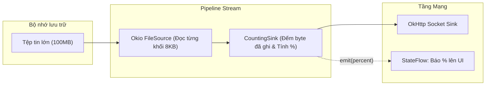

# Okio

> [!NOTE]
> Bản nháp: phần dưới đây là kiến thức chuyển từ [5.3 Networking](../../session_05/networking.md), nơi nó từng được dạy trước. Phần còn thiếu của Topic (`Buffer`, `ByteString`, `FileSystem`, đọc ghi file thường ngày) sẽ viết khi làm Session 08.

## Vấn đề cần giải quyết

Khi tải lên tệp tin lớn (ảnh độ phân giải cao, tài liệu KYC PDF, video), một sai lầm phổ biến là đọc toàn bộ nội dung file vào một mảng byte trong RAM:
```kotlin
// SAI LẦM TỰ SÁT BỘ NHỚ: Gây OutOfMemoryError ngay lập tức với file lớn!
val bytes = file.readBytes() // Đọc 100MB vào RAM của Android!
val body = bytes.toRequestBody("image/jpeg".toMediaTypeOrNull())
```

Ngoài việc không được nạp cả file vào RAM, màn hình upload thường cần hiện phần trăm đã gửi, nên app phải biết bao nhiêu byte đã thực sự được ghi ra socket.

## Sau khi học xong

- Giải thích được vì sao Okio đọc và ghi dữ liệu theo từng đoạn qua Source, Sink và Buffer thay vì nạp cả file vào RAM.
- Áp dụng được ForwardingSink để đếm số byte đã ghi và báo tiến độ upload.
- Triển khai được RequestBody stream file cho multipart upload mà không gây OutOfMemoryError.
- Nhận diện được các lỗi khi báo tiến độ (đọc cả file, writeTo bị gọi nhiều lần).

## Okio là gì?

**Okio** là thư viện I/O của Square mà OkHttp dùng bên dưới: dữ liệu đi qua `Source` (đọc) và `Sink` (ghi) theo từng đoạn trong `Buffer`, nên xử lý được file lớn mà không cần nạp cả file vào RAM.

Mental model: một **đường ống**. Dữ liệu chảy từ `Source` sang `Sink` từng đoạn một; muốn đo lượng nước chảy qua thì lắp thêm một đoạn ống có đồng hồ (`ForwardingSink`) vào giữa.

## Cách hoạt động

Để an toàn tuyệt đối, chúng ta phải đọc file theo từng khối đệm (Chunk Buffer) từ ổ cứng và truyền trực tiếp ra Socket. Đồng thời, bọc `BufferedSink` của OkHttp bằng một `ForwardingSink` để đếm số byte thực tế đã ghi.



## Ví dụ thực tế: upload file lớn có báo tiến độ

```kotlin
import okhttp3.MediaType
import okhttp3.RequestBody
import okio.Buffer
import okio.BufferedSink
import okio.ForwardingSink
import okio.Sink
import okio.buffer
import okio.source
import java.io.File

class CountingRequestBody(
    private val file: File,
    private val contentType: MediaType?,
    private val onProgressUpdate: (bytesWritten: Long, totalBytes: Long, percent: Int) -> Unit
) : RequestBody() {

    override fun contentType(): MediaType? = contentType

    override fun contentLength(): Long = file.length()

    override fun writeTo(sink: BufferedSink) {
        val totalBytes = contentLength()
        var bytesWritten = 0L

        // Bao bọc sink bằng ForwardingSink để đếm byte
        val countingSink = object : ForwardingSink(sink) {
            override fun write(source: Buffer, byteCount: Long) {
                super.write(source, byteCount)
                bytesWritten += byteCount
                val percent = ((bytesWritten * 100) / totalBytes).toInt()
                onProgressUpdate(bytesWritten, totalBytes, percent)
            }
        }

        // Dùng Okio buffer để stream dữ liệu từng chunk an toàn, không tốn RAM
        // Okio 2/3 dùng extension function: File.source(), Sink.buffer()
        file.source().use { source ->
            val bufferedSink = countingSink.buffer()
            bufferedSink.writeAll(source)
            bufferedSink.flush()
        }
    }
}
```

Dùng `CountingRequestBody` làm một part của request multipart:

```kotlin
val body = MultipartBody.Builder()
    .setType(MultipartBody.FORM)
    .addFormDataPart(
        "file", file.name,
        CountingRequestBody(file, "image/jpeg".toMediaType()) { _, _, percent ->
            progressFlow.value = percent // cập nhật StateFlow cho UI
        }
    )
    .build()
```

## Sai lầm thường gặp

### 1. Đọc toàn bộ file vào byte array để upload

**Triệu chứng:**
- `OutOfMemoryError` khi user upload file nặng trên máy RAM thấp.

**Nguyên nhân:**
- `file.readBytes()` nạp cả file vào heap trước khi gửi.

**Giải pháp:**
- Stream file bằng `file.source()` và `writeAll()`, như `CountingRequestBody` ở trên.

### 2. Tiến độ upload vượt 100% hoặc chạy hai lần

**Triệu chứng:**
- Thanh tiến độ chạy tới 100% rồi chạy lại từ đầu, hoặc vượt 100%.

**Nguyên nhân:**
- `writeTo()` có thể bị gọi nhiều lần cho cùng một request, ví dụ `HttpLoggingInterceptor` ở `Level.BODY` ghi body vào buffer để log, hoặc request được gửi lại.

**Giải pháp:**
- Tắt log body cho request upload, và reset bộ đếm ở đầu mỗi lần `writeTo()` (biến `bytesWritten` khai báo trong `writeTo`, như ở trên).

## Lịch sử phát triển

- **04/2014:** Okio 0.5.0, bản công khai đầu tiên.
- **27/08/2018:** Okio 2.0.0 chuyển code từ Java sang Kotlin; API dùng extension function như `File.source()`, `Sink.buffer()`.
- **28/10/2021:** Okio 3.0.0 hỗ trợ Kotlin Multiplatform, `FileSystem` hết trạng thái experimental.

## Kết nối hệ thống

- **8.1.3 OkHttp:** `RequestBody.writeTo(sink: BufferedSink)` là nơi OkHttp giao cho app một `Sink` của Okio để ghi body. Xem [OkHttp](okhttp.md).
- **5.3 Networking:** upload là một loại request; lỗi mạng giữa chừng xử lý theo phân loại lỗi và retry ở bài đó. Xem [5.3 Networking](../../session_05/networking.md).

## Nguồn tham khảo

- [Okio (GitHub)](https://github.com/square/okio)
- [Okio CHANGELOG](https://github.com/square/okio/blob/master/CHANGELOG.md)
