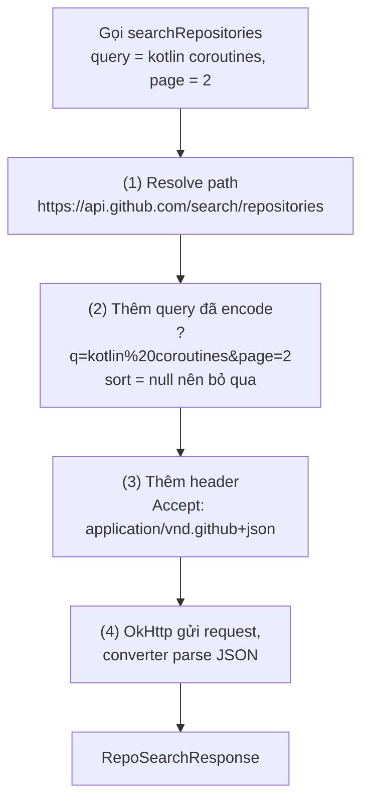
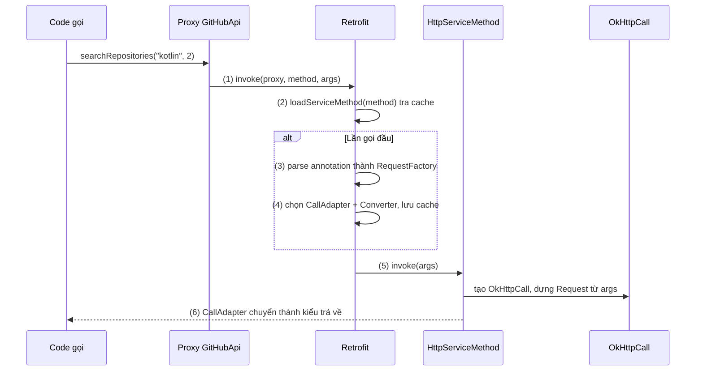
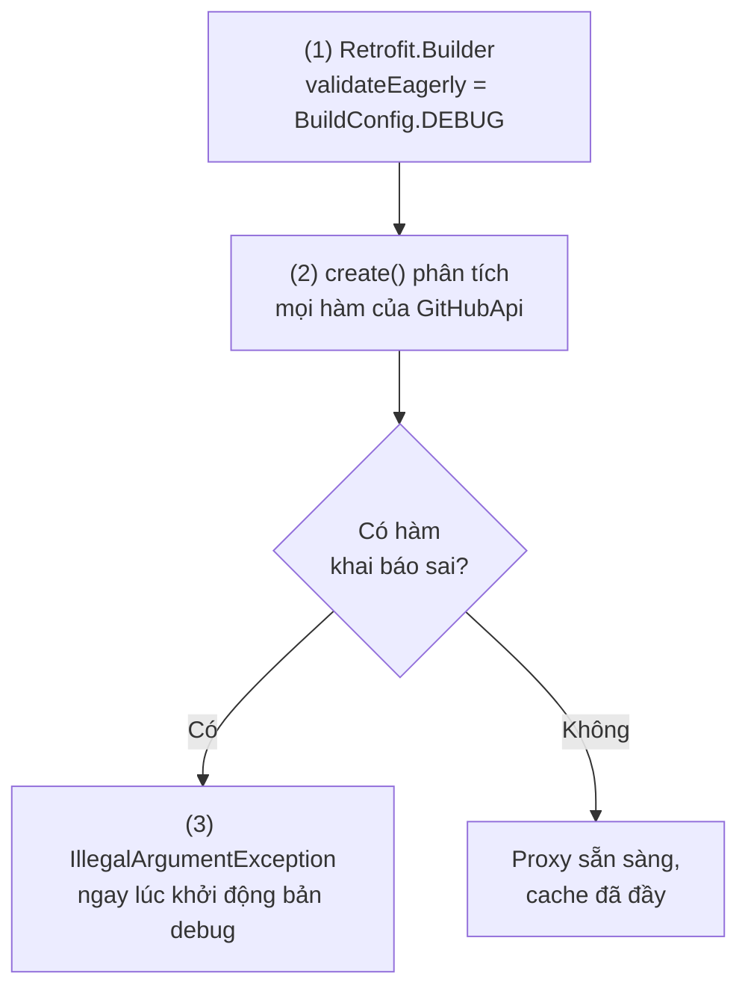
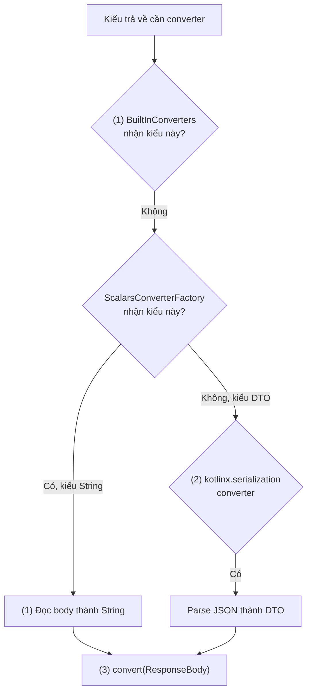
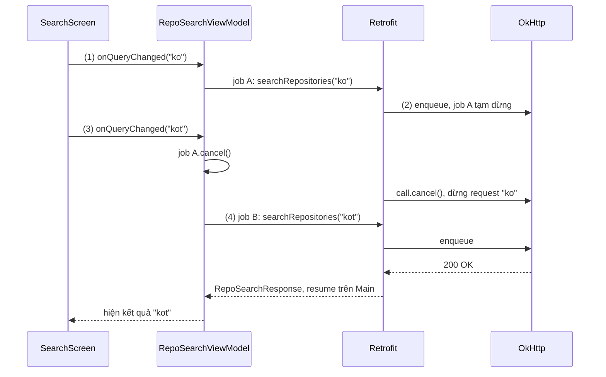
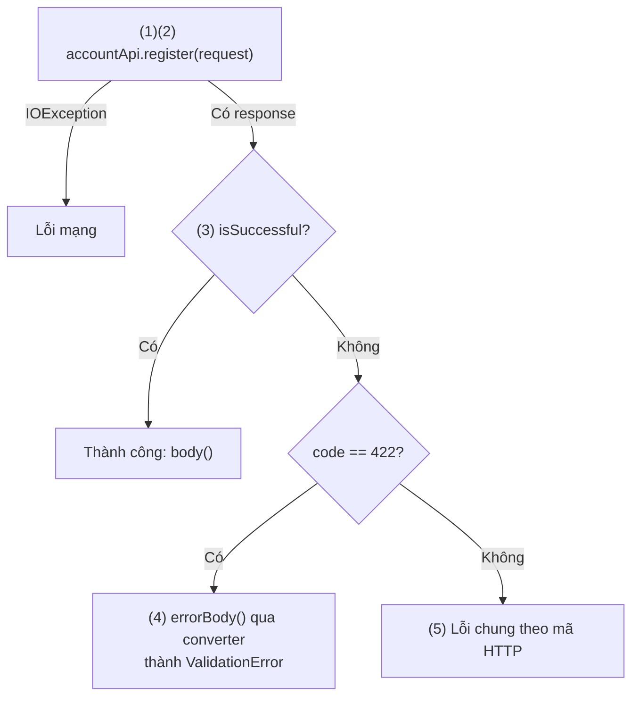
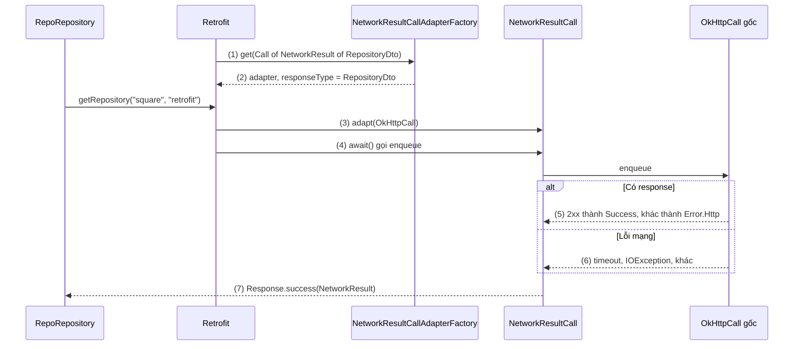

# Retrofit

## Vấn đề cần giải quyết

Một lời gọi API REST, khi viết thẳng bằng OkHttp, gồm nhiều bước lặp lại: ghép URL và query, mã hoá tham số, chuyển object thành JSON, gửi request, kiểm tra mã HTTP, đọc body và parse JSON ngược lại thành object:

```kotlin
// Gọi thẳng bằng OkHttp: mỗi endpoint lặp lại các bước này
val url = "https://api.github.com/search/repositories".toHttpUrl().newBuilder()
    .addQueryParameter("q", query)
    .addQueryParameter("page", page.toString())
    .build()
val request = Request.Builder().url(url).header("Accept", "application/vnd.github+json").build()
client.newCall(request).execute().use { response ->
    if (!response.isSuccessful) throw IOException("HTTP ${response.code}")
    val json = response.body!!.string()
    return Json.decodeFromString<RepoSearchResponse>(json)
}
```

App có 40 endpoint thì có 40 đoạn gần giống nhau, mỗi đoạn là một chỗ có thể quên mã hoá query, quên kiểm tra mã lỗi hoặc gọi `execute()` trên Main Thread. Thông tin quan trọng nhất (method, path, tham số, kiểu kết quả) chìm giữa code thủ tục.

Vấn đề cần giải quyết là: **mô tả API bằng khai báo ngắn gọn, có kiểu, và để một thư viện lo phần dựng request, gửi, và chuyển response thành object**, theo cùng một cách cho mọi endpoint.

Kiến thức nền của tầng mạng (Socket, TLS, phân loại lỗi, retry, Network Security Config) nằm ở [5.3 Networking](../../session_05/networking.md). Bài này chỉ dạy Retrofit.

## Sau khi học xong

- Giải thích được cách Retrofit biến một interface có annotation thành implementation bằng dynamic proxy và ServiceMethod.
- Triển khai được interface API với annotation HTTP, @Path, @Query, @Body, @Header và base URL đúng quy tắc.
- Phân biệt được vai trò của Converter.Factory và CallAdapter.Factory, và thứ tự đăng ký của chúng.
- Xử lý được kết quả của suspend function qua Response, HttpException, IOException và error body.
- Nhận diện được các lỗi thường gặp như base URL thiếu dấu gạch chéo, sai thứ tự converter và tạo Retrofit mới cho mỗi lời gọi.

## Retrofit là gì?

**Retrofit** là thư viện HTTP client type-safe của Square cho Android và JVM: bạn khai báo API dưới dạng một interface có annotation, Retrofit tạo implementation của interface đó lúc runtime bằng dynamic proxy, và mỗi hàm được phân tích một lần thành một `ServiceMethod` biết cách dựng request OkHttp và chuyển response thành kiểu trả về của hàm.

Mental model: **interface là bản mô tả API, Retrofit là trình dịch.** Trình dịch đọc bản mô tả của mỗi hàm một lần (method, path, tham số, kiểu trả về), ghi nhớ cách dịch, rồi dịch mọi lời gọi hàm sau đó thành request HTTP và dịch response ngược lại thành object Kotlin. Việc gửi request thật thuộc về OkHttp; việc đổi byte JSON thành object thuộc về converter.

Mọi request đi qua `OkHttpClient`, nên interceptor, connection pool, cache, timeout cấu hình ở [8.1.3 OkHttp](okhttp.md).

## Cách hoạt động

### Khai báo API bằng interface và annotation

Mỗi hàm trong interface mô tả một endpoint. Annotation trên hàm nói **method và path**; annotation trên tham số nói **giá trị đó đi vào phần nào của request**:

| Annotation | Đặt ở | Ý nghĩa |
|---|---|---|
| `@GET`, `@POST`, `@PUT`, `@PATCH`, `@DELETE` | Hàm | HTTP method và path tương đối |
| `@Path("name")` | Tham số | Thay `{name}` trong path, mặc định URL-encode |
| `@Query("name")`, `@QueryMap` | Tham số | Thêm `?name=value`; giá trị `null` thì bỏ qua tham số đó |
| `@Body` | Tham số | Object được converter chuyển thành request body |
| `@Header("name")`, `@Headers(...)` | Tham số / hàm | Header động / header cố định |
| `@FormUrlEncoded` + `@Field` | Hàm + tham số | Body dạng `application/x-www-form-urlencoded` |
| `@Multipart` + `@Part` | Hàm + tham số | Body `multipart/form-data` (upload file) |
| `@Url` | Tham số | Dùng URL đầy đủ truyền lúc gọi thay cho path |
| `@Streaming` | Hàm | Không đọc hết body vào bộ nhớ trước khi trả về |

Path trong annotation được **resolve theo base URL** giống cách trình duyệt resolve link tương đối (`HttpUrl.resolve`):

- Base URL phải kết thúc bằng `/`. `Retrofit.Builder.baseUrl()` ném `IllegalArgumentException` nếu đường dẫn base URL không kết thúc bằng `/`.
- Path không có `/` đầu (`"search/repositories"`) được nối **sau** base URL.
- Path có `/` đầu (`"/search/repositories"`) thay toàn bộ phần đường dẫn của base URL, chỉ giữ scheme và host.
- Path là URL đầy đủ (`"https://uploads.github.com/..."`) thay cả host.

#### Ví dụ: tìm kiếm repository trên GitHub

**Bài toán:** màn tìm kiếm gọi GitHub REST API để tìm repository theo từ khoá, có phân trang, và xem chi tiết một repository. Đây là bài toán điển hình có cả path parameter, query parameter và header cố định.

**Luồng chạy** khi gọi `searchRepositories(query = "kotlin coroutines", page = 2)`:

1. Lấy path tương đối từ `@GET("search/repositories")`, resolve theo base URL `https://api.github.com/`.
2. Mỗi `@Query` được URL-encode và nối vào query string: khoảng trắng thành `%20`, ra `?q=kotlin%20coroutines&page=2`. `sort` bằng `null` nên bị bỏ qua.
3. Header cố định trong `@Headers` được thêm vào request.
4. Request được giao cho OkHttp gửi; body JSON trả về được converter chuyển thành `RepoSearchResponse`.



```kotlin
// app/build.gradle.kts
plugins {
    id("org.jetbrains.kotlin.plugin.serialization") // sinh serializer cho @Serializable
}
dependencies {
    implementation("com.squareup.retrofit2:retrofit:3.0.0")
    implementation("com.squareup.retrofit2:converter-kotlinx-serialization:3.0.0")
    implementation("com.squareup.retrofit2:converter-scalars:3.0.0")
}
```

```kotlin
// GitHubApi.kt
interface GitHubApi {

    @Headers("Accept: application/vnd.github+json")                // (3) header cố định
    @GET("search/repositories")                                      // (1) path tương đối
    suspend fun searchRepositories(
        @Query("q") query: String,                                   // (2) ?q=...
        @Query("page") page: Int = 1,
        @Query("sort") sort: String? = null                          // (2) null thì bỏ qua
    ): RepoSearchResponse                                            // (4) converter parse

    @GET("repos/{owner}/{repo}")
    suspend fun getRepository(
        @Path("owner") owner: String,
        @Path("repo") repo: String
    ): RepositoryDto
}

// RepoSearchResponse.kt
@Serializable
data class RepoSearchResponse(
    @SerialName("total_count") val totalCount: Int,
    val items: List<RepositoryDto>
)

@Serializable
data class RepositoryDto(
    val id: Long,
    @SerialName("full_name") val fullName: String,
    val description: String? = null,
    @SerialName("stargazers_count") val stars: Int
)
```

```kotlin
// NetworkModule.kt
val json = Json { ignoreUnknownKeys = true }

val gitHubApi: GitHubApi = Retrofit.Builder()
    .baseUrl("https://api.github.com/")                              // kết thúc bằng "/"
    .client(okHttpClient)                                            // OkHttpClient dùng chung của app
    .addConverterFactory(json.asConverterFactory("application/json".toMediaType()))
    .build()
    .create(GitHubApi::class.java)
```

JSON trong ví dụ được parse bằng kotlinx.serialization; Retrofit nhận converter nào cũng được. Chi tiết về JSON, và vì sao dự án Kotlin mới thường chọn kotlinx.serialization hoặc Moshi thay vì Gson, nằm ở [8.1.2 Gson](gson.md).

**Kết quả:** gắn `HttpLoggingInterceptor` vào `okHttpClient` (cách gắn ở [8.1.3 OkHttp](okhttp.md)) rồi gọi hàm: log hiện đúng `GET https://api.github.com/search/repositories?q=kotlin%20coroutines&page=2`. Quy tắc `/` đầu xem lại ở sai lầm 1.

### Retrofit tạo implementation: dynamic proxy và ServiceMethod

Không ai viết class implement `GitHubApi`. `retrofit.create(GitHubApi::class.java)` trả về một **dynamic proxy** (`java.lang.reflect.Proxy`): class do JVM tạo lúc runtime, implement interface và chuyển **mọi** lời gọi hàm tới một `InvocationHandler` duy nhất.

Khi một hàm của proxy được gọi, Retrofit làm các bước sau:

1. `InvocationHandler.invoke(proxy, method, args)` nhận `Method` (đối tượng reflection mô tả hàm vừa gọi) và mảng tham số. Hàm của `Object` (`toString`, `equals`) và default method của interface được xử lý riêng, không thành request.
2. `loadServiceMethod(method)` tra cache (`ConcurrentHashMap<Method, ServiceMethod>`). Lần đầu gọi hàm này thì chưa có, phải phân tích.
3. Phân tích annotation của hàm và tham số thành `RequestFactory`: method, path template, tham số nào là `@Path`, `@Query`, `@Body`. Khai báo sai (`@Path("name")` mà path không có `{name}`, hai `@Body`, thiếu HTTP method) ném `IllegalArgumentException` ở bước này, kèm tên hàm.
4. Từ kiểu trả về, hỏi các `CallAdapter.Factory` và `Converter.Factory` đã đăng ký để chọn adapter và converter phù hợp (hai phần ngay sau). Kết quả là một `HttpServiceMethod`, được lưu vào cache.
5. `ServiceMethod.invoke(args)` tạo một `OkHttpCall` (bọc `okhttp3.Call`), dùng `RequestFactory` dựng `okhttp3.Request` từ `args`.
6. CallAdapter chuyển `OkHttpCall` thành kiểu trả về mà hàm khai báo: `Call<T>`, kết quả của `suspend fun`, `Single<T>` của RxJava…

Từ lần gọi thứ hai, bước 3–4 được bỏ qua nhờ cache: chi phí reflection chỉ trả **một lần cho mỗi hàm**.



Đoạn dưới là phần cốt lõi của `Retrofit.create()`, rút gọn và viết lại bằng Kotlin từ source Java của Retrofit để thấy cơ chế; không phải code để chép vào app:

```kotlin
// Rút gọn từ retrofit2.Retrofit.create() (source gốc viết bằng Java)
fun <T> create(service: Class<T>): T =
    Proxy.newProxyInstance(service.classLoader, arrayOf(service)) { proxy, method, args ->
        when {
            method.declaringClass == Any::class.java -> method.invoke(this, *(args ?: emptyArray())) // (1) toString, equals
            method.isDefault -> invokeDefaultMethod(method, service, proxy, args)                   // (1) default method
            else -> loadServiceMethod(service, method)                                              // (2)(3)(4) tra cache hoặc parse
                .invoke(proxy, args ?: emptyArray())                                                // (5)(6)
        }
    } as T
```

#### Ví dụ: phát hiện khai báo API sai ngay khi app debug khởi động

**Bài toán:** một developer thêm endpoint lấy danh sách issue, path có `{repo}` nhưng tham số lại ghi `@Path("repoName")`. Vì Retrofit chỉ phân tích hàm ở lần gọi đầu, lỗi chỉ lộ ra khi ai đó mở đúng màn hình issue, có thể là sau khi đã phát hành. Retrofit có tuỳ chọn `validateEagerly` để phân tích mọi hàm ngay trong `create()`.

**Luồng chạy:**

1. Bản debug bật `validateEagerly(true)`; bản release để mặc định `false` để không tốn thời gian khởi động.
2. `create()` duyệt mọi hàm của interface và chạy bước phân tích annotation cho từng hàm.
3. Hàm khai báo sai ném `IllegalArgumentException` ngay tại `create()`, app debug crash khi khởi động với thông báo chỉ đúng hàm sai.



```kotlin
// GitHubApi.kt (thêm hàm bị khai báo sai)
@GET("repos/{owner}/{repo}/issues")
suspend fun listIssues(
    @Path("owner") owner: String,
    @Path("repoName") repo: String                                   // sai: path là {repo}
): List<IssueDto>

// NetworkModule.kt
val gitHubApi: GitHubApi = Retrofit.Builder()
    .baseUrl("https://api.github.com/")
    .client(okHttpClient)
    .addConverterFactory(json.asConverterFactory("application/json".toMediaType()))
    .validateEagerly(BuildConfig.DEBUG)       // (1) chỉ bản debug
    .build()
    .create(GitHubApi::class.java)            // (2)(3) parse mọi hàm tại đây
```

`BuildConfig.DEBUG` cần bật `buildFeatures { buildConfig = true }` từ AGP 8; cách cấu hình theo Build Type ở [Build Types](../../session_04/android_manifest/package_build_gradle/build_types.md).

**Kết quả:** chạy bản debug, app crash ngay khi khởi tạo `GitHubApi` với thông báo dạng `URL "repos/{owner}/{repo}/issues" does not contain "{repoName}". (parameter #2) for method GitHubApi.listIssues`. Lỗi được sửa trước khi có ai mở màn hình issue. Retrofit kiểm tra tên trong `@Path` có trong URL, nhưng không kiểm tra chiều ngược lại: một `{placeholder}` không có `@Path` nào sẽ đi nguyên vào URL, nên vẫn cần test endpoint.

### Converter.Factory: chuyển đổi body và tham số

Retrofit chỉ biết `okhttp3.RequestBody` và `okhttp3.ResponseBody`. Mọi kiểu khác (`RepoSearchResponse`, `String`, `CreateIssueRequest`) cần một **Converter** (`Converter<F, T>`, một hàm `convert(F): T`). Converter được tạo bởi `Converter.Factory`, factory có ba hàm, mỗi hàm trả về converter nếu factory xử lý được kiểu đó, hoặc `null` nếu không:

| Hàm của factory | Chuyển | Dùng cho |
|---|---|---|
| `responseBodyConverter(type, …)` | `ResponseBody` → `T` | Kiểu trả về của hàm |
| `requestBodyConverter(type, …)` | `T` → `RequestBody` | Tham số `@Body`, `@Part` |
| `stringConverter(type, …)` | `T` → `String` | `@Path`, `@Query`, `@Header`, `@Field` |

Retrofit hỏi các factory **theo thứ tự đăng ký**, factory đầu tiên trả converter khác `null` thắng. Trước mọi factory bạn thêm là `BuiltInConverters`, xử lý sẵn `ResponseBody`, `RequestBody`, `Unit`/`Void` (bỏ qua body) và dùng `toString()` cho tham số `@Query`, `@Path`.

Converter JSON (Gson, Moshi, kotlinx.serialization) nhận **mọi** kiểu, kể cả `String`, nên converter chuyên một nhóm kiểu như `ScalarsConverterFactory` (`String`, kiểu nguyên thuỷ) phải đứng trước.

#### Ví dụ: một endpoint trả text thuần giữa các endpoint JSON

**Bài toán:** màn hình chào hiện một câu ngẫu nhiên từ `GET https://api.github.com/zen`, endpoint này trả `text/plain`, không phải JSON. Các endpoint còn lại vẫn trả JSON. Hàm `getZen()` khai báo kiểu `String`, nên converter nào nhận `String` trước sẽ quyết định kết quả.

**Luồng chạy:**

1. Lần đầu gọi `getZen()`, Retrofit hỏi `BuiltInConverters` rồi `ScalarsConverterFactory` cho kiểu `String`; Scalars nhận, trả converter đọc body thành chuỗi.
2. Lần đầu gọi `searchRepositories()`, Scalars trả `null` cho `RepoSearchResponse`, Retrofit hỏi tiếp converter kotlinx.serialization, converter này nhận.
3. Mỗi lần gọi, converter đã chọn chuyển `ResponseBody` thành kiểu trả về.



```kotlin
// GitHubApi.kt
@GET("zen")
suspend fun getZen(): String                                         // text/plain

// NetworkModule.kt
val gitHubApi: GitHubApi = Retrofit.Builder()
    .baseUrl("https://api.github.com/")
    .client(okHttpClient)
    .addConverterFactory(ScalarsConverterFactory.create())           // (1) đứng trước: chỉ nhận String, primitive
    .addConverterFactory(json.asConverterFactory("application/json".toMediaType())) // (2) nhận phần còn lại
    .build()
    .create(GitHubApi::class.java)
```

**Kết quả:** `getZen()` trả câu dạng `Design for failure.`. Đảo thứ tự hai dòng `addConverterFactory` thì converter JSON nhận `String` trước và cố parse `Design for failure.` như JSON, lời gọi ném exception của kotlinx.serialization (`SerializationException`) dù server trả 200.

### CallAdapter và suspend function

Converter quyết định **body** thành kiểu gì; **CallAdapter** quyết định **lời gọi** được trả về dưới hình thức nào. Lõi của Retrofit luôn làm việc với `Call<T>` (một request có thể chạy đồng bộ bằng `execute()` hoặc bất đồng bộ bằng `enqueue(callback)`, và huỷ được bằng `cancel()`). `CallAdapter.Factory` chuyển `Call<T>` thành kiểu trả về bạn khai báo:

| Kiểu trả về | Ai xử lý | Ghi chú |
|---|---|---|
| `Call<T>` | `DefaultCallAdapterFactory` (có sẵn) | Trên Android, callback của `enqueue` chạy trên Main Thread |
| `suspend fun …(): T` / `Response<T>` | Retrofit tự xử lý (từ 2.6.0) | Không cần thêm factory |
| `Single<T>`, `Observable<T>` | `RxJava3CallAdapterFactory` (`adapter-rxjava3`) | RxJava học ở [8.4.4 RxJava, RxAndroid, RxKotlin](../async_threads/rxjava.md) |
| Kiểu tuỳ biến (vd `NetworkResult<T>`) | `CallAdapter.Factory` bạn tự viết | Xem "Ví dụ thực tế" |

> [!NOTE]
> Kiến thức dùng trước: coroutine (đoạn code có thể tạm dừng ở hàm `suspend` mà không chặn thread) được học ở [8.4.3 Coroutines](../async_threads/coroutines.md); `viewModelScope` ở [ViewModel](../../session_06/viewmodel.md). Ở đây chỉ dùng `launch`, `cancel` và gọi hàm `suspend`.

Với `suspend fun`, CHANGELOG của Retrofit 2.6.0 mô tả: bên dưới hàm hoạt động như thể được khai báo trả `Call<T>` rồi gọi `Call.enqueue`. Cụ thể:

1. Trình biên dịch Kotlin thêm một tham số `Continuation` vào cuối hàm; Retrofit nhận ra tham số này khi phân tích và biết đây là hàm suspend.
2. Retrofit tạo `Call<T>` như bình thường, rồi gọi hàm mở rộng `await()` bọc trong `suspendCancellableCoroutine`: coroutine tạm dừng, thread hiện tại (kể cả Main) được trả lại.
3. `await()` gọi `call.enqueue(...)`: OkHttp chạy request trên thread pool của nó.
4. Response về: `await()` resume coroutine với body (2xx) hoặc với exception. Coroutine chạy tiếp trên dispatcher của nó, ví dụ Main.
5. Coroutine bị huỷ trong lúc chờ: `invokeOnCancellation` gọi `call.cancel()`, OkHttp đóng kết nối của request đó.

Vì vậy gọi hàm suspend của Retrofit từ Main Thread là **an toàn**, không cần bọc `withContext(Dispatchers.IO)`.

#### Ví dụ: huỷ request cũ khi người dùng gõ tìm kiếm

**Bài toán:** ô tìm kiếm repository gọi API sau mỗi lần người dùng ngừng gõ 300 ms. Người dùng gõ "ko" rồi gõ tiếp "kot": kết quả của "ko" không còn cần, request đó phải dừng thật ở tầng mạng, và kết quả cũ không được ghi đè kết quả mới.

**Luồng chạy:**

1. Người dùng gõ "ko": ViewModel `launch` job A, chờ 300 ms rồi gọi `searchRepositories("ko")`.
2. Retrofit `enqueue` request; job A tạm dừng, Main Thread rảnh.
3. Người dùng gõ "kot": ViewModel huỷ job A. Retrofit nhận tín hiệu huỷ và gọi `call.cancel()`, OkHttp dừng request "ko".
4. Job B chạy với "kot"; response về, job B resume trên Main và cập nhật UI.



```kotlin
// RepoSearchViewModel.kt
class RepoSearchViewModel(private val api: GitHubApi) : ViewModel() {

    private val _results = MutableLiveData<List<RepositoryDto>>()
    val results: LiveData<List<RepositoryDto>> = _results
    private var searchJob: Job? = null

    fun onQueryChanged(query: String) {
        searchJob?.cancel()                                          // (3) huỷ job cũ → Retrofit gọi call.cancel()
        if (query.isBlank()) return
        searchJob = viewModelScope.launch {                          // (1) job mới
            delay(300)                                               // chờ người dùng ngừng gõ
            val response = api.searchRepositories(query)             // (2) tạm dừng, không chặn Main
            _results.value = response.items                          // (4) resume trên Main
        }
    }
}
```

Xử lý lỗi nằm ở phần ngay sau; debounce và kết hợp nhiều nguồn viết bằng Flow gọn hơn, học ở [7.1.4.2 Flow](../../session_07/design_pattern/observer/flow.md).

**Kết quả:** gõ nhanh "k", "ko", "kot": log của `HttpLoggingInterceptor` chỉ hiện một request hoàn tất cho "kot"; request nào kịp gửi trước đó kết thúc bằng `<-- HTTP FAILED: java.io.IOException: Canceled`. Danh sách luôn ứng với từ khoá cuối cùng.

### Response, HttpException và xử lý lỗi

Một lời gọi Retrofit kết thúc theo một trong bốn cách. Kiểu trả về bạn khai báo quyết định mỗi cách lộ ra thế nào:

| Kết cục | `suspend fun …(): T` | `suspend fun …(): Response<T>` |
|---|---|---|
| Server trả 2xx, body hợp lệ | Trả `T` | `isSuccessful = true`, `body()` là `T` |
| Server trả mã khác 2xx | Ném `HttpException` (có `code()`, `response()`) | `isSuccessful = false`, `errorBody()` chứa body lỗi |
| Lỗi mạng (timeout, mất kết nối) | Ném `IOException` | Ném `IOException` |
| Body sai định dạng | Ném exception của converter | Ném exception của converter |

Vài chi tiết quan trọng:

- `HttpException` là `RuntimeException`; không bắt thì crash.
- `Response<T>` cho đọc mã HTTP, header (`ETag`, `Link` phân trang) và `errorBody()`. Body lỗi đã được buffer nên đọc được sau khi response về, nhưng chỉ **một lần**.
- Server trả 204/205 cho hàm khai báo kiểu non-null (`T` không phải `Unit`): body là `null`, hàm suspend ném `KotlinNullPointerException`. Endpoint không có body nên khai báo `Unit` (hỗ trợ làm kiểu response từ 2.10.0) hoặc `Response<Unit>`.
- Phân loại lỗi cho toàn app (`NetworkResult`, `safeApiCall`, thứ tự `catch`, không nuốt `CancellationException`) ở [5.3 Networking](../../session_05/networking.md), mục "Chuẩn hóa Error Handling & Result Pattern trong Clean Architecture".

#### Ví dụ: hiển thị lỗi validation khi đăng ký tài khoản

**Bài toán:** form đăng ký gửi `POST /v1/accounts`. Server trả `201` khi thành công, hoặc `422` kèm JSON `{"field": "email", "message": "Email đã được sử dụng"}`. App phải hiện lỗi đúng dưới ô email, nên cần đọc **body của response lỗi**, không chỉ mã 422.

**Luồng chạy:**

1. Hàm khai báo trả `Response<AccountDto>` để lỗi HTTP không bị ném thành `HttpException`.
2. Gọi API; lỗi mạng vẫn là `IOException`, bắt riêng.
3. `isSuccessful` (mã 200–299): lấy `body()`.
4. Mã 422: lấy converter của Retrofit cho `ValidationError`, chuyển `errorBody()` thành object.
5. Mã khác: trả lỗi chung theo mã.



```kotlin
// AccountApi.kt
interface AccountApi {
    @POST("v1/accounts")
    suspend fun register(@Body request: RegisterRequest): Response<AccountDto> // (1)
}

@Serializable data class RegisterRequest(val email: String, val password: String)
@Serializable data class AccountDto(val id: String, val email: String)
@Serializable data class ValidationError(val field: String, val message: String)

sealed interface RegisterResult {
    data class Success(val account: AccountDto) : RegisterResult
    data class Invalid(val field: String, val message: String) : RegisterResult
    data class Failed(val reason: String) : RegisterResult
}

// AccountRepository.kt
class AccountRepository(private val api: AccountApi, private val retrofit: Retrofit) {

    private val errorConverter: Converter<ResponseBody, ValidationError> =
        retrofit.responseBodyConverter(ValidationError::class.java, arrayOf()) // converter JSON đã đăng ký

    suspend fun register(email: String, password: String): RegisterResult {
        val response = try {
            api.register(RegisterRequest(email, password))                     // (2)
        } catch (e: IOException) {
            return RegisterResult.Failed("Không có kết nối mạng")
        }
        return when {
            response.isSuccessful -> response.body()                           // (3)
                ?.let { RegisterResult.Success(it) }
                ?: RegisterResult.Failed("Phản hồi rỗng")
            response.code() == 422 -> {                                        // (4)
                val error = response.errorBody()?.let { body ->
                    runCatching { errorConverter.convert(body) }.getOrNull()
                }
                if (error != null) RegisterResult.Invalid(error.field, error.message)
                else RegisterResult.Failed("Dữ liệu không hợp lệ")
            }
            else -> RegisterResult.Failed("Lỗi máy chủ (${response.code()})")  // (5)
        }
    }
}
```

**Kết quả:** đăng ký bằng email đã tồn tại → `RegisterResult.Invalid("email", "Email đã được sử dụng")`, UI đặt lỗi dưới ô email. Test cả bốn nhánh bằng MockWebServer trả `201`, `422` với body JSON, `500`, và `SocketPolicy` ngắt kết nối, theo [10.2 Unit Testing](../../coding_analyst_and_testing/unit_testing.md).

## Ví dụ thực tế

### CallAdapter trả thẳng `NetworkResult<T>`

**Bài toán:** với `safeApiCall` ở [5.3 Networking](../../session_05/networking.md), mỗi Repository phải nhớ bọc từng lời gọi; quên một chỗ là `HttpException` lọt lên UI. Một `CallAdapter.Factory` tuỳ biến cho phép khai báo `suspend fun ...(): NetworkResult<T>` **không bao giờ ném lỗi HTTP hay lỗi mạng**.

**Luồng chạy:**

1. Khi phân tích hàm `suspend fun getRepository(...): NetworkResult<RepositoryDto>`, Retrofit coi kiểu cần adapt là `Call<NetworkResult<RepositoryDto>>` và hỏi các factory. Factory tự viết nhận vì kiểu bên trong `Call` là `NetworkResult`.
2. Factory báo cho Retrofit `responseType()` là `RepositoryDto`, để Retrofit chọn converter JSON cho đúng kiểu body.
3. Adapter bọc `Call<RepositoryDto>` gốc thành `NetworkResultCall`.
4. Khi coroutine `await()` gọi `enqueue`, `NetworkResultCall` chuyển tiếp xuống call gốc.
5. Response về: 2xx thành `Success`, mã khác thành `Error.Http` kèm `errorBody`.
6. Lỗi mạng: `SocketTimeoutException` thành `NetworkTimeout`, `IOException` khác thành `NoInternet`, còn lại `Unknown`.
7. Cả hai nhánh đều trả về `Response.success(result)`, nên hàm suspend luôn trả một `NetworkResult`. Huỷ coroutine vẫn đi qua `cancel()` xuống OkHttp như bình thường.



```kotlin
// NetworkResultCallAdapterFactory.kt
// NetworkResult là sealed interface ở 5.3 Networking
class NetworkResultCallAdapterFactory : CallAdapter.Factory() {
    override fun get(
        returnType: Type,
        annotations: Array<out Annotation>,
        retrofit: Retrofit
    ): CallAdapter<*, *>? {
        if (getRawType(returnType) != Call::class.java) return null              // (1) hàm suspend được nhìn như Call<...>
        val callType = getParameterUpperBound(0, returnType as ParameterizedType)
        if (getRawType(callType) != NetworkResult::class.java) return null       // (1) không phải NetworkResult: để factory khác
        val bodyType = getParameterUpperBound(0, callType as ParameterizedType)  // (2) RepositoryDto
        return NetworkResultCallAdapter<Any>(bodyType)
    }
}

private class NetworkResultCallAdapter<T : Any>(
    private val bodyType: Type
) : CallAdapter<T, Call<NetworkResult<T>>> {
    override fun responseType(): Type = bodyType                                 // (2) converter chọn theo kiểu này
    override fun adapt(call: Call<T>): Call<NetworkResult<T>> = NetworkResultCall(call, bodyType) // (3)
}

private class NetworkResultCall<T : Any>(
    private val delegate: Call<T>,
    private val bodyType: Type
) : Call<NetworkResult<T>> {

    override fun enqueue(callback: Callback<NetworkResult<T>>) {
        delegate.enqueue(object : Callback<T> {                                   // (4)
            override fun onResponse(call: Call<T>, response: Response<T>) {
                val body = response.body()
                @Suppress("UNCHECKED_CAST")
                val result: NetworkResult<T> = when {                             // (5)
                    response.isSuccessful && body != null -> NetworkResult.Success(body)
                    response.isSuccessful && bodyType == Unit::class.java -> NetworkResult.Success(Unit as T) // 204
                    response.isSuccessful -> NetworkResult.Error.Unknown(IllegalStateException("Body rỗng"))
                    else -> NetworkResult.Error.Http(
                        code = response.code(),
                        message = response.message(),
                        errorBody = response.errorBody()?.string()
                    )
                }
                callback.onResponse(this@NetworkResultCall, Response.success(result)) // (7)
            }

            override fun onFailure(call: Call<T>, t: Throwable) {
                val result = when (t) {                                           // (6)
                    is SocketTimeoutException -> NetworkResult.Error.NetworkTimeout()
                    is IOException -> NetworkResult.Error.NoInternet()
                    else -> NetworkResult.Error.Unknown(t)
                }
                callback.onResponse(this@NetworkResultCall, Response.success(result)) // (7)
            }
        })
    }

    override fun execute(): Response<NetworkResult<T>> =
        throw UnsupportedOperationException("Chỉ dùng với suspend hoặc enqueue")
    override fun clone(): Call<NetworkResult<T>> = NetworkResultCall(delegate.clone(), bodyType)
    override fun isExecuted(): Boolean = delegate.isExecuted
    override fun cancel() = delegate.cancel()                                    // (7) huỷ coroutine → huỷ OkHttp
    override fun isCanceled(): Boolean = delegate.isCanceled
    override fun request(): Request = delegate.request()
    override fun timeout(): Timeout = delegate.timeout()
}
```

```kotlin
// GitHubApi.kt
@GET("repos/{owner}/{repo}")
suspend fun getRepository(
    @Path("owner") owner: String,
    @Path("repo") repo: String
): NetworkResult<RepositoryDto>

// NetworkModule.kt
Retrofit.Builder()
    .baseUrl("https://api.github.com/")
    .client(okHttpClient)
    .addCallAdapterFactory(NetworkResultCallAdapterFactory())
    .addConverterFactory(json.asConverterFactory("application/json".toMediaType()))
    .build()
```

**Kết quả:** `when (val result = api.getRepository("square", "retrofit"))` trong Repository nhận đủ các nhánh `Success`, `Error.Http`, `NoInternet`… mà không có `try-catch`. Tắt mạng → `NoInternet`; đổi tên repo thành tên không tồn tại → `Error.Http(code = 404, …)`. Lưu ý: lỗi parse JSON xảy ra trong converter, được OkHttpCall báo qua `onFailure`, nên rơi vào `Unknown`; muốn tách riêng thì thêm nhánh cho exception của converter đang dùng (`SerializationException` với kotlinx.serialization, `JsonSyntaxException` với Gson).

### Các bài toán khác

- **Upload ảnh đại diện:** `@Multipart @POST("v1/me/avatar") suspend fun uploadAvatar(@Part avatar: MultipartBody.Part): AvatarDto`; báo tiến độ bằng `ForwardingSink` ở [8.1.4 Okio](okio.md).
- **Tải file lớn:** `@Streaming @GET suspend fun download(@Url url: String): ResponseBody` trả body chưa đọc; ghi xuống file bằng Okio trong `withContext(Dispatchers.IO)` vì đọc stream là thao tác blocking.
- **Token đăng nhập:** cần ở mọi request nên đặt trong interceptor và `Authenticator` của OkHttp ([8.1.3 OkHttp](okhttp.md)), không thêm `@Header("Authorization")` vào từng hàm.

## So sánh với các cách tiếp cận khác

- **OkHttp trực tiếp:** không có lớp khai báo, mỗi request là code thủ tục dựng `Request`; hợp với vài request đặc biệt (WebSocket, Server-Sent Events).
- **Ktor Client:** API là hàm Kotlin thường (`client.get(url) { parameter(...) }`), không dynamic proxy, chạy trên Kotlin Multiplatform với engine thay được. Cách chọn giữa nó và Retrofit ở [8.1.5 Ktor and Apollo Android](ktor_apollo.md).

## Khi nào nên và không nên dùng

**Nên dùng khi** app Android gọi REST API có nhiều endpoint và muốn khai báo ngắn, có kiểu; cần đổi cách parse (Gson, Moshi, kotlinx.serialization, Protobuf) hoặc hình thức trả về (suspend, RxJava, kiểu tuỳ biến) mà không sửa từng endpoint; muốn giữ interceptor, cache, pinning sẵn có của OkHttp.

**Không nên dùng khi:**

- Tầng mạng phải chạy chung Android và iOS bằng Kotlin Multiplatform: Retrofit chỉ chạy trên JVM, chọn Ktor Client.
- API là GraphQL: dùng Apollo Kotlin ([8.1.5 Ktor and Apollo Android](ktor_apollo.md)).
- Chỉ cần WebSocket hoặc vài request đặc biệt: dùng OkHttp trực tiếp.

## Sai lầm thường gặp

### 1. Base URL thiếu `/` cuối, hoặc path có `/` đầu

```kotlin
// Sai
Retrofit.Builder().baseUrl("https://api.example.com/v2")      // thiếu "/" cuối
// Sai kín hơn: base URL đúng, path có "/" đầu
// baseUrl("https://api.example.com/v2/") + @GET("/products") → https://api.example.com/products
```

**Lỗi lộ ra thế nào:** trường hợp đầu ném `IllegalArgumentException: baseUrl must end in /` ngay khi build. Trường hợp sau không có lỗi nào, request đi tới `/products` thay vì `/v2/products`, server trả 404 hoặc tệ hơn là trả dữ liệu của API phiên bản cũ.

**Cách sửa:** base URL luôn kết thúc bằng `/`, path trong annotation không bắt đầu bằng `/` trừ khi thật sự muốn bỏ đường dẫn của base URL.

### 2. Converter JSON đứng trước converter chuyên biệt

```kotlin
// Sai: converter JSON nhận cả String
.addConverterFactory(GsonConverterFactory.create())
.addConverterFactory(ScalarsConverterFactory.create())
```

**Lỗi lộ ra thế nào:** endpoint trả text (`suspend fun getZen(): String`) ném lỗi parse của Gson (`JsonSyntaxException` hoặc `JsonIOException`) dù server trả 200.

**Cách sửa:** factory chỉ nhận một nhóm kiểu (Scalars, Protobuf, Wire) đăng ký trước; converter JSON nhận mọi kiểu đăng ký cuối cùng.

### 3. Dùng `Response<T>` nhưng không kiểm tra `isSuccessful`

```kotlin
// Sai
val products = api.getProducts().body()!!   // Response<List<ProductDto>>
```

**Lỗi lộ ra thế nào:** server trả 500 hay 401 thì không có exception nào ở dòng gọi API, nhưng `body()` là `null` và `!!` ném `NullPointerException`, stack trace không nói gì về lỗi HTTP.

**Cách sửa:** chỉ khai báo `Response<T>` khi cần mã, header hoặc `errorBody()`, và luôn rẽ nhánh theo `isSuccessful` như ví dụ đăng ký. Không cần những thứ đó thì khai báo `T` và xử lý `HttpException`.

### 4. Tạo `Retrofit` (và `OkHttpClient`) mới cho mỗi lời gọi

```kotlin
// Sai: mỗi lần gọi một instance mới
suspend fun loadProfile() = Retrofit.Builder()
    .baseUrl(BASE_URL)
    .addConverterFactory(converter)
    .build()
    .create(ProfileApi::class.java)
    .getProfile()
```

**Lỗi lộ ra thế nào:** mỗi instance `Retrofit` có cache `ServiceMethod` riêng, nên lời gọi nào cũng trả lại chi phí reflection của lần đầu. Kèm `OkHttpClient` mới thì còn mất connection pool ([8.1.3 OkHttp](okhttp.md), sai lầm 1).

**Cách sửa:** tạo một `Retrofit` cho mỗi base URL, một service cho mỗi interface, giữ ở phạm vi app (object singleton hoặc DI; Hilt học ở [7.1.5.3 Hilt](../../session_07/design_pattern/di/hilt.md)).

### 5. Bản release R8 làm mất kiểu generic

```kotlin
// Chạy tốt ở debug, crash ở release đã bật minify
suspend fun getRepositories(): List<RepositoryDto>
```

**Lỗi lộ ra thế nào:** bản release crash khi gọi hàm suspend với lỗi dạng `ClassCastException: java.lang.Class cannot be cast to java.lang.reflect.ParameterizedType`, hoặc field của DTO bị `null`. R8 ở full mode (mặc định từ AGP 8.0) xoá thông tin generic signature hoặc class mà nó nghĩ không được dùng, trong khi Retrofit cần đọc chúng bằng reflection.

**Cách sửa:** dùng Retrofit bản mới (rule R8 đi kèm thư viện và được bổ sung qua các bản 2.5.0, 2.6.0, 2.10.0); giữ class DTO theo hướng dẫn của thư viện JSON đang dùng ([8.1.2 Gson](gson.md), mục R8). Luôn chạy thử bản release đã minify trước khi phát hành; cấu hình R8 theo Build Type ở [Build Types](../../session_04/android_manifest/package_build_gradle/build_types.md).

## Lịch sử phát triển

- **Retrofit 1.0 (05/2013):** Square phát hành Retrofit với `RestAdapter`, interface annotation, callback và gọi đồng bộ. HTTP client có thể thay (OkHttp, `HttpURLConnection`, Apache).
- **Retrofit 2.0.0 (03/2016):** viết lại trên OkHttp, giới thiệu `Call<T>` (vừa đồng bộ vừa bất đồng bộ, huỷ được), tách converter thành module riêng (từ đây không còn Gson mặc định) và thêm `CallAdapter` để hỗ trợ RxJava. Package đổi thành `retrofit2` để chạy song song với bản 1.
- **2.5.0 (11/2018):** hỗ trợ `Unit` của Kotlin, đưa rule R8 vào jar, gắn `Invocation` làm tag của OkHttp `Call`.
- **2.6.0 (06/2019):** hỗ trợ `suspend fun`, hoạt động như `Call<T>` + `enqueue`; có thể trả `Response<T>` để đọc metadata. Thêm rule giữ interface Retrofit cho R8 full mode.
- **2.7.0 (12/2019):** yêu cầu tối thiểu Java 8 hoặc Android 5 (API 21).
- **2.10.0 (03/2024):** `Unit` dùng được làm kiểu response, converter kotlinx.serialization trở thành module chính thức (`converter-kotlinx-serialization`), thêm BOM và rule R8 cho generic signature.
- **3.0.0 (05/2025):** nâng OkHttp từ 3.14 lên 4.12 (kéo theo Kotlin stdlib), vẫn tương thích nhị phân với 2.x và giữ groupId `com.squareup.retrofit2`. Tại thời điểm viết (11/2026), README của Retrofit ghi 3.0.0 là bản mới nhất.

## Kết nối hệ thống

- **Tiên quyết:**
  - [5.3 Networking](../../session_05/networking.md): Socket, TLS, phân loại lỗi, retry, `NetworkResult` và `safeApiCall` dùng lại trong bài.
  - [Kotlin](../../session_01/languages/kotlin.md): interface, annotation, `data class`, nullable type.
- **Liên quan:**
  - [8.1.2 Gson](gson.md): chuyển JSON thành object; so sánh Gson, Moshi, kotlinx.serialization để chọn converter.
  - [8.1.3 OkHttp](okhttp.md): tầng gửi request bên dưới Retrofit; interceptor, `Authenticator`, cache, connection pool.
  - [8.1.4 Okio](okio.md): stream bên dưới body, upload/download file lớn có tiến độ.
  - [8.1.5 Ktor and Apollo Android](ktor_apollo.md): lựa chọn thay Retrofit cho KMP và GraphQL.
  - [ViewModel](../../session_06/viewmodel.md): `viewModelScope` dùng trong ví dụ huỷ tìm kiếm.
  - [10.2 Unit Testing](../../coding_analyst_and_testing/unit_testing.md): test interface Retrofit bằng MockWebServer thay vì mock interface.
- **Học tiếp:**
  - [8.4.3 Coroutines](../async_threads/coroutines.md): cơ chế của `suspend`, huỷ coroutine, dispatcher.
  - [8.4.4 RxJava, RxAndroid, RxKotlin](../async_threads/rxjava.md): Retrofit với `adapter-rxjava3`.
  - [7.1.4.2 Flow](../../session_07/design_pattern/observer/flow.md): biến lời gọi Retrofit thành luồng dữ liệu (debounce tìm kiếm, kết hợp nhiều nguồn).
  - [7.1.5.3 Hilt](../../session_07/design_pattern/di/hilt.md): cung cấp `Retrofit` và service dạng singleton.

## Tham khảo

- [Retrofit - README (yêu cầu tối thiểu, R8/ProGuard, bản mới nhất) - GitHub](https://github.com/square/retrofit)
- [Retrofit CHANGELOG (mốc 1.0, 2.0.0, 2.5.0, 2.6.0, 2.7.0, 2.10.0, 3.0.0) - GitHub](https://github.com/square/retrofit/blob/trunk/CHANGELOG.md)
- [Retrofit source: Retrofit.create, HttpServiceMethod, KotlinExtensions - GitHub](https://github.com/square/retrofit/tree/trunk/retrofit/src/main/java/retrofit2)
- [Retrofit website (trang tài liệu mà README của repo trỏ tới; square.github.io/retrofit hiện trả 404)](https://lysine.dev/retrofit/)
- [java.lang.reflect.Proxy - Java SE Documentation](https://docs.oracle.com/en/java/javase/17/docs/api/java.base/java/lang/reflect/Proxy.html)
- [Shrink, obfuscate, and optimize your app (R8 full mode) - Android Developers](https://developer.android.com/build/shrink-code)
- [GitHub REST API: Search repositories - GitHub Docs](https://docs.github.com/en/rest/search/search#search-repositories)
