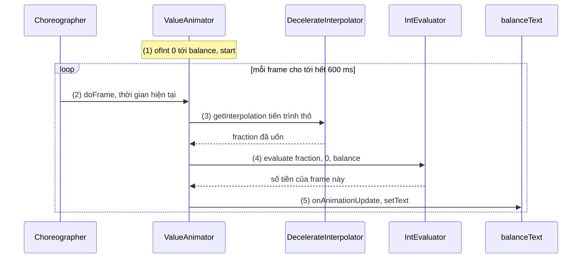
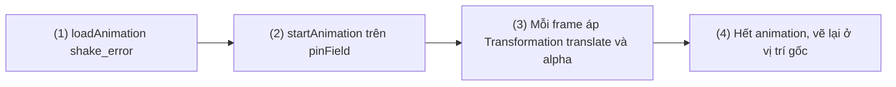
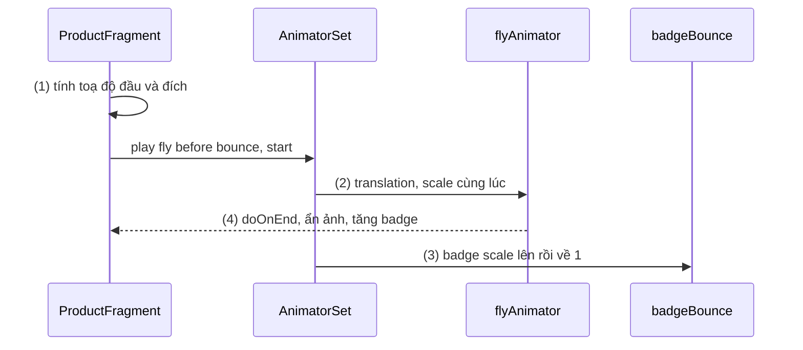
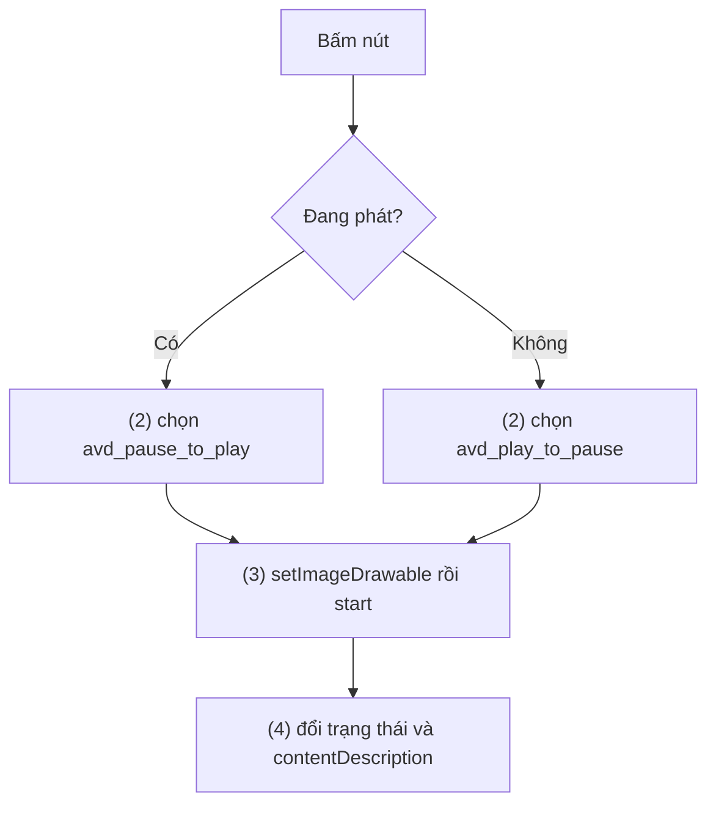
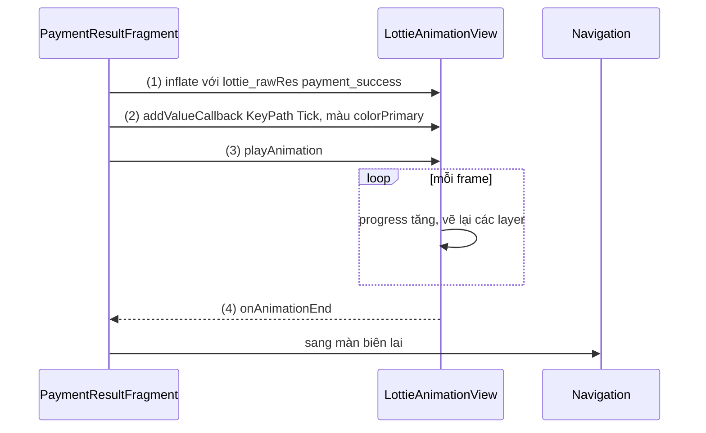
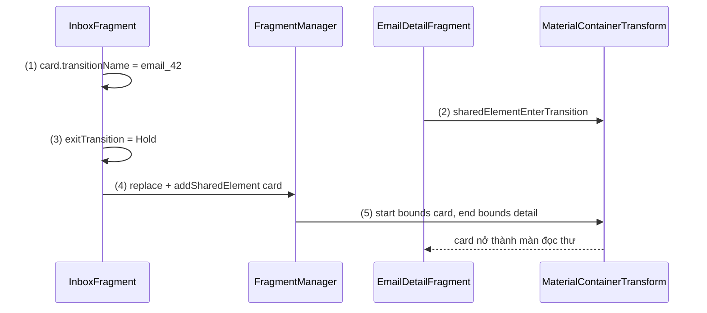
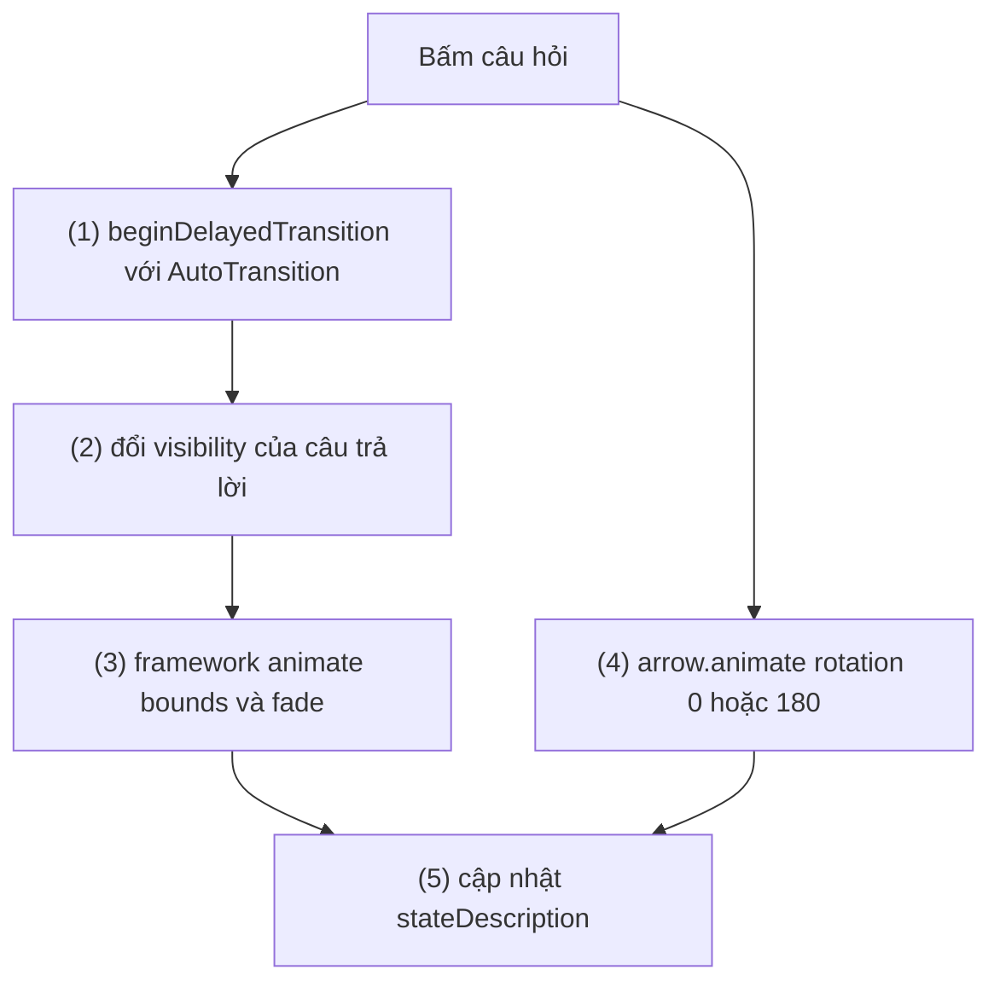

# Animation (Animator, Lottie, Material Motion, AnimationSet)

## Vấn đề cần giải quyết

Khi UI đổi trạng thái tức thì, người dùng phải tự đoán chuyện gì vừa xảy ra: mục vừa biến mất là bị xoá hay bị lọc, màn chi tiết mở ra từ mục nào. Chuyển động trả lời các câu hỏi đó: nó cho thấy **cái gì thay đổi, đến từ đâu, đi về đâu**. Nhưng chuyển động cũng dễ làm sai:

```kotlin
// "Animation" kiểu tự chế: chặn main thread, không theo nhịp vẽ màn hình
for (step in 0..100) {
    cartBadge.translationY = -step / 5f
    Thread.sleep(3)   // main thread bị chặn, màn hình không vẽ được frame nào cho tới khi xong
}
```

Main thread bị chặn nên màn hình chỉ vẽ trạng thái cuối. Muốn chuyển động mượt, giá trị phải được đổi **đúng lúc màn hình chuẩn bị vẽ frame tiếp theo**. Thêm vào đó, Android có nhiều API animation, mỗi cái đổi một thứ khác nhau; chọn sai thì nút đã "bay" sang chỗ mới nhưng vùng bấm vẫn ở chỗ cũ, hoặc list giật vì mỗi frame phải đo lại layout.

Vấn đề cần giải quyết là: **hiểu cơ chế chung của mọi animation trên Android, mỗi API đổi cái gì, và chọn API đúng cho từng loại chuyển động.**

## Sau khi học xong

- Giải thích được animation là giá trị được tính lại mỗi frame qua interpolator và evaluator, và vì sao View Animation chỉ đổi chỗ vẽ còn Property Animation đổi property thật.
- Triển khai được animation bằng ValueAnimator, ObjectAnimator, AnimatorSet và ViewPropertyAnimator với interpolator phù hợp.
- Áp dụng được AnimatedVectorDrawable, Lottie và các pattern Material Motion cho đúng loại chuyển động.
- Biết khi nào dùng Transition framework, MotionLayout hay animator tự viết, và cách tôn trọng cài đặt tắt animation của người dùng.
- Nhận diện được các lỗi như vùng chạm không đi theo View Animation, animate LayoutParams gây layout mỗi frame và animator không được huỷ.

## Animation là gì?

**Animation** trên Android là việc thay đổi một giá trị hiển thị theo thời gian, **được tính lại ở mỗi frame** theo nhịp vẽ của màn hình (VSync, do `Choreographer` phát). Các API khác nhau ở chỗ **chúng thay đổi cái gì**: View Animation đổi phép biến đổi lúc vẽ, Property Animation đổi property thật của object, Drawable animation đổi nội dung của drawable, Transition framework tự tính animation giữa hai trạng thái layout.

Mental model xuyên suốt bài: **animation là một hàm của thời gian, được hỏi lại mỗi frame.**

```text
fraction = interpolator( thời gian đã trôi / duration )      // 0..1, đã "uốn" theo đường cong
value    = evaluator( fraction, giá trị đầu, giá trị cuối )   // giá trị cho frame này
áp value vào một thứ gì đó  →  thứ đó được vẽ lại
```

Mọi API trong bài đều là biến thể của hàm này: khác ở chỗ ai tính `fraction`, `value` thuộc kiểu gì, và **"thứ gì đó"** là ma trận vẽ, property của View, path của vector, hay cả layout.

## Cách hoạt động

### Nền chung: frame, Choreographer, interpolator, evaluator

Màn hình vẽ lại theo tần số cố định (60, 90, 120 Hz...). Mỗi lần có tín hiệu VSync, `Choreographer` của main thread chạy theo thứ tự: input, **animation**, rồi traversal (measure, layout, draw). Animator đăng ký callback với `Choreographer`, nên giá trị mới luôn được tính **ngay trước** lúc View được vẽ. Vì vậy animation không cần thread riêng, nhưng sẽ giật nếu main thread bận (xem [Working with Thread](../../session_05/working_with_thread.md)).

Ba thành phần của hàm thời gian:

- **Duration:** tổng thời gian; mặc định của Property Animation là 300 ms.
- **Interpolator** (`TimeInterpolator`): uốn tiến trình thời gian thành tiến trình chuyển động: `LinearInterpolator` đều, `AccelerateDecelerateInterpolator` (mặc định) chậm, nhanh, chậm, `FastOutSlowInInterpolator` (androidx) là đường cong "standard" của Material.
- **Evaluator** (`TypeEvaluator`): nội suy giữa giá trị đầu và cuối theo kiểu dữ liệu: `IntEvaluator`, `FloatEvaluator`, `ArgbEvaluator` (màu).

Một chi tiết quan trọng cho accessibility: người dùng có thể đặt **"Animator duration scale"** trong Developer options hoặc bật **"Remove animations"** trong cài đặt accessibility. Mọi Property Animation nhân duration với hệ số đó; hệ số bằng 0 thì animator **nhảy thẳng tới giá trị cuối** (listener kết thúc vẫn được gọi). Từ API 26, `ValueAnimator.areAnimatorsEnabled()` cho biết animation có đang bị tắt không.

#### Ví dụ: số dư tài khoản đếm lên khi mở màn hình

**Bài toán:** màn tổng quan của app ví hiển thị số dư "đếm" từ 0 lên giá trị thật trong nửa giây. Không có property nào của `TextView` là "số tiền", nên đây là chỗ cần `ValueAnimator`: nó chỉ tính giá trị, việc áp giá trị do ta làm.

**Luồng chạy:**

1. Tạo `ValueAnimator.ofInt(0, balance)` với duration 600 ms và gọi `start()`; animator đăng ký với `Choreographer`.
2. Mỗi frame, animator lấy thời gian đã trôi, chia cho duration ra tiến trình thô.
3. Interpolator (`DecelerateInterpolator`) uốn tiến trình: tăng nhanh lúc đầu, chậm dần về cuối.
4. `IntEvaluator` tính số nguyên tương ứng giữa 0 và `balance`.
5. Update listener nhận giá trị, định dạng tiền tệ và gán vào `TextView`; `TextView` được vẽ lại trong cùng frame.



```kotlin
// WalletOverviewFragment.kt (trích)
private var balanceAnimator: ValueAnimator? = null

private fun showBalance(balance: Int) {
    val formatter = NumberFormat.getCurrencyInstance(Locale("vi", "VN"))
    balanceAnimator?.cancel()
    balanceAnimator = ValueAnimator.ofInt(0, balance).apply {     // (1)(4) IntEvaluator mặc định
        duration = 600
        interpolator = DecelerateInterpolator()                    // (3)
        addUpdateListener { animator ->                            // (2) gọi mỗi frame
            binding.balanceText.text = formatter.format(animator.animatedValue as Int) // (5)
        }
        start()                                                    // (1)
    }
}
// onDestroyView() gọi balanceAnimator?.cancel(): xem Sai lầm thường gặp, phần 3
```

**Kết quả:** số tiền chạy nhanh rồi chậm dần tới giá trị thật. Đặt "Animator duration scale" là 10x để xem chậm; tắt hẳn thì số dư hiện ngay giá trị cuối.

### View Animation (tween) và AnimationSet

**View Animation** (gói `android.view.animation`, có từ API 1) gồm `TranslateAnimation`, `ScaleAnimation`, `RotateAnimation`, `AlphaAnimation`, và **`AnimationSet`** để chạy nhiều cái cùng lúc (trong XML là thẻ `<set>` ở `res/anim/`). Nó dùng chung interpolator với Property Animation, nhưng "thứ gì đó" trong hàm thời gian là **phép biến đổi (`Transformation`) áp lên canvas lúc View cha vẽ View con**. Property của View (`x`, `translationX`, `alpha`) không đổi.

Hệ quả trực tiếp:

- View trông như đã dịch sang chỗ mới, nhưng **vùng chạm và vị trí layout vẫn ở chỗ cũ**. Hết animation, View về chỗ cũ, trừ khi đặt `fillAfter = true`, và khi đó nó chỉ *được vẽ* ở chỗ mới.
- Chỉ áp được cho `View`, và chỉ cho bốn loại biến đổi trên.
- `AnimationSet` gom các animation chạy song song, có thể chia sẻ một interpolator (`shareInterpolator`); muốn tuần tự thì đặt `startOffset` cho từng cái.

Ngày nay View Animation vẫn còn chỗ dùng: animation chuyển Activity (`overridePendingTransition`, `ActivityOptions.makeCustomAnimation` dùng `res/anim`), `LayoutAnimationController` cho item xuất hiện lần đầu, và những hiệu ứng **không cần đổi vị trí thật**.

#### Ví dụ: rung ô mã PIN khi nhập sai

**Bài toán:** nhập sai mã PIN thì ô nhập rung ngang vài lần rồi đứng yên ở chỗ cũ, đồng thời nhấp nháy mờ một lần. Ô nhập không thật sự di chuyển, nên View Animation với `AnimationSet` là đủ và ngắn gọn.

**Luồng chạy:**

1. `AnimationUtils.loadAnimation()` đọc `res/anim/shake_error.xml` thành một `AnimationSet` gồm một translate và một alpha.
2. `pinField.startAnimation()` gắn set vào View; mỗi frame, View cha áp `Transformation` của set khi vẽ ô nhập.
3. `CycleInterpolator(4)` biến tiến trình 0..1 thành bốn chu kỳ sin, nên translate đi qua đi lại bốn lần; alpha mờ rồi rõ lại.
4. Hết animation, phép biến đổi bị bỏ, ô nhập được vẽ ở đúng vị trí layout.



```xml
<!-- res/anim/shake_error.xml: thẻ set là một AnimationSet -->
<set xmlns:android="http://schemas.android.com/apk/res/android"
    android:duration="400"
    android:shareInterpolator="false">

    <translate
        android:fromXDelta="0"
        android:toXDelta="12dp"
        android:interpolator="@anim/cycle_4" />

    <alpha
        android:fromAlpha="1.0"
        android:toAlpha="0.4"
        android:repeatCount="1"
        android:repeatMode="reverse"
        android:duration="200" />
</set>

<!-- res/anim/cycle_4.xml -->
<cycleInterpolator xmlns:android="http://schemas.android.com/apk/res/android"
    android:cycles="4" />
```

```kotlin
// PinEntryFragment.kt (trích)
private fun onPinRejected() {
    val shake = AnimationUtils.loadAnimation(requireContext(), R.anim.shake_error) // (1)
    binding.pinField.startAnimation(shake)                                          // (2)(3)
    binding.pinField.text?.clear()
    binding.pinField.announceForAccessibility("Mã PIN không đúng")
}
```

**Kết quả:** ô nhập rung, mờ một nhịp rồi về như cũ; Layout Inspector cho thấy `x` của nó không đổi trong lúc rung. `announceForAccessibility` để người dùng TalkBack không phải dựa vào chuyển động.

### Property Animation: ValueAnimator, ObjectAnimator, AnimatorSet, ViewPropertyAnimator

**Property Animation** (gói `android.animation`, từ Android 3.0, API 11) đổi **property thật** của bất kỳ object nào. Cùng lúc đó View có thêm các property dành cho animation: `translationX/Y/Z`, `scaleX/Y`, `rotation`, `alpha`, `x`, `y`. Các property này chỉ đổi cách RenderNode vẽ View (không đổi kích thước layout), và vùng chạm đi theo chúng.

- **`ValueAnimator`:** chỉ tính giá trị; bạn tự áp trong update listener (ví dụ số dư ở trên).
- **`ObjectAnimator`:** con của `ValueAnimator`, tự gọi setter. `ObjectAnimator.ofFloat(view, View.TRANSLATION_X, 0f, 200f)` dùng object `Property` có kiểu, an toàn hơn dạng chuỗi `"translationX"` (dạng chuỗi tìm setter `setTranslationX` lúc chạy).
- **`AnimatorSet`:** điều phối nhiều animator: `playTogether()`, `playSequentially()`, hoặc `play(a).with(b).before(c)`.
- **`ViewPropertyAnimator`** (`view.animate()`, API 12): cách gọn nhất cho View; gom các property đổi cùng lúc vào một animator, có `withLayer()` để vẽ View qua hardware layer trong lúc animate, `withEndAction()` chạy sau khi xong.

Quy tắc hiệu năng: animate **`translation`, `scale`, `rotation`, `alpha`** gần như không tốn chi phí layout, vì chúng không kích hoạt `requestLayout()`. Animate `LayoutParams` (chiều rộng, chiều cao, margin) buộc **measure và layout lại mỗi frame** (sự khác nhau giữa `invalidate()` và `requestLayout()` ở [8.5.2 View Custom](views.md)).

#### Ví dụ: sản phẩm "bay" vào giỏ hàng

**Bài toán:** bấm "Thêm vào giỏ", bản sao ảnh sản phẩm bay tới icon giỏ hàng và thu nhỏ dần; tới nơi thì badge nảy một nhịp và tăng số. Chuyển động có **nhiều bước nối nhau** là việc của `AnimatorSet`.

**Luồng chạy:**

1. Tính vị trí bắt đầu (ảnh sản phẩm) và đích (icon giỏ) trong toạ độ của `overlay` (một `FrameLayout` phủ cả màn), rồi đặt `flyingImage` vào vị trí bắt đầu.
2. Nhóm "bay": `translationX`, `translationY`, `scaleX`, `scaleY` của `flyingImage` chạy **cùng lúc**.
3. Nhóm "nảy": `scaleX`, `scaleY` của badge tăng rồi về 1, chạy **sau** nhóm bay.
4. Khi nhóm bay kết thúc: ẩn `flyingImage`, tăng số trên badge (đúng lúc badge bắt đầu nảy).



```kotlin
// ProductFragment.kt (trích)
private var cartAnimator: AnimatorSet? = null

private fun animateAddToCart(productImage: ImageView, newCount: Int) {
    val start = IntArray(2).also { productImage.getLocationInWindow(it) }   // (1)
    val end = IntArray(2).also { binding.cartIcon.getLocationInWindow(it) }
    val origin = IntArray(2).also { binding.overlay.getLocationInWindow(it) }

    binding.flyingImage.apply {
        setImageDrawable(productImage.drawable)
        x = (start[0] - origin[0]).toFloat()
        y = (start[1] - origin[1]).toFloat()
        isVisible = true
    }
    val dx = (end[0] - start[0]).toFloat()
    val dy = (end[1] - start[1]).toFloat()

    val fly = AnimatorSet().apply {                                          // (2)
        playTogether(
            ObjectAnimator.ofFloat(binding.flyingImage, View.TRANSLATION_X, 0f, dx),
            ObjectAnimator.ofFloat(binding.flyingImage, View.TRANSLATION_Y, 0f, dy),
            ObjectAnimator.ofFloat(binding.flyingImage, View.SCALE_X, 1f, 0.2f),
            ObjectAnimator.ofFloat(binding.flyingImage, View.SCALE_Y, 1f, 0.2f),
        )
        duration = 450
        interpolator = FastOutSlowInInterpolator()
        doOnEnd {                                                            // (4)
            binding.flyingImage.isVisible = false
            binding.flyingImage.translationX = 0f   // trả về trạng thái gốc để dùng lại
            binding.flyingImage.translationY = 0f
            binding.flyingImage.scaleX = 1f
            binding.flyingImage.scaleY = 1f
            binding.cartBadge.text = newCount.toString()
        }
    }

    val bounce = ObjectAnimator.ofPropertyValuesHolder(                      // (3)
        binding.cartBadge,
        PropertyValuesHolder.ofFloat(View.SCALE_X, 1f, 1.4f, 1f),
        PropertyValuesHolder.ofFloat(View.SCALE_Y, 1f, 1.4f, 1f),
    ).apply { duration = 250 }

    cartAnimator?.cancel()
    cartAnimator = AnimatorSet().apply {
        play(fly).before(bounce)
        start()
    }
}
// onDestroyView() gọi cartAnimator?.cancel(), như ví dụ số dư
```

**Kết quả:** ảnh bay tới icon giỏ, badge nảy và tăng số đúng lúc ảnh tới. Xem frame trong Android Studio Profiler: không có measure/layout trong lúc bay, vì chỉ đổi `translation` và `scale`. Tắt animation trong cài đặt: badge tăng số ngay, logic vẫn đúng vì nó nằm trong `doOnEnd`.

> [!NOTE]
> `doOnEnd`, `isVisible` là extension của `androidx.core:core-ktx`; `FastOutSlowInInterpolator` nằm trong `androidx.interpolator`.

### Drawable animation và AnimatedVectorDrawable

Hai loại animation thay đổi **nội dung của drawable** thay vì View:

- **`AnimationDrawable`** (frame animation, API 1): một danh sách bitmap hiện lần lượt, như cuộn phim. Đơn giản nhưng tốn bộ nhớ theo số frame và vỡ khi phóng to.
- **`AnimatedVectorDrawable`** (AVD, API 21; `AnimatedVectorDrawableCompat` cho máy cũ): một `VectorDrawable` cộng các `ObjectAnimator` nhắm vào `group` (xoay, dịch, scale) hoặc `path` (`pathData`, `fillColor`, `trimPathEnd`) bên trong nó. Vẫn là hàm thời gian ở trên, chỉ là "thứ gì đó" giờ là thuộc tính của một path. Morph `pathData` từ hình này sang hình kia đòi hai path **cùng cấu trúc lệnh** (cùng số và loại lệnh `M`, `L`, `C`...).

AVD hợp với **icon đổi trạng thái** (play và pause, menu và back, tick khi hoàn tất): nhẹ, sắc nét mọi cỡ, đổi màu theo theme được.

#### Ví dụ: nút Play/Pause trong trình phát podcast

**Bài toán:** bấm nút ở trình phát podcast thì icon biến hình từ tam giác "play" sang hai thanh "pause" và ngược lại, thay vì đổi ảnh đột ngột.

**Luồng chạy:**

1. Hai file AVD: `avd_play_to_pause` và `avd_pause_to_play`, cùng dùng một vector có path `icon`; animator morph `pathData` giữa hai hình cùng cấu trúc lệnh.
2. Khi bấm, chọn AVD theo trạng thái hiện tại và đặt vào `ImageButton`.
3. Gọi `start()` qua interface `Animatable`; drawable tự vẽ lại mỗi frame.
4. Đổi trạng thái phát và `contentDescription` cho TalkBack.



```xml
<!-- (1) res/drawable/avd_play_to_pause.xml -->
<animated-vector
    xmlns:android="http://schemas.android.com/apk/res/android"
    xmlns:aapt="http://schemas.android.com/aapt">
    <aapt:attr name="android:drawable">
        <vector
            android:width="24dp"
            android:height="24dp"
            android:viewportWidth="24"
            android:viewportHeight="24">
            <path
                android:name="icon"
                android:fillColor="?attr/colorOnSurface"
                android:pathData="M8,5 L8,19 L12,16.5 L12,7.5 Z M12,7.5 L12,16.5 L19,12 L19,12 Z" />
        </vector>
    </aapt:attr>
    <target android:name="icon">
        <aapt:attr name="android:animation">
            <objectAnimator
                android:duration="250"
                android:propertyName="pathData"
                android:valueType="pathType"
                android:valueFrom="M8,5 L8,19 L12,16.5 L12,7.5 Z M12,7.5 L12,16.5 L19,12 L19,12 Z"
                android:valueTo="M6,5 L6,19 L10,19 L10,5 Z M14,5 L14,19 L18,19 L18,5 Z"
                android:interpolator="@android:interpolator/fast_out_slow_in" />
        </aapt:attr>
    </target>
</animated-vector>
<!-- avd_pause_to_play.xml giống hệt, đảo valueFrom và valueTo, path ban đầu là hình pause -->
```

```kotlin
// PlayerControlsView.kt (trích)
private var isPlaying = false

private fun onPlayPauseClicked() {
    val avdRes = if (isPlaying) R.drawable.avd_pause_to_play else R.drawable.avd_play_to_pause // (2)
    val avd = AppCompatResources.getDrawable(context, avdRes)
    playPauseButton.setImageDrawable(avd)
    (avd as? Animatable)?.start()                                                              // (3)

    isPlaying = !isPlaying                                                                     // (4)
    playPauseButton.contentDescription = if (isPlaying) "Tạm dừng" else "Phát"
    if (isPlaying) player.play() else player.pause()
}
```

**Kết quả:** bấm nút, tam giác tách đôi và kéo thẳng thành hai thanh trong 250 ms. Nếu hai `pathData` khác cấu trúc lệnh, app crash khi chạy animation với lỗi "Can't morph from ... to ..."; đó là dấu hiệu phải vẽ lại path cho khớp.

### Lottie: animation do designer làm trong After Effects

Khi chuyển động quá phức tạp để viết bằng animator hay AVD (minh hoạ nhiều lớp, nhân vật, hiệu ứng ăn mừng), **Lottie** (thư viện mã nguồn mở của Airbnb) cho phép designer làm animation trong Adobe After Effects, xuất ra JSON bằng plugin Bodymovin, và app chạy file đó **dưới dạng vector** thay vì video hay GIF.

Cơ chế, nhìn qua mental model hàm thời gian:

- File JSON được parse (bất đồng bộ) thành một `LottieComposition`: các layer, shape, keyframe. Composition được **cache** theo key, nên mở lại không parse lại.
- `LottieAnimationView` (hoặc `LottieDrawable`) dùng một animator nội bộ để tiến `progress` từ 0 tới 1; mỗi frame, mọi layer được tính lại theo keyframe và vẽ lên canvas.
- Điều khiển: `setMinAndMaxProgress()` chỉ chạy một đoạn, `repeatCount`, `speed` (âm là chạy ngược), `progress` để gắn animation vào một giá trị khác như vị trí cuộn.
- **Dynamic properties:** `addValueCallback(KeyPath(...), LottieProperty.COLOR_FILTER, ...)` đổi màu, độ mờ... của layer lúc chạy, ví dụ để khớp màu theme.
- **Reduced motion:** mặc định Lottie đọc hệ số animation của hệ thống; khi animation bị tắt và file có marker tên `reduced motion`, `playAnimation()` nhảy tới frame của marker đó thay vì chạy.

Cái giá: thêm một thư viện, file phức tạp (mask, matte, nhiều layer) tốn CPU mỗi frame, và không phải mọi tính năng After Effects đều được hỗ trợ.

#### Ví dụ: hoạt ảnh "Thanh toán thành công" trước khi sang biên lai

**Bài toán:** sau khi thanh toán thành công, hiện hoạt ảnh dấu tick kèm pháo giấy một lần, màu tick theo `colorPrimary` của theme, rồi mới chuyển sang màn biên lai. Hoạt ảnh do designer làm sẵn, nên dùng Lottie.

**Luồng chạy:**

1. Layout khai báo `LottieAnimationView` với `lottie_rawRes`, không tự chạy, không lặp.
2. Khi màn hiện, đổi màu layer "Tick" sang `colorPrimary` bằng dynamic property.
3. Nhận kết quả thành công: gọi `playAnimation()`; Lottie tiến progress mỗi frame.
4. `onAnimationEnd`: điều hướng sang biên lai. Vì listener được gọi cả khi animation bị tắt (animator kết thúc ngay), luồng nghiệp vụ không bị kẹt.



```kotlin
// build.gradle.kts (module app)
dependencies {
    implementation("com.airbnb.android:lottie:6.7.1") // bản mới nhất trên Maven Central tại thời điểm viết
}
```

```xml
<!-- (1) res/layout/fragment_payment_result.xml (trích) -->
<com.airbnb.lottie.LottieAnimationView
    android:id="@+id/success_animation"
    android:layout_width="200dp"
    android:layout_height="200dp"
    android:layout_gravity="center"
    android:contentDescription="Thanh toán thành công"
    app:lottie_rawRes="@raw/payment_success"
    app:lottie_autoPlay="false"
    app:lottie_loop="false" />
```

```kotlin
// PaymentResultFragment.kt (trích)
override fun onViewCreated(view: View, savedInstanceState: Bundle?) {
    super.onViewCreated(view, savedInstanceState)
    val primary = MaterialColors.getColor(view, com.google.android.material.R.attr.colorPrimary)
    binding.successAnimation.addValueCallback(                                     // (2)
        KeyPath("Tick", "**"),
        LottieProperty.COLOR_FILTER,
        LottieValueCallback(SimpleColorFilter(primary))
    )
    binding.successAnimation.addAnimatorListener(object : AnimatorListenerAdapter() {
        override fun onAnimationEnd(animation: Animator) {                          // (4)
            findNavController().navigate(R.id.action_paymentResult_to_receipt)
        }
    })
    binding.successAnimation.playAnimation()                                       // (3)
}

override fun onDestroyView() {
    binding.successAnimation.removeAllAnimatorListeners()
    super.onDestroyView()
}
```

**Kết quả:** tick màu thương hiệu hiện cùng pháo giấy rồi sang biên lai; bật dynamic color thì tick đổi màu theo. Tắt animation trong cài đặt: màn biên lai hiện gần như ngay lập tức.

> [!NOTE]
> Tên layer trong `KeyPath` ("Tick") do designer đặt trong After Effects, là một phần "hợp đồng" giữa designer và developer. `findNavController()` thuộc Navigation component, chỉ dùng để điều hướng.

### Transition framework và Material Motion

Ba loại trên đều yêu cầu bạn nói **giá trị đầu và cuối**. **Transition framework** (API 19, bản AndroidX `androidx.transition` chạy đồng nhất trên mọi API) làm ngược lại: bạn chỉ **thay đổi layout**, framework tự suy ra animation.

1. `TransitionManager.beginDelayedTransition(sceneRoot, transition)` chụp giá trị hiện tại (vị trí, kích thước, visibility...) của các View trong `sceneRoot`.
2. Bạn đổi layout bình thường (ẩn hiện View, đổi constraint, đổi text).
3. Ở frame tiếp theo, framework chụp giá trị mới, so với giá trị cũ, và tạo các `Animator` cho phần đã đổi.

Đây vẫn là hàm thời gian, chỉ là giá trị đầu và cuối do framework đo hộ. Activity transitions (API 21) và shared element giữa Fragment dựa trên cùng cơ chế.

**Material Motion** là bộ **transition pattern** của design guide Material (xem [8.5.4 Design Guide](design_guide.md)), cài sẵn trong Material Components (`com.google.android.material.transition`, từ MDC 1.2.0) dưới dạng các lớp `Transition`:

| Pattern | Lớp | Dùng khi |
|---|---|---|
| Container transform | `MaterialContainerTransform` | Một phần tử (card, item, FAB) "nở" thành màn chi tiết |
| Shared axis | `MaterialSharedAxis` (X, Y, Z) | Các màn có quan hệ không gian: bước onboarding, tiến/lùi |
| Fade through | `MaterialFadeThrough` | Các màn không liên quan: đổi tab bottom navigation |
| Fade | `MaterialFade` | Phần tử hiện/ẩn trong màn: dialog, menu, FAB |

Duration và easing của các pattern đọc từ **motion token** của theme (`motionDurationLong1`, `motionEasingStandard`...). Gói `...transition.platform` là bản cho Activity và Window transition.

**MotionLayout** (con của `ConstraintLayout`, animate giữa các `ConstraintSet`, gắn được với cử chỉ) hợp với chuyển động phức tạp trong một màn như header co lại khi cuộn; cách khai báo thuộc [8.5.1 Layouts](layouts.md).

#### Ví dụ: mở email từ danh sách bằng container transform

**Bài toán:** bấm một email, card nở ra thành màn đọc thư; Back thì co về đúng card. Người dùng thấy màn chi tiết "là" cái card vừa bấm: đúng việc của container transform.

**Luồng chạy:**

1. Mỗi card có `transitionName` duy nhất theo id email; màn chi tiết đặt cùng `transitionName` cho View gốc.
2. Fragment chi tiết đặt `sharedElementEnterTransition` là `MaterialContainerTransform`, với `drawingViewId` là container chung của các Fragment.
3. Fragment danh sách đặt `exitTransition` là `Hold()` để danh sách đứng yên phía sau trong lúc card nở ra, không biến mất ngay.
4. Khi bấm card: `FragmentManager` thay Fragment với `setReorderingAllowed(true)` và `addSharedElement(card, transitionName)`.
5. Framework chụp bounds của card và của màn chi tiết, `MaterialContainerTransform` animate hình dạng, màu nền và nội dung giữa hai trạng thái; Back chạy ngược lại.



```kotlin
// InboxFragment.kt (trích)
private fun openEmail(card: View, emailId: Long) {
    exitTransition = Hold()                                                     // (3)
    parentFragmentManager.commit {                                              // (4)
        setReorderingAllowed(true)
        addSharedElement(card, card.transitionName)
        replace(R.id.fragment_container, EmailDetailFragment.newInstance(emailId))
        addToBackStack(null)
    }
}

// EmailAdapter.kt (trích, trong onBindViewHolder)
holder.binding.root.transitionName = "email_${email.id}"                       // (1)

// EmailDetailFragment.kt (trích)
override fun onCreate(savedInstanceState: Bundle?) {
    super.onCreate(savedInstanceState)
    sharedElementEnterTransition = MaterialContainerTransform().apply {         // (2)
        drawingViewId = R.id.fragment_container
        scrimColor = Color.TRANSPARENT
        setAllContainerColors(
            MaterialColors.getColor(requireContext(), com.google.android.material.R.attr.colorSurface, Color.WHITE)
        )
    }
}

override fun onViewCreated(view: View, savedInstanceState: Bundle?) {
    super.onViewCreated(view, savedInstanceState)
    view.transitionName = "email_${requireArguments().getLong(ARG_EMAIL_ID)}"   // (1) cùng tên với card
}
```

**Kết quả:** bấm email, card nở thành màn đọc thư; Back, màn co về đúng card cũ. Không có hiệu ứng nở thì kiểm tra trước tiên `transitionName` hai bên có khớp và có duy nhất không. Nội dung đích tải bất đồng bộ thì cần `postponeEnterTransition()` tới khi sẵn sàng (xem [Fragment Manager](../../session_04/components/fragment/fragment_manager.md)).

## Ví dụ thực tế

1. **Mở rộng và thu gọn câu hỏi FAQ** (bài toán chính, code bên dưới): Transition framework cho layout, `ViewPropertyAnimator` cho icon.
2. **Đổi tab bottom navigation:** `MaterialFadeThrough()` cho `enterTransition` và `exitTransition` của các Fragment đích.
3. **Onboarding có minh hoạ chạy theo vuốt:** gắn `LottieAnimationView.progress` vào `positionOffset` của `ViewPager2`.

### Mở rộng và thu gọn câu hỏi FAQ

**Bài toán:** bấm một câu hỏi FAQ thì câu trả lời mở ra, các item bên dưới trượt xuống mượt, mũi tên xoay 180 độ. Chỉ đổi `visibility` thì câu trả lời hiện đột ngột và các item bên dưới nhảy.

**Luồng chạy:**

1. Bấm item: gọi `TransitionManager.beginDelayedTransition()` trên container của item, với `AutoTransition` (fade và đổi bounds) và duration theo motion token.
2. Đổi `isVisible` của câu trả lời; layout mới được đo ở frame sau.
3. Framework so bounds cũ và mới của item, câu trả lời và các item bên dưới, rồi animate các thay đổi đó.
4. Đồng thời, `ViewPropertyAnimator` xoay mũi tên tới 180 hoặc 0 độ.
5. Cập nhật `stateDescription` để TalkBack đọc "đã mở rộng" hoặc "đã thu gọn".



```kotlin
// FaqView.kt: một item FAQ dùng trong LinearLayout của màn trợ giúp
class FaqView @JvmOverloads constructor(
    context: Context,
    attrs: AttributeSet? = null,
) : LinearLayout(context, attrs) {

    private val binding = ViewFaqBinding.inflate(LayoutInflater.from(context), this)
    private var expanded = false
    private val transition = AutoTransition().apply {
        duration = MotionUtils.resolveThemeDuration(
            context, com.google.android.material.R.attr.motionDurationMedium2, 250
        ).toLong()
        interpolator = FastOutSlowInInterpolator()
    }

    init {
        orientation = VERTICAL
        binding.questionRow.setOnClickListener { toggle() }
    }

    private fun toggle() {
        expanded = !expanded
        val sceneRoot = parent as? ViewGroup ?: this
        TransitionManager.beginDelayedTransition(sceneRoot, transition)   // (1)
        binding.answerText.isVisible = expanded                           // (2) (3) framework lo phần còn lại

        binding.arrowIcon.animate()                                       // (4)
            .rotation(if (expanded) 180f else 0f)
            .setDuration(transition.duration)
            .setInterpolator(FastOutSlowInInterpolator())

        ViewCompat.setStateDescription(                                   // (5)
            binding.questionRow, if (expanded) "Đã mở rộng" else "Đã thu gọn"
        )
    }
}
```

**Kết quả:** câu trả lời mở ra, các câu bên dưới trượt xuống, mũi tên xoay, cùng nhịp, mà không có dòng nào tính chiều cao hay animate `LayoutParams`. Item này đặt trong `RecyclerView` thì `sceneRoot` nên là chính `RecyclerView` và trạng thái `expanded` phải nằm trong dữ liệu của adapter, vì View bị tái sử dụng.

## So sánh với các cách tiếp cận khác

| API | Đổi cái gì | Hợp với | Hạn chế |
|---|---|---|---|
| View Animation, `AnimationSet` | Phép biến đổi lúc vẽ | Hiệu ứng không đổi vị trí thật, animation chuyển Activity | Vùng chạm không đi theo; chỉ 4 loại biến đổi |
| Property Animation | Property thật hoặc một giá trị bất kỳ | Một View (`animate()`), nhiều bước (`AnimatorSet`), giá trị tự vẽ (`ValueAnimator`) | Tự khai báo đầu, cuối |
| `AnimatedVectorDrawable` | Thuộc tính của path, group | Icon đổi trạng thái | Morph cần path cùng cấu trúc |
| Lottie | Toàn bộ composition | Minh hoạ phức tạp do designer làm | Thêm thư viện; file nặng tốn CPU |
| Transition, Material Motion | Bounds, visibility, cả màn | Đổi layout, chuyển màn | Ít kiểm soát từng frame |
| MotionLayout | `ConstraintSet` | Chuyển động phức tạp trong một màn, gắn cử chỉ | Phải dùng `ConstraintLayout`, XML dài |

Với UI viết bằng Compose, animation dùng API riêng (`animate*AsState`, `AnimatedVisibility`, `AnimatedContent`, `Crossfade`) theo cùng ý tưởng hàm thời gian; xem [9.7.2 AnimatedVisibility](../../jetpack_compose_ui/graphics_animations/animated_visibility.md), nơi có bảng chọn API animation của Compose.

## Khi nào nên và không nên dùng

- **Nên** dùng animation để giải thích thay đổi: phần tử đến từ đâu, đi đâu, cái gì vừa được thêm hoặc xoá.
- **Nên** chọn API ở mức cao nhất làm được việc: Material Motion hoặc Transition cho đổi layout và chuyển màn, `ViewPropertyAnimator` cho một View, `AnimatorSet` khi cần điều phối, AVD cho icon, Lottie cho minh hoạ; duration và easing lấy từ motion token của theme.
- **Không nên** dùng View Animation cho View sẽ được bấm ở vị trí mới, và không để animation chặn thao tác hay bắt người dùng chờ hoạt ảnh dài mỗi lần mở màn.
- **Không nên** dùng Lottie cho thứ AVD hoặc animator làm được: thêm thư viện và chi phí CPU cho một icon xoay là không đáng.
- **Luôn** giữ app dùng được khi người dùng tắt animation: logic không phụ thuộc thời lượng, và thông tin không chỉ truyền qua chuyển động (kèm text lỗi, `announceForAccessibility`, `stateDescription` như ví dụ mã PIN và FAQ).

## Sai lầm thường gặp

### 1. Dùng View Animation rồi bấm ở vị trí mới

```kotlin
// Sai: nút "Lưu" trượt lên trên khi bàn phím mở
val slideUp = TranslateAnimation(0f, 0f, 0f, -200f).apply { duration = 200; fillAfter = true }
binding.saveButton.startAnimation(slideUp)
```

**Lỗi lộ ra thế nào:** nút hiện ở chỗ mới, nhưng bấm vào không có gì; bấm vào chỗ trống phía dưới (vị trí cũ) thì nút lại phản hồi.

**Cách sửa:** đổi property thật: `binding.saveButton.animate().translationY(-200f).setDuration(200)`.

### 2. Animate `LayoutParams` mỗi frame

```kotlin
// Sai: mở rộng panel bằng cách đổi height mỗi frame
ValueAnimator.ofInt(0, targetHeight).apply {
    addUpdateListener {
        panel.layoutParams = panel.layoutParams.apply { height = it.animatedValue as Int }
    }
    start()
}
```

**Lỗi lộ ra thế nào:** mỗi frame gọi `requestLayout()`, cả cây View từ panel lên gốc được measure và layout lại; trong màn có `RecyclerView` hoặc layout lồng sâu, chuyển động giật rõ, Profiler thấy frame vượt ngân sách.

**Cách sửa:** để Transition framework đo hai trạng thái một lần (ví dụ FAQ), hoặc animate `translationY`/`scaleY` khi chỉ cần hiệu ứng thị giác.

### 3. Không huỷ animator khi View bị huỷ

```kotlin
// Sai: animator lặp vô hạn, không bao giờ cancel
ObjectAnimator.ofFloat(binding.liveDot, View.ALPHA, 1f, 0.2f).apply {
    repeatCount = ValueAnimator.INFINITE
    repeatMode = ValueAnimator.REVERSE
    start()
}
```

**Lỗi lộ ra thế nào:** Fragment vào backstack nhưng animator vẫn chạy mỗi frame và giữ tham chiếu tới View cũ; LeakCanary báo leak cây View của Fragment, pin hao vì main thread vẫn làm việc khi không có gì hiện.

**Cách sửa:** giữ tham chiếu và `cancel()` trong `onDestroyView()` (vì sao là `onDestroyView` chứ không phải `onDestroy`: [Fragment Lifecycle](../../session_04/components/fragment/lifecycle.md)); với custom view, huỷ trong `onDetachedFromWindow()`.

### 4. Đồng bộ logic bằng `postDelayed` khớp thời lượng animation

```kotlin
// Sai: đợi "đúng 300 ms" rồi xoá item vì animation dài 300 ms
itemView.animate().alpha(0f).setDuration(300)
itemView.postDelayed({ adapter.remove(position) }, 300)
```

**Lỗi lộ ra thế nào:** người dùng đặt "Animator duration scale" là 0,5x hoặc 2x, hoặc tắt animation: item bị xoá khi còn đang mờ, hoặc mờ hết rồi đứng đó một lúc mới mất.

**Cách sửa:** chạy logic trong listener kết thúc: `.withEndAction { adapter.remove(position) }` hoặc `doOnEnd {}`. Listener được gọi đúng lúc animation kết thúc, kể cả khi hệ số bằng 0.

## Lịch sử phát triển

- **Android 1.0 (API 1, 2008):** View Animation (`TranslateAnimation`, `AnimationSet`...) và `AnimationDrawable` (frame animation).
- **Android 3.0–3.1 (API 11–12, 2011):** Property Animation và các property `translationX`, `alpha`... trên View, ra đời vì View Animation không đổi được property thật; API 12 thêm `ViewPropertyAnimator`.
- **Android 4.1 (API 16, 2012):** Project Butter, `Choreographer` đồng bộ animation, input và vẽ theo VSync.
- **Android 4.4 (API 19, 2013):** Transition framework (`Scene`, `TransitionManager`).
- **Android 5.0 (API 21, 2014):** cùng Material Design: `AnimatedVectorDrawable`, Activity transition và shared element, `PathInterpolator`, circular reveal, ripple.
- **02/2016, Support Library 23.2:** `AnimatedVectorDrawableCompat` cho máy dưới API 21.
- **02/2017, Lottie:** Airbnb mở mã nguồn Lottie, dựa trên định dạng JSON của Bodymovin.
- **2017, Support Library 25.3.0:** physics-based animation (`SpringAnimation`, `FlingAnimation`), nay là `androidx.dynamicanimation`.
- **08/2020:** ConstraintLayout 2.0 đưa MotionLayout lên stable; MDC-Android 1.2.0 thêm Material Motion (container transform, shared axis, fade through, fade).
- **MDC-Android 1.6.0 và 1.13.0:** motion token của Material 3 (`motionDuration*`, `motionEasing*`), rồi spring token (`motionSpring*`) cho Material 3 Expressive (2025).
- **Lottie 6.7.1 (10/2025):** bản mới nhất tại thời điểm viết, có reduced motion qua marker.

## Kết nối hệ thống

- **Tiên quyết:**
  - [8.5.2 View Custom](views.md): vòng đời View, `invalidate()` và `requestLayout()`, nền để hiểu vì sao animate `translation` rẻ hơn animate `LayoutParams`.
- **Liên quan:**
  - [8.5.1 Layouts](layouts.md): MotionLayout, `ConstraintSet` và `RecyclerView` mà ví dụ FAQ nhắc tới.
  - [8.5.4 Design Guide](design_guide.md): motion là một nhóm token của Material; các pattern Material Motion thuộc design guide đó.
  - [8.5.5 Message](message.md): Snackbar và FAB nhường chỗ là animation có sẵn của Material Components.
  - [Fragment Manager](../../session_04/components/fragment/fragment_manager.md): transaction, shared element và postpone transition.
  - [Fragment Lifecycle](../../session_04/components/fragment/lifecycle.md): huỷ animator theo vòng đời View.
  - [Working with Thread](../../session_05/working_with_thread.md): main thread, nơi mọi animation chạy.
- **Học tiếp:**
  - 9.7 Graphics and Animations: animation trong Compose, gồm [9.7.2 AnimatedVisibility](../../jetpack_compose_ui/graphics_animations/animated_visibility.md), [9.7.4 AnimatedContent](../../jetpack_compose_ui/graphics_animations/animated_content.md), [9.7.5 Crossfade](../../jetpack_compose_ui/graphics_animations/crossfade.md).

## Tham khảo

- [Introduction to animations - Android Developers](https://developer.android.com/develop/ui/views/animations/overview)
- [Property animation overview (300 ms mặc định, so sánh với View Animation) - Android Developers](https://developer.android.com/develop/ui/views/animations/prop-animation)
- [View animation (tween) - Android Developers](https://developer.android.com/guide/topics/graphics/view-animation)
- [Animate drawable graphics (AnimatedVectorDrawable) - Android Developers](https://developer.android.com/develop/ui/views/animations/drawable-animation)
- [Animate layout changes using a transition - Android Developers](https://developer.android.com/develop/ui/views/animations/transitions)
- [Motion (transition patterns, motion token) - Material Components for Android docs](https://github.com/material-components/material-components-android/blob/master/docs/theming/Motion.md)
- [Lottie for Android - GitHub](https://github.com/airbnb/lottie-android)
- [Behind the scenes of our new open-source animation tool (Lottie) - Airbnb Design](https://airbnb.design/introducing-lottie)
- [com.airbnb.android:lottie - Maven Central](https://central.sonatype.com/artifact/com.airbnb.android/lottie)
