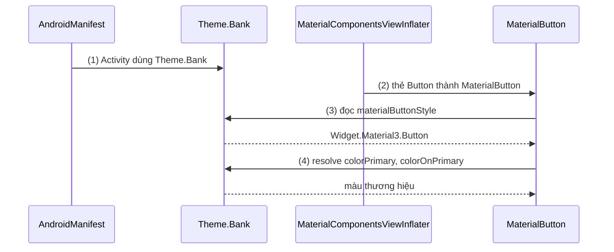
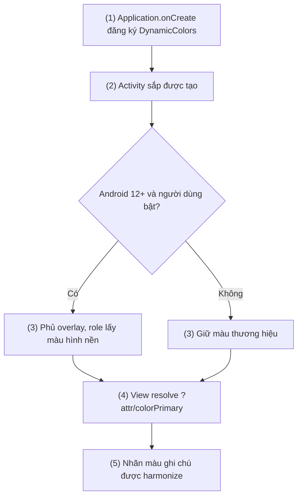
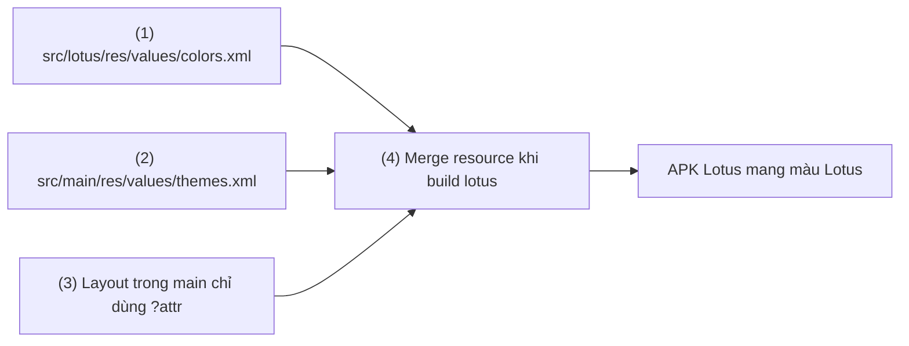

# Design Guide

## Vấn đề cần giải quyết

Một app có vài chục màn hình, mỗi màn do một người làm vào một thời điểm khác nhau. Không có quy tắc chung, layout sẽ trông như sau:

```xml
<!-- Màn A -->
<TextView android:textColor="#212121" android:textSize="17sp" />
<Button android:background="#6200EE" />

<!-- Màn B, viết sau ba tháng -->
<TextView android:textColor="#000000" android:textSize="16sp" />
<Button android:background="#5E35B1" />
```

Từ đó lộ ra ba vấn đề:

- **Không nhất quán:** hai nút "chính" hai màu tím khác nhau, hai tiêu đề hai cỡ chữ. Người dùng thấy app "lủng củng" mà không chỉ ra được vì sao.
- **Không đổi được theo ngữ cảnh:** `#212121` đúng trên nền trắng nhưng gần như biến mất trên nền tối. Bật dark mode thì phải đi tìm từng mã màu.
- **Designer và developer nói hai ngôn ngữ:** designer nói "nút hành động chính", developer nghe thành "`#6200EE`". Khi thương hiệu đổi màu, không ai biết mã màu nào là "màu thương hiệu" và mã nào chỉ tình cờ trùng.

Vấn đề cần giải quyết là: **cho cả nhóm một bộ quy tắc chung về màu, chữ, hình khối, độ sâu và chuyển động, được đặt tên theo ý nghĩa, để UI nhất quán và đổi được ở một chỗ.**

## Sau khi học xong

- Giải thích được design guide là bộ design token cùng quy tắc dùng chúng, và vì sao Material Design ra đời để bù phần Flat design bỏ mất.
- Phân biệt được Flat design, Material 2 và Material 3 qua cách mỗi bên biểu diễn màu, chiều sâu và hình khối.
- Áp dụng được Material 3 trong app View bằng Material Components for Android với color role, type scale, shape và dynamic color.
- Nhận diện được các lỗi khi áp dụng design guide như hardcode màu, dùng sai cặp on-color, trộn theme và component khác thế hệ.

## Design Guide là gì?

**Design guide** (hướng dẫn thiết kế) là bộ quy tắc của một design system (hệ thống thiết kế): nó định nghĩa các **design token** (giá trị thiết kế có tên theo vai trò, như màu `primary`, kiểu chữ `titleMedium`, góc bo `cornerMedium`) và quy tắc component dùng các token đó, để mọi màn hình nhìn và phản hồi nhất quán. Material Design là design guide của Google cho Android; Flat design là một **phong cách** thị giác, không phải một design system đầy đủ.

Mental model xuyên suốt bài: **design guide là bộ từ vựng chung giữa designer và developer.** Token là từ ("màu chính", "chữ tiêu đề vừa"), component là câu ghép từ những từ đó ("nút chính = nền `primary`, chữ `onPrimary`, góc bo full"). Khi mọi người nói bằng từ thay vì bằng mã màu, đổi nghĩa của một từ (đổi màu thương hiệu, bật dark mode) sẽ đổi mọi câu dùng từ đó.

Bài này dạy **từ vựng** của Material và cách áp nó vào app View. Cơ chế Android resolve một attribute từ theme, style và view attr thuộc [8.5.3 Styles](styles.md); bài này chỉ dùng kết quả của cơ chế đó.

## Cách hoạt động

### Từ Flat design tới Material Design

Trước 2013, UI di động phổ biến theo **skeuomorphism** (mô phỏng vật thật): ứng dụng ghi chú có giấy kẻ dòng, lịch có viền da khâu chỉ, nút có gradient và bóng như nhựa nổi. Ưu điểm là người dùng mới nhìn là biết "cái này bấm được". Nhược điểm là nhiều chi tiết trang trí, khó mở rộng cho nhiều cỡ màn hình, và chi tiết giả lập không mang thông tin.

**Flat design** (thiết kế phẳng) đi ngược lại: bỏ texture, gradient, bóng đổ; dùng mảng màu phẳng, typography rõ, nhiều khoảng trắng. Windows Phone (Metro), Android Holo và iOS 7 đều đi theo hướng này. UI gọn, nhẹ, dễ co giãn.

Nhưng Flat design làm mất một thứ: **affordance** (gợi ý cách tương tác). Khi nút và nhãn đều là chữ phẳng trên nền phẳng, người dùng phải đoán đâu bấm được. Nghiên cứu của Nielsen Norman Group cho thấy phần tử UI phẳng thu hút ít chú ý hơn và làm người dùng do dự hơn. Flat design cũng không nói gì về **thứ bậc**: cái gì nằm trên cái gì, cái gì quan trọng hơn.

**Material Design** (2014) giữ sự gọn của Flat design và thêm lại thông tin bằng một ẩn dụ vật lý có kiểm soát: UI gồm các **bề mặt** (surface) như những tờ giấy, nằm ở các **độ cao** (elevation) khác nhau dưới một nguồn sáng. Độ cao sinh ra bóng hoặc sắc độ, cho biết thứ bậc; chuyển động (motion) cho biết bề mặt đến từ đâu và đi đâu. Khác với skeuomorphism, Material không giả lập vật liệu cụ thể (da, gỗ); nó chỉ mượn các quy luật giúp người dùng hiểu không gian.

Điểm quan trọng nhất với developer: Material không chỉ là một phong cách. Nó đi kèm **bộ token và component** có tên, có quy tắc, có thư viện cài đặt sẵn. Đó là thứ biến nó thành design guide.

#### Ví dụ: phân cấp hành động trên màn thanh toán

**Bài toán:** màn thanh toán có ba hành động với mức quan trọng khác nhau: "Thanh toán" (chính), "Áp mã giảm giá" (phụ), "Xem điều khoản" (ít quan trọng). Theo Flat design thuần, cả ba thường là chữ phẳng cùng kiểu, người dùng phải đọc hết mới biết nút nào là chính.

Material giải quyết bằng **mức nhấn mạnh** (emphasis) của component: cùng là button nhưng mỗi kiểu dùng token khác nhau.

| Mức nhấn mạnh | Component | Token chính |
|---|---|---|
| Cao | Filled button | Nền `colorPrimary`, chữ `colorOnPrimary` |
| Trung bình | Outlined button | Viền `colorOutline`, chữ `colorPrimary` |
| Thấp | Text button | Không nền, không viền, chữ `colorPrimary` |

```xml
<!-- res/layout/fragment_checkout.xml (trích) -->
<!-- Mức cao: style mặc định của MaterialButton trong theme Material 3 là filled -->
<com.google.android.material.button.MaterialButton
    android:id="@+id/pay_button"
    android:layout_width="match_parent"
    android:layout_height="wrap_content"
    android:text="Thanh toán" />

<!-- Mức trung bình -->
<com.google.android.material.button.MaterialButton
    android:id="@+id/apply_coupon_button"
    style="?attr/materialButtonOutlinedStyle"
    android:layout_width="match_parent"
    android:layout_height="wrap_content"
    android:text="Áp mã giảm giá" />

<!-- Mức thấp -->
<com.google.android.material.button.MaterialButton
    android:id="@+id/terms_button"
    style="@style/Widget.Material3.Button.TextButton"
    android:layout_width="wrap_content"
    android:layout_height="wrap_content"
    android:text="Xem điều khoản" />
```

**Kết quả:** ba nút có thứ bậc rõ mà layout không có một mã màu nào. Đổi `colorPrimary` trong theme thì cả ba nút đổi theo, đúng vai trò của từng nút.

### Material Components for Android: thư viện cài đặt design guide

Design guide nằm trên giấy (m3.material.io). Phần cài đặt cho hệ View là thư viện **Material Components for Android** (MDC-Android, artifact `com.google.android.material:material`). Nó cung cấp ba thứ:

1. **Theme** (`Theme.Material3.*`): khai báo giá trị cho mọi token dưới dạng theme attribute (`colorPrimary`, `textAppearanceTitleMedium`, `shapeAppearanceCornerMedium`...).
2. **Component** (`MaterialButton`, `MaterialCardView`, `TextInputLayout`, `Snackbar`...): style mặc định của mỗi component chỉ tham chiếu token qua `?attr/`, không chứa mã màu cứng.
3. **Tiện ích**: `DynamicColors`, `MaterialColors`, các transition của Material Motion (xem [8.5.6 Animation](animation.md)).

Một chi tiết hay bị bỏ qua: với `AppCompatActivity` và theme Material, thẻ `<Button>` trong XML được inflate thành `MaterialButton`. Theme Material khai báo `viewInflaterClass` là `MaterialComponentsViewInflater`, lớp này thay `Button`, `CheckBox`, `RadioButton`, `TextView`, `AutoCompleteTextView` bằng bản Material tương ứng. Vì vậy cùng một layout, đổi theme từ AppCompat sang Material là đổi cả kiểu của component.

Component Material còn **kiểm tra theme**: nếu theme của Activity không phải con của `Theme.MaterialComponents` (Material 3 cũng thuộc nhánh này), nó ném `IllegalArgumentException: The style on this component requires your app theme to be Theme.MaterialComponents (or a descendant).`

#### Ví dụ: một nút đọc token từ theme thế nào

**Bài toán:** app ngân hàng cần nút "Chuyển tiền" đúng màu thương hiệu ở mọi màn mà không lặp mã màu. Cần hiểu nút lấy màu từ đâu để biết phải sửa ở đâu khi đổi màu.

**Luồng chạy:**

1. Manifest gán theme `Theme.Bank` (con của `Theme.Material3.DayNight.NoActionBar`) cho Activity; theme này đặt `colorPrimary`, `colorOnPrimary`.
2. `LayoutInflater` gặp thẻ `<Button>`; `MaterialComponentsViewInflater` tạo `MaterialButton`.
3. `MaterialButton` không có `style` riêng nên dùng default style attr `materialButtonStyle` của theme, trỏ tới `Widget.Material3.Button`.
4. Style đó tham chiếu `?attr/colorPrimary` cho nền và `?attr/colorOnPrimary` cho chữ; giá trị được resolve từ theme ở bước 1 (thứ tự resolve chi tiết ở [8.5.3 Styles](styles.md)).



```kotlin
// build.gradle.kts (module app)
dependencies {
    // Bản stable mới nhất tại thời điểm viết (05/2026) là 1.14.0
    implementation("com.google.android.material:material:1.14.0")
}
```

```xml
<!-- res/values/themes.xml -->
<resources>
    <!-- (1) theme của app kế thừa Material 3 -->
    <style name="Theme.Bank" parent="Theme.Material3.DayNight.NoActionBar">
        <item name="colorPrimary">@color/bank_primary</item>
        <item name="colorOnPrimary">@color/bank_on_primary</item>
    </style>
</resources>

<!-- res/layout/activity_transfer.xml (trích) -->
<!-- (2)(3)(4) không có style, không có mã màu: mọi thứ đến từ theme -->
<Button
    android:id="@+id/transfer_button"
    android:layout_width="match_parent"
    android:layout_height="wrap_content"
    android:text="Chuyển tiền" />
```

**Kết quả:** đặt breakpoint hoặc gọi `binding.transferButton.javaClass.name` sẽ thấy `com.google.android.material.button.MaterialButton`. Đổi `@color/bank_primary` một lần, mọi nút chính trong app đổi theo.

### Hệ màu: color role và tonal palette

Material 3 không đặt tên màu theo sắc ("tím", "xanh") mà theo **vai trò** (color role). Mỗi role trả lời câu hỏi "màu này dùng để làm gì":

| Nhóm | Role | Dùng cho |
|---|---|---|
| Accent | `primary`, `onPrimary`, `primaryContainer`, `onPrimaryContainer` | Hành động chính, thành phần nổi bật nhất |
| Accent | `secondary*`, `tertiary*` | Thành phần ít nổi bật hơn, điểm nhấn tương phản |
| Trạng thái | `error`, `onError`, `errorContainer`, `onErrorContainer` | Lỗi |
| Bề mặt | `surface`, `onSurface`, `surfaceVariant`, `onSurfaceVariant` | Nền và nội dung trên nền |
| Bề mặt | `surfaceContainerLowest` … `surfaceContainerHighest` | Các lớp bề mặt ở mức nhấn khác nhau (card, sheet, dialog) |
| Viền | `outline`, `outlineVariant` | Viền, đường chia |

Quy tắc quan trọng nhất là **cặp on-color**: nội dung đặt trên nền `X` dùng màu `onX`. Chữ trên `primaryContainer` dùng `onPrimaryContainer`, chữ trên `surface` dùng `onSurface`. Material đảm bảo mỗi cặp đủ độ tương phản, nên tuân thủ cặp là đủ đọc được cả ở light và dark theme.

Đằng sau các role là **tonal palette** (bảng sắc độ). Từ một màu gốc (key color), Material sinh ra một dãy sắc độ (tone) từ 0 (đen) tới 100 (trắng) trong không gian màu HCT (Hue, Chroma, Tone). Light scheme và dark scheme chỉ là hai cách **chọn tone khác nhau** từ cùng palette. Trong baseline scheme của M3:

| Role | Light | Dark |
|---|---|---|
| `primary` | tone 40 | tone 80 |
| `onPrimary` | tone 100 | tone 20 |
| `primaryContainer` | tone 90 | tone 30 |
| `onPrimaryContainer` | tone 10 | tone 90 |

Vì vậy với Material 3, dark theme không phải "đảo màu" mà là "đổi tone", và cùng một layout tự đúng ở cả hai chế độ nếu chỉ dùng role.

#### Ví dụ: thẻ trạng thái đơn hàng ở light và dark theme

**Bài toán:** màn chi tiết đơn có một thẻ nổi bật "Đơn đang được giao". Thẻ phải nổi hơn nền nhưng không lấn nút chính, và đọc được ở cả hai chế độ sáng tối.

Chọn nền `primaryContainer` (nổi, nhưng nhẹ hơn `primary` của nút chính), và mọi nội dung trên thẻ dùng `onPrimaryContainer`.

```xml
<!-- res/layout/item_order_status.xml -->
<com.google.android.material.card.MaterialCardView
    xmlns:android="http://schemas.android.com/apk/res/android"
    xmlns:app="http://schemas.android.com/apk/res-auto"
    android:layout_width="match_parent"
    android:layout_height="wrap_content"
    app:cardBackgroundColor="?attr/colorPrimaryContainer"
    app:strokeWidth="0dp">

    <LinearLayout
        android:layout_width="match_parent"
        android:layout_height="wrap_content"
        android:orientation="vertical"
        android:padding="16dp">

        <TextView
            android:id="@+id/status_title"
            android:layout_width="wrap_content"
            android:layout_height="wrap_content"
            android:text="Đơn đang được giao"
            android:textAppearance="?attr/textAppearanceTitleMedium"
            android:textColor="?attr/colorOnPrimaryContainer" />

        <TextView
            android:id="@+id/status_eta"
            android:layout_width="wrap_content"
            android:layout_height="wrap_content"
            android:text="Dự kiến 15:30 hôm nay"
            android:textAppearance="?attr/textAppearanceBodyMedium"
            android:textColor="?attr/colorOnPrimaryContainer" />
    </LinearLayout>
</com.google.android.material.card.MaterialCardView>
```

**Kết quả:** bật dark theme (`adb shell cmd uimode night yes`), thẻ chuyển sang nền tone 30, chữ tone 90; không cần `values-night` cho layout này. Thử đổi `textColor` thành `?attr/colorOnSurface`: ở light theme vẫn đọc được, nhưng tương phản không còn được đảm bảo theo cặp; đó là lý do quy tắc on-color tồn tại.

### Dynamic color: palette lấy từ hình nền

**Dynamic color** là phần đặc trưng của Material You (Material 3): từ Android 12 (API 31), hệ thống trích màu từ hình nền của người dùng, sinh các tonal palette, và đưa chúng cho app dưới dạng color resource hệ thống (`android.R.color.system_accent1_*`, `system_neutral1_*`...). App bật dynamic color thì các role `primary`, `secondary`, `surface`... lấy giá trị từ các palette đó thay vì từ màu thương hiệu.

MDC-Android làm việc này bằng một **theme overlay**: `DynamicColors.applyToActivitiesIfAvailable(application)` đăng ký callback để trước khi mỗi Activity được tạo, theme của nó được phủ thêm overlay ánh xạ role sang màu hệ thống. Trên máy dưới Android 12 (hoặc máy không hỗ trợ), hàm không làm gì và app giữ màu thương hiệu.

Dynamic color là một đánh đổi: app hoà vào máy của người dùng, nhưng **màu thương hiệu biến mất** khỏi các role. Những màu mang nghĩa cố định (màu logo, màu đỏ "lỗ" và xanh "lãi" của biểu đồ chứng khoán) không nên lấy từ role; chúng giữ màu riêng và có thể được **harmonize** (kéo sắc nhẹ về phía `primary` để không lệch tông) bằng `MaterialColors.harmonizeWithPrimary()`.

#### Ví dụ: app ghi chú bật dynamic color có công tắc

**Bài toán:** app ghi chú muốn theo màu hình nền của người dùng, nhưng phải có công tắc "Dùng màu hệ thống" trong cài đặt, và nhãn màu do người dùng gán cho ghi chú (đỏ, vàng, xanh) phải giữ nghĩa.

**Luồng chạy:**

1. `Application.onCreate()` gọi `DynamicColors.applyToActivitiesIfAvailable()` với một `Precondition` đọc lựa chọn của người dùng.
2. Trước khi mỗi Activity được tạo, MDC kiểm tra máy có hỗ trợ dynamic color (Android 12+) và precondition trả về `true`.
3. Nếu có, overlay được phủ lên theme: các role trỏ sang palette từ hình nền. Nếu không, theme giữ màu thương hiệu.
4. View resolve `?attr/colorPrimary` như bình thường, không biết màu đến từ đâu.
5. Nhãn màu của ghi chú không dùng role; nó được harmonize với `colorPrimary` hiện tại để hợp tông.



```kotlin
// NotesApp.kt
class NotesApp : Application() {
    override fun onCreate() {
        super.onCreate()
        val settings = getSharedPreferences("settings", MODE_PRIVATE)
        val options = DynamicColorsOptions.Builder()
            .setPrecondition { _, _ ->                       // (2) điều kiện của app
                settings.getBoolean("use_system_colors", true)
            }
            .build()
        DynamicColors.applyToActivitiesIfAvailable(this, options) // (1)(3)
    }
}

// NoteViewHolder.kt (trích)
fun bindLabel(labelView: View, @ColorInt labelColor: Int) {
    // (5) giữ nghĩa "đỏ là gấp" nhưng kéo sắc về gần primary hiện tại
    val harmonized = MaterialColors.harmonizeWithPrimary(labelView.context, labelColor)
    labelView.backgroundTintList = ColorStateList.valueOf(harmonized)
}
```

**Kết quả:** trên máy Android 12+, đổi hình nền rồi mở lại app: nút, thanh điều hướng, nền đổi tông theo hình nền; nhãn đỏ vẫn đỏ nhưng ngả về tông mới. Tắt công tắc rồi tạo lại Activity (`recreate()`): app về màu thương hiệu. Trên Android 11, công tắc không có tác dụng gì về màu.

> [!NOTE]
> `SharedPreferences` trong ví dụ chỉ để giữ code ngắn; cơ chế và cách chọn nơi lưu cài đặt ở [Key-value storage](../../session_05/data_store/key_value.md).

### Typography, shape và elevation

Ba nhóm token còn lại đi theo cùng một nguyên tắc: tên theo vai trò, giá trị khai báo ở theme.

**Type scale (thang chữ).** Material 3 có 15 kiểu chữ: 5 nhóm vai trò (`display`, `headline`, `title`, `body`, `label`) nhân 3 cỡ (`Large`, `Medium`, `Small`). Mỗi kiểu là một theme attribute, ví dụ `textAppearanceTitleMedium` mặc định Medium 16sp, `textAppearanceBodyMedium` Regular 14sp. Material 2 có 13 kiểu khác tên (`Headline1`…`Headline6`, `Subtitle1`, `Body1`, `Caption`, `Overline`...). Đổi font cho cả app là tạo style con của `TextAppearance.Material3.*` với `fontFamily` mới rồi trỏ attribute trong theme vào đó.

**Shape (hình khối).** Material 3 có thang góc bo: `shapeAppearanceCornerExtraSmall` (4dp), `Small` (8dp), `Medium` (12dp), `Large` (16dp), `ExtraLarge` (28dp), cộng thêm vài bậc mới của bản Expressive. Component dùng bậc phù hợp với kích thước của nó (chip nhỏ bo ít, bottom sheet bo nhiều). Muốn đổi một component, dùng `shapeAppearanceOverlay` với `parent=""` và chỉ đặt giá trị cần đổi (`cornerFamily` là `rounded` hoặc `cut`, `cornerSize`).

**Elevation (độ sâu).** Đây là chỗ M2 và M3 khác nhau rõ nhất:

- **Material 2** biểu diễn độ cao bằng **bóng đổ**. Ở dark theme bóng khó thấy, nên M2 thêm **elevation overlay**: bề mặt càng cao càng được phủ trắng nhiều hơn.
- **Material 3** chuyển sang **tonal elevation**: độ cao chủ yếu biểu diễn bằng **màu bề mặt**. Ban đầu là trộn `colorSurfaceTint` theo độ cao; từ MDC 1.11 các component dùng thẳng các role `surfaceContainer*` (card thấp dùng `surfaceContainerLow`, dialog dùng `surfaceContainerHigh`). Bóng đổ vẫn còn cho thành phần nổi thật sự như FAB.

#### Ví dụ: đổi font và góc bo cho toàn app

**Bài toán:** app đặt món dùng font thương hiệu cho tiêu đề và muốn mọi card bo góc lớn hơn mặc định, mà không sửa từng layout.

```xml
<!-- res/values/type.xml -->
<resources>
    <style name="TextAppearance.Food.TitleMedium" parent="TextAppearance.Material3.TitleMedium">
        <item name="fontFamily">@font/food_brand_semibold</item>
        <item name="android:fontFamily">@font/food_brand_semibold</item>
    </style>

    <!-- Overlay chỉ đổi giá trị cần đổi, parent rỗng -->
    <style name="ShapeAppearanceOverlay.Food.Card" parent="">
        <item name="cornerFamily">rounded</item>
        <item name="cornerSize">20dp</item>
    </style>

    <style name="Widget.Food.CardView" parent="Widget.Material3.CardView.Filled">
        <item name="shapeAppearanceOverlay">@style/ShapeAppearanceOverlay.Food.Card</item>
    </style>
</resources>

<!-- res/values/themes.xml (trích) -->
<style name="Theme.Food" parent="Theme.Material3.DayNight.NoActionBar">
    <item name="textAppearanceTitleMedium">@style/TextAppearance.Food.TitleMedium</item>
    <item name="materialCardViewStyle">@style/Widget.Food.CardView</item>
</style>
```

**Kết quả:** mọi `TextView` dùng `?attr/textAppearanceTitleMedium` và mọi `MaterialCardView` không đặt style riêng đổi theo, kể cả màn đã viết từ trước. Layout không cần sửa dòng nào: đó là hệ quả trực tiếp của việc layout dùng "từ" thay vì giá trị.

## Ví dụ thực tế

Ba bài toán thường gặp khi áp design guide vào một app thật:

1. **App white-label cho nhiều thương hiệu** (bài toán chính, code bên dưới).
2. **Thêm dark mode cho app cũ:** việc chính là thay mã màu trong layout bằng role. Sau khi mọi màu đi qua role, dark mode gần như "miễn phí" nhờ theme `DayNight`.
3. **Kiểm tra độ tương phản cho accessibility:** dùng đúng cặp on-color, rồi kiểm tra bằng Accessibility Scanner; màu tự chọn ngoài role (badge, biểu đồ) mới là chỗ hay thiếu tương phản.

### App white-label: một bộ layout, nhiều thương hiệu

**Bài toán:** một công ty bán app đặt lịch cho nhiều chuỗi spa. Mỗi chuỗi có màu và font riêng, nhưng màn hình và logic giống hệt nhau. Mỗi thương hiệu là một product flavor (xem [Product Flavors](../../session_04/android_manifest/package_build_gradle/flavor.md)).

**Luồng chạy:**

1. Mỗi flavor có thư mục resource riêng (`src/lotus/res`, `src/jasmine/res`) chứa `colors.xml` với cùng tên màu nhưng giá trị khác. Màu của từng flavor được sinh bằng công cụ Material Theme Builder từ màu gốc của thương hiệu, gồm đủ role cho light và dark.
2. `src/main/res/values/themes.xml` khai báo theme chung, ánh xạ role sang các tên màu đó.
3. Layout trong `main` chỉ dùng `?attr/colorX` và `?attr/textAppearanceX`.
4. Khi build flavor `lotus`, resource của `lotus` ghi đè `main`; theme chung trỏ tới màu của Lotus.



```kotlin
// build.gradle.kts (module app, trích)
android {
    flavorDimensions += "brand"
    productFlavors {
        create("lotus") { dimension = "brand"; applicationIdSuffix = ".lotus" }
        create("jasmine") { dimension = "brand"; applicationIdSuffix = ".jasmine" }
    }
}
```

```xml
<!-- (1) src/lotus/res/values/colors.xml: giá trị minh hoạ; thực tế xuất từ Material Theme Builder -->
<resources>
    <color name="brand_primary">#8C4A60</color>
    <color name="brand_on_primary">#FFFFFF</color>
    <color name="brand_primary_container">#FFD9E2</color>
    <color name="brand_on_primary_container">#3A071D</color>
    <!-- ... secondary, tertiary, surface, outline ... -->
</resources>

<!-- (1) src/lotus/res/values-night/colors.xml: cùng tên, tone cho dark -->
<resources>
    <color name="brand_primary">#FFB1C8</color>
    <color name="brand_on_primary">#541D32</color>
    <color name="brand_primary_container">#703348</color>
    <color name="brand_on_primary_container">#FFD9E2</color>
</resources>

<!-- (2) src/main/res/values/themes.xml -->
<resources>
    <style name="Theme.Booking" parent="Theme.Material3.DayNight.NoActionBar">
        <item name="colorPrimary">@color/brand_primary</item>
        <item name="colorOnPrimary">@color/brand_on_primary</item>
        <item name="colorPrimaryContainer">@color/brand_primary_container</item>
        <item name="colorOnPrimaryContainer">@color/brand_on_primary_container</item>
        <item name="textAppearanceTitleMedium">@style/TextAppearance.Booking.TitleMedium</item>
    </style>
</resources>

<!-- (3) src/main/res/layout/item_service.xml (trích): không có màu cứng -->
<TextView
    android:id="@+id/service_name"
    android:layout_width="wrap_content"
    android:layout_height="wrap_content"
    android:textAppearance="?attr/textAppearanceTitleMedium"
    android:textColor="?attr/colorOnSurface" />
```

**Kết quả:** `./gradlew assembleLotusDebug` và `assembleJasmineDebug` cho hai app khác màu, khác font, cùng một bộ layout. Thêm thương hiệu thứ ba chỉ là thêm một flavor và một bộ `colors.xml`. Ở app này nên **không bật dynamic color**, vì màu thương hiệu chính là thứ khách hàng trả tiền để có.

> [!TIP]
> Một cách kiểm tra nhanh mức độ "nói bằng từ vựng" của codebase: tìm `#[0-9A-Fa-f]{6}` và `textSize=` trong `res/layout`. Mỗi kết quả là một chỗ sẽ không đổi theo theme.

## So sánh với các cách tiếp cận khác

| Tiêu chí | Flat design | Material 2 | Material 3 (Material You) |
|---|---|---|---|
| Bản chất | Phong cách thị giác | Design system | Design system |
| Màu | Bảng màu tự chọn, không quy tắc vai trò | `primary`, `secondary`, `surface`, `onX`; chủ yếu chọn tay | Color role sinh từ tonal palette; hỗ trợ dynamic color |
| Chiều sâu | Gần như không có | Bóng đổ, elevation overlay ở dark theme | Tonal elevation: màu `surfaceContainer*`, bóng chỉ cho thành phần nổi |
| Hình khối | Tuỳ | Shape theo cỡ component (small, medium, large) | Thang góc bo ExtraSmall tới ExtraLarge, bo nhiều hơn M2 |
| Typography | Tuỳ | 13 kiểu (`Headline1`, `Body1`...) | 15 kiểu (`display`, `headline`, `title`, `body`, `label` × 3 cỡ) |
| Theme trong MDC | Không có | `Theme.MaterialComponents.*` | `Theme.Material3.*` |

Ngoài Material, nhiều công ty xây design system riêng (thường vẫn dựa trên Material Components và chỉ đổi token), và app đa nền tảng đôi khi theo Human Interface Guidelines của Apple trên iOS. Trên Android, đi lệch quá xa Material làm app trông "lạ" ở các chi tiết hệ thống như dialog, thanh điều hướng, nút back.

## Khi nào nên và không nên dùng

- **Nên dùng Material 3** cho app Android mới viết bằng View: theme, component và tài liệu có sẵn, khớp giao diện hệ thống từ Android 12.
- **Nên dùng theme Material và đổi token** khi có design system riêng: đổi color role, type scale, shape trong theme thay vì tự viết lại component.
- **Nên bật dynamic color** cho app tiện ích cá nhân (ghi chú, lịch, đồng hồ), nơi hoà vào máy của người dùng có giá trị hơn nhận diện thương hiệu.
- **Không nên bật dynamic color** khi màu thương hiệu là nhận diện chính (ngân hàng, thương hiệu bán lẻ, white-label), hoặc khi màu mang nghĩa nghiệp vụ.
- **Không cần chuyển gấp** app đang dùng Material 2 ổn định sang Material 3 chỉ vì "mới hơn": chuyển theme kéo theo đổi hàng loạt kích thước, góc bo, màu; nên làm có kế hoạch, theo từng màn.
- **Với Compose**, token Material nằm trong `MaterialTheme` (`colorScheme`, `typography`, `shapes`), cùng khái niệm nhưng khác API; xem 9.4.1 Material Design Theme (chưa có bài).

## Sai lầm thường gặp

### 1. Hardcode mã màu thay vì dùng color role

```xml
<!-- Sai -->
<TextView android:textColor="#1C1B1F" />
```

**Lỗi lộ ra thế nào:** ở dark theme chữ gần đen nằm trên nền gần đen, gần như không đọc được. Bật dynamic color thì phần còn lại của màn đổi màu, riêng chữ này không đổi.

**Cách sửa:** `android:textColor="?attr/colorOnSurface"`. Nếu cần một màu không có role (màu nghiệp vụ), đặt nó trong `colors.xml` với tên theo nghĩa (`stock_up`, `stock_down`) và khai báo bản `values-night`.

### 2. Dùng sai cặp on-color

```xml
<!-- Sai: nền primary nhưng chữ lại là primary -->
<TextView
    android:background="?attr/colorPrimary"
    android:textColor="?attr/colorPrimary" />

<!-- Sai kiểu khó thấy hơn: nền primaryContainer, chữ onPrimary -->
<TextView
    android:background="?attr/colorPrimaryContainer"
    android:textColor="?attr/colorOnPrimary" />
```

**Lỗi lộ ra thế nào:** trường hợp đầu chữ biến mất. Trường hợp sau có thể đọc được ở light theme với màu thương hiệu, nhưng với tone khác (dark theme, dynamic color) chữ trắng nằm trên nền nhạt, tương phản không đạt.

**Cách sửa:** nền `X` đi với chữ `onX`, luôn luôn: `primaryContainer` đi với `onPrimaryContainer`.

### 3. Trộn theme và component khác thế hệ

```xml
<!-- Sai: theme AppCompat nhưng dùng component Material -->
<style name="Theme.Shop" parent="Theme.AppCompat.Light.NoActionBar" />
```

**Lỗi lộ ra thế nào:** inflate `MaterialButton` hay `TextInputLayout` thì crash `IllegalArgumentException: The style on this component requires your app theme to be Theme.MaterialComponents (or a descendant).` Trường hợp khó thấy hơn: theme `Theme.MaterialComponents` (M2) nhưng layout dùng style `Widget.Material3.*`; style đó tham chiếu attribute chỉ theme M3 mới khai báo (`colorSurfaceContainerLow`, `textAppearanceTitleMedium`...), nên màu và chữ ra sai, hoặc crash kiểu `Failed to resolve attribute` khi View cần giá trị đó.

**Cách sửa:** chọn một thế hệ cho cả app: theme `Theme.Material3.*` đi với style `Widget.Material3.*`. Khi chuyển dần, có thể đặt theme M3 cho từng Activity (hoặc `android:theme` cho một nhánh View) thay vì trộn trong cùng một màn.

### 4. Áp dynamic color sau khi View đã được inflate

```kotlin
// Sai: overlay áp sau setContentView
override fun onCreate(savedInstanceState: Bundle?) {
    super.onCreate(savedInstanceState)
    setContentView(binding.root)
    DynamicColors.applyToActivityIfAvailable(this)
}
```

**Lỗi lộ ra thế nào:** màn hiện tại vẫn màu thương hiệu; chỉ View tạo sau đó (dialog, item mới) mới lấy màu động, nên một màn có hai bộ màu.

**Cách sửa:** đăng ký một lần bằng `DynamicColors.applyToActivitiesIfAvailable(application)` trong `Application.onCreate()`, để overlay được phủ trước khi Activity inflate bất kỳ View nào.

## Lịch sử phát triển

- **2010–2013, chuyển sang Flat:** Windows Phone 7 (2010) ra mắt ngôn ngữ Metro; Android 3.0/4.0 (2011) dùng Holo, phẳng, nền tối, điểm nhấn xanh; iOS 7 (09/2013) bỏ skeuomorphism.
- **25/06/2014, Material Design:** Google công bố tại Google I/O 2014 (tên mã "Quantum Paper"), cùng bản preview Android L; Android 5.0 Lollipop (API 21, 11/2014) là bản đầu tiên dùng Material trên toàn hệ thống.
- **05/2015, Design Support Library:** Google I/O 2015 ra thư viện `com.android.support:design` (FAB, Snackbar, TextInputLayout, CoordinatorLayout) để dùng component Material trên Android cũ.
- **05/2018, Material Theming (thường gọi là Material 2):** Google I/O 2018 cho phép tuỳ biến color, typography, shape thay vì một giao diện cố định; MDC-Android 1.0.0 (11/2018) chuyển namespace từ `android.support.design` sang `com.google.android.material`.
- **08/2020, MDC 1.2.0:** thêm hệ thống Transition/Motion (container transform, shared axis, fade through).
- **05/2021, Material You (Material 3):** công bố tại Google I/O 2021; Android 12 (API 31, 10/2021) đưa dynamic color từ hình nền. MDC-Android 1.5.0 (01/2022) có theme và component `Material3`.
- **MDC-Android 1.11.0:** các tonal surface role (`surfaceContainer*`) thành mặc định cho component, thay cách trộn surface tint theo độ cao.
- **13/05/2025, Material 3 Expressive:** Google công bố bản mở rộng của M3 (màu đậm hơn, hình khối mới, motion theo spring), không phải "Material 4". MDC-Android 1.14.0 (05/2026) đưa theme và component Expressive vào bản stable.

## Kết nối hệ thống

- **Tiên quyết:**
  - [8.5.3 Styles](styles.md): style, theme, `ThemeOverlay` và thứ tự resolve attribute mà mọi token trong bài dựa vào.
- **Liên quan:**
  - [8.5.1 Layouts](layouts.md): các layout chứa component Material trong ví dụ.
  - [8.5.5 Message](message.md): Snackbar là một component Material, dùng role `colorSurfaceInverse`.
  - [Product Flavors](../../session_04/android_manifest/package_build_gradle/flavor.md): cơ chế ghi đè resource theo flavor dùng trong bài toán white-label.
  - [Jetpack Compose Overview](../../jetpack_compose_ui/overview.md): hướng UI mới, dùng cùng design guide qua `MaterialTheme`.
- **Học tiếp:**
  - [8.5.6 Animation](animation.md): motion, token cuối cùng của Material, và các transition pattern.
  - 9.4.1 Material Design Theme (Color, Typography, Shapes) (chưa có bài): cùng hệ token trong Compose.

## Tham khảo

- [Material Design 3 - m3.material.io](https://m3.material.io/)
- [Material Components for Android - Getting started - GitHub](https://github.com/material-components/material-components-android/blob/master/docs/getting-started.md)
- [Color theming (color roles, dynamic color, harmonization) - MDC-Android docs](https://github.com/material-components/material-components-android/blob/master/docs/theming/Color.md)
- [Typography theming - MDC-Android docs](https://github.com/material-components/material-components-android/blob/master/docs/theming/Typography.md)
- [Shape theming - MDC-Android docs](https://github.com/material-components/material-components-android/blob/master/docs/theming/Shape.md)
- [MDC-Android releases (1.0.0, 1.2.0, 1.5.0, 1.14.0) - GitHub](https://github.com/material-components/material-components-android/releases)
- [ThemeEnforcement.java (thông báo lỗi theme) - GitHub](https://github.com/material-components/material-components-android/blob/master/lib/java/com/google/android/material/internal/ThemeEnforcement.java)
- [Flat UI Elements Attract Less Attention and Cause Uncertainty - Nielsen Norman Group](https://www.nngroup.com/articles/flat-ui-less-attention-cause-uncertainty/)
- [Material Design - Wikipedia (mốc 2014, tên mã Quantum Paper)](https://en.wikipedia.org/wiki/Material_Design)
- [Android 16 and Material 3 Expressive (13/05/2025) - 9to5Google](https://9to5google.com/2025/05/13/android-16-material-3-expressive-redesign/)
