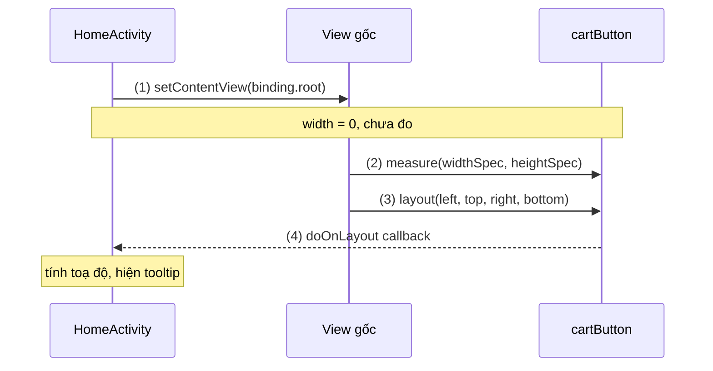
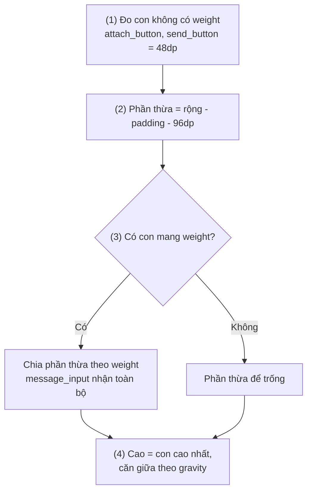
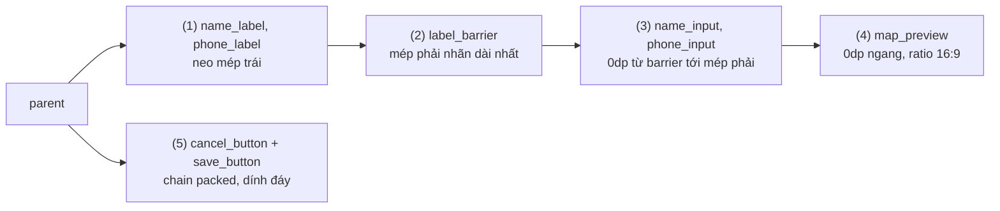
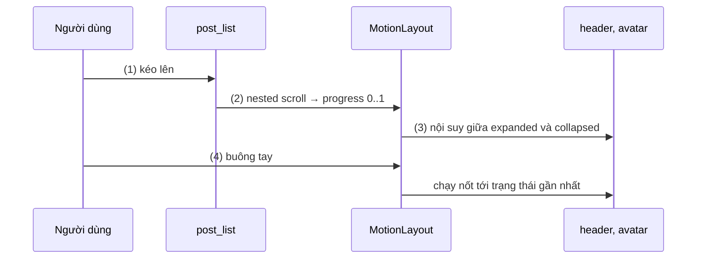
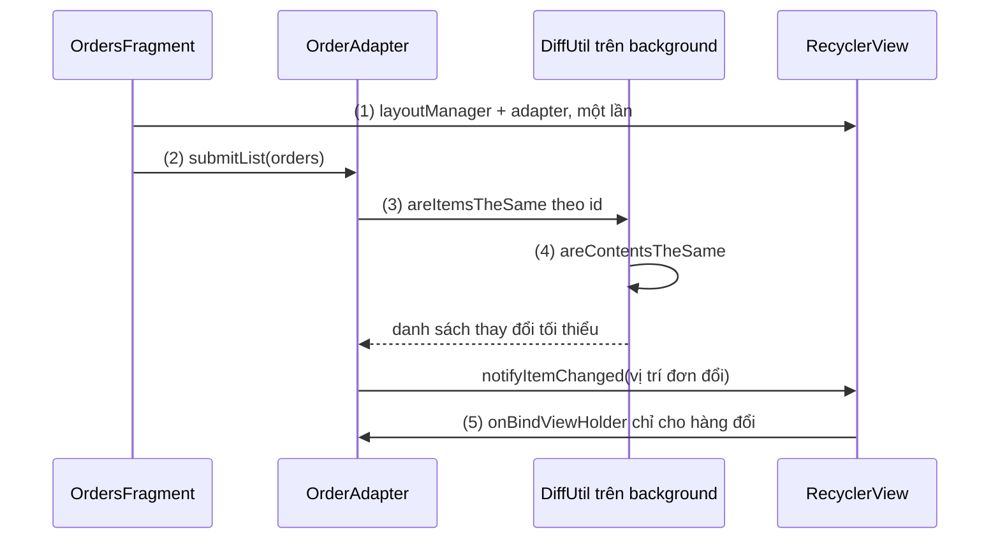
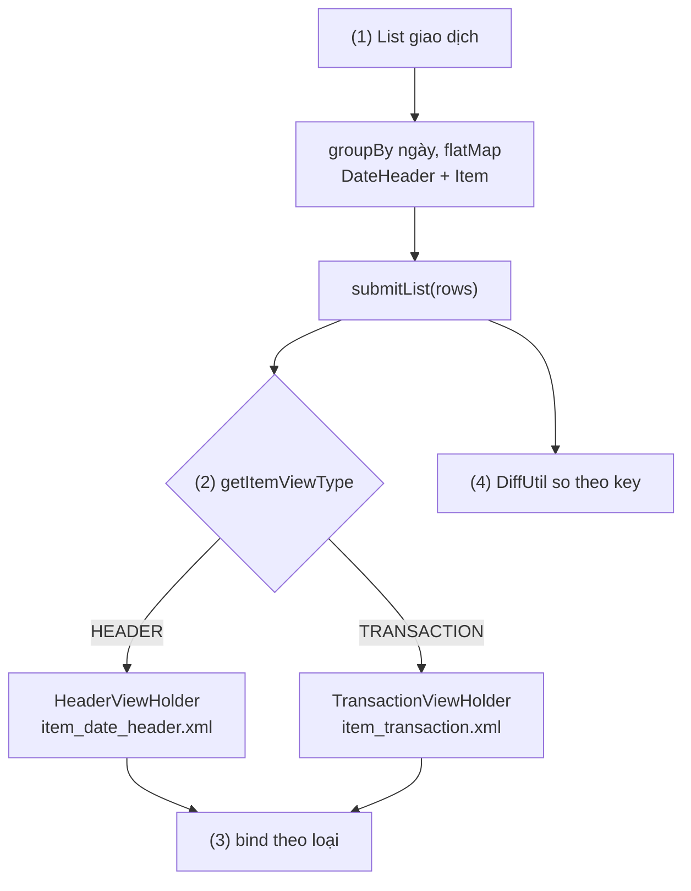
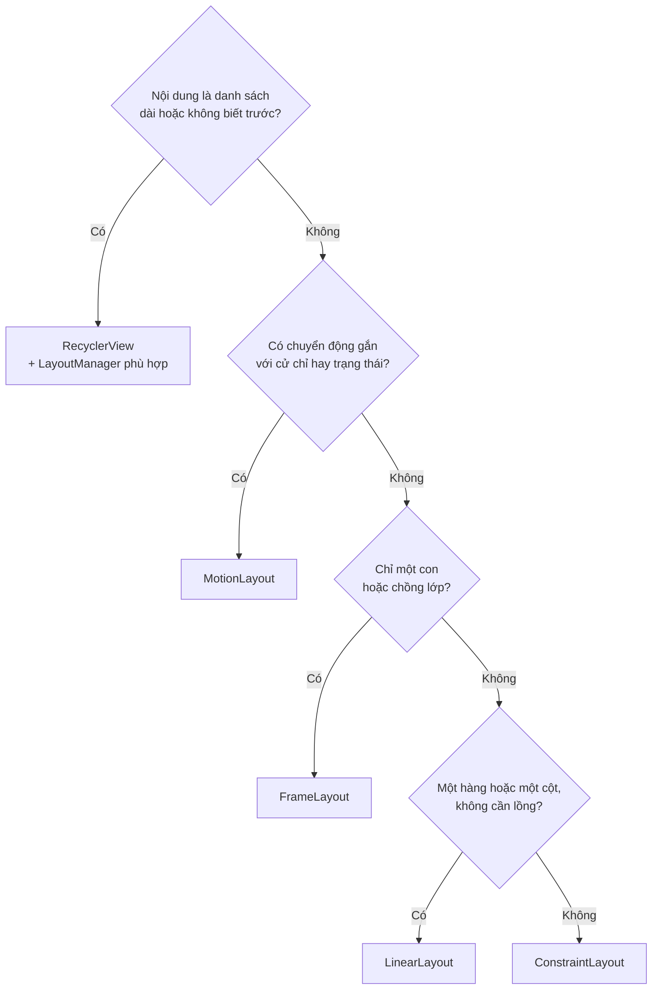

# Layouts

## Vấn đề cần giải quyết

Một màn hình là một cây View: nút, chữ, ảnh, ô nhập. Mỗi View cần biết **nó rộng bao nhiêu và nằm ở đâu**, và câu trả lời phải đúng trên điện thoại nhỏ, tablet, màn ngang, chữ phóng to, tiếng Việt dài hơn tiếng Anh. Không ai muốn tính toạ độ bằng tay cho từng thiết bị.

Có ba vấn đề cụ thể:

- **Sắp xếp theo quan hệ, không theo toạ độ:** "ô nhập nằm sau nhãn dài nhất", "nút gửi luôn ở mép phải", "ảnh rộng full, cao theo tỉ lệ 16:9". Cần một cách khai báo quan hệ để hệ thống tự tính ra toạ độ.
- **Chi phí tính toán:** mỗi frame có khoảng 16 ms trên màn 60 Hz, và việc đo, đặt View chạy trên Main Thread ([Working with Thread](../../session_05/working_with_thread.md), mục "Main Thread"). Cây View lồng sâu, hoặc layout phải đo con hai lần, làm frame trễ và màn hình giật.
- **Danh sách dài:** lịch sử 10.000 giao dịch không thể tạo 10.000 hàng View. Cần chỉ tạo đủ cho phần đang nhìn thấy và dùng lại khi cuộn.

Layout là lời giải chung cho cả ba: mỗi loại layout là một **luật sắp xếp** khác nhau, và việc của developer là chọn đúng luật cho từng vùng màn hình.

## Sau khi học xong

- Giải thích được cách một ViewGroup đo và đặt View con qua lượt measure và layout, và vì sao lồng layout hay dùng weight làm tăng chi phí.
- Phân biệt được luật sắp xếp của LinearLayout, FrameLayout, RelativeLayout và ConstraintLayout để chọn đúng layout cho từng màn hình.
- Triển khai được màn hình bằng ConstraintLayout với chain, barrier, dimension ratio, và chuyển giữa hai trạng thái bằng MotionLayout.
- Triển khai được danh sách bằng RecyclerView với ListAdapter, DiffUtil và LayoutManager phù hợp.
- Nhận diện được các lỗi thường gặp như match_parent trong ConstraintLayout, thiếu ràng buộc, RecyclerView lồng trong ScrollView và submitList cùng một list đã sửa.

## Layout là gì?

**Layout** là một `ViewGroup`, tức một View chứa các View con, mang một **luật sắp xếp** riêng: nó nhận giới hạn kích thước từ View cha, **đo** từng View con theo luật đó (measure), rồi **đặt** mỗi con vào một hình chữ nhật cụ thể trên màn hình (layout).

Mental model: mỗi layout là **một luật xếp chỗ**. LinearLayout xếp thành một hàng; FrameLayout xếp chồng lên nhau; RelativeLayout và ConstraintLayout xếp theo quan hệ giữa các View; MotionLayout là ConstraintLayout có hai bộ luật và chuyển dần từ bộ này sang bộ kia; RecyclerView xếp một danh sách nhưng chỉ tạo chỗ cho phần đang nhìn thấy. Mọi luật đều chạy qua cùng hai bước: hỏi con cần bao nhiêu chỗ, rồi chỉ chỗ cho con.

## Cách hoạt động

### Measure và layout: cha hỏi, con trả lời

Khi cây View cần hiển thị (frame đầu tiên, hoặc sau khi có View gọi `requestLayout()`), hệ thống chạy một **traversal** từ View gốc của cửa sổ xuống:

1. **Measure (đo):** View cha gọi `child.measure(widthSpec, heightSpec)` cho từng con. `MeasureSpec` là giới hạn cha đưa cho con: "đúng X px", "tối đa X px" hoặc "tuỳ ý". Con tự tính kích thước mong muốn trong giới hạn đó. ViewGroup chỉ biết kích thước của mình sau khi đo xong các con.
2. **Layout (đặt):** cha gọi `child.layout(left, top, right, bottom)` cho từng con, dựa trên kích thước đã đo và luật sắp xếp của mình. Từ lúc này View mới có `width`, `height`, `left`, `top`.
3. **Draw (vẽ):** từng View vẽ nội dung vào vùng của mình. Phần vẽ và cách tự viết `onMeasure`, `onDraw` được học ở [View Custom](views.md).

Hai chi tiết quyết định chi phí của một layout:

- **Thuộc tính `layout_*` là của View cha.** `android:layout_width`, `android:layout_weight`, `app:layout_constraintStart_toStartOf` được lưu trong `LayoutParams` của **cha**, vì chỉ cha mới dùng chúng để đo và đặt con. Đó là lý do `layout_weight` chỉ có tác dụng khi cha là `LinearLayout`.
- **Mỗi tầng lồng nhau là một lần đo nữa.** Đo một ViewGroup nghĩa là đo cả cây con của nó. Docs gọi trường hợp một layout phải đo con nhiều lượt mới ra kết quả là **double taxation** (bị "đánh thuế hai lần"): `RelativeLayout` luôn đo hai lượt; `LinearLayout` có weight cũng có thể phải đo lại. Đặt các layout như vậy lồng nhau, hoặc làm gốc của mỗi item trong danh sách, thì số lần đo nhân lên theo từng tầng.

`layout_width`, `layout_height` được cha đổi thành `MeasureSpec` cho con: kích thước cố định và `match_parent` thành "đúng X" (`EXACTLY`), `wrap_content` thành "tối đa bằng cha" (`AT_MOST`), còn `0dp` để luật của cha (weight, constraint) tự quyết. Cách một View đọc `MeasureSpec` được học ở [View Custom](views.md).

#### Ví dụ: đặt tooltip hướng dẫn trỏ đúng nút giỏ hàng

**Bài toán:** lần đầu mở app, màn chính hiện tooltip "Giỏ hàng của bạn ở đây" có mũi tên chỉ vào nút giỏ hàng. Code cần toạ độ và kích thước thật của nút, nhưng đọc `width` ngay trong `onCreate()` luôn ra `0`.

**Luồng chạy:**

1. `onCreate()` inflate layout và gọi `setContentView()`: cây View được **tạo** nhưng chưa được đo; `cartButton.width` là `0`.
2. Ở frame đầu tiên, hệ thống chạy lượt measure từ gốc xuống; nút giỏ hàng có kích thước đo được.
3. Lượt layout đặt nút vào vị trí; `left`, `top`, `width`, `height` có giá trị thật.
4. Callback `doOnLayout` (thư viện `androidx.core:core-ktx`) chạy ngay sau lượt layout đó; lúc này mới tính toạ độ để đặt tooltip.



```kotlin
// HomeActivity.kt
override fun onCreate(savedInstanceState: Bundle?) {
    super.onCreate(savedInstanceState)
    binding = ActivityHomeBinding.inflate(layoutInflater)
    setContentView(binding.root)                        // (1) mới tạo cây View, chưa đo
    Log.d(TAG, "width trong onCreate = " + binding.cartButton.width) // in ra 0

    binding.cartButton.doOnLayout { button ->           // (4) chạy sau (2) measure và (3) layout
        val location = IntArray(2)
        button.getLocationInWindow(location)
        showCartTooltip(
            anchorX = location[0] + button.width / 2,
            anchorY = location[1] + button.height
        )
    }
}
```

**Kết quả:** log in `width trong onCreate = 0`, nhưng tooltip hiện đúng dưới nút. Nếu nút đã được đo từ trước (ví dụ gọi lại sau khi xoay), `doOnLayout` chạy ngay lập tức thay vì đợi lượt layout tiếp theo.

### LinearLayout, FrameLayout, RelativeLayout: ba luật sắp xếp cơ bản

**LinearLayout** xếp các con thành **một hàng** (`orientation="horizontal"`) hoặc **một cột** (`vertical`), lần lượt theo thứ tự trong XML. Hai công cụ chính:

- `layout_weight`: chia phần chỗ **còn thừa** cho các con theo tỉ lệ. Con có weight thường khai báo kích thước theo chiều chính là `0dp`, để LinearLayout không phải đo nó theo nội dung trước rồi đo lại.
- `gravity` (căn nội dung của chính View đó) khác `layout_gravity` (xin cha căn View đó trong vùng của cha).

**FrameLayout** xếp mọi con **chồng lên nhau** tại góc trên trái, căn bằng `layout_gravity`; con khai báo sau vẽ đè lên con trước. Nó là layout rẻ nhất: đo mỗi con một lần, không có quan hệ giữa các con. Dùng cho vùng chứa một con (container của Fragment), hoặc lớp phủ (vòng tải nằm trên nội dung).

**RelativeLayout** xếp con theo quan hệ: `layout_below`, `layout_toEndOf`, `layout_alignParentEnd`. Nó từng là cách chính để giảm lồng LinearLayout, nhưng luôn đo con hai lượt, và trang docs của nó ghi rõ nên dùng ConstraintLayout thay thế để có hiệu năng và công cụ tốt hơn. Trong bài này RelativeLayout là **legacy**: cần đọc hiểu khi bảo trì code cũ, không chọn cho màn mới.

Ngoài ba layout, có hai thẻ giúp dùng lại layout mà không thêm tầng thừa:

- `<include layout="@layout/view_toolbar"/>` nhúng một file layout vào layout khác.
- `<merge>` làm gốc của file được nhúng: các con của nó được gắn thẳng vào View cha nơi nhúng, không có thêm một ViewGroup bọc ngoài.

Cách View Binding sinh field cho `<include>` và `<merge>` đã có ở [View Binding](../../session_06/view_binding.md), mục "Layout dùng lại: `<include>` và `<merge>`".

#### Ví dụ: thanh soạn tin nhắn co giãn theo màn hình

**Bài toán:** thanh soạn tin trong màn chat gồm nút đính kèm, ô nhập và nút gửi. Hai nút có kích thước cố định; ô nhập phải chiếm toàn bộ chỗ còn lại, trên mọi độ rộng màn hình. Đây đúng là bài toán "một hàng, chia phần thừa" của LinearLayout.

**Luồng chạy** (LinearLayout ngang đo các con):

1. Đo các con **không** có weight trước: hai `ImageButton` 48dp.
2. Tính phần thừa: độ rộng của LinearLayout trừ padding và tổng độ rộng đã dùng.
3. Chia phần thừa theo weight: ô nhập có weight duy nhất nên nhận hết, được đo với `EXACTLY` phần thừa.
4. Chiều cao của LinearLayout là chiều cao của con cao nhất (`wrap_content`), các con được căn giữa theo chiều dọc bằng `gravity`.



```xml
<!-- res/layout/view_message_composer.xml -->
<LinearLayout xmlns:android="http://schemas.android.com/apk/res/android"
    android:layout_width="match_parent"
    android:layout_height="wrap_content"
    android:gravity="center_vertical"
    android:orientation="horizontal"
    android:padding="8dp">

    <!-- (1) kích thước cố định, đo trước -->
    <ImageButton
        android:id="@+id/attach_button"
        android:layout_width="48dp"
        android:layout_height="48dp"
        android:contentDescription="@string/attach_file"
        android:src="@drawable/ic_attach" />

    <!-- (3) 0dp + weight: nhận toàn bộ phần thừa, chỉ đo một lần -->
    <EditText
        android:id="@+id/message_input"
        android:layout_width="0dp"
        android:layout_height="wrap_content"
        android:layout_weight="1"
        android:hint="@string/message_hint"
        android:inputType="textMultiLine"
        android:maxLines="4" />

    <ImageButton
        android:id="@+id/send_button"
        android:layout_width="48dp"
        android:layout_height="48dp"
        android:contentDescription="@string/send_message"
        android:src="@drawable/ic_send" />
</LinearLayout>
```

**Kết quả:** trên điện thoại hay tablet, hai nút luôn 48dp ở hai đầu, ô nhập giãn ra giữa; gõ nhiều dòng thì ô nhập cao lên tới 4 dòng và cả thanh cao theo. Đây là trường hợp LinearLayout đúng nhất: một hàng, không lồng, một con có weight.

### ConstraintLayout: xếp theo ràng buộc

**ConstraintLayout** (thư viện `androidx.constraintlayout:constraintlayout`) xếp các con theo **ràng buộc** (constraint): mỗi cạnh của một View được "neo" vào cạnh của View cha, của View anh em, hoặc của một đường dẫn ảo. Bên trong, nó chuyển toàn bộ ràng buộc thành một hệ phương trình tuyến tính và giải một lần để ra toạ độ, nên một màn hình phức tạp vẫn có thể giữ **một tầng phẳng**.

Các khái niệm cần nắm:

- **Mỗi View cần ít nhất một ràng buộc ngang và một ràng buộc dọc.** Thiếu thì View rơi về toạ độ 0 theo chiều đó khi chạy, dù Layout Editor vẫn hiện đúng chỗ bạn kéo thả.
- **`0dp` là "match constraint":** kích thước do ràng buộc quyết định (giãn giữa hai neo). Không dùng `match_parent` cho con của ConstraintLayout.
- **Bias** (`layout_constraintHorizontal_bias="0.3"`): khi View bị neo hai phía mà nhỏ hơn khoảng trống, bias quyết định nó lệch về bên nào.
- **Chain:** một nhóm View neo vào nhau thành chuỗi theo một trục, chia khoảng trống theo `chainStyle`: `spread` (chia đều), `spread_inside` (hai đầu dính mép), `packed` (dồn lại giữa).
- **Guideline:** đường dẫn ảo không hiển thị, đặt theo dp hoặc theo phần trăm (`layout_constraintGuide_percent="0.3"`).
- **Barrier:** đường dẫn ảo tự đặt ở mép **ngoài cùng** của một nhóm View (`barrierDirection="end"`, `constraint_referenced_ids`). Khi nội dung của nhóm đổi dài ngắn (đổi ngôn ngữ), barrier tự dời theo.
- **Dimension ratio** (`layout_constraintDimensionRatio="16:9"`): một chiều tính theo chiều kia.
- **Group:** đổi `visibility` của nhiều View cùng lúc mà không bọc chúng trong ViewGroup.

#### Ví dụ: form người nhận hàng có nhãn đổi độ dài theo ngôn ngữ

**Bài toán:** form gồm nhãn và ô nhập cho tên, số điện thoại; dưới là ảnh bản đồ vị trí giao hàng và hai nút Huỷ, Lưu. Nhãn tiếng Việt "Số điện thoại" dài hơn "Phone", nên ô nhập phải bắt đầu sau **nhãn dài nhất**, dù ngôn ngữ nào. Làm bằng LinearLayout thì cần lồng ít nhất ba tầng và cố định độ rộng nhãn; ConstraintLayout giải được trong một tầng.

**Luồng chạy** (thứ tự các ràng buộc phụ thuộc nhau mà solver phải giải):

1. Nhãn neo vào mép trái của cha, và căn baseline với ô nhập cùng hàng.
2. Barrier đặt ở mép phải của nhãn dài nhất trong hai nhãn.
3. Ô nhập neo từ barrier tới mép phải của cha, rộng `0dp` nên giãn hết khoảng đó; ô sau nằm dưới ô trước.
4. Ảnh bản đồ rộng full (`0dp` giữa hai mép), cao tính theo tỉ lệ 16:9 của độ rộng.
5. Hai nút tạo chain `packed` theo chiều ngang, dính đáy, dồn vào giữa.



```xml
<!-- res/layout/fragment_receiver_form.xml -->
<androidx.constraintlayout.widget.ConstraintLayout
    xmlns:android="http://schemas.android.com/apk/res/android"
    xmlns:app="http://schemas.android.com/apk/res-auto"
    android:layout_width="match_parent"
    android:layout_height="match_parent"
    android:padding="16dp">

    <!-- (1) nhãn: neo trái + căn baseline với ô nhập cùng hàng -->
    <TextView
        android:id="@+id/name_label"
        android:layout_width="wrap_content"
        android:layout_height="wrap_content"
        android:text="@string/label_receiver_name"
        app:layout_constraintBaseline_toBaselineOf="@id/name_input"
        app:layout_constraintStart_toStartOf="parent" />

    <TextView
        android:id="@+id/phone_label"
        android:layout_width="wrap_content"
        android:layout_height="wrap_content"
        android:text="@string/label_phone"
        app:layout_constraintBaseline_toBaselineOf="@id/phone_input"
        app:layout_constraintStart_toStartOf="parent" />

    <!-- (2) barrier: luôn nằm sau nhãn dài nhất -->
    <androidx.constraintlayout.widget.Barrier
        android:id="@+id/label_barrier"
        android:layout_width="wrap_content"
        android:layout_height="wrap_content"
        app:barrierDirection="end"
        app:constraint_referenced_ids="name_label,phone_label" />

    <!-- (3) ô nhập: 0dp = giãn giữa barrier và mép phải -->
    <EditText
        android:id="@+id/name_input"
        android:layout_width="0dp"
        android:layout_height="wrap_content"
        android:layout_marginStart="12dp"
        android:inputType="textPersonName"
        app:layout_constraintEnd_toEndOf="parent"
        app:layout_constraintStart_toEndOf="@id/label_barrier"
        app:layout_constraintTop_toTopOf="parent" />

    <EditText
        android:id="@+id/phone_input"
        android:layout_width="0dp"
        android:layout_height="wrap_content"
        android:layout_marginStart="12dp"
        android:inputType="phone"
        app:layout_constraintEnd_toEndOf="parent"
        app:layout_constraintStart_toEndOf="@id/label_barrier"
        app:layout_constraintTop_toBottomOf="@id/name_input" />

    <!-- (4) rộng full, cao = rộng * 9 / 16 -->
    <ImageView
        android:id="@+id/map_preview"
        android:layout_width="0dp"
        android:layout_height="0dp"
        android:layout_marginTop="16dp"
        android:contentDescription="@string/delivery_location_map"
        android:scaleType="centerCrop"
        app:layout_constraintDimensionRatio="16:9"
        app:layout_constraintEnd_toEndOf="parent"
        app:layout_constraintStart_toStartOf="parent"
        app:layout_constraintTop_toBottomOf="@id/phone_input" />

    <!-- (5) chain packed: hai nút neo vào nhau và vào hai mép -->
    <Button
        android:id="@+id/cancel_button"
        android:layout_width="wrap_content"
        android:layout_height="wrap_content"
        android:text="@string/cancel"
        app:layout_constraintBottom_toBottomOf="parent"
        app:layout_constraintEnd_toStartOf="@id/save_button"
        app:layout_constraintHorizontal_chainStyle="packed"
        app:layout_constraintStart_toStartOf="parent" />

    <Button
        android:id="@+id/save_button"
        android:layout_width="wrap_content"
        android:layout_height="wrap_content"
        android:layout_marginStart="12dp"
        android:text="@string/save"
        app:layout_constraintBottom_toBottomOf="parent"
        app:layout_constraintEnd_toEndOf="parent"
        app:layout_constraintStart_toEndOf="@id/cancel_button" />
</androidx.constraintlayout.widget.ConstraintLayout>
```

**Kết quả:** đổi ngôn ngữ máy giữa tiếng Anh và tiếng Việt, ô nhập tự dời theo nhãn dài nhất; xoay ngang thì ảnh bản đồ vẫn giữ tỉ lệ 16:9. Layout Inspector cho thấy mọi View là con trực tiếp của **một** ConstraintLayout. Chain chỉ hình thành khi hai View neo **hai chiều** vào nhau (`cancel` → `save` và `save` → `cancel`); bỏ một chiều thì `chainStyle` không còn tác dụng.

### MotionLayout: chuyển dần giữa hai bộ ràng buộc

**MotionLayout** là lớp con của ConstraintLayout (cùng thư viện, từ ConstraintLayout 2.0). Nó có ít nhất hai **ConstraintSet** (trạng thái đầu, trạng thái cuối) và một **Transition** nối chúng; với mỗi `progress` từ 0 tới 1, nó tính vị trí, kích thước của từng View **xen giữa** hai trạng thái: hai bộ luật xếp chỗ, chuyển dần từ bộ này sang bộ kia.

Các thành phần, đều khai báo trong một file **MotionScene** XML ở `res/xml/` và gắn vào layout bằng `app:layoutDescription`:

- `<ConstraintSet>`: một bộ ràng buộc đầy đủ cho các View cần chuyển động.
- `<Transition>`: nối `constraintSetStart` với `constraintSetEnd`, có `duration`, và nguồn điều khiển progress: `<OnSwipe>` (theo cử chỉ kéo) hoặc `<OnClick>`.
- `<KeyFrameSet>`: điểm trung gian (ví dụ ở 50% progress, View mờ đi) khi chuyển động không phải đường thẳng.

MotionLayout chỉ điều khiển **các con trực tiếp** của nó; View không có trong ConstraintSet giữ ràng buộc khai báo trong layout. Animation tổng quát (Property Animation, Material Motion) thuộc [Animation](animation.md).

#### Ví dụ: header hồ sơ thu gọn khi cuộn danh sách bài viết

**Bài toán:** màn hồ sơ có header cao 200dp với avatar lớn ở giữa; khi người dùng kéo danh sách bài viết lên, header thu về 56dp và avatar nhỏ lại, dời sang trái. Chuyển động phải bám theo ngón tay, dừng giữa chừng được, buông tay thì tự về trạng thái gần nhất.

**Luồng chạy:**

1. Người dùng kéo danh sách bài viết lên.
2. `OnSwipe` với `touchAnchorId` là danh sách đổi khoảng kéo thành `progress` của Transition. RecyclerView cuộn bên trong MotionLayout, nên MotionLayout nhận sự kiện cuộn lồng nhau (nested scroll) và dùng nó để thu header trước khi cho danh sách cuộn tiếp.
3. Với mỗi `progress`, MotionLayout nội suy kích thước và vị trí của từng View giữa ConstraintSet `expanded` và `collapsed`.
4. Buông tay, MotionLayout tự chạy nốt tới trạng thái gần nhất. Bấm avatar khi đã thu gọn thì code gọi `transitionToStart()` để mở lại header.



```xml
<!-- res/layout/fragment_profile.xml -->
<androidx.constraintlayout.motion.widget.MotionLayout
    xmlns:android="http://schemas.android.com/apk/res/android"
    xmlns:app="http://schemas.android.com/apk/res-auto"
    android:id="@+id/profile_motion"
    android:layout_width="match_parent"
    android:layout_height="match_parent"
    app:layoutDescription="@xml/scene_profile_header">

    <View
        android:id="@+id/header_background"
        android:layout_width="0dp"
        android:layout_height="200dp"
        android:background="?attr/colorPrimaryContainer" />

    <ImageView
        android:id="@+id/avatar"
        android:layout_width="96dp"
        android:layout_height="96dp"
        android:contentDescription="@string/profile_avatar" />

    <!-- không có trong MotionScene: giữ ràng buộc khai báo ở đây -->
    <androidx.recyclerview.widget.RecyclerView
        android:id="@+id/post_list"
        android:layout_width="0dp"
        android:layout_height="0dp"
        app:layout_constraintBottom_toBottomOf="parent"
        app:layout_constraintEnd_toEndOf="parent"
        app:layout_constraintStart_toStartOf="parent"
        app:layout_constraintTop_toBottomOf="@id/header_background" />
</androidx.constraintlayout.motion.widget.MotionLayout>
```

```xml
<!-- res/xml/scene_profile_header.xml -->
<MotionScene xmlns:android="http://schemas.android.com/apk/res/android"
    xmlns:motion="http://schemas.android.com/apk/res-auto">

    <!-- (2) kéo post_list lên thì progress tăng từ expanded tới collapsed -->
    <Transition
        motion:constraintSetEnd="@+id/collapsed"
        motion:constraintSetStart="@+id/expanded"
        motion:duration="300">
        <OnSwipe
            motion:dragDirection="dragUp"
            motion:touchAnchorId="@id/post_list"
            motion:touchAnchorSide="top" />
    </Transition>

    <!-- (3) trạng thái đầu -->
    <ConstraintSet android:id="@+id/expanded">
        <Constraint
            android:id="@id/header_background"
            android:layout_width="0dp"
            android:layout_height="200dp"
            motion:layout_constraintEnd_toEndOf="parent"
            motion:layout_constraintStart_toStartOf="parent"
            motion:layout_constraintTop_toTopOf="parent" />
        <Constraint
            android:id="@id/avatar"
            android:layout_width="96dp"
            android:layout_height="96dp"
            motion:layout_constraintBottom_toBottomOf="@id/header_background"
            motion:layout_constraintEnd_toEndOf="parent"
            motion:layout_constraintStart_toStartOf="parent"
            motion:layout_constraintTop_toTopOf="@id/header_background" />
    </ConstraintSet>

    <!-- (3) trạng thái cuối: kế thừa expanded, chỉ ghi đè header và avatar -->
    <ConstraintSet
        android:id="@+id/collapsed"
        motion:deriveConstraintsFrom="@id/expanded">
        <Constraint
            android:id="@id/header_background"
            android:layout_width="0dp"
            android:layout_height="56dp"
            motion:layout_constraintEnd_toEndOf="parent"
            motion:layout_constraintStart_toStartOf="parent"
            motion:layout_constraintTop_toTopOf="parent" />
        <Constraint
            android:id="@id/avatar"
            android:layout_width="40dp"
            android:layout_height="40dp"
            android:layout_marginStart="16dp"
            motion:layout_constraintBottom_toBottomOf="@id/header_background"
            motion:layout_constraintStart_toStartOf="parent"
            motion:layout_constraintTop_toTopOf="@id/header_background" />
    </ConstraintSet>
</MotionScene>
```

```kotlin
// ProfileFragment.kt (trong onViewCreated)
binding.avatar.setOnClickListener {
    if (binding.profileMotion.currentState == R.id.collapsed) {
        binding.postList.smoothScrollToPosition(0)
        binding.profileMotion.transitionToStart()   // (4) mở lại header bằng code
    }
}
```

**Kết quả:** kéo danh sách lên, header thu dần theo ngón tay; dừng giữa chừng thì header dừng ở trạng thái trung gian; buông tay thì chạy nốt. Motion Editor của Android Studio cho xem trước và tua `progress` của MotionScene.

### RecyclerView: chỉ tạo View cho phần đang nhìn thấy

**RecyclerView** (thư viện `androidx.recyclerview:recyclerview`) là ViewGroup hiển thị một danh sách dài bằng cách chỉ giữ đủ View cho các item **đang nằm trên màn hình** cộng một ít dự phòng. Khi một item cuộn ra khỏi màn hình, View của nó không bị huỷ mà được **tái sử dụng** (recycle) cho item sắp cuộn vào, chỉ cần gán lại dữ liệu.

RecyclerView tách việc thành các vai trò rõ ràng:

| Thành phần | Trách nhiệm |
|---|---|
| `Adapter` | Biết có bao nhiêu item, tạo ViewHolder (`onCreateViewHolder`), gán dữ liệu của vị trí N vào ViewHolder (`onBindViewHolder`) |
| `ViewHolder` | Giữ View gốc của một item và tham chiếu tới các View con, để bind không phải tìm lại View |
| `LayoutManager` | Luật sắp xếp item: `LinearLayoutManager` (dọc hoặc ngang), `GridLayoutManager` (lưới), `StaggeredGridLayoutManager` (lưới so le) |
| `Recycler` / `RecycledViewPool` | Kho ViewHolder đã cuộn ra để dùng lại |
| `ItemDecoration`, `ItemAnimator` | Vẽ đường kẻ, khoảng cách; animation khi item thêm, xoá, đổi |

Hai hàm của Adapter có chi phí rất khác nhau: `onCreateViewHolder` inflate layout (đắt), chỉ chạy khi kho hết ViewHolder phù hợp; `onBindViewHolder` chỉ gán dữ liệu (rẻ), chạy mỗi lần một item cuộn vào. Kho có hai tầng: một **cache** nhỏ (mặc định 2) giữ item vừa cuộn ra kèm nguyên dữ liệu, cuộn ngược lại đúng vị trí đó thì không cần bind; và **RecycledViewPool** (mặc định 5 mỗi view type) giữ ViewHolder "bẩn", lấy ra phải bind lại. Vì vậy ViewHolder từ pool **mang theo trạng thái của item trước**, và `onBindViewHolder` phải gán lại mọi thuộc tính phụ thuộc dữ liệu. Cách tổ chức ViewHolder như một pattern được bàn ở 7.1.2 ViewHolder Pattern (chưa có bài).

**ListAdapter và DiffUtil.** Khi dữ liệu đổi, gọi `notifyDataSetChanged()` buộc RecyclerView bind lại mọi item đang hiển thị và mất animation. `ListAdapter` giải quyết bằng cách nhận cả list mới qua `submitList(newList)`, rồi dùng `DiffUtil` tính trên **background thread** danh sách thay đổi tối thiểu (thêm, xoá, di chuyển, đổi nội dung) giữa list cũ và list mới, và chỉ báo những thay đổi đó cho RecyclerView. DiffUtil cần hai câu trả lời từ `DiffUtil.ItemCallback`:

- `areItemsTheSame`: hai phần tử có phải **cùng một item** không (so `id`).
- `areContentsTheSame`: cùng item đó, **nội dung** có đổi không (thường so `==` của data class).

Danh sách phân trang theo trang dùng `PagingDataAdapter`, một biến thể của ListAdapter, được học ở [Paging](../../session_06/paging.md), mục "Hiển thị: PagingDataAdapter và DiffUtil".

#### Ví dụ: danh sách đơn hàng cập nhật trạng thái theo thời gian thực

**Bài toán:** màn "Đơn hàng của tôi" hiển thị vài trăm đơn; khi một đơn đổi trạng thái (Đang giao → Đã giao), chỉ hàng đó được cập nhật, danh sách giữ nguyên vị trí cuộn, có animation nhẹ ở đúng hàng đổi.

> [!NOTE]
> Kiến thức dùng trước: `viewModel.orders` là một `Flow<List<OrderUi>>`, được collect trong coroutine theo vòng đời View. Coroutine và `repeatOnLifecycle` được học ở [Coroutines](../async_threads/coroutines.md); Flow ở 7.1.4.2 Flow (chưa có bài).

**Luồng chạy:**

1. Fragment gắn `LinearLayoutManager` và **một** adapter cho RecyclerView, một lần trong `onViewCreated()`.
2. Mỗi khi ViewModel phát list đơn hàng mới, Fragment gọi `adapter.submitList(orders)`.
3. `DiffUtil` chạy trên background thread, so từng cặp item bằng `areItemsTheSame` (cùng `id`).
4. Với các cặp cùng id, `areContentsTheSame` cho biết đơn nào đổi nội dung; kết quả được gửi về Main Thread dưới dạng các lệnh `notifyItemChanged/Inserted/Removed`.
5. RecyclerView chỉ gọi `onBindViewHolder` cho hàng đã đổi đang hiển thị, kèm animation của `ItemAnimator`.



```kotlin
// OrderUi.kt
data class OrderUi(
    val id: String,
    val code: String,
    val totalText: String,
    @StringRes val statusLabel: Int   // R.string.order_shipping, R.string.order_delivered...
)
```

```kotlin
// OrderAdapter.kt
class OrderAdapter(
    private val onOrderClick: (OrderUi) -> Unit
) : ListAdapter<OrderUi, OrderAdapter.OrderViewHolder>(OrderDiff) {

    override fun onCreateViewHolder(parent: ViewGroup, viewType: Int): OrderViewHolder {
        // Chỉ chạy khi kho không còn ViewHolder để dùng lại
        val binding = ItemOrderBinding.inflate(LayoutInflater.from(parent.context), parent, false)
        return OrderViewHolder(binding, onOrderClick)
    }

    override fun onBindViewHolder(holder: OrderViewHolder, position: Int) {
        holder.bind(getItem(position))                                   // (5)
    }

    class OrderViewHolder(
        private val binding: ItemOrderBinding,
        onOrderClick: (OrderUi) -> Unit
    ) : RecyclerView.ViewHolder(binding.root) {

        private var boundOrder: OrderUi? = null

        init {
            // Gắn listener một lần khi tạo, không gắn lại mỗi lần bind
            binding.root.setOnClickListener { boundOrder?.let(onOrderClick) }
        }

        fun bind(order: OrderUi) {
            boundOrder = order
            binding.orderCode.text = order.code
            binding.orderTotal.text = order.totalText
            binding.orderStatus.setText(order.statusLabel)
        }
    }

    private object OrderDiff : DiffUtil.ItemCallback<OrderUi>() {
        override fun areItemsTheSame(oldItem: OrderUi, newItem: OrderUi) =
            oldItem.id == newItem.id                                     // (3)

        override fun areContentsTheSame(oldItem: OrderUi, newItem: OrderUi) =
            oldItem == newItem                                           // (4)
    }
}
```

```kotlin
// OrdersFragment.kt
class OrdersFragment : Fragment(R.layout.fragment_orders) {

    private val viewModel: OrdersViewModel by viewModels()

    override fun onViewCreated(view: View, savedInstanceState: Bundle?) {
        super.onViewCreated(view, savedInstanceState)
        val binding = FragmentOrdersBinding.bind(view)
        val adapter = OrderAdapter { order -> openOrderDetail(order.id) }

        binding.orderList.layoutManager = LinearLayoutManager(requireContext()) // (1)
        binding.orderList.adapter = adapter

        viewLifecycleOwner.lifecycleScope.launch {
            viewLifecycleOwner.repeatOnLifecycle(Lifecycle.State.STARTED) {
                viewModel.orders.collect { orders -> adapter.submitList(orders) } // (2)
            }
        }
    }

    private fun openOrderDetail(orderId: String) { /* điều hướng sang chi tiết */ }
}
```

**Kết quả:** đổi trạng thái một đơn ở server (hoặc giả lập trong ViewModel): chỉ hàng đó nhấp nháy nhẹ (animation "change" mặc định), vị trí cuộn giữ nguyên. Bật "Show layout bounds" hoặc đặt log trong `onCreateViewHolder`: cuộn hết danh sách vài trăm đơn mà số lần tạo ViewHolder chỉ khoảng số hàng vừa một màn hình cộng vài hàng dự phòng.

## Ví dụ thực tế

Ba bài toán hay gặp khi chọn và dùng layout:

1. **Danh sách có nhiều loại hàng** (tiêu đề nhóm theo ngày + giao dịch): một ListAdapter với nhiều view type. Đây là bài toán chính, code đầy đủ bên dưới.
2. **Lưới ảnh có ô rộng gấp đôi** (ảnh nổi bật chiếm hai cột): `GridLayoutManager(context, 2)` với `spanSizeLookup` trả 2 cho vị trí nổi bật, 1 cho phần còn lại. Không cần lồng LinearLayout để tạo cột.
3. **Màn chi tiết dài có danh sách ở giữa** (chi tiết sản phẩm kèm đánh giá): vài hàng cố định thì `NestedScrollView` bọc ConstraintLayout là đủ; danh sách có thể dài thì đổi cả màn thành **một** RecyclerView nhiều view type (ảnh, mô tả, đánh giá).

### Lịch sử giao dịch nhóm theo ngày

**Bài toán:** lịch sử giao dịch hiển thị tiêu đề ngày ("Hôm nay", "08/11/2026") rồi tới các giao dịch của ngày đó. Tiêu đề và giao dịch có layout khác nhau, nhưng phải cùng nằm trong một danh sách cuộn liền, có DiffUtil.

**Luồng chạy:**

1. ViewModel nhóm giao dịch theo ngày và làm phẳng thành list `TransactionRow`: mỗi nhóm là một `DateHeader` rồi các `Item`.
2. `getItemViewType(position)` trả loại hàng; RecyclerView dùng nó để chọn layout trong `onCreateViewHolder` và chọn đúng pool khi tái sử dụng.
3. `onBindViewHolder` bind theo loại ViewHolder.
4. DiffUtil so item bằng `key` ổn định, khác nhau giữa header và giao dịch, nên thêm giao dịch mới vào đầu ngày hôm nay chỉ chèn một hàng.



```kotlin
// TransactionRow.kt
sealed interface TransactionRow {
    val key: String

    data class DateHeader(val date: LocalDate, val label: String) : TransactionRow {
        override val key: String get() = "header-$date"
    }

    data class Item(val id: Long, val title: String, val amountText: String) : TransactionRow {
        override val key: String get() = "tx-$id"
    }
}
```

Bước (1) trong ViewModel chỉ là `groupBy { it.date }` rồi `flatMap { (date, items) -> listOf(DateHeader(...)) + items.map { Item(...) } }`, sắp ngày mới nhất lên đầu.

```kotlin
// TransactionAdapter.kt
class TransactionAdapter :
    ListAdapter<TransactionRow, RecyclerView.ViewHolder>(RowDiff) {

    override fun getItemViewType(position: Int): Int = when (getItem(position)) {   // (2)
        is TransactionRow.DateHeader -> VIEW_TYPE_HEADER
        is TransactionRow.Item -> VIEW_TYPE_TRANSACTION
    }

    override fun onCreateViewHolder(parent: ViewGroup, viewType: Int): RecyclerView.ViewHolder {
        val inflater = LayoutInflater.from(parent.context)
        return when (viewType) {
            VIEW_TYPE_HEADER ->
                HeaderViewHolder(ItemDateHeaderBinding.inflate(inflater, parent, false))
            VIEW_TYPE_TRANSACTION ->
                TransactionViewHolder(ItemTransactionBinding.inflate(inflater, parent, false))
            else -> error("Unknown viewType $viewType")
        }
    }

    override fun onBindViewHolder(holder: RecyclerView.ViewHolder, position: Int) {     // (3)
        when (val row = getItem(position)) {
            is TransactionRow.DateHeader -> (holder as HeaderViewHolder).bind(row)
            is TransactionRow.Item -> (holder as TransactionViewHolder).bind(row)
        }
    }

    class HeaderViewHolder(private val binding: ItemDateHeaderBinding) :
        RecyclerView.ViewHolder(binding.root) {
        fun bind(row: TransactionRow.DateHeader) {
            binding.dateLabel.text = row.label
        }
    }

    class TransactionViewHolder(private val binding: ItemTransactionBinding) :
        RecyclerView.ViewHolder(binding.root) {
        fun bind(row: TransactionRow.Item) {
            binding.transactionTitle.text = row.title
            binding.transactionAmount.text = row.amountText
        }
    }

    private object RowDiff : DiffUtil.ItemCallback<TransactionRow>() {
        override fun areItemsTheSame(oldItem: TransactionRow, newItem: TransactionRow) =
            oldItem.key == newItem.key                                                   // (4)

        override fun areContentsTheSame(oldItem: TransactionRow, newItem: TransactionRow) =
            oldItem == newItem
    }

    private companion object {
        const val VIEW_TYPE_HEADER = 0
        const val VIEW_TYPE_TRANSACTION = 1
    }
}
```

**Kết quả:** danh sách có tiêu đề ngày xen giữa các giao dịch; nhận một giao dịch mới của hôm nay thì chỉ một hàng được chèn ngay dưới tiêu đề "Hôm nay", không nhấp nháy cả danh sách. Header và giao dịch có pool riêng, nên ViewHolder của header không bao giờ bị đưa cho hàng giao dịch. Nếu lịch sử dài tới mức phải tải theo trang, cách chèn tiêu đề tương đương là `insertSeparators` ở [Paging](../../session_06/paging.md), mục "Biến đổi PagingData: map, filter, insertSeparators".

## So sánh với các cách tiếp cận khác

| Layout | Luật sắp xếp | Chi phí đo | Chọn khi | Trạng thái |
|---|---|---|---|---|
| `FrameLayout` | Chồng lên nhau, căn bằng `layout_gravity` | Thấp nhất, một lượt | Một con, container của Fragment, lớp phủ | Framework, dùng bình thường |
| `LinearLayout` | Một hàng hoặc một cột theo thứ tự | Thấp; có weight hoặc ngang có thể đo lại | Một hàng/cột đơn giản, không lồng | Framework, dùng bình thường |
| `RelativeLayout` | Theo quan hệ giữa các View | Luôn hai lượt | Chỉ khi bảo trì code cũ | Legacy, docs khuyên dùng ConstraintLayout |
| `ConstraintLayout` | Theo ràng buộc, giải một hệ phương trình | Thường một lượt, giữ cây phẳng | Màn hình có quan hệ phức tạp, cần một tầng | Jetpack, maintenance mode từ 2026 |
| `MotionLayout` | Hai bộ ràng buộc, nội suy theo progress | Như ConstraintLayout + tính mỗi frame khi chuyển | Chuyển động gắn với layout và cử chỉ | Jetpack, cùng thư viện ConstraintLayout |
| `RecyclerView` | LayoutManager quyết định; chỉ giữ View đang hiển thị | Chỉ đo các item hiển thị | Danh sách dài hoặc không biết trước độ dài | Jetpack, maintenance mode từ 2026 |
| Compose `Row`/`Column`/`Box`/`LazyColumn` | Layout là hàm composable | Một lượt đo theo thiết kế | UI mới viết bằng Compose | Hướng chính cho UI mới |

`ListView`, `GridView` là tiền thân của RecyclerView (không tách LayoutManager, ViewHolder chỉ là tuỳ chọn); dự án mới không chọn chúng. `CoordinatorLayout`, `GridLayout` cũng là ViewGroup nhưng ngoài phạm vi tiêu đề của bài.

Từ 05/2026 (hướng **Compose-first**), bộ View và các thư viện View như ConstraintLayout, RecyclerView ở **maintenance mode**: chỉ nhận bản sửa lỗi nghiêm trọng, không có tính năng mới, nhưng không bị deprecate. Kiến thức của bài vẫn cần cho mọi màn hình XML đang có, và các ý tưởng (đo rồi đặt, ràng buộc, chỉ tạo phần nhìn thấy) xuất hiện lại trong Compose: [Jetpack Compose Overview](../../jetpack_compose_ui/overview.md), 9.6 Layout and View và 9.5.4 Lazy Column (chưa có bài).

## Khi nào nên và không nên dùng

Chọn layout bằng câu hỏi "vùng này cần luật xếp chỗ nào?", không phải "layout nào mạnh nhất":



- **FrameLayout** cho container của Fragment và lớp phủ; đừng dùng ConstraintLayout chỉ để bọc một View.
- **LinearLayout** cho một hàng hoặc một cột đơn giản. Bắt đầu lồng LinearLayout có weight vào nhau là dấu hiệu chuyển sang ConstraintLayout.
- **ConstraintLayout** cho màn hình và item danh sách có nhiều quan hệ; cây phẳng đặc biệt đáng giá với item được inflate và đo lặp lại khi cuộn.
- **MotionLayout** khi chuyển động là thay đổi **bố cục** giữa hai trạng thái; **không** dùng cho animation đơn lẻ của một View.
- **RecyclerView** cho mọi danh sách có thể dài; **không cần** cho vài hàng cố định trong màn chi tiết.
- **Không** chọn RelativeLayout cho màn mới; **không áp dụng** các layout này cho màn viết bằng Compose.

## Sai lầm thường gặp

### 1. `match_parent` cho con của ConstraintLayout

```xml
<!-- Sai: match_parent bỏ qua ràng buộc, đè lên View bên cạnh -->
<EditText
    android:id="@+id/name_input"
    android:layout_width="match_parent"
    app:layout_constraintStart_toEndOf="@id/label_barrier"
    app:layout_constraintEnd_toEndOf="parent" ... />
```

**Lỗi lộ ra thế nào:** ô nhập rộng bằng cả ConstraintLayout và đè lên nhãn, hoặc tràn ra ngoài khi có margin. Docs ConstraintLayout nói rõ không nên dùng `match_parent` cho con của nó.

**Cách sửa:** dùng `0dp` (match constraint) và neo hai cạnh; muốn rộng bằng cha thì neo vào `parent` cả hai phía.

### 2. View thiếu ràng buộc dọc

```xml
<!-- Sai: chỉ có ràng buộc ngang -->
<TextView
    android:id="@+id/empty_message"
    app:layout_constraintStart_toStartOf="parent"
    app:layout_constraintEnd_toEndOf="parent" ... />
```

**Lỗi lộ ra thế nào:** trong Layout Editor chữ nằm giữa màn (vị trí kéo thả được lưu bằng thuộc tính `tools:layout_editor_absoluteY`, chỉ có tác dụng lúc thiết kế), nhưng chạy thật thì chữ dính sát mép trên. Lint báo `MissingConstraints`.

**Cách sửa:** thêm ít nhất một ràng buộc theo mỗi chiều; để căn giữa dọc, neo `Top_toTopOf="parent"` và `Bottom_toBottomOf="parent"`.

### 3. RecyclerView `wrap_content` lồng trong ScrollView

```xml
<!-- Sai: ScrollView cho RecyclerView chiều cao vô hạn -->
<androidx.core.widget.NestedScrollView ...>
    <LinearLayout android:orientation="vertical" ...>
        <include layout="@layout/view_product_header" />
        <androidx.recyclerview.widget.RecyclerView
            android:id="@+id/review_list"
            android:layout_height="wrap_content" ... />
    </LinearLayout>
</androidx.core.widget.NestedScrollView>
```

**Lỗi lộ ra thế nào:** với vài chục item thì chạy ổn, với vài nghìn item thì mở màn rất chậm, tốn bộ nhớ: RecyclerView được đo với chiều cao không giới hạn nên LayoutManager coi mọi item là "đang hiển thị", tạo và bind **tất cả** cùng lúc, mất hẳn cơ chế tái sử dụng.

**Cách sửa:** để RecyclerView là View cuộn duy nhất; đưa phần header vào danh sách như một view type riêng (giống bài toán "Lịch sử giao dịch" ở trên), hoặc ghép nhiều adapter bằng `ConcatAdapter`.

### 4. `submitList` với chính list đã bị sửa

```kotlin
// Sai: sửa list cũ rồi submit lại cùng instance
val current = adapter.currentList as MutableList<OrderUi>  // currentList là list chỉ đọc
current[index] = current[index].copy(statusLabel = R.string.order_delivered)
adapter.submitList(current)
```

**Lỗi lộ ra thế nào:** dòng gán crash `UnsupportedOperationException`, vì `currentList` là list chỉ đọc; còn nếu bạn tự giữ một `MutableList` rồi sửa và submit lại cùng instance, **không có gì cập nhật**. ListAdapter thấy list mới trùng đúng instance list cũ nên bỏ qua, không chạy DiffUtil.

**Cách sửa:** luôn tạo list mới: `adapter.submitList(orders.map { if (it.id == id) it.copy(statusLabel = newLabel) else it })`. Tốt nhất là state trong ViewModel đã bất biến (`List`, data class `copy`), và UI chỉ submit list nhận được.

### 5. Không gán lại thuộc tính trong `onBindViewHolder`

```kotlin
// Sai: chỉ gán khi có giá trị
fun bind(order: OrderUi) {
    binding.orderCode.text = order.code
    if (order.isOverdue) {
        binding.orderStatus.setTextColor(errorColor)
    }
}
```

**Lỗi lộ ra thế nào:** cuộn một lúc thì vài đơn bình thường cũng có chữ trạng thái màu đỏ. ViewHolder lấy từ pool đã từng bind một đơn quá hạn và vẫn giữ màu đỏ.

**Cách sửa:** mỗi thuộc tính phụ thuộc dữ liệu phải được gán ở **mọi** nhánh: `binding.orderStatus.setTextColor(if (order.isOverdue) errorColor else normalColor)`. Tương tự với `visibility`, trạng thái checkbox, ảnh placeholder.

## Lịch sử phát triển

- **Android 1.0 (API 1, 2008):** framework có `LinearLayout`, `FrameLayout`, `RelativeLayout`, `AbsoluteLayout`, cùng `ListView`, `GridView`. `AbsoluteLayout` (toạ độ tuyệt đối) bị deprecate từ API 3, vì toạ độ cố định không chạy được trên nhiều kích thước màn hình.
- **2014, cùng Android 5.0:** RecyclerView ra mắt trong Support Library v7, tách việc sắp xếp ra LayoutManager và bắt buộc ViewHolder.
- **Support Library 24.2.0 (08/2016):** thêm `DiffUtil`. **27.1.0 (2018):** thêm `ListAdapter` và `AsyncListDiffer`, đưa diff lên background thread.
- **Google I/O 2016 → ConstraintLayout 1.0 (2017):** thư viện riêng, đi cùng Layout Editor mới; bản 1.1 (2018) thêm Barrier, Group.
- **ConstraintLayout 2.0.0 (21/08/2020):** MotionLayout và virtual layout `Flow` stable; 2.1.0 (30/07/2021) thêm `Carousel`.
- **RecyclerView 1.2.0 (07/04/2021):** thêm `ConcatAdapter`; `getAdapterPosition()` bị deprecate, thay bằng `getBindingAdapterPosition()` và `getAbsoluteAdapterPosition()`.
- **05/2026, Compose-first:** bộ View và các thư viện View vào maintenance mode, Layout Editor không nhận tính năng mới. Tại thời điểm viết, bản stable mới nhất là ConstraintLayout 2.2.2 (29/07/2026) và RecyclerView 1.4.0 (15/01/2025).

## Kết nối hệ thống

- **Tiên quyết:**
  - [View Binding](../../session_06/view_binding.md): cách lấy View của layout trong code, dùng trong mọi ví dụ của bài.
  - [Fragment Lifecycle](../../session_04/components/fragment/lifecycle.md): vì sao RecyclerView và adapter được gắn trong `onViewCreated()` và collect theo `viewLifecycleOwner`.
- **Liên quan:**
  - [Working with Thread](../../session_05/working_with_thread.md): ngân sách frame và vì sao measure, layout phải nhanh trên Main Thread.
  - [Paging](../../session_06/paging.md): RecyclerView với dữ liệu tải theo trang.
  - [Styles and Themes](styles.md): `?attr/colorPrimaryContainer` và các thuộc tính giao diện dùng trong layout.
  - 7.1.2 ViewHolder Pattern (chưa có bài): ViewHolder nhìn như một design pattern.
- **Học tiếp:**
  - [View Custom](views.md): tự viết `onMeasure`, `onLayout`, `onDraw` cho View của riêng mình, dựa trên lượt measure và layout ở bài này.
  - [Animation](animation.md): animation tổng quát cho View, bên cạnh MotionLayout.
  - [Jetpack Compose Overview](../../jetpack_compose_ui/overview.md): hướng UI mới, với layout là hàm composable.

## Tham khảo

- [Layouts in views - Android Developers](https://developer.android.com/develop/ui/views/layout/declaring-layout)
- [Build a responsive UI with ConstraintLayout - Android Developers](https://developer.android.com/develop/ui/views/layout/constraint-layout)
- [Manage motion and widget animation with MotionLayout - Android Developers](https://developer.android.com/develop/ui/views/animations/motionlayout)
- [Create dynamic lists with RecyclerView - Android Developers](https://developer.android.com/develop/ui/views/layout/recyclerview)
- [Performance and view hierarchies (double taxation) - Android Developers](https://developer.android.com/topic/performance/rendering/optimizing-view-hierarchies)
- [Relative Layout (khuyến nghị dùng ConstraintLayout) - Android Developers](https://developer.android.com/develop/ui/views/layout/relative)
- [ConstraintLayout release notes - Android Developers](https://developer.android.com/jetpack/androidx/releases/constraintlayout)
- [RecyclerView release notes - Android Developers](https://developer.android.com/jetpack/androidx/releases/recyclerview)
- [Recent Support Library revisions (DiffUtil 24.2.0) - Android Developers](https://developer.android.com/topic/libraries/support-library/rev-archive)
- [Compose-first - Android Developers](https://developer.android.com/develop/ui/compose/first)
- [Android UI development is Compose first - Android Developers Blog (05/2026)](https://android-developers.googleblog.com/2026/05/android-ui-development-is-compose-first.html)
