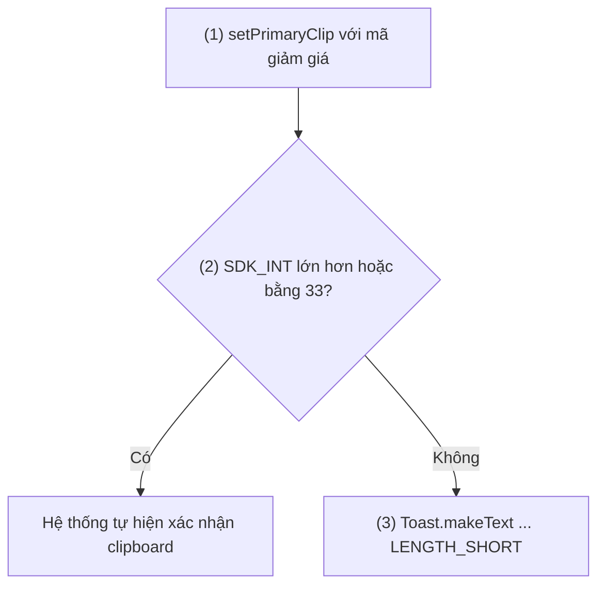
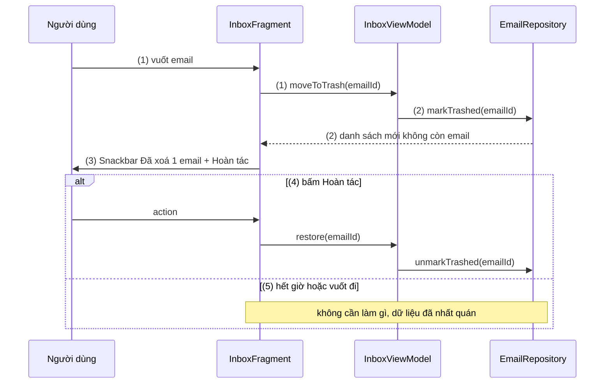
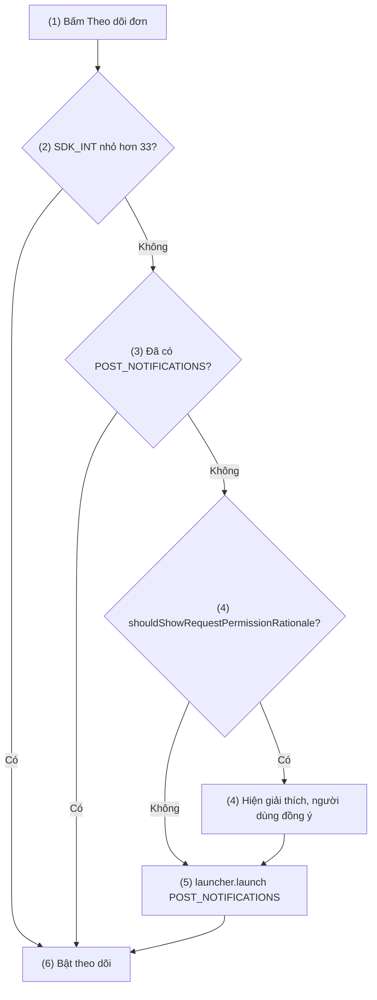
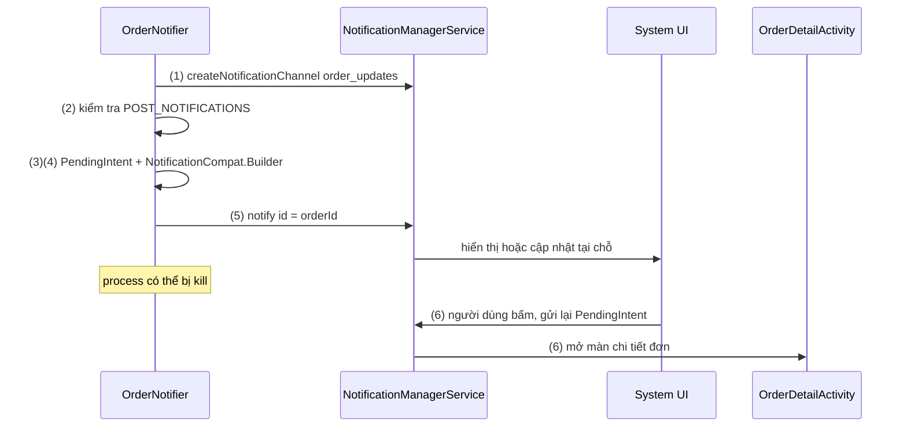
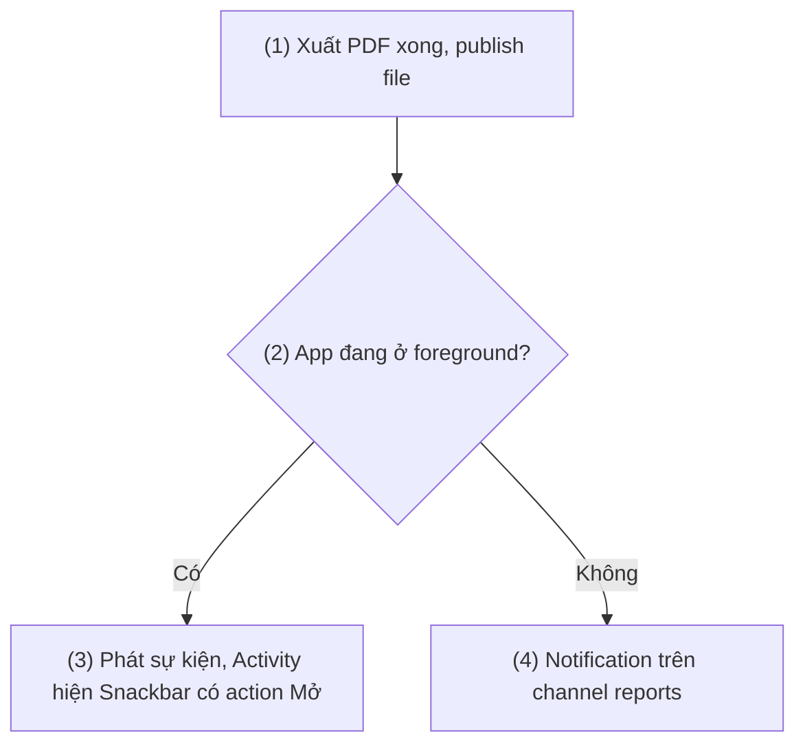

# Message (Toast, Snackbar, Notification)

## Vấn đề cần giải quyết

Mọi app đều phải báo cho người dùng những việc xảy ra ngoài thao tác họ đang làm: "Đã lưu", "Không có mạng", "Đã xoá 1 email", "Đơn hàng đã được giao". Những thông điệp này khác nhau rất nhiều:

- Có cái chỉ cần thoáng qua, có cái phải cho người dùng **làm gì đó** (hoàn tác, thử lại).
- Có cái chỉ có nghĩa khi người dùng **đang nhìn màn hình đó**, có cái phải tới được người dùng **khi app không chạy**.
- Có cái nếu bỏ lỡ cũng không sao, có cái bỏ lỡ là mất tiền (đơn bị huỷ, mã OTP hết hạn).

Chọn sai kênh lộ ra ngay:

```kotlin
// Báo lỗi thanh toán bằng Toast: biến mất sau vài giây, không có nút "Thử lại",
// và nếu người dùng đã chuyển sang app khác thì gần như chắc chắn bỏ lỡ.
Toast.makeText(context, "Thanh toán thất bại, vui lòng thử lại", Toast.LENGTH_SHORT).show()
```

Vấn đề cần giải quyết là: **hiểu mỗi kênh thông điệp do ai giữ, sống bao lâu, tương tác được tới đâu, để đặt mỗi thông điệp vào đúng kênh và cài đặt nó đúng giới hạn của từng phiên bản Android.**

## Sau khi học xong

- Phân biệt được Toast, Snackbar và Notification theo bên giữ thông điệp, thời gian sống và khả năng tương tác, để chọn đúng kênh cho từng thông điệp.
- Triển khai được Snackbar có action và anchor, xử lý được thao tác hoàn tác mà không đặt trạng thái nghiệp vụ trong Snackbar.
- Triển khai được Notification với NotificationChannel, quyền POST_NOTIFICATIONS và PendingIntent mở đúng màn hình.
- Nhận diện được các giới hạn theo phiên bản như custom toast từ background, toast hai dòng, notification trampoline và thông báo bị tắt mặc định trên Android 13.

## Message là gì?

**Message** (thông điệp tới người dùng) là thông báo ngắn mà app đưa ra **ngoài luồng nội dung chính** để báo kết quả, trạng thái hay sự kiện. Android có ba kênh chính, khác nhau ở **ai giữ thông điệp và giữ bao lâu**: Toast do hệ thống giữ trong vài giây, Snackbar do màn hình hiện tại giữ (nó là một View trong cây View), Notification do System UI giữ cho tới khi người dùng xử lý, kể cả khi process của app đã chết.

Mental model xuyên suốt bài: **"ai giữ thông điệp"** quyết định mọi thứ khác.

| Kênh | Ai giữ | Sống bao lâu | Tương tác |
|---|---|---|---|
| Toast | `NotificationManagerService` của hệ thống | 2 giây hoặc 3,5 giây | Không |
| Snackbar | Cây View của Activity/Fragment hiện tại | Vài giây, tới khi bị vuốt, hoặc vô hạn | Một action |
| Notification | System UI (status bar, notification shade) | Tới khi người dùng hoặc app gỡ | Bấm mở, action, trả lời |

Thông điệp sống lâu hơn bên giữ nó thì phải chuyển sang kênh có bên giữ sống lâu hơn. Đó là lý do một việc kết thúc khi app ở nền phải dùng Notification: màn hình (bên giữ Snackbar) đã không còn.

## Cách hoạt động

### Toast: thông điệp do hệ thống hiển thị

`Toast.makeText(context, text, duration).show()` **không vẽ gì trong app**. Nó gửi một yêu cầu qua Binder tới `NotificationManagerService` (chạy trong `system_server`). Dịch vụ này giữ một **hàng đợi toast chung cho cả máy**, hiện lần lượt từng cái, và tự gỡ sau thời gian cố định: `LENGTH_SHORT` là 2 giây, `LENGTH_LONG` là 3,5 giây (hằng `SHORT_DELAY`, `LONG_DELAY` trong AOSP). Không có cách đặt thời gian khác. Mỗi app chỉ được xếp tối đa vài toast trong hàng đợi (AOSP hiện đặt `MAX_PACKAGE_TOASTS = 5`), để toast không hiện chậm nhiều giây sau sự kiện.

Vì hệ thống giữ toast, nó có thể hiện **đè lên app khác**. Điều này từng bị lạm dụng (toast có custom view giả giao diện app khác), nên Android siết dần:

- **Android 11 (API 30), khi target 30+:** toast có custom view (`setView()`) gửi từ background bị chặn, logcat ghi `Blocking custom toast from package ... due to package not in the foreground`. `setView()` bị deprecated. Với text toast, `setGravity()` và `setMargin()` không còn tác dụng, `getView()` trả về `null`. API mới `addCallback(Toast.Callback)` báo khi toast hiện và ẩn.
- **Android 12 (API 31), khi target 31+:** text toast bị giới hạn **hai dòng** và luôn có **icon của app** bên cạnh, để người dùng biết toast đến từ app nào.

Hệ quả: Toast ngày nay chỉ còn là **một dòng chữ ngắn, không tương tác, không tuỳ biến**. Tài liệu chính thức khuyên dùng Snackbar khi app ở foreground và Notification khi app ở background.

#### Ví dụ: báo "Đã sao chép mã giảm giá"

**Bài toán:** người dùng bấm vào mã giảm giá để sao chép. Cần một phản hồi thoáng qua, không cần hành động, và không phụ thuộc màn hình nào: đúng kiểu thông điệp Toast phù hợp. Có một chi tiết: từ Android 13 (API 33), hệ thống tự hiện xác nhận khi app ghi vào clipboard, nên app hiện thêm toast sẽ thành hai thông báo trùng nhau.

**Luồng chạy:**

1. Ghi mã vào clipboard bằng `ClipboardManager.setPrimaryClip()`.
2. Kiểm tra phiên bản: Android 13 trở lên thì hệ thống đã hiện xác nhận, app không làm gì thêm.
3. Android 12L trở xuống: app tự hiện text toast.



```kotlin
// CouponCopier.kt
fun copyCouponCode(context: Context, code: String) {
    val clipboard = context.getSystemService(ClipboardManager::class.java)
    clipboard.setPrimaryClip(ClipData.newPlainText("Mã giảm giá", code))   // (1)

    if (Build.VERSION.SDK_INT < Build.VERSION_CODES.TIRAMISU) {            // (2)
        Toast.makeText(context, "Đã sao chép $code", Toast.LENGTH_SHORT).show() // (3)
    }
}
```

**Kết quả:** trên máy Android 12, bấm mã thấy toast hai dòng có icon app; trên Android 13+, chỉ thấy thông báo clipboard của hệ thống. Toast không có `setGravity()` hay custom view, nên chạy giống nhau trên mọi phiên bản.

### Snackbar: thông điệp nằm trong cây View

**Snackbar** là component của Material Components (`com.google.android.material.snackbar.Snackbar`). Khác Toast, nó là **một View được thêm vào cây View của màn hình hiện tại**, nên nó chỉ sống khi màn hình đó còn, nhưng đổi lại có thể có **một action** ("Hoàn tác", "Thử lại").

Cơ chế chính:

- **Tìm View cha:** `Snackbar.make(view, text, duration)` đi ngược lên từ `view` truyền vào, dừng ở `CoordinatorLayout` đầu tiên gặp được; nếu không có thì dùng `FrameLayout` nội dung của Activity (`android.R.id.content`). Snackbar được thêm vào cuối View cha đó.
- **Một cái một lúc:** một `SnackbarManager` dùng chung quản lý hàng đợi; hiện Snackbar mới thì cái đang hiện bị đóng (sự kiện `DISMISS_EVENT_CONSECUTIVE`).
- **Thời lượng:** `LENGTH_SHORT` (1,5 giây), `LENGTH_LONG` (2,75 giây), `LENGTH_INDEFINITE` (tới khi đóng hoặc bị thay), hoặc số mili giây tuỳ ý qua `setDuration()`. Từ Android 10, thời lượng thực tế được hệ thống điều chỉnh theo cài đặt accessibility "thời gian thực hiện hành động" của người dùng (`AccessibilityManager.getRecommendedTimeoutMillis()`), và Snackbar có action được tính là nội dung có điều khiển.
- **Hành vi trong `CoordinatorLayout`:** vuốt ngang để đóng, và `FloatingActionButton` tự dịch lên nhường chỗ. Không có `CoordinatorLayout` thì không vuốt được.
- **Vị trí:** mặc định nằm sát đáy View cha. `setAnchorView()` đặt nó ngay trên một View khác (FAB, `BottomNavigationView`) để không bị che.
- **Kết thúc:** `addCallback(BaseTransientBottomBar.BaseCallback)` nhận `onDismissed(snackbar, event)` với `event` là `DISMISS_EVENT_ACTION`, `SWIPE`, `TIMEOUT`, `MANUAL` hoặc `CONSECUTIVE`.

Màu của Snackbar theo token Material 3 (`colorSurfaceInverse`, `colorOnSurfaceInverse`, action dùng `colorPrimaryInverse`): nền đảo màu so với bề mặt để nổi lên trên nội dung (xem [8.5.4 Design Guide](design_guide.md)).

#### Ví dụ: xoá email có "Hoàn tác"

**Bài toán:** vuốt một email để xoá; Snackbar hiện "Đã xoá 1 email" với nút "Hoàn tác". Cái bẫy của bài toán: nếu "đang chờ xoá" chỉ nằm trong callback của Snackbar thì xoay màn hình, chuyển tab hay app bị kill giữa chừng đều làm trạng thái đó đi đâu không rõ. Snackbar là **UI**, nó chỉ nên gửi ý định của người dùng đi; trạng thái nghiệp vụ nằm ở tầng dữ liệu.

**Luồng chạy:**

1. Người dùng vuốt email: Fragment gọi `viewModel.moveToTrash(emailId)`.
2. ViewModel đánh dấu email là "trong thùng rác" trong Repository ngay lập tức (soft delete); danh sách quan sát dữ liệu nên email biến mất khỏi list.
3. Fragment hiện Snackbar "Đã xoá 1 email" với action "Hoàn tác", anchor lên trên `BottomNavigationView`.
4. Người dùng bấm "Hoàn tác": Fragment gọi `viewModel.restore(emailId)`, Repository bỏ đánh dấu, email hiện lại.
5. Snackbar hết giờ hoặc bị vuốt: **không làm gì cả**, vì email đã ở thùng rác từ bước 2. Việc xoá hẳn do một tác vụ dọn dẹp riêng làm sau này.



```kotlin
// InboxViewModel.kt
class InboxViewModel(private val repository: EmailRepository) : ViewModel() {
    fun moveToTrash(emailId: Long) {
        viewModelScope.launch { repository.markTrashed(emailId) }   // (2) soft delete ngay
    }

    fun restore(emailId: Long) {
        viewModelScope.launch { repository.unmarkTrashed(emailId) } // (4)
    }
}

// InboxFragment.kt (trích)
private fun onEmailSwiped(email: EmailItem) {
    viewModel.moveToTrash(email.id)                                  // (1)

    Snackbar.make(binding.root, "Đã xoá 1 email", Snackbar.LENGTH_LONG) // (3)
        .setAnchorView(requireActivity().findViewById<View>(R.id.bottom_nav))
        .setAction("Hoàn tác") { viewModel.restore(email.id) }       // (4)
        .show()
    // (5) không có callback xoá hẳn: trạng thái không nằm trong Snackbar
}
```

**Kết quả:** vuốt một email rồi xoay màn hình ngay: Snackbar biến mất cùng View cũ, email vẫn ở thùng rác, không mất, không xoá nhầm. Bấm "Hoàn tác" trước khi hết giờ thì email quay lại đúng vị trí. Nếu `binding.root` là `CoordinatorLayout`, Snackbar vuốt ngang được.

> [!NOTE]
> `viewModelScope.launch` là coroutine, được học ở [8.4.3 Coroutines](../async_threads/coroutines.md); ở đây chỉ cần biết nó chạy việc ghi dữ liệu mà không chặn main thread. ViewModel được học ở [ViewModel](../../session_06/viewmodel.md).

### Notification: thông điệp do System UI giữ

**Notification** là thông điệp app **giao cho hệ thống giữ**. App tạo một đối tượng `Notification` mô tả nội dung, gửi cho `NotificationManagerService`; dịch vụ này kiểm tra, lưu, rồi để System UI hiển thị ở status bar, notification shade, màn khoá, heads-up (thông báo nổi) hay badge trên icon. Từ lúc đó, thông báo **không phụ thuộc process của app**: app bị kill, thông báo vẫn nằm đó.

Một thông báo đi qua các khâu sau:

1. **Channel.** Từ Android 8.0 (API 26), app target 26+ phải gán mọi thông báo vào một **NotificationChannel** (kênh thông báo). Channel mang **importance** quyết định mức làm phiền: `IMPORTANCE_HIGH` có âm thanh và heads-up, `DEFAULT` có âm thanh, `LOW` im lặng, `MIN` im lặng và không có icon trên status bar. Sau khi tạo, **chỉ người dùng** đổi được hành vi của channel; app chỉ đổi được tên và mô tả. Tạo lại channel với cùng giá trị là no-op nên gọi ở mỗi lần khởi động là an toàn.
2. **Quyền.** Từ Android 13 (API 33), gửi thông báo cần runtime permission `POST_NOTIFICATIONS`. App mới cài trên Android 13+ có thông báo **tắt mặc định**. App target 33+ tự chọn lúc hỏi; app target 32 trở xuống thì hệ thống tự hiện hộp thoại khi app tạo channel đầu tiên rồi mở Activity. Cơ chế runtime permission nói chung ở [2.1 File Permissions](../../session_02/file_permissions.md), mục "Manifest Permission vs Runtime Permission".
3. **Nội dung.** `NotificationCompat.Builder(context, channelId)` dựng thông báo: `setSmallIcon()` (bắt buộc), tiêu đề, nội dung, `setContentIntent()` (bấm vào làm gì), action, style (`BigTextStyle`, `BigPictureStyle`, `InboxStyle`, `MessagingStyle`), nhóm (`setGroup()`).
4. **Gửi và cập nhật.** `NotificationManagerCompat.notify(id, notification)`. Cùng `id` (và tag) là **cập nhật** thông báo cũ, khác `id` là thông báo mới. Hệ thống giới hạn tần suất cập nhật của mỗi app (AOSP mặc định 5 lần mỗi giây, vượt thì bản cập nhật bị bỏ và logcat ghi `Package enqueue rate is ... Shedding ...`) và số thông báo đang hiện của mỗi app (AOSP đặt tối đa 50).
5. **Người dùng bấm.** System UI kích hoạt `PendingIntent` app đã đưa ở bước 3. Vì sao phải là PendingIntent, cách chọn `requestCode` và cờ mutability đã có ở [Pending Intent](../../session_04/intent/pending_intent.md); bài này chỉ dùng lại.

Một trường hợp đặc biệt là **thông báo của Foreground Service**: service muốn chạy ở foreground bắt buộc phải gắn một thông báo đang chạy (ongoing). Cách khởi động, `foregroundServiceType` và giới hạn theo phiên bản thuộc [Android Service](../../session_04/components/services/android_service.md), mục "Foreground Service và giới hạn chạy nền theo phiên bản Android". Hai điểm liên quan tới thông báo: app không cần `POST_NOTIFICATIONS` để **khởi động** foreground service, nhưng nếu người dùng từ chối quyền thì thông báo của service không hiện trong shade mà chỉ hiện trong Task Manager; và từ Android 14, người dùng vuốt bỏ được thông báo `setOngoing(true)` (trừ khi máy đang khoá, và trừ một số loại như `CallStyle`, media).

#### Ví dụ: xin quyền thông báo đúng lúc

**Bài toán:** app giao đồ ăn cần gửi thông báo trạng thái đơn. Hỏi quyền ngay khi mở app lần đầu làm người dùng từ chối theo phản xạ; thời điểm tốt là khi họ vừa đặt đơn và bấm "Theo dõi đơn", lúc họ hiểu ngay thông báo dùng để làm gì.

**Luồng chạy:**

1. Người dùng bấm "Theo dõi đơn".
2. Máy dưới Android 13: không có runtime permission, đi thẳng bước 6.
3. Đã có quyền: đi thẳng bước 6.
4. `shouldShowRequestPermissionRationale()` trả `true` (người dùng từng từ chối một lần): hiện giải thích ngắn trước, người dùng đồng ý thì sang bước 5.
5. Gọi launcher `RequestPermission` để hệ thống hiện hộp thoại.
6. Có quyền thì bật theo dõi; không có thì vẫn cho theo dõi trong app, chỉ không có thông báo.



```xml
<!-- AndroidManifest.xml -->
<uses-permission android:name="android.permission.POST_NOTIFICATIONS" />
```

```kotlin
// OrderTrackingFragment.kt (trích)
private val notificationPermission =
    registerForActivityResult(ActivityResultContracts.RequestPermission()) { granted ->
        viewModel.startTracking(withNotifications = granted)          // (6)
    }

private fun onTrackOrderClicked() {                                    // (1)
    when {
        Build.VERSION.SDK_INT < Build.VERSION_CODES.TIRAMISU ->        // (2)
            viewModel.startTracking(withNotifications = true)
        ContextCompat.checkSelfPermission(
            requireContext(), Manifest.permission.POST_NOTIFICATIONS
        ) == PackageManager.PERMISSION_GRANTED ->                      // (3)
            viewModel.startTracking(withNotifications = true)
        shouldShowRequestPermissionRationale(Manifest.permission.POST_NOTIFICATIONS) -> // (4)
            MaterialAlertDialogBuilder(requireContext())
                .setTitle("Nhận cập nhật đơn hàng?")
                .setMessage("Chúng tôi báo khi quán nhận đơn và khi shipper sắp tới.")
                .setPositiveButton("Đồng ý") { _, _ ->
                    notificationPermission.launch(Manifest.permission.POST_NOTIFICATIONS)
                }
                .setNegativeButton("Để sau") { _, _ ->
                    viewModel.startTracking(withNotifications = false)
                }
                .show()
        else -> notificationPermission.launch(Manifest.permission.POST_NOTIFICATIONS) // (5)
    }
}
```

**Kết quả:** reset quyền bằng `adb shell pm revoke <package> android.permission.POST_NOTIFICATIONS` kèm `pm clear-permission-flags ... user-set user-fixed` để mô phỏng máy mới cài; bấm "Theo dõi đơn" mới thấy hộp thoại. Từ chối hai lần thì hệ thống không hiện hộp thoại nữa; lúc đó chỉ còn cách đưa người dùng tới cài đặt thông báo của app.

#### Ví dụ: thông báo trạng thái đơn hàng

**Bài toán:** trạng thái đơn đổi nhiều lần (quán nhận đơn, đang giao, đã giao). Người dùng chỉ nên thấy **một** thông báo cho mỗi đơn, được cập nhật tại chỗ; bấm vào mở đúng màn chi tiết của đơn đó, kể cả khi app đã bị kill.

**Luồng chạy:**

1. Khi app khởi động, tạo channel "Cập nhật đơn hàng" với `IMPORTANCE_DEFAULT`.
2. Khi có trạng thái mới (ví dụ nhận từ push), `OrderNotifier` kiểm tra quyền; không có quyền thì dừng.
3. Tạo `PendingIntent` mở `OrderDetailActivity` với `requestCode` riêng của đơn.
4. Dựng thông báo bằng `NotificationCompat.Builder`, `setOnlyAlertOnce(true)` để các lần cập nhật không kêu lại.
5. `notify()` với `id` là id đơn: lần đầu tạo mới, các lần sau cập nhật tại chỗ.
6. Người dùng bấm: System UI kích hoạt PendingIntent, hệ thống mở `OrderDetailActivity` dưới danh tính app.



```kotlin
// OrderNotifier.kt
class OrderNotifier(private val context: Context) {

    fun createChannel() {                                              // (1) gọi trong Application.onCreate
        val channel = NotificationChannelCompat.Builder(
            CHANNEL_ORDER_UPDATES, NotificationManagerCompat.IMPORTANCE_DEFAULT
        )
            .setName("Cập nhật đơn hàng")
            .setDescription("Trạng thái nhận đơn, giao hàng")
            .build()
        NotificationManagerCompat.from(context).createNotificationChannel(channel)
    }

    fun showStatus(orderId: Int, status: String) {
        val manager = NotificationManagerCompat.from(context)
        if (!manager.areNotificationsEnabled()) return                // (2) gồm cả trường hợp chưa cấp quyền

        val intent = Intent(context, OrderDetailActivity::class.java)
            .putExtra(OrderDetailActivity.EXTRA_ORDER_ID, orderId)
        val contentIntent = TaskStackBuilder.create(context)           // (3) Back về màn danh sách đơn
            .addNextIntentWithParentStack(intent)
            .getPendingIntent(
                orderId,                                               // requestCode riêng cho từng đơn
                PendingIntent.FLAG_IMMUTABLE or PendingIntent.FLAG_UPDATE_CURRENT
            )

        val notification = NotificationCompat.Builder(context, CHANNEL_ORDER_UPDATES) // (4)
            .setSmallIcon(R.drawable.ic_stat_order)
            .setContentTitle("Đơn #$orderId")
            .setContentText(status)
            .setCategory(NotificationCompat.CATEGORY_STATUS)
            .setContentIntent(contentIntent)
            .setOnlyAlertOnce(true)
            .setAutoCancel(true)
            .build()

        try {
            manager.notify(orderId, notification)                      // (5) cùng id: cập nhật tại chỗ
        } catch (e: SecurityException) {
            // Quyền bị thu hồi giữa lúc kiểm tra và lúc gửi: bỏ qua thông báo này
        }
    }

    companion object {
        const val CHANNEL_ORDER_UPDATES = "order_updates"
    }
}
```

**Kết quả:** gọi `showStatus(1024, "Quán đã nhận đơn")` rồi `showStatus(1024, "Shipper đang tới")`: shade chỉ có một thông báo cho đơn #1024, chỉ kêu lần đầu. Kill app (`adb shell am force-stop <package>` sẽ gỡ cả thông báo, nên hãy vuốt app khỏi Recents) rồi bấm thông báo: mở đúng chi tiết đơn #1024, Back về danh sách đơn. Kiểm tra channel bằng `adb shell dumpsys notification`.

> [!TIP]
> `areNotificationsEnabled()` trả `false` cả khi người dùng tắt thông báo của app trong cài đặt, không chỉ khi thiếu quyền. Kiểm tra trên **channel** (`getNotificationChannelCompat(id)?.importance`) nếu cần biết riêng một channel có bị tắt không.

## Ví dụ thực tế

Ba bài toán thường gặp:

1. **Một việc dài kết thúc: báo thế nào tuỳ app đang ở đâu** (bài toán chính, code bên dưới).
2. **Mất mạng kéo dài:** đây là trạng thái, không phải sự kiện. Dùng Snackbar `LENGTH_INDEFINITE` với action "Thử lại", hoặc một banner cố định trong layout; đóng nó khi có mạng lại. Không dùng Toast lặp lại mỗi lần request lỗi.
3. **Lỗi nhập liệu trong form:** không phải message. Lỗi gắn với một ô nhập thì hiện tại ô đó (`TextInputLayout.error`); Snackbar hay Toast bắt người dùng nhớ lỗi thuộc ô nào.

### Xuất báo cáo PDF: Snackbar nếu đang xem, Notification nếu đã rời app

**Bài toán:** app kế toán xuất báo cáo PDF mất vài chục giây. Khi xong, nếu người dùng vẫn đang ở app thì Snackbar "Đã xuất báo cáo" với action "Mở" là đủ; nếu họ đã chuyển sang app khác thì Snackbar không có ai xem, phải dùng Notification. Đây chính là mental model "ai giữ thông điệp": thông điệp sống lâu hơn màn hình thì phải chuyển cho System UI.

**Luồng chạy:**

1. `ReportExporter` xuất xong file, gọi `ReportResultPublisher.publish(file)`.
2. Publisher kiểm tra app có đang ở foreground không bằng `ProcessLifecycleOwner` (artifact `androidx.lifecycle:lifecycle-process`): trạng thái ít nhất `STARTED` nghĩa là có ít nhất một Activity đang hiện.
3. Có: phát sự kiện qua một `SharedFlow`; Activity đang hiện thu sự kiện và hiện Snackbar có action "Mở".
4. Không: tạo Notification trên channel "Báo cáo", bấm vào mở file.



```kotlin
// ReportResultPublisher.kt
class ReportResultPublisher(
    private val context: Context,
    private val notifier: ReportNotifier,
) {
    private val _uiEvents = MutableSharedFlow<File>(extraBufferCapacity = 1)
    val uiEvents: SharedFlow<File> = _uiEvents

    fun publish(report: File) {                                         // (1)
        val inForeground = ProcessLifecycleOwner.get().lifecycle.currentState
            .isAtLeast(Lifecycle.State.STARTED)                         // (2)
        if (inForeground) {
            _uiEvents.tryEmit(report)                                   // (3)
        } else {
            notifier.showReportReady(report)                            // (4)
        }
    }
}

// ReportsActivity.kt (trích)
override fun onCreate(savedInstanceState: Bundle?) {
    super.onCreate(savedInstanceState)
    setContentView(binding.root)
    lifecycleScope.launch {
        repeatOnLifecycle(Lifecycle.State.STARTED) {
            publisher.uiEvents.collect { report ->                      // (3)
                Snackbar.make(binding.root, "Đã xuất ${report.name}", Snackbar.LENGTH_LONG)
                    .setAction("Mở") { openReport(report) }
                    .show()
            }
        }
    }
}

// ReportNotifier.kt (trích): class ReportNotifier(private val context: Context)
// CHANNEL_REPORTS được tạo trong Application.onCreate như ví dụ OrderNotifier
fun showReportReady(report: File) {                                     // (4)
    val manager = NotificationManagerCompat.from(context)
    if (!manager.areNotificationsEnabled()) return
    val openIntent = Intent(context, ReportViewerActivity::class.java)
        .putExtra(ReportViewerActivity.EXTRA_PATH, report.absolutePath)
    val pendingIntent = PendingIntent.getActivity(
        context, report.name.hashCode(), openIntent,
        PendingIntent.FLAG_IMMUTABLE or PendingIntent.FLAG_UPDATE_CURRENT
    )
    val notification = NotificationCompat.Builder(context, CHANNEL_REPORTS)
        .setSmallIcon(R.drawable.ic_stat_report)
        .setContentTitle("Báo cáo đã sẵn sàng")
        .setContentText(report.name)
        .setContentIntent(pendingIntent)
        .setAutoCancel(true)
        .build()
    try {
        manager.notify(report.name.hashCode(), notification)
    } catch (e: SecurityException) {
        // quyền bị thu hồi: bỏ qua
    }
}
```

**Kết quả:** bấm xuất rồi ở yên trong app: Snackbar hiện, bấm "Mở" xem được PDF. Bấm xuất rồi về Home: vài giây sau có thông báo, bấm vào mở PDF. Trong cả hai trường hợp, người dùng nhận đúng một thông điệp.

> [!NOTE]
> `SharedFlow`, `lifecycleScope` và `repeatOnLifecycle` là phần tối thiểu của coroutine và Flow để thu sự kiện theo vòng đời; coroutine học ở [8.4.3 Coroutines](../async_threads/coroutines.md), Flow học ở [7.1.4.2 Flow](../../session_07/design_pattern/observer/flow.md). Nếu việc xuất phải tiếp tục khi app bị đưa xuống nền lâu, nó cần chạy trong WorkManager hoặc Foreground Service (xem [Android Service](../../session_04/components/services/android_service.md)).

## So sánh với các cách tiếp cận khác

| Tiêu chí | Toast | Snackbar | Notification | Dialog |
|---|---|---|---|---|
| Ai giữ | Hệ thống | Cây View màn hiện tại | System UI | Activity/Fragment hiện tại |
| Khi app ở nền | Text toast vẫn hiện; custom toast bị chặn (Android 11+) | Không | Có, kể cả process đã chết | Không |
| Tương tác | Không | Một action, vuốt để đóng | Bấm, action, trả lời trực tiếp | Bắt buộc phản hồi |
| Chặn thao tác | Không | Không | Không | Có |
| Cần quyền | Không | Không | `POST_NOTIFICATIONS` (Android 13+) | Không |
| Hợp với | Xác nhận thoáng qua | Kết quả thao tác, hoàn tác, thử lại | Sự kiện quan trọng ngoài app | Quyết định không thể bỏ qua |

Dialog (xem [Dialog and DialogFragment](../../session_04/components/fragment/dialog_and_dialogfragment.md)) không phải "message" theo nghĩa bài này vì nó chặn luồng; nhưng nó là lựa chọn đúng khi thông điệp đòi một quyết định (xác nhận xoá vĩnh viễn, đăng xuất).

## Khi nào nên và không nên dùng

- **Toast:** nên dùng cho xác nhận ngắn, không cần hành động, và chấp nhận bị bỏ lỡ. Không dùng cho lỗi cần xử lý, thông tin quan trọng, hay bất cứ thứ gì cần nhiều hơn hai dòng.
- **Snackbar:** nên dùng cho kết quả của thao tác người dùng vừa làm trên màn hình này, nhất là khi có một hành động đi kèm (hoàn tác, thử lại, mở). Không dùng khi thông điệp phải sống qua việc rời màn hình, và không đặt trạng thái nghiệp vụ trong callback của nó.
- **Notification:** nên dùng cho sự kiện người dùng cần biết khi không mở app (tin nhắn, đơn hàng, nhắc lịch) và cho việc dài đang chạy ở foreground service. Không dùng cho thông tin chỉ có nghĩa khi đang ở trong app, và không dùng để quảng cáo trên channel quan trọng: người dùng sẽ tắt cả channel, hoặc thu hồi quyền.
- **Không dùng kênh nào cả** khi thông tin thuộc về một phần tử cụ thể trên màn hình (lỗi của ô nhập, trạng thái trống của danh sách): hiện ngay tại phần tử đó.

## Sai lầm thường gặp

### 1. Gửi thông báo trên Android 8+ mà không có channel

```kotlin
// Sai: channel "promo" chưa bao giờ được tạo
val notification = NotificationCompat.Builder(context, "promo")
    .setSmallIcon(R.drawable.ic_stat_promo)
    .setContentText("Giảm 50% hôm nay")
    .build()
NotificationManagerCompat.from(context).notify(1, notification)
```

**Lỗi lộ ra thế nào:** không crash, không có thông báo; logcat của hệ thống ghi `No Channel found for pkg=..., channelId=promo`. Bật Developer options → "Show notification channel warnings" để thấy cảnh báo ngay trên màn.

**Cách sửa:** tạo mọi channel trong `Application.onCreate()` (an toàn khi gọi lặp lại), và dùng hằng số cho channel id thay vì chuỗi rải rác.

### 2. Gọi `notify()` khi chưa có quyền trên Android 13

**Lỗi lộ ra thế nào:** app target 33+ cài mới trên Android 13: không thông báo nào hiện, không lỗi gì. Lint báo `MissingPermission` ở chỗ gọi `notify()` nếu không kiểm tra quyền.

**Cách sửa:** khai báo `POST_NOTIFICATIONS` trong manifest, xin quyền theo ngữ cảnh như ví dụ "xin quyền thông báo đúng lúc", và kiểm tra `areNotificationsEnabled()` hoặc `checkSelfPermission()` trước khi gửi. Không hỏi ngay ở màn đầu tiên: người dùng từ chối hai lần là app không được hỏi lại nữa.

### 3. Notification trampoline: mở Activity từ receiver hoặc service

```kotlin
// Sai: bấm thông báo → BroadcastReceiver → startActivity
class OpenOrderReceiver : BroadcastReceiver() {
    override fun onReceive(context: Context, intent: Intent) {
        analytics.log("notification_opened")
        context.startActivity(
            Intent(context, OrderDetailActivity::class.java).addFlags(Intent.FLAG_ACTIVITY_NEW_TASK)
        )
    }
}
```

**Lỗi lộ ra thế nào:** app target Android 12+ bấm thông báo không mở gì; logcat ghi `Indirect notification activity start (trampoline) from <package>, this should be avoided for performance reasons.`

**Cách sửa:** `setContentIntent()` bằng `PendingIntent.getActivity()` trỏ thẳng tới Activity đích. Việc ghi log chuyển vào Activity (đọc extra đánh dấu "mở từ thông báo").

### 4. Đặt trạng thái nghiệp vụ trong callback của Snackbar

```kotlin
// Sai: chỉ xoá thật khi Snackbar đóng mà không phải do bấm Hoàn tác
Snackbar.make(binding.root, "Đã xoá 1 email", Snackbar.LENGTH_LONG)
    .setAction("Hoàn tác") { }
    .addCallback(object : Snackbar.Callback() {
        override fun onDismissed(bar: Snackbar, event: Int) {
            if (event != Snackbar.Callback.DISMISS_EVENT_ACTION) repository.deleteForever(emailId)
        }
    })
    .show()
```

**Lỗi lộ ra thế nào:** email "đã xoá" trên UI nhưng việc xoá thật phụ thuộc vòng đời của một View. Process bị kill trong 2,75 giây đó thì email quay lại khi mở app; xoá liên tiếp nhiều email thì Snackbar sau đóng Snackbar trước (`DISMISS_EVENT_CONSECUTIVE`) và logic phải xử lý thêm trường hợp đó. Ngoài ra, ghi dữ liệu trong callback của View dễ chạy trên main thread.

**Cách sửa:** soft delete ngay ở tầng dữ liệu, Snackbar chỉ gửi "hoàn tác", như ví dụ "xoá email có Hoàn tác".

### 5. Cập nhật thông báo tiến trình quá dày

```kotlin
// Sai: DownloadNotifier.kt, được gọi mỗi khi tải xong một khối 8 KB
fun onChunkDownloaded(downloadedBytes: Long, totalBytes: Long) {
    val percent = (downloadedBytes * 100 / totalBytes).toInt()
    manager.notify(DOWNLOAD_ID, builder.setProgress(100, percent, false).build())
}
```

**Lỗi lộ ra thế nào:** thanh tiến trình đứng rồi nhảy cóc, có khi kẹt ở giá trị cũ; logcat hệ thống ghi `Package enqueue rate is ... Shedding ...` vì app vượt ngưỡng cập nhật mỗi giây.

**Cách sửa:** chỉ `notify()` khi phần trăm thực sự đổi và không quá khoảng một lần mỗi giây; dùng `setOnlyAlertOnce(true)` để không kêu lại mỗi lần cập nhật. Thông báo "hoàn tất" cuối cùng không bị giới hạn này chặn.

## Lịch sử phát triển

- **Android 1.0 (API 1, 2008):** đã có `Toast` và `Notification` (status bar). Notification dựng bằng constructor và `setLatestEventInfo()`.
- **Android 3.0 (API 11, 2011):** `Notification.Builder`. Support Library có `NotificationCompat` để dùng API mới trên máy cũ.
- **Android 4.1 (API 16, 2012):** thông báo mở rộng được (`BigTextStyle`, `BigPictureStyle`, `InboxStyle`) và action.
- **Android 5.0 (API 21, 2014):** heads-up notification, thông báo trên màn khoá với `setVisibility()`.
- **05/2015, Design Support Library:** ra mắt `Snackbar` cùng `CoordinatorLayout`; về sau chuyển sang Material Components (`com.google.android.material.snackbar`).
- **Android 7.0 (API 24, 2016):** trả lời trực tiếp trên thông báo, nhóm thông báo (bundled), `MessagingStyle`.
- **Android 8.0 (API 26, 2017):** NotificationChannel bắt buộc khi target 26+, badge trên icon, tạm hoãn (snooze).
- **Android 11 (API 30, 2020):** chặn custom toast từ background, deprecate `Toast.setView()`, thêm `Toast.Callback`.
- **Android 12 (API 31, 2021):** toast hai dòng kèm icon app; chặn notification trampoline; custom notification luôn nằm trong template chuẩn; PendingIntent phải khai báo mutability.
- **Android 13 (API 33, 2022):** runtime permission `POST_NOTIFICATIONS`, thông báo tắt mặc định với app mới cài; hệ thống tự hiện xác nhận khi ghi clipboard.
- **Android 14 (API 34, 2023):** người dùng vuốt bỏ được thông báo ongoing (trừ khi máy khoá và một số loại như `CallStyle`, media).
- **Android 16 (API 36, 2025):** `Notification.ProgressStyle` cho thông báo theo tiến trình và nền tảng của Live Updates (thông báo được "đưa lên" status bar cho việc người dùng đang theo dõi như giao hàng, đi xe). Cách hệ thống quyết định đưa lên và quyền liên quan đang thay đổi theo các bản cập nhật Android 16, cần kiểm tra lại tài liệu chính thức khi dùng.

## Kết nối hệ thống

- **Tiên quyết:**
  - [Pending Intent](../../session_04/intent/pending_intent.md): mọi thao tác bấm trên Notification đi qua PendingIntent.
- **Liên quan:**
  - [Android Service](../../session_04/components/services/android_service.md): thông báo bắt buộc của Foreground Service.
  - [2.1 File Permissions](../../session_02/file_permissions.md): cơ chế runtime permission mà `POST_NOTIFICATIONS` dùng.
  - [Dialog and DialogFragment](../../session_04/components/fragment/dialog_and_dialogfragment.md): khi thông điệp cần một quyết định.
  - [Task and Backstack](../../session_04/components/activity/task_and_backstack.md): back stack khi mở màn hình từ thông báo (`TaskStackBuilder`).
  - [8.5.4 Design Guide](design_guide.md): token màu Material mà Snackbar dùng.
- **Học tiếp:**
  - [8.5.6 Animation](animation.md): chuyển động khi Snackbar xuất hiện và khi FAB nhường chỗ.
  - [7.1.4.2 Flow](../../session_07/design_pattern/observer/flow.md): `SharedFlow` dùng để phát sự kiện UI một lần.

## Tham khảo

- [Toasts overview - Android Developers](https://developer.android.com/guide/topics/ui/notifiers/toasts)
- [Behavior changes: apps targeting Android 11 (Updates to toasts) - Android Developers](https://developer.android.com/about/versions/11/behavior-changes-11)
- [Behavior changes: apps targeting Android 12 (Toast redesign, notification trampolines) - Android Developers](https://developer.android.com/about/versions/12/behavior-changes-12)
- [Behavior changes: all apps on Android 14 (non-dismissible notifications) - Android Developers](https://developer.android.com/about/versions/14/behavior-changes-all)
- [Create and manage notification channels - Android Developers](https://developer.android.com/develop/ui/views/notifications/channels)
- [Notification runtime permission - Android Developers](https://developer.android.com/develop/ui/views/notifications/notification-permission)
- [Copy and paste (feedback on Android 13+) - Android Developers](https://developer.android.com/develop/ui/views/touch-and-input/copy-paste)
- [Snackbar - Material Components for Android docs](https://github.com/material-components/material-components-android/blob/master/docs/components/Snackbar.md)
- [Snackbar.java và SnackbarManager.java (thời lượng, findSuitableParent) - GitHub](https://github.com/material-components/material-components-android/tree/master/lib/java/com/google/android/material/snackbar)
- [NotificationManagerService.java (SHORT_DELAY, LONG_DELAY, MAX_PACKAGE_TOASTS, enqueue rate) - AOSP](https://android.googlesource.com/platform/frameworks/base/+/refs/heads/main/services/core/java/com/android/server/notification/NotificationManagerService.java)
