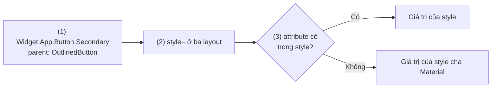
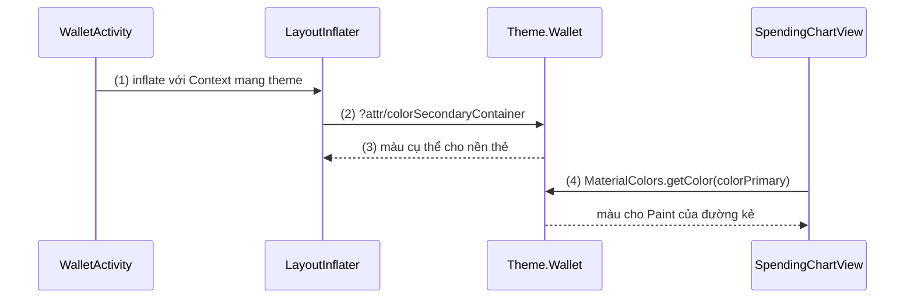
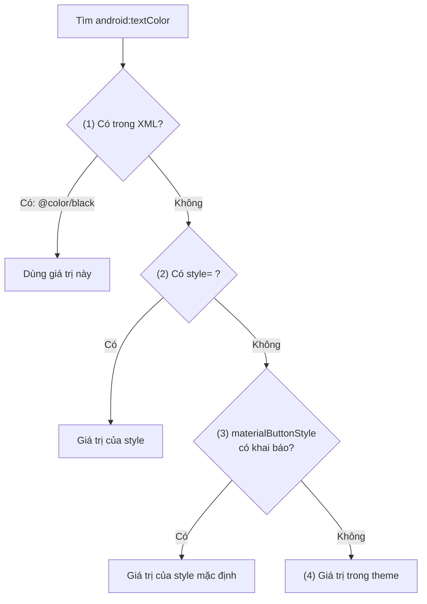
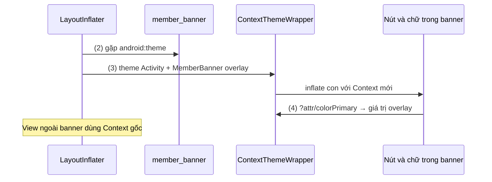
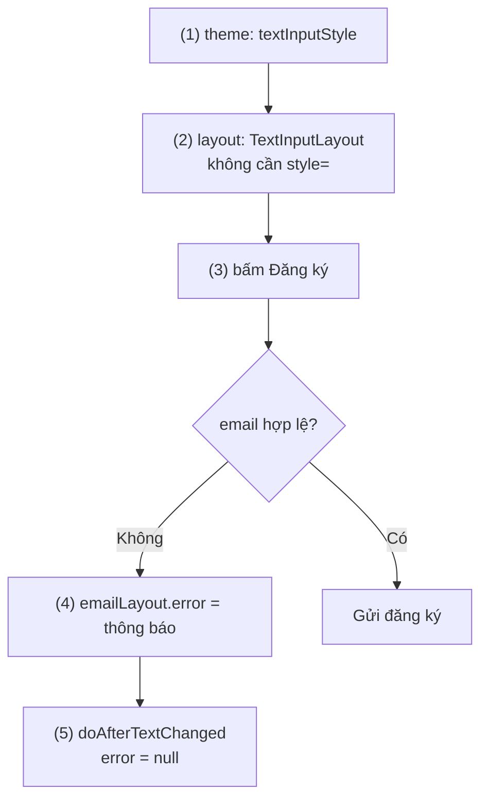
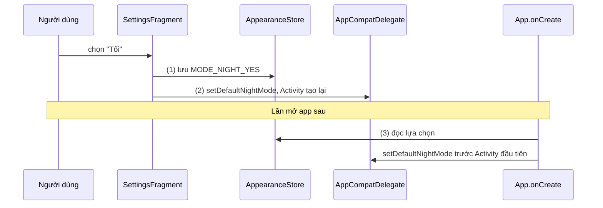
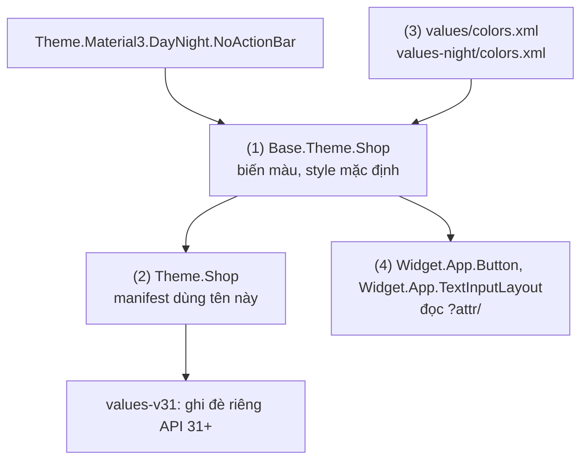

# Styles and Themes

## Vấn đề cần giải quyết

Một app có hàng trăm View: nút chính, nút phụ, ô nhập, thẻ, tiêu đề. Nếu mỗi View tự ghi màu, cỡ chữ, góc bo trong layout:

```xml
<Button
    android:backgroundTint="#1B5E20"
    android:textColor="#FFFFFF"
    android:textSize="16sp" ... />
```

thì ba yêu cầu rất thường gặp đều trở thành sửa tay hàng loạt:

- **Đổi nhận diện thương hiệu:** màu chính từ xanh lá sang xanh dương nghĩa là tìm và sửa mọi chỗ ghi `#1B5E20`.
- **Dark theme:** cùng một nút cần màu khác khi máy bật chế độ tối; mã màu ghi cứng không đổi theo được.
- **Một vùng khác tông:** banner nền tối trên màn sáng cần chữ và nút bên trong đổi sang màu sáng, nhưng chỉ trong banner đó.

Vấn đề cần giải quyết là: **tách "View này trông như thế nào" khỏi layout, và tách giá trị cụ thể (màu, font) khỏi chỗ dùng nó**, để đổi một chỗ mà mọi View liên quan đổi theo.

## Sau khi học xong

- Giải thích được khác biệt giữa style, theme và ThemeOverlay, và cách tham chiếu ?attr/ được resolve theo theme của Context.
- Debug được vì sao một View nhận giá trị attribute từ đâu bằng thứ tự ưu tiên giữa attribute trong XML, style, default style và theme.
- Áp dụng được style cho View và cho ô nhập TextInputLayout, cho từng View lẫn làm mặc định toàn app qua theme attribute.
- Triển khai được theme DayNight với lựa chọn Sáng, Tối, Theo hệ thống.
- Nhận diện được các lỗi thường gặp như mong style kế thừa xuống View con, dùng theme đầy đủ thay cho ThemeOverlay, inflate bằng applicationContext và đổi chế độ tối sai chỗ.

## Styles and Themes là gì?

**Style** là một tập cặp attribute và giá trị áp cho **đúng một View**. **Theme** là một tập cặp attribute và giá trị gắn vào một **Context** (cả app, một Activity, hoặc một nhánh View); mọi View được tạo từ Context đó đọc giá trị của theme qua tham chiếu `?attr/tên`.

Mental model: **theme là bảng biến của Context, style là công thức của một loại View.** Công thức (style) ghi "nền = `?attr/colorPrimary`, chữ = `?attr/colorOnPrimary`" thay vì mã màu; bảng biến (theme) quyết định `colorPrimary` lúc này là màu gì. Đổi bảng biến (sang dark theme, hay một bảng phụ cho riêng banner) thì mọi công thức đọc biến đó đổi theo, không phải sửa công thức nào.

Từ vựng của bảng biến (color role như `colorPrimary`, `colorSurface`, thang chữ, hình khối của Material Design) thuộc [Design Guide](design_guide.md); bài này dạy cơ chế Android dùng bảng biến và công thức để ra giá trị cuối cùng cho mỗi View.

## Cách hoạt động

### Style: công thức cho một loại View

Style khai báo trong `res/values/themes.xml` (hoặc `styles.xml`) bằng `<style>`, mỗi `<item>` là một attribute mà bạn vẫn có thể ghi thẳng trong layout:

- **Kế thừa bằng `parent`:** `<style name="Widget.App.Button.Secondary" parent="Widget.Material3.Button.OutlinedButton">` lấy toàn bộ công thức của Material rồi chỉ ghi đè vài attribute. Luôn kế thừa một style có sẵn để giữ hành vi chuẩn (trạng thái pressed, disabled, ripple).
- **Kế thừa bằng dấu chấm:** `Widget.App.Button.Secondary.Small` tự kế thừa `Widget.App.Button.Secondary` mà không cần `parent`; chỉ dùng cho style của chính bạn. Có cả hai thì `parent` thắng.
- **Áp bằng `style="@style/..."`:** chỉ View đó nhận style; **View con không nhận** (muốn cả nhánh nhận thì cần theme, phần sau).
- **Một View chỉ có một `style`.** Riêng `TextView` có thêm `android:textAppearance`, một "style chỉ cho chữ" (font, cỡ, màu chữ), để style chính dành cho phần khác.

Quy ước đặt tên `Widget.<App>.<Component>.<Biến thể>` cho style của component và `TextAppearance.<App>.<Vai trò>` cho chữ giúp đọc tên là biết style dùng cho đâu.

#### Ví dụ: nút phụ "Để sau" dùng chung nhiều màn

**Bài toán:** màn onboarding, màn cập nhật app và màn xin quyền đều có nút phụ ("Để sau", "Bỏ qua"): viền, không nền, góc bo 12dp, chữ màu primary. Ba màn phải giống hệt nhau, và đổi thiết kế một lần thì cả ba đổi.

**Luồng chạy:**

1. Khai báo `Widget.App.Button.Secondary` kế thừa nút viền của Material 3, chỉ ghi đè góc bo và màu chữ, màu chữ tham chiếu `?attr/colorPrimary`.
2. Ba layout gán `style="@style/Widget.App.Button.Secondary"`.
3. Khi inflate, nút đọc các attribute từ style; attribute nào không có trong style thì lấy từ style cha của Material.



```xml
<!-- res/values/themes.xml (1) -->
<style name="Widget.App.Button.Secondary" parent="Widget.Material3.Button.OutlinedButton">
    <item name="android:textColor">?attr/colorPrimary</item>
    <item name="shapeAppearance">@style/ShapeAppearance.App.Button</item>
</style>

<style name="ShapeAppearance.App.Button" parent="">
    <item name="cornerFamily">rounded</item>
    <item name="cornerSize">12dp</item>
</style>

<!-- res/layout/fragment_onboarding.xml (2) -->
<Button
    android:id="@+id/skip_button"
    style="@style/Widget.App.Button.Secondary"
    android:layout_width="wrap_content"
    android:layout_height="wrap_content"
    android:text="@string/action_later" />
```

**Kết quả:** ba nút giống nhau; đổi `cornerSize` sang 20dp trong style thì cả ba màn đổi. Màu chữ không ghi mã màu mà tham chiếu `?attr/colorPrimary`, nên khi theme đổi (dark theme), nút đổi theo mà style không phải sửa.

### Theme và tham chiếu `?attr/`

Theme cũng khai báo bằng `<style>`, nhưng được **áp vào Context**: `android:theme` trên `<application>` hoặc `<activity>` trong manifest. Mỗi Activity giữ một object `Resources.Theme`; `LayoutInflater` của Activity tạo View bằng Context mang theme đó.

Theme chứa ba loại item:

- **Biến ngữ nghĩa:** `colorPrimary`, `colorOnPrimary`, `colorSurface`, `textAppearanceBodyLarge`, `shapeAppearanceCornerMedium`. Style và layout đọc chúng bằng `?attr/colorPrimary`.
- **Style mặc định của từng loại component** (default style attribute): `materialButtonStyle`, `textInputStyle`, `toolbarStyle`. Đặt chúng trong theme là đổi công thức mặc định của **mọi** nút, mọi ô nhập trong app mà không cần ghi `style=` ở từng chỗ.
- **Thuộc tính cửa sổ:** `android:windowBackground`, `android:statusBarColor`, chỉ có tác dụng ở theme của Activity.

Khác nhau giữa hai kiểu tham chiếu:

| Viết | Nghĩa | Đổi theo theme? |
|---|---|---|
| `@color/brand_green` | Một resource cụ thể (có thể khác nhau giữa `values/` và `values-night/`) | Chỉ theo resource qualifier |
| `?attr/colorPrimary` | "Hỏi theme của Context hiện tại xem `colorPrimary` là gì" | Có: theme khác, overlay khác cho giá trị khác |

Trong code, đọc theme attribute bằng `MaterialColors.getColor(view, attr)` của Material Components, hoặc `context.theme.resolveAttribute(attr, typedValue, true)`. Không đọc màu bằng `ContextCompat.getColor(context, R.color.x)` khi giá trị thật sự phụ thuộc theme.

#### Ví dụ: thẻ ưu đãi và đường biểu đồ lấy màu từ theme

**Bài toán:** màn ví có thẻ ưu đãi nền `secondaryContainer`, và một custom view vẽ biểu đồ chi tiêu (như các View tự vẽ ở [View Custom](views.md)) cần màu `colorPrimary` cho đường kẻ. Cả hai phải đổi đúng khi đổi thương hiệu hoặc bật dark theme.

**Luồng chạy:**

1. Activity được tạo với theme `Theme.Wallet` khai báo trong manifest; Context của nó mang `Resources.Theme` đó.
2. `LayoutInflater` đọc layout thẻ ưu đãi, gặp `?attr/colorSecondaryContainer`.
3. Theme của Context tra `colorSecondaryContainer` ra một màu cụ thể, gán cho nền thẻ.
4. Custom view biểu đồ đọc `colorPrimary` trong code bằng `MaterialColors.getColor(this, ...)`, cũng từ theme của chính Context của nó.



```xml
<!-- res/layout/item_promo_card.xml (2) -->
<com.google.android.material.card.MaterialCardView
    android:layout_width="match_parent"
    android:layout_height="wrap_content"
    app:cardBackgroundColor="?attr/colorSecondaryContainer">

    <TextView
        android:id="@+id/promo_title"
        android:layout_width="wrap_content"
        android:layout_height="wrap_content"
        android:textAppearance="?attr/textAppearanceTitleMedium"
        android:textColor="?attr/colorOnSecondaryContainer" />
</com.google.android.material.card.MaterialCardView>
```

```kotlin
// SpendingChartView.kt (4)
private val linePaint = Paint(Paint.ANTI_ALIAS_FLAG).apply {
    style = Paint.Style.STROKE
    color = MaterialColors.getColor(this@SpendingChartView, androidx.appcompat.R.attr.colorPrimary)
}
```

**Kết quả:** đổi `colorPrimary` và `colorSecondaryContainer` trong `Theme.Wallet` thì cả thẻ lẫn biểu đồ đổi màu. Bật dark theme (phần DayNight phía dưới): Activity được tạo lại với theme tối, hai giá trị được tra lại và ra màu tối tương ứng, không dòng code nào phải sửa.

### Thứ tự resolve attribute

Một attribute có thể được khai báo ở nhiều nơi cùng lúc. Khi View được tạo, constructor gọi `obtainStyledAttributes(attrs, styleable, defStyleAttr, defStyleRes)`; docs của hàm này nói giá trị cuối cùng lấy từ **bốn nguồn theo thứ tự ưu tiên**, nguồn trước thắng nguồn sau:

1. **Attribute ghi thẳng trong XML** của View (`android:textColor="..."`).
2. **Style gán bằng `style="..."`** trên View đó.
3. **Style mặc định:** style mà theme trỏ tới qua `defStyleAttr` (ví dụ `materialButtonStyle`), hoặc `defStyleRes` nếu theme không khai báo `defStyleAttr` đó.
4. **Giá trị trong theme** của Context.

Docs về styles đặt bốn nguồn này trong một danh sách rộng hơn: text span (styling theo ký tự) và giá trị đặt bằng code (`setTextColor()`) đứng **trên** cả XML, còn `TextAppearance` đứng **dưới** theme. Hệ quả hay gặp: ghi `android:textColor` trong XML hoặc trong style thì `textAppearance` không còn quyết định màu chữ.

Từ Android 10 (API 29), Layout Inspector của Android Studio hiện được **chuỗi resolve** của từng attribute (giá trị đến từ layout, style hay theme), dựa trên API `Resources.Theme.getAttributeResolutionStack()`. Đây là công cụ nhanh nhất để trả lời "giá trị này đến từ đâu". Cách custom view của bạn khai báo `defStyleAttr` để tham gia thứ tự này có ở [View Custom](views.md), mục "Custom attribute".

#### Ví dụ: nút "Thanh toán" không nhận màu chữ mới

**Bài toán:** thiết kế mới yêu cầu chữ trên nút chính là `colorOnPrimary` (trắng). Developer sửa style mặc định của nút trong theme, mọi nút đổi theo, trừ nút "Thanh toán" vẫn chữ đen.

**Luồng chạy** (hệ thống tìm `android:textColor` cho nút "Thanh toán"):

1. Kiểm tra XML của nút: có `android:textColor="@color/black"`, do ai đó thêm từ lâu. Nguồn này thắng, dừng tìm.
2. Nếu XML không có, kiểm tra `style=` trên nút.
3. Nếu không có `style=`, lấy từ style mặc định `materialButtonStyle` trong theme, chính là nơi developer vừa sửa.
4. Nếu style mặc định cũng không có, lấy từ theme.



```xml
<!-- res/values/themes.xml: (3) style mặc định cho mọi nút -->
<style name="Theme.Shop" parent="Theme.Material3.DayNight.NoActionBar">
    <item name="materialButtonStyle">@style/Widget.App.Button</item>
</style>

<style name="Widget.App.Button" parent="Widget.Material3.Button">
    <item name="android:textColor">?attr/colorOnPrimary</item>
</style>

<!-- res/layout/fragment_checkout.xml: (1) attribute trong XML thắng mọi style -->
<Button
    android:id="@+id/pay_button"
    android:layout_width="match_parent"
    android:layout_height="wrap_content"
    android:text="@string/action_pay"
    android:textColor="@color/black" />
```

**Kết quả:** chọn nút trong Layout Inspector, thuộc tính `textColor` hiện giá trị đến từ `fragment_checkout.xml` chứ không phải `Widget.App.Button`. Xoá dòng `android:textColor` trong XML thì nút nhận màu từ style mặc định như mọi nút khác. Quy tắc rút ra: giá trị dùng chung đặt ở style hoặc theme; XML chỉ ghi attribute thật sự riêng cho View đó.

### ThemeOverlay và `android:theme` trên View

Từ Android 5.0 (API 21), và với AppCompat từ Support Library 22.1, `android:theme` đặt được trên **một View trong layout**. Khi gặp nó, `LayoutInflater` bọc Context hiện tại bằng một `ContextThemeWrapper` áp thêm theme đó **lên trên** theme đang có, và dùng Context mới cho View đó cùng **mọi View con**.

Theme dùng cho việc này nên là một **ThemeOverlay**: một theme chỉ khai báo vài attribute cần đổi, kế thừa `ThemeOverlay.Material3` (hoặc `parent=""`), để các attribute khác giữ nguyên giá trị của theme bên dưới. Theo mental model của bài: overlay là **một bảng biến phụ đè lên vài biến** của bảng chính, chỉ trong phạm vi nhánh View đó.

Hai biến thể hay dùng:

- **`materialThemeOverlay` trong style của component Material:** cho phép một *style* mang theo overlay (bình thường style không đổi được theme). Ví dụ style của ô nhập đổi `colorPrimary` chỉ cho ô nhập.
- **`ContextThemeWrapper(context, R.style.ThemeOverlay_...)` trong code:** khi tạo View hoặc inflate một layout cần tông riêng.

#### Ví dụ: banner thành viên nền tối trên màn sáng

**Bài toán:** màn chủ (theme sáng) có banner "Ưu đãi thành viên" nền màu đậm. Chữ, icon và nút bên trong phải sáng để tương phản, nhưng phần còn lại của màn giữ nguyên. Gán màu cho từng View trong banner thì vừa dài vừa vỡ khi bật dark theme.

**Luồng chạy:**

1. Khai báo `ThemeOverlay.App.MemberBanner` chỉ đổi `colorSurface`, `colorOnSurface`, `colorPrimary`, `colorOnPrimary`.
2. Gán `android:theme` của overlay cho View gốc của banner.
3. `LayoutInflater` tạo `ContextThemeWrapper` = theme của Activity + overlay, dùng cho banner và các con.
4. Nút và chữ trong banner đọc `?attr/colorPrimary`, `?attr/colorOnSurface` từ overlay; View ngoài banner vẫn đọc theme gốc.



```xml
<!-- res/values/themes.xml (1): chỉ đổi bốn biến -->
<style name="ThemeOverlay.App.MemberBanner" parent="">
    <item name="colorSurface">@color/member_surface_dark</item>
    <item name="colorOnSurface">@color/member_on_surface</item>
    <item name="colorPrimary">@color/member_gold</item>
    <item name="colorOnPrimary">@color/member_on_gold</item>
</style>

<!-- res/layout/view_member_banner.xml (2) -->
<LinearLayout
    android:id="@+id/member_banner"
    android:layout_width="match_parent"
    android:layout_height="wrap_content"
    android:background="?attr/colorSurface"
    android:orientation="vertical"
    android:padding="16dp"
    android:theme="@style/ThemeOverlay.App.MemberBanner">

    <TextView
        android:layout_width="wrap_content"
        android:layout_height="wrap_content"
        android:text="@string/member_offer_title"
        android:textColor="?attr/colorOnSurface" />

    <Button
        android:layout_width="wrap_content"
        android:layout_height="wrap_content"
        android:text="@string/action_view_offer" />
</LinearLayout>
```

**Kết quả:** banner nền đậm, chữ sáng, nút màu vàng thành viên; mọi View khác trên màn không đổi. Nút trong banner không cần `style=` hay màu riêng: style mặc định của nút vẫn đọc `?attr/colorPrimary`, chỉ là giờ biến đó có giá trị của overlay. `android:theme` chỉ áp khi **inflate**; đặt theme cho View bằng code sau khi đã tạo thì không có tác dụng.

### Style cho ô nhập: `TextInputLayout`

Ô nhập theo Material là cặp `TextInputLayout` (khung: nhãn nổi, viền, helper text, lỗi, bộ đếm, icon cuối) bọc `TextInputEditText` (phần nhập chữ). Material 3 có các style chính:

| Style | Theme attribute trỏ tới nó | Hình dạng |
|---|---|---|
| `Widget.Material3.TextInputLayout.OutlinedBox` | `textInputStyle`, `textInputOutlinedStyle` | Viền quanh, là **mặc định** |
| `Widget.Material3.TextInputLayout.FilledBox` | `textInputFilledStyle` | Nền đặc, gạch dưới |
| `...OutlinedBox.Dense`, `...FilledBox.Dense` | `textInputOutlinedDenseStyle`, `textInputFilledDenseStyle` | Thấp hơn, cho form dày |
| `...OutlinedBox.ExposedDropdownMenu` | `textInputOutlinedExposedDropdownMenuStyle` | Ô chọn dạng dropdown |

Các attribute hay tuỳ biến: `boxStrokeColor` (màu viền, nên là color state list cho trạng thái focus), `boxBackgroundColor`, `hintTextColor`, `shapeAppearance` (góc bo), `endIconMode` (`password_toggle`, `clear_text`, `dropdown_menu`, `custom`), `helperText`, `counterEnabled` + `counterMaxLength`.

Ba phạm vi áp style, đúng như phần trên: `style=` cho một ô; `textInputStyle` trong theme cho mọi ô; đổi biến chung (`colorPrimary`) trong theme thì đổi cả ô nhập lẫn component khác. Muốn đổi màu chỉ cho ô nhập, dùng `materialThemeOverlay` trong style của ô nhập; docs của Material nhắc khi đó phải đặt cả `editTextStyle` trong overlay về một style `Widget.Material3.TextInputEditText.*`.

#### Ví dụ: form đăng ký có mọi ô nhập cùng kiểu và báo lỗi đúng ô

**Bài toán:** form đăng ký có email, mật khẩu, mã giới thiệu. Mọi ô phải cùng kiểu viền bo 12dp; ô mật khẩu có nút hiện/ẩn; bấm Đăng ký với email sai thì ô email báo lỗi ngay dưới nó, sửa lại thì lỗi biến mất.

**Luồng chạy:**

1. Theme đặt `textInputStyle` trỏ tới `Widget.App.TextInputLayout`, kế thừa `OutlinedBox` và đổi góc bo, màu viền.
2. Layout khai báo các `TextInputLayout` **không cần** `style=`; ô mật khẩu thêm `endIconMode="password_toggle"`.
3. Bấm Đăng ký: kiểm tra email.
4. Sai: gán `emailLayout.error` (đặt lỗi trên `TextInputLayout`, không phải trên `EditText`), khung chuyển màu lỗi, chữ lỗi hiện và được TalkBack đọc.
5. Người dùng sửa chữ: `doAfterTextChanged` xoá lỗi bằng `error = null`.



```xml
<!-- res/values/themes.xml (1) -->
<style name="Theme.Shop" parent="Theme.Material3.DayNight.NoActionBar">
    <item name="textInputStyle">@style/Widget.App.TextInputLayout</item>
</style>

<style name="Widget.App.TextInputLayout" parent="Widget.Material3.TextInputLayout.OutlinedBox">
    <item name="boxStrokeColor">@color/text_input_stroke</item>
    <item name="shapeAppearance">@style/ShapeAppearance.App.Field</item>
</style>

<style name="ShapeAppearance.App.Field" parent="">
    <item name="cornerFamily">rounded</item>
    <item name="cornerSize">12dp</item>
</style>

<!-- res/color/text_input_stroke.xml: viền theo trạng thái -->
<selector xmlns:android="http://schemas.android.com/apk/res/android">
    <item android:color="?attr/colorPrimary" android:state_focused="true" />
    <item android:color="?attr/colorOutline" />
</selector>

<!-- res/layout/fragment_sign_up.xml (2) -->
<com.google.android.material.textfield.TextInputLayout
    android:id="@+id/email_layout"
    android:layout_width="match_parent"
    android:layout_height="wrap_content"
    android:hint="@string/hint_email">

    <com.google.android.material.textfield.TextInputEditText
        android:id="@+id/email_input"
        android:layout_width="match_parent"
        android:layout_height="wrap_content"
        android:inputType="textEmailAddress" />
</com.google.android.material.textfield.TextInputLayout>

<com.google.android.material.textfield.TextInputLayout
    android:id="@+id/password_layout"
    android:layout_width="match_parent"
    android:layout_height="wrap_content"
    android:hint="@string/hint_password"
    app:endIconMode="password_toggle">

    <com.google.android.material.textfield.TextInputEditText
        android:id="@+id/password_input"
        android:layout_width="match_parent"
        android:layout_height="wrap_content"
        android:inputType="textPassword" />
</com.google.android.material.textfield.TextInputLayout>
```

```kotlin
// SignUpFragment.kt (trong onViewCreated)
binding.signUpButton.setOnClickListener {                                     // (3)
    val email = binding.emailInput.text?.toString().orEmpty().trim()
    if (!Patterns.EMAIL_ADDRESS.matcher(email).matches()) {
        binding.emailLayout.error = getString(R.string.error_invalid_email)    // (4)
        return@setOnClickListener
    }
    viewModel.signUp(email, binding.passwordInput.text?.toString().orEmpty())
}

binding.emailInput.doAfterTextChanged {
    binding.emailLayout.error = null                                           // (5)
}
```

**Kết quả:** mọi ô nhập trong app, kể cả form khác không nhắc tới style, đều viền bo 12dp và đổi màu viền khi focus. Nhập "abc" rồi bấm Đăng ký: viền và chữ lỗi của ô email chuyển màu `colorError`; gõ thêm một ký tự thì lỗi biến mất. Ô mật khẩu có icon mắt để hiện/ẩn.

### DayNight: theme sáng và tối

Từ Android 10 (API 29), người dùng bật được dark theme cho cả hệ thống. App hỗ trợ bằng cách kế thừa một theme **DayNight** (`Theme.Material3.DayNight.NoActionBar`, hoặc `Theme.AppCompat.DayNight` nếu chưa dùng Material). Theme DayNight ra bản sáng khi resource dùng `values/` và bản tối khi dùng `values-night/`; theme của app ghi đè thêm trong `values-night/themes.xml` hoặc trỏ màu tới `values-night/colors.xml`.

Ba cơ chế cần biết:

- **Đổi chế độ là configuration change `uiMode`:** Activity bị huỷ và tạo lại với theme mới. Dữ liệu sống qua đó theo cùng cách với xoay màn hình ([Activity State Changes](../../session_04/components/activity/state_changes.md)).
- **Cho người dùng chọn trong app:** docs khuyên ba lựa chọn Sáng, Tối, Theo hệ thống, ánh xạ tới `AppCompatDelegate.MODE_NIGHT_NO`, `MODE_NIGHT_YES`, `MODE_NIGHT_FOLLOW_SYSTEM`. Gọi `AppCompatDelegate.setDefaultNightMode(mode)`; từ AppCompat 1.1.0 hàm này tự tạo lại các Activity đang chạy. Từ API 31, docs khuyên báo thêm cho hệ thống bằng `UiModeManager.setApplicationNightMode()`, để splash screen cũng đúng theme.
- **Force Dark (API 29):** hệ thống tự làm tối app theme sáng nếu theme có `android:forceDarkAllowed="true"`. Nó không áp dụng cho theme DayNight; app tự hỗ trợ dark theme thì không cần Force Dark.

#### Ví dụ: cài đặt giao diện Sáng, Tối, Theo hệ thống

**Bài toán:** màn cài đặt có ba lựa chọn giao diện. Chọn xong thì app đổi ngay; mở lại app hôm sau vẫn đúng lựa chọn, và không nháy theme sáng rồi mới chuyển tối.

**Luồng chạy:**

1. Người dùng chọn "Tối": lưu lựa chọn vào storage key-value.
2. Gọi `AppCompatDelegate.setDefaultNightMode(MODE_NIGHT_YES)`; AppCompat tạo lại các Activity đang chạy, resource được chọn từ `values-night/`.
3. Lần mở app sau: `Application.onCreate()` đọc lựa chọn đã lưu và gọi `setDefaultNightMode()` **trước** khi Activity đầu tiên được tạo, nên Activity sinh ra với đúng theme ngay từ đầu.



```kotlin
// AppearanceStore.kt: lựa chọn cần đọc ngay khi app khởi động
class AppearanceStore(context: Context) {
    private val prefs = context.getSharedPreferences("appearance", Context.MODE_PRIVATE)

    var nightMode: Int
        get() = prefs.getInt(KEY_NIGHT_MODE, AppCompatDelegate.MODE_NIGHT_FOLLOW_SYSTEM)
        set(value) = prefs.edit { putInt(KEY_NIGHT_MODE, value) }

    private companion object { const val KEY_NIGHT_MODE = "night_mode" }
}

// SettingsFragment.kt
private fun onAppearanceSelected(mode: Int) {
    appearanceStore.nightMode = mode                       // (1)
    AppCompatDelegate.setDefaultNightMode(mode)            // (2) tạo lại Activity
}

// ShopApplication.kt
class ShopApplication : Application() {
    override fun onCreate() {
        super.onCreate()
        AppCompatDelegate.setDefaultNightMode(AppearanceStore(this).nightMode)   // (3)
    }
}
```

`SharedPreferences` được dùng ở đây vì lựa chọn phải đọc **đồng bộ** trước khi Activity đầu tiên được tạo; cách chọn giữa SharedPreferences và DataStore có ở [Key-Value Storage](../../session_05/data_store/key_value.md).

**Kết quả:** chọn "Tối": màn hình chuyển tối ngay, quay lại các màn trước trong backstack cũng tối. Tắt app, mở lại: vào thẳng giao diện tối. Chọn "Theo hệ thống" rồi bật dark theme trong Quick Settings: app đổi theo.

## Ví dụ thực tế

Ba bài toán hay gặp:

1. **Dựng `themes.xml` cho một app mới:** biến ngữ nghĩa, style mặc định cho từng component, bản tối. Đây là bài toán chính, code bên dưới.
2. **Dialog có tông riêng:** `MaterialAlertDialogBuilder` đọc theme attribute `materialAlertDialogTheme`; trỏ nó tới một `ThemeOverlay.Material3.MaterialAlertDialog` tuỳ biến thì mọi dialog đổi theo mà không truyền style từng chỗ.
3. **Nhiều thương hiệu trên cùng mã nguồn (white-label):** mỗi product flavor có `values/` riêng ghi đè các biến màu; layout và style giữ nguyên. Cách tổ chức đầy đủ ở [Design Guide](design_guide.md), mục "App white-label: một bộ layout, nhiều thương hiệu".

### `themes.xml` cho app bán hàng

**Bài toán:** app mới cần một theme dùng cho mọi Activity: màu thương hiệu, font chữ tiêu đề, nút và ô nhập mặc định đúng thiết kế, và bản tối, mà layout không ghi mã màu nào.

**Luồng chạy:**

1. `Base.Theme.Shop` kế thừa `Theme.Material3.DayNight.NoActionBar`, khai báo biến màu (trỏ tới `@color/`) và style mặc định của component.
2. `Theme.Shop` kế thừa `Base.Theme.Shop`; manifest dùng tên này. Cần thêm attribute chỉ có ở API mới thì tạo `values-v31/themes.xml` ghi đè `Theme.Shop` mà không lặp phần base.
3. `values-night/colors.xml` đổi giá trị các màu; theme không cần viết lại.
4. Component đọc style mặc định từ theme; style đọc biến qua `?attr/`.



```xml
<!-- res/values/themes.xml -->
<resources>
    <!-- (1) biến và style mặc định -->
    <style name="Base.Theme.Shop" parent="Theme.Material3.DayNight.NoActionBar">
        <item name="colorPrimary">@color/shop_primary</item>
        <item name="colorOnPrimary">@color/shop_on_primary</item>
        <item name="colorPrimaryContainer">@color/shop_primary_container</item>
        <item name="colorOnPrimaryContainer">@color/shop_on_primary_container</item>
        <item name="colorSurface">@color/shop_surface</item>
        <item name="colorOnSurface">@color/shop_on_surface</item>
        <item name="textAppearanceTitleLarge">@style/TextAppearance.Shop.TitleLarge</item>

        <item name="materialButtonStyle">@style/Widget.App.Button</item>
        <item name="textInputStyle">@style/Widget.App.TextInputLayout</item>
        <item name="materialAlertDialogTheme">@style/ThemeOverlay.App.Dialog</item>
    </style>

    <!-- (2) tên dùng trong manifest -->
    <style name="Theme.Shop" parent="Base.Theme.Shop" />

    <style name="TextAppearance.Shop.TitleLarge" parent="TextAppearance.Material3.TitleLarge">
        <item name="fontFamily">@font/be_vietnam_pro_semibold</item>
    </style>

    <!-- (4) style mặc định chỉ đọc biến -->
    <style name="Widget.App.Button" parent="Widget.Material3.Button">
        <item name="shapeAppearance">@style/ShapeAppearance.App.Button</item>
    </style>

    <style name="ThemeOverlay.App.Dialog" parent="ThemeOverlay.Material3.MaterialAlertDialog">
        <item name="shapeAppearanceOverlay">@style/ShapeAppearance.App.Dialog</item>
    </style>
</resources>
```

```xml
<!-- res/values-night/colors.xml (3): chỉ đổi giá trị, không đổi tên -->
<resources>
    <color name="shop_primary">#8BD88F</color>
    <color name="shop_on_primary">#00390F</color>
    <color name="shop_surface">#101410</color>
    <color name="shop_on_surface">#E0E4DC</color>
    <!-- ... các màu còn lại -->
</resources>
```

```xml
<!-- AndroidManifest.xml -->
<application
    android:name=".ShopApplication"
    android:theme="@style/Theme.Shop" ... >
```

`Widget.App.TextInputLayout` và các `ShapeAppearance` là các style ở mục "Style cho ô nhập" và "Style" phía trên.

**Kết quả:** layout chỉ dùng `?attr/` và style; đổi màu thương hiệu là sửa `colors.xml`, thêm bản tối là thêm `values-night/colors.xml`. Layout Inspector cho thấy mỗi giá trị đến từ theme hay style. Mã màu ở đây chỉ minh hoạ; cách sinh bộ màu theo vai trò từ một màu gốc thuộc [Design Guide](design_guide.md).

## So sánh với các cách tiếp cận khác

| Cách | Phạm vi | Ưu tiên khi resolve | Dùng khi |
|---|---|---|---|
| Attribute trong XML | Một View | Cao nhất (sau span và code) | Giá trị thật sự riêng của View đó |
| `style="..."` | Một View, không xuống con | Dưới XML | Biến thể dùng lại của một loại View |
| Default style attribute trong theme (`materialButtonStyle`) | Mọi View cùng loại trong Context | Dưới `style=` | Kiểu mặc định cho cả app |
| Theme (manifest) | App hoặc Activity, mọi View con | Dưới style | Biến ngữ nghĩa, thuộc tính cửa sổ |
| ThemeOverlay qua `android:theme` | Một nhánh View | Đè lên theme bên dưới, cho nhánh đó | Một vùng màn hình khác tông |
| `android:textAppearance` | Chữ của một `TextView` | Thấp nhất | Kiểu chữ theo vai trò, để style chính cho việc khác |
| Compose `MaterialTheme` | Cây composable | Theo `CompositionLocal` | Màn viết bằng Compose (9.4.1 Material Design Theme, chưa có bài) |

Từ 05/2026, Material Components cho View nằm trong nhóm thư viện maintenance mode của hướng Compose-first; cơ chế style và theme của framework không đổi. Tại thời điểm viết, trang releases của Material Components ghi 1.14.0 là bản stable mới nhất.

## Khi nào nên và không nên dùng

- **Nên dùng theme attribute (`?attr/`)** cho mọi màu, kiểu chữ, hình khối có thể đổi theo thương hiệu hoặc dark theme.
- **Nên dùng default style attribute trong theme** khi muốn mọi component cùng loại trông giống nhau; dùng `style=` cho các biến thể có tên rõ ràng (nút phụ, ô nhập dày).
- **Nên dùng ThemeOverlay** khi một vùng màn hình cần tông khác; **không** viết một theme đầy đủ thứ hai cho việc đó.
- **Không nên** ghi màu, cỡ chữ thẳng trong layout trừ khi giá trị đó chỉ thuộc về một View.
- **Không nên** dùng `style=` để mong các View con đổi theo: đó là việc của `android:theme`.
- **Không áp dụng** cho màn viết bằng Compose: theme ở Compose là `MaterialTheme` và các `CompositionLocal`.

## Sai lầm thường gặp

### 1. Mong `style` kế thừa xuống View con

```xml
<!-- Sai: style trên ViewGroup không đi xuống con -->
<LinearLayout style="@style/Widget.App.DarkSection" ... >
    <TextView ... />   <!-- vẫn dùng màu chữ của theme -->
</LinearLayout>
```

**Lỗi lộ ra thế nào:** LinearLayout đổi nền như mong muốn, nhưng chữ bên trong vẫn màu cũ, có khi chữ tối trên nền tối. Docs ghi rõ chỉ View được gán `style` nhận style đó.

**Cách sửa:** những gì cả nhánh cần đọc (màu chữ, màu primary) đặt trong một ThemeOverlay và gán bằng `android:theme`, như banner thành viên.

### 2. Dùng theme đầy đủ làm `android:theme` cho một View

```xml
<!-- Sai: áp cả Theme.Material3.Dark lên một thẻ -->
<com.google.android.material.card.MaterialCardView
    android:theme="@style/Theme.Material3.Dark" ... >
```

**Lỗi lộ ra thế nào:** thẻ tối đi, nhưng font, góc bo, màu primary của thương hiệu bên trong thẻ biến mất, vì theme đầy đủ ghi đè **mọi** attribute về giá trị mặc định của Material.

**Cách sửa:** dùng một ThemeOverlay chỉ khai báo các attribute cần đổi (`parent=""` hoặc `ThemeOverlay.Material3...`), như `ThemeOverlay.App.MemberBanner`.

### 3. Inflate View bằng `applicationContext`

```kotlin
// Sai: Context của Application mang theme của <application>, không phải của Activity
val row = LayoutInflater.from(applicationContext).inflate(R.layout.item_promo_card, parent, false)
```

**Lỗi lộ ra thế nào:** View không theo theme của Activity (Activity có theme riêng, hoặc DayNight cấu hình theo Activity), hoặc component Material crash vì không tìm thấy theme Material. Lỗi chỉ lộ ở vài màn nên khó tìm.

**Cách sửa:** inflate bằng Context của Activity hoặc của View cha: `LayoutInflater.from(parent.context)`, `layoutInflater` của Activity hay Fragment.

### 4. Đổi chế độ tối trong `Activity.onCreate()` mỗi lần mở

```kotlin
// Sai: đọc lựa chọn và set trong mỗi Activity
override fun onCreate(savedInstanceState: Bundle?) {
    super.onCreate(savedInstanceState)
    AppCompatDelegate.setDefaultNightMode(appearanceStore.nightMode)
    setContentView(R.layout.activity_home)
}
```

**Lỗi lộ ra thế nào:** lần mở đầu tiên với lựa chọn khác hệ thống, Activity hiện theme sai một khoảnh khắc rồi bị tạo lại, màn hình nháy; code khởi tạo trong `onCreate` chạy hai lần.

**Cách sửa:** áp lựa chọn đã lưu **một lần** trong `Application.onCreate()`, và chỉ gọi lại khi người dùng đổi lựa chọn, như ví dụ DayNight.

## Lịch sử phát triển

- **Android 1.0 (API 1, 2008):** style, theme và tham chiếu `?attr/` đã có; `Theme` và `Theme.Light` là theme của hệ thống.
- **Android 3.0 (API 11):** `Theme.Holo`, theme đầu tiên theo một ngôn ngữ thiết kế thống nhất.
- **Android 5.0 (API 21, 2014):** `Theme.Material` với `colorPrimary`, `colorAccent`; `android:theme` đặt được trên từng View. AppCompat mang theme Material xuống bản Android cũ; Support Library 22.1 (2015) hỗ trợ `android:theme` trên View cho AppCompat.
- **Support Library 23.2 (24/02/2016):** thêm `Theme.AppCompat.DayNight` và `AppCompatDelegate.setDefaultNightMode()`.
- **Material Components for Android 1.0 (2018):** `Theme.MaterialComponents`, `TextInputLayout` và các component Material đi kèm style mặc định đọc từ theme.
- **Android 10 (API 29, 2019):** dark theme toàn hệ thống, Force Dark, và `getAttributeResolutionStack()` giúp Layout Inspector hiện chuỗi resolve attribute. AppCompat 1.1.0 cho `setDefaultNightMode()` tự tạo lại Activity.
- **Material Components 1.5.0 (13/01/2022):** bản stable đầu tiên có theme `Theme.Material3` (xem trước từ 1.5.0-alpha03).
- **Android 12 (API 31):** `UiModeManager.setApplicationNightMode()`; dynamic color thuộc [Design Guide](design_guide.md).
- **05/2026, Compose-first:** Material Components (Views) vào maintenance mode.

## Kết nối hệ thống

- **Tiên quyết:**
  - [Layouts](layouts.md): layout và attribute `layout_*` mà style không thay được (chúng thuộc View cha).
- **Liên quan:**
  - [Design Guide](design_guide.md): từ vựng của bảng biến (color role, typography, shape) và Material 3.
  - [View Custom](views.md): custom view tham gia thứ tự resolve qua `defStyleAttr` và đọc màu từ theme.
  - [Activity State Changes](../../session_04/components/activity/state_changes.md): đổi dark theme là configuration change.
  - [Key-Value Storage](../../session_05/data_store/key_value.md): lưu lựa chọn giao diện.
  - 2.3 Resource Solutions (chưa có bài): resource qualifier như `values-night`, `values-v31`.
- **Học tiếp:**
  - [Design Guide](design_guide.md): áp Material 3 và dynamic color lên cơ chế của bài này.
  - 9.4.1 Material Design Theme (chưa có bài): theme trong Compose.

## Tham khảo

- [Styles and themes - Android Developers](https://developer.android.com/develop/ui/views/theming/themes)
- [Resources.Theme.obtainStyledAttributes (thứ tự bốn nguồn) - Android Developers](https://developer.android.com/reference/android/content/res/Resources.Theme#obtainStyledAttributes(android.util.AttributeSet,%20int[],%20int,%20int))
- [Implement dark theme - Android Developers](https://developer.android.com/develop/ui/views/theming/darktheme)
- [Text fields (TextInputLayout) - Material Components for Android](https://github.com/material-components/material-components-android/blob/master/docs/components/TextField.md)
- [Material Components for Android releases - GitHub](https://github.com/material-components/material-components-android/releases)
- [Android Support Library 23.2 (DayNight) - Android Developers Blog](https://android-developers.googleblog.com/2016/02/android-support-library-232.html)
- [Android styling: themes vs styles - Android Developers (Medium)](https://medium.com/androiddevelopers/android-styling-themes-vs-styles-ebe05f917578)
- [Compose-first - Android Developers](https://developer.android.com/develop/ui/compose/first)
