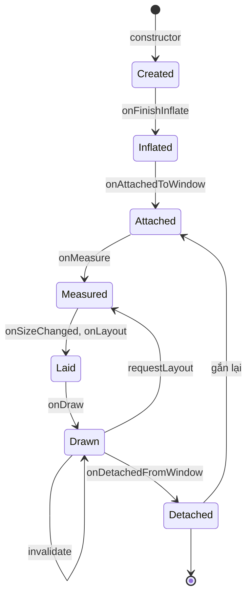
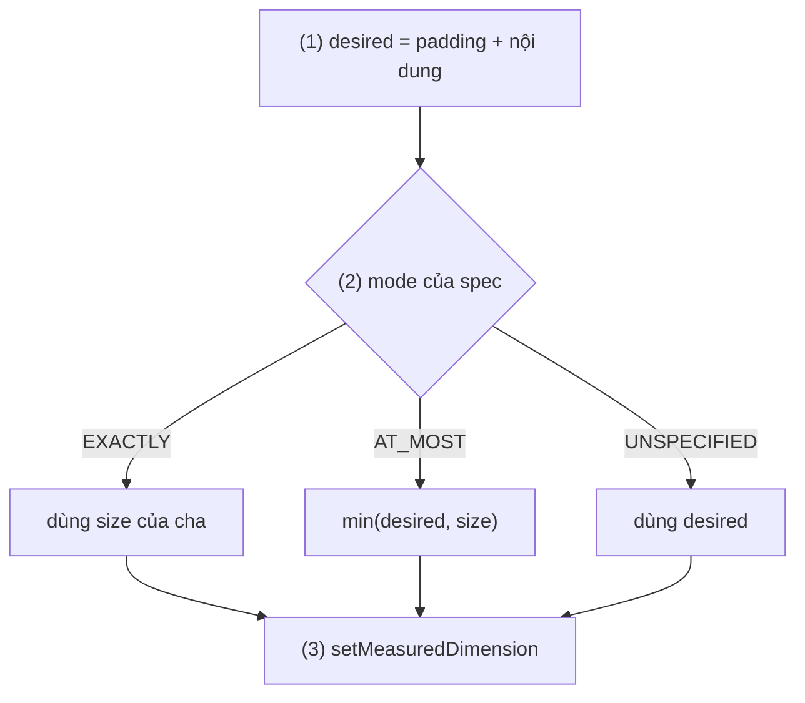
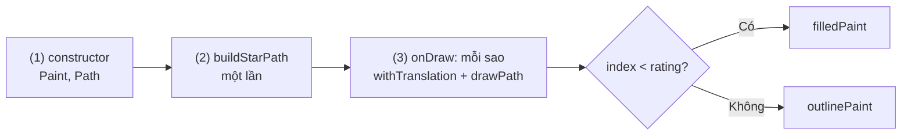
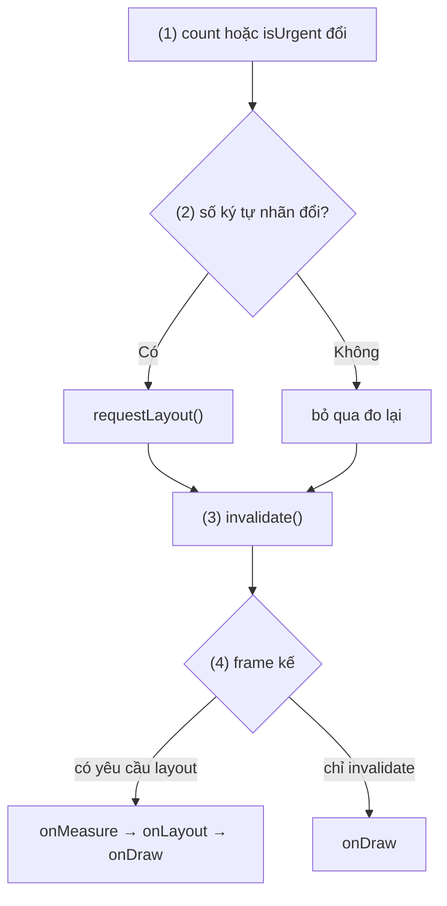
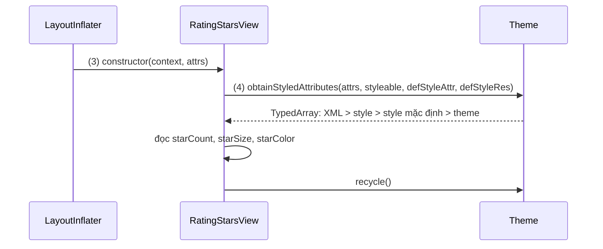
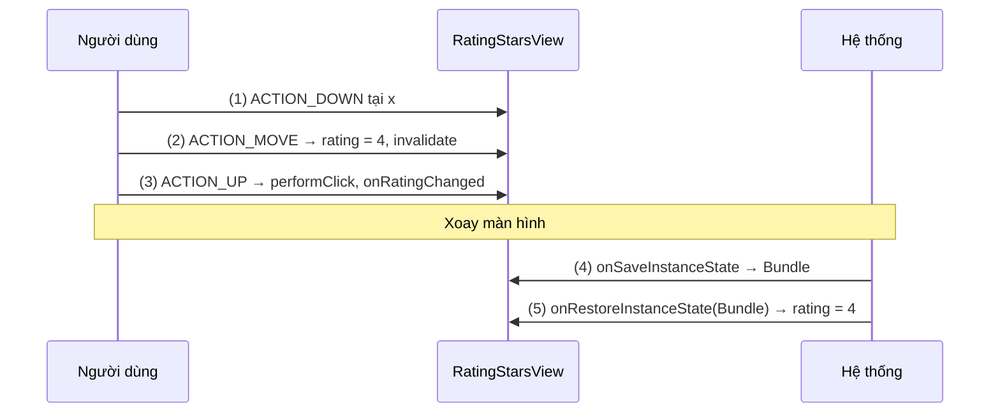
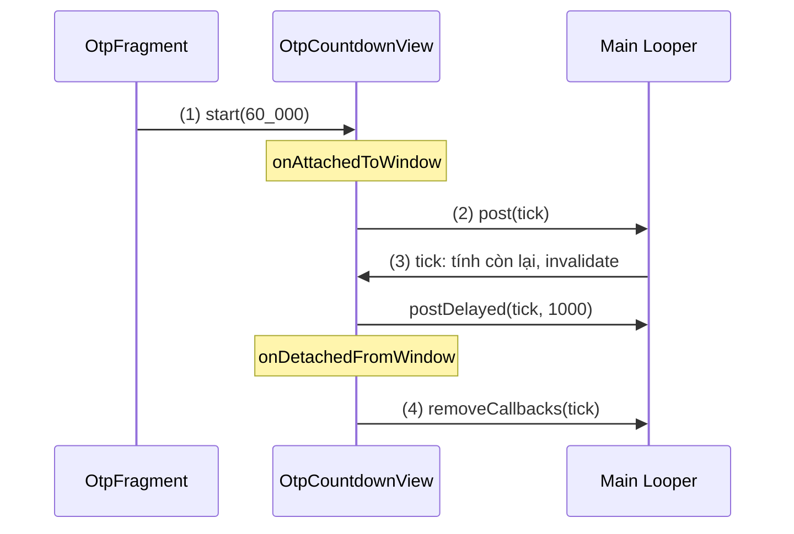
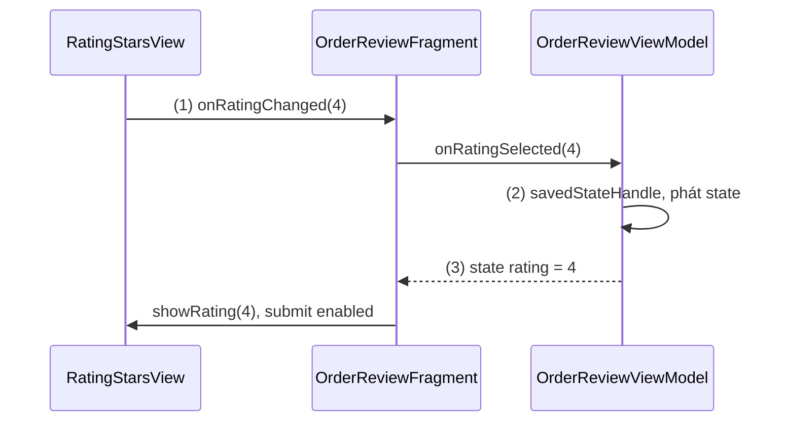

# Custom View

## Vấn đề cần giải quyết

Widget có sẵn (`TextView`, `ImageView`, `ProgressBar`) không phủ được mọi giao diện: biểu đồ nhiệt độ theo giờ, vòng đếm ngược OTP, thanh đánh giá sao chạm được, huy hiệu số co giãn theo số chữ số. Ghép chúng từ nhiều View thì cây View phình to; tự vẽ mà không hiểu hệ thống thì gặp lỗi:

- **Sai kích thước:** `wrap_content` mà View chiếm hết chỗ của cha, hoặc nội dung bị cắt vì bỏ qua padding.
- **Giật khi cuộn:** mỗi frame tạo `Paint`, `Path` mới, bộ thu gom rác chạy liên tục trên Main Thread.
- **Cập nhật sai cách:** đổi màu mà đo lại cả cây View, hoặc chữ dài ra mà chỉ vẽ lại nên bị cắt.
- **Mất trạng thái, chạy ngầm:** xoay màn mất số sao vừa chọn; bộ đếm vẫn chạy sau khi màn đã đóng.

Vấn đề cần giải quyết là: **viết một View của riêng mình mà đo, vẽ, cập nhật và dọn dẹp đúng như mọi View của hệ thống.**

## Sau khi học xong

- Giải thích được vòng đời của một View từ constructor tới onDetachedFromWindow và việc nên làm ở từng callback.
- Triển khai được onMeasure theo MeasureSpec và onDraw bằng Canvas, Paint, Path mà không cấp phát object trong lúc vẽ.
- Phân biệt được invalidate() với requestLayout() để chỉ yêu cầu đúng lượt cần chạy lại.
- Áp dụng được custom attribute bằng declare-styleable, lưu và khôi phục state, và hỗ trợ accessibility cho custom view.
- Nhận diện được các lỗi thường gặp như cấp phát trong onDraw, bỏ qua padding và wrap_content, quên setMeasuredDimension và không dọn tài nguyên khi detach.

## Custom View là gì?

**Custom view** là class kế thừa `View` (hoặc một View, ViewGroup có sẵn) và override một số **callback** mà hệ thống gọi trên mọi View: đo kích thước, đặt vị trí, vẽ, nhận chạm, gắn vào và gỡ khỏi cửa sổ, lưu và khôi phục state.

Mental model: vòng đời View là **một hợp đồng callback**. Hệ thống quyết định **khi nào** gọi từng điều khoản (đo lúc nào, vẽ frame nào); custom view chỉ quyết định **làm gì** trong điều khoản đó. Custom view không bao giờ tự gọi `onDraw()` hay `onMeasure()`; nó chỉ **xin** hệ thống chạy lại một điều khoản bằng `invalidate()` hoặc `requestLayout()`.

## Cách hoạt động

### Ba mức tuỳ biến

Có ba mức, chọn mức nhỏ nhất đủ dùng: **compound view** (kế thừa ViewGroup, inflate các View có sẵn, như `QuantityStepperView` ở [View Binding](../../session_06/view_binding.md), mục "Custom view chọn số lượng sản phẩm"), **mở rộng widget có sẵn** (kế thừa `AppCompatTextView`... để thêm hành vi), và **View vẽ từ đầu** (kế thừa `View`, tự đo, tự vẽ bằng `Canvas`). Hai mức đầu dùng lại cơ chế đo và vẽ của View có sẵn nên ít lỗi; bài tập trung vào mức thứ ba, nơi bạn tự điền mọi điều khoản của hợp đồng. Bảng so sánh đầy đủ ở mục "So sánh với các cách tiếp cận khác".

### Vòng đời View: các điều khoản và thứ tự gọi

Một View đi qua các callback sau. Các bước đo, đặt, vẽ chính là lượt measure, layout, draw đã học ở [Layouts](layouts.md), mục "Measure và layout: cha hỏi, con trả lời", nhìn từ phía View con.



| Callback | Khi nào được gọi | Nên làm |
|---|---|---|
| Constructor | Inflate từ XML hoặc tạo trong code | Đọc attribute, tạo sẵn `Paint`, `Path`; chưa có kích thước |
| `onFinishInflate()` | ViewGroup inflate xong các con | Lấy tham chiếu tới View con |
| `onAttachedToWindow()` | View được gắn vào cửa sổ | Bắt đầu đếm giờ, listener, animation |
| `onMeasure()` | Cha hỏi View muốn to bao nhiêu | Tính kích thước, `setMeasuredDimension()` |
| `onSizeChanged()` | Lần đầu có kích thước, và mỗi khi đổi | Tính sẵn hình học theo kích thước |
| `onLayout()` | Sau khi đo, cần đặt vị trí | ViewGroup đặt các con; View lá thường bỏ qua |
| `onDraw()` | Frame cần vẽ lại View này | Chỉ gọi lệnh vẽ; không cấp phát, không `requestLayout()` |
| `onDetachedFromWindow()` | View rời khỏi cửa sổ | Dừng mọi thứ đã bắt đầu khi attach |

Hai điểm dễ hiểu nhầm:

- **Detach không có nghĩa là bị huỷ.** RecyclerView detach item khi cuộn ra rồi gắn lại khi dùng lại; Fragment vào backstack thì View của nó bị gỡ. Mọi thứ bắt đầu ở `onAttachedToWindow()` phải dừng ở `onDetachedFromWindow()`, và có thể bắt đầu lại lần nữa.
- **Thứ tự measure, layout, draw có thể lặp nhiều lần** trong đời một View; hợp đồng chỉ đảm bảo thứ tự, không đảm bảo số lần.

Mỗi điều khoản quan trọng có một ví dụ riêng ở các phần sau.

### Đo kích thước: `onMeasure` và `MeasureSpec`

`onMeasure(widthMeasureSpec, heightMeasureSpec)` nhận hai số `Int`, mỗi số gói một **mode** (2 bit cao) và một **size** (30 bit còn lại), tách ra bằng `MeasureSpec.getMode()` và `MeasureSpec.getSize()`:

| Mode | Cha nói gì | Thường đến từ |
|---|---|---|
| `EXACTLY` | "Con phải đúng `size`" | Kích thước cố định, `match_parent`, `0dp` đã giải xong |
| `AT_MOST` | "Con tối đa `size`, tự chọn nhỏ hơn" | `wrap_content` |
| `UNSPECIFIED` | "Tuỳ con" | Chiều cuộn của `ScrollView`, đo thử trong một số layout |

Hợp đồng bắt buộc hai việc: tự tính kích thước mong muốn **gồm cả padding**, rồi gọi `setMeasuredDimension()`. Không gọi thì View ném `IllegalStateException` ngay khi đo. Hàm `View.resolveSize(desired, spec)` làm phần ghép mode: `EXACTLY` trả `size` của cha, `AT_MOST` trả số nhỏ hơn giữa `desired` và `size`, `UNSPECIFIED` trả `desired`.

Nếu không override, `View.onMeasure()` mặc định coi `AT_MOST` như `EXACTLY`: View vẽ từ đầu đặt `wrap_content` sẽ chiếm toàn bộ chỗ cha cho phép.

#### Ví dụ: thanh đánh giá sao đo vừa đủ cho số sao

**Bài toán:** `RatingStarsView` hiển thị 5 ngôi sao 24dp cách nhau 4dp. Đặt `wrap_content` thì View phải rộng đúng bằng 5 sao, không chiếm cả hàng; đặt `match_parent` thì nhận đúng chỗ cha đưa.

**Luồng chạy:**

1. Tính kích thước mong muốn: rộng = padding trái + phải + 5 sao + 4 khoảng cách; cao = padding trên + dưới + một sao.
2. Ghép với `MeasureSpec` của cha bằng `resolveSize` cho từng chiều.
3. Báo kết quả bằng `setMeasuredDimension()`.



```kotlin
// RatingStarsView.kt (phần đo)
override fun onMeasure(widthMeasureSpec: Int, heightMeasureSpec: Int) {
    val contentWidth = starSize * starCount + starGap * (starCount - 1)
    val desiredWidth = paddingLeft + paddingRight + contentWidth.roundToInt()      // (1)
    val desiredHeight = paddingTop + paddingBottom + starSize.roundToInt()

    val measuredWidth = View.resolveSize(desiredWidth, widthMeasureSpec)            // (2)
    val measuredHeight = View.resolveSize(desiredHeight, heightMeasureSpec)
    setMeasuredDimension(measuredWidth, measuredHeight)                             // (3)
}
```

**Kết quả:** trong Layout Inspector, `wrap_content` cho View rộng `5 × 24 + 4 × 4 = 136dp` cộng padding; đổi sang `match_parent` thì View rộng hết hàng, các sao vẫn vẽ từ trái. Xoá `onMeasure()` đi thì `wrap_content` lập tức rộng bằng cả màn hình.

### Vẽ: `Canvas`, `Paint`, `Path` trong `onDraw`

`onDraw(canvas)` nhận một `Canvas`. Docs chia việc vẽ thành hai phần:

- **`Canvas` quyết định vẽ cái gì:** `drawLine`, `drawRect`, `drawRoundRect`, `drawCircle`, `drawArc`, `drawPath`, `drawText`, `drawBitmap`. Toạ độ tính bằng pixel, gốc ở góc trên trái của View; phần nội dung nằm trong padding.
- **`Paint` quyết định vẽ thế nào:** màu, `style` (`FILL`, `STROKE`), `strokeWidth`, khử răng cưa (`ANTI_ALIAS_FLAG`), cỡ chữ, `textAlign`, `shader` cho gradient.
- **`Path`** là một hình tự do ghép từ `moveTo`, `lineTo`, `quadTo`, `cubicTo`, `close`, vẽ bằng `drawPath`.

`Canvas` còn có phép biến đổi: `translate`, `rotate`, `scale`, `clipRect`. Bọc chúng giữa `save()` và `restore()` (hoặc `withTranslation`, `withSave` của `androidx.core:core-ktx`) để không ảnh hưởng lệnh vẽ sau.

Quy tắc hiệu năng quan trọng nhất: **không cấp phát object trong `onDraw()`**. `onDraw` có thể chạy mỗi frame khi cuộn hay animation; tạo `Paint`, `Path`, `RectF`, `String` mới ở đó sinh rác liên tục và kéo bộ thu gom rác chạy trên Main Thread. Docs của Android nhấn mạnh tạo sẵn các object vẽ là một tối ưu quan trọng. Mọi tính toán phụ thuộc kích thước làm trong `onSizeChanged()`; phụ thuộc dữ liệu thì làm khi dữ liệu đổi.

#### Ví dụ: vẽ các ngôi sao của thanh đánh giá bằng một `Path`

**Bài toán:** `RatingStarsView` vẽ 5 ngôi sao, tô kín các sao trong số điểm và chỉ viền các sao còn lại. View nằm trong từng item của danh sách sản phẩm, nên `onDraw` chạy rất nhiều lần khi cuộn và phải thật nhẹ.

**Luồng chạy:**

1. Constructor tạo sẵn hai `Paint` (tô kín và viền) và một `Path`.
2. `buildStarPath()` dựng hình **một** ngôi sao (10 đỉnh xen kẽ bán kính ngoài và trong) quanh gốc toạ độ, chỉ một lần khi biết `starSize`.
3. `onDraw()` với mỗi sao: dịch `Canvas` tới vị trí của sao (tính từ padding), vẽ cùng `Path` đó bằng `Paint` tuỳ sao có được tô hay không, rồi trả `Canvas` về như cũ.
4. Không có object nào được tạo trong `onDraw()`.



```kotlin
// RatingStarsView.kt (phần vẽ)
private val filledPaint = Paint(Paint.ANTI_ALIAS_FLAG).apply { style = Paint.Style.FILL }    // (1)
private val outlinePaint = Paint(Paint.ANTI_ALIAS_FLAG).apply { style = Paint.Style.STROKE }
private val starPath = Path()

private fun buildStarPath(size: Float) {                     // (2) gọi một lần trong init
    val outer = size / 2f
    val inner = outer * 0.4f
    starPath.reset()
    for (i in 0 until 10) {
        val radius = if (i % 2 == 0) outer else inner
        val angle = Math.toRadians(-90.0 + i * 36.0)
        val x = outer + radius * cos(angle).toFloat()
        val y = outer + radius * sin(angle).toFloat()
        if (i == 0) starPath.moveTo(x, y) else starPath.lineTo(x, y)
    }
    starPath.close()
}

override fun onDraw(canvas: Canvas) {                        // (3)
    super.onDraw(canvas)
    for (index in 0 until starCount) {
        val left = paddingLeft + index * (starSize + starGap)
        canvas.withTranslation(left, paddingTop.toFloat()) {  // save, translate, ..., restore
            drawPath(starPath, if (index < rating) filledPaint else outlinePaint)
        }
    }                                                        // (4) không cấp phát gì
}
```

**Kết quả:** 5 sao vẽ đúng trong vùng trừ padding, `rating = 3` thì 3 sao tô kín. Mở Memory Profiler khi cuộn danh sách: `onDraw` không tạo object mới. Màu của hai `Paint` lấy từ attribute `starColor` ở mục "Custom attribute"; để đổi theo dark theme, giá trị nên là theme attribute như `?attr/colorPrimary` ([Styles and Themes](styles.md)).

### `invalidate()` và `requestLayout()`: xin đúng điều khoản

Khi trạng thái của View đổi, View phải **xin** hệ thống chạy lại phần hợp đồng bị ảnh hưởng:

| Cái gì đổi | Gọi | Hệ thống chạy lại |
|---|---|---|
| Chỉ nội dung vẽ (màu, góc của vòng tiến độ, số sao tô) | `invalidate()` | `onDraw()` của View này ở frame kế |
| Kích thước hoặc vị trí có thể đổi (chữ dài hơn, thêm phần tử) | `requestLayout()` | `onMeasure()`, `onLayout()` của View này và các cha phía trên |
| Cả hai | `requestLayout()` và `invalidate()` | Đo, đặt, rồi vẽ lại |

Ba điều cần nhớ:

- Cả hai chỉ là **yêu cầu**, được gộp vào frame kế tiếp: gọi `invalidate()` mười lần trong một frame vẫn chỉ vẽ một lần.
- `requestLayout()` đắt hơn nhiều: nó lan lên tới gốc cây View và có thể kéo theo đo lại cả các View anh em. Chỉ gọi khi kích thước thật sự có thể đổi.
- Sau khi đo lại, nếu kích thước không đổi thì View không chắc được vẽ lại; khi nội dung cũng đổi, gọi thêm `invalidate()`. Cả hai phải gọi trên Main Thread; từ thread khác dùng `postInvalidate()` hoặc đưa việc về Main Thread.

#### Ví dụ: huy hiệu số thông báo

**Bài toán:** huy hiệu trên icon chuông hiển thị số thông báo chưa đọc: "7", "12", hoặc "99+" khi quá 99. Số chữ số đổi thì huy hiệu phải rộng ra hay hẹp lại; còn khi chỉ đổi sang màu khẩn (có tin quan trọng) thì kích thước giữ nguyên.

**Luồng chạy:**

1. `count` đổi: tính nhãn mới ("", "7", "12", "99+").
2. Nếu số ký tự của nhãn đổi, độ rộng có thể đổi → `requestLayout()`.
3. Luôn `invalidate()` vì nội dung vẽ đã đổi. Đổi `isUrgent` chỉ đổi màu nền → chỉ `invalidate()`.
4. Frame kế: nếu có yêu cầu layout thì chạy `onMeasure` (đo chữ bằng `measureText`), `onLayout`, rồi `onDraw`; nếu không thì chỉ `onDraw`.



```kotlin
// NotificationBadgeView.kt
class NotificationBadgeView @JvmOverloads constructor(
    context: Context,
    attrs: AttributeSet? = null
) : View(context, attrs) {

    private val density = resources.displayMetrics.density
    private val minSize = 18f * density
    private val horizontalInset = 5f * density
    private val backgroundPaint = Paint(Paint.ANTI_ALIAS_FLAG).apply {
        color = ContextCompat.getColor(context, R.color.badge_normal)
    }
    private val textPaint = Paint(Paint.ANTI_ALIAS_FLAG).apply {
        color = ContextCompat.getColor(context, R.color.badge_text)
        textAlign = Paint.Align.CENTER
        typeface = Typeface.DEFAULT_BOLD
        textSize = TypedValue.applyDimension(TypedValue.COMPLEX_UNIT_SP, 11f, resources.displayMetrics)
    }
    private var label = ""

    var count: Int = 0
        set(value) {
            if (field == value) return
            field = value
            val newLabel = when {                                  // (1)
                value <= 0 -> ""
                value > 99 -> "99+"
                else -> value.toString()
            }
            if (newLabel.length != label.length) requestLayout()  // (2) độ rộng có thể đổi
            label = newLabel
            invalidate()                                           // (3)
        }

    var isUrgent: Boolean = false
        set(value) {
            if (field == value) return
            field = value
            backgroundPaint.color = ContextCompat.getColor(
                context, if (value) R.color.badge_urgent else R.color.badge_normal
            )
            invalidate()                                           // (3) chỉ đổi màu
        }

    override fun onMeasure(widthMeasureSpec: Int, heightMeasureSpec: Int) {   // (4)
        val contentWidth = maxOf(minSize, textPaint.measureText(label) + horizontalInset * 2)
        val desiredWidth = paddingLeft + paddingRight + contentWidth.roundToInt()
        val desiredHeight = paddingTop + paddingBottom + minSize.roundToInt()
        setMeasuredDimension(
            View.resolveSize(desiredWidth, widthMeasureSpec),
            View.resolveSize(desiredHeight, heightMeasureSpec)
        )
    }

    // onDraw: drawRoundRect nền bo tròn trong vùng trừ padding, drawText label ở giữa
}
```

**Kết quả:** đặt log trong `onMeasure` và `onDraw`. `count` 3 → 7: chỉ `onDraw`. 7 → 12: cả `onMeasure` và `onDraw`, huy hiệu rộng ra. Bật `isUrgent`: chỉ `onDraw`.

### Custom attribute: cấu hình View từ XML

Để View cấu hình được trong layout như widget có sẵn (`app:starCount="5"`), khai báo attribute trong `res/values/attrs.xml` bằng `<declare-styleable>`. AGP sinh ra mảng `R.styleable.RatingStarsView` và các chỉ số `R.styleable.RatingStarsView_starCount`.

Constructor nhận giá trị qua `Theme.obtainStyledAttributes(attrs, R.styleable.X, defStyleAttr, defStyleRes)`, trả về `TypedArray`. Docs liệt kê bốn nguồn giá trị theo thứ tự ưu tiên: attribute ghi thẳng trong XML, style gán bằng `style="..."`, style mặc định qua `defStyleAttr`/`defStyleRes`, và giá trị trong theme. Cơ chế resolve này được giải thích kỹ ở [Styles and Themes](styles.md), mục "Thứ tự resolve attribute"; ở đây chỉ cần dùng đúng tham số.

`TypedArray` là object dùng chung, phải `recycle()` sau khi đọc. Hàm `Context.withStyledAttributes { }` của `core-ktx` tự `recycle()`; từ API 31, `TypedArray` còn implement `AutoCloseable` nên dùng được `use { }`.

#### Ví dụ: `RatingStarsView` cấu hình số sao, kích thước, màu từ layout

**Bài toán:** màn đánh giá đơn hàng cần 5 sao lớn màu theo thương hiệu; màn danh sách sản phẩm cần sao nhỏ chỉ để hiển thị. Cùng một View, cấu hình từ XML.

**Luồng chạy:**

1. `attrs.xml` khai báo `starCount`, `starSize`, `starGap`, `starColor`, `rating`, và một theme attribute `ratingStarsViewStyle` để theme đặt style mặc định cho mọi `RatingStarsView`.
2. Layout gán `app:starSize`, `app:starColor="?attr/colorPrimary"`.
3. `LayoutInflater` gọi constructor hai tham số; `@JvmOverloads` chuyển sang constructor đầy đủ với `defStyleAttr = R.attr.ratingStarsViewStyle`.
4. `withStyledAttributes` resolve từng attribute theo thứ tự ưu tiên, trả giá trị hoặc giá trị mặc định, rồi tự `recycle()`.



```xml
<!-- res/values/attrs.xml (1) -->
<resources>
    <attr name="ratingStarsViewStyle" format="reference" />

    <declare-styleable name="RatingStarsView">
        <attr name="starCount" format="integer" />
        <attr name="starSize" format="dimension" />
        <attr name="starGap" format="dimension" />
        <attr name="starColor" format="color" />
        <attr name="rating" format="integer" />
    </declare-styleable>
</resources>

<!-- res/layout/fragment_order_review.xml (2) -->
<com.example.review.RatingStarsView
    android:id="@+id/order_rating"
    app:starColor="?attr/colorPrimary"
    app:starSize="40dp"
    ... />
```

```kotlin
// RatingStarsView.kt (constructor và đọc attribute)
class RatingStarsView @JvmOverloads constructor(
    context: Context,
    attrs: AttributeSet? = null,
    defStyleAttr: Int = R.attr.ratingStarsViewStyle                    // (3)
) : View(context, attrs, defStyleAttr) {

    init {
        context.withStyledAttributes(                                   // (4) tự recycle()
            attrs, R.styleable.RatingStarsView, defStyleAttr, R.style.Widget_App_RatingStarsView
        ) {
            starCount = getInt(R.styleable.RatingStarsView_starCount, 5).coerceAtLeast(1)
            starSize = getDimension(R.styleable.RatingStarsView_starSize, 24f * density)
            starGap = getDimension(R.styleable.RatingStarsView_starGap, 4f * density)
            starColor = getColor(R.styleable.RatingStarsView_starColor, Color.BLACK)
            rating = getInt(R.styleable.RatingStarsView_rating, 0).coerceIn(0, starCount)
        }
    }
    // ...
}
```

`R.style.Widget_App_RatingStarsView` là style mặc định khai báo trong `themes.xml`, dùng khi theme không đặt `ratingStarsViewStyle`.

**Kết quả:** màn đánh giá hiện sao 40dp màu primary; màn danh sách để mặc định hiện sao 24dp. Đổi `colorPrimary` của theme thì mọi `RatingStarsView` dùng `?attr/colorPrimary` đổi theo mà không sửa code.

### Chạm, accessibility và lưu state

Một View tương tác được cần thêm ba điều khoản:

- **Chạm:** `onTouchEvent(event)` nhận chuỗi sự kiện `ACTION_DOWN` → `ACTION_MOVE`... → `ACTION_UP`. Trả `true` ở `ACTION_DOWN` để nhận phần còn lại của chuỗi. Khi override `onTouchEvent`, gọi `performClick()` ở `ACTION_UP` và override `performClick()`, để click listener và dịch vụ trợ năng cùng thấy "cú bấm" (Lint báo `ClickableViewAccessibility` nếu thiếu).
- **Accessibility:** TalkBack không thấy hình vẽ trên `Canvas`, chỉ thấy thông tin bạn khai báo. Mô tả trạng thái bằng `ViewCompat.setStateDescription()` ("4 trên 5 sao"), và cung cấp hành động thay cho cử chỉ bằng `ViewCompat.addAccessibilityAction()` ("Tăng đánh giá"), vì người dùng TalkBack không chạm đúng vị trí ngôi sao được.
- **State:** khi Activity bị tạo lại (xoay màn, process death), hệ thống gọi `onSaveInstanceState()` của từng View **có id** và `isSaveEnabled`, rồi trả lại qua `onRestoreInstanceState()`. Chỉ lưu state giao diện tạm thời của chính View; dữ liệu nghiệp vụ thuộc ViewModel. Phân loại dữ liệu nào lưu ở đâu đã có ở [Activity State Changes](../../session_04/components/activity/state_changes.md), mục "onSaveInstanceState: transient UI state (View/XML)".

#### Ví dụ: chạm để chọn sao và giữ lựa chọn khi xoay màn

**Bài toán:** người dùng kéo ngón tay trên thanh sao để chọn 4 sao, rồi xoay màn hình trước khi bấm Gửi. Lựa chọn phải còn nguyên, và người dùng TalkBack cũng phải chọn được.

**Luồng chạy:**

1. `ACTION_DOWN`: trả `true` để nhận tiếp chuỗi chạm, tính sao tại toạ độ `x`.
2. `ACTION_MOVE`: cập nhật số sao theo `x`; mỗi lần đổi thì cập nhật state description và `invalidate()`.
3. `ACTION_UP`: `performClick()`, báo `onRatingChanged` cho màn chứa.
4. Xoay màn: `onSaveInstanceState()` gói state của lớp cha và `rating` vào `Bundle`.
5. View mới được tạo: `onRestoreInstanceState()` lấy `rating` ra, vẽ lại.



```kotlin
// RatingStarsView.kt (chạm, accessibility, state)
override fun onTouchEvent(event: MotionEvent): Boolean {
    if (!isEnabled) return false
    when (event.actionMasked) {
        MotionEvent.ACTION_DOWN,                                         // (1)
        MotionEvent.ACTION_MOVE -> applyRating(ratingAt(event.x), fromUser = true) // (2)
        MotionEvent.ACTION_UP -> performClick()                         // (3)
    }
    return true
}

override fun performClick(): Boolean = super.performClick()

private fun ratingAt(x: Float): Int =
    ((x - paddingLeft) / (starSize + starGap)).toInt().plus(1).coerceIn(1, starCount)

private fun applyRating(value: Int, fromUser: Boolean) {
    val newRating = value.coerceIn(0, starCount)
    if (newRating == rating) return
    rating = newRating
    updateStateDescription()                         // ViewCompat.setStateDescription("4 trên 5 sao")
    invalidate()                                     // chỉ nội dung đổi, kích thước giữ nguyên
    if (fromUser) onRatingChanged?.invoke(newRating)
}

override fun onSaveInstanceState(): Parcelable = bundleOf(                // (4)
    KEY_SUPER_STATE to super.onSaveInstanceState(),
    KEY_RATING to rating
)

override fun onRestoreInstanceState(state: Parcelable?) {                // (5)
    if (state is Bundle) {
        super.onRestoreInstanceState(
            BundleCompat.getParcelable(state, KEY_SUPER_STATE, Parcelable::class.java)
        )
        applyRating(state.getInt(KEY_RATING), fromUser = false)
    } else {
        super.onRestoreInstanceState(state)
    }
}
```

Trong `init`, View đăng ký hai hành động trợ năng bằng `ViewCompat.addAccessibilityAction(this, context.getString(R.string.rating_increase)) { _, _ -> applyRating(rating + 1, fromUser = true); true }`, và tương tự cho "Giảm đánh giá".

**Kết quả:** chọn 4 sao, xoay màn: vẫn 4 sao. Xoá `android:id` khỏi View trong layout rồi xoay lại: về 0 sao, vì hệ thống chỉ lưu state của View có id. Bật TalkBack: focus vào View đọc "4 trên 5 sao", và menu hành động có "Tăng đánh giá", "Giảm đánh giá".

### `onAttachedToWindow` và `onDetachedFromWindow`: việc gắn với lúc đang hiển thị

Những gì chỉ có nghĩa khi View **đang nằm trên màn hình** (đếm giờ, animation lặp, listener cảm biến, đăng ký nhận broadcast) bắt đầu ở `onAttachedToWindow()` và dừng ở `onDetachedFromWindow()`. Làm ở constructor thì việc chạy cả khi View chưa hiển thị; quên dừng khi detach thì View tiếp tục chạy ngầm, giữ tham chiếu và có thể leak cả Activity.

#### Ví dụ: vòng đếm ngược mã OTP

**Bài toán:** màn nhập mã OTP có vòng tròn đếm ngược 60 giây kèm số giây còn lại; hết giờ thì hiện nút "Gửi lại mã". Người dùng có thể chuyển sang app tin nhắn rồi quay lại; vòng đếm phải hiện đúng số giây thật, và không được chạy ngầm khi màn hình đã đóng.

**Luồng chạy:**

1. `start(60_000)` lưu mốc hết hạn theo `SystemClock.elapsedRealtime()`, đồng hồ không bị ảnh hưởng khi người dùng đổi giờ hệ thống.
2. `onAttachedToWindow()`: nếu chưa hết hạn thì `post(tick)`.
3. `tick` tính thời gian còn lại từ mốc hết hạn (không đếm số lần tick), cập nhật nhãn và góc vòng, `invalidate()`, rồi hẹn tick sau 1 giây; hết giờ thì gọi `onExpired`.
4. `onDetachedFromWindow()`: `removeCallbacks(tick)`, không còn gì chạy. Gắn lại thì bước (2) chạy lại và tự tính đúng số giây còn lại.



```kotlin
// OtpCountdownView.kt
class OtpCountdownView @JvmOverloads constructor(
    context: Context,
    attrs: AttributeSet? = null
) : View(context, attrs) {

    private val density = resources.displayMetrics.density
    private val ringBounds = RectF()
    private val trackPaint = Paint(Paint.ANTI_ALIAS_FLAG).apply {
        style = Paint.Style.STROKE
        strokeWidth = 4f * density
        color = ContextCompat.getColor(context, R.color.countdown_track)
    }
    private val ringPaint = Paint(trackPaint).apply {
        strokeCap = Paint.Cap.ROUND
        color = ContextCompat.getColor(context, R.color.countdown_progress)
    }
    private val textPaint = Paint(Paint.ANTI_ALIAS_FLAG)   // cỡ chữ, màu, textAlign CENTER: như huy hiệu

    private var deadline = 0L
    private var totalMillis = 0L
    private var sweepAngle = 0f
    private var label = ""
    var onExpired: (() -> Unit)? = null

    private val tick = object : Runnable {
        override fun run() {                                                     // (3)
            val remaining = (deadline - SystemClock.elapsedRealtime()).coerceAtLeast(0L)
            label = ((remaining + 999) / 1000).toString()
            sweepAngle = 360f * remaining / totalMillis
            invalidate()
            if (remaining > 0) postDelayed(this, 1_000L) else onExpired?.invoke()
        }
    }

    fun start(durationMillis: Long) {                                            // (1)
        totalMillis = durationMillis
        deadline = SystemClock.elapsedRealtime() + durationMillis
        removeCallbacks(tick)
        if (isAttachedToWindow) post(tick)
    }

    override fun onAttachedToWindow() {
        super.onAttachedToWindow()
        if (deadline > SystemClock.elapsedRealtime()) post(tick)                 // (2)
    }

    override fun onDetachedFromWindow() {
        removeCallbacks(tick)                                                    // (4)
        super.onDetachedFromWindow()
    }

    override fun onSizeChanged(w: Int, h: Int, oldw: Int, oldh: Int) {
        super.onSizeChanged(w, h, oldw, oldh)
        val inset = trackPaint.strokeWidth / 2                 // View được đặt kích thước vuông
        ringBounds.set(paddingLeft + inset, paddingTop + inset, w - paddingRight - inset, h - paddingBottom - inset)
    }

    override fun onDraw(canvas: Canvas) {
        super.onDraw(canvas)
        canvas.drawOval(ringBounds, trackPaint)
        canvas.drawArc(ringBounds, -90f, sweepAngle, false, ringPaint)
        val baseline = ringBounds.centerY() - (textPaint.descent() + textPaint.ascent()) / 2f
        canvas.drawText(label, ringBounds.centerX(), baseline, textPaint)
    }
}
```

**Kết quả:** bắt đầu đếm, chuyển sang app tin nhắn 20 giây rồi quay lại: vòng hiện khoảng 40 giây, không bị "đứng" ở 60. Đặt log trong `tick` rồi đóng màn hình: log dừng ngay. Bỏ `removeCallbacks` trong `onDetachedFromWindow`: log vẫn chạy sau khi đóng màn, và LeakCanary báo View bị `Handler` giữ.

## Deep Dive: `invalidate()` không vẽ pixel ngay

Từ Android 4.0 (API 14), hardware acceleration bật mặc định cho app có `targetSdkVersion` từ 14. Khi đó `onDraw()` **không vẽ ra pixel**: các lệnh trên `Canvas` được ghi lại thành một **display list** gắn với `RenderNode` của View. Từ Android 5.0, một thread riêng là **RenderThread** đọc các display list đó và gửi lệnh cho GPU.

Hệ quả: `invalidate()` chỉ đánh dấu View "bẩn", và ở frame kế (theo nhịp vsync do `Choreographer` điều phối) chỉ View bẩn được ghi lại display list. Đổi `translationX`, `alpha`, `scaleX`, `rotation` thậm chí **không** chạy lại `onDraw()`, chỉ sửa thuộc tính của `RenderNode`; vì vậy animation di chuyển, mờ dần nên dùng các thuộc tính này ([Animation](animation.md)) thay vì tự tính toạ độ rồi `invalidate()` mỗi frame.

## Ví dụ thực tế

Ba bài toán hay gặp:

1. **Màn đánh giá đơn hàng dùng `RatingStarsView`:** View tự giữ state giao diện, còn số sao đã chọn thuộc ViewModel để sống qua cả process death. Đây là bài toán chính, code bên dưới.
2. **Hình dạng tĩnh không tương tác** (nền thẻ có góc cắt, viền gradient): không cần View; dùng `Drawable` (`GradientDrawable`, `MaterialShapeDrawable`) gán làm `background`, rẻ hơn và dùng lại được cho mọi View.
3. **Biểu đồ phức tạp có zoom, chú thích, nhiều trục:** cân nhắc thư viện biểu đồ có sẵn, hoặc Compose `Canvas` (9.7.1 Surface and Canvas, chưa có bài). Tự viết chỉ đáng khi biểu đồ đơn giản và cần kiểm soát hoàn toàn.

### Màn đánh giá đơn hàng

**Bài toán:** người dùng chọn số sao rồi bấm Gửi; nút Gửi chỉ bật khi đã chọn ít nhất một sao. Trong danh sách sản phẩm, cùng View đó chỉ hiển thị điểm, không nhận chạm.

**Luồng chạy:**

1. Fragment gắn `onRatingChanged`: mỗi lần người dùng đổi sao (chạm hoặc hành động trợ năng), báo ViewModel.
2. ViewModel lưu số sao vào `SavedStateHandle` và phát state mới.
3. Fragment nhận state: `showRating()` cho View (không báo ngược lại vì `fromUser = false`), bật nút Gửi khi `rating > 0`.
4. Trong `onBindViewHolder` của danh sách sản phẩm: `isEnabled = false` và `showRating(điểm làm tròn)`.



```kotlin
// OrderReviewFragment.kt (trong onViewCreated)
binding.orderRating.onRatingChanged = { stars -> viewModel.onRatingSelected(stars) }   // (1)

viewLifecycleOwner.lifecycleScope.launch {
    viewLifecycleOwner.repeatOnLifecycle(Lifecycle.State.STARTED) {
        viewModel.uiState.collect { state ->                                            // (3)
            binding.orderRating.showRating(state.rating)
            binding.submitButton.isEnabled = state.rating > 0
        }
    }
}
```

`showRating(value)` là hàm công khai của View, chỉ gọi `applyRating(value, fromUser = false)`. Ở bước (4), `onTouchEvent` trả `false` khi View bị tắt nên chạm không đổi gì.

**Kết quả:** chọn 4 sao thì nút Gửi bật; xoay màn hoặc giả lập process death ("Don't keep activities"), số sao vẫn 4 vì ViewModel giữ nó qua `SavedStateHandle` ([ViewModel](../../session_06/viewmodel.md)). Trong danh sách, chạm vào sao không đổi gì. Collect `uiState` là kiến thức dùng trước: coroutine và `repeatOnLifecycle` được học ở [Coroutines](../async_threads/coroutines.md).

## So sánh với các cách tiếp cận khác

| Cách | Đo, vẽ do ai lo | Chi phí | Hợp với |
|---|---|---|---|
| Compound view (ghép View có sẵn) | Các View con | Nhiều View hơn, nhưng ít code và ít lỗi | Nhóm control lặp lại: ô số lượng, thanh tìm kiếm |
| Kế thừa widget có sẵn | Widget gốc, bạn thêm hành vi | Thấp | Đổi một hành vi nhỏ của widget |
| View vẽ từ đầu | Bạn: `onMeasure`, `onDraw`, chạm, state, accessibility | Một View, nhưng tự chịu mọi điều khoản | Biểu đồ, control đặc thù |
| Custom `Drawable` | `Drawable.draw()`, không đo, không chạm | Rất thấp, gán làm background cho View bất kỳ | Hình dạng, nền, viền tĩnh |
| Compose `Canvas`, `Modifier.drawBehind` | Hàm composable, vẽ trong `DrawScope` | Thấp, ít boilerplate | Màn hình viết bằng Compose |

Từ 05/2026 (Compose-first), `android.widget` và `androidx.customview` ở maintenance mode (chỉ sửa lỗi nghiêm trọng); package `android.view` (`View`, `Canvas`, vòng đời trong bài) vẫn được hỗ trợ vì Compose cũng chạy trên nó. Màn mới nên cân nhắc Compose ([Jetpack Compose Overview](../../jetpack_compose_ui/overview.md)).

## Khi nào nên và không nên dùng

- **Nên dùng** custom view vẽ từ đầu khi UI không ghép được từ widget có sẵn mà không phình cây View (biểu đồ, vòng tiến độ có nhãn, control chạm đặc thù), và cần dùng lại ở nhiều màn.
- **Nên dùng** compound view khi chỉ cần gom vài widget có sẵn thành một khối dùng lại.
- **Không nên** tự vẽ khi widget có sẵn cộng style đã đủ (`Slider`, `CircularProgressIndicator`, `Chip` của Material Components đều có attribute tuỳ biến); tự vẽ nghĩa là tự làm lại accessibility, dark theme, RTL.
- **Không nên** dùng View cho hình dạng tĩnh không tương tác: dùng `Drawable`.
- **Không áp dụng** cho màn viết bằng Compose: vẽ bằng `Canvas` của Compose.

## Sai lầm thường gặp

### 1. Cấp phát object trong `onDraw()`

```kotlin
// Sai: mỗi frame tạo Paint, RectF, String mới
override fun onDraw(canvas: Canvas) {
    val paint = Paint().apply { color = Color.RED }
    canvas.drawRect(RectF(0f, 0f, width.toFloat(), height.toFloat()), paint)
    canvas.drawText("$count thông báo", 0f, 40f, paint)
}
```

**Lỗi lộ ra thế nào:** Lint báo `DrawAllocation`; khi cuộn hoặc animation, Memory Profiler thấy rác tăng đều và GC chạy liên tục, frame bị trễ.

**Cách sửa:** tạo `Paint`, `RectF`, `Path` một lần làm field; tính chuỗi và hình học khi dữ liệu hoặc kích thước đổi (`onSizeChanged`, setter), như `RatingStarsView` và `OtpCountdownView`.

### 2. Không override `onMeasure()`, hoặc bỏ qua padding

```kotlin
// Sai: không có onMeasure, vẽ từ (0, 0) bất kể padding
override fun onDraw(canvas: Canvas) {
    canvas.drawCircle(width / 2f, height / 2f, width / 2f, paint)
}
```

**Lỗi lộ ra thế nào:** đặt `wrap_content` nhưng View chiếm toàn bộ chiều rộng của cha; thêm `android:padding="8dp"` không có tác dụng, hình vẫn chạm mép.

**Cách sửa:** override `onMeasure()` với kích thước mong muốn gồm padding và `resolveSize`; khi vẽ, tính vùng nội dung bằng `paddingLeft`, `paddingTop`, `width - paddingRight`, `height - paddingBottom`.

### 3. Quên `setMeasuredDimension()` ở một nhánh của `onMeasure()`

**Lỗi lộ ra thế nào:** crash ngay khi màn hình hiện: `IllegalStateException: onMeasure() did not set the measured dimension by calling setMeasuredDimension()`.

**Cách sửa:** mọi nhánh của `onMeasure()` phải kết thúc bằng `setMeasuredDimension()`, hoặc gọi `super.onMeasure()`.

### 4. Gọi `requestLayout()` trong `onLayout()` hoặc `onDraw()`, hoặc khi chỉ đổi màu

**Lỗi lộ ra thế nào:** gọi trong `onDraw()`/`onLayout()` tạo vòng lặp đo, đặt, vẽ liên tục, Profiler thấy Main Thread bận mọi frame dù không có gì đổi. Gọi khi chỉ đổi màu làm cả cây View phía trên bị đo lại không cần thiết.

**Cách sửa:** chỉ `requestLayout()` khi kích thước thật sự có thể đổi, ngoài các callback đo, đặt, vẽ; đổi nội dung thì `invalidate()`.

### 5. Không dọn việc đang chạy khi detach

**Lỗi lộ ra thế nào:** `Runnable` đếm giờ, `ValueAnimator` lặp vô hạn hay listener cảm biến bắt đầu trong constructor và không bao giờ dừng: CPU vẫn chạy sau khi màn đóng, LeakCanary báo View (và Activity qua `context`) bị giữ.

**Cách sửa:** bắt đầu trong `onAttachedToWindow()`, dừng trong `onDetachedFromWindow()`, như `OtpCountdownView`.

### 6. `@JvmOverloads` với `defStyleAttr = 0` khi kế thừa widget có sẵn

```kotlin
// Sai: Button con mất style mặc định của theme
class LoadingButton @JvmOverloads constructor(
    context: Context, attrs: AttributeSet? = null, defStyleAttr: Int = 0
) : MaterialButton(context, attrs, defStyleAttr)
```

**Lỗi lộ ra thế nào:** nút hiện như View trơn, không nền, không ripple: `defStyleAttr = 0` nghĩa là "không có style mặc định", trong khi `MaterialButton` lấy style từ `R.attr.materialButtonStyle` của theme.

**Cách sửa:** truyền đúng theme attribute của lớp cha (`defStyleAttr: Int = com.google.android.material.R.attr.materialButtonStyle`), hoặc viết các constructor tường minh gọi đúng constructor của lớp cha.

## Lịch sử phát triển

- **Android 1.0 (API 1, 2008):** `View`, `Canvas`, `Paint`, `Path` và vòng đời `onMeasure`/`onLayout`/`onDraw` đã có, vẽ bằng phần mềm qua Skia.
- **Android 3.0 (API 11):** hardware acceleration cho UI 2D, phải bật tay; **Android 4.0 (API 14)** bật mặc định khi `targetSdkVersion` từ 14, `onDraw` chuyển sang ghi display list.
- **Android 4.1 (API 16), Project Butter:** `Choreographer` đồng bộ việc vẽ với vsync. **Android 5.0 (API 21):** RenderThread.
- **Android 10 (API 29):** `RenderNode` công khai. **Android 11 (API 30):** `View.setStateDescription()`. **Android 12 (API 31):** `RenderEffect`; `TypedArray` implement `AutoCloseable`.
- **05/2026, Compose-first:** `android.widget` và `androidx.customview` vào maintenance mode; `android.view` tiếp tục được hỗ trợ.

## Kết nối hệ thống

- **Tiên quyết:**
  - [Layouts](layouts.md): lượt measure, layout và `MeasureSpec` nhìn từ phía ViewGroup.
- **Liên quan:**
  - [View Binding](../../session_06/view_binding.md): compound view `QuantityStepperView` dùng layout gốc `<merge>`.
  - [Styles and Themes](styles.md): thứ tự resolve attribute mà `obtainStyledAttributes` áp dụng, và theme attribute cho màu của custom view.
  - [Activity State Changes](../../session_04/components/activity/state_changes.md): state nào thuộc View, state nào thuộc ViewModel.
  - [Working with Thread](../../session_05/working_with_thread.md): `Handler`, `Looper` mà `post` và `postDelayed` dùng, và ngân sách frame.
- **Học tiếp:**
  - [Animation](animation.md): animate thuộc tính của View thay vì `invalidate()` mỗi frame.
  - 9.7.1 Surface and Canvas (chưa có bài): vẽ tự do trong Compose.

## Tham khảo

- [Create custom view components - Android Developers](https://developer.android.com/develop/ui/views/layout/custom-views/custom-components)
- [Create a view class (custom attributes) - Android Developers](https://developer.android.com/develop/ui/views/layout/custom-views/create-view)
- [Custom drawing - Android Developers](https://developer.android.com/develop/ui/views/layout/custom-views/custom-drawing)
- [View - Android Developers (reference)](https://developer.android.com/reference/android/view/View)
- [View.MeasureSpec - Android Developers](https://developer.android.com/reference/android/view/View.MeasureSpec)
- [Resources.Theme.obtainStyledAttributes - Android Developers](https://developer.android.com/reference/android/content/res/Resources.Theme#obtainStyledAttributes(android.util.AttributeSet,%20int[],%20int,%20int))
- [TypedArray (close() từ API 31) - Android Developers](https://developer.android.com/reference/android/content/res/TypedArray)
- [Hardware acceleration - Android Developers](https://developer.android.com/develop/ui/views/graphics/hardware-accel)
- [Make custom views more accessible - Android Developers](https://developer.android.com/guide/topics/ui/accessibility/custom-views)
- [Compose-first - Android Developers](https://developer.android.com/develop/ui/compose/first)
