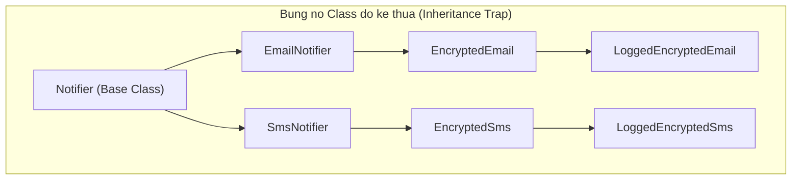
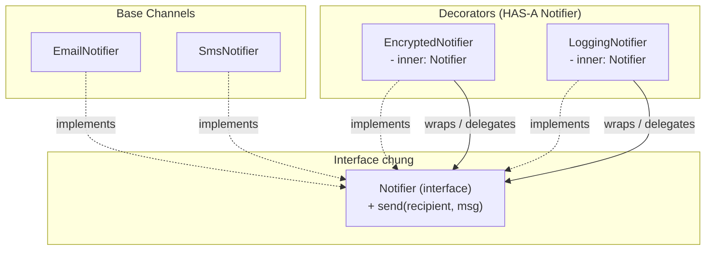

# Composition over Inheritance (Ủy thác thay vì Kế thừa)

Gang of Four, *Design Patterns* (1994):

> **"Favor object composition over class inheritance."**
>
> *(Hãy ưu tiên phối hợp đối tượng hơn là kế thừa cấu trúc lớp.)*

---

## 1. Vấn đề với Kế thừa

### 1.1 Fragile Base Class Problem

Kế thừa là **White-box reuse** — lớp con buộc phải biết chi tiết cài đặt bên trong lớp cha. Nếu lớp cha thay đổi cách các hàm `protected` gọi nội bộ nhau, lớp con bị hỏng âm thầm mà trình biên dịch không báo lỗi.

Ví dụ kinh điển từ Joshua Bloch, *Effective Java* (2018):

```typescript
// Lớp cha: Set chuẩn
class TrackedSet<T> extends Set<T> {
  private addCount = 0;

  add(value: T): this {
    this.addCount++;
    return super.add(value);
  }

  addAll(values: T[]): void {
    this.addCount += values.length;
    // NGUY HIEM: nếu super.addAll() nội bộ đã gọi this.add()
    // addCount sẽ bị đếm gấp đôi — lỗi phụ thuộc cài đặt nội bộ lớp cha
    super.addAll(values as any);
  }

  getAddCount(): number { return this.addCount; }
}
```

### 1.2 Bùng nổ số lượng class (Class Explosion)

Hệ thống thông báo cần kết hợp nhiều tính năng:



Mỗi tổ hợp tính năng (kênh × mã hóa × logging) tạo ra một class mới — số lượng class tăng theo cấp số nhân.

---

## 2. Giải pháp: Composition & Delegation

**Composition là Black-box reuse** — đối tượng chỉ giao tiếp với thành phần bên trong qua interface. Không cần biết cài đặt nội bộ.

```typescript
interface Notifier {
  send(recipient: string, message: string): void;
}

// Decorator: bổ sung tính năng bằng cách bọc ngoài
class EncryptedNotifier implements Notifier {
  constructor(private inner: Notifier) {}
  send(recipient: string, message: string): void {
    const encrypted = encrypt(message); // bổ sung logic
    this.inner.send(recipient, encrypted); // ủy thác
  }
}

class LoggingNotifier implements Notifier {
  constructor(private inner: Notifier) {}
  send(recipient: string, message: string): void {
    log(`Sending to ${recipient}`);
    this.inner.send(recipient, message);
  }
}
```

Kết hợp tự do tại runtime — không cần tạo thêm class:

```typescript
const emailNotifier = new EmailNotifier();

// Email + mã hóa + logging — lắp ghép tùy ý
const secure = new LoggingNotifier(new EncryptedNotifier(emailNotifier));
```



---

## 3. So sánh

| Tiêu chí | Kế thừa | Composition |
|:---|:---|:---|
| **Quan hệ** | Is-A | Has-A |
| **Tái sử dụng** | White-box (biết nội bộ) | Black-box (qua interface) |
| **Thời điểm ràng buộc** | Compile-time (tĩnh) | Runtime (linh hoạt) |
| **Mức Coupling** | Tight (lớp con – lớp cha) | Loose (qua interface) |

---

## 4. Khi nào dùng Kế thừa?

Kế thừa vẫn hợp lý khi:

1. **Quan hệ Is-A bền vững và tuân thủ LSP:** `Sparrow` là `Bird`, và mọi nơi dùng `Bird` đều có thể thay bằng `Sparrow` mà không sai hành vi.
2. **Framework Template Method:** Framework định nghĩa vòng đời, bạn chỉ override hook — như `React.Component`, `Android Activity`, `Spring BaseController`.

> [!NOTE]
> "Favor" có nghĩa là **ưu tiên**, không phải **cấm**. Kế thừa là công cụ đúng khi quan hệ thực sự là Is-A và đáp ứng Liskov Substitution Principle.
