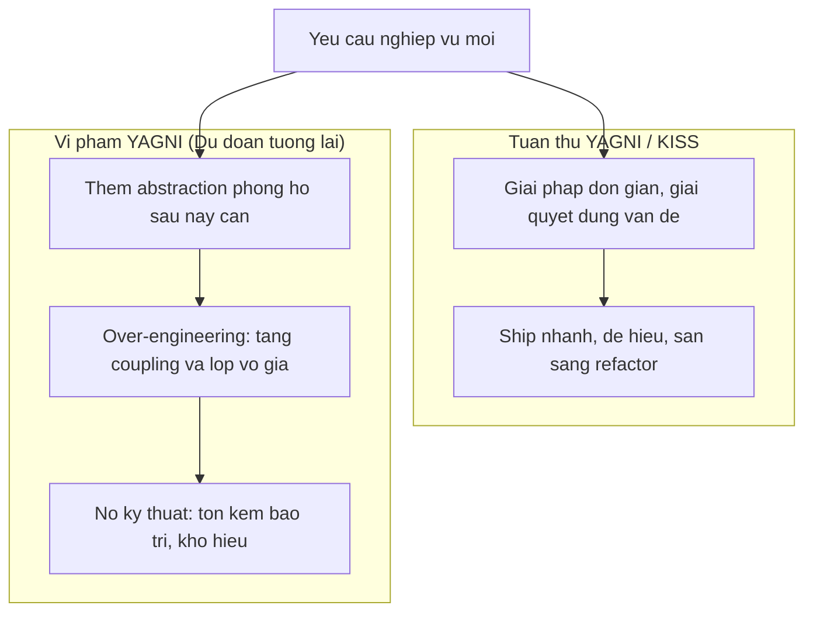

# DRY, KISS & YAGNI trong OOP

Ba nguyên lý này không phải của GoF hay SOLID, nhưng là bộ kiểm soát thực hành quan trọng, đặc biệt để tránh hai cực đoan: **under-engineering** (thiếu abstraction) và **over-engineering** (quá nhiều abstraction không cần thiết).

---

## 1. DRY — Don't Repeat Yourself

Andy Hunt & Dave Thomas, *The Pragmatic Programmer* (1999):

> **"Every piece of knowledge must have a single, unambiguous, authoritative representation within a system."**

**DRY không phải là cấm copy code.** DRY là cấm **copy knowledge** — nếu một quy tắc nghiệp vụ tồn tại ở nhiều nơi, khi quy tắc đó thay đổi, bạn phải nhớ sửa tất cả các nơi — và rất dễ bỏ sót.

### Ví dụ vi phạm DRY

```typescript
// Quy tắc: đơn hàng trên 500.000đ được miễn phí vận chuyển
// Tồn tại ở 3 nơi khác nhau

// Trong OrderService
if (order.total > 500000) applyFreeShipping(order);

// Trong CartSummaryComponent
if (cartTotal > 500000) showFreeShippingBadge();

// Trong ShippingController
if (request.total > 500000) waiveShippingFee(response);
```

Khi ngưỡng thay đổi từ 500.000đ sang 300.000đ: phải tìm và sửa 3 nơi — nếu bỏ sót 1 nơi, hệ thống không nhất quán.

### Giải pháp

```typescript
// Single source of truth cho quy tắc nghiệp vụ
class ShippingPolicy {
  static readonly FREE_SHIPPING_THRESHOLD = 500_000;

  static qualifiesForFreeShipping(total: number): boolean {
    return total >= this.FREE_SHIPPING_THRESHOLD;
  }
}

// Mọi nơi đều tham chiếu ShippingPolicy.qualifiesForFreeShipping()
```

---

## 2. KISS — Keep It Simple, Stupid

Nguyên lý được Kelly Johnson (Lockheed) đúc kết từ thiết kế máy bay chiến đấu: **hệ thống hoạt động tốt nhất khi đơn giản nhất có thể**.

Trong phần mềm, KISS nghĩa là: **chọn giải pháp đơn giản nhất đáp ứng đúng yêu cầu hiện tại**.

```typescript
// Over-engineered: tạo Pipeline, Strategy, Registry chỉ để validate email
class ValidationPipelineFactory {
  createEmailPipeline(): ValidationPipeline {
    return new ValidationPipeline([
      new RegexValidator(EMAIL_REGEX),
      new DomainBlacklistValidator(),
      new MxRecordValidator(),
    ]);
  }
}

// KISS: regex là đủ cho 99% trường hợp thực tế
function isValidEmail(email: string): boolean {
  return /^[^\s@]+@[^\s@]+\.[^\s@]+$/.test(email);
}
```

---

## 3. YAGNI — You Aren't Gonna Need It

Nguyên lý từ Extreme Programming (Kent Beck):

> **"Always implement things when you actually need them, never when you just foresee that you need them."**

YAGNI không có nghĩa là viết code tệ. Nó có nghĩa là **không thêm flexibility, abstraction, hay tính năng vì "biết đâu sau này cần"**.



---

## 4. Cân bằng giữa ba nguyên lý

Ba nguyên lý đôi khi mâu thuẫn nhau:

| Tình huống | Nguyên lý ưu tiên |
|:---|:---|
| Quy tắc nghiệp vụ xuất hiện > 2 lần | DRY: trích xuất thành Single Source of Truth |
| Thêm abstraction chưa có use case thực tế | YAGNI: giữ giải pháp đơn giản |
| Code hoạt động nhưng quá phức tạp | KISS: refactor về giải pháp đơn giản hơn |

> [!TIP]
> **Rule of Three (Martin Fowler):** Lần đầu viết — just do it. Lần thứ hai thấy tương tự — chú ý. Lần thứ ba — refactor. Đây là thời điểm DRY thực sự có giá trị, không phải từ lần đầu tiên.
