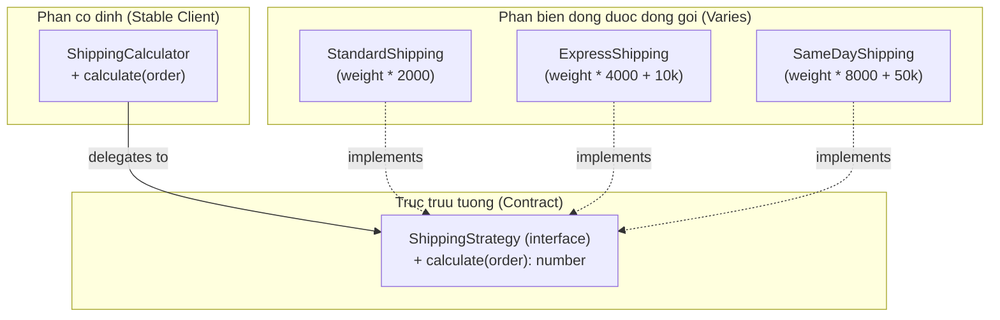

# Encapsulate What Varies (Đóng gói biến động)

Gang of Four (GoF) mở đầu cuốn *Design Patterns* (1994) bằng nguyên lý:

> **"Identify the aspects of your application that vary and separate them from what stays the same."**
>
> *(Xác định những phần hay thay đổi trong ứng dụng và tách chúng ra khỏi những phần ổn định.)*

Đây là nguyên lý nền tảng dẫn tới Strategy Pattern, Template Method Pattern, và là lý do tồn tại của OCP trong SOLID.

---

## 1. Vấn đề: Trục thay đổi không được đóng gói

```typescript
// Hệ thống tính phí vận chuyển ban đầu
class ShippingCalculator {
  calculate(order: Order): number {
    if (order.shippingType === 'STANDARD') {
      return order.weight * 2000;
    } else if (order.shippingType === 'EXPRESS') {
      return order.weight * 4000 + 10000;
    }
    // Yêu cầu mới: thêm SAME_DAY, INTERNATIONAL...
    // Mỗi lần thêm loại mới, class này lại bị MỞ RA SỬA
    throw new Error('Unknown shipping type');
  }
}
```

**Trục biến động** ở đây là *thuật toán tính phí vận chuyển* — nó thay đổi thường xuyên theo yêu cầu kinh doanh. Nếu không cô lập, mỗi lần thêm loại vận chuyển mới đều phải sửa class đang chạy ổn định.

---

## 2. Giải pháp: Đóng gói sau Interface

**Bước 1:** Xác định trục biến động — thuật toán tính phí.

**Bước 2:** Định nghĩa interface ổn định cho nó.

**Bước 3:** Tạo class cụ thể cho từng biến thể.

```typescript
// Interface ổn định — không bao giờ thay đổi
interface ShippingStrategy {
  calculate(order: Order): number;
}

// Các biến thể cụ thể — thêm mới không cần sửa class cũ
class StandardShipping implements ShippingStrategy {
  calculate(order: Order): number {
    return order.weight * 2000;
  }
}

class ExpressShipping implements ShippingStrategy {
  calculate(order: Order): number {
    return order.weight * 4000 + 10000;
  }
}

class SameDayShipping implements ShippingStrategy {
  calculate(order: Order): number {
    return order.weight * 8000 + 50000;
  }
}

// Context sử dụng — đóng với sửa đổi
class ShippingCalculator {
  constructor(private strategy: ShippingStrategy) {}

  calculate(order: Order): number {
    return this.strategy.calculate(order);
  }
}
```



---

## 3. Cách nhận diện trục biến động

Đặt câu hỏi: **"Điều gì trong đoạn code này có khả năng thay đổi khi yêu cầu kinh doanh thay đổi?"**

Các dấu hiệu phổ biến:
- Khối `if-else` hoặc `switch-case` kiểm tra loại/type.
- Comment kiểu `// TODO: thêm loại mới ở đây`.
- Hàm có tên chứa `type`, `kind`, `mode` làm tham số.

---

## 4. Giới hạn của nguyên lý

> [!WARNING]
> Không phải mọi thứ đều cần đóng gói. Nếu một đoạn logic chưa từng thay đổi và không có lý do để tin nó sẽ thay đổi, việc cố tình tạo abstraction sớm là **over-engineering** — vi phạm YAGNI.
>
> Chỉ đóng gói khi bạn **đã thấy hoặc có lý do cụ thể để tin** rằng đây là điểm biến động.
