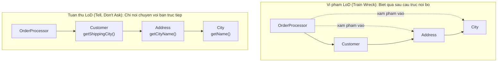

# Law of Demeter (Nguyên lý tối thiểu hoá tri thức)

Law of Demeter được phát biểu tại Northeastern University năm 1987 trong dự án Demeter. Nguyên tắc đơn giản:

> **"Only talk to your immediate friends."**
>
> *(Chỉ giao tiếp với bạn thân trực tiếp của bạn.)*

Phiên bản kỹ thuật: Một phương thức `m` của object `O` chỉ được gọi phương thức của:
1. `O` chính nó.
2. Các đối tượng được truyền vào làm tham số của `m`.
3. Các đối tượng được tạo hoặc khởi tạo bên trong `m`.
4. Các thuộc tính trực tiếp của `O`.

---

## 1. Vấn đề: Train Wreck Code

```typescript
// Vi phạm LoD: truy cập chuỗi dài (Train Wreck)
class OrderProcessor {
  processOrder(customer: Customer): void {
    // Lấy thành phố từ chuỗi 3 cấp phụ thuộc
    const city = customer.getAddress().getCity().getName();
    //            ^^^^^^^^^^^^^^^^^^^^^^^^^^^^^^^^^^^^^^^
    //            OrderProcessor phải biết: Customer có Address,
    //            Address có City, City có getName()
    //            — phụ thuộc vào 3 cấu trúc nội bộ
    applyShippingRule(city);
  }
}
```

**Hậu quả:**
- `Customer` đổi cấu trúc `Address` từ `City` sang `Location` → `OrderProcessor` vỡ.
- `City` đổi `getName()` thành `getLabel()` → vỡ tiếp.
- Một thay đổi nhỏ trong một class dẫn đến sửa nhiều class không liên quan (Shotgun Surgery).

---

## 2. Giải pháp: Tell, Don't Ask

Thay vì lấy dữ liệu ra ngoài tự xử lý, **yêu cầu đối tượng tự làm**:

```typescript
// Giải pháp 1: Thêm phương thức trên Customer (Tell, Don't Ask)
class Customer {
  getShippingCity(): string {
    return this.address.getCityName(); // Customer tự giải quyết nội bộ
  }
}

class OrderProcessor {
  processOrder(customer: Customer): void {
    const city = customer.getShippingCity(); // chỉ gọi 1 cấp
    applyShippingRule(city);
  }
}
```



---

## 3. Phân biệt: LoD vs Fluent API

> [!NOTE]
> **LoD không cấm method chaining (Fluent API).** Sự khác biệt nằm ở chỗ các phương thức được chain có trả về *cùng một đối tượng* hay *các đối tượng khác nhau*.
>
> ```typescript
> // KHÔNG vi phạm LoD: chain trả về cùng kiểu (Builder pattern)
> queryBuilder
>   .select('*')
>   .from('orders')
>   .where('status = ?', 'ACTIVE')
>   .limit(10);
>
> // VI PHẠM LoD: mỗi bước trả về đối tượng khác nhau, đi sâu vào cấu trúc
> customer.getAddress().getCity().getZipCode();
> ```

---

## 4. Khi nào LoD tạo ra friction hợp lý?

Áp dụng LoD nghiêm ngặt có thể tạo ra nhiều wrapper method nhỏ. Đây là trade-off có chủ ý: bạn hy sinh một chút convenience để đổi lấy khả năng thay đổi nội bộ mà không phá vỡ bên ngoài.

> [!TIP]
> Ưu tiên áp dụng LoD tại **ranh giới giữa các module** (inter-module boundaries) — nơi thay đổi ở một bên dễ phá vỡ bên kia nhất. Bên trong một module nhỏ, single-developer, LoD ít quan trọng hơn.
