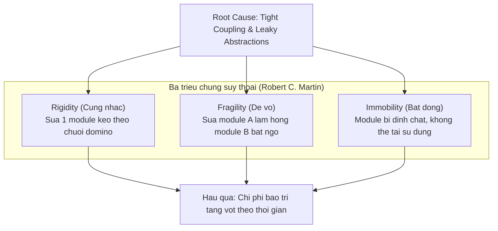
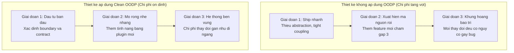

# Bản chất của OOP & Chi phí của sự thay đổi

Hầu hết lập trình viên học OOP qua 4 tính chất: **Encapsulation**, **Inheritance**, **Polymorphism**, **Abstraction**. Biết cú pháp tạo class hay viết `extends` không đồng nghĩa thiết kế tốt. Một hệ thống dùng đủ class, object, interface vẫn có thể là mớ hỗn độn không thể bảo trì.

> Bản chất của Object-Oriented Design không phải mô phỏng thế giới thực vào máy tính, mà là **quản lý sự phụ thuộc (Dependency Management)** để kiểm soát độ phức tạp và giảm chi phí thay đổi.
>
> — Robert C. Martin, *Clean Architecture* (2017)

---

## 1. Tại sao phần mềm bị suy thoái?

Yêu cầu kinh doanh luôn thay đổi. Một hệ thống ban đầu trong sáng, qua hàng chục đợt vá lỗi gấp:

- Class cũ bị nhét thêm code không liên quan.
- Hàm phình to với `if-else` chằng chịt.
- Mỗi lần deploy là một cơn ác mộng.

Robert C. Martin đúc kết thành **3 triệu chứng suy thoái (Rotting Software)**:



### 1.1 Rigidity — Tính cứng nhắc

**Biểu hiện:** Thay đổi nhỏ tưởng mất 2 giờ, thực tế phải sửa 10 class trên nhiều tầng.

**Nguyên nhân:** Tight Coupling — Class A phụ thuộc trực tiếp vào B, B phụ thuộc C, C phụ thuộc D. Khi D đổi, toàn chuỗi A→B→C bị ảnh hưởng.

### 1.2 Fragility — Tính dễ vỡ

**Biểu hiện:** Sửa logic tính phí vận chuyển, đột nhiên tính năng gửi email xác nhận bị lỗi crash.

**Nguyên nhân:** Global State mutation hoặc Hidden Side-effects không được đóng gói an toàn.

### 1.3 Immobility — Tính bất động

**Biểu hiện:** Muốn tái sử dụng class mã hóa từ Project A sang Project B, nhưng khi copy thì trình biên dịch báo thiếu hàng chục class phụ thuộc đi kèm.

**Hậu quả:** Kỹ sư chọn copy-paste code thay vì tái sử dụng, nhân bản lỗi tiềm ẩn.

---

## 2. Bản chất của Đối tượng trong OOD

Hai cách hiểu về object:

**Sai:** Object là bịch chứa dữ liệu (Data Bag) — class chỉ có getter/setter, không có hành vi nghiệp vụ. Đây là *Anemic Domain Model* — thực chất là lập trình thủ tục đội lốt class.

**Đúng:** Object là tập hợp các **Trách nhiệm (Responsibilities)** — nhận message, tự xử lý dữ liệu nội bộ, trả kết quả, giấu cách hoạt động bên trong (*Tell, Don't Ask*).

```typescript
// Sai: Service lấy dữ liệu ra ngoài tự tính
class OrderService {
  processOrder(order: Order) {
    let total = 0;
    for (const item of order.items) {
      total += item.price * item.quantity;
      if (item.category === 'ELECTRONICS' && item.price > 1000) {
        total -= item.price * 0.05; // logic giảm giá bị rò rỉ ra ngoài
      }
    }
  }
}

// Đúng: giao trách nhiệm cho object sở hữu dữ liệu
class OrderItem {
  calculateSubtotal(): number {
    return this.price * this.quantity - this.calculateDiscount();
  }
  private calculateDiscount(): number {
    return this.category === 'ELECTRONICS' && this.price > 1000
      ? this.price * 0.05 : 0;
  }
}
```

Khi quy tắc giảm giá thay đổi, chỉ `OrderItem` bị sửa — `OrderService` không cần biết.

---

## 3. Chi phí Thay đổi theo thời gian



Mục tiêu của các nguyên lý thiết kế: **giữ đường cong chi phí thay đổi phẳng nhất có thể**.

---

## 4. Lộ trình học tập

| Module | Nội dung | Bài toán giải quyết |
|:---|:---|:---|
| **01 · Foundations** | Encapsulate What Varies, Composition over Inheritance, Law of Demeter | Chống Fragility và Immobility cục bộ |
| **02 · SOLID** | SRP, OCP, LSP, ISP, DIP | Kiến trúc module bền vững, dễ mở rộng |
| **03 · GRASP** | Information Expert, Creator, Controller, Coupling/Cohesion | Phân bổ trách nhiệm đúng nơi từ đầu |
| **04 · Code Smells** | God Object, Feature Envy, Anemic Domain | Nhận diện và sửa thiết kế đã suy thoái |

> [!TIP]
> Trước khi áp dụng bất kỳ Design Pattern nào, hãy tự hỏi: Thiết kế này có dễ thay đổi không? Nếu sửa module A, có nguy cơ vỡ module B không? Đối tượng có đang tự bảo vệ dữ liệu của mình không?
