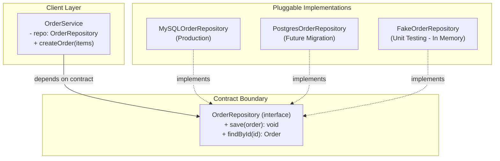

# Program to Interfaces, not Implementations

Gang of Four, *Design Patterns* (1994):

> **"Program to an interface, not an implementation."**

Đây là nguyên lý thứ hai trong phần mở đầu của GoF, song song với *Composition over Inheritance*. Cùng nhau, chúng tạo ra nền móng để toàn bộ 23 Design Pattern của GoF hoạt động.

---

## 1. Interface là gì trong ngữ cảnh này?

Trong GoF, "interface" không chỉ là từ khóa `interface` của Java/TypeScript. Nó là **tập hợp các phương thức mà một đối tượng công bố ra ngoài** — có thể là `interface`, `abstract class`, hoặc bất kỳ contract nào.

Nguyên lý này yêu cầu: **Code của bạn phụ thuộc vào contract (interface), không phụ thuộc vào ai thực thi contract đó.**

---

## 2. Vấn đề khi phụ thuộc vào Implementation

```typescript
// Phụ thuộc cứng vào class cụ thể
class OrderService {
  private repo = new MySQLOrderRepository(); // gắn chặt vào MySQL

  createOrder(items: OrderItem[]): void {
    const order = new Order(items);
    this.repo.save(order); // không thể test mà không có MySQL
  }
}
```

**Hậu quả:**
- Không thể Unit Test vì mọi test đều cần kết nối database thật.
- Muốn đổi MySQL sang PostgreSQL: phải sửa `OrderService`.
- Muốn chạy thử với dữ liệu giả: không có cách nào.

---

## 3. Giải pháp: Phụ thuộc vào Interface

```typescript
// Hợp đồng: tôi cần "một thứ lưu Order" — không quan tâm là gì
interface OrderRepository {
  save(order: Order): void;
  findById(id: string): Order | null;
}

class OrderService {
  constructor(private repo: OrderRepository) {} // nhận contract, không gắn cụ thể

  createOrder(items: OrderItem[]): void {
    const order = new Order(items);
    this.repo.save(order);
  }
}

// Production
const service = new OrderService(new MySQLOrderRepository());

// Test — thay bằng fake không cần DB
class FakeOrderRepository implements OrderRepository {
  private orders: Order[] = [];
  save(order: Order): void { this.orders.push(order); }
  findById(id: string): Order | null {
    return this.orders.find(o => o.id === id) ?? null;
  }
}
const testService = new OrderService(new FakeOrderRepository());
```



---

## 4. Bẫy: 1 Interface – 1 Class

> [!WARNING]
> **Đừng tạo interface cho mọi class vì "có vẻ đúng".**
>
> Nếu `UserService` chỉ có một cài đặt duy nhất và không bao giờ cần swap, tạo `IUserService` chỉ để tạo là **over-engineering** — thêm indirection vô ích, làm code khó đọc hơn.
>
> Interface có giá trị khi **có hơn một implementation** hoặc khi cần **kiểm soát điểm phụ thuộc** (testability, extensibility).

---

## 5. Kết nối với SOLID

Nguyên lý này là nền tảng trực tiếp của:
- **OCP (Open/Closed):** Class "đóng với sửa đổi" vì phụ thuộc vào abstraction, không vào detail.
- **DIP (Dependency Inversion):** Module cấp cao phụ thuộc vào abstraction, module cấp thấp implement abstraction đó.
- **ISP (Interface Segregation):** Chia nhỏ interface để client chỉ phụ thuộc đúng những gì nó dùng.
