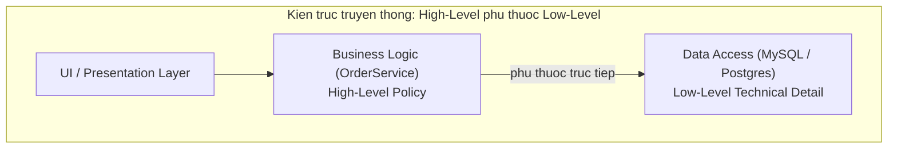
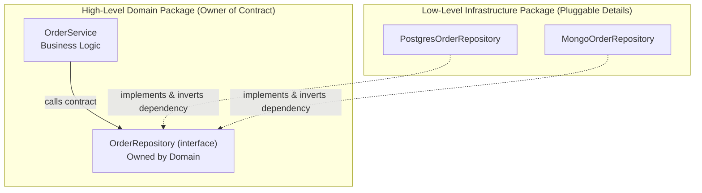
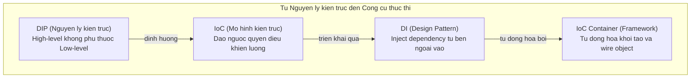

# Dependency Inversion Principle (DIP)

Robert C. Martin, *Clean Architecture* (2017) — hai mệnh đề:

> **1. High-level modules should not depend on low-level modules. Both should depend on abstractions.**
>
> **2. Abstractions should not depend on details. Details should depend on abstractions.**

DIP định hình **toàn bộ ranh giới kiến trúc** — là nền tảng của Clean Architecture, Hexagonal Architecture và Onion Architecture.

---

## 1. Vấn đề: Kiến trúc truyền thống



Chiều mũi tên: Business Logic (giá trị cốt lõi của doanh nghiệp) phụ thuộc trực tiếp vào MySQL (chi tiết kỹ thuật).

**Hậu quả:**
- Muốn đổi MySQL sang PostgreSQL: Business Logic bị ảnh hưởng.
- Muốn Unit Test Business Logic: phải có database thật.
- Domain logic trở thành **con tin** của công nghệ hạ tầng.

| Tiêu chí | Kiến trúc truyền thống | Kiến trúc DIP |
|:---|:---|:---|
| **Chiều phụ thuộc** | Business → Database | Database → Interface ← Business |
| **Đổi Database** | Business Logic bị sửa | Business Logic không bị ảnh hưởng |
| **Unit Testing** | Cần DB thật | Thay DB bằng in-memory mock |
| **Tốc độ phát triển** | Phụ thuộc thư viện bên ngoài | Domain độc lập với hạ tầng |

---

## 2. Giải pháp: Đảo ngược chiều phụ thuộc

**Bước chủ chốt:** Đặt Interface tại tầng Business — tầng Business *sở hữu* interface này. Tầng Data muốn phục vụ Business phải *implement* interface đó.



Chiều mũi tên đã đảo 180°: Database layer phụ thuộc vào Business layer, không phải ngược lại.

---

## 3. Triển khai thực tế

```typescript
// ── BUSINESS LAYER (High-Level) ──────────────────────────────
// Interface do Business sở hữu — đặt tại package business/
export interface OrderRepository {
  save(order: Order): Promise<void>;
  findById(id: string): Promise<Order | null>;
}

// UseCase không import bất kỳ thư viện DB nào
export class CreateOrderUseCase {
  constructor(private readonly repo: OrderRepository) {}

  async execute(customerId: string, items: OrderItem[]): Promise<Order> {
    const order = Order.create(customerId, items);
    await this.repo.save(order);
    return order;
  }
}

// ── INFRASTRUCTURE LAYER (Low-Level) ──────────────────────────
// Detail implement abstraction — đặt tại package infrastructure/
import { Pool } from 'pg'; // chi tiết kỹ thuật chỉ xuất hiện ở đây

export class PostgresOrderRepository implements OrderRepository {
  constructor(private db: Pool) {}

  async save(order: Order): Promise<void> {
    await this.db.query(
      'INSERT INTO orders(id, customer_id, total) VALUES($1, $2, $3)',
      [order.id, order.customerId, order.total]
    );
  }

  async findById(id: string): Promise<Order | null> {
    const result = await this.db.query('SELECT * FROM orders WHERE id = $1', [id]);
    return result.rows[0] ? Order.fromRow(result.rows[0]) : null;
  }
}
```

---

## 4. Phân biệt DIP, IoC, DI và IoC Container

Bốn thuật ngữ hay bị dùng lẫn lộn, nhưng ở các cấp độ khác nhau:



1. **DIP (Nguyên lý):** Module cấp cao không phụ thuộc module cấp thấp — định hướng kiến trúc.
2. **IoC (Mô hình):** *"Don't call us, we'll call you"* — quyền điều khiển luồng thực thi được đảo ngược (Framework gọi code của bạn, không phải ngược lại).
3. **DI (Pattern):** Kỹ thuật implement IoC — inject dependency từ bên ngoài vào qua Constructor, Setter, hoặc Method, thay vì class tự `new` bên trong.
4. **IoC Container (Công cụ):** Spring IoC, NestJS, Dagger, Inversify — tự động scan, khởi tạo và inject dependency.

---

## 5. Tổng kết bộ ngũ SOLID

- **S** — Phân rã class theo Actor, giữ High Cohesion.
- **O** — Mở rộng bằng code mới, đóng với sửa đổi code cũ.
- **L** — Lớp con bảo toàn hành vi cam kết của lớp cha.
- **I** — Interface sắc bén, chuyên biệt theo vai trò.
- **D** — Domain Logic độc lập với công nghệ hạ tầng.
