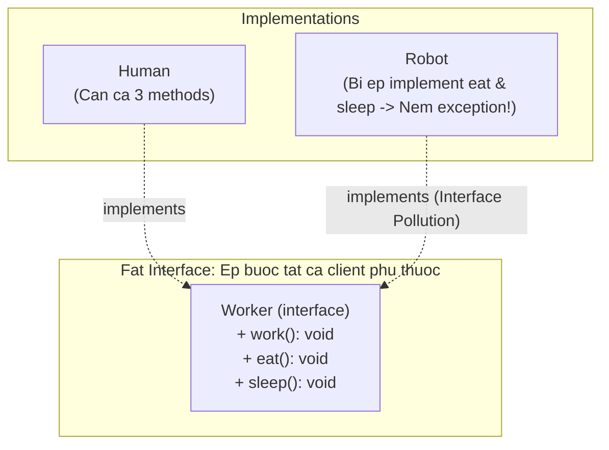
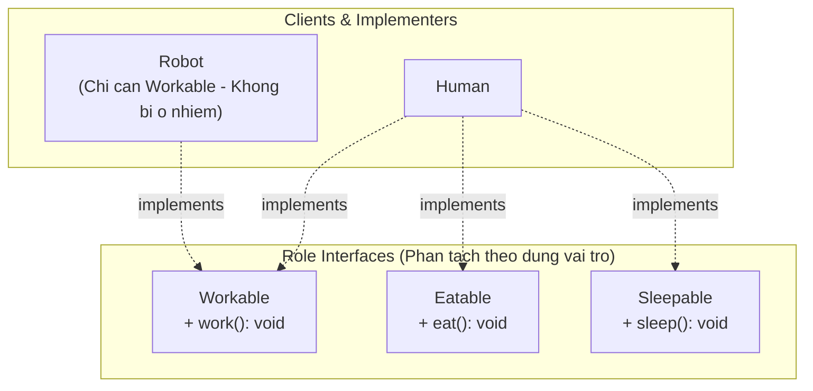

# Interface Segregation Principle (ISP)

Robert C. Martin:

> **"Clients should not be forced to depend upon interfaces that they do not use."**

ISP có thể được xem là **SRP áp dụng cho Interface**: interface phải được chia nhỏ theo vai trò (Role Interface), không phải một Fat Interface chứa mọi thứ.

---

## 1. Vấn đề: Fat Interface

```typescript
// Fat Interface: mọi client phải implement tất cả method
interface Worker {
  work(): void;
  eat(): void;
  sleep(): void;
}

// Robot không cần eat() và sleep() nhưng bị buộc implement
class Robot implements Worker {
  work(): void { console.log('Working...'); }
  eat(): void { throw new Error('Robots do not eat!'); }  // vi phạm LSP!
  sleep(): void { throw new Error('Robots do not sleep!'); }
}
```

**Hậu quả:** Khi thêm method mới vào `Worker` (ví dụ `takeBreak()`), `Robot` lại bị buộc implement một method vô nghĩa với nó.



---

## 2. Giải pháp: Role Interfaces

Chia nhỏ theo vai trò, mỗi client chỉ phụ thuộc đúng những gì nó dùng:

```typescript
interface Workable {
  work(): void;
}

interface Eatable {
  eat(): void;
}

interface Sleepable {
  sleep(): void;
}

// Human implement tất cả vai trò phù hợp
class Human implements Workable, Eatable, Sleepable {
  work(): void { console.log('Working...'); }
  eat(): void { console.log('Eating...'); }
  sleep(): void { console.log('Sleeping...'); }
}

// Robot chỉ implement vai trò phù hợp với nó
class Robot implements Workable {
  work(): void { console.log('Processing...'); }
}
```



---

## 3. ISP trong thực tế: Repository Pattern

```typescript
// Fat repository interface
interface EmployeeRepository {
  findById(id: string): Employee;
  findAll(): Employee[];
  save(emp: Employee): void;
  delete(id: string): void;
  findByDepartment(dept: string): Employee[];
  generatePayReport(): Report;  // không liên quan đến repository!
}

// Segregated — mỗi client chỉ phụ thuộc đúng những gì nó dùng
interface EmployeeReader {
  findById(id: string): Employee;
  findAll(): Employee[];
}

interface EmployeeWriter {
  save(emp: Employee): void;
  delete(id: string): void;
}

// ReadOnlyService chỉ cần EmployeeReader — không bị phụ thuộc vào save/delete
class EmployeeReportService {
  constructor(private reader: EmployeeReader) {}
  generateReport(): Report { /* chỉ đọc */ }
}
```

---

## 4. Phân biệt ISP và SRP

| | SRP | ISP |
|:---|:---|:---|
| **Áp dụng cho** | Class/Module | Interface |
| **Câu hỏi** | Class này phục vụ mấy Actor? | Interface này có method nào client không dùng không? |
| **Kết quả** | Tách class theo Actor | Chia interface theo Role |

> [!TIP]
> ISP thường vi phạm cùng lúc với LSP: client bị buộc implement method không phù hợp → throw `UnsupportedOperationException`. Nếu thấy điều này, đó là dấu hiệu cần áp dụng ISP để tách interface.
